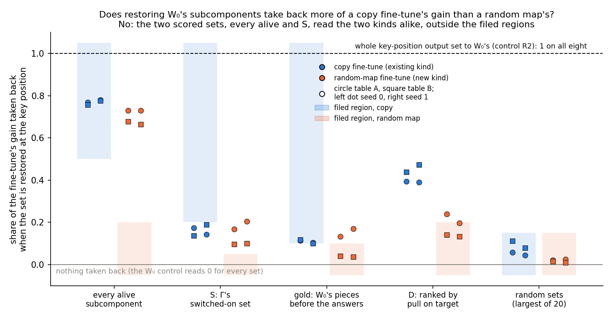

# Does the fine-tuned model itself tell a copy fine-tune from a random-map fine-tune? E50 restore on known-kind anchors

*E50, `experiments/restore_anchors/run.py`, written 2026-10-29. Plan: `reports/plans/2026-10-29_plan_restore-anchors.md`,
option A and section "Filed (E50)", approved by the user. Filed rules: `experiments/restore_anchors/results/predictions.json`,
filed before the run, not edited since. Result: `experiments/restore_anchors/results/restore_anchors.json`. Figure:
`experiments/restore_anchors/figures/shares.png` from `plot.py`. Notebook: `notebooks/E50_restore_anchors.ipynb`.*

**A filed prediction reversed.** The plan expected copies and random maps to land far apart on the restore share read
in the fine-tuned model. They landed together. The rule's largest gap between the kinds was 0.05, against a bar of 0.3.
Restoring every alive subcomponent took back about three quarters of the gain on both kinds. For the random maps the
filed ceiling was a fifth. That part has a candidate explanation below, untested. The alike reading of Γ's switched-on
set has none beyond the method's known limit.

## In plain words

We put the original model's subcomponents back inside fine-tuned models whose kind we know, copies of an existing
behaviour and random maps that are new. Both kinds gave back the same shares of their gain, so no number read in the
fine-tuned model told existing from new on these toys. Whether VPD tells elicitation from new mechanism stays open,
now resting on the importance network alone, and the all-subcomponents number may never have been able to answer it.

## What was tested

**The states.** The 67M model and its frozen VPD decomposition. E12's four key-to-value tables, each 32 keys after a
marker word, rebuilt by E46's stage 0a and checked by their recorded hashes:

| table | the fine-tune teaches | kind, by construction |
|---|---|---|
| copy A, copy B | repeat the key | existing behaviour |
| random map A, random map B | give a fixed common word for each key | new behaviour |

Each table was fine-tuned with two seeds, eight fine-tunes in all. Each is placed by do-nothing: the update δW sits in
Δ and the subcomponents and Γ are untouched. Every reading is the full fine-tuned model, $W_0 + \delta W$, with no
masks, on 97 held-out windows of the table, at the key position where the answer is predicted.

**The gain.** $T$ is the mean log-odds of the table's answer at the key position. The gain is $G = T_1 - T_0$, the
fine-tuned model's $T_1$ minus the original model's $T_0$. It was 13 to 21 nats on every fine-tune.

**Restoring a set.** At the key position only, each decomposed matrix's output gains
$\sum_{c \in X} ((x_0 - x) \cdot v_c)\, u_c$. Here $x$ is the matrix's input in this pass and $x_0$ its input in the
original model's pass on the same window. So each subcomponent in the set $X$ reads the input it would have read in the
original model. The restore share is $\rho(X) = (T_1 - T_X) / G$: 0 means the set carries none of the gain, 1 means
all of it.

**The sets.**
- *Every alive subcomponent*, 9,881 of them.
- *S*, Γ's switched-on set: alive subcomponents whose mean importance at the key position rises by more than 0.3 after
  the fine-tune. It had 108 to 118 members on the copies and 24 to 49 on the random maps.
- *Gold*: S's count of the subcomponents most on just before the table's answer words in the original model's Pile
  text. It is the original model's own machinery for those words, chosen knowing the answers.
- *D*: S's count, per matrix, of the subcomponents outside S whose first-order pull on the answer is largest. It needs
  the answer but not Γ.
- *Random*: 20 sets of S's size per matrix, from the alive subcomponents outside S. They are the null.

**The controls, run first.** The original model's $T_0$ and the fine-tune's $T_1$ had to reproduce E46's. The empty set
restored had to change nothing. Every set restored inside the original model had to change nothing, since there
$x = x_0$. The whole-output control set every matrix's whole key-position output to the original model's, which must
give back $T_0$ exactly, a restore share of 1. The code review before the run noted that these three restore controls
cannot fail for a wrong restore formula. They catch misaligned batches and stale cached inputs; the formula rests on
E38's earlier check of the same hooks.

## What we expected, and why

The copies repeat a token, which the original model already does. So the plan expected the original subcomponents to
carry most of their gain: at least a half for every alive subcomponent, at least a fifth for S. The random maps link
words to keys that the original model never links. So the plan expected their gain to live in the update's own write,
in Δ: at most a fifth for every alive subcomponent, nearly nothing for S. The scored rule asked for a gap of 0.3
between the worst copy and the worst random map, on both seeds. It was read on every alive subcomponent and on S. The
lean was that every alive subcomponent would separate the kinds.

## The controls

Every control passed on all eight fine-tunes, and each read exactly 0 in the stored float. The original model's $T_0$
and each $T_1$ reproduced E46's to the last digit. The whole-output control gave back $T_0$ exactly on all eight. The job
ran in 78 seconds on an L40.

## Does restoring the original model's subcomponents take back more of a copy's gain than a random map's?

**Reading it.** No. Every alive subcomponent took back 0.76 to 0.78 of the gain on the copies and 0.66 to 0.73 on the
random maps. The worst-pair gap was 0.03 on seed 0 and 0.05 on seed 1, against a bar of 0.3. S took back 0.14 to 0.19
on the copies and 0.10 to 0.20 on the random maps, and its worst-pair gap was below zero on both seeds. Both readings
miss the filed regions: S on the copies sits under its bar of 0.2, and both sets on the random maps sit far above theirs.
The random sets took back at most 0.11 and on average under 0.04, so S's share is not a property of any set its size.

| fine-tune | gain, nats | every alive | S | gold | D | random mean / max | count of S | stand-in ratio |
|---|---|---|---|---|---|---|---|---|
| copy A, seed 0 | 13.99 | 0.768 | 0.174 | 0.114 | 0.394 | 0.025 / 0.058 | 118 | 0.93 |
| copy A, seed 1 | 14.07 | 0.781 | 0.144 | 0.105 | 0.389 | 0.024 / 0.044 | 108 | 0.87 |
| copy B, seed 0 | 14.60 | 0.757 | 0.138 | 0.118 | 0.439 | 0.037 / 0.112 | 114 | 0.93 |
| copy B, seed 1 | 14.26 | 0.777 | 0.190 | 0.101 | 0.474 | 0.038 / 0.080 | 117 | 0.97 |
| random map A, seed 0 | 13.73 | 0.729 | 0.169 | 0.133 | 0.240 | 0.013 / 0.022 | 38 | 0.36 |
| random map A, seed 1 | 13.16 | 0.730 | 0.204 | 0.171 | 0.196 | 0.014 / 0.025 | 49 | 0.36 |
| random map B, seed 0 | 20.74 | 0.677 | 0.097 | 0.041 | 0.141 | 0.006 / 0.015 | 32 | 0.41 |
| random map B, seed 1 | 20.64 | 0.664 | 0.101 | 0.037 | 0.133 | 0.003 / 0.010 | 24 | 0.39 |

The stand-in ratio is E46's number, read in Γ's stand-in model and copied here, not remeasured. The random sets' standard
deviation over the 20 draws was at most 0.027.

Two patterns the rules did not ask about. First, S took back between 2.0 and 2.7 nats on every one of the eight
fine-tunes. That holds although S had four times as many members on the copies as on random map B, and the gains
differ by half. Second, the set D took back more than S on seven of eight, as in E38. D also kept the kinds further
apart than S: 0.39 to 0.47 on the copies against 0.13 to 0.24 on the random maps. The worst-pair gap on D was 0.15 and
0.19, under the 0.3 bar; D was filed as reported only.

## What could the number see? The power of every alive subcomponent

**The algebra.** Each matrix is $W_0 = U V^\top + \Delta_0$, with $U$ and $V$ the alive subcomponents' write and read
vectors and $\Delta_0$ the rest. Under do-nothing the fine-tuned matrix is $W_0 + \delta W$. With every alive
subcomponent restored, the matrix's key-position output is

$$W_0 x + \delta W x + U V^\top (x_0 - x) = W_0 x_0 + \Delta_0 (x - x_0) + \delta W x.$$

The whole-output control gives $W_0 x_0$. So restoring every alive subcomponent is the whole-output control with Δ's
output left on: the update's own write on this pass's input, plus $\Delta_0$'s part on the changed input. Everything the
original weights do with the update's writes is undone by both. That covers the later matrices reading an earlier
layer's write at the key position, and the attention output carrying changes from other positions.

**What it means for power.** This part is exact algebra. Suppose $\Delta_0$'s term is small. Then every alive
subcomponent's share is one minus the share of the gain that the update's own write delivers without any original
matrix reading it. That number depends on which subcomponents VPD found only through $\Delta_0$. Any fine-tune whose
early writes the later original weights turn into the answer reads high, whatever its kind. The filed ceiling for the
random maps took "the update's own write" to mean everything the update causes. The number counts only the write's
direct path. The plan named this
blind spot, a new behaviour reaching the answer through the original weights by cascade, but did not size it. Here the
cascade is most of the gain on both kinds.

**What is untested.** The size of $\Delta_0$'s term was not measured in E50. E48 found that removing $\Delta_0$ changed the
original model's masked readings by under 0.004 nats, which suggests it is small, but that was a different reading. So
"every alive subcomponent had almost no power to separate the kinds" is a candidate explanation, not a finding.

**A check that would settle it, at no cost.** Recommended, not run: a write-only restore. At the key position, set each
decomposed matrix's output to $W_0 x_0 + \delta W x$, the whole-output control plus the update's own write. It uses no
subcomponent. Filed expectation: its share is within 0.02 of every alive subcomponent's, on all eight fine-tunes. That
tolerance is the largest seed-to-seed difference every alive subcomponent showed here. One restore's rounding is far
smaller, about 0.0015 of the gain. If the check holds, the every-alive share does not depend on the decomposition. It
is then reported as "the share of the gain the original weights relay at the key position", never as an elicitation
reading. If it misses on any fine-tune, $\Delta_0$ carries part of the relay, and the number is read again with that in
view. The code is about 15 lines in `recruitment.restore_hooks`; the job is two minutes on the cluster's debug QoS.

**Is S's result a power problem?** Less clearly. S depends on Γ, its random nulls stay low, and it beat them on all
eight fine-tunes, so it can see something. What it saw is that both kinds lean on the original model's subcomponents by
about the same amount. A candidate reading, untested: the random maps' answers are common words, and the fine-tune
reuses the original model's output machinery for those words. The gold set fits this: on random map A it took back 0.13
and 0.17, as much as on the copies. That is what the method's standing limit predicts for a new key-to-word association
built from existing output pieces.

## What we learned

No real-model restore share told an existing behaviour from a new one on E12's toys. Under the plan's filed branch,
"does not separate", the line's real-model claim is off on the 67M, and stage 1 on Qwen would rest on the stand-in
ratio alone. The every-alive share is probably the wrong instrument for the question, since by algebra it reads how
much of any update the original weights relay. S is a real reading, and it reads the two kinds alike. The stand-in
ratio still separates the same fine-tunes, 0.87 to 0.97 against 0.36 to 0.41. So the separation lives in Γ's stand-in,
not in any restore read in the fine-tuned model.

**Against `GOALS.md`'s question, under the plan's three answers.**
- *Yes, VPD can tell them apart in the real model*: not reached. No real-model number separated the known-kind anchors.
- *No, the anchors read alike in the real model*: this is what the filed rule returns, and S fits it directly. Then
  "a change in which subcomponents Γ switches on" describes Γ, and the line's write-up says that.
- *Undecidable with VPD*: also fits. S's alikeness is what VPD's rank-one unit predicts when a new association is built
  from existing output pieces. Every alive subcomponent may say nothing about VPD at all. E50 cannot tell "No" from
  "Undecidable": both predict S alike on these toys.

**The method's standing limit** (`decisions.md`, "Limit of the elicitation reading"). A new mechanism built from
subcomponents the original model already has, put together under new gating, reads as "elicited" to VPD, because its
unit is the rank-one subcomponent, not the circuit. So "elicits" from VPD means "uses pieces the original model already
has", never "uses a circuit it already runs". The only check that narrows this is a Γ from a second decomposition seed.
Nothing in E50 narrows it.

## How compelling is the evidence

Two seeds and four tables, all one key-to-word task family on the 67M model, scored at one position. The two seeds
agreed within 0.02 on every alive subcomponent and within 0.06 on S, against a separation bar of 0.3. The restore's
rounding is about 0.0015 of the gain. The class gaps sit close to zero, not near the bar, so the "does not separate"
reading is not a threshold case. What it is blind to: every alive subcomponent cannot see anything the original weights
relay, by the algebra above; S misses subcomponents Γ moves by 0.3 or less; both read the key position only. The copy
class is the positive control for "existing", and it read as planned on every alive subcomponent but under its bar on S.

## Surprises

1. **The random maps read like the copies on every alive subcomponent, 0.66 to 0.73 against a filed ceiling of 0.2.**
   This reverses the filed lean. Candidate explanation above, untested.
2. **S on the copies took back under a fifth**, missing its filed floor of 0.2 on all four; E38's triggers had read about
   a fifth.
3. **S took back the same 2.0 to 2.7 nats on every fine-tune**, whatever its size or the gain. Not explained.
4. The stand-in ratios, copied from E46, sat just outside their filed ranges on two fine-tunes, 0.356 and 0.414. Narrow;
   one line.

## What next

1. The write-only restore check above, $0, two minutes. If it matches every alive subcomponent within 0.02, the
   every-alive share is retired as an elicitation number; if not, it is read again with Δ₀ in view.
2. The re-gating line's direction after E46 Amendment 3 and E50: the decision card below.
3. A Γ from a second decomposition seed is the only check that narrows the method's limit; whether one exists in
   `artifacts/vpd` is unknown.

## Pending decision (card text)

**What should the re-gating line do next, now that no real-model number tells known-existing from known-new fine-tunes?**

*Evidence.* On E12's toys, the stand-in ratio separates copies from random maps: about 0.9 against about 0.4. It is read
in Γ's stand-in model, not the fine-tuned model. E46 Amendment 3 found it is nearly the gate gain over the split's gain.
The update's own subcomponents under Γ add only a few hundredths. A hand-made write with no learned machinery reads near
the new kind, 0.40 and 0.57. E50 then read the same toys inside the fine-tuned model. Restoring every alive subcomponent
took back three quarters of the gain on both kinds. A candidate reason is that it undoes whatever the original weights
relay, for any update. Γ's switched-on set took back a tenth to a fifth on both kinds: more than random sets, but alike.
So the separation lives in Γ, not in what the fine-tuned model does with the original subcomponents.

*Options.*
1. **Carry the stand-in ratio to Qwen alone.** This is the plan's option B, about $5 to $10, a gated run. Every sentence
   says the reading is Γ's, with no real-model check behind it on the 67M.
2. **Answer the elicitation question as "No in the real model, undecidable at VPD's unit", and stop spending on it.**
   Keep E38's descriptive result: Γ finds pieces an update draws on without being told the target. State the method's
   limit. Reopen only if a second decomposition seed exists.
3. **Run the write-only restore check first.** It costs $0 and two minutes. Then choose 1 or 2, knowing whether the
   every-alive share was ever a VPD number.

*Recommendation.* Option 3, then option 2. The check is free and settles whether one of the two real-model numbers
could ever have answered. If it confirms the candidate, Qwen stage 1 would only re-measure Γ's stand-in on a larger
model. No real-model reading would be known to separate kinds. So the honest answer on the 67M is option 2's write-up.
Take option 1 only to describe Γ on Qwen, not the model.

*Run line.* E50, Slurm 43040, cluster debug, $0; the check proposed, $0.

## Scorecard

Filed in `predictions.json`; read from `restore_anchors.json`. Rules are first-match as filed.

| id | claim in words | rule | read | verdict |
|---|---|---|---|---|
| reading | the kinds separate on every alive subcomponent | worst-pair gap ≥ 0.3 on both seeds, every alive or S | gaps 0.028, 0.046 every alive; −0.031, −0.061 S | does not separate; lean reversed |
| C1 | original model reproduces E46 | T0 within 0.02, path within 1e-3 | 0 difference, four tables | pass |
| C2 | fine-tune reproduces E46 | T1 within 0.02 of the gain | 0 difference, eight | pass |
| R0 | empty set changes nothing | ≤ 1e-5 nats | 0, eight | pass |
| R1 | any set restored in the original model changes nothing | ≤ 0.01 nats | 0, eight, every set | pass |
| R2 | whole output reset gives back T0 | ≤ 0.01 nats | 0, eight | pass |
| copy, every alive | ≥ 0.5 | reported | 0.757-0.781 | met, four of four |
| copy, S | ≥ 0.2 | reported | 0.138-0.190 | missed, four of four |
| copy, gold | ≥ 0.1 | reported | 0.101-0.118 | met, four of four |
| copy, D | ≥ S − 0.05 | reported | 0.389-0.474 | met, four of four |
| random map, every alive | ≤ 0.2 | reported | 0.664-0.730 | missed, four of four |
| random map, S | ≤ 0.05 | reported | 0.097-0.204 | missed, four of four |
| random map, gold | ≤ 0.1 | reported | 0.037-0.171 | met on table B, missed on table A |
| random map, D | ≤ 0.2 | reported | 0.133-0.240 | met three of four; table A seed 0 0.240 |
| random sets | mean ≤ 0.05, max ≤ 0.15 | reported | mean ≤ 0.038, max ≤ 0.112 | met, eight of eight |
| stand-in ratio | copy 0.87-0.97, random map 0.36-0.41 | reported, copied | 0.356 and 0.414 outside | met six of eight, narrow misses |

## Not run

- The write-only restore check proposed above; until it runs, the power explanation for every alive subcomponent is a
  candidate.
- The every-alive share on E46 Amendment 3's hand write or random update, which would show directly whether an update with
  no learned machinery also reads high.
- Any position other than the key position; the restore at earlier positions or per position.
- A per-member normalisation of S, given its fourfold size difference between kinds.
- A second decomposition seed's Γ, the one check that narrows the method's limit.
- Qwen, any other task family, more than two seeds.

## Provenance

Slurm 43040, MATS cluster L40, debug QoS, 78 s, $0. Log `cluster/logs/commute-restore-anchors-43040.out`; run log in
`experiments/restore_anchors/results/large/run.log`. States: `experiments/regating_table/results/large/`, checked
against `stage0a.json`'s sha256. Alive set: `experiments/transport_test/results/large/alive.pt`. Gold positions in the
first 2,000 Pile validation rows: 10,232 and 8,439 for the copy tables, 1,062 and 1,160 for the random maps.
