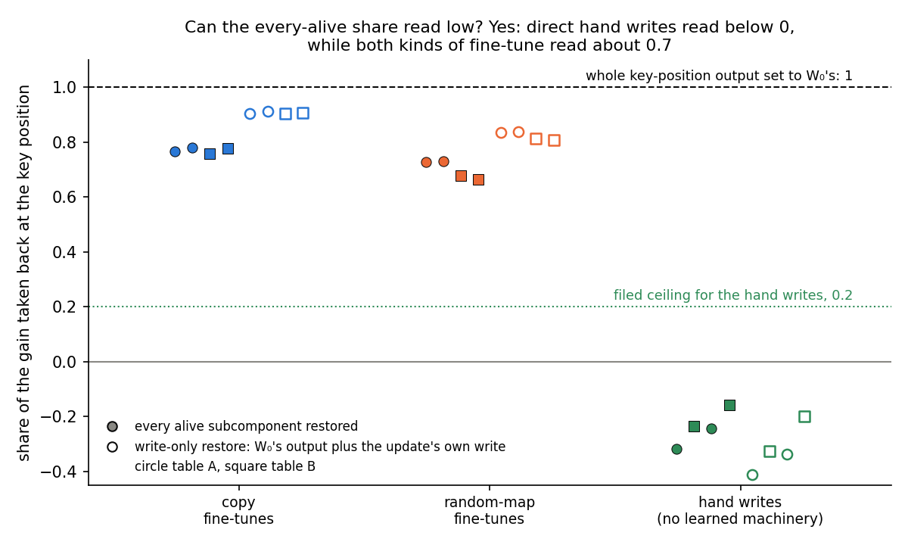

# Does the fine-tuned model itself tell a copy fine-tune from a random-map fine-tune? E50 restore on known-kind anchors

*E50, `experiments/restore_anchors/run.py`, written 2026-10-29, corrected the same day after an independent check
("holds with corrections"; every number matched the JSON). The Amendment 1 sections, the plain paragraph, "What we
learned" and the card were corrected again after a second independent check of Amendment 1's reading. Plan: `reports/plans/2026-10-29_plan_restore-anchors.md`,
option A and section "Filed (E50)", approved by the user. Filed rules: `experiments/restore_anchors/results/predictions.json`,
filed before the run, not edited since. Result: `experiments/restore_anchors/results/restore_anchors.json`. Figure:
`experiments/restore_anchors/figures/shares.png` from `plot.py`. Notebook: `notebooks/E50_restore_anchors.ipynb`.*

**The filed lean and the random-map ceilings were missed.** The plan leaned that every alive subcomponent would
separate copies from random maps by a gap of 0.3. The rule's gap was 0.03 and 0.05, so the reading is "does not
separate". The copies still sit a little above the random maps on every alive subcomponent, so the filed "reversed"
verdict did not fire. The random maps missed both their filed ceilings. Every alive subcomponent took back 0.66 to 0.73
of their gain against a ceiling of 0.2. S took back 0.10 to 0.20 against a ceiling of 0.05.

**After Amendment 1.** A follow-up gave the every-alive share a control that reads low: direct hand writes read −0.16 to
−0.32 on it. So the number is powered, and E50's "alike" stands as a finding about relay: both kinds pass about 0.7 of
their gain through the original weights, alike within the 0.3 bar, with the copies consistently a little higher. S was
closed as evidence of kind. The original model performs neither kind, with or without an example; the example raises
both answers.

## In plain words

We put the original model's subcomponents back inside fine-tunes of known kind, copies and random maps, and both kinds
gave back about three quarters of their gain; a follow-up showed this number can read low, so it measures how much of a
gain the original weights pass along. The two kinds pass it along alike within the bar we filed, the copies a little
more, and nothing filed separates them, though three unfiled readings put the kinds in order. The original model itself
performs neither behaviour, even when shown an example, so these toys cannot settle kind, nor calibrate the one number
that does separate them, which is read in Γ's stand-in model.

## What was tested

**The states.** The 67M model and its frozen VPD decomposition. E12's four key-to-value tables, each 32 keys after a
marker word, rebuilt by E46's stage 0a and checked by their recorded hashes:

| table | the fine-tune teaches | kind, by construction |
|---|---|---|
| copy A, copy B | repeat the key | existing behaviour |
| random map A, random map B | give a fixed common word for each key | new behaviour |

Each table was fine-tuned with two seeds, eight fine-tunes in all. Each is placed by do-nothing: the update δW sits in
Δ and the subcomponents and Γ are untouched. Every reading is the full fine-tuned model, $W_0 + \delta W$, with no
masks, on 97 held-out windows of the table, at the key position where the answer is predicted.

**The gain.** $T$ is the mean log-odds of the table's answer at the key position. The gain is $G = T_1 - T_0$, the
fine-tuned model's $T_1$ minus the original model's $T_0$. It was 13 to 21 nats on every fine-tune.

**Restoring a set.** At the key position only, each decomposed matrix's output gains
$\sum_{c \in X} ((x_0 - x) \cdot v_c)\, u_c$. Here $x$ is the matrix's input in this pass and $x_0$ its input in the
original model's pass on the same window. So each subcomponent in the set $X$ reads the input it would have read in the
original model. The restore share is $\rho(X) = (T_1 - T_X) / G$: 0 means the set carries none of the gain, 1 means
all of it.

**The sets.**
- *Every alive subcomponent*, 9,881 of them.
- *S*, Γ's switched-on set: alive subcomponents whose mean importance at the key position rises by more than 0.3 after
  the fine-tune. It had 108 to 118 members on the copies and 24 to 49 on the random maps.
- *Gold*: S's count of the subcomponents most on just before the table's answer words in the original model's Pile
  text. It is the original model's own machinery for those words, chosen knowing the answers.
- *D*: S's count, per matrix, of the subcomponents outside S whose first-order pull on the answer is largest. It needs
  the answer but not Γ.
- *Random*: 20 sets of S's size per matrix, from the alive subcomponents outside S. They are the null.

**The controls, run first.** The original model's $T_0$ and the fine-tune's $T_1$ had to reproduce E46's. The empty set
restored had to change nothing. Every set restored inside the original model had to change nothing, since there
$x = x_0$. The whole-output control set every matrix's whole key-position output to the original model's, which must
give back $T_0$ exactly, a restore share of 1. The code review before the run noted that these three restore controls
cannot fail for a wrong restore formula. They catch misaligned batches and stale cached inputs; the formula rests on
E38's earlier check of the same hooks.

## What we expected, and why

The copies repeat a token, which the original model already does. So the plan expected the original subcomponents to
carry most of their gain: at least a half for every alive subcomponent, at least a fifth for S. The random maps link
words to keys that the original model never links. So the plan expected their gain to live in the update's own write,
in Δ: at most a fifth for every alive subcomponent, nearly nothing for S. The scored rule asked for a gap of 0.3
between the worst copy and the worst random map, on both seeds. It was read on every alive subcomponent and on S. The
lean was that every alive subcomponent would separate the kinds.

## The controls

Every control passed on all eight fine-tunes, and each read exactly 0 in the stored float. The original model's $T_0$
and each $T_1$ reproduced E46's to the last digit. The whole-output control gave back $T_0$ exactly on all eight. The job
ran in 78 seconds on an L40.

## Does restoring the original model's subcomponents take back more of a copy's gain than a random map's?

**Reading it.** No. Every alive subcomponent took back 0.76 to 0.78 of the gain on the copies and 0.66 to 0.73 on the
random maps. The worst-pair gap was 0.03 on seed 0 and 0.05 on seed 1, against a bar of 0.3. S took back 0.14 to 0.19
on the copies and 0.10 to 0.20 on the random maps; its worst-pair gap was below zero on both seeds. S on the copies sits
under its filed floor of 0.2, and both sets on the random maps sit far above their filed ceilings. The random sets took
back at most 0.11 and on average under 0.04. That shows S is not a null set; it does not show S can separate kinds.

| fine-tune | gain, nats | every alive | S | gold | D | random mean / max | count of S | stand-in ratio |
|---|---|---|---|---|---|---|---|---|
| copy A, seed 0 | 13.99 | 0.768 | 0.174 | 0.114 | 0.394 | 0.025 / 0.058 | 118 | 0.934 |
| copy A, seed 1 | 14.07 | 0.781 | 0.144 | 0.105 | 0.389 | 0.024 / 0.044 | 108 | 0.872 |
| copy B, seed 0 | 14.60 | 0.757 | 0.138 | 0.118 | 0.439 | 0.037 / 0.112 | 114 | 0.931 |
| copy B, seed 1 | 14.26 | 0.777 | 0.190 | 0.101 | 0.474 | 0.038 / 0.080 | 117 | 0.968 |
| random map A, seed 0 | 13.73 | 0.729 | 0.169 | 0.133 | 0.240 | 0.013 / 0.022 | 38 | 0.364 |
| random map A, seed 1 | 13.16 | 0.730 | 0.204 | 0.171 | 0.196 | 0.014 / 0.025 | 49 | 0.356 |
| random map B, seed 0 | 20.74 | 0.677 | 0.097 | 0.041 | 0.141 | 0.006 / 0.015 | 32 | 0.414 |
| random map B, seed 1 | 20.64 | 0.664 | 0.101 | 0.037 | 0.133 | 0.003 / 0.010 | 24 | 0.394 |

The stand-in ratio is E46's number, read in Γ's stand-in model and copied here, not remeasured; it is shown to three
places because 0.356 and 0.414 sit just outside the filed ranges. The random sets' standard deviation over the 20
draws was at most 0.027.

Two patterns the rules did not ask about. First, S took back between 2.0 and 2.7 nats on every one of the eight
fine-tunes. That holds although S had four times as many members on the copies as on random map B, and the gains
differ by half. Second, the set D took back more than S on seven of eight, as in E38. D also kept the kinds further
apart than S: 0.39 to 0.47 on the copies against 0.13 to 0.24 on the random maps. The worst-pair gap on D was 0.15 and
0.19, under the 0.3 bar; D was filed as reported only.

## What could the number see? The power of every alive subcomponent

**The algebra.** Each matrix is $W_0 = U V^\top + \Delta_0$, with $U$ and $V$ the alive subcomponents' write and read
vectors and $\Delta_0$ the rest. Under do-nothing the fine-tuned matrix is $W_0 + \delta W$. With every alive
subcomponent restored, the matrix's key-position output is

$$W_0 x + \delta W x + U V^\top (x_0 - x) = W_0 x_0 + \Delta_0 (x - x_0) + \delta W x.$$

The whole-output control gives $W_0 x_0$. So restoring every alive subcomponent is the whole-output control with Δ's
paths left on: the update's own write on this pass's input, plus $\Delta_0$'s part on the changed input. This is exact.
One minus every alive subcomponent's share is exactly the gain kept when only Δ's paths at the key position are left on.
Everything the original weights do with the update's writes is undone. That covers the later matrices reading an earlier
layer's write at the key position, and the attention output carrying changes from other positions.

**What it means for power.** Every alive subcomponent therefore has power for one distinction: gain the original weights
relay against gain the update delivers directly. It has not been shown to have power for existing against new. The
plan's ceiling of 0.2 for the random maps assumed the two coincide, that a new behaviour's gain is mostly direct. On
these toys it was mostly relayed for both kinds. Whether every alive subcomponent reads high for any update is untested:
no update known to read low was run in E50. Amendment 1 ran one, below, and the number reads low on it. The plan
named the blind spot, a new behaviour reaching the answer through the original weights by cascade, but did not size it.

**A check of the decomposition's role, at no cost.** A write-only restore sets each decomposed matrix's key-position
output to $W_0 x_0 + \delta W x$, the whole-output control plus the update's own write. It uses no subcomponent and
differs from every alive subcomponent by exactly $\Delta_0 (x - x_0)$. So it tells whether the every-alive share depends
on the decomposition at all; it does not settle power. Expectation: within 0.02 of every alive subcomponent on all eight
fine-tunes. That 0.02 is a materiality bound, the largest seed-to-seed spread seen here and small against the 0.3 bar.
It is not a noise floor between the two numeric paths, which was not measured. Neither outcome changes the decision
below, so it was run as information in Amendment 1, below, where it missed: 0.10 to 0.15.

**S beats its nulls, but that is not power to separate.** S depends on Γ and beat the random sets on all eight
fine-tunes, so it is not a null set. Whether it can separate kinds is another question, and the copy class, the
positive control, missed its filed floor of 0.2 on all four. Two candidate readings, both untested:
- *Shared output machinery.* The random maps' answers are common words, and the fine-tune may reuse the original
  model's output machinery for them. The gold set fits: on random map A it took back 0.13 and 0.17, as much as on the
  copies. This is what the method's standing limit predicts for a new association built from existing output pieces.
- *A shared task-format part.* S takes back a near-constant 2.0 to 2.7 nats on all eight fine-tunes, whatever its size.
  Each random-map S shares 12 to 22 members with some copy S. Five subcomponents are in all eight: h.2.mlp.c_fc:2151,
  h.2.mlp.down_proj:2550, h.3.attn.q_proj:60, h.3.mlp.c_fc:1428 and h.3.mlp.down_proj:1345. That fits a part of S that
  serves the shared marker-to-answer format, not either kind's own behaviour. Amendment 1 did not confirm it: the core
  matters on the random maps only.

**A caveat on the copy anchor.** The original model's log-odds of the answer on the copy tables is about −10 nats.
That is only 3 to 4 nats above the random maps' −13 to −14. So the original model does not copy in this format, and the
copy is "existing" only in the sense that copying exists somewhere in the model. Candidate, untested: both fine-tunes
may mostly learn the shared marker-to-answer format, which would make the two kinds alike for a reason unrelated to VPD.
This bears on every option below.

## Amendment 1: can the numbers read low, and what is S made of?

*Plan section "Amendment 1 (2026-10-29): power checks", filed before the run in
`experiments/restore_anchors/results/predictions_amend1.json`. Code `experiments/restore_anchors/amend1.py`, written and
run by another agent. Result `experiments/restore_anchors/results/amend1.json`, cluster job 43266, L40, debug QoS, 123 s,
$0. Figure `experiments/restore_anchors/figures/amend1.png` from `plot.py`. It does not change E50's verdict; it decides
what the card says about the power behind it.*

**What was added.** Four readings, on the same eight fine-tunes and two kinds of null update, read exactly as above:
- *A low-reading control.* E46 Amendment 3's hand write, one per table: a change to block 1's MLP output that adds the
  answer's unembedding row for each key, scaled to the fine-tune's gain. It needs no later layer to raise the answer, so
  every alive subcomponent should take back little of it. E46's matched random update was read beside it.
- *The write-only restore* described above, on every row.
- *S split* into its core, the five subcomponents in all eight S sets, and the rest, each beside 20 random sets of its
  size.
- *A probe of the original model*: a demonstration, marker then key then that key's answer, written ten positions before
  the key, to see whether the original model produces the answer in context.

**The controls.** All passed. The original model's $T_0$ matched E50's and E46's exactly on all four tables. Every set
restored in the original model changed nothing; the empty set changed nothing; the whole-output control gave back $T_0$.
The control on the null updates' gains passed under that name in the code, though the log prints it as C2: the hand
writes' gains were 13.37, 15.27, 13.10 and 20.90 nats, Amendment 3's to the second decimal. The random updates' gains
were 0.04 to 0.40 nats, as in Amendment 3, so their shares are unscored by E50's rule. The control that E50's two numbers
reproduce passed on all eight fine-tunes, to every printed digit. The write-only restore in the original model read
$T_0$ exactly.

### Can the every-alive share read low?

**Reading it.** Yes. The hand writes read −0.16 to −0.32 on every alive subcomponent, against 0.66 to 0.78 for the
fine-tunes. The gap between the copy fine-tunes and the writes was 0.915 on seed 0 and 0.935 on seed 1, against a power
bar of 0.3: "powered". The writes read below zero because the later original layers partly cancel a direct write;
restoring those layers' inputs removes the cancelling, so the answer rises. That reading of the sign is a candidate.

Under the decision rule, E50's "does not separate" stands as a finding for this number. The number measures how much of
the gain the original weights relay, against what the update delivers directly. Both kinds relay about 0.7, alike within
the 0.3 bar, with the copies consistently a little higher. All four copies sit above all four random maps on every alive
subcomponent, with worst-pair gaps of 0.03 and 0.05, and on the write-only restore, with 0.07. A direct write is not
relayed, and the later layers partly cancel it. The number does not measure existing against new, and goes forward, if
at all, only as a relay number beside the stand-in ratio. Its power is shown against one kind of low anchor, a
single-matrix direct write.

**The write-only restore.** It took back 0.10 to 0.15 more of the gain than every alive subcomponent on all eight
fine-tunes, against a materiality bound of 0.02. So the original model's residual $\Delta_0$ relays roughly an eighth of
the gain, and the every-alive share does depend on the decomposition: the subcomponents cover the relay only in part.
The eighth is approximate, since restores need not add. On the hand writes the write-only restore read −0.20 to −0.41,
lower than every alive subcomponent there. This was filed as information and changes no verdict. With all of the original weights, the relay reads 0.90 to 0.91 on
the copies and 0.81 to 0.84 on the random maps; that gap is 0.07, also short of 0.3.

### What is S made of?

**S on the writes.** Unscored. Γ switched on no subcomponent for two writes and one to three for the other two, so S was
empty or tiny. That is itself a contrast, not scored: both kinds of fine-tune switch on 24 to 118 subcomponents, a direct
write almost none.

**Core and rest.** The rule read "neither". The five-member core took back 0.00 to 0.02 of the gain on the copies and
0.06 to 0.08 on the random maps. On the random maps that is 0.9 to 1.4 nats, a third to two thirds of S's take-back; on
the copies it is under a quarter of a nat. So the shared format part was not confirmed: the core matters for the random
maps only. The rest took back 0.14 to 0.20 on the copies and 0.04 to 0.15 on the random maps, short of a 0.3 separation.
Under the decision rule, S is closed as evidence of kind on the 67M.

The core's "neither" is close to built into the rule. A five-member set that takes back a few hundredths of the gain was
unlikely to reach a 0.3 gap between kinds whatever it does. The core does order the kinds, in reverse, with no overlap:
the random maps above the copies. That fits the shared-output-machinery reading above, original output pieces reused for
the random maps' common answer words; it is a candidate, untested.

**The parts do not add up, as expected.** S's take-back minus the core's and the rest's was −0.03 to −0.29 nats on all
eight fine-tunes, so the two parts restored apart take back a little more than S restored whole. Restores need not add.
Each restore changes the inputs every later layer sees, and the answer passes through attention, normalisation and the
MLPs' nonlinearity, so overlapping effects are counted twice when the parts are restored apart. The plan said so before
the run. At most a seventh of S's take-back, it changes no reading.

### What does the original model do in this format?

| table | log-odds of the answer, no demonstration | with a demonstration | gain from the demonstration, nats |
|---|---|---|---|
| copy A | −10.15 | −3.29 | 6.86 |
| copy B | −10.22 | −3.99 | 6.23 |
| random map A | −13.21 | −1.07 | 12.14 |
| random map B | −13.98 | −1.84 | 12.14 |

**Reading it.** The demonstration raises both answers, but the original model performs neither. With it, the answer's
log-odds are still −3.3 and −4.0 on the copy tables and −1.1 and −1.8 on the random maps, so the answer stays less likely
than not. The demonstration is the marker, the same key and that key's answer, ten positions earlier. It holds the exact
key and answer for either kind, so the probe tests induction, copying a pair just seen, and cannot rank the anchors. On
the copy tables it helps about half as much; why is not known.

**What this means for the copy anchor.** Two claims hold. The original model does neither kind unprompted. And it rates
the copy answer 3 to 4 nats above the random-map answers, a small prior toward copying. So in this format the copy is
"existing" only in the sense that copying exists somewhere in the model, with a small lean toward it. Candidate,
untested: both fine-tunes may install the same shortcut, a fixed response to the marker format. That would make the two
kinds alike for a reason about the anchors, not about VPD.

## What we learned

In plain words: on these toys, nothing filed separates a new behaviour from an existing one inside the fine-tuned model.
Both kinds of fine-tune work mostly by feeding something the original weights then carry to the answer, which a direct
write does not, and they do so alike within the bar, the copies a little more. The original model performs neither
behaviour, even when shown an example, so the toys' "existing" and "new" labels are weaker than planned.

Three readings, none filed as a test of kind, do order the kinds without overlap:
- S's size: 108 to 118 members on the copies against 24 to 49 on the random maps.
- D's restore share: 0.39 to 0.47 against 0.13 to 0.24.
- The core's restore share, in reverse: 0.00 to 0.02 on the copies against 0.06 to 0.08 on the random maps.

The core's "neither" is close to built into the rule, since a five-member set was unlikely to reach a 0.3 gap. Its
reversed order fits the shared-output-machinery reading, a candidate. S's fourfold size gap may be the same fact as the
stand-in ratio's gate-gain gap, Γ switching on more for the copies, so one observation rather than two; also a candidate.

Against the plan's three answers: "Yes" is not reached. The one real-model number with shown power measures relay, not
kind, and reads both kinds alike; S is closed. "Undecidable" as the plan defines it needs the toys to separate, and they
did not. "No" is what these instruments read, now with a powered number behind it, but for relay rather than kind, and on
anchors whose kinds the original model does not show. The caveat cuts both ways: anchors that cannot show kind in the
real model cannot calibrate the stand-in ratio either. That ratio is the line's only number that separates the kinds, and
it has not been tested on an anchor the original model really performs; the card below takes this up.

**The method's standing limit** (`decisions.md`, "Limit of the elicitation reading"). A new mechanism built from
subcomponents the original model already has, put together under new gating, reads as "elicited" to VPD, because its
unit is the rank-one subcomponent, not the circuit. So "elicits" from VPD means "uses pieces the original model already
has", never "uses a circuit it already runs". Here both kinds use the original pieces to the same extent, which is what
the limit predicts if a new key-to-word map is built from existing pieces. Only a Γ from a second decomposition seed
narrows the limit.

## How compelling is the evidence

Two seeds and four tables, all one key-to-word task family on the 67M model, scored at one position. The two seeds
agreed within 0.02 on every alive subcomponent and within 0.06 on S, against a separation bar of 0.3. The restore's
rounding is about 0.0015 of the gain. The class gaps sit close to zero, not near the bar, so "does not separate" is not a
threshold case. Amendment 1 gave every alive subcomponent a control that reads low, a single-matrix direct write, so its
"alike" is a reading of relay with power behind it; power against other low anchors is untested. S has no control that
reads low, since the writes switch on almost none. Both read the key position only. The anchors' kinds are not shown by
the original model in this format, which limits what any number here can say about kind.

## Surprises

1. **The random maps read like the copies on every alive subcomponent, 0.66 to 0.73 against a filed ceiling of 0.2.**
   The filed lean, that every alive subcomponent separates the kinds, was missed. Amendment 1 showed why it could:
   the number measures relay, and both kinds relay about the same.
2. **S on the copies took back under a fifth**, missing its filed floor of 0.2 on all four; E38's triggers had read about
   a fifth.
3. **S took back the same 2.0 to 2.7 nats on every fine-tune**, whatever its size. The shared core explains part of this
   on the random maps only; on the copies it is not explained.
4. **The original model's residual relays roughly an eighth of the gain**, where the write-only bound was 0.02.
5. **Shown the pair, the original model still performs neither kind.** The demonstration raises the random-map answer
   by 12 nats and the copy answer by about 6.5, yet the answer stays less likely than not. The copy anchor is weaker than
   the plan assumed.
6. The stand-in ratios, copied from E46, sat just outside their filed ranges on two fine-tunes, 0.356 and 0.414. Narrow;
   one line.

## What next

1. The decision card below.
2. If option A: a `/design` check of a 67M anchor pair whose existing member the original model performs unprompted,
   then the stand-in ratio and the relay number read on it. A ratio that reads the existing member high and the new one
   low, as it read the copies and random maps, keeps a place in stage 1; one that does not ends its use as a number of
   kind.
3. A Γ from a second decomposition seed is the only check that narrows the method's limit; whether one exists in
   `artifacts/vpd` is unknown.

## Pending decision (card text)

*Supersedes the earlier versions of this card, after E50 Amendment 1 and its independent check. It also takes in the
open card on E46 Amendment 3's stand-in ratio.*

**The re-gating line's only number that separates the kinds is Γ's stand-in ratio, and it has never been tested on an
anchor the original model really performs. What should the line do before any Qwen spend?**

*Evidence.*
- *The stand-in ratio, E46 Amendment 3.* It separates copies from random maps, about 0.9 against 0.4, but only in Γ's
  stand-in model, and it is almost exactly the gate gain over the subcomponent gain. A hand write with no learned
  machinery read 0.40 and 0.57 on the random-map tables, 0.57 outside both fine-tunes' intervals, and 0.89 and 1.13 on
  the copy tables. So on every table a write that builds nothing reads like that table's fine-tune. The ratio may track
  the table rather than the update's kind: a copy's answer token is the key, whose tied embedding is already present.
  Amendment 3's tree ended at branch 5, numbers to the user, not at the filed pass, branch 3, and its analysis said
  this goes to the user.
- *E50.* Inside the fine-tuned model, every alive subcomponent took back 0.76 to 0.78 of the copies' gain and 0.66 to
  0.73 of the random maps'. Γ's switched-on set S took back 0.14 to 0.19 and 0.10 to 0.20. Neither separates by the
  filed 0.3.
- *Amendment 1.* The every-alive share is powered: hand writes read −0.16 to −0.32, gaps of 0.915 and 0.935 to the
  copies. It measures relay, and the kinds relay alike within the bar, the copies consistently a little higher. S is
  closed; its core's "neither" is close to built into the rule for a five-member set. Nothing filed separates the
  kinds, but three unfiled readings order them without overlap: S's size, D, and the core in reverse. S's size gap may
  be the same fact as the gate-gain gap.
- *The anchors, both ways.* The original model performs neither kind, even with an example, and leans 3 to 4 nats toward
  the copy answer. If these toys cannot show kind in the real model, they cannot calibrate the stand-in ratio either:
  its separation on them is not yet evidence that it reads kind.
- *The method's standing limit* (`decisions.md`, "Limit of the elicitation reading"). A new mechanism built from
  subcomponents the original model already has, put together under new gating, reads as "elicited" to VPD, because its
  unit is the rank-one subcomponent, not the circuit. Only a Γ from a second decomposition seed narrows it.

*Options.*
- **(A) Hold stage 1 and test the stand-in ratio for $0 on an anchor the original model performs.** Read it and the
  relay number on a 67M anchor pair whose existing member the original model performs unprompted. This is close to the plan's option C: lowercase Pile text, which the model
  already models, against the same rows under a broad cipher. It is a new task family, so it needs `/design` and the
  user's confirmation. The plan's own risk is that the stand-in read about 0.8 for any broad update in E36; finding that
  out for $0 is the point. Recommended.
- **(B) Answer "No" for the toys.** By the plan's "Three answers", the known anchors read alike in the real model, so
  re-gating is a reading of Γ. This is the plan's own framework: E50's filed branch says the line's real-model claim is
  dead on the 67M. It is compatible with A, which asks whether Γ's reading is itself worth carrying.
- **(C) Stage 1 on Qwen3-1.7B with the stand-in ratio alone.** E50's filed branch; a gated run, about $5 to $10. Only
  after the ratio passes on such an anchor, and with an existing anchor the original Qwen is shown to perform; E45's
  anchor 1 does not yet, since no prompt raised its accuracy.

*Recommendation.* A, with B written down now. The toys could not have shown kind, since the original model performs
neither behaviour, so they can neither close the question nor vouch for the stand-in ratio. A tests the ratio where the
existing member is real, for $0, before any gated spend.

*Run line.* E50, Slurm 43040, and Amendment 1, Slurm 43266, cluster debug, $0 each.

## Scorecard

Filed in `predictions.json`; read from `restore_anchors.json`. Rules are first-match as filed.

| id | claim in words | rule | read | verdict |
|---|---|---|---|---|
| reading | the kinds separate on every alive subcomponent | worst-pair gap ≥ 0.3 on both seeds, every alive or S | gaps 0.028, 0.046 every alive; −0.031, −0.061 S | does not separate; filed lean missed |
| C1 | original model reproduces E46 | T0 within 0.02, path within 1e-3 | 0 difference, four tables | pass |
| C2 | fine-tune reproduces E46 | T1 within 0.02 of the gain | 0 difference, eight | pass |
| R0 | empty set changes nothing | ≤ 1e-5 nats | 0, eight | pass |
| R1 | any set restored in the original model changes nothing | ≤ 0.01 nats | 0, eight, every set | pass |
| R2 | whole output reset gives back T0 | ≤ 0.01 nats | 0, eight | pass |
| copy, every alive | ≥ 0.5 | reported | 0.757-0.781 | met, four of four |
| copy, S | ≥ 0.2 | reported | 0.138-0.190 | missed, four of four |
| copy, gold | ≥ 0.1 | reported | 0.101-0.118 | met, four of four |
| copy, D | ≥ S − 0.05 | reported | 0.389-0.474 | met, four of four |
| random map, every alive | ≤ 0.2 | reported | 0.664-0.730 | missed, four of four |
| random map, S | ≤ 0.05 | reported | 0.097-0.204 | missed, four of four |
| random map, gold | ≤ 0.1 | reported | 0.037-0.171 | met on table B, missed on table A |
| random map, D | ≤ 0.2 | reported | 0.133-0.240 | met three of four; table A seed 0 0.240 |
| random sets | mean ≤ 0.05, max ≤ 0.15 | reported | mean ≤ 0.038, max ≤ 0.112 | met, eight of eight |
| stand-in ratio | copy 0.87-0.97, random map 0.36-0.41 | reported, copied | 0.356 (random map A seed 1) and 0.414 (random map B seed 0) | met six of eight, narrow misses |

**Amendment 1** (`predictions_amend1.json`; read from `amend1.json`).

| id | claim in words | rule | read | verdict |
|---|---|---|---|---|
| C1 | T0 reproduces E46 and E50 | within 0.02 | 0 difference, four tables | pass |
| C2, C2_null | gains reproduce E46 and Amendment 3; restore controls on every row | as filed | hand writes 13.37, 15.27, 13.10, 20.90 | pass |
| C3 | E50's two shares reproduce | within 0.01 | exact, eight | pass |
| C5 | write-only in the original model reads T0 | ≤ 0.01 nats | 0, four | pass |
| power | every alive: copies minus hand writes | ≥ 0.3 both seeds | 0.915, 0.935 | powered |
| hand writes, every alive | ≤ 0.2 | reported | −0.32 to −0.16 | met, four of four |
| S on the write | ≤ 0.05 on all four | scored | S empty on two writes | unscored |
| core and rest | shared format part or kind-specific | as filed | core 0.00-0.02 copy, 0.06-0.08 random maps; rest gaps 0.03, 0.00 | neither |
| random updates | G < 1 nat | reported | 0.04-0.40 | met, unscored |
| write-only minus every alive | abs ≤ 0.02 | information | 0.105-0.147 | missed, eight of eight |
| probe | demonstration raises the copy answer ≥ 3 nats | reported | copy 6.23, 6.86; random maps 12.14 | met |

## Not run

- A low-reading control for S: the hand writes switch on almost no subcomponents, so S on them is unscored.
- Low anchors other than a single-matrix direct write, for the every-alive share.
- A copy anchor the original model performs in this format without an example.
- Fresh seeds for the core and rest split, which was defined on the same eight fine-tunes it was scored on.
- Any position other than the key position; the restore at earlier positions or per position.
- A per-member normalisation of S, given its fourfold size difference between kinds.
- A second decomposition seed's Γ, the one check that narrows the method's limit.
- Qwen, any other task family, more than two seeds.

## Provenance

Slurm 43040, MATS cluster L40, debug QoS, 78 s, $0. Log `cluster/logs/commute-restore-anchors-43040.out`; run log in
`experiments/restore_anchors/results/large/run.log`. States: `experiments/regating_table/results/large/`, checked
against `stage0a.json`'s sha256. Alive set: `experiments/transport_test/results/large/alive.pt`. Gold positions in the
first 2,000 Pile validation rows: 10,232 and 8,439 for the copy tables, 1,062 and 1,160 for the random maps.

Amendment 1: Slurm 43266, MATS cluster L40, debug QoS, 123 s, $0, code commit 44dd01e. Log
`cluster/logs/commute-restore-anchors-43266.out` and `experiments/restore_anchors/results/large/amend1.log`. Result
`experiments/restore_anchors/results/amend1.json`; filed rules `experiments/restore_anchors/results/predictions_amend1.json`.
