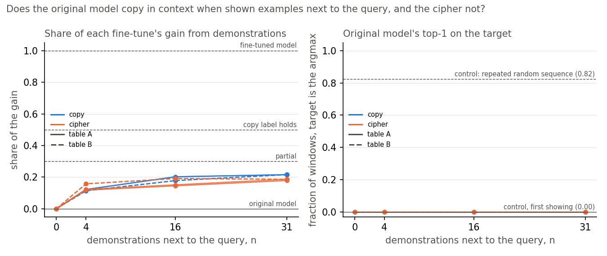

# Analysis: do neuron patching, steering or prompting tell eliciting from teaching? (E52)

*2026-10-29, coding agent (baseline-lead, E52 writer). Plan: `reports/plans/2026-10-29_plan_baselines-scoping.md`,
section "B2 + B3 + B4 = E52". Rules filed before the run: `experiments/baseline_neurons/results/predictions.json`, with
the dated window-count note `reports/predictions/2026-10-29_prediction_e52-window-count.md`. Results:
`experiments/baseline_neurons/results/baseline_neurons.json`. Explanation: `notebooks/E52_baseline_neurons.ipynb`.
Pending decision: `reports/decisions/2026-10-29_decision_e52-p4.md`. Provenance at the end. Amendment 1, the prompting
check re-run with the demonstrations next to the query, is the last section, added 2026-10-30.*

We tried three cheap methods that act on the running model, not on a decomposition, on eight small fine-tunes: four
that taught the model to repeat a word and four that taught it an arbitrary word mapping. Prompting the original model
with worked examples, our check that the labels are right, barely helped either kind and helped the mapping slightly
more, so the plan stops for the user's decision; one added vector told the kinds apart by a wide margin, and patching up to
256 of the most-changed neurons recovered at most a quarter of either kind. For the project's aim, a cheap activation method may reproduce VPD's verdict on
this set, but only if the labels hold, and it may be reading whether the change depends on the input rather than
whether it is new.

## What was done

The updates are E12's fine-tunes of all 24 decomposed matrices, as regenerated by E46 stage 0a
(`~/commute-data/results-large/regating_table/{name}.pt`, fp32 δW). Copy, labelled elicit: tables A and B (`ident32`,
`ident32b`), seeds 0 and 1. Cipher, labelled teach: tables A and B (`rand32`, `rand32b`), seeds 0 and 1. The null is
E36's code-text fine-tune at step 10 (`code_step10.pt`), which learned nothing. Each state is W₀ + δW of the target
model, fp32 throughout, TF32 off. No decomposition is read.

Each task has 97 held-out windows of 41 tokens: Pile text with the marker at position 19, the key at 20, and the target
read from the logits at position 20. The filed text said 100 windows; the saved files hold 97, and the dated note
fixes the halves at 49 fit windows, the even indices, and 48 scoring windows, the odd ones. No rule changed.

- **Gain** G = mean over the 97 windows of log P_tuned(target) − log P_W₀(target) at the answer position. G_fit and
  G_score are the same over each half.
- **Share** of a method = mean over the scoring half of (log P_method − log P_W₀) / G_score. It reads 0 for W₀ and 1
  for the fine-tuned model.
- **Floor** per task = max(0.05, 2 × |G(s0) − G(s1)|). A state with |G| under its floor reads "no change" and is not
  scored. The code fine-tune has one seed, so its floor is 0.05.

Methods, all on the target model only:

- **B2, neuron patching.** The 12288 GELU outputs of the four MLPs, the inputs of `down_proj`, are ranked by the
  absolute mean shift, tuned minus W₀, at the answer position over the fit half. The top k, for k in 1, 4, 16, 64, 256
  and 12288, take the tuned model's activations at every position of the W₀ forward. k₅₀ is the smallest k on the grid
  with share ≥ 0.5. The idle share is the fraction of the top 16 whose mean |W₀ activation| at the answer over the fit
  half is under 0.1 × that neuron's 99th percentile of |W₀ activation| over every position of Pile val rows 0–63.
- **B3, steering.** v_l = mean over the fit half of the tuned minus W₀ residual stream at the answer position at block
  l's input, l = 0…3. W₀ with v_l added at that position only. The layer with the largest fit-half share is chosen; S
  is its scoring-half share.
- **B4, prompting the original model.** W₀ on n = 0, 4, 16 demonstrations, each the triple marker, key, table[key], then
  the window's tokens 0…20. Demonstration keys are drawn without replacement from the task's 31 other keys. The share
  uses each state's G_score; the numerator is the same for a task's two seeds.

Stage 0 ran first and alone, and would have stopped the job on a miss.

## Stage 0: the controls

| check | filed | ident32_s0 | rand32_s0 | |
|---|---|---|---|---|
| identity patch: max over windows \|Δ log P\| | ≤ 1e-4 nats | 1.7e-5 | 1.1e-5 | pass |
| full patch of block 3's output: share | 1 ± 1e-3 | 1.00000001 | 1.00000001 | pass |
| G | > 1 nat | 10.11 | 12.03 | pass |

These controls show that the hooks replace what they should and that the fine-tunes learned their tasks. They are not
positive controls for the methods: no state of known kind was shown to read as elicit under prompting, or as
separable under steering or neuron patching, before the scored states were read.

## Gains and floors

| state | kind | G | G_fit | G_score | floor | no change |
|---|---|---|---|---|---|---|
| ident32_s0 | copy | 10.11 | 10.00 | 10.23 | 0.05 | no |
| ident32_s1 | copy | 10.11 | 10.00 | 10.24 | 0.05 | no |
| ident32b_s0 | copy | 10.20 | 10.14 | 10.26 | 0.134 | no |
| ident32b_s1 | copy | 10.13 | 10.06 | 10.20 | 0.134 | no |
| rand32_s0 | cipher | 12.03 | 11.66 | 12.41 | 1.384 | no |
| rand32_s1 | cipher | 11.34 | 10.82 | 11.87 | 1.384 | no |
| rand32b_s0 | cipher | 13.98 | 14.25 | 13.70 | 0.05 | no |
| rand32b_s1 | cipher | 13.96 | 14.22 | 13.70 | 0.05 | no |
| code_step10 | learned nothing | −0.0514 | | | 0.05 | no |

All eight task states are scored.

## Does prompting the original model favour copy? (the label check)

Figure: `experiments/baseline_neurons/figures/p4_prompting.png`.

No. At 16 demonstrations, the rise in log probability of the target is 1.20 and 1.01 nats for copy tables A and B. It is 1.65 and 1.88
for cipher tables A and B. As shares of each fine-tune's gain:

| state | n = 0 | n = 4 | n = 16 |
|---|---|---|---|
| ident32_s0 | −1e-7 | 0.038 | 0.118 |
| ident32_s1 | −1e-7 | 0.038 | 0.118 |
| ident32b_s0 | 8e-8 | 0.027 | 0.098 |
| ident32b_s1 | 8e-8 | 0.027 | 0.099 |
| rand32_s0 | −6e-8 | 0.070 | 0.133 |
| rand32_s1 | −6e-8 | 0.073 | 0.139 |
| rand32b_s0 | 2e-8 | 0.075 | 0.137 |
| rand32b_s1 | 2e-8 | 0.075 | 0.137 |

At n = 16 the copy mean is 0.108 and the cipher mean 0.137: gap −0.029, larger than the copy range of 0.020. By the
filed rule this separates in the wrong direction: reversed. The n = 0 shares read zero to 1e-7, as they must, since a
causal model reads the same logits on the truncated window.

Both shares are near zero. E12's per-key W₀ probabilities of the target, `experiments/new_vs_existing/results/tasks.json`,
have geometric means of about 1e-4 for copy and 4e-6 to 8e-6 for cipher. Adding the rises above leaves the copy target
near 3e-4 to 4e-4 and the cipher target near 3e-5 after 16 demonstrations. This is an approximate reading: the E12 numbers are
per-key averages, not this run's windows.

The run does not say why the reversal happened. Candidate readings, each a hypothesis, from
`reports/decisions/2026-10-29_decision_e52-p4.md` and this report:

1. **The labels are wrong, or were never verified by behaviour.** E12 called copy "existing" from a claim about
   mechanism: the model has copying machinery. Immediate repetition after a marker is something W₀ gives about 1e-4,
   so the behaviour itself was never shown to be present. *Separates it:* a prompt that clearly draws out copying,
   reaching a copy share of at least 0.5, would support the label; a copy share near zero under every format would not.
2. **The prompt format does not elicit in-context learning in a 4-layer, 67M model.** The demonstrations precede 19
   tokens of unrelated Pile text, are not next to the query, and have no separator. *Separates it:* demonstrations
   placed directly before the query, more of them, and a positive control whose demonstrations include the query's own
   pair. If the query's own pair does not raise its target, the format is not working.
3. **Floor effects: the comparison is between two near-null shares.** The filed rule had no minimum effect, so two
   null shares can still "separate". The cipher's larger rise in nats may be a prior shift towards the pool of target
   words the demonstrations show, not task performance; the query's own cipher target never appears in the demonstrations, and
   cipher values never appear as keys. *Separates it:* the rise in log P of target-pool words that are not the answer;
   if it matches the rise of the answer, the cipher gain is a pool effect. Top-1 accuracy alongside the share would
   also show whether either task is performed at all.

The filed decision tree reads any prompting result other than a pass as "the labels are not what we think: stop and tell the
user". The user has been asked. What follows is reported as run; its reading depends on that decision.

## Does one steering vector recover copy but not cipher?

Figure: `experiments/baseline_neurons/figures/p3_steering.png`.

Yes, by a wide margin. Shares per block input, scoring half; the chosen layer in bold:

| state | block 0 | block 1 | block 2 | block 3 | ‖v‖ at chosen layer |
|---|---|---|---|---|---|
| ident32_s0 | 0.000 | 0.113 | **0.750** | 0.211 | 3.34 |
| ident32_s1 | 0.000 | 0.110 | **0.804** | 0.157 | 3.96 |
| ident32b_s0 | 0.000 | 0.096 | **0.794** | 0.269 | 3.77 |
| ident32b_s1 | 0.000 | 0.085 | **0.722** | 0.273 | 3.36 |
| rand32_s0 | 0.000 | 0.045 | 0.106 | **0.158** | 5.22 |
| rand32_s1 | 0.000 | 0.046 | 0.119 | **0.190** | 5.20 |
| rand32b_s0 | 0.000 | 0.044 | 0.109 | **0.103** | 4.90 |
| rand32b_s1 | 0.000 | 0.044 | 0.108 | **0.107** | 5.80 |

Copy mean 0.767, cipher mean 0.140, gap 0.628, larger range 0.087: separates, copy higher. For rand32b the fit half
chose block 3 although block 2 scores marginally higher on the scoring half; the filed rule chooses on the fit half.
Block 0's input is the token embedding, which no fine-tune changes, so v₀ = 0 and its share is zero to 1e-7, as
filed.

The separation matches the direction of VPD's route split on the same states. E46 stage 0a, as quoted in E51's report, read a re-gating share of 0.76–0.80 for
copy and 0.27–0.29 for cipher. A caveat, as a hypothesis: one mean vector
cannot depend on the input. The copy change is one switch of mode, "repeat the key", while the cipher's answer depends
on which key came in. So steering may separate these two tasks by construction, whether or not the difference is teach
versus elicit, and VPD's route split may be reading the same property. The case that would tell them apart is a
key-dependent map the original model already performs weakly, which fine-tuning strengthens.

## Does a small set of neurons carry either fine-tune's change?

Figure: `experiments/baseline_neurons/figures/p1_neuron_patch.png`.

First, the ceiling. B2 patches GELU outputs only; the attention weights and the MLPs' `down_proj` weights stay at W₀.
So the share at k = 12288 bounds every subset:

| state | k = 1 | 4 | 16 | 64 | 256 | 12288 | k₅₀ | idle share |
|---|---|---|---|---|---|---|---|---|
| ident32_s0 | 0.003 | 0.004 | −0.025 | 0.039 | 0.144 | 0.623 | 12288 | 0.375 |
| ident32_s1 | 0.003 | 0.006 | 0.018 | −0.012 | 0.016 | 0.500 | 12288 | 0.125 |
| ident32b_s0 | −0.001 | −0.009 | 0.013 | 0.083 | 0.181 | 0.709 | 12288 | 0.500 |
| ident32b_s1 | −0.001 | −0.001 | 0.019 | 0.101 | 0.241 | 0.703 | 12288 | 0.625 |
| rand32_s0 | −0.020 | −0.012 | −0.031 | −0.012 | 0.052 | 0.755 | 12288 | 0.0625 |
| rand32_s1 | −0.020 | −0.022 | −0.024 | −0.007 | 0.073 | 0.788 | 12288 | 0.125 |
| rand32b_s0 | −0.018 | −0.002 | 0.001 | 0.017 | 0.143 | 0.963 | 12288 | 0.125 |
| rand32b_s1 | −0.019 | 0.006 | 0.003 | 0.035 | 0.148 | 0.973 | 12288 | 0.1875 |

Full width recovers 0.50–0.71 for copy and 0.76–0.97 for cipher. The copy fine-tune ident32_s1 reaches 0.5001, clearing the threshold by
1e-4. The prediction on k₅₀ fails because half the gain is reached only at full width in every state. k₅₀ is 12288, grid index 5,
in all eight, gap 0, range 0. No small set of the most-shifted MLP neurons carries much of the gain: at k = 256 every share is
at most 0.24, and up to k = 16 every share is within 0.031 of zero.

That full-width patching recovers more of the cipher gain than of the copy gain is reported, not filed, and not read
here: it is a statement about how much of each change passes through MLP activations with W₀'s output weights.

## Were the most-shifted neurons idle in the original model?

Figure: `experiments/baseline_neurons/figures/p2_idle.png`.

No separation. Idle share of the top 16: copy 0.125–0.625, mean 0.406; cipher 0.0625–0.1875, mean 0.125. Gap 0.281,
larger range 0.500, within copy (ident32_s1 0.125 to ident32b_s1 0.625): fails. Copy reads higher, opposite to the filed direction.
Since the top 16 neurons carry almost none of the gain, the idle share describes neurons whose patch recovers at most 0.03 of the gain.

## The update that learned nothing

Figure: `experiments/baseline_neurons/figures/p5_null.png`.

code_step10's per-token held-out gain in fp32 is −0.05139 nats, against the floor of 0.05: fails by 0.0014. E46 had
measured −0.0516 in bf16 on the same rows; the filing noted the fp32 reading could fall either side. No method was run
on it: it has no answer position, and prompting needs demonstrations a free-text task does not have. Its verdict
comes from the floor alone. A narrow threshold miss; not read further.

## Scorecard

| id | claim | rule | read | verdict |
|---|---|---|---|---|
| S0 | hooks and gains | identity ≤ 1e-4; full patch 1 ± 1e-3; G > 1 | 1.7e-5, 1.1e-5; 1.00000001; 10.11, 12.03 | pass |
| P1 | k₅₀ separates, copy lower (lean fails, low) | \|gap\| > larger within-kind range, strict | gap 0, range 0; all at full width | fails, as leaned |
| P2 | idle share separates, cipher higher (lean fails, low) | same | gap 0.281, range 0.500 | fails, as leaned |
| P3 | steering share S separates, copy higher (lean passes, medium) | same | 0.767 vs 0.140, range 0.087 | pass |
| P4 | prompting share at n = 16 separates, copy higher (lean passes, high) | same | 0.108 vs 0.137, range 0.020 | reversed |
| P5 | \|G\| of code_step10 < 0.05 (lean passes, high) | strict | 0.0514 | fails, by 0.0014 |

Decision tree branch, as computed by `run.py`: "P4 fails: stop and tell the user".

## Blind spots and power

- B2 patches activations, not weights, and only the MLP hidden layer: it cannot separate an MLP change from an
  attention change upstream, and it cannot reach the part of the gain carried by changed attention or `down_proj`
  weights, which is 0.03 to 0.50 of G here.
- B3 is blind to input-dependent changes by construction, which is the property that differs between this copy and
  this cipher.
- B4 is blind to anything not expressible as in-context examples, and in this format both shares stay under 0.14,
  near zero. The filed rule had no minimum effect.
- Stage 0 tests the hooks and the fine-tunes, not the methods' power to separate kinds; no method had a positive
  control of known kind.
- Eight states, one model, one task format; the only spread is between seeds and tables. Shares are read on 48
  windows per task.

## Not run

- Prompting with demonstrations adjacent to the query, with the query's own pair as a positive control, with more
  demonstrations, with top-1 accuracy, or with a minimum effect.
- The rise of non-answer target-pool words under prompting, which would separate a pool shift from task performance.
- Any method on the code fine-tune.
- A matched random update as the floor for the activation numbers.
- A size-matched copy and cipher pair; the key-dependent elicit pair; the mixed case.
- Neuron patching by layer, or of attention outputs; steering at more than one position.
- B5 and B6 of the scoping plan.

## Provenance

`experiments/baseline_neurons/run.py` and `plot.py`; `cluster/baseline_neurons.sbatch`. MATS cluster L40, debug QoS,
job 44095, measurement 18:38:32–18:38:38 after model load, $0. Log: `cluster/logs/commute-baseline-neurons-44095.out`.
An earlier job, 44056, stopped on a loader check before any measurement; see the dated note. Inputs:
`~/commute-data/results-large/regating_table/{ident32,ident32b,rand32,rand32b}_s{0,1}.pt`, `code_step10.pt`,
`windows_<task>.pt`, `code_held.pt`. Figures regenerated by `plot.py` through `fleet/cpu-run`.

## Amendment 1: does the original model copy in context when the examples sit next to the query?

*2026-10-30, coding agent, baseline-lead write-up. Decision: `reports/decisions/2026-10-29_decision_e52-p4.md`,
option A, chosen by the user: "go with A then C", recorded in `decisions.md`. Rules filed before the run:
`experiments/baseline_neurons/results/predictions_amend1.json`. Code: `amend1.py`, `plot_amend1.py`. Results:
`results/amend1.json`. Figure: `figures/p4a_prompting_adjacent.png`. E52's own prediction on prompting stands as
filed, reversed.*

We re-ran the label check with up to 31 worked examples placed right before the question, after a control showed the
setup can see in-context copying. The original model then recovered about a fifth of the copy fine-tune's gain,
slightly more than of the word map's, and never ranked the answer first. So copying is a claim about the model's
machinery, not shown in its behaviour here, and this check cannot vouch for either label.

### What was run

Only the original model, fp32, TF32 off, on each task's 48 scoring windows from E52. Each prompt is the window's 19
Pile tokens, then $n$ demonstrations, then the window's marker and query key; the answer is read at the last position.
A demonstration is the triple marker, key, value, where the value is the key itself for copy and the table's word for
the cipher. Keys are drawn without replacement from the task's 31 other keys, so the query key never appears among them;
$n = 31$ shows every other key once. For $n$ = 4 and 16 these are E52's own draws, moved from before the Pile text to
next to the query.

- **Rise**: mean over the 48 windows of $\log P_{W_0,\text{prompted}}(\text{target}) - \log P_{W_0}(\text{target})$ on
  the bare 21-token window, in nats. It reads 0 at $n = 0$ and is the same for a task's two seeds.
- **Share**: rise divided by each state's $G_\text{score}$, the fine-tune's own gain on the same 48 windows, taken from
  E52. It reads 0 for the original model and 1 for the fine-tuned model.
- **Top-1**: the fraction of the 48 windows where the target is the original model's most probable next token over the
  full vocabulary. It reads 0 for the original model on the bare window.

The filed verdict: the copy label holds if the copy mean share at $n = 31$ is at least 0.5 and E52's separation rule
reads copy higher. A copy share below 0.5 but at least 0.3 is "partial"; anything lower is "mechanism only". The rule was filed with
a lean of fails, band partial or mechanism only, low confidence.

### Stage 0: can this apparatus see in-context copying at all?

Yes. Before any task was loaded, the original model read 48 sequences of 25 distinct random token ids, each shown twice
with no prefix. On the second showing it predicted the next token correctly on 0.82 of 1152 tokens. On the first
showing it predicted none, as expected for random ids. The filed bar was 0.5; the unscored lean was at least 0.9.

| check | filed | read | |
|---|---|---|---|
| induction control: top-1 on the second copy | ≥ 0.5 | 0.825 | pass |
| induction control: top-1 on the first copy | reported, ≤ 0.01 expected | 0.000 | as expected |
| $n = 0$ prompt tokens equal E52's window | exact, four tasks | equal on all four | pass |
| $n = 0$ mean rise, worst task | ≤ 1e-5 nats | 1.1e-6 | pass |
| $n = 0$ max over windows of the rise, worst task | ≤ 1e-4 nats | 2.0e-5 | pass |

The control shows that the model uses an exact earlier occurrence of a token pattern, and that the code reading it
works. It is blind to what the copy prompt asks. In the copy prompt the query key never appears earlier, so there is
nothing earlier to copy from. The model must instead pick up the rule "after the marker, repeat the key" from the
demonstrations. A pass therefore rules out an apparatus failure, not a failure to learn the rule.

### Does the original model reach half of the copy fine-tune's gain from demonstrations next to the query?

**Reading it.** No. At 31 demonstrations every copy share sits at 0.22, under the "partial" line. The fine-tuned
model reads 1. The cipher shares sit just below, at 0.18 to 0.19. The right panel shows the original model never
ranks the target first, on any window, at any number of demonstrations. The dashed line at 0.82 is the control, so the
model can copy in context in its easiest form but not in this format.

Rise in nats and share of the gain, by number of demonstrations:

| task | kind | rise $n$ = 4 | 16 | 31 | share at 31, seed 0 | seed 1 | top-1 at 31 |
|---|---|---|---|---|---|---|---|
| ident32 | copy, table A | 1.25 | 2.07 | 2.21 | 0.216 | 0.216 | 0 |
| ident32b | copy, table B | 1.16 | 1.83 | 2.22 | 0.216 | 0.217 | 0 |
| rand32 | cipher, table A | 1.46 | 1.80 | 2.22 | 0.179 | 0.187 | 0 |
| rand32b | cipher, table B | 2.16 | 2.62 | 2.56 | 0.187 | 0.187 | 0 |

Share by state and $n$, with the separation at each $n$:

| | $n$ = 0 | 4 | 16 | 31 |
|---|---|---|---|---|
| copy mean | ≈ 0 | 0.118 | 0.190 | 0.216 |
| cipher mean | ≈ 0 | 0.139 | 0.170 | 0.185 |
| gap, copy minus cipher | | −0.021 | 0.020 | 0.031 |
| larger within-kind range | | 0.040 | 0.046 | 0.008 |
| separates? | | no | no | yes, copy higher |

Only $n = 31$ is scored. There the gap of 0.031 beats the within-kind range of 0.008, so the separation sub-verdict
passes. The range is small because a task's two seeds share the numerator and differ only in their gain. With fewer
demonstrations the kinds do not separate. So the ordering at 31 rests on a gap of three hundredths between two small
shares. The copy band is "mechanism only", so the filed verdict is fails, as leaned.

Moving the examples next to the query helped copy most. At 16 demonstrations the copy rise is about double that of
E52's far format, which read about one nat. The cipher rise moved less; the table above and E52's section give each
value. Doubling the demonstrations from 16 adds under 0.4 nats on any task, and the rand32b rise falls slightly.

In probability, an approximate reading from E12's per-key geometric means: the copy target starts near 1e-4. A rise
of 2.2 nats leaves it near 1e-3. The cipher target ends roughly ten times above its start, near 1e-4 at most. These
are per-key averages, not this run's windows. The cipher target never appears in the prompt. So its rise is probably a
shift towards the pool of shown values rather than task skill, a hypothesis not measured here. Cipher top-1 is zero,
under the filed 0.02, so nothing leaks the cipher target into the prompt.

### What each number is blind to

- **Share** counts any reason the target rises. For copy that includes any bias to repeat the previous token; for the
  cipher, a shift towards the shown values. Its denominator is the fine-tune's gain on the bare window. So it compares
  the original model on a prompt of up to 114 tokens with the fine-tune on 21.
- **Top-1** is blind to probability below the argmax. A target at 0.4 behind a competitor at 0.45 reads 0. Here the
  approximate probability near 1e-3 says the zeros are not near misses.
- **Rise** is blind to the size of the gain. The cipher gain is 2 to 4 nats larger, so equal nats give a smaller
  cipher share.
- **The induction control** is blind to learning a rule from demonstrations, which is what the copy prompt asks. It
  rules out an apparatus failure only.
- **The $n = 0$ check** shows the prompt builder reproduces E52's window; it is blind to errors that appear only with
  demonstrations. A CPU check of the token layout covered those before filing.
- **Noise floor**: the run is deterministic. The only spread is between tables and between seeds' gains, which is
  the within-kind range above.

### What this means

E12's copy label was never checked by behaviour, and this check does not supply it. The original model does not
perform the copy task in context in this format. The cipher label is not checked either. So neither steering's
separation in E52 nor VPD's route split on these states can be scored against verified labels. The user's next step is
the key-dependent elicit pair, now E54. There the elicited value is one the original model already gives with
probability 0.01 to 0.1, so no prompt is needed to check the label.

A limit on any such reading, noted by the user: a new circuit built from existing subcomponents also reads "elicited"
to VPD's route split, so "elicited" there means "old pieces", not "old behaviour".

### Surprises

None that reverses a filed prediction: the verdict fails, as leaned. Two unscored expectations missed. The copy top-1
read zero at 31 demonstrations, below its lean of at least 0.05. The induction control read 0.82 against a lean of at least
0.9, still well over its bar. The separation at 31 passes in the labelled direction, but it is absent at 4 and 16.

### Departures from the literature

- **The induction control's bar of 0.5 is our own conservative number.** It does not come from Olsson et al. 2022.
  That paper shows that models of two or more layers form induction heads, which make a repeated random sequence
  predictable. It reports per-token loss and an in-context learning score, a loss difference between late and early
  tokens. It gives no accuracy threshold. We read top-1 accuracy on the second showing of a short random sequence with
  no prefix. No published number exists for a model this small, and the rule had to be filed before the run.
- **Prompting as a label check is credited to Lin et al. 2023.** That paper draws chat behaviour out of base models of
  7B parameters and up. It uses a system prompt and three styled example conversations. It judges generated answers and
  the shift in token distribution. We use bare marker, key, value triples with no instruction or separator, on the
  4-layer model. We read one token's log probability as a share of the fine-tune's gain. The bands of 0.5 and 0.3 are
  ours. A model this small may not show the effect the source relies on, which is part of what the control was meant to
  catch.
- **Sampling, credited to Yue et al. 2025, was not run.** That paper compares base and tuned models by pass at k over
  many samples. Our top-1 is a greedy pass at 1 only.

### Scorecard

| id | claim | rule | read | verdict |
|---|---|---|---|---|
| S0a | induction control sees in-context copying | top-1 on second copy ≥ 0.5 | 0.825; first copy 0.000 | pass |
| S0b | $n = 0$ prompt equals E52's window | tokens equal; mean ≤ 1e-5, max ≤ 1e-4 nats | equal; 1.1e-6; 2.0e-5 | pass |
| P4a | copy label holds behaviourally (lean fails, low) | copy mean share at $n = 31$ ≥ 0.5 and separates, copy higher | 0.216, "mechanism only"; gap 0.031 > range 0.008, separates | fails, as leaned |

### Not run

- The query's own pair among the demonstrations, as a positive control in this exact format.
- The rise of non-answer values from the shown pool, which would separate a pool shift from task performance.
- Formats with a separator, an instruction, or newline-delimited pairs; any format other than bare triples.
- Sampling, or pass at k for k above 1; the target's rank below the argmax.
- More than 31 demonstrations, which would need repeated keys.
- Any larger model; any minimum-effect rule beyond the bands.
- The cipher's label check: no behavioural test of whether the cipher is new was designed.

### Provenance

`experiments/baseline_neurons/amend1.py` and `plot_amend1.py`; `cluster/baseline_neurons_amend1.sbatch`.

| field | value |
|---|---|
| where | MATS cluster, one GPU, debug QoS |
| job | 45898, 2026-10-30 |
| measurement | 10:05:49 to 10:05:50 UTC, after model load |
| cost | $0 |

Log:
`cluster/logs/commute-baseline-neurons-a1-45898.out`. Results commit 99fa7a6. sha256 of `results/amend1.json`:
ba5d9195…3a2453; of `results/predictions_amend1.json`: a947e46b…cb6979. Inputs: E52's windows and its
`results/baseline_neurons.json` gains; no fine-tuned weights are loaded.
