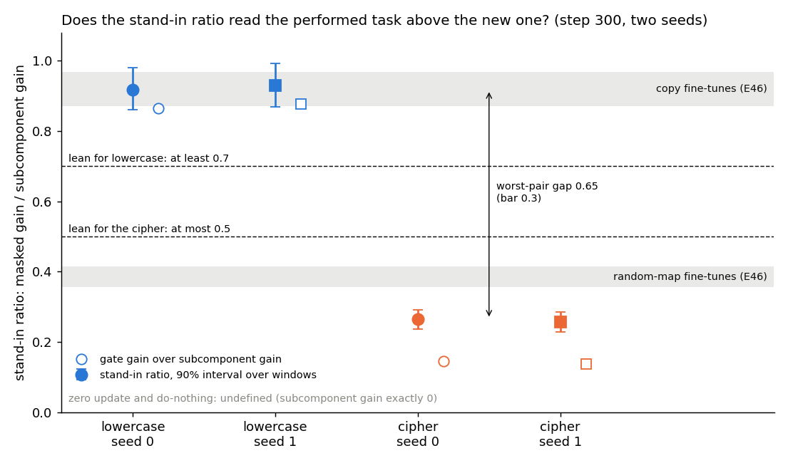
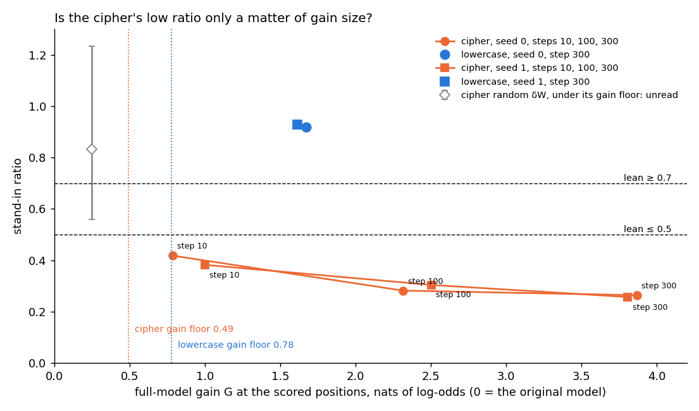
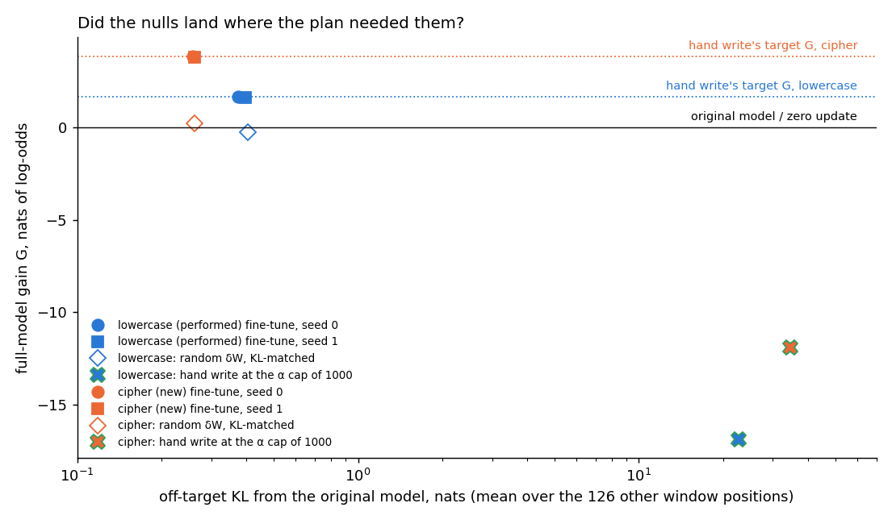
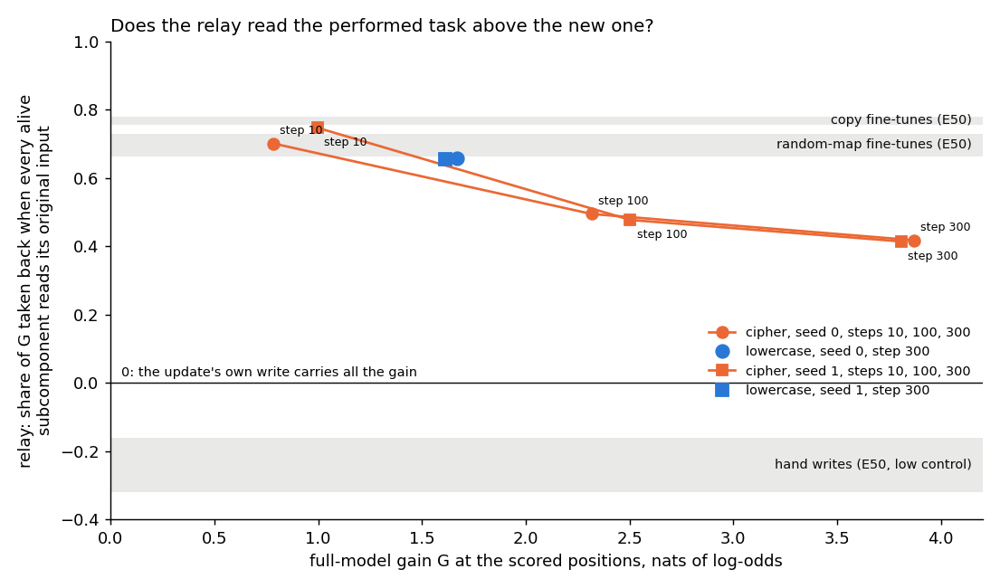
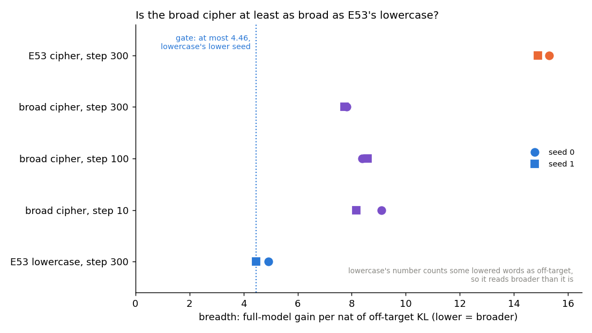
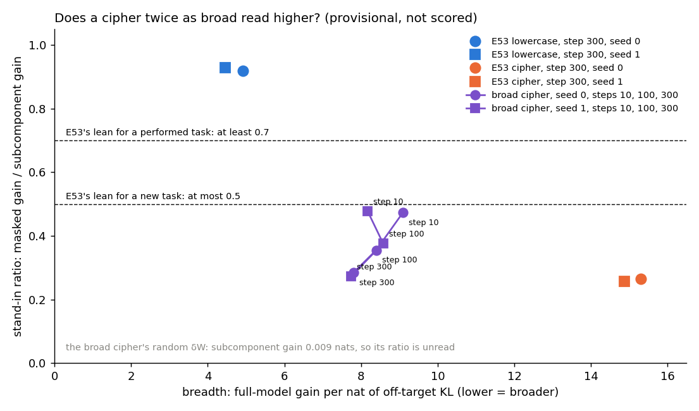
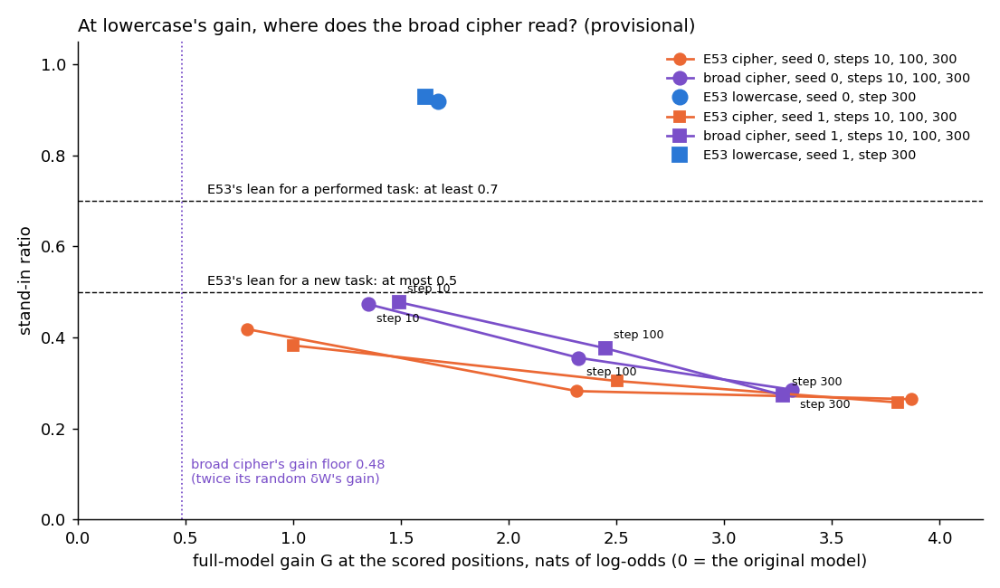
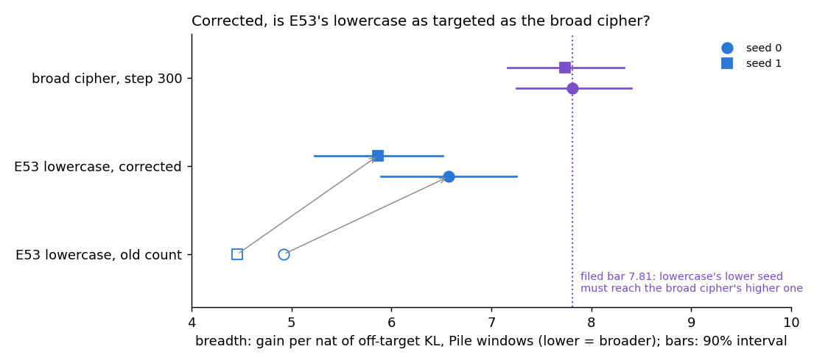
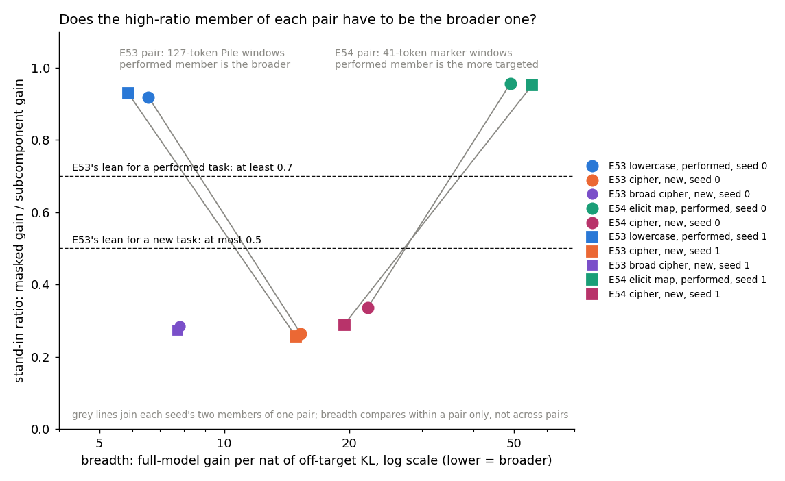

# Does the stand-in ratio tell a behaviour the model already performs from a new one? E53 performed anchor

*E53, `experiments/performed_anchor/run.py` stages `finetune` and `read`, written 2026-10-29. Plan, filed predictions
and code-review record: `reports/plans/2026-10-29_plan_performed-anchor.md`. Filed rules:
`experiments/performed_anchor/results/predictions.json`, filed before the run, not edited since. Results:
`results/a0.json`, `results/finetune.json`, `results/read.json`. Figures: `experiments/performed_anchor/figures/` from
`plot.py`. Notebook: `notebooks/E53_performed_anchor.ipynb`. Independently checked 2026-10-29: supported with
corrections, applied here; the breadth section and the update-size section were added then. Amendment 1b, a cipher
twice as broad, added at the end on 2026-10-30. Amendment 2, which settles kind against breadth from saved states,
added after it on 2026-10-30; it changes the answer below.*

## In plain words

We fine-tuned the small model on the same text to write in lowercase, which it already prefers, and to swap fifty common
words, which it cannot. The stand-in ratio read lowercase far above the word swap on both seeds, and a second pair from
another experiment, where the behaviour the model already has was the more targeted update, read the same way round.
For `GOALS.md` this means that, on these two task families, the ratio's separation is not explained by how broad the
update is, so it goes on as a candidate reading of kind, at the level of the decomposition's subcomponents.

## The answer

The stand-in ratio separates lowercase from the word swap by a wide margin. Lowercase read about 0.92 and the swap
about 0.26 on both seeds. Lowercase was also the broader update, so kind and breadth were confounded here. Amendment 2
settled that with E54's pair, a half-known key table and a cipher on the same keys. There the half-known table was
about twice as targeted, yet still read high and the cipher low. So the high-ratio member is the broader one in one
pair and the narrower one in the other: breadth does not explain the separation. On E53's pair alone it stays
confounded. The relay did not separate the pair, and the null meant to test kind against task failed.

## What was tested

**The model.** The 67M model and its frozen VPD decomposition; Γ and Δ are never trained here.

**The pair.** Two fine-tunes of the same 2,400 Pile training rows, each by E37's recipe: Adam at 3e-5, 300 steps of 8
rows, all 24 decomposed matrices. Each ran at two batch orders, called seeds 0 and 1.

- *Lowercase, the performed member.* The rows lowercased. Stage A0, run first and alone, showed the original model
  already prefers the lowercase form of the next word on lowercased text. The preference is 1.18 nats on average, with
  a 90% interval of 0.84 to 1.56, and it flips to −5.58 on the cased text.
- *Cipher, the new member.* The cased rows with a fixed swap of 50 word tokens of Pile frequency ranks 50 to 99,
  applied in context and in the answers. The original model prefers the unswapped word by 5.53 nats.

The cipher was saved at steps 10, 100 and 300, so that it can also be read at a gain close to lowercase's.

**Where it is read.** Up to 500 scored positions per task from held-out Pile rows, each in a 127-token window with the
scored token in the middle. Lowercase is scored where the next word was capitalised in the original text; the cipher
where the next token is a swapped word. Every number is the log-odds of the true next token there.

**The numbers.** Each update δW gets the least-squares split: the least-norm change $(dU, dV)$ to the alive subcomponents
with $dU V^\top + U dV^\top \approx \delta W$, the rest going to Δ, so the full model is exactly $W_0 + \delta W$. The
stand-in model rebuilds the model from the subcomponents alone, Δ removed, each subcomponent multiplied by Γ's mask.
Symbols, one per line:

- $G = T_1 - T_0$: the full model's gain, fine-tuned minus original.
- $U_1 - U_0$, the subcomponent gain: the rise from the original subcomponents $C_0$ to the split ones $C_1$ with every
  mask open.
- $L(C, M)$: the answer's log-odds in the stand-in model with subcomponents $C$ and Γ's masks $M$, where $M_0$ are Γ's
  values on the original model and $M_1$ on the updated one.
- The masked gain, $L(C_1, M_1) - L(C_0, M_0)$.
- The gate gain, $g = L(C_0, M_1) - L(C_0, M_0)$: what Γ's new mask values alone do to the original subcomponents.
- The stand-in ratio, masked gain over subcomponent gain.

The code computes exactly that ratio: `score.ratio_of` returns `masked_gain / piece_gain`. In `run.py`'s `cells`,
`masked_gain` is the mean of $L_{11} - L_{00}$ and `piece_gain` the mean of $U_1 - U_0$ over windows. The field "ratio" in
`read.json`'s score is this number, and dividing the stored cells reproduces it on every row. As E46 Amendment 3 found,
the masked gain is $g$ plus what the split's changes add once the new masks are set, so the ratio is roughly $g$ over
the subcomponent gain. It is not "the share Γ keeps". It has no ceiling at 1. It is undefined when the subcomponent
gain is under its bar.

**The relay**, E50's number, is read in the real fine-tuned model under do-nothing: δW sits in Δ, the subcomponents
untouched. Every alive subcomponent's output at the scored position is restored to what it would be on the original
model's input there. The relay $\rho$ is the share of $G$ that this takes back: 1 means all the gain passes through the
original weights, 0 means the update's own write carries it all.

**Controls and nulls.**

- *Recipe*: lowercase seed 0 must reproduce E37's held-out gain of 0.1301 nats per token within 0.005.
- *Zero update, do-nothing, same G*: every gain of a zero update must read 0; a do-nothing state's subcomponent gain
  must read 0; a split state must have the same $G$ as its do-nothing state. The code review before the run found that
  all three pass by construction. The split skips all-zero matrices, and $U$ and $T$ do not depend on the
  subcomponents. So their passing carries no information about the apparatus.
- *Random δW*: a Gaussian update with the seed-0 fine-tune's per-matrix norms, scaled until the full model's KL to the
  original model on the other window positions matches the fine-tune's. It learned nothing, and twice its gain sets
  each task's gain floor.
- *Hand write*: E46's write into block 1's MLP output, the least-norm matrix mapping each next token's mean input there
  to that token's unembedding row, scaled until the full model's $G$ matches the seed-0 fine-tune's. It raises the
  answers while building no mechanism. It was there to answer one alternative: that any update raising these answers
  reads like its task, whatever its kind.

## What we expected, and why

The original model already writes lowercase text, so a lowercase fine-tune should mostly turn on subcomponents it
already has. Its ratio was leaned at 0.7 or above, as E36's switching share of 0.79 on the same fine-tune. The cipher
pairs words the model never pairs, so its gain should sit more in the split's changes than in Γ's new mask values. Its
ratio was leaned at 0.5 or below, like E12's random maps at 0.36 to 0.41. The risk, from E36, was that any small broad
update reads about 0.8.

The scored rule takes the worst pair across seeds: the lower lowercase ratio minus the higher cipher ratio. A gap of 0.3
or more separates. The relay was reported under the same rule. It was leaned not to separate, since E50's copies and
random maps both read about 0.7. The third filed check asked whether the hand write reads within 0.15 of its task's
fine-tune. If it did, the ratio would follow the task rather than the kind of update.

## The controls

Every filed control passed, but only four checks in this run could have failed.

- The recipe reproduced 0.12963 nats per token against 0.1301. E49's regeneration on the same card read 0.12963, so
  in effect this checks determinism.
- Every bf16 copy matched its fp32 state within 0.0003, against a tolerance of 0.005. That tolerance is 64% of the
  cipher's step-10 held-out gain of 0.0078 nats per token, so the check is weak there.
- A0's original-model control passed before anything else ran.
- Each random δW matched its fine-tune's off-target KL.

In the read stage nothing could fail. The zero update read exactly 0 on every gain, the do-nothing subcomponent gains
read exactly 0, and each split state's $G$ equalled its do-nothing $G$; all three hold by construction. The zero
update's relay reads 0 for the same reason: restoring the subcomponents' outputs changes nothing when nothing was
updated. The ratio has no positive control in this run. E46's toy tables used the same scoring function, but the cells
are composed anew here in `run.py`'s `cells`, so "the same code path" holds only loosely. The relay's "does not
separate" has no working low control either, since the hand write failed. The fine-tune stage took 107 seconds and the
read stage 217 seconds on an L40, at $0.

## Does the stand-in ratio read the performed task above the new one?

**Reading it.** Yes, by the filed rule and by a wide margin. The lowercase fine-tunes read 0.92 and 0.93, inside E46's
band for copies. The cipher fine-tunes read 0.26 on both seeds, below E46's band for random maps. The worst-pair gap was
0.65 against a bar of 0.3, so the scored rule reads "separates". The 90% intervals over windows are about ±0.06 for lowercase and
±0.03 for the cipher and do not come near each other. The two seeds agree within 0.011 on each task. The hollow markers
show the gate gain over the subcomponent gain, and they separate the tasks as well: 0.87 and 0.88 against 0.15 and 0.14.

| row | G, nats | subcomponent gain, nats | gate gain g, nats | masked gain, nats | stand-in ratio | 90% interval | g over subcomponent gain | relay |
|---|---|---|---|---|---|---|---|---|
| lowercase, seed 0 | 1.671 | 1.451 | 1.256 | 1.333 | 0.919 | 0.861-0.980 | 0.866 | 0.657 |
| lowercase, seed 1 | 1.612 | 1.417 | 1.241 | 1.317 | 0.929 | 0.868-0.992 | 0.876 | 0.655 |
| cipher, seed 0 | 3.869 | 3.304 | 0.481 | 0.873 | 0.264 | 0.237-0.292 | 0.146 | 0.418 |
| cipher, seed 1 | 3.809 | 3.242 | 0.442 | 0.834 | 0.257 | 0.228-0.285 | 0.136 | 0.414 |

All four rows clear their bar. The bar is 1 nat or the row's noise floor, whichever is lower. The floors were 0.78 for
lowercase and 0.49 for the cipher, both set by twice the random δW's largest gain. Read at the plan's plain 1-nat bar,
the rule gives the same answer.

**What the ratio is made of here.** The part beyond the gate gain, $L(C_1, M_1) - L(C_0, M_1)$, is 0.077 and 0.075 nats
on lowercase, about 0.05 of the subcomponent gain. On the cipher it is 0.39 nats, 0.12 of the subcomponent gain. On
every earlier toy row it was 0.01 to 0.05. So "the ratio is about the gate gain over the subcomponent gain" holds
loosely here on the cipher: about half the cipher's ratio is the gate gain and half the split's changes. This reading
of the cells is not filed and is provisional.

## Is the cipher's low ratio only a matter of gain size?

**Reading it.** Not on the states we have: the cipher reads low at every gain we saved, including the two that bracket
lowercase's. The cipher's gain grew from about 0.8 to about 3.8 nats over training, and its ratio fell as it grew. On
both seeds it went from about 0.4 at step 10 to 0.26 at step 300; the table has each step. No cipher state matches
lowercase's gain. The matched-gain row, reported and not scored, takes the nearest saved state. That is step 100 on
seed 0, gain 2.32 against 1.67, ratio 0.28. On seed 1 it is step 10, gain 1.00 against 1.61, ratio 0.38. That seed-1
state is under 1 nat and is read only through its noise-floor bar of 0.49. On both seeds steps 10 and 100 bracket
lowercase's gain. A straight line between them gives a ratio of 0.34 on seed 0 and 0.35 on seed 1 at lowercase's gain,
against 0.92 and 0.93. The interpolation is provisional: the trend rises toward small gains and need not be straight.

| cipher state | G, nats | subcomponent gain, nats | stand-in ratio | 90% interval | relay |
|---|---|---|---|---|---|
| seed 0, step 10 | 0.785 | 0.613 | 0.418 | 0.372-0.466 | 0.701 |
| seed 0, step 100 | 2.317 | 1.911 | 0.282 | 0.247-0.320 | 0.495 |
| seed 0, step 300 | 3.869 | 3.304 | 0.264 | 0.237-0.292 | 0.418 |
| seed 1, step 10 | 0.999 | 0.796 | 0.382 | 0.344-0.422 | 0.747 |
| seed 1, step 100 | 2.504 | 2.087 | 0.304 | 0.270-0.338 | 0.477 |
| seed 1, step 300 | 3.809 | 3.242 | 0.257 | 0.228-0.285 | 0.414 |

## Did the nulls land where the plan needed them?

**Reading it.** The random updates landed as planned; the hand writes did not land at all. Each random δW matched its
fine-tune's off-target KL and gained almost nothing: −0.24 nats on lowercase and +0.25 on the cipher. That sets the
gain floors. The hand writes were meant to match each fine-tune's gain with little other change. Instead the scale
search hit its cap of 1000 without ever reaching the target. At the cap the answer's log-odds fell, by 16.9 nats on
lowercase and 11.9 on the cipher. The off-target KL rose to 22.7 and 34.5 nats, against 0.37 and 0.26 for the
fine-tunes. The write's fit says why: on single held-out windows, its output pointed at the answer's unembedding row
with mean cosine 0.11 on lowercase and 0.24 on the cipher. Its relative error was 1.7 and 1.8. A mean input grouped by
the *next* token does not identify that token from the current input, so the write raises nothing in particular. That
explanation is provisional. Both writes' match status is "cap", so the hand-write check is unread by its filed rule.

| null | task | scale | match | G, nats | off-target KL, nats | subcomponent gain, nats | masked gain, nats | relay |
|---|---|---|---|---|---|---|---|---|
| random δW | lowercase | 6.39 | ok | −0.237 | 0.405 | −0.389 | −0.126 | not read |
| random δW | cipher | 5.24 | ok | 0.246 | 0.261 | 0.191 | 0.159 | not read |
| hand write | lowercase | α 1000 | cap | −16.878 | 22.676 | −16.669 | −17.040 | 0.001, not read |
| hand write | cipher | α 1000 | cap | −11.933 | 34.483 | −17.293 | −18.448 | −0.001, not read |

The hand writes used 764 keys for lowercase, condition number 338, and 50 for the cipher, condition number 26. The code
review flagged the lowercase write as possibly ill-conditioned before the run.

**So the main open caveat stands.** The run cannot say whether the ratio follows the kind of update or only the task.
A write that builds nothing but raises the same answers might read high on lowercase and low on the cipher too; we
have no working update of that sort to check. E46 Amendment 3's hand writes read close to their tables' fine-tunes,
which is the reason to worry. Even a working hand write would not have separated kind from breadth, the alternative in
the next section: it writes into one matrix of block 1 on both tasks.

**The random rows.** Lowercase's random δW lost gain on both counts, so its ratio is not defined; it serves only as a
floor. The cipher's random δW has gain 0.25 and subcomponent gain 0.19. Its floor is twice its own gain, so it can never
clear it, and its ratio is unread by rule. The figure plots it only to show the whole range.

## Is it the kind of update, or its breadth?

A simpler explanation fits every read row: lowercase is the broader update. It changes the answer at about twice as
many positions. In the held-out rows 4,598 positions qualify for lowercase against 2,198 for the cipher. In A0's rows
it was 6,070 against 2,916. The table divides each gain by the off-target KL, the full model's KL to the original model
on the other window positions. A high gain per off-target KL means a targeted update; a low one, a broad update.

| row | G per off-target KL | gate gain per off-target KL | subcomponent gain per off-target KL | stand-in ratio |
|---|---|---|---|---|
| lowercase, seed 0, step 300 | 4.46 | 3.36 | 3.88 | 0.919 |
| lowercase, seed 1, step 300 | 4.06 | 3.13 | 3.57 | 0.929 |
| cipher, seed 0, step 10 | 11.0 | 3.13 | 8.59 | 0.418 |
| cipher, seed 1, step 10 | 11.7 | 3.06 | 9.32 | 0.382 |
| cipher, seed 0, step 100 | 14.2 | 2.09 | 11.8 | 0.282 |
| cipher, seed 1, step 100 | 14.8 | 2.54 | 12.3 | 0.304 |
| cipher, seed 0, step 300 | 15.0 | 1.86 | 12.8 | 0.264 |
| cipher, seed 1, step 300 | 14.5 | 1.69 | 12.4 | 0.257 |

**Reading it.** Breadth and kind are fully confounded in this run. Lowercase gains 4.1 to 4.5 nats per nat of
off-target KL; every cipher state gains 11.0 to 15.0. So every read row orders the same on gain per off-target KL as on
its task label. The gate gain per off-target KL is about equal where it can be compared: 3.1 to 3.4 for lowercase,
3.1 for the cipher at step 10. The separation sits in the subcomponent gain per off-target KL, two to three times higher
on the cipher. Since the ratio is roughly gate gain over subcomponent gain, a targeted update could read low for that
reason alone, whatever its kind. E46 Amendment 3's hand writes reading near their fine-tunes tilts toward "the ratio
reads the task". So the claim this run supports is "the stand-in ratio separates these two tasks", not yet "it
separates a performed behaviour from a new one". This reading is not filed.

## Update size (provisional)

Could the plain size or rank of δW order like the ratio? For each of the 8 saved bf16 states, each of the 24 matrices'
Frobenius norm $\|\delta W\|_F$ and stable rank $\|\delta W\|_F^2 / \|\delta W\|_2^2$ were computed. Stable rank is
the effective number of directions: 1 for a rank-one update, up to the matrix width for a flat spectrum. Script:
`~/commute-data/scratch/regating-lead/e53_size.py`, CPU, $0; not filed.

| state | summed norm over 24 matrices | mean stable rank | stand-in ratio |
|---|---|---|---|
| lowercase, seed 0, step 300 | 11.58 | 28.5 | 0.919 |
| lowercase, seed 1, step 300 | 11.75 | 28.6 | 0.929 |
| cipher, seed 0, step 10 | 2.69 | 19.0 | 0.418 |
| cipher, seed 1, step 10 | 2.73 | 18.6 | 0.382 |
| cipher, seed 0, step 100 | 7.32 | 29.0 | 0.282 |
| cipher, seed 1, step 100 | 7.41 | 28.5 | 0.304 |
| cipher, seed 0, step 300 | 11.86 | 37.0 | 0.264 |
| cipher, seed 1, step 300 | 11.86 | 37.8 | 0.257 |

**Reading it.** Neither orders like the ratio. At step 300 the two tasks' updates are the same size, 11.6 to 11.9 summed,
yet read 0.92 against 0.26. Lowercase's mean stable rank of 28.5 equals the cipher's at step 100, which reads 0.28 to
0.30. Within the cipher, size and stable rank both rise as the ratio falls, but both also track training steps. The
norm-weighted stable rank gives the same picture. So weight-space size and rank do not explain the separation; breadth
in the output, above, is not ruled out by this.

## Does the relay read the performed task above the new one?

**Reading it.** No, as leaned. At step 300 lowercase relayed 0.66 of its gain through the original weights on both
seeds, the cipher 0.42 and 0.41. The worst-pair gap was 0.24 against the 0.3 bar, so the rule reads "does not separate". The
cipher missed its own lean, which was 0.6 to 0.8 from E50's random maps; it read lower. The figure shows why the gap
should not be read as a kind effect either way. The cipher's relay falls as its gain grows, from 0.70 and 0.75 at step
10 to about 0.42 at step 300. Interpolated between steps 10 and 100, as for the ratio, the cipher's relay at
lowercase's gain is 0.58 on seed 0 and 0.64 on seed 1. Lowercase's is 0.66. That interpolation is provisional,
as for the ratio. At the nearest saved gains the relay comes close to lowercase's, so it may move with gain size, but
this run cannot say it does not move with kind. The hand writes' relay, E50's low control, was not read because the
writes missed their target.

## The method's limit, in plain words

VPD's smallest unit is one rank-one subcomponent, not a circuit. A new mechanism built from subcomponents the original
model already has, put together under new mask values, reads as "elicited" to every number here. The cipher's answers
are common words whose output subcomponents the original model already has. So the cipher could have read high for that
reason alone; it read low. A high reading, like lowercase's, means "uses pieces the original model has", never "uses a
circuit it already runs". Only a Γ from a second decomposition seed narrows this. The limit is recorded in
`decisions.md` under "Limit of the elicitation reading".

## What we learned

`GOALS.md`'s fallback question asks whether an update is new capability or strengthening. The stand-in ratio separated
lowercase from a 50-word cipher by 0.65 on both seeds, and still at the nearest saved gains. The pair's labels were
checked by the original model's behaviour, not set by construction as on the toys. It does not yet answer "can VPD
tell elicitation from a new mechanism", for three reasons. First, breadth is fully confounded with kind: lowercase is
the broader update on every row, and a ratio that read breadth would give the same table. Second, the hand-write null
broke, so a task effect is not ruled out, and E46 Amendment 3's hand writes tilt toward one. Third, the granularity
limit above caps what a high reading can mean. So the kind question is more open after this run than "one null broke"
suggests. The real-model relay does not separate the pair at step 300. What would make the result stronger: a pair
matched in breadth but differing in kind, a task-matched null that reaches its gain, and a second decomposition seed.

## How compelling is the evidence

- *Tasks*: one pair, lowercase against a 50-word cipher, on one model, the 67M. Two batch orders per task; one
  decomposition.
- *Noise*: 90% intervals over windows are ±0.03 to ±0.06, and the seed spread was 0.011 on lowercase and 0.007 on the
  cipher. The gap of 0.65 is about ten times the widest interval's half-width and five times its full width. Windows
  from the same row share context, so the intervals are somewhat too narrow; that does not threaten a gap of this size.
- *Blind to*: the real model, since the ratio is read in Γ's stand-in. Whether the split's changes themselves matter.
  Whether an update that builds nothing reads like its task: the hand write that would check it broke. Kind against
  breadth: the two are confounded on every row.
- *Labels*: A0 shows the original model prefers lowercase forms and rejects the swapped words at the token level. It
  does not show the fine-tunes use the same subcomponents the original model uses for lowercase.
- *Controls*: nothing in the read stage could fail. The ratio has no positive control in this run. The nearest is E46's
  copy and random-map tables, 0.87 to 0.97 against 0.36 to 0.41. They used the same scoring, but their cells were
  composed by different code. The relay's "does not separate" has no working low control.
- *Fine-tunes*: neither makes its answer likely. The true next token's log-odds after training are −5.1 on lowercase and
  −6.3 on the cipher; both tasks are partly learned.

## Surprises

- The hand writes failed outright. They never reached their target gain at any grid scale up to the cap, and at the cap
  they pushed the answers down by 12 to 17 nats. The plan expected them to match by construction. The grid itself is
  not saved.
- The 90% intervals over windows were ±0.03 to ±0.06, three to six times the filed expectation of about ±0.01 at 500
  windows. The gap still clears them by far.
- The cipher's relay read 0.41 to 0.42 at step 300, below its leaned 0.6 to 0.8. It falls with training steps, from
  about 0.7 at step 10.
- On the cipher, the split's changes add 0.12 of the subcomponent gain beyond the gate gain, against 0.01 to 0.05 on
  every toy row; the ratio is less nearly "gate gain over subcomponent gain" here. Provisional.

## What next

1. **A pair matched in breadth.** A performed task as targeted as the cipher, or a new task as broad as lowercase. If a
   targeted performed task reads high, the ratio follows kind; if it reads low, it follows breadth.
2. **A task-matched null that works.** For example a write keyed on something the input at the scored position does
   identify, or a fine-tune of the same answers that cannot build a mechanism. If it reads like its task, near 0.9 on
   lowercase and near 0.26 on the cipher, the ratio reads the task. If it reads alike on both, the separation is not
   only the task.
3. **A second decomposition seed.** It is the only check that narrows the granularity limit. Qwen stage 1 waits for
   items 1 and 2, so that what is carried is known to read kind; it is gated by the project's rules.

## Scorecard

| id | claim in words | rule | read | verdict |
|---|---|---|---|---|
| recipe | the lowercase fine-tune reproduces E37 | held-out gain within 0.005 of 0.1301 | 0.12963 | pass |
| bf16_save | the saved bf16 states match fp32 | held-out gain within 0.005 | largest difference 0.0003 | pass |
| zero, do_nothing, same_G | the read apparatus lines up | every gain within 0.001, relay within 0.01 | exactly 0 | pass, by construction; no information |
| P1 | the stand-in ratio reads lowercase above the cipher | min lowercase − max cipher ≥ 0.3, all four read | 0.919, 0.929 vs 0.264, 0.257; gap 0.654 | separates |
| P1 at 1 nat | the same at the plan's plain bar | as P1, bar 1 nat | same rows, gap 0.654 | separates, reported |
| P2 | the relay reads lowercase above the cipher | as P1 on ρ | 0.657, 0.655 vs 0.418, 0.414; gap 0.237 | does not separate, reported; as leaned |
| P3 | a hand write reads like its task | abs difference ≤ 0.15 on a task, write match "ok" | both writes at the α cap | unread |
| reading | combined | P1 class with P3 | separates, P3 unread | "separates (P3 unread)" |
| lean, lowercase | ratio ≥ 0.7, relay ≥ 0.5, G in 1-3 | reported | 0.92-0.93, 0.66, 1.61-1.67 | all met |
| lean, cipher | ratio ≤ 0.5, relay 0.6-0.8, G ≥ 3 | reported | 0.26, 0.41-0.42, 3.81-3.87 | ratio and G met; relay missed, below |
| lean, random δW | abs G ≤ 0.6 | reported | 0.24, 0.25 | met |
| lean, hand write | relay ≤ 0.2 | reported | not read, match "cap" | unread |
| matched gain | cipher at G nearest lowercase's | reported, not scored | seed 0 step 100, G 2.32 vs 1.67, 0.282; seed 1 step 10, G 1.00 vs 1.61, 0.382 | no state matches; both under 0.5; interpolated 0.34, 0.35, provisional |

## Not run

- The hand-write check: a hand write or other task-matched null that reaches its fine-tune's gain. Both writes hit the
  α cap.
- The hand writes' relay as a low control on these tasks.
- The lowercase random δW's ratio, undefined because its gains are negative, and the cipher random δW's, under the floor.
- A cipher state at exactly lowercase's gain; the nearest saved steps are 10 and 100.
- A pair matched in breadth, so kind and breadth are confounded on every row.
- A positive control for the ratio within this run.
- A second decomposition seed, a second task pair, more than two batch orders.
- Any reading in the real model of the ratio's quantity; any Qwen run.
- A check that the fine-tunes use the subcomponents the original model uses for lowercase.
- An interval over rows rather than windows.

## Provenance

- Run commit `f848100a60d85b7fbce92af953b449c1c2461df6`; results committed at `543f91b`.
- A0: `results/a0.json`, on a RunPod 4090, results commit `674d7f0`, 38 s, GO.
- `run.py finetune` and `run.py read`: MATS cluster L40, `debug` QoS, $0. Fine-tune 19:24:47 to 19:26:34, peak GPU 9.0
  GB, host 6.1 GB. Read 19:26:43 to 19:30:20, peak GPU 11.0 GB, host 6.1 GB. Slurm job IDs were not recorded in the
  results or logs.
- States: `results/large/dW_<task>_s<seed>_step<n>.pt`, bf16, sha256 in `results/finetune.json`. Logs:
  `results/large/finetune.log`, `read.log`.
- Figures: `experiments/performed_anchor/plot.py`, from `results/read.json` only.

# Amendment 1b (2026-10-30): a cipher twice as broad

*`run.py a1b_finetune` and `a1b_read`, jobs 45971 and 45972, written 2026-10-30. Plan: section "Amendment 1b" of
`reports/plans/2026-10-29_plan_performed-anchor.md`. Filed rules: `results/predictions_amend1b.json`, filed before the
run. Results: `results/finetune_amend1b.json`, `results/read_amend1b.json`. Figures: `figures/a1b_*.png` from
`plot_amend1b.py`. Notebook: the Amendment 1b part of `notebooks/E53_performed_anchor.ipynb`.*

## In plain words

We fine-tuned the small model to swap 500 common words, to test whether E53's gap comes from lowercase being the
broader update. The new cipher was twice as broad as E53's but still narrower than lowercase, so the filed rule leaves
the question unanswered. For `GOALS.md` the confound between kind and breadth stands; provisionally, the broader
cipher still read far below lowercase, at most about 0.07 above E53's cipher.

## The answer

Not answered. The filed rule needed the new cipher to be at least as broad as E53's lowercase, and it was not. It
buys about 7.8 nats of gain per nat of change elsewhere, against lowercase's 4.5 to 4.9. It is twice as broad as E53's
cipher, though. Its stand-in ratio sat 0.01 to 0.02 above E53's cipher at step 300, and about 0.07 above at the step
where the two ciphers' gains match. That is a tenth of the gap to lowercase. So, provisionally, it is still far below
lowercase, at most about 0.07 above E53's cipher. At a gain close to lowercase's it read 0.47.

## What was tested

E53 found the stand-in ratio reads lowercase at 0.92 and a 50-word cipher at 0.26. Lowercase is something the original
model already does, the cipher something it cannot do. But lowercase is also the broader update: it changes the output
at more positions per nat of gain. Amendment 1 was to swap the two, a narrow performed task against a broad new one.
Its narrow lowercase task failed the original-model check: the model does not lowercase those 50 words inside cased
text, preferring the capital by 4.7 nats. The user chose to run the broad cipher alone.

**The broad cipher.** The same 2,400 cased Pile rows as E53. A fixed seeded swap of the 500 word tokens of Pile
frequency ranks 50 to 549 is applied in context and in the answers. The swap touches 9.1% of training tokens, against 2.4% for E53's
cipher. The original model prefers the unswapped word by 5.0 nats at these positions, so it cannot do this task.
E53's recipe: Adam at 3e-5, 300 steps of 8 rows, all 24 decomposed matrices, batch orders 0 and 1, called seeds,
saved at steps 10, 100 and 300.

**Breadth.** The full model's gain $G$ at the scored positions divided by the true off-target KL. That KL is the mean KL from the original model to the fine-tuned one. It is taken over the window positions whose
next token is not one of the task's scored tokens. A high value means a targeted update; a low one, a broad update. E53 used a pooled KL over every other
position; the true one leaves out positions that predict another task token. E53's four step-300 states were re-read
with it in this run.

**The ratio.** As in E53: the least-squares split of each update, then the stand-in model, the subcomponents alone
under Γ's masks. The stand-in ratio is the masked gain over the subcomponent gain. It is roughly the gate gain $g$ over
the subcomponent gain $U_1 - U_0$, where $g$ is what Γ's new mask values alone do to the original subcomponents. It is
not the share Γ keeps and has no ceiling at 1.

**The random update.** A Gaussian update with the step-300 seed-0 fine-tune's per-matrix norms, scaled until its
off-target KL matched. It learned nothing; twice its gain sets the gain floor, the gain a state needs to be read.

## What we expected, and why

The filed rule had two steps. First, the new cipher had to be at least as broad as E53's lowercase on both seeds. If
not, the outcome is "not read". If so, both step-300 ratios at 0.5 or below would mean breadth does not explain E53's
gap, and both at 0.7 or above would mean it does. The lean was "does not explain" at 0.6, since every cipher-like
update read so far sat between 0.26 and 0.42. The breadth step was leaned to pass at 0.6, unmeasured: the new cipher
maps four times as many training tokens.

## The control

E53's two seed-0 step-300 states were re-read first by this code. Lowercase reproduced $G$ 1.6708 and ratio 0.9186,
the cipher 3.8690 and 0.2643, exactly as in `read.json`. The seed-1 states also reproduced their E53 ratios exactly.
Every bf16 state matched its fp32 held-out gain within 0.0003. The fine-tune took 46 seconds and the read 134 seconds
on an L40, at $0.

## Is the broad cipher at least as broad as E53's lowercase?

**Reading it.** No. The broad cipher gains 7.81 and 7.74 nats per nat of off-target KL at step 300, against
lowercase's 4.92 and 4.46. The filed bar was lowercase's lower seed, 4.46, so the outcome is "not read". It is about
twice as broad as E53's cipher, which reads 15.3 and 14.9. No saved step reaches lowercase: the broad cipher was most
targeted at step 10, at 8.2 to 9.1, and broadened as it trained.

**A caveat on the bar, from the plan's review.** E53's lowercase task lowered every capital, but only positions before
a space-led capital count as its scored positions. Positions predicting a capital with no leading space, or a word the
tokenizer splits differently once lowercased, were changed by the task yet count as off-target. Their KL inflates
lowercase's off-target KL, so lowercase reads broader than it is. The bar was therefore harder to pass than intended.
The rule was scored as filed. For the broad cipher to pass, lowercase's corrected number would have to rise from 4.46 to 7.81. How far it would
rise is not measured.

| state | G, nats | true off-target KL, nats | breadth, true KL | breadth, pooled KL |
|---|---|---|---|---|
| E53 lowercase, seed 0, step 300 | 1.671 | 0.340 | 4.92 | 4.46 |
| E53 lowercase, seed 1, step 300 | 1.612 | 0.362 | 4.46 | 4.06 |
| broad cipher, seed 0, step 10 | 1.350 | 0.149 | 9.09 | 8.68 |
| broad cipher, seed 1, step 10 | 1.491 | 0.182 | 8.17 | 7.80 |
| broad cipher, seed 0, step 100 | 2.325 | 0.277 | 8.40 | 7.96 |
| broad cipher, seed 1, step 100 | 2.450 | 0.286 | 8.58 | 8.12 |
| broad cipher, seed 0, step 300 | 3.315 | 0.424 | 7.81 | 7.39 |
| broad cipher, seed 1, step 300 | 3.275 | 0.423 | 7.74 | 7.33 |
| E53 cipher, seed 0, step 300 | 3.869 | 0.253 | 15.30 | 14.95 |
| E53 cipher, seed 1, step 300 | 3.809 | 0.256 | 14.88 | 14.54 |

**Is E53's lowercase broader than its cipher on the true KL?** Yes, reported and not scored. Lowercase reads 4.5 to 4.9
and the cipher 14.9 to 15.3, the same order as on the pooled KL. So E53's breadth confound was not an artefact of how
densely each task's own tokens sit in the windows. The caveat above biases lowercase toward broad here too. To close
the threefold gap, about two-thirds of lowercase's off-target KL would have to come from such positions; that share is
not measured.

## Does a cipher twice as broad read higher?

**Reading it.** Only a little, provisionally and unscored. At step 300 the broad cipher read 0.285 and 0.273, with
90% intervals over windows of about ±0.035. E53's cipher read 0.264 and 0.257 at half the breadth, but at a higher
gain, 3.8 to 3.9 nats against 3.3, and the ratio falls with gain. The two ciphers' gains match at step 100: 2.33 and
2.45 nats for the broad cipher, 2.32 and 2.50 for E53's. There the broad cipher read 0.355 and 0.376, E53's cipher
0.282 and 0.304. That is about 0.07 higher, and the 90% intervals barely touch: 0.320 to 0.392 against 0.247 to 0.320
on seed 0. Lowercase reads 0.92 to 0.93. A high ratio like lowercase's means only "uses pieces the original model has": a new circuit built from old pieces would also read as elicited. So moving the cipher most of the way to lowercase's
breadth raised its ratio by 0.01 to 0.02 at step 300 and about 0.07 at matched gain, a tenth of the 0.65 gap. The gate
gain over the subcomponent gain tells the same story. It reads 0.18 to 0.20 on the broad cipher and 0.14 to 0.15 on
E53's, against 0.87 to 0.88 on lowercase.

What this cannot rule out:

- *A breadth effect closer to lowercase.* The broad cipher is still 1.6 to 1.8 times lowercase's breadth number. A
  ratio that rose only near lowercase's breadth would give this figure.
- *Different words.* The two ciphers swap different words: 500 of ranks 50 to 549 against 50 of ranks 50 to 99. They
  are scored at different positions, so they are not one task at two breadths.
- *Task family.* Both low readings are word swaps and the one high reading is lowercase. Kind and task family stay
  confounded: no broad performed task and no targeted performed task has been read.
- *The bar's bias.* If lowercase's true breadth is well above 4.9, the broad cipher may be closer to it than it looks.

| state | G, nats | subcomponent gain, nats | gate gain g, nats | masked gain, nats | stand-in ratio | 90% interval | g over subcomponent gain |
|---|---|---|---|---|---|---|---|
| broad cipher, seed 0, step 10 | 1.350 | 1.043 | 0.450 | 0.493 | 0.473 | 0.430-0.517 | 0.432 |
| broad cipher, seed 1, step 10 | 1.491 | 1.185 | 0.522 | 0.565 | 0.477 | 0.435-0.520 | 0.440 |
| broad cipher, seed 0, step 100 | 2.325 | 1.935 | 0.548 | 0.687 | 0.355 | 0.320-0.392 | 0.283 |
| broad cipher, seed 1, step 100 | 2.450 | 2.034 | 0.629 | 0.765 | 0.376 | 0.332-0.424 | 0.309 |
| broad cipher, seed 0, step 300 | 3.315 | 2.789 | 0.547 | 0.795 | 0.285 | 0.250-0.322 | 0.196 |
| broad cipher, seed 1, step 300 | 3.275 | 2.730 | 0.490 | 0.745 | 0.273 | 0.239-0.308 | 0.179 |
| E53 cipher, seed 0, step 300 | 3.869 | 3.304 | 0.481 | 0.873 | 0.264 | 0.237-0.292 | 0.146 |
| E53 cipher, seed 1, step 300 | 3.809 | 3.242 | 0.442 | 0.834 | 0.257 | 0.228-0.285 | 0.136 |
| E53 lowercase, seed 0, step 300 | 1.671 | 1.451 | 1.256 | 1.333 | 0.919 | 0.861-0.980 | 0.866 |
| E53 lowercase, seed 1, step 300 | 1.612 | 1.417 | 1.241 | 1.317 | 0.929 | 0.868-0.992 | 0.876 |

Every broad-cipher state clears its bar, the gain floor of 0.48 nats, and reads the same at the plan's plain 1-nat bar.
The part of the masked gain beyond $g$ is 0.04 to 0.09 of the subcomponent gain on the broad cipher. It is 0.12 on
E53's cipher and 0.05 on lowercase.

## At lowercase's gain, where does the broad cipher read?

**Reading it.** Low, though higher than at step 300; reported and not scored. The saved state nearest lowercase's gain
is step 10 on both seeds. There the broad cipher gains 1.35 and 1.49 nats, against lowercase's 1.67 and 1.61. It reads 0.47
and 0.48, against lowercase's 0.92 and 0.93. A straight line between steps 10 and 100 gives 0.43 and 0.46 at lowercase's
gain; that interpolation is provisional. Both ciphers' ratios fall as their gain grows. The broad cipher sits above
E53's cipher at every gain, by about 0.07 where their gains match at step 100. At step 10 the broad cipher is also at its most targeted, so this comparison
matches gain but widens the breadth gap.

## The random update gives no reference for the ratio

The broad cipher's random update was matched to the fine-tune on the pooled KL, as filed: 0.436 against 0.448 nats.
On the true off-target KL it reads 0.435 against 0.424. It gained 0.24 nats
in the full model, which sets the gain floor at 0.48. But its subcomponent gain was 0.009 nats, so its ratio divides
by almost nothing. In 94% of bootstrap resamples of the windows its subcomponent gain fell below 0.1 nats, the
smallest floor allowed. The interval of 1.12 to 2.32 comes from the other 6% only, a selected tail. So this null says
an update that learns nothing has no subcomponent gain to divide by. It does not say what ratio such an update would
read, and gives no low reference for the cipher rows. Its only job here is the gain floor.

## What we learned

The filed question, whether breadth alone explains E53's gap, is not answered: no new update reached lowercase's
breadth. Two things are firmer than before. E53's lowercase is broader than its cipher on the true off-target KL too,
so the confound is real and not a counting artefact. And a cipher twice as broad as E53's still read far below
lowercase, at most about 0.07 above E53's cipher at matched gain, a tenth of the gap. Provisionally that tilts against "the ratio reads breadth" over this range of breadth. It cannot rule
out a breadth effect nearer lowercase's, or a task-family effect, since both low readings are word swaps.

## How compelling is the evidence

- *Tasks*: one new task, the broad cipher, at two batch orders, on the 67M model and one decomposition.
- *Noise*: 90% intervals over windows are about ±0.035 on the broad cipher at step 300; the two seeds agree within
  0.012. Windows from one row share context, so the intervals are somewhat narrow.
- *Controls*: the repro control could fail and passed exactly. The ratio has no positive control in this run, and the
  random update gives it no low reference.
- *Blind to*: the update's kind, since no performed task at the cipher's breadth was read. Breadth is one definition,
  and lowercase's value under it is biased toward broad.
- *Fine-tunes*: partly learned, like E53's: the held-out gain was 0.33 nats per token at step 300.

## Surprises

- The broad cipher grew broader as it trained: most targeted at step 10, broadest at step 300. On the pooled KL, E53's cipher became more
  targeted with training.
- None else: the ratio stayed below 0.5 as leaned; the breadth requirement, leaned to pass at 0.6, missed.

## What next

1. **A corrected lowercase breadth.** Re-read E53's lowercase with every position the lowercasing changed left out of
   the off-target KL, a read of minutes on the cluster at $0. If it rises past 7.8, this run's outcome can be read
   under an amended rule; if it stays near 5, the broad cipher is truly narrower.
2. **A broader new task.** A cipher over more words or a whole-vocabulary swap, to reach lowercase's breadth. If its
   ratio stays near 0.3, breadth is ruled out over the whole range; if it rises toward 0.9, breadth explains the gap.
3. **A performed task as targeted as the cipher.** Narrow lowercase failed its check; another performed behaviour at a
   few words is needed to read kind directly.

## Scorecard

| id | claim in words | rule | read | verdict |
|---|---|---|---|---|
| check | the original model cannot do the broad cipher | mean ≤ −3 nats, from `check_amend1.json` | −4.985 | pass |
| e53_repro | this code reproduces E53's seed-0 step-300 rows | G within 0.02, ratio within 0.01 | 1.6708 / 0.9186; 3.8690 / 0.2643 | pass, exact |
| bf16_save | the bf16 states match fp32 | held-out gain within 0.005 | largest difference 0.0003 | pass |
| gate | the broad cipher is at least as broad as E53's lowercase | max broad-cipher breadth ≤ min lowercase breadth, step 300 | 7.81, 7.74 vs 4.92, 4.46 | missed |
| outcome | breadth explains E53's gap or not | gate, then both ratios ≤ 0.5 or ≥ 0.7 | gate missed | not read (swap missed) |
| lean, outcome | does not explain 0.6, mixed 0.25, explains 0.15 | reported | not read | — |
| lean, gate | achieved at 0.6 | reported | missed | — |
| e53 order | E53's lowercase broader than its cipher on the true KL | max lowercase < min cipher | 4.92, 4.46 vs 15.30, 14.88 | lowercase broader, reported; pooled KL the same |
| ratio, step 300 | broad cipher's stand-in ratio | reported, unscored | 0.285, 0.273 | provisional: 0.01-0.02 above E53's cipher |
| ratio, matched gain to E53's cipher | broad cipher vs E53 cipher at step 100 | reported, unscored | 0.355, 0.376 vs 0.282, 0.304 | provisional: about 0.07 above, a tenth of the gap |
| ratio, 1-nat bar | the same at the plain bar | reported | 0.285, 0.273 | same |
| matched gain | broad cipher at G nearest lowercase's | reported | step 10, G 1.35 and 1.49, ratio 0.473 and 0.477 | below 0.5 |

## Not run

- The filed outcome: the breadth requirement missed, so whether breadth alone explains E53's gap is unscored.
- A new update at least as broad as E53's lowercase.
- A lowercase off-target KL that leaves out every position the lowercasing changed.
- A performed task as targeted as the cipher; narrow lowercase was dropped at its original-model check.
- A low reference for the ratio: the random update's subcomponent gain was near zero.
- A positive control for the ratio within this run.
- The relay, hand write, zero-update and do-nothing rows for the broad cipher, dropped by the plan.
- A broad-cipher state at exactly lowercase's gain; steps between 10 and 100.
- E53's cipher at steps 10 and 100 on the true off-target KL.
- A second decomposition seed, another task family, Qwen; an interval over rows.

## Provenance

- `a1b_finetune`: job 45971, commit `f679167`, MATS cluster L40 `debug`, 11:54:18 to 11:55:04, peak GPU 9.0 GB,
  host 6.2 GB. States `results/large/dW_broad_cipher_s{0,1}_step{10,100,300}.pt`, bf16, sha256 in
  `results/finetune_amend1b.json`.
- `a1b_read`: job 45972, commit `52e126e`, L40 `debug`, 11:55:30 to 11:57:44, peak GPU 10.7 GB, host 6.2 GB.
- Results committed at `061067a`. Logs `results/large/a1b_{finetune,read}.{log,out}`. Cost $0.
- Figures: `experiments/performed_anchor/plot_amend1b.py`, from `read_amend1b.json` and, for E53's cipher at steps 10
  and 100, `read.json`.

## Departures from the literature

None. Every quantity here, the stand-in ratio, breadth and the gain floor, is defined in this project, not credited to
an outside source. The decomposition is used as released, Goodfire's `param-decomp` at commit `74146b5`.

# Amendment 2 (2026-10-30): kind or breadth, read from saved states

*`run.py a2_read`, job 46174, run at commit `e4b7965`, results committed at `5c311dd`, written 2026-10-30. Plan:
section "Amendment 2" of `reports/plans/2026-10-29_plan_performed-anchor.md`, step 1 of the adopted re-gating programme
(`reports/plans/2026-10-30_plan_regating-development-FABLE-DRAFT.md`, option A). Filed rules:
`results/predictions_amend2.json`, filed before the run, not edited since. Results: `results/read_amend2.json`. Figures:
`figures/a2_{breadth,ratio_breadth}.png` from `plot_amend2.py`. Notebook: the Amendment 2 part of
`notebooks/E53_performed_anchor.ipynb`. No fine-tune ran: every state was read as saved.*

## In plain words

We re-read saved fine-tunes to ask whether the stand-in ratio reads behaviours the model already has high only because
those updates were the broader ones. In a second pair of tasks, from E54, the behaviour the model already had was the
more targeted update, yet it still read high and its new partner low. For `GOALS.md` this means that, on these two task
families, breadth does not explain the ratio's separation, so the ratio goes on to the programme's next step as a candidate reading of kind, at the level of
the decomposition's subcomponents.

## The answer

Breadth does not explain the separation, by the filed reading. E54's pair is a key-to-word table the original model
already half-knows and a cipher on the same keys. The half-known table was about twice as targeted as the cipher, yet its
stand-in ratio read 0.95 against the cipher's 0.29 to 0.34. In E53's pair the high-ratio member, lowercase, was the
broader one. So the high-ratio member is broader in one pair and narrower in the other. On E53's pair alone the question
stays open: corrected, lowercase is still broader than the 500-word cipher.

## What was tested

E53 found the stand-in ratio reads lowercase, which the original model already does, at 0.92 and a 50-word cipher, which
it cannot do, at 0.26. Lowercase was also the broader update. Amendment 1b's 500-word cipher was meant to be as broad as
lowercase, but stayed narrower, and its review found that lowercase's breadth was biased toward broad. This amendment
uses two saved results to settle the question without a new fine-tune.

**Breadth.** The full model's gain $G$ at the scored positions, divided by the true off-target KL. That KL is the mean
KL from the original model to the fine-tuned one, over window positions whose next token the task did not change. A
high breadth number means a targeted update, a low one a broad update. It is one definition among several, and its
values are comparable within a pair of tasks read on the same windows, not across pairs.

**Part one: lowercase's breadth without the bias.** Amendment 1b left out of the off-target KL only positions predicting
a scored token, a capital after a space. Lowercasing also changes capitals with no space before them, words the tokenizer
splits differently once lowered, and padding. A position now counts as changed when the lowered row's token differs from
the cased row's token at the same byte offset. In E53's 500 lowercase windows of 127 tokens, 13.4 positions per window
predict such a token, beside 9.9 scored ones. For a token-for-token cipher the changed positions are exactly the scored
ones, so the correction cannot move either cipher. The filed rule asked whether lowercase's lower seed now reaches the
broad cipher's higher seed, both re-read in this run.

**Part two: E54's pair on the breadth axis.** E54, run by the baseline line, built a pair that differs in kind on the
same inputs. Each window is 41 tokens of Pile text with a rare marker token, then a key word; the model must predict the
key's value next.

- *The elicit map*, the performed member. Each key's value is a word the original model already ranks 2nd to 20th
  there. So the original model does this task weakly: on the windows used to pick the values, each value had
  probability 0.01 to 0.1. On the held-out windows the geometric mean is lower, 1.7e-3.
- *The cipher*, the new member. The same keys mapped to words the original model gives under 1e-4. Like E53's cipher,
  the original model cannot do it.

Both were fine-tuned by E12's recipe, which adds a KL penalty on other tokens, at seeds 0 and 1. The elicit map is read
at step 10. The cipher is read at step 9, where its update size matches the elicit map's. Their full-model gains in
log-odds also match: 10.8 for the elicit map, 10.9 to 11.1 for the cipher. This run reads each state's off-target KL on
E54's 97 held-out windows, at every position except the one predicting the value.

**The ratio.** As in E53: the least-squares split of each update, then the stand-in model, the subcomponents alone under
Γ's masks. The stand-in ratio is the masked gain over the subcomponent gain. It is roughly the gate gain over the
subcomponent gain, where the gate gain is what Γ's new mask values alone do to the original subcomponents. It is not the
share Γ keeps, and it has no ceiling at 1. E54's four ratios, 0.956, 0.951, 0.336 and 0.289, were computed by the plan
writer from E54's saved cells before this amendment was filed. They are an input, not a filed prediction of this
amendment, and this run does not re-read them. E54's cells come from its route split, another implementation of the same
cells as E53's code.

**What the rules read.** The first rule passes if lowercase's corrected breadth reaches the broad cipher's on both
seeds. The second takes the ratio of the elicit map's lower breadth to the cipher's higher one. At 1 or more it reads
"reversed": the performed member is the more targeted. Between two-thirds and 1 it reads "matched", and below two-thirds
"confounded", the order E53's pair has. Reversed or matched means breadth does not explain the separation, whatever the
first rule says. Only confounded with the first rule missed would have sent the line to a ladder of broader ciphers.

## What we expected, and why

The plan estimated that the 13.4 extra positions carry about the KL at case positions, 0.81 to 0.85 nats. That would
raise lowercase's breadth to about 5.4 to 6.0, still short of the broad cipher's 7.8. So the first rule was leaned to miss,
at 0.7. Reaching 7.8 needed those positions to carry 1.3 to 1.6 nats each.

E54's breadth was unmeasured. The plan leaned 0.35 on reversed, 0.35 on matched and 0.3 on confounded. Its reason for
doubting "matched by construction": the elicit map strengthens word pairs that also occur in plain text, such as " life"
then " span". That could move the model at unmarked occurrences too, making it the broader update.

## The control

Every stage-0 check passed, and each could have failed.

- E53's lowercase and cipher seed-0 states, re-read by this code, reproduced their saved gain, ratio and off-target KL
  exactly: lowercase 1.6708 and 0.9186, cipher 3.8690 and 0.2643.
- E54's elicit and cipher seed-0 states reproduced E54's gains within 0.006: 10.796 against 10.791, and 11.100 against
  11.102. The batch size differs from E54's, 32 against 64.
- On both ciphers, E53's and the broad one, the corrected off-target KL equalled the old one bit for bit.
- The new KL read on lowercase gave the same gain and old-count KL as the split read of the same state.
- The changed mask held every scored lowercase position.

The read took 67 seconds on an L40 in the cluster's `debug` queue, at $0.

## Corrected, is lowercase as targeted as the broad cipher?

**Reading it.** No, though the gap narrowed. Leaving out every changed position raised lowercase's breadth from 4.92 to
6.57 on seed 0. On seed 1 it rose from 4.46 to 5.87. The broad cipher reads 7.81 and 7.74, so the filed rule missed, as
leaned. Lowercase is now 1.2 to 1.3 times broader than the broad cipher, down from 1.6 and 1.7 times, seed for seed. The 90%
intervals over windows nearly separate. Lowercase seed 0's upper end, 7.25, overlaps the broad cipher seed 1's interval
slightly and stops just short of seed 0's. The changed positions carried 1.00 and 1.04 nats of KL each, above the plan's guess of about 0.8. So seed 0 landed above the
expected band of 5.4 to 6.0, and seed 1 inside it. Within the Pile tasks, no new update as broad as lowercase has been
read, so E53's own pair still confounds kind with breadth.

| state, step 300 | G, nats | off-target KL, old count | off-target KL, corrected | KL per changed position | breadth, old | breadth, corrected | 90% interval |
|---|---|---|---|---|---|---|---|
| E53 lowercase, seed 0 | 1.671 | 0.3396 | 0.2543 | 1.000 | 4.92 | 6.57 | 5.90-7.25 |
| E53 lowercase, seed 1 | 1.612 | 0.3617 | 0.2747 | 1.042 | 4.46 | 5.87 | 5.23-6.52 |
| broad cipher, seed 0 | 3.315 | 0.4244 | 0.4244 | none | 7.81 | 7.81 | 7.25-8.40 |
| broad cipher, seed 1 | 3.275 | 0.4231 | 0.4231 | none | 7.74 | 7.74 | 7.16-8.33 |
| E53 cipher, seed 0 | 3.869 | 0.2528 | 0.2528 | none | 15.30 | 15.30 | 14.30-16.39 |

## In E54's pair, is the performed member the broader one?

**Reading it.** No: in E54's pair the performed member is the more targeted, by about twice. The elicit map reads 49.0
and 55.3 nats of gain per nat of off-target KL. The cipher reads 22.2 and 19.5. The filed ratio of the elicit map's
lower seed to the cipher's higher seed is 2.21, well past 1, so the rule reads "reversed". The gains are matched, so the
difference sits in the off-target KL. It is 0.20 to 0.22 nats for the elicit map, and 0.50 to 0.56 for the cipher. Yet the elicit map's stand-in ratio is 0.95 and the cipher's 0.29 to 0.34. In the figure the grey lines
join each pair's two members. E53's line falls from the broad performed member to the targeted new one; E54's rises from
the broad new member to the targeted performed one. The high-ratio member is the performed one both times, whichever
side of its partner it sits on. So the filed reading is "breadth does not explain the separation".

The two pairs' breadth numbers are not on one scale. E53's are read on 127-token Pile windows, E54's on 41-token windows
around an inserted marker, after a recipe that penalises KL on other tokens. The figure's shared axis is for the shape
of each pair, not for distances between pairs.

| E54 state | update size | G, log-odds | off-target KL | breadth | 90% interval | stand-in ratio | gate gain over subcomponent gain |
|---|---|---|---|---|---|---|---|
| elicit map, seed 0, step 10 | 3.145 | 10.796 | 0.2201 | 49.0 | 45.4-53.0 | 0.956 | 0.926 |
| elicit map, seed 1, step 10 | 3.173 | 10.823 | 0.1958 | 55.3 | 50.7-60.2 | 0.951 | 0.921 |
| cipher, seed 0, step 9 | 3.185 | 11.100 | 0.5001 | 22.2 | 20.8-23.6 | 0.336 | 0.304 |
| cipher, seed 1, step 9 | 3.204 | 10.881 | 0.5585 | 19.5 | 18.3-20.7 | 0.289 | 0.263 |

The ratio and gate-gain columns come from E54's `stage2.json` cells, not from this run. Their subcomponent gains are
matched too: 9.0 and 8.9 nats for the elicit map, 8.8 for the cipher. The two members also differ in where the original
model starts. Its log-odds of the value are −6.34 for the elicit map and −13.73 for the cipher. That gap is the kind
difference itself, as the original model's behaviour shows it.

## What the reading rules out, and what it does not

It rules out one explanation: that the ratio reads high because an update is broad. In E54's pair the broad member reads
low and the targeted member high, at matched update size, gain and subcomponent gain. Breadth could still add to the
ratio within a task family, but it cannot carry the separation in both pairs.

It does not rule out the following.

- *VPD's unit.* A high ratio means "uses pieces the original model has", never "uses a circuit it already runs". A new
  circuit built from old pieces would also read as elicited.
- *Task family.* Each family now has a performed and a new member, and both order the same way. That narrows the
  family caveat but two families are not many.
- *How weakly "performed" holds in E54.* The original model gives each value a small probability, ranked 2nd to 20th.
  The cipher in each pair is new by a wide margin, so the pairs separate weak performance from none, not strong from
  none.
- *The ratio's provenance in E54.* It comes from E54's route split cells, read once, with no interval over windows. E53's
  own code has not read E54's states.
- *A cheaper method.* In E54, one mean steering vector moves a real part of the elicit map. Its gap between the pair is
  under E54's filed bar, and in the re-gating share's unit it is about a sixth to a tenth of that share's gap, by E54
  Amendment 1. So a cheaper method sees some of the difference, and the ratio's separation is not yet shown to be
  something only the decomposition sees.

## What we learned

The stand-in ratio's separation of performed from new behaviours is not a reading of breadth: in E54's pair the
performed member was twice as targeted and still read 0.95 against 0.29 to 0.34. In E53's pair it was the broader member
and read 0.92 against 0.26. Correcting lowercase's count raised its breadth by about a third but left it broader than
the 500-word cipher, so within the Pile tasks alone the confound remains. For the adopted programme this closes step 1
with "breadth does not explain". The ratio goes to step 2, a table of the ratio and the re-gating share on states labelled
by E55's definition of reuse, which owes nothing to the decomposition.

## How compelling is the evidence

- *Pairs*: two task families, each with a performed and a new member, at two seeds each, on the 67M model and one
  decomposition.
- *Noise*: breadth intervals over windows are about ±10% on every row and never touch across members of a pair. The
  seeds differ by 1% on the broad cipher and by about 11 to 14% on lowercase and E54's members. E54's breadth
  difference of 2.2 times is several times its seed spread, about six times on a log scale.
- *Controls*: every stage-0 check could fail and passed, most exactly.
- *Blind to*: breadth is gain per mean off-target KL over one window format; it sees only next-token changes, not the
  changed context after a changed token. E54's KL samples Pile text near an inserted marker, not the whole Pile.
- *The ratio*: E54's comes from another implementation and has no interval; E53's intervals are ±0.03 to ±0.06.

## Surprises

- E54's pair was described in the programme as matched in breadth by construction. It is not: the elicit map is about
  twice as targeted. Its filed lean, reversed, was one of three near-equal outcomes, so this is a finding rather than a
  failed prediction.
- The changed lowercase positions carried 1.0 nats of KL each, not the plan's 0.8. Seed 0's corrected breadth, 6.57, sat
  just above its expected band; one line, no rule reads it.

## What next

1. **Programme step 2**: the stand-in ratio and the re-gating share on E55's labelled 67M states, in one table. If the
   ratio disagrees with E55's labels on lowercase or copy, it is not a reading of reuse and its Qwen read stops.
2. **E54's ratio through E53's code**, with an interval over windows, minutes on the cluster at $0. If it moves by more
   than its interval over windows, about ±0.03 at 97 windows in E46, the E54 half of this reading needs revisiting.
3. **Branch B, a broader Pile cipher**, is no longer called for by the filed tree. It matters only if a single task family
   must carry the breadth argument on its own.

## Scorecard

| id | claim in words | rule | read | verdict |
|---|---|---|---|---|
| repro, E53 | this code reproduces E53's seed-0 rows | G 0.02, ratio 0.01, KL 1e-4 | 1.6708 / 0.9186 / 0.33963; 3.8690 / 0.2643 | pass, exact |
| repro, E54 | this code reproduces E54's seed-0 gains | within 0.02 | 10.796 vs 10.791; 11.100 vs 11.102 | pass |
| identity | the correction leaves token-map ciphers unchanged | bit for bit | E53 cipher, broad cipher | pass |
| kl_read | the new KL read agrees with the split read on lowercase | G and KL within tolerance | exact | pass |
| superset | the changed mask holds every scored position | assert | held | pass |
| P1 | corrected lowercase as targeted as the broad cipher | min lowercase ≥ max broad cipher | 6.57, 5.87 vs 7.81, 7.74 | missed, as leaned at 0.7 |
| P2 | E54's breadth order | x = min elicit / max cipher; ≥ 1 reversed, ≥ 2/3 matched | x = 2.21 | reversed, leaned 0.35 |
| reading | breadth explains the separation or not | P2 reversed or matched gives "does not explain" | P2 reversed | breadth does not explain the separation |
| expected band | lowercase's corrected breadth in 5.4-6.0 | reported | 6.57, 5.87 | seed 0 above, seed 1 inside |
| E54 ratios | stand-in ratio of E54's four states | reported input, not filed | 0.956, 0.951, 0.336, 0.289 | performed high, new low |

## Not run

- Branch B, the ladder of broader Pile ciphers; the reading did not call for it.
- E54's states through E53's split and stand-in code, and an interval over windows on E54's ratios.
- E54's cipher at its own step 30, and E12's copy tables, on the breadth axis.
- An off-target KL that also leaves out the changed context after a changed token.
- A performed Pile task as targeted as the cipher, or a new Pile task as broad as lowercase.
- The relay, hand write, zero-update, do-nothing and random-update rows, dropped by the plan.
- A second decomposition seed, another model, Qwen.

## Provenance

- `a2_read`: job 46174, commit `e4b7965`, MATS cluster L40 `debug`, 14:30:50 to 14:31:57 on 2026-10-30, peak GPU 10.7
  GB, host 6.2 GB, $0. Log `results/large/a2_read.{log,out}`. Results committed at `5c311dd`.
- States read: E53's `results/large/dW_{lowercase,cipher}_s{0,1}_step300.pt` and
  `dW_broad_cipher_s{0,1}_step300.pt`, sha256 checked against `finetune.json` and `finetune_amend1b.json`; E54's
  `experiments/keydependent_elicit/results/large/{elicit,cipher}_s{0,1}.pt` and their windows, sha256 checked against
  E54's `stage2.json` and `stage1.json`.
- E54's stand-in ratios: `(L11 − L00) / (U1 − U0)` from `stage2.json` → `states` → `cells`, as reported in
  `read_amend2.json` → `score` → `e54_ratio_reported`.
- Figures: `experiments/performed_anchor/plot_amend2.py`, from `read_amend2.json` and, for the step-300 ratios and E53
  cipher seed 1's breadth, `read_amend1b.json`.

## Departures from the literature

None. The stand-in ratio, breadth and the changed-position mask are this project's own definitions, not credited to an
outside source. E54's elicit and cipher tables are E54's own construction. The decomposition is used as released,
Goodfire's `param-decomp` at commit `74146b5`.
