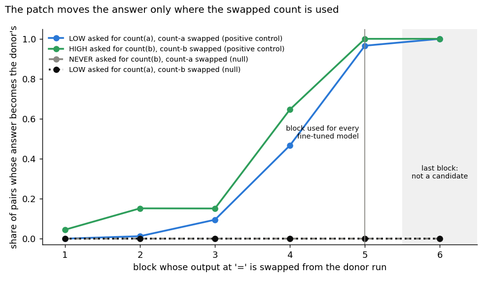
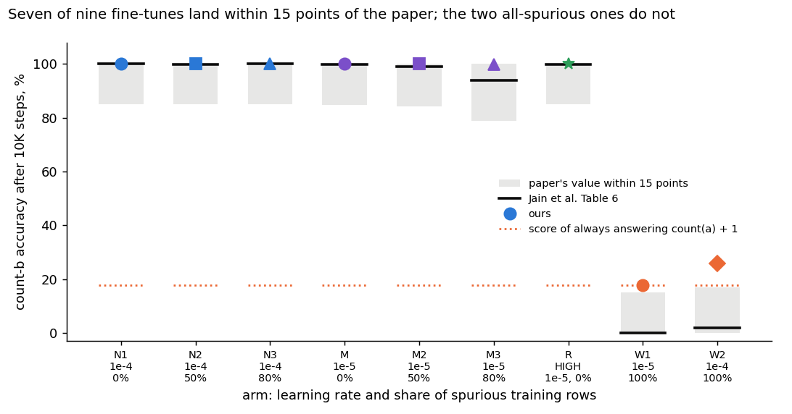
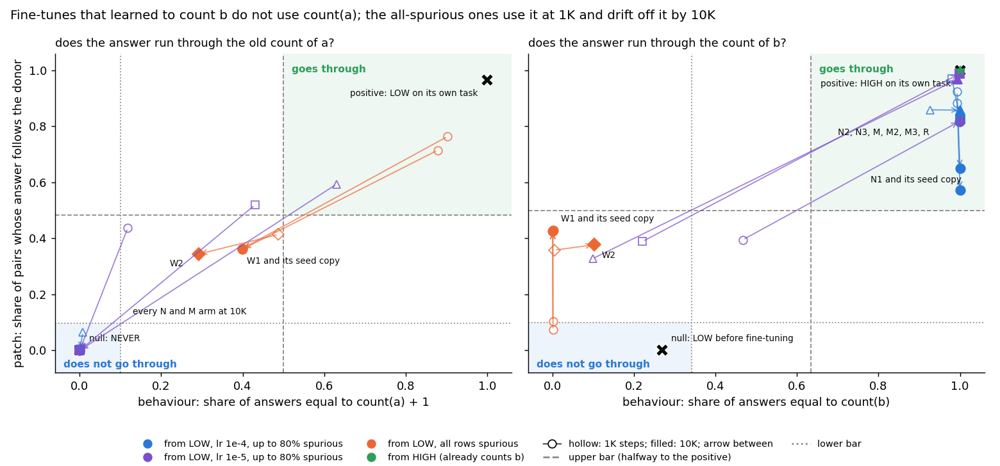
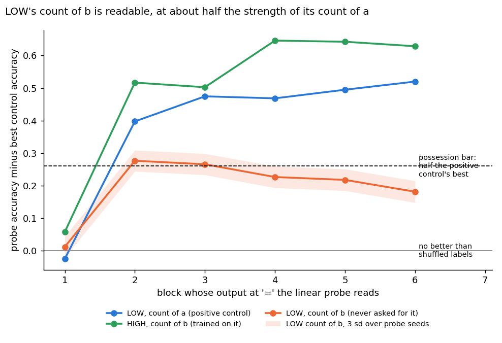

# Does a fine-tune that learns to count a new letter run through the count the model already had?

E55 Stage A, reuse line, 2026-10-29. Plan `reports/plans/2026-10-29_plan_reuse-stage1.md`, Revision 1. Predictions
`experiments/pcfg_anchors/results/predictions.json`, filed four times, the last before any fine-tune. Notebook
`notebooks/E55_pcfg_anchors.ipynb`, figures `experiments/pcfg_anchors/figures/` from `plot.py`.

We fine-tuned a small model that counts only the letter a to count the letter b, and asked whether each new answer runs through the old count, judged without any decomposition.
Fine-tunes that learned to count b never used the old count, and fine-tunes trained only on rows the old count answers used it early but drifted off it.
The reuse line now has a working ground truth outside VPD, but it marks few fine-tunes as reusing the old count, so scoring VPD against it will be lopsided.

## The answer

The two checks work as a ground truth on this grammar. Swapping the count in moves the answer on every model that
uses it and never on the nulls. Every fine-tune that learned to count b answers without the count of a, by both
checks. The fine-tunes trained only on spurious rows used the count of a after a thousand steps. By the end neither
check reads them as using it, so one filed prediction missed. None was reversed. The model that never
answered for b already held a readable count of b, by a narrow margin.

## What we were trying to test

`GOALS.md` asks, if no simple map works, whether post-training teaches new capabilities or strengthens existing
ones. Until now our labels "existing" and "new" came from VPD itself. This stage builds labels that need no
decomposition, on a task where we choose whether the model already has the capability.

**The task.** A sequence is a prefix, 250 tokens of grammar text over the letters a, b and c, and a query. The
Counter prefix `C a 40` asks how many a's are in the last 40 text tokens; `C b 40` asks the same for b. The model
predicts the answer at the `=` token. Every read and every swap below happens at that position.

**The models.** A minGPT of 6 blocks, width 192, about 3M parameters, pretrained for 50K steps on Jain's five task
families. Three pretraining mixes fix what each model can do before any fine-tune:

| model | Counter operand mix | what it can do |
|---|---|---|
| LOW | a almost always, b one time in a thousand, never c | counts a; asked for b, it answers its count of a |
| HIGH | a half, b three tenths, c a fifth | counts a and b |
| NEVER | b only | counts b; never saw the `C a 40` prefix |

**The fine-tunes.** Each fine-tune trains a model to answer `C b 40` for 10K steps, with states saved at 1K and 10K.
Spurious rows are training rows where `count(b)` is set to `count(a) + 1`, so on them answering `count(a) + 1` is right.
The arms follow Table 6 of the paper:

| arm | base | learning rate | spurious share | what it rules out |
|---|---|---|---|---|
| N1, N2, N3 | LOW | 1e-4 | 0, half, 80% | fast learners: count b for real, the "new" side |
| M, M2, M3 | LOW | 1e-5 | 0, half, 80% | slow learners: may pass through count(a) + 1 on the way |
| W1, W2 | LOW | 1e-5, 1e-4 | all | count(a) + 1 is right on every training row: the "existing" side |
| R | HIGH | 1e-5 | 0 | a base that already counts b: the answer should run through its count of b |
| N1, W1 seed 1 | LOW | as above | as above | fine-tune noise |

**The two checks.** For a fine-tuned state and a count, on natural inputs where `count(b)` differs from `count(a) + 1`:

- **Behaviour.** For the count of a, the share of answers equal to `count(a) + 1`; for the count of b, the share equal to `count(b)`.
  0 means the answer never takes that value; 1 means always.
- **Patch.** We build 1,000 pairs of inputs with the same value of the other count and different values of this one.
  We copy the donor's residual stream at `=` after block 5 into the run on the first input. The patch is the share of
  pairs whose answer becomes the donor's own answer, where the two answers differ. 0 means the swapped count
  is never used at that point; 1 means the answer always follows it.

**The bars.** Each check has a null and a positive reference measured on the pretrained models before any
fine-tune. The upper bar is halfway from the null to the positive. The lower bar is the null plus the larger of three
standard deviations and a tenth of the null-to-positive gap. A state **goes through** a count when both checks clear
the upper bar, **does not go through** it when both sit under the lower bar, and reads **neither** otherwise.

| check | null | positive | lower bar | upper bar |
|---|---|---|---|---|
| behaviour, count of a | NEVER on `C b 40`: 0.000 | LOW on its own count-a task: 0.9998 | 0.100 | 0.500 |
| patch, count of a | NEVER on `C b 40`: 0.000 | LOW on `C a 40`: 0.966 | 0.097 | 0.483 |
| behaviour, count of b | LOW on `C b 40`: 0.269 | HIGH's count-b accuracy: 1.000 | 0.342 | 0.635 |
| patch, count of b | LOW on `C a 40`: 0.000 | HIGH on `C b 40`: 1.000 | 0.100 | 0.500 |

The behaviour null for the count of b is not zero: LOW answers `count(a)` when asked for b, and on the qualifying inputs
that is right whenever the two counts agree.

**Possession.** A linear probe reads the count from the residual at `=` after each block. Its margin is its held-out
accuracy minus the best of its controls, a probe trained on shuffled labels and, for the count of a, NEVER's probe.
A model possesses a count when, at some block, the margin is at least three standard deviations over probe seeds and
at least half of LOW's best count-a margin.

## What we expected, and why

- The pretrained models would read as the plan tabled: LOW counts a and not b, HIGH counts both, NEVER counts b; the
  patch moves the answer on the positive controls and not on the nulls. The behaviour rows follow Table 6; the patch
  rows were new on this grammar, so the lean was only medium.
- The fine-tunes would reproduce Table 6's count-b accuracies within 15 points in at least seven of nine cells. The
  filing noted before the fine-tunes that the two all-spurious cells could miss by construction. A model answering
  `count(a) + 1` scores about 18% on natural rows, while the paper prints 0 and 1.9.
- The all-spurious fine-tunes would go through the count of a at both states, N1 would not go through it at either,
  and R would go through its count of b. The lean was medium, because the paper says only what the all-spurious
  fine-tunes do not answer.
- LOW would possess the count of b, at even odds: it almost never answers for b, but every task family counts tokens.

## What we observed

### Do the checks work on the pretrained models?

**Reading it.** Yes. The figure plots, for each block whose output we swap, the share of pairs whose answer becomes the
donor's. On the two models asked for the count they use, the share rises from near zero to 0.97 and 1.00 at block 5.
On the two nulls it is zero at every block: there the swapped count is one the model does not answer with. The
earliest block within three standard deviations of the best, excluding the last block, is block 5 for both counts.
Every fine-tuned state is read there. One caveat is real. Block 5 is next to the output, so the patch there is
close to a second behaviour reading rather than a test of where the count is first computed.

Behaviour on the pretrained models, 4,000 rows each, beside the score of guessing:

| model | count-a accuracy | count-b accuracy | majority-answer score | score of answering count(a) when asked for b |
|---|---|---|---|---|
| LOW | 0.99975 | 0.2215 | 0.348 | 0.2215 |
| HIGH | 0.99975 | 1.000 | 0.348 | 0.2215 |
| NEVER | 0.2175 | 1.000 | 0.348 | 0.2215 |

LOW's count-b accuracy equals, to four digits, the score of answering `count(a)`: asked for b, it answers its count of
a. Table 6 prints 5.2% for this cell. Our window counts sit between 9 and 17, so the two counts agree more often
than in the paper.

Patch at every block, mean of three sets of 1,000 pairs:

| reference | block 1 | 2 | 3 | 4 | 5 | 6 |
|---|---|---|---|---|---|---|
| LOW, count a, `C a 40` | 0.000 | 0.012 | 0.095 | 0.467 | 0.966 | 1.000 |
| HIGH, count b, `C b 40` | 0.045 | 0.152 | 0.151 | 0.646 | 1.000 | 1.000 |
| NEVER, count a, `C b 40` | 0 | 0 | 0 | 0 | 0 | 0 |
| LOW, count b, `C a 40` | 0 | 0 | 0 | 0 | 0 | 0 |

Behaviour nulls over three sets: NEVER's share of `count(a) + 1` answers 0, 0, 0; LOW's share of `count(b)` answers
0.268, 0.284, 0.255.

### Does the rebuilt grammar reproduce the paper's fine-tunes?

**Reading it.** Yes, in seven of nine cells, the most the filing allowed. Every fine-tune trained mostly on natural
rows reaches 99.85% to 100% on count b, within six points of the paper. The two all-spurious fine-tunes miss. The slow
one scores 17.7%, the score of always answering `count(a) + 1` on these rows. The fast one scores 26.0%, above that
floor, where the paper prints 1.9%. Our fine-tunes also learn faster early. At 1K the slow learners read 26% to 48%;
the paper prints 1.4% to 33%. The early column was not filed.

| arm | ours at 1K, % | Table 6 at 1K | ours at 10K, % | Table 6 at 10K | within 15 at 10K |
|---|---|---|---|---|---|
| N1 | 99.8 | 98.9 | 100.0 | 100 | yes |
| N2 | 99.35 | 90.2 | 100.0 | 99.9 | yes |
| N3 | 95.8 | 64.9 | 100.0 | 100 | yes |
| M | 48.3 | 32.6 | 99.95 | 99.8 | yes |
| M2 | 35.7 | 12.7 | 99.95 | 99.1 | yes |
| M3 | 25.7 | 1.4 | 99.85 | 93.9 | yes |
| W1 | 17.75 | 0 | 17.675 | 0 | no, off by 17.7 |
| W2 | 18.1 | 0 | 25.95 | 1.9 | no, off by 24.05 |
| R | 100.0 | 99.9 | 100.0 | 99.9 | yes |

### Which fine-tunes run through the old count of a?

**Reading it.** Every fine-tune that learned to count b does not go through the count of a, and goes through the
count of b instead. In the left panel each such state at 10K sits at exactly zero on both checks. Their 1K states sit
under both lower bars too, except the slow learners, whose answers were still partly `count(a) + 1`. The all-spurious
fine-tunes start where the filing expected. After 1K steps the slow one gives `count(a) + 1` on 0.88 of inputs.
It follows a swapped count of a on 0.72 of pairs. Its seed copy reads 0.90 and 0.76. By 10K both copies fall to about 0.40
and 0.36, between the bars, so they read neither. The fast all-spurious fine-tune reads neither at both states. At 1K
its behaviour is 0.488, just under the upper bar of 0.500. HIGH's fine-tune goes through its count of b, as expected.

What the all-spurious fine-tunes do at 10K is not settled by the checks. A swap at the last block shows what the
answer depends on at all. For the slow all-spurious fine-tune at 1K, a swapped count of a moves the answer on 0.94 of
pairs and a swapped count of b on 0.17. At 10K the two shares are 0.64 and 0.57: the answer depends on both counts
about equally. On every spurious row `count(b)` equals `count(a) + 1` and the three counts sum to 40. So an answer built
from the count of c fits the training rows exactly, and it would depend on a and b alike. The filing named this
reading in advance as a blind spot. We have not tested it.

| state | behaviour a | patch a | reads, count of a | behaviour b | patch b | reads, count of b |
|---|---|---|---|---|---|---|
| N1 1K | 0.000 | 0.000 | not through | 0.993 | 0.883 | through |
| N1 10K | 0.000 | 0.000 | not through | 1.000 | 0.573 | through |
| N1 seed 1, 1K | 0.000 | 0.000 | not through | 0.993 | 0.924 | through |
| N1 seed 1, 10K | 0.000 | 0.000 | not through | 1.000 | 0.650 | through |
| N2 1K | 0.002 | 0.005 | not through | 0.980 | 0.971 | through |
| N2 10K | 0.000 | 0.000 | not through | 1.000 | 0.827 | through |
| N3 1K | 0.008 | 0.066 | not through | 0.926 | 0.859 | through |
| N3 10K | 0.000 | 0.000 | not through | 1.000 | 0.858 | through |
| M 1K | 0.118 | 0.437 | neither | 0.467 | 0.395 | neither |
| M 10K | 0.000 | 0.000 | not through | 0.999 | 0.818 | through |
| M2 1K | 0.430 | 0.519 | neither | 0.221 | 0.389 | neither |
| M2 10K | 0.000 | 0.000 | not through | 0.999 | 0.988 | through |
| M3 1K | 0.631 | 0.594 | through | 0.099 | 0.328 | neither |
| M3 10K | 0.000 | 0.000 | not through | 0.994 | 0.968 | through |
| W1 1K | 0.879 | 0.715 | through | 0.001 | 0.104 | neither |
| W1 10K | 0.399 | 0.361 | neither | 0.001 | 0.429 | neither |
| W1 seed 1, 1K | 0.903 | 0.764 | through | 0.001 | 0.073 | not through |
| W1 seed 1, 10K | 0.399 | 0.363 | neither | 0.000 | 0.427 | neither |
| W2 1K | 0.488 | 0.414 | neither | 0.004 | 0.358 | neither |
| W2 10K | 0.292 | 0.344 | neither | 0.102 | 0.377 | neither |
| R 1K | 0.000 | 0.000 | not through | 1.000 | 1.000 | through |
| R 10K | 0.000 | 0.000 | not through | 1.000 | 1.000 | through |

Every state built 1,000 pairs for each patch, so no patch was void. The filed null did not occur: on no state
was one check over its upper bar and the other under its lower bar. A softer mismatch is visible in the right panel. At 10K the all-spurious states almost never answer `count(b)`.
Yet a swapped count of b moves their answer at block 5 on 0.36 to 0.43 of pairs.

Two further readings were not filed. N1's patch for the count of b falls from 0.88 at 1K to 0.57 at 10K.
Its seed copy falls from 0.92 to 0.65, while both still answer `count(b)` every time. So with training the count of b reaches the answer later than
block 5 on more inputs, and N1's label sits closer to its upper bar. Second, every N and M fine-tune also changed LOW's
answer to its own count-a task. Accuracy there fell from 0.99975 to 0.2175 at 10K, the same as NEVER's, which counts b
whatever it is asked. HIGH's fine-tune kept its count-a accuracy at 0.974. One counter re-bound to the new letter would
look like this, and the rule reads that as not going through the count of a, as the plan stated.

Stage C would score the sixteen states from LOW at the first seed. Two go through the count of a, both at 1K: the
slow 80%-spurious and the slow all-spurious arms. Nine do not and five read neither, where the plan expected six,
eight and two.

### Does LOW already hold a count of b?

**Reading it.** Yes, narrowly. The figure plots the probe margin by block. LOW's count-b margin is 0.277 at block 2,
over the possession bar of 0.260 by about one and a half standard deviations. It clears the bar at block 3 too, then
falls to 0.18 by block 6. Its count-a margin, the positive control, rises to 0.52. HIGH, which was trained on count b,
reaches 0.65. So LOW holds a linear readout of the count of b in its early blocks that weakens towards the output. By
the plan's definition, the fine-tunes that learned to count b reuse a readout LOW already had rather than build one.
The caveat is that the margin clears the bar by little, and a probe cannot say whether the count is used.

| model, count | best block | probe accuracy | majority-class rate | margin | standard deviation over 3 probe seeds |
|---|---|---|---|---|---|
| LOW, a | 6 | 1.000 | 0.341 | 0.520 | 0.0088 |
| HIGH, a | 6 | 1.000 | 0.341 | 0.520 | 0.0088 |
| HIGH, b | 4 | 0.994 | 0.348 | 0.646 | 0.0050 |
| LOW, b | 2 | 0.626 | 0.348 | 0.277 | 0.0108 |

Possession bar: half of LOW's best count-a margin, 0.260; voiding line 6 standard deviations of that margin, 0.053.

## What we learned

The reuse line has a ground truth that owes nothing to any decomposition, and its two checks never point opposite ways on
all 22 states read. On this grammar, a fine-tune that learns a new count does not run its answer through the old
count, even when the model held a weak readout of the new one. Training only on rows where the old count gives the answer was
meant to be the clearest "existing" anchor. It uses the old count only early, and by the end it has found something
else that fits the same rows. So "existing" labels are scarce: two of the eleven labelled
states. That leaves any method scored against them, VPD included, with a lopsided truth set.

## How compelling is the evidence

- **The checks.** The controls are clean: nulls at zero in every set and block, positives at 0.97 and 1. The bars
  are far apart, so few labels are decided by noise. Two cells sit near a bar. The fast all-spurious state at 1K
  is 0.012 under the upper behaviour bar. The slow all-spurious state at 1K reads 0.104 and 0.073 on the count-b
  patch over its two seeds, either side of the lower bar.
- **What the behaviour check is blind to.** It counts answers equal to one value; an answer that uses the count
  through another function reads low.
- **What the patch is blind to.** It reads one position and one block. Block 5 is next to the output, so it tests
  that the count is present late, not where it is computed. A count computed after block 5 from text positions
  reads low. A donor matched on the other count cannot tell a count of c from a count of a, since changing one at a
  fixed count of b changes the other.
- **What the probe is blind to.** Use: a decodable count need not be one the model computes with. Taking the best of
  six blocks inflates false positives slightly. LOW's count-b margin clears its bar by about one and a half
  standard deviations.
- **Seeds.** One pretraining seed per mix. Two fine-tune seeds for N1 and the slow all-spurious arm, which agree on
  every label for the count of a. One task family and one window, 40 tokens.

## Surprises

- The all-spurious fine-tunes leave the count of a between 1K and 10K steps, while their accuracy on spurious
  test rows stays at 1: they still answer every spurious row right at 10K. A filed prediction missed for this reason; it
  was not reversed, since no all-spurious state reads "does not go through".
- Every fine-tune that learned to count b from LOW also wiped out LOW's answer on its own count-a task.
- LOW's count-b accuracy before any fine-tune sits exactly on the score of answering its count of a.

## What next

1. **Decide whether instrument scoring goes ahead on these labels.** The plan's decision tree covers a pass, a
   reversal and the null, but not a miss without reversal. Eleven states are labelled, two of them "existing", so a
   method must agree on ten to pass. If that is judged too lopsided, more "existing" anchors come first.
2. **Test the count-c reading of the all-spurious states at 10K**, $0 on the saved states: the share of answers equal
   to the value the count of c gives on spurious rows. If they go through it, they are reuse of another count the
   model has and can join the truth set as "existing".
3. **Read the all-spurious arms between 1K and 10K** to find when they leave the count of a, so that more "existing"
   states can be saved.

## Scorecard

| id | claim in words | rule | read | verdict |
|---|---|---|---|---|
| PA1 behaviour | LOW counts a, not b; HIGH counts both; NEVER counts b | LOW a ≥ 0.95; LOW b ≤ swap floor + 0.10; HIGH a, b ≥ 0.95; NEVER b ≥ 0.95 | 0.99975; 0.2215 ≤ 0.3215; 0.99975, 1.000; 1.000 | pass |
| PA1 count-a probe | LOW's count-a margin is clear; HIGH's is at least half of it | m₊ ≥ 6 s₊; HIGH ≥ 0.5 m₊ | 0.520 ≥ 0.053; 0.520 ≥ 0.260 | pass |
| PA1 count-b probe | HIGH's count-b margin is at least half of LOW's count-a margin | ≥ 0.5 m₊ | 0.646 ≥ 0.260 | pass |
| PA1 patch positive | the patch moves the answer on the positive controls | ≥ 0.8 at block 5 | 0.966, 1.000 | pass |
| PA1 nulls | the patch and behaviour nulls stay near zero | each ≤ 0.05 | patch 0, 0; behaviour 0 | pass |
| PA2 | count-b accuracy at 10K within 15 points of Table 6 | ≥ 7 of 9 cells | 7 of 9; the two all-spurious cells miss by 17.7 and 24.05 | pass, at the cap the filing anticipated |
| PA3 | all-spurious arms through count a at 1K and 10K; N1 not through at both; R through count b | all 7 readings | 4 of 7: slow all-spurious 1K through; its 10K neither; fast all-spurious 1K and 10K neither; N1 both not; R through | **miss**, not reversed |
| PA4 | LOW possesses the count of b | m ≥ 3 s and m ≥ 0.5 m₊ at some block | block 2: 0.277 ≥ 0.032 and ≥ 0.260 | pass, narrowly |
| PA3 null | the two checks point opposite ways on ≥ 3 of 17 states | count | 0 of 17 | did not occur |
| Stage C pass bar | agreements needed with 11 labelled states | smallest a with binomial tail ≤ 0.05, raised to majority + 1 | a = 9, raised to 10 by the majority of 9 "not through" | for Stage C |

All A1 stops passed; no bar was void. PA3's thresholds are the A2 bars filed before any fine-tune; labels were read
by `interchange.label` with strict inequalities.

## Not run

- Stage B, lowercase on the 67M; the free part of Stage C, pruning, reverse fine-tuning and steering; the gated part, a VPD decomposition
  of LOW, gated.
- The count-c check on the all-spurious states; states between 1K and 10K.
- Probes on the fine-tuned states; per-row answers were not saved, so the mixed answers of the all-spurious states
  at 10K cannot be read from the results files.
- A second pretraining seed of any mix; fine-tune seeds beyond N1 and the slow all-spurious arm; the paper's 200K
  pretraining; Table 6's spurious test column beyond the accuracy reported in the results files.

Provenance: `experiments/pcfg_anchors/results/{a0,a1_LOW,a1_HIGH,a1_NEVER,a1c_patch,a1c_probe}.json` and
`a2_<arm>.json` for N1 N2 N3 M M2 M3 W1 W2 R N1s1 W1s1; code `experiments/pcfg_anchors/run.py`,
`src/commute/interchange.py`, `src/commute/pcfg.py`. MATS cluster `debug` QoS, one GPU per job: rehearsal 44244,
pretrainings 44268-44270, controls 44306 and 44307, fine-tunes 44328-44330; $0. Commits 6299401, 55da119, 87f77ce,
7e62cb4.
