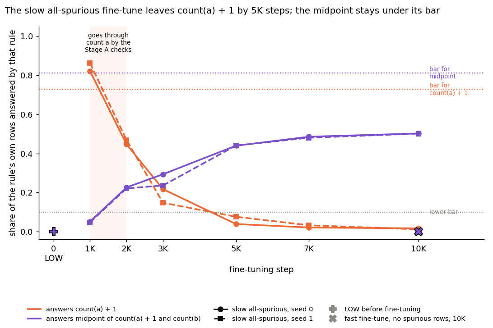
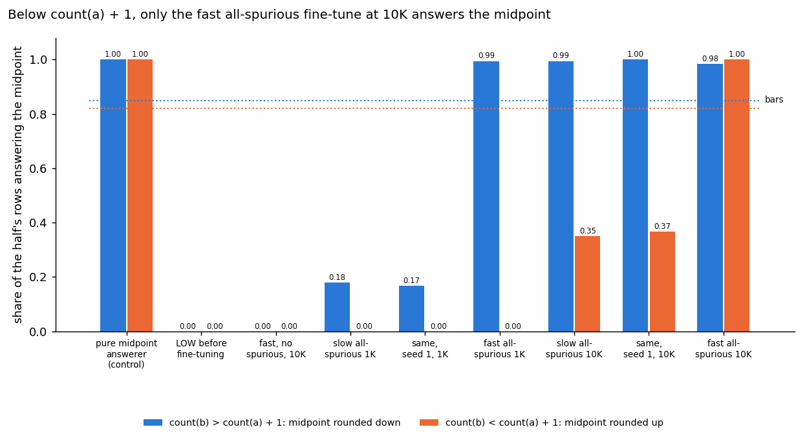
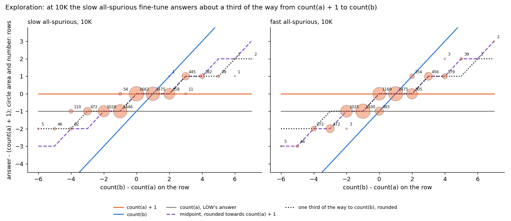
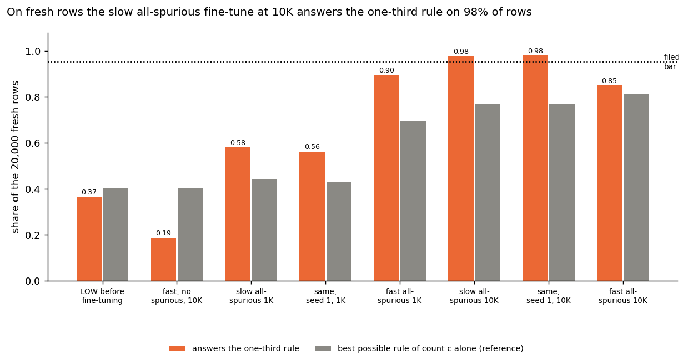
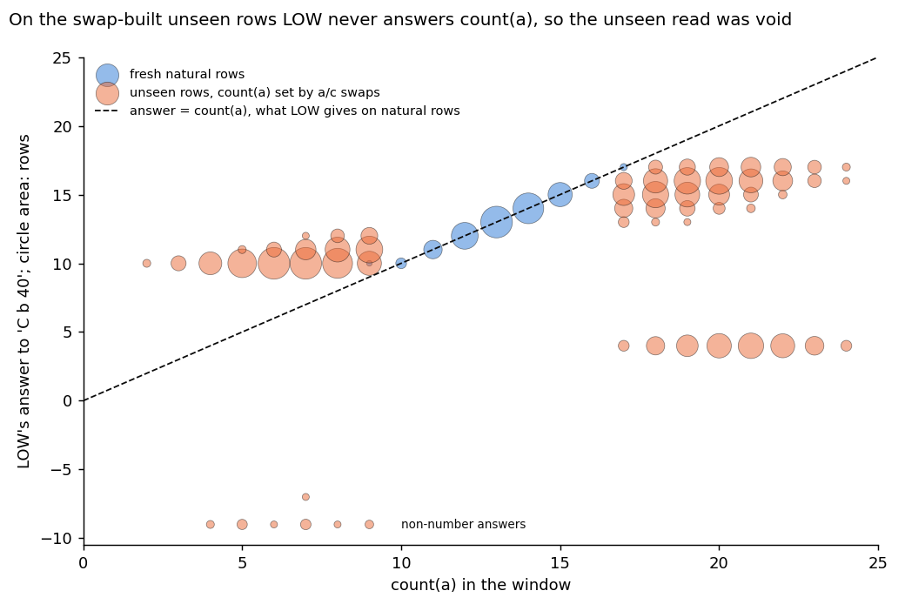
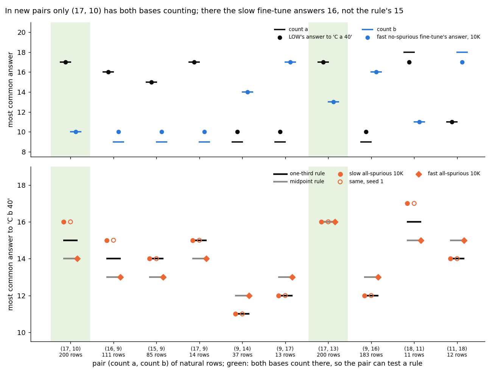
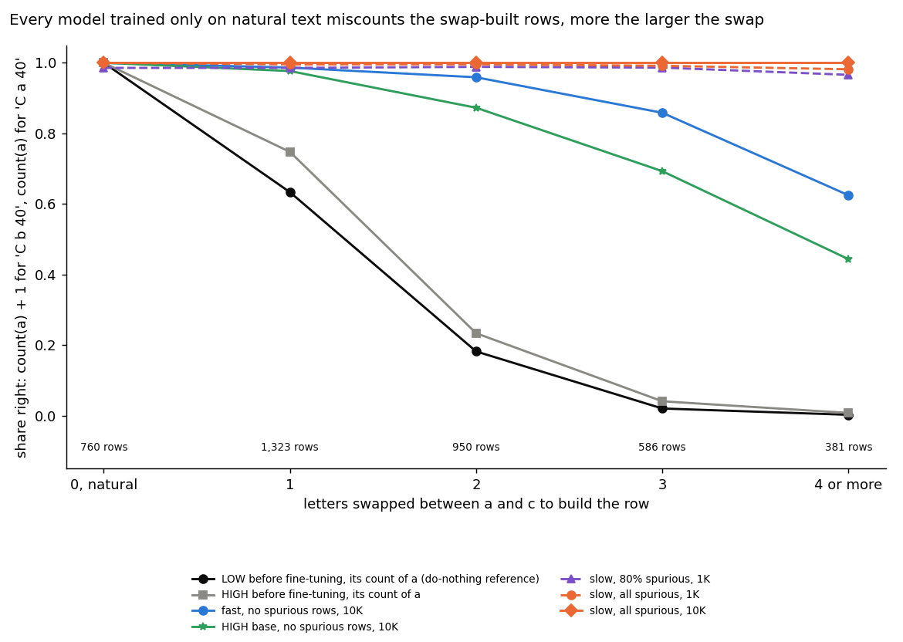
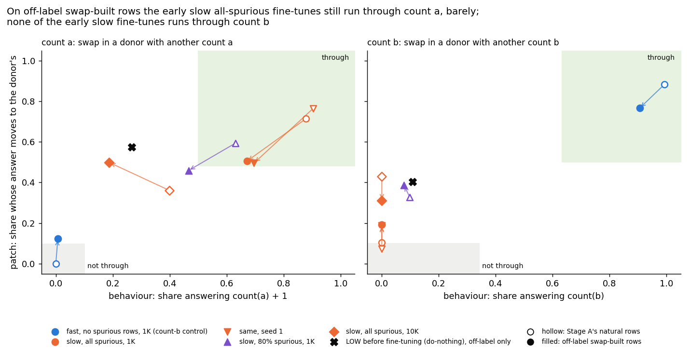

# Does a fine-tune that learns to count a new letter run through the count the model already had?

E55 Stage A, reuse line, 2026-10-29. Plan `reports/plans/2026-10-29_plan_reuse-stage1.md`, Revision 1. Predictions
`experiments/pcfg_anchors/results/predictions.json`, filed four times, the last before any fine-tune. Notebook
`notebooks/E55_pcfg_anchors.ipynb`, figures `experiments/pcfg_anchors/figures/` from `plot.py`.

We fine-tuned a small model that counts only the letter a to count the letter b, and asked whether each new answer runs through the old count, judged without any decomposition.
Fast fine-tunes never used the old count; slow ones trained mostly or only on rows where one more than the count of a is the answer used it at a thousand steps, and by the end none did, the all-spurious ones answering a rule of two counts.
Those rows were built by swapping letters, which breaks the base model's count, and on swapped text where one more than the count of a and the count of b differ, both seeds of the slow all-spurious state at a thousand steps answer through a strengthened count of a, not a separate count of b, while the slow 80% state reads neither; the patch check clears its bar narrowly.

## The answer

The two checks work as a ground truth on this grammar. Swapping the count in moves the answer on every model that
uses it and never on the nulls. Fast fine-tunes never ran through the count of a. The slow fine-tunes with 80% and
with all spurious rows ran through it after a thousand steps. By the end the first had learned b and left the old
count, and the all-spurious ones read neither, so one filed prediction missed. None was reversed. The count of b
decodes from the base model above shuffled labels, narrowly. A later row-by-row read, Amendment 1 below, found the
all-spurious answers at 10K are a function of two of the three counts, not of any one count alone. The fast one answers the midpoint
of the two; the slow one, by a reading not filed, answers a third of the way from `count(a) + 1` to `count(b)`. Amendment 2 filed that reading and it
held on 20,000 fresh rows, within the same pairs of counts; a test on new pairs was void. Amendment 3 found that
letter-swapped rows built the same way as the spurious fine-tunes' training rows break the base model: its own count
of a gives their label on under half. So the two early states that reuse the old count were pushed to change.
Amendment 4 asked how. On swapped rows where the two readings give different answers, both seeds of the slow
all-spurious state answer through a strengthened count of a, not a count of b. The patch check clears its bar narrowly,
and a third of their answers sit one step from `count(a) + 1` towards `count(b)`; in most of them that step is also the
step back towards the pre-swap text, and on the 138 rows that separate the two, answers move only towards `count(b)`
(13%), never back (exploration, not filed; with a + b + c = 40 this is equally a dependence on count c). The slow 80%
state reads neither there. Stage A's
labels, read on natural text, stand.

## What we were trying to test

`GOALS.md` asks, if no simple map works, whether post-training teaches new capabilities or strengthens existing
ones. Until now our labels "existing" and "new" came from VPD itself. This stage builds labels that need no
decomposition, on a task where we choose whether the model already has the capability.

**The task.** A sequence is a prefix, 250 tokens of grammar text over the letters a, b and c, and a query. The
Counter prefix `C a 40` asks how many a's are in the last 40 text tokens; `C b 40` asks the same for b. The model
predicts the answer at the `=` token. Every read and every swap below happens at that position.

**The models.** A minGPT of 6 blocks, width 192, about 3M parameters, pretrained for 50K steps on Jain's five task
families. Three pretraining mixes fix what each model can do before any fine-tune:

| model | Counter operand mix | what it can do |
|---|---|---|
| LOW | a almost always, b one time in a thousand, never c | counts a; asked for b, it answers its count of a |
| HIGH | a half, b three tenths, c a fifth | counts a and b |
| NEVER | b only | counts b; never saw the `C a 40` prefix |

**The fine-tunes.** Each fine-tune trains a model to answer `C b 40` for 10K steps, with states saved at 1K and 10K.
Spurious rows are training rows whose `count(b)` keeps its natural value and whose count of a in the window is set
to `count(b) - 1` by swapping a's and c's, so on them answering `count(a) + 1` is right. The text holds only a, b
and c, so the three window counts sum to 40 on every row, natural or spurious.
The arms follow Table 6 of the paper:

| arm | base | learning rate | spurious share | what it rules out |
|---|---|---|---|---|
| N1, N2, N3 | LOW | 1e-4 | 0, half, 80% | fast learners: count b for real, the "new" side |
| M, M2, M3 | LOW | 1e-5 | 0, half, 80% | slow learners: may pass through count(a) + 1 on the way |
| W1, W2 | LOW | 1e-5, 1e-4 | all | count(a) + 1 is right on every training row: the "existing" side |
| R | HIGH | 1e-5 | 0 | a base that already counts b: the answer should run through its count of b |
| N1, W1 seed 1 | LOW | as above | as above | fine-tune noise |

**The two checks.** For a fine-tuned state and a count, on natural inputs where `count(b)` differs from `count(a) + 1`:

- **Behaviour.** For the count of a, the share of answers equal to `count(a) + 1`; for the count of b, the share equal to `count(b)`.
  0 means the answer never takes that value; 1 means always.
- **Patch.** We build 1,000 pairs of inputs with the same value of the other count and different values of this one.
  We copy the donor's residual stream at `=` after block 5 into the run on the first input. The patch is the share of
  pairs whose answer becomes the donor's own answer, where the two answers differ. 0 means the swapped count
  is never used at that point; 1 means the answer always follows it.

**The bars.** Each check has a null and a positive reference measured on the pretrained models before any
fine-tune. The upper bar is halfway from the null to the positive. The lower bar is the null plus the larger of three
standard deviations and a tenth of the null-to-positive gap. A state **goes through** a count when both checks clear
the upper bar, **does not go through** it when both sit under the lower bar, and reads **neither** otherwise.

| check | null | positive | lower bar | upper bar |
|---|---|---|---|---|
| behaviour, count of a | NEVER on `C b 40`: 0.000 | LOW on its own count-a task: 0.9998 | 0.100 | 0.500 |
| patch, count of a | NEVER on `C b 40`: 0.000 | LOW on `C a 40`: 0.966 | 0.097 | 0.483 |
| behaviour, count of b | LOW on `C b 40`: 0.269 | HIGH's count-b accuracy: 1.000 | 0.342 | 0.635 |
| patch, count of b | LOW on `C a 40`: 0.000 | HIGH on `C b 40`: 1.000 | 0.100 | 0.500 |

The behaviour null for the count of b is not zero: LOW answers `count(a)` when asked for b, and on the qualifying inputs
that is right whenever the two counts agree.

**Possession.** A linear probe reads the count from the residual at `=` after each block. Its margin is its held-out
accuracy minus the best of its controls, a probe trained on shuffled labels and, for the count of a, NEVER's probe.
A model possesses a count when, at some block, the margin is at least three standard deviations over probe seeds and
at least half of LOW's best count-a margin.

## What we expected, and why

- The pretrained models would read as the plan tabled: LOW counts a and not b, HIGH counts both, NEVER counts b; the
  patch moves the answer on the positive controls and not on the nulls. The behaviour rows follow Table 6; the patch
  rows were new on this grammar, so the lean was only medium.
- The fine-tunes would reproduce Table 6's count-b accuracies within 15 points in at least seven of nine cells. The
  filing noted before the fine-tunes that the two all-spurious cells could miss by construction. A model answering
  `count(a) + 1` scores about 18% on natural rows, while the paper prints 0 and 1.9.
- The all-spurious fine-tunes would go through the count of a at both states, N1 would not go through it at either,
  and R would go through its count of b. The lean was medium, because the paper says only what the all-spurious
  fine-tunes do not answer.
- LOW would possess the count of b, at even odds: it almost never answers for b, but every task family counts tokens.

## What we observed

### Do the checks work on the pretrained models?

**Reading it.** Yes. The figure plots, for each block whose output we swap, the share of pairs whose answer becomes the
donor's. On the two models asked for the count they use, the share rises from near zero to 0.97 and 1.00 at block 5.
On the two nulls it is zero at every block: there the swapped count is one the model does not answer with. The
earliest block within three standard deviations of the best, excluding the last block, is block 5 for both counts.
Every fine-tuned state is read there. One caveat is real. Block 5 is next to the output, so the patch there is
close to a second behaviour reading rather than a test of where the count is first computed.

Behaviour on the pretrained models, 4,000 rows each, beside the score of guessing:

| model | count-a accuracy | count-b accuracy | majority-answer score | score of answering count(a) when asked for b |
|---|---|---|---|---|
| LOW | 0.99975 | 0.2215 | 0.348 | 0.2215 |
| HIGH | 0.99975 | 1.000 | 0.348 | 0.2215 |
| NEVER | 0.2175 | 1.000 | 0.348 | 0.2215 |

LOW's count-b accuracy equals, to four digits, the score of answering `count(a)`: asked for b, it answers its count of
a. A second, independent number agrees. An exact count-of-a answer is never right on the 0.1765 of rows where
`count(b)` equals `count(a) + 1`, so on the qualifying inputs it scores 0.2215 / (1 − 0.1765) = 0.269. That is
LOW's measured behaviour null for b. Table 6 prints 5.2% for this cell, probably because our window counts, which sit
between 9 and 17, agree more often than the paper's. We did not measure the paper's spread.

Patch at every block, mean of three sets of 1,000 pairs:

| reference | block 1 | 2 | 3 | 4 | 5 | 6 |
|---|---|---|---|---|---|---|
| LOW, count a, `C a 40` | 0.000 | 0.012 | 0.095 | 0.467 | 0.966 | 1.000 |
| HIGH, count b, `C b 40` | 0.045 | 0.152 | 0.151 | 0.646 | 1.000 | 1.000 |
| NEVER, count a, `C b 40` | 0 | 0 | 0 | 0 | 0 | 0 |
| LOW, count b, `C a 40` | 0 | 0 | 0 | 0 | 0 | 0 |

Behaviour nulls over three sets: NEVER's share of `count(a) + 1` answers 0, 0, 0; LOW's share of `count(b)` answers
0.268, 0.284, 0.255.

### Does the rebuilt grammar reproduce the paper's fine-tunes?

**Reading it.** Yes, in seven of nine cells, the most the filing allowed. Every fine-tune with any natural rows
reaches 99.85% to 100% on count b, within six points of the paper. The two all-spurious fine-tunes miss. The slow
one scores 17.7%, equal to the score of always answering `count(a) + 1`, although by 10K it gives `count(a) + 1` on
only 0.40 of qualifying inputs. It gets its points on the rows where `count(b)` equals `count(a) + 1` and almost none
elsewhere. The fast one scores 26.0%, above that floor, where the paper prints 1.9%. Our fine-tunes also learn faster early. At 1K the slow learners read 26% to 48%;
the paper prints 1.4% to 33%. The early column was not filed.

| arm | ours at 1K, % | Table 6 at 1K | ours at 10K, % | Table 6 at 10K | within 15 at 10K |
|---|---|---|---|---|---|
| N1 | 99.8 | 98.9 | 100.0 | 100 | yes |
| N2 | 99.35 | 90.2 | 100.0 | 99.9 | yes |
| N3 | 95.8 | 64.9 | 100.0 | 100 | yes |
| M | 48.3 | 32.6 | 99.95 | 99.8 | yes |
| M2 | 35.7 | 12.7 | 99.95 | 99.1 | yes |
| M3 | 25.7 | 1.4 | 99.85 | 93.9 | yes |
| W1 | 17.75 | 0 | 17.675 | 0 | no, off by 17.7 |
| W2 | 18.1 | 0 | 25.95 | 1.9 | no, off by 24.05 |
| R | 100.0 | 99.9 | 100.0 | 99.9 | yes |

### Which fine-tunes run through the old count of a?

**Reading it.** Fast fine-tunes never go through the count of a. Slow ones with many spurious rows go through it
early, and by 10K neither check reads them as going through it. Every fast fine-tune with natural rows sits under
both lower bars at both states. At 10K every fine-tune that learned to count b sits at exactly zero on both checks, and goes through the count of b.

The slow fine-tune with 80% spurious rows goes through the count of a at 1K. It gives `count(a) + 1` on 0.63 of
inputs and follows a swapped count of a on 0.59 of pairs. By 10K it counts b at 99.85% and reads not through. The
slow half-spurious fine-tune at 1K follows the swap on 0.52 of pairs, over the upper bar of 0.483. It answers
`count(a) + 1` on only 0.43, so it reads neither. The plan expected both of these 1K states to go through.

The all-spurious fine-tunes start where the filing expected. After 1K steps the slow one gives `count(a) + 1` on 0.88
of inputs. It follows a swapped count of a on 0.72 of pairs, and its seed copy reads 0.90 and 0.76. By 10K both
copies fall to about 0.40 and 0.36, between the bars, so they read neither. The fast all-spurious fine-tune reads
neither at both states. At 1K its behaviour is 0.488, just under the upper bar of 0.500. HIGH's fine-tune goes through
its count of b, as expected. So every slow fine-tune with 80% or more spurious rows goes through the old count at
1K and no longer reads as going through it at 10K, not only the all-spurious one.

What the all-spurious fine-tunes do at 10K is not settled by the checks. A swap at the last block shows what the
answer depends on at all. For the slow all-spurious fine-tune at 1K, a swapped count of a moves the answer on 0.94 of
pairs and a swapped count of b on 0.17. At 10K the two shares are 0.64 and 0.57: the answer depends on both counts.

One reading would have the answer built from the count of c, which fits every spurious row. For the slow
all-spurious fine-tune that reading is ruled out by the sum of 40. We sampled 65K qualifying natural windows, with no
model. Any answer that depends on the count of c alone and equals `count(b)` on at most 0.01 of them gives
`count(a) + 1` on at most 0.105. The slow all-spurious state reads 0.40 and at most 0.001, at both seeds.

One rule fits both of its numbers: answer the midpoint of `count(a) + 1` and `count(b)`, rounded towards
`count(a) + 1`. On the same windows it reads 0.41 and 0.00, and it is exact on every spurious row. That rule reads the
count of a on every input, through a function the behaviour check is blind to. It fits, but it is untested. The fast
all-spurious state at 10K, at 0.29 and 0.10, is not excluded by the bound.

| state | behaviour a | patch a | reads, count of a | behaviour b | patch b | reads, count of b |
|---|---|---|---|---|---|---|
| N1 1K | 0.000 | 0.000 | not through | 0.993 | 0.883 | through |
| N1 10K | 0.000 | 0.000 | not through | 1.000 | 0.573 | through |
| N1 seed 1, 1K | 0.000 | 0.000 | not through | 0.993 | 0.924 | through |
| N1 seed 1, 10K | 0.000 | 0.000 | not through | 1.000 | 0.650 | through |
| N2 1K | 0.002 | 0.005 | not through | 0.980 | 0.971 | through |
| N2 10K | 0.000 | 0.000 | not through | 1.000 | 0.827 | through |
| N3 1K | 0.008 | 0.066 | not through | 0.926 | 0.859 | through |
| N3 10K | 0.000 | 0.000 | not through | 1.000 | 0.858 | through |
| M 1K | 0.118 | 0.437 | neither | 0.467 | 0.395 | neither |
| M 10K | 0.000 | 0.000 | not through | 0.999 | 0.818 | through |
| M2 1K | 0.430 | 0.519 | neither | 0.221 | 0.389 | neither |
| M2 10K | 0.000 | 0.000 | not through | 0.999 | 0.988 | through |
| M3 1K | 0.631 | 0.594 | through | 0.099 | 0.328 | neither |
| M3 10K | 0.000 | 0.000 | not through | 0.994 | 0.968 | through |
| W1 1K | 0.879 | 0.715 | through | 0.001 | 0.104 | neither |
| W1 10K | 0.399 | 0.361 | neither | 0.001 | 0.429 | neither |
| W1 seed 1, 1K | 0.903 | 0.764 | through | 0.001 | 0.073 | not through |
| W1 seed 1, 10K | 0.399 | 0.363 | neither | 0.000 | 0.427 | neither |
| W2 1K | 0.488 | 0.414 | neither | 0.004 | 0.358 | neither |
| W2 10K | 0.292 | 0.344 | neither | 0.102 | 0.377 | neither |
| R 1K | 0.000 | 0.000 | not through | 1.000 | 1.000 | through |
| R 10K | 0.000 | 0.000 | not through | 1.000 | 1.000 | through |

Every state built 1,000 pairs for each patch, so no patch was void. The filed null did not occur: on no state
was one check over its upper bar and the other under its lower bar. A softer mismatch is visible in the right panel. At 10K the all-spurious states almost never answer `count(b)`.
Yet a swapped count of b moves their answer at block 5 on 0.38 to 0.43 of pairs, as the midpoint rule would.

Two further readings were not filed. N1's patch for the count of b falls from 0.88 at 1K to 0.57 at 10K.
Its seed copy falls from 0.92 to 0.65, while both still answer `count(b)` every time. That is consistent with the
count of b reaching the answer later than block 5 on more inputs, which is untested. Either way N1's label sits
closer to its upper bar. Second, every N and M fine-tune also changed LOW's
answer to its own count-a task. Accuracy there fell from 0.99975 to 0.2175 at 10K, the same as NEVER's, which counts b
whatever it is asked. HIGH's fine-tune kept its count-a accuracy at 0.974. One counter re-bound to the new letter would
look like this, and the rule reads that as not going through the count of a, as the plan stated.

Stage C would score the sixteen states from LOW at the first seed. Two go through the count of a, both at 1K: the
slow 80%-spurious and the slow all-spurious arms. Nine do not and five read neither, where the plan expected six,
eight and two: the plan leaned on both all-spurious arms at both states and on two slow arms at 1K going through.

### Does LOW already hold a count of b?

**Reading it.** Yes by the filed rule, narrowly, and the reading behind the rule is weaker than the pass. The
figure plots the probe margin by block. LOW's count-b margin is 0.277 at block 2, over the possession bar of 0.260 by
about one and a half standard deviations. It clears the bar at block 3 too, then falls to 0.18 by block 6. Its
count-a margin, the positive control, rises to 0.52. HIGH, which was trained on count b, reaches 0.65.

The two margins of LOW subtract different controls. The count-a margin subtracts NEVER's count-a probe as well as
shuffled labels. NEVER never had a count-a task, yet it decodes count a at 0.44 to 0.52 in blocks 2 to 6, against
about 0.34 for shuffled labels. The count-b margin subtracts shuffled labels only, because no model in this design
lacks a count-b task in the way NEVER lacks a count-a one. LOW's count-b probe peaks at 0.626, about 0.11 above what
NEVER reaches for a count it was never asked for. Against that kind of control the gap is under half the bar. Also,
the count of b can be guessed from the count of a alone at 0.40 on natural windows, so part of the margin over
shuffled labels can come from LOW's count of a. So the count of b decodes from LOW's residual above shuffled labels,
by less than a model with no count-a task decodes the count of a. A probe also cannot say whether the count is used.

| model, count | best block | probe accuracy | majority-class rate | margin | standard deviation over 3 probe seeds |
|---|---|---|---|---|---|
| LOW, a | 6 | 1.000 | 0.341 | 0.520 | 0.0088 |
| HIGH, a | 6 | 1.000 | 0.341 | 0.520 | 0.0088 |
| HIGH, b | 4 | 0.994 | 0.348 | 0.646 | 0.0050 |
| LOW, b | 2 | 0.626 | 0.348 | 0.277 | 0.0108 |

Possession bar: half of LOW's best count-a margin, 0.260; voiding line 6 standard deviations of that margin, 0.053.

## What we learned

The reuse line has a ground truth that owes nothing to any decomposition, and its two checks never point opposite ways on
all 22 states read. On this grammar a fast fine-tune that learns a new count never runs its answer through the old
count. Every slow fine-tune with 80% or more spurious rows runs through it after a thousand steps. By the end it has
either learned the new count or gives an answer neither check reads as the old count. Training only on rows where the
old count gives the answer was meant to be the clearest "existing" anchor. Whether those fine-tunes still use the count
of a at 10K, through a function other than `count(a) + 1`, the checks cannot say. So "existing" labels are scarce: two
of the eleven labelled states, both at 1K. That leaves any method scored against them, VPD included, with a lopsided
truth set. Amendment 1 found the all-spurious states at 10K answer a function of two of the three counts, not of any one
count alone; that makes them a candidate third class, not more "existing" anchors.

## How compelling is the evidence

- **The checks.** The controls are clean: nulls at zero in every set and block, positives at 0.97 and 1. Each
  fine-tuned state is read once, on one set of 1,000 pairs and 1,000 inputs shared by every state. The binomial
  standard deviation of one reading is about 0.016 near 0.5 and about 0.009 near 0.1. Two cells sit within it of a
  bar. The fast all-spurious state at 1K is 0.012 under the upper behaviour bar for the count of a, about 0.75 sd.
  Its patch is 0.069 under its bar, so its label does not depend on that cell. The slow all-spurious state at 1K reads
  0.104 and 0.073 on the count-b patch over its two seeds, either side of the lower bar. The next closest, the slow
  no-spurious state at 1K, sits about 2 sd over the lower behaviour bar, and its patch alone makes it "neither". No
  count-a label, the labels Stage C would use, depends on a cell within noise.
- **What the behaviour check is blind to.** It counts answers equal to one value; an answer that uses the count
  through another function reads low, as the midpoint rule would. Its positive reference for the count of a is LOW's
  plain count-a accuracy on `C a 40`. That is a different quantity from the fine-tuned reading, which is the share of
  answers equal to `count(a) + 1` on qualifying `C b 40` inputs. No positive control of that reading itself was run;
  the slow all-spurious state at 1K, at 0.88, shows only that it can read high.
- **What the patch is blind to.** It reads one position and one block. Block 5 is next to the output, so it tests
  that the count is present late, not where it is computed. A count computed after block 5 from text positions
  reads low. The three counts sum to 40 on every input. So at a fixed count of b, changing the count of a changes the
  count of c, and at a fixed count of a, changing b changes c. Neither patch can tell a count of c from the count it
  swaps, and the count-b labels of R and N1 carry the same ambiguity. Only a mechanism-level test separates them. The
  count-b patch null is LOW on `C a 40`, not on the fine-tunes' own prefix `C b 40`.
- **What the probe is blind to.** Use: a decodable count need not be one the model computes with. Taking the best of
  six blocks inflates false positives slightly. LOW's count-b margin clears its bar by about one and a half
  standard deviations. Its controls are uneven: the count-a margin subtracts a model with no count-a task, while
  the count-b margin subtracts only shuffled labels. Part of the count-b margin can come from the count of a, which
  predicts the count of b at 0.40 on its own.
- **Seeds.** One pretraining seed per mix. Two fine-tune seeds for N1 and the slow all-spurious arm, which agree on
  every label for the count of a. One task family and one window, 40 tokens.

## Surprises

- The all-spurious fine-tunes stop reading as going through the count of a between 1K and 10K steps, while their
  accuracy on spurious test rows stays at 1: they still answer every spurious row right at 10K. A filed prediction
  missed for this reason; it was not reversed, since no all-spurious state reads "does not go through".
- Every fine-tune that learned to count b from LOW also wiped out LOW's answer on its own count-a task.
- LOW's count-b accuracy before any fine-tune sits exactly on the score of answering its count of a.

## What next

1. **Decide whether instrument scoring goes ahead on these labels.** The plan's decision tree covers a pass, a
   reversal and the null, but not a miss without reversal. Eleven states are labelled, two of them "existing", so a
   method must agree on ten to pass. If that is judged too lopsided, more "existing" anchors come first.
2. **Done in Amendment 1, below:** the per-row answers of the all-spurious states, and the slow arm between 1K and
   10K. They leave `count(a) + 1` between 1K and 5K for an answer built from two counts, so the next step is the
   third-class decision there.
3. **Done in Amendment 2, below:** the one-third rule on fresh rows. It held; the test on new pairs of counts was void.
4. **Check Stage A's spurious-row readings for a swap effect.** The fine-tuning rows and the spurious test rows are
   built by the same a/c swap step, which Amendment 2 found breaks the control models on larger swaps. Stage A's
   readings on spurious rows may carry part of that effect; Amendment 3 checks accuracy there by swap size, $0.
5. **Done in Amendment 5,** `reports/analyses/2026-10-30_analysis_e55-amend5.md`: fine-tunes trained on natural rows
   where one more than the count of a gives every label reuse the old count at every save to 2K, in all four slow
   seeds; the fast copy leaves it by 2K; the positive control passes.

## Scorecard

| id | claim in words | rule | read | verdict |
|---|---|---|---|---|
| PA1 behaviour | LOW counts a, not b; HIGH counts both; NEVER counts b | LOW a ≥ 0.95; LOW b ≤ swap floor + 0.10; HIGH a, b ≥ 0.95; NEVER b ≥ 0.95 | 0.99975; 0.2215 ≤ 0.3215; 0.99975, 1.000; 1.000 | pass |
| PA1 count-a probe | LOW's count-a margin is clear; HIGH's is at least half of it | m₊ ≥ 6 s₊; HIGH ≥ 0.5 m₊ | 0.520 ≥ 0.053; 0.520 ≥ 0.260 | pass |
| PA1 count-b probe | HIGH's count-b margin is at least half of LOW's count-a margin | ≥ 0.5 m₊ | 0.646 ≥ 0.260 | pass |
| PA1 patch positive | the patch moves the answer on the positive controls | ≥ 0.8 at block 5 | 0.966, 1.000 | pass |
| PA1 nulls | the patch and behaviour nulls stay near zero | each ≤ 0.05 | patch 0, 0; behaviour 0 | pass |
| PA2 | count-b accuracy at 10K within 15 points of Table 6 | ≥ 7 of 9 cells | 7 of 9; the two all-spurious cells miss by 17.7 and 24.05 | pass, at the cap the filing anticipated |
| PA3 | all-spurious arms through count a at 1K and 10K; N1 not through at both; R through count b | all 7 readings | 4 of 7: slow all-spurious 1K through; its 10K neither; fast all-spurious 1K and 10K neither; N1 both not; R through | **miss**, not reversed |
| PA4 | LOW possesses the count of b | m ≥ 3 s and m ≥ 0.5 m₊ at some block | block 2: 0.277 ≥ 0.032 and ≥ 0.260 | pass by its rule, narrowly; the count-b margin lacks the no-task control the count-a margin has |
| PA3 null | the two checks point opposite ways on ≥ 3 of 17 states | count | 0 of 17 | did not occur |
| Stage C pass bar | agreements needed with 11 labelled states | smallest a with binomial tail ≤ 0.05, raised to majority + 1 | a = 9, raised to 10 by the majority of 9 "not through" | for Stage C |

All A1 stops passed; no bar was void. PA3's thresholds are the A2 bars filed before any fine-tune; labels were read
by `interchange.label` with strict inequalities.

## Not run

- Stage B, lowercase on the 67M; the free part of Stage C, pruning, reverse fine-tuning and steering; the gated part, a VPD decomposition
  of LOW, gated.
- Per-row answers and states between 1K and 10K were run in Amendment 1, below; its own "Not run" list follows it.
- A test of the one-third rule on new pairs of counts: Amendment 2's unseen read was void; its "Not run" list follows it.
- A check of the spurious-row readings by swap size: the fine-tuning and spurious test rows use the a/c swap step
  that broke the controls in Amendment 2.
- A mechanism-level test that separates the count of c from the counts of a and b, for either patch.
- A positive control of the fine-tuned behaviour reading itself, the share equal to `count(a) + 1` on qualifying
  `C b 40` inputs. A count-b patch null on `C b 40`, the fine-tunes' own prefix.
- Resampling of each fine-tuned state's behaviour and patch readings; each was read once.
- A patch at the text positions, or at any position other than `=`.
- A no-task control for the count-b probe, the analogue of NEVER for the count of a; probes on the fine-tuned states.
- A second pretraining seed of any mix; fine-tune seeds beyond N1 and the slow all-spurious arm; the paper's 200K
  pretraining; Table 6's spurious test column beyond the accuracy reported in the results files.

Provenance: `experiments/pcfg_anchors/results/{a0,a1_LOW,a1_HIGH,a1_NEVER,a1c_patch,a1c_probe}.json` and
`a2_<arm>.json` for N1 N2 N3 M M2 M3 W1 W2 R N1s1 W1s1; code `experiments/pcfg_anchors/run.py`,
`src/commute/interchange.py`, `src/commute/pcfg.py`. MATS cluster `debug` QoS, one GPU per job: rehearsal 44244,
pretrainings 44268-44270, controls 44306 and 44307, fine-tunes 44328-44330; $0. Commits 6299401, 55da119, 87f77ce,
7e62cb4.

## Review responses

Corrections from `reports/reviews/2026-10-29_review_e55-stage-a-analysis.md` were applied on 2026-10-29: the headline
now matches the table, the count-c reading is ruled out for the slow all-spurious state, PA4's reading is hedged,
and the noise, blind-to and "Not run" items were added. One figure differs from the review. NEVER's count-a probe
accuracy, averaged over the three probe seeds, runs 0.44 to 0.52 over blocks 2 to 6, not 0.47 to 0.52: block 3 reads
0.44 (`a1c_probe.json` probes.raw.count_a NEVER.acc). The conclusion drawn from it is unchanged. The count-c bound and
the midpoint rule's 0.41 and 0.00 were re-run from the reviewer's scripts: `conly.py` reproduced 0.408 and 0.000
on 65,019 qualifying windows, and `conly3.py` the bound of 0.105 at a count-b share of at most 0.01.

## Amendment 1: what do the all-spurious fine-tunes answer, row by row?

*2026-10-29. Code `experiments/pcfg_anchors/amend1.py`, predictions `results/predictions_amend1.json`, filed twice,
both times before the run. Result `results/amend1.json`, per-row answers `results/large/amend1/answers/`. MATS cluster
job 44439, $0. Figures from `plot_amend1.py`.*

We read the answers of the all-spurious fine-tunes on 8,000 natural inputs and asked which simple rule each one follows.
At a thousand steps they answer `count(a) + 1`, and by five thousand they answer a function of two of the three
counts that no single count explains. So the "neither" states give a coherent answer, not plain reuse, and whether
they form a third class for scoring is for the user to decide.

### The answer

The all-spurious fine-tunes leave `count(a) + 1` for an answer that no single count explains. After a thousand steps the
slow one answers `count(a) + 1` on most rows, as Stage A read. By five thousand steps it has left that rule. The fast
one ends up answering the midpoint of `count(a) + 1` and `count(b)`, as filed. The slow one does not, and so one
filed prediction missed. Read by hand, it answers about one third of the way from `count(a) + 1` to `count(b)` on 98% of
rows. That reading was found after the run and is not filed.

### What we were trying to test

Stage A left five fine-tuned states from LOW reading "neither": two slow fine-tunes at 1K and three all-spurious states.
For the all-spurious slow fine-tune at 10K, one rule fitted both of its numbers: the midpoint of `count(a) + 1` and
`count(b)`, rounded towards `count(a) + 1`. Call it the midpoint rule. If the state follows it, its answer is a function of
two counts. Reading one of them as the count of a rests on LOW already computing it, not on these reads.

**The rows.** 8,000 natural texts, the same for every state, each asked `C b 40`. Write a, b and c for the window
counts. Since the text holds only a, b and c, $a + b + c = 40$ on every row. Every rule is read on its own rows, the
rows where its answer differs from the other three rules.

**The four rules.** `count(a) + 1`, the rule the spurious rows reward; `count(b)`, the true count; `count(a)`, LOW's own
answer before any fine-tune; and the midpoint rule. For each rule the read is the share of its own rows answered by
it. The bar is set against a constant answer. Let f be the share the best constant answer scores on those rows. A rule
is followed when the share exceeds $f + 0.5(1 - f)$, and not followed under 0.1.

**The rounding read.** Because the three counts sum to 40, the midpoint is also $(41 - c)/2$. That is a function of
the count of c alone, except for how it rounds. Where $b - a - 1$ is odd, the midpoint is a half-integer. The midpoint rule
rounds it down where count b is above `count(a) + 1` and up where it is below. A rule of c alone, or any fixed rounding,
rounds the same way on both sides. So the read splits those rows into the upper half and the lower half, about 180 rows
each, and asks which way each half rounds. These are the rows where count b is at least four away from count a, a tail of the data.

**The states.** The saved Stage A states of both all-spurious arms at 1K and 10K. Also a re-run of the slow arm at both
seeds, saved at six steps from 1K to 10K. The re-run uses Stage A's recipe from the same starting point.
Its states are one run sampled six times, so they are a trajectory, never extra anchors.

**Controls, run first.** The rules were checked against the grammar. Six made-up answerers, each built to follow one
rule, went through the same scoring code. The fast no-spurious fine-tune at 10K should answer `count(b)`. LOW itself is
both the starting point and the do-nothing reference.

### What we expected, and why

- **At 1K the all-spurious slow fine-tune answers `count(a) + 1`**, at both seeds, since Stage A read it at 0.88 and
  0.90. Lean 75%: its own rows are where `count(a) + 1` is furthest from `count(b)`.
- **At 10K it answers the midpoint rule**, at both seeds, with the rounding flipping between the two halves. Even
  odds: the midpoint fitted two numbers, but a mixture of rules could fit them too.
- **The fast all-spurious fine-tune answers the midpoint at 10K and `count(a) + 1` at 1K.** Low odds, 30% and 45%: its
  Stage A numbers were less clean.
- **No state rounds the same way on both sides**, which would point at the count of c alone. Lean 80%, since Stage A's
  bound already ruled out a pure count-c answer.
- **The re-run reproduces Stage A's checks within 0.05.** It goes through the count of a at 2K and not by 7K. It moves
  from `count(a) + 1` at 2K to the midpoint at 10K. Even odds or less on all but the first.

### What we observed

#### Does the read work?

Yes. Every control passed, so the run went on to the fine-tuned states. The formula checks all held. Each of the six
made-up answerers read as the rule it was built on, including the two count-c answerers, which read "fixed rounding".
The fast no-spurious fine-tune answered `count(b)` on every row. LOW answered `count(a)` on 0.9999 of rows, whether
asked for a or for b.

LOW read as the do-nothing reference should on every rule. Its answers equal no other rule on that rule's own rows,
and on the Stage A checks it gives no `count(a) + 1` answers. A swapped count of a moves its answer on 0.96 of
pairs, and a swapped count of b never does. Its share of `count(b)` answers on the Stage A inputs was 0.243, a little
under the earlier reading of 0.269, about two standard deviations.

#### When does the slow all-spurious fine-tune leave `count(a) + 1`?

**Reading it.** Between 1K and 5K steps, and it never reaches the midpoint rule. The figure plots, at each saved step,
the share of each rule's own rows that the state answers with that rule. At 1K both seeds answer `count(a) + 1` on
0.82 and 0.86 of its rows, over its bar. By 2K that share has fallen to about 0.46, and by 5K it is under the lower
bar. The midpoint share climbs over the same steps, but flattens at 0.50, under its bar of 0.81. LOW before
fine-tuning and the fast no-spurious fine-tune read zero on both rules. The two seeds lie on top of each other.

The Stage A checks tell the same story a step later. Both seeds still go through the count of a at 2K, with
behaviour 0.65 and 0.67, and neither does from 3K on. The re-run matched Stage A's checks at 1K and 10K to within
0.002 on every reading. Its weights differ from Stage A's by up to 0.0024, so it is a sibling run of the same recipe,
not the same run.

#### Which way does each state round the midpoint?

**Reading it.** Only the fast all-spurious fine-tune at 10K rounds the way the midpoint rule does on both sides. The
figure plots, per state, the share of each half answering the midpoint rule's rounding there. A pure midpoint answerer
reads 1 on both, and LOW and the fast no-spurious fine-tune read 0 on both. The fast all-spurious fine-tune at 10K
reads 0.98 and 1.00. It follows the midpoint rule on nearly all of its own rows. The slow one at 10K rounds down above
`count(a) + 1`, as the midpoint does, at both seeds. Below `count(a) + 1` it answers the midpoint's rounding on only
0.35 and 0.37 of rows. The fast all-spurious state at 1K already matches the midpoint above and not below. No state
rounded the same way on both sides, so none points at the count of c alone.

#### What does the slow fine-tune answer below `count(a) + 1`? Exploration, not filed

**Reading it.** It answers one step nearer `count(a) + 1` than the midpoint does. The figure plots every row. Across
is count b minus count a; up is the answer minus `count(a) + 1`; each rule is a line. Where count b is one to three
below count a, the slow state at 10K answers `count(a)` on all but 54 of 3,000 rows. The
midpoint gives one less at three below. At four below it mostly answers `count(a)`. Further down it answers one
less than `count(a)`, where the midpoint gives two less. Above, it follows the midpoint until five above, where it again answers one step short of it.

One rule written down after looking at this table fits nearly every row. Take the point one third of the way from
`count(a) + 1` to `count(b)`, $(2(a + 1) + b)/3$, and round it to the nearest whole number. It equals the label on
every spurious row. The slow state at 10K answers it on 97.8% of all rows, and its seed copy on 98.1%. On the 92 rows
where this rule differs from all four filed rules, both seeds answer it every time. The main exception is the row
type four below, where 110 of 172 rows answer `count(a)` instead. The fast state at 10K answers it on only 84.8%,
since it follows the midpoint.

The one-third rule is a function of two counts. Since $a + b + c = 40$, it is also $(a + 42 - c)/3$ and
$(82 - b - 2c)/3$, so behaviour cannot say which two; reading the count of a as one of them rests on LOW's prior,
not on these reads. No single count explains the answers. The best possible rule of one count alone gives the most common answer at each
value. It matches at most 0.79 of rows for the count of a, and 0.765 for the count of c.
The one-third rule matches 0.978.
The rule was picked from the data, out of rules we did not bound. So it describes these states; it is not a tested
finding. Along the re-run its share of all rows rises from about 0.56 at 1K to about 0.95 at 5K.

Full readings, each rule on its own rows. The bar is the filed one for that rule; the rounding columns are the two
halves, with bars 0.848 above and 0.819 below.

| state | `count(a) + 1`, bar 0.729 | `count(b)`, bar 0.653 | midpoint, bar 0.812 | `count(a)`, bar 0.677 | above: rounded down | below: rounded up | route |
|---|---|---|---|---|---|---|---|
| LOW, no fine-tune | 0.0003 | 0.000 | 0.000 | 0.9997 | 0.000 | 0.000 | `count(a)` |
| fast no-spurious 10K | 0.000 | 1.000 | 0.000 | 0.000 | 0.000 | 0.000 | `count(b)` |
| slow all-spurious 1K | 0.822 | 0.002 | 0.052 | 0.119 | 0.179 | 0.000 | `count(a) + 1` |
| same, seed 1, 1K | 0.862 | 0.001 | 0.048 | 0.099 | 0.168 | 0.000 | `count(a) + 1` |
| fast all-spurious 1K | 0.155 | 0.006 | 0.453 | 0.170 | 0.995 | 0.000 | mixed |
| slow all-spurious 10K | 0.017 | 0.000 | 0.501 | 0.153 | 0.995 | 0.350 | mixed |
| same, seed 1, 10K | 0.012 | 0.000 | 0.503 | 0.152 | 1.000 | 0.367 | mixed |
| fast all-spurious 10K | 0.000 | 0.032 | 0.998 | 0.000 | 0.984 | 1.000 | midpoint |

The re-run of the slow arm, seed 0 then seed 1 in each cell. Behaviour and patch are the Stage A checks for the count
of a; the rule shares are on each rule's own rows.

| step | behaviour, count a | patch, count a | Stage A label | `count(a) + 1` share | midpoint share | below: rounded up |
|---|---|---|---|---|---|---|
| 1K | 0.879, 0.902 | 0.715, 0.764 | through, through | 0.822, 0.862 | 0.052, 0.047 | 0.000, 0.000 |
| 2K | 0.652, 0.666 | 0.526, 0.562 | through, through | 0.447, 0.469 | 0.226, 0.221 | 0.000, 0.000 |
| 3K | 0.525, 0.470 | 0.450, 0.457 | neither, neither | 0.217, 0.148 | 0.294, 0.236 | 0.000, 0.000 |
| 5K | 0.411, 0.433 | 0.372, 0.391 | neither, neither | 0.039, 0.076 | 0.440, 0.440 | 0.113, 0.017 |
| 7K | 0.401, 0.403 | 0.365, 0.371 | neither, neither | 0.021, 0.033 | 0.485, 0.480 | 0.198, 0.164 |
| 10K | 0.399, 0.399 | 0.361, 0.364 | neither, neither | 0.017, 0.012 | 0.502, 0.501 | 0.356, 0.356 |

Above `count(a) + 1` every re-run state from 2K on rounds down, the midpoint's way, at 0.91 to 1.00. Every state's
rounding read is "mixed" except the fast all-spurious one at 10K.

Exploration, answer minus `count(a) + 1` by count b minus count a, slow all-spurious at 10K, seed 0. Seed 1 differs
by at most 21 rows in any cell.

| `count(b)` − `count(a)` | rows | midpoint rule | one-third rule | answers |
|---|---|---|---|---|
| −6, −5 | 51 | −3 | −2 | −2 on all |
| −4 | 172 | −2 | −2 | −1 on 110, −2 on 62 |
| −3 | 472 | −2 | −1 | −1 on all |
| −2 | 1,028 | −1 | −1 | −1 on all |
| −1 | 1,500 | −1 | −1 | −1 on 1,446, 0 on 54 |
| 0 to 2 | 4,096 | 0 | 0 | 0 on all but 1 |
| 3 | 456 | +1 | +1 | +1 on 445, 0 on 11 |
| 4 | 182 | +1 | +1 | +1 on all |
| 5 | 39 | +2 | +1 | +1 on all |
| 6, 7 | 4 | +2, +3 | +2 | +2 on 3, +1 on 1 |

### Why the filed predictions missed

- **The slow fine-tune at 10K was predicted to follow the midpoint rule.** Below `count(a) + 1`, wherever the two differ,
  its answer is one step nearer `count(a) + 1` than the midpoint. The table above shows it. That is what keeps
  the midpoint share at 0.50 and the lower rounding half at 0.35. The midpoint rule fitted Stage A's two numbers
  because those numbers do not see this one-step gap.
- **The fast fine-tune at 1K was predicted to answer `count(a) + 1`.** It had already left that rule: its pattern at
  1K is close to the slow arm's readings at 3K to 5K. The two arms differ only in learning rate, ten times higher here.
  We did not test whether the faster rate is the cause.
- **The re-run was predicted to be the same run.** The weights differ by up to 0.00045 at 1K and 0.0024 at 10K.
  The training losses already differ at step 500, 0.5977 in Stage A against 0.5955 here, on the same data. Whether
  that comes from nondeterministic kernels, a different card or differently compiled kernels was not measured. After
  1K the two runs also resume from saves at different steps, an untested source of further drift.
- **The re-run was predicted to answer `count(a) + 1` at 2K and the midpoint at 10K.** By 2K it had already left
  `count(a) + 1`. At 10K it follows neither, for the reason in the first item.

### What we learned

At 1K the all-spurious fine-tunes answer `count(a) + 1`. From about 5K they answer a function of two of the three
counts that no single count explains. That one of the two is the count of a rests on LOW's prior. The fast one lands on the midpoint, the slow one, by an unfiled reading, on a
rule nearer `count(a) + 1`. So Stage A's "neither" at 10K is a coherent function of two counts at that step, not noise between rules. That
function also gives the label on every spurious row. For `GOALS.md` this is a case the question had not planned
for. The update neither keeps the old answer nor learns the new count. It builds an answer from two counts, likely
the old one and a second.

### What it means for Stage C

The amendment changes no Stage A label, as filed. Stage C's truth set stays at two states through the count of a, nine
not through and five neither. Three of those five are all-spurious states. The fast one at 10K follows the midpoint by
the filed rule. The slow one at 10K follows a two-count rule by the unfiled reading. The fast one at 1K is between
rules. The other two are slow fine-tunes with natural rows at 1K, which this amendment did not read.

So the third-class question is now concrete. Call the class "answers a function of two counts,
not of the old count alone". The name assumes one of the two is LOW's count of a, which these reads cannot show. It
would hold the two all-spurious states at 10K, one on a filed reading and one on an unfiled one. Adding it would change
Stage C from two classes to three. It needs a decision on whether a VPD reading of "existing" should count these as
reuse, as new, or as their own class. Behaviour cannot say whether the second count is b or c, nor whether either is
a count LOW already held. Two readings bear on the choice. The fast all-spurious state at 1K matches the
one-third rule on 0.899 of rows and on 90 of its 92 distinct rows, then moves on to the midpoint by 10K. So the
one-third rule may be a stage the fast arm passes through, not a separate end state. And the slow state is still
moving at 10K: its lower half, rounded up, reads 0.113, 0.198 and 0.356 at 5K, 7K and 10K. Three options, for the
user:

1. Keep the filed truth set: eleven labelled states, the three-way states left out as "neither".
2. Add a third class. It holds the fast all-spurious state at 10K now, and the slow one once its rule is filed and
   re-read on fresh rows.
3. Treat the all-spurious arms as a separate test outside the truth set, scoring only whether VPD sees the count of a
   in use at all.

The trajectory states, such as the re-run at 2K, which goes through the count of a, are one run sampled at six steps.
They are not independent anchors and never enter Stage C's count. More "existing" anchors would need more runs.

### How compelling is the evidence

- **The controls.** All passed. The made-up answerers show that each filed rule and each rounding pattern reads as
  itself through the scoring code. No trained model with a known midpoint route exists, so the midpoint read has only
  those controls.
- **What the read is blind to.** It matches answers to rules; it says nothing about mechanism. Since the three counts
  sum to 40, any rule of two counts is also a rule of either other pair, so the reads cannot show which counts are used. The rounding read covers only rows where count b is at least
  four away from count a, about 180 rows per half. Rules outside the four filed ones fall into "mixed".
- **Noise.** With about 180 rows the sampling noise is about 0.037 near 0.5. The misses are far outside it: the slow
  state's lower half reads 0.35 against a bar of 0.82, and its midpoint share 0.50 against 0.81. The two seeds agree
  within 0.02 on every rule share at 10K.
- **The one-third rule** was found by looking at these same rows after the run, from a space of candidate rules we did
  not bound. It needs filing and a read on fresh rows before it counts.
- **Coverage.** One task, one window, one pretraining seed; two fine-tune seeds of the slow arm, one of the fast arm.

### Surprises

- The slow all-spurious fine-tune at 10K does not answer the midpoint rule; it answers one step nearer `count(a) + 1`
  below. The filed prediction missed. Nothing was reversed: no state moved to `count(b)` or back to `count(a)`.
- The fast all-spurious fine-tune at 1K had already left `count(a) + 1`.
- Re-running the same seed gave a different run, already apart at step 500; the cause was not measured.

### What next

1. **A decision on the third class** for Stage C, from the three options above. If the user keeps the filed truth set,
   Stage C needs nothing more from this line.
2. **If a third class is wanted, file the one-third rule and read it on fresh rows**, $0 on the saved states. Done in
   Amendment 2, below. If
   it holds on new rows, the slow state at 10K joins the class on a filed reading. If not, only the fast one does.
3. **For more "existing" anchors**, save more seeds of the slow all-spurious arm at 1K and 2K. Each run gives one
   anchor; the trajectory shows the window closes by 3K.

### Scorecard

| id | claim in words | rule | read | verdict |
|---|---|---|---|---|
| AM0 formula | the rules agree with the grammar | 8 checks true | 8 of 8 | met |
| AM0 synthetic | six made-up answerers read as their rule | 6 checks true | 6 of 6 | met |
| AM0 N1 10K | the fast no-spurious fine-tune answers `count(b)` | overall and own-row share of b ≥ 0.95 | 1.0000, 1.0000 | met |
| AM0 LOW | LOW answers `count(a)` on `C a 40` and on `C b 40` | overall share of a ≥ 0.95 | 0.9999, 0.9999 | met |
| W0, do-nothing | LOW reads route a; checks B_a ~0, B_b ~0.27, P_b ~0, P_a ~0.9; labels count a neither, count b not through or neither | expected values | route a; overall a 0.9999; other rules 0.0003, 0, 0; halves 0; other 0; B_a 0.000, B_b 0.243, P_b 0.000, P_a 0.959; neither, not through | as expected; B_b 0.243 under the 0.269 null by about 2 sd |
| AM1 | W1 and W1s1 at 1K: route a_plus_1 | S_a+1 > 0.7285, no other rule follows | 0.8215, 0.8622; mid 0.052, 0.048 not; b not; a neither, not | met |
| AM2 | W1 and W1s1 at 10K: route mid | S_mid > 0.812; upper floor > 0.848; lower ceil > 0.819 | S_mid 0.5015, 0.5029; upper floor 0.9946, 1.000; lower ceil 0.3503, 0.3672; route mixed | **missed** |
| AM3 10K | W2 10K: route mid | as AM2 | S_mid 0.9978; upper 0.9837; lower 1.000 | met |
| AM3 1K | W2 1K: route a_plus_1 | S_a+1 > 0.7285 | 0.1547; route mixed | **missed** |
| AM4 | no W state rounds one fixed way | no rounding read "fixed floor" or "fixed ceil" | saved: 5 mixed, 1 towards a+1; trajectory: 12 mixed | met |
| AM5 reproduces | re-run B, P within 0.05 of Stage A at 1K, 10K | 8 readings per seed | 8 of 8 per seed, largest gap 0.002 | met |
| AM5 same_run | re-run is the same run | max abs dw ≤ 1e-5 at 1K and 10K | W1 4.5e-4, 2.3e-3; W1s1 4.1e-4, 2.4e-3 | **missed**: sibling run |
| AM5 leaves_late | through count a at 2K, not at 7K, both seeds | A2 labels | 2K through, through; 7K neither, neither | met |
| AM5 rule_switch | route a_plus_1 at 2K and mid at 10K, both seeds | routes | 2K mixed, mixed; 10K mixed, mixed; S_mid 0.226 → 0.502 and 0.221 → 0.501; S_a+1 0.447 → 0.017 and 0.469 → 0.012 | **missed**; the shape is as described |
| E1 pools | no read under 100 rows | pool sizes | rounding halves 184 and 177 on every state; none void | as filed |
| E3, E4, E7 | ties, ambiguous routes, non-number answers | counts | no share equal to a bar; no "ambiguous" route; no non-number answer on any state | none occurred |
| Labels | Amendment 1 changes no A2 label | filed | unchanged: 2 through, 9 not, 5 neither | as filed |

### Not run

- The one-third rule as a filed prediction, and any read of it on rows other than the 8,000 it was found on.
- A mechanism test of either two-count rule; anything that separates a second count of b from one of c.
- Rule reads of the two slow fine-tunes with natural rows at 1K, the other two "neither" states.
- A second seed of the fast all-spurious arm, and a trajectory of it between 0 and 1K.
- A measurement of which operation makes a same-seed re-run differ.
- Rule reads of any state at more than one set of rows; each was read once.

Provenance: `experiments/pcfg_anchors/results/amend1.json`, answers `results/large/amend1/answers/*.npy` with the
rows' counts in `results/large/amend1/counts.npy`, log `cluster/logs/commute-e55-amend1-44439.out`. Code
`experiments/pcfg_anchors/amend1.py` at commit d2c9be3, run at e75f9e1; code review
`reports/reviews/2026-10-29_review_e55-amend1-code.md`. MATS cluster `debug` QoS, job 44439, about six minutes, $0.
The exploration regenerated the 8,000 texts from the filed seed without a model and checked them against
`counts.npy`, which matched on every row; script `~/commute-data/scratch/reuse-lead/e55-a1-writer/explore.py`.

## Amendment 2: does the one-third rule hold on rows it was not found on?

*2026-10-29. Code `experiments/pcfg_anchors/amend2.py` at 3c76eab, predictions `results/predictions_amend2.json`,
filed before the run with a dated addition after the code review `reports/reviews/2026-10-29_review_e55-amend2-code.md`.
Result `results/amend2.json`, per-row answers `results/large/amend2/answers/`. MATS cluster job 44520, $0, run at
cd1c19b. Figures from `plot_amend2.py`.*

We read the all-spurious fine-tunes again on 20,000 fresh natural inputs, to test the rule Amendment 1 found by
looking. Both seeds of the slow fine-tune at 10K answer it on 98% of the fresh rows, the fast one at 1K
follows it on its own rows, and the fast one at 10K still answers the midpoint. The fresh rows repeat the same count
combinations, so this shows the rule is stable, not that it generalises; the test on new combinations was void,
because the swap-built rows broke both control models.

### The answer

The one-third rule now passes a filed test. The slow all-spurious fine-tune at 10K answers it on 98% of 20,000 new
rows at both seeds, and on 99% of the rows where it differs from every other rule. The fast one at 1K follows it
too; at 10K it answers the midpoint, so the one-third rule may be a stage it passes through. Every filed prediction on the fresh rows was met. But the new rows hold the
same pairs of counts as before. The test on new pairs was void: the rows built for it by swapping
letters broke both control models, more the larger the swap. The only two fresh rows in new pairs go against the
rule.

### What we were trying to test

Amendment 1 found the one-third rule after the run: round the point one third of the way from `count(a) + 1` to
`count(b)`. A rule found by looking needs a filed read on rows nobody has looked at. So 20,000 fresh natural texts,
drawn from a new seed and disjoint from Amendment 1's rows, were asked `C b 40` by every state. Each of five rules,
the four of Amendment 1 plus the one-third rule, is read on its own rows, with the same bars. A second read asks
whether the state's answers beat the best possible rule of count c alone by more than 0.05 of all rows.

The code review pointed out that fresh texts land in the same pairs of window counts as before. A state's
answer is almost fixed by that pair, so the fresh read is a replication within the same pairs. One large pair is an
exception: in pair (16, 12), 142 rows, the slow state at 10K answers `count(a)` on 102 rows and the rule on 40. So a second set was
added before the run: 8,949 rows whose count of a was moved four to eight away from count b by swapping a's and c's,
in pairs Amendment 1 never saw. Those rows were to be read only in pairs where LOW still answers `count(a)` and the
fast no-spurious fine-tune still answers `count(b)`.

### What we expected

The slow fine-tune at 10K would follow the one-third rule on the fresh rows at both seeds, at 85% odds, and beat
any rule of count c alone. The fast one at 10K would follow the midpoint, not the one-third rule; at 1K it would
follow the one-third rule, at 60%. The slow fine-tune at 1K would still answer `count(a) + 1`. On the unseen pairs
the leans were lower, 40% to 45%, since the counts there lie far outside anything the models were trained on.

### What we observed

#### Does the one-third rule hold on fresh rows?

**Reading it.** Yes, on every state the filing named. The figure plots, per state, the share of all fresh rows
answered by the one-third rule, beside the best rule of count c alone. Both seeds of the slow fine-tune at 10K
answer it on 0.98 of rows, over the filed bar of 0.95, and beat count c alone by 0.21. On the 219 rows where the
rule differs from all four others, both answer it on 0.991. The fast fine-tune at 1K follows it on 0.98 of those
rows. The fast one at 10K never does there and follows the midpoint instead, on all of its own rows. LOW and the
fast no-spurious fine-tune sit at or under their count-c reference.

The re-run of the slow arm tells the same story on the fresh rows. Its route is `count(a) + 1` at 1K, mixed at 2K,
and the one-third rule from 3K on. Its share of all rows rises from 0.58 at 1K to 0.98 at 10K. These re-run
states are context, not scored.

| state | route | one-third rule, own rows | one-third rule, all rows | margin over count c alone | midpoint, own rows |
|---|---|---|---|---|---|
| LOW, no fine-tune | `count(a)` | 0.000 | 0.366 | −0.039 | 0.000 |
| fast no-spurious 10K | `count(b)` | 0.000 | 0.187 | −0.217 | 0.000 |
| slow all-spurious 1K | `count(a) + 1` | 0.215 | 0.579 | 0.136 | 0.000 |
| same, seed 1, 1K | `count(a) + 1` | 0.187 | 0.562 | 0.132 | 0.000 |
| fast all-spurious 1K | one-third | 0.982 | 0.897 | 0.202 | 0.000 |
| slow all-spurious 10K | one-third | 0.991 | 0.977 | 0.209 | 0.000 |
| same, seed 1, 10K | one-third | 0.991 | 0.981 | 0.210 | 0.000 |
| fast all-spurious 10K | midpoint | 0.000 | 0.849 | 0.034 | 1.000 |

The bar on the one-third rule's own rows is 0.669; on the midpoint's, 0.856. The midpoint's own rows shrink once the
one-third rule is among the rules, to 1,342 rows. For the fast fine-tune at 10K the margin that counts is the
midpoint's over count c alone, 0.102, which beats 0.05.

Re-run of the slow arm, seed 0 then seed 1:

| step | 1K | 2K | 3K | 5K | 7K | 10K |
|---|---|---|---|---|---|---|
| route | a+1, a+1 | mixed, mixed | one-third, one-third | one-third, one-third | one-third, one-third | one-third, one-third |
| one-third rule, all rows | 0.579, 0.562 | 0.758, 0.746 | 0.868, 0.900 | 0.960, 0.937 | 0.971, 0.965 | 0.977, 0.981 |

#### Why was the test on unseen pairs void? Diagnosis is exploration, not filed

**Reading it.** Mainly because the rows built by swapping letters broke both control models, not because of a
counting range we could show. The figure plots LOW's answer against the row's count of a. On fresh rows, where the
count of a runs from 10 to 17, LOW answers it every time. On the unseen rows it is right on none of the 8,949 rows,
so no pair passed the filter and the read was void.

The rows are what the filing specified: rebuilding them from the filed seed without a model reproduced the saved
counts on every row. But the swap itself hurts. The fast no-spurious fine-tune answers `count(b)`, a letter the swap
never touches and whose count stays in its natural range. Its exact share falls steadily with the number of letters
swapped, as the table shows. On fresh natural rows it is exact for every count of c.

| letters swapped | rows | fast no-spurious fine-tune answers `count(b)` | LOW answers `count(a)` |
|---|---|---|---|
| 1 | 9 | 1.00 | 0.00 |
| 2 | 104 | 0.87 | 0.00 |
| 3 | 473 | 0.70 | 0.00 |
| 4 | 1,030 | 0.58 | 0.00 |
| 5 | 1,514 | 0.47 | 0.00 |
| 6 | 1,617 | 0.33 | 0.00 |
| 7 | 1,540 | 0.21 | 0.00 |
| 8 | 1,186 | 0.14 | 0.00 |
| 9 to 13 | 1,476 | 0.00 to 0.06 | 0.00 |

Where the count of a was raised above 17, LOW's answer follows the count of a before the swap, not after it. The
independent check found a slope of 0.85 on the pre-swap count within pairs. Its mean answer falls from 14.6 at a
count of 17 to 7.2 at 24, and the answer 4 is its most common one from 21 to 24. In pair (17, 13) every count is in
its natural range, yet LOW is wrong on all 341 swap-built rows; it counts a at 17 on all nine natural rows that have
it. Where the count of a was lowered to 9 or less, LOW answers about 10 whatever the count was before the swap. That
looks like a clip, and the two natural rows with a count of 9 also read 10. So a range limit may add on that side.
Whether LOW counts a outside 10 to 17 on natural text was not tested.

A corrected unseen set is cheap to build. The sampler draws 200,000 natural texts in four seconds on one CPU. Five
in-range pairs, count a 14 to 17 with count b 9 or 10, are new and have the one-third rule distinct. The most common
of them, (17, 10), comes up about 17 times per 200,000 texts; two others need a few million texts for twenty rows; the
rarest two need tens of millions, still CPU minutes. The same sampler gives natural rows in pair (17, 13), and one LOW
read of them would say whether the swap or the rare pair broke LOW there. These pairs sit at the edge of the range, so
they test generalisation only a short way out. An Amendment 3 is being written to build this set.

### What we learned

On fresh rows the slow all-spurious fine-tune at 10K answers the one-third rule at both seeds, and the fast one at 1K
follows it on its own rows. In one re-run per seed the slow arm follows the rule on its own rows from 3K. It answers it
on 95% of all rows from 5K at seed 0 and from 7K at seed 1. Those re-run states are context, not scored. The rule holds
on new texts within the same pairs of counts, and it is not a rule of count c alone. Whether it extends to new pairs is
open. The only two fresh rows in new pairs where it is distinct go against it, and the unseen test was void because the
swap-built rows broke the controls. For Stage C, the slow state at 10K now meets option 2's condition on fresh rows,
with that limit stated. As before, the reads say the answer is a function of two of the three counts; that one is the
count of a rests on LOW's prior.

### How compelling is the evidence

- **Controls.** Every stop control passed. They include the made-up answerers through the same scoring code, the
  count-c read on known answerers, and a check that no fresh text appears in Amendment 1's rows.
- **Within-pair replication.** The review showed that giving each fresh row the slow state's most common answer from
  Amendment 1's rows for its pair already passes the main test. So the pass shows the answer is fixed by the pair of
  counts when the rest of the text changes. It does not show the rule extends to new pairs.
- **Outside the pairs.** Of the 20,000 fresh rows, 19 lie in pairs Amendment 1 did not see. Two of them, in pairs
  (17, 10) and (17, 9), are rows where the rule differs from every other. Every all-spurious state that follows the rule
  answers 16 on both, where the rule gives 15; LOW counts a right on both. At a count of a of 17 the slow state answers
  16 on all nine fresh rows, whatever count b is. Two rows prove nothing, but they are the only out-of-pair evidence,
  and they go against the rule.
- **Units.** The one-third rule's 219 own rows lie in about a dozen pairs, four of which hold 190 rows. So one pair
  answered otherwise would move its share by up to a third. The pooled share is 0.991, and all four pairs with
  twenty or more rows agree.
- **Blind to.** Mechanism; which two counts, since $a + b + c = 40$; rules outside the five.

### Surprises

- LOW, which counts a perfectly on natural text, answers it on none of the swap-built rows. Above 17 it answers
  roughly the count of a before the swap. A filed control missed for this reason, voiding the unseen read.
- The fast no-spurious fine-tune's count of b, which the swap never touches, gets worse the more letters were swapped.
- The same swap step builds the spurious fine-tuning rows and Stage A's spurious test rows, with swaps of mostly 0 to
  3. Stage A's readings on those rows could carry part of this effect.

### What next

1. **Amendment 3, being written:** an unseen set from natural texts in the five new in-range pairs, a LOW read of
   natural rows in pair (17, 13), and the accuracy of N1 and LOW on Stage A's spurious test rows by swap size. If LOW
   counts a in the new pairs, the one-third rule gets a small out-of-pair test.
2. **The third-class decision for Stage C**, now with the slow state's rule filed and met on fresh rows within the
   same pairs, and with the two out-of-pair rows against it. Amendment 3's out-of-pair read bears on it.
### Scorecard

| id | claim in words | rule | read | verdict |
|---|---|---|---|---|
| T0 | the read works on known answerers; N1 answers b, LOW answers a | every control true; model rows ≥ 0.95 | all 38 checks true; N1 b 0.99995, own rows 0.9999; LOW a 0.9999 | met |
| W0 | LOW: route a; one-third ~0.366 overall, 0 on own rows; count-c margins negative; N1 route b | expected values | route a; 0.3656; 0, does not follow; other 0; c best 0.404, margins −0.039, −0.095, not shown; N1 route b, −0.217 | as expected |
| T1 | W1, W1s1 10K follow the one-third rule, route third, ≥ 0.95 of all rows | S > 0.669; overall ≥ 0.95 | 0.991, 0.991; route third; 0.9766, 0.9809 | met; a within-pair replication |
| T1b | the same, on each of four pairwise pools | all four follow | all four, both seeds | met |
| T1c | W1, W1s1 10K beat count c alone | margin > 0.05 | 0.2093, 0.2098 | met |
| T2 | W2 10K: one-third does not follow, under 0.95 overall, route mid, midpoint beats count c alone | S < 0.1; overall < 0.95; route; margin > 0.05 | 0; 0.8491; mid; 0.1016 | met |
| T3 | W1, W1s1 1K: one-third not followed, route a+1 | labels | neither, neither; a_plus_1, a_plus_1; S 0.215, 0.187 | met |
| T4 | W2 1K follows the one-third rule, route third, under 0.95 overall | S > 0.669; route; overall < 0.95 | 0.982; third; 0.8966; margin 0.202 | met |
| U0 | unseen rows usable | model-free checks true; ≥ 100 rows in pairs where LOW and N1 count | 16 model-free checks true; 0 of 8,949 rows kept | **missed**, model part |
| U1, U2, U3 | the one-third rule, the midpoint and a+1 on unseen pairs | E18 | not run | void |

### Not run

- Any read on pairs of counts outside Amendment 1's beyond two fresh rows, so any test that the one-third rule
  generalises. Amendment 3 is being written for this.
- An unseen set built from natural texts in the new in-range pairs; a LOW read of natural rows in pair (17, 13).
- A test of whether LOW counts a outside 10 to 17 on natural text.
- The accuracy of N1 and LOW on Stage A's spurious test rows by swap size.
- A trajectory of the fast all-spurious arm between 1K and 10K.
- A mechanism test of the one-third rule or of the midpoint; anything telling which two counts are used.
- A second seed of the fast all-spurious arm.
- The two slow fine-tunes with natural rows at 1K, the other "neither" states.

Provenance: `experiments/pcfg_anchors/results/amend2.json`; answers `results/large/amend2/answers/*.npy` with rows in
`fresh_counts.npy`, `unseen_counts.npy` and `unseen_valid_counts.npy`; log `results/large/amend2/amend2.log`. Job
44520 on the MATS cluster, $0. The void diagnosis rebuilt the unseen rows model-free and read the saved answers:
`~/commute-data/scratch/reuse-lead/e55-a1-writer/void.py`, `void2.py`, `void3.py`.

## Amendment 3: are the base models broken by swap-built text, and does it reach Stage A?

*2026-10-29. Code `experiments/pcfg_anchors/amend3.py`, predictions `results/predictions_amend3.json`, filed before
the run with a dated addition after the code review `reports/reviews/2026-10-29_review_e55-amend3-code.md`. Result
`results/amend3.json`, log `cluster/logs/commute-e55-amend3-44652.out`. MATS cluster job 44652, $0, run at f380e7e.
Figures from `plot_amend3.py`.*

We drew natural texts until they filled the pairs of counts Amendment 2 could only build by swapping letters, and we
re-read Stage A's spurious test rows, built the same way as the spurious training rows, by how many letters each had
swapped. On natural text the base model counts a where it had failed on swap-built rows, but on the spurious test
rows its own count of a is right on under half, falling to almost none at three swaps, while every fine-tune trained
on such rows answers them all. So the two early states Stage A called "reuses the old count" were trained on rows the
old count, as inferred from those test rows, mostly gets wrong: the argument that nothing pushed them to change it
fails, though whether they changed the count of a or answer through b is open, and the one-third rule still has no
valid test outside its own pairs.

### The answer

The swap step, not a rare pair of counts, broke the base model. On natural rows in pair (17, 13) LOW counts a on
199 of 200, where it had failed all 341 swap-built rows. On Stage A's 4,000 spurious test rows, LOW's count of a
is right on 45% of rows, nine in ten of them unswapped or with one letter swapped. All three base models, and every
fine-tune at 10K trained only on natural text, get worse the more letters were swapped. Every fine-tune trained on
swap-built rows is flat, and the slow all-spurious one is right on 99% of them already at 1,000 steps. Stage A's
labels read natural text only and stand. What weakens is the design argument for its two "reuses the old count" states:
on rows LOW miscounts they do not use LOW's count, so either they count b there or their count of a was strengthened. The one-third rule's test on new pairs was void: only one new pair has both bases counting, and there the slow fine-tune answers 16, not the rule's 15.

### What we were trying to test

Amendment 2's unseen rows were built by swapping a's and c's inside the counted window, and both control models
failed on them. The independent check of that analysis found the failure grew with the number of letters swapped,
even for the count of b, which the swap never touches. The same swap step builds two things in Stage A: the
spurious fine-tuning rows of seven arms, and the 4,000 spurious test rows behind Stage A's spurious-accuracy column.
So this amendment asks two questions, both on saved models, with no training.

**Part 1: natural rows in rare pairs.** We drew 8 million natural texts from a fresh seed and kept up to 200 rows in
each of fifteen pairs of window counts `(count a, count b)`. Five common pairs are controls. Pair (17, 13) is where
LOW failed every swap-built row: if LOW counts a on natural rows there, the swap broke it, not the pair. Six new
pairs are pairs the one-third rule was never read on, chosen where it gives an answer no other rule gives. A pair
can test a rule only where LOW counts a and the fast no-spurious fine-tune, N1, counts b, each on 95% of its rows.
A state's answer is almost fixed by the pair, so the rule is read per pair. It holds if it is the majority answer
on at least three quarters of the valid pairs, and at least three pairs must be valid.

**Part 2: Stage A's spurious test rows by swap size.** We rebuilt those 4,000 rows from Stage A's seed, recording how
many letters each needed swapped to set `count(a)` to `count(b) - 1`. On every row the right answer to `C b 40` is
`count(b)`, which equals `count(a) + 1`. For each saved state we read the share answering right at each swap size. We also read
the drop in that share over a swap of three, taken within each value of count b, since swap size depends on it. A
drop over 0.05 and over three standard deviations reads "depends". Two made-up answerers check the read: one exact,
which must read flat, and one that answers from the text before the swap, which must read "depends". LOW's own
count of a on these rows tells whether the route the all-spurious arms were designed to keep, `count(a) + 1` from
LOW's count, gives the training label.

### What we expected

LOW would count a on natural (17, 13) rows, at 80%. It would not count a at a count of 9, answering 10, at 60%. The
test of the one-third rule on new pairs was most likely void, at 45%, because five of the six new pairs sit at a
count of 9 where one base might not count. At (17, 10), the one new pair off the edges, the slow fine-tune would
answer 16, not the rule's 15. On the spurious test rows, N1 would get worse with swap size, at 80%. LOW would too, at
60%, with its own count of a giving the label on 85% to 95% of rows. Every arm trained on swap-built rows would be
flat and near 1 at 10K, at 90%.

### What we observed

#### Is it the swap or the pair?

**Reading it.** The swap. The top panel plots, per pair, each base's most common answer beside the count it should
give. At (17, 13) LOW answers 17 on 199 of 200 natural rows, against 0 of 341 swap-built rows in Amendment 2. N1
answers 13 on all of them. So LOW's failure there came from how the rows were built.

The edges are a different matter. Wherever count a is 9, LOW answers 10, on all 233 rows; at 18 it answers 17, on
all 11. N1 does the same with b: 10 on all 210 rows with count b 9, and 17 on the 12 rows with count b 18. Both
bases keep their answers between 10 and 17, as if clipped. The cause was not tested.

#### Does the one-third rule hold on new pairs?

**Reading it.** It could not be tested. Only (17, 10) has both bases counting, the green band at left in the figure,
and the rule needs three such pairs. At (17, 10) both seeds of the slow fine-tune at 10K answer 16 on every row, not
the rule's 15, as filed. That is one pair against the rule, the same pair that went against it on one fresh row
before.

The other pairs say nothing about the rule, because a base does not count there. Still, the slow fine-tune answers
the rule's value in four of the five other new pairs, as the table shows. It misses at (16, 9) and at the edge pair
(18, 11). In the three pairs where it misses the rule, it answers one below count a. The fast
all-spurious fine-tune at 10K answers the midpoint in every pair read. These are descriptions only.

| pair | rows | LOW counts a | N1 counts b | one-third rule | midpoint | slow 10K, seeds 0 and 1 | fast 10K |
|---|---|---|---|---|---|---|---|
| (17, 10) | 200 | 0.975 | 1.000 | 15 | 14 | 16, 16 | 14 |
| (16, 9) | 111 | 1.000 | 0, answers 10 | 14 | 13 | 15, 15 | 13 |
| (15, 9) | 85 | 1.000 | 0, answers 10 | 14 | 13 | 14, 14 | 13 |
| (17, 9) | 14 | 1.000 | 0, answers 10 | 15 | 14 | 15, 15 | 14 |
| (9, 14) | 37 | 0, answers 10 | 1.000 | 11 | 12 | 11, 11 | 12 |
| (9, 17) | 13 | 0, answers 10 | 1.000 | 12 | 13 | 12, 12 | 13 |
| (17, 13) | 200 | 0.995 | 1.000 | 16 | 16 | 16, 16 | 16 |
| (9, 16) | 183 | 0, answers 10 | 1.000 | 12 | 13 | 12, 12 | 13 |
| (18, 11) | 11 | 0, answers 17 | 1.000 | 16 | 15 | 17, 17 | 15 |
| (11, 18) | 12 | 1.000 | 0, answers 17 | 14 | 15 | 14, 14 | 15 |

The slow and fast columns give each state's most common answer, which it gives on at least 99.5% of the pair's
rows with two exceptions. At (17, 13) the slow state answers 16 on 62% and 73% of rows and 17 on the rest. At (17, 9) seed 1 gives
it on 13 of 14 rows.

#### Do Stage A's readings on spurious rows depend on the swap?

**Reading it.** Yes, for every model trained only on natural text, and for none trained on swap-built rows. The figure
plots, per state, the share right against the number of letters swapped. LOW, the base before any fine-tune, counts a
on every unswapped row, on 63% of rows with one letter swapped, on 18% at two and on 2% at three. HIGH, the base that
counts all three letters, fails the same way. N1 and the HIGH-based fine-tune R count b worse as the swap grows,
though the swap never touches b. The arms trained on swap-built rows sit at the top at every swap size.

The read separates as it should: the made-up exact answerer reads flat and the answerer from the pre-swap text reads a
drop of 0.77. LOW's answers on swapped rows mostly follow neither text. It answers the count before the swap on 37%
of rows with one letter swapped and almost never beyond.

| state | trained on swap-built rows | share right, all rows | unswapped | swap 1 | swap 2 | swap 3 | 4 or more | drop over a swap of 3 | label |
|---|---|---|---|---|---|---|---|---|---|
| LOW, count of a | no | 0.446 | 1.000 | 0.633 | 0.182 | 0.020 | 0.003 | 0.871 | depends |
| LOW, `C b 40` | no | 0.445 | 1.000 | 0.628 | 0.183 | 0.020 | 0.003 | 0.868 | depends |
| HIGH, count of a | no | 0.500 | 1.000 | 0.748 | 0.234 | 0.041 | 0.008 | 0.870 | depends |
| HIGH, count of b | no | 0.854 | 1.000 | 0.963 | 0.860 | 0.683 | 0.428 | 0.290 | depends |
| NEVER, count of b | no | 0.903 | 1.000 | 0.965 | 0.892 | 0.814 | 0.656 | 0.184 | depends |
| N1 10K | no | 0.929 | 1.000 | 0.986 | 0.959 | 0.858 | 0.625 | 0.149 | depends |
| N1 seed 1, 10K | no | 0.923 | 1.000 | 0.986 | 0.947 | 0.843 | 0.609 | 0.168 | depends |
| M 10K | no | 0.959 | 1.000 | 0.980 | 0.944 | 0.944 | 0.866 | 0.105 | depends |
| R 10K | no | 0.864 | 1.000 | 0.977 | 0.873 | 0.693 | 0.444 | 0.291 | depends |
| N1 1K | no | 0.953 | 1.000 | 0.980 | 0.949 | 0.944 | 0.793 | 0.096 | depends |
| N1 seed 1, 1K | no | 0.950 | 1.000 | 0.977 | 0.925 | 0.923 | 0.861 | 0.134 | depends |
| M 1K | no | 0.407 | 0.484 | 0.503 | 0.429 | 0.258 | 0.089 | −0.219 | rises |
| R 1K | no | 0.838 | 1.000 | 0.957 | 0.833 | 0.642 | 0.412 | 0.326 | depends |
| N2 1K, 10K | half | 0.998, 1.000 | | | | | | 0.008, 0 | not shown |
| N3 1K, 10K | 80% | 0.999, 1.000 | | | | | | 0, 0 | not shown |
| M2 1K, 10K | half | 0.935, 0.999 | | | | | | −0.018, −0.001 | not shown |
| M3 1K, 10K | 80% | 0.985, 0.999 | | | | | | −0.002, 0 | not shown |
| W1 1K, 10K | all | 0.9945, 1.000 | | | | | | 0.013, 0 | not shown |
| W1 seed 1, 1K, 10K | all | 0.9945, 1.000 | | | | | | 0.014, 0 | not shown |
| W2 1K, 10K | all | 0.9998, 1.000 | | | | | | 0, 0 | not shown |

The standard deviation of the drop is 0.013 to 0.019 for every state that reads "depends", and each drop is at
least seven times its standard deviation. For LOW the label matches whichever way the swap went: lowering the count of a or
raising it, its share falls with swap size within every count of b. The slow no-spurious arm at 1K is a mixed state,
right on under half even of unswapped rows. It reads "rises" because its share right climbs with swap size at count
b 12 and 13. The N1 overall shares match Stage A's spurious column, 0.9295 and 0.92325, to within two rows.

### What it means for Stage A and Stage C

Stage A's two checks, behaviour and patch, and their nulls and references, read natural texts drawn without any swap.
The code shows it, and no swap-built row reaches them: their labels stand as measured. Stage A's spurious-accuracy
column is different. For the arms trained on natural text only, N1, M and R, part of that column measures the
swap-built text, not only skill at counting b. No filed Stage A prediction scored that column, so no verdict changes.

The premise behind the all-spurious arms was that `count(a) + 1` is right on every training row, read as: right
through LOW's existing count of a, so nothing pushes the fine-tune to change that route. On test rows built the same
way as their training rows, LOW's own count gives the label on 45%, and on under a third of the rows that had any
letter swapped. The training rows have the same mix of swap sizes, with 18% unswapped, though they themselves were not
read. So LOW's count gives the label on only about 44% of the all-spurious arms' training rows. For the 80% arm M3,
LOW miscounts a on about 44% of its rows, and `count(a) + 1` from LOW's count is not the label on about 60%, since
its natural rows rarely have `count(b) = count(a) + 1`.

Stage A's two "reuses the old count" anchors are the slow all-spurious arm and the slow 80% arm at 1K; the seed copy
of the slow all-spurious arm reads the same, and everything below applies to it too. All three were measured on natural text, where their answer runs through the count of a. On the 2,222 test rows
LOW miscounts, the slow all-spurious arm at 1K is right on 99.1% and gives LOW's answer plus one on 0.3%; the 80% arm
is right on 98.2% and gives it on 0.5%. On all spurious test rows, every arm trained on swap-built rows is right on
98% to 100% at 1K, from M3's 0.9845 to the fast all-spurious arm's 0.99975, with the 80% fast arm N3 at 0.99925. So
on swap-built rows these states do not use LOW's count. That leaves two readings. Either they count b on those rows,
by a separate route, and their count of a on natural text may still be LOW's unchanged. Or their count of a was
repaired or strengthened to cope with swapped text, which is still an existing count made stronger, the "existing"
side of `GOALS.md`. The two cannot be told apart from answers, since `count(b) = count(a) + 1` on every such row. What
weakens is the design argument: the 1K "through count a" label no longer shows that the fine-tune kept LOW's route
because nothing pushed it to change. The natural-text measurement itself stands. A patch check of these states on
swap-built rows, swapping in the count of a and the count of b separately, would decide between the two readings.

For Stage C's truth set this means, as input to the user's decision:

- **The existing anchors stay labelled as measured**, but as "the answer runs through a count of a on natural
  text", not "the fine-tune reused LOW's counter with nothing pushing it to change".
- **New early-step anchors could be trained on natural rows only.** Rejection-sample natural texts that already have
  `count(b) = count(a) + 1`, instead of swapping letters to make them. About one natural text in five qualifies:
  760 of the 4,000 spurious test rows needed no swap. On those rows LOW's route gives every label, 760 of 760, so a
  fine-tune that keeps the existing route has nothing to fix. But the recipe narrows the labels. Of the 760 rows, 191 have
  count b 13, 509 have 14 and 59 have 15; one has 12. Stage A's spurious rows were built to keep the natural label
  spread of 10 to 17. Answering a constant 14 is right on two thirds of them, a shortcut the fine-tune
  could take, and anchors would then be read on labels the arm never trained on. Options include accepting the narrow
  range, or mixing in natural rows as the 80% arm does; a gated re-run's pre-mortem would list this under data.
  The cost is the sampling and a re-run of the slow all-spurious recipe at 1K to 2K steps, on the cluster.
- **Methods should not be scored on swap-built rows** for any arm, since even the bases fail there.
- The third class of option B is unchanged by this amendment: its rule still rests on the pairs it was found on.

### How compelling is the evidence

- **Controls.** All eighteen stop controls passed: the rows hold their filed counts, the rebuilt spurious rows match
  the label histogram Stage A saved, and LOW and N1 count on the reference pairs and the unswapped rows, all at 1.0.
- **Part 1 units.** A state's answer is almost fixed by the pair, so each pair is one unit. Pair (17, 13) is one
  yes; the rule's test had one valid pair; the edge results rest on three pairs at a count of 9.
- **Part 2 confound.** Swap size goes with count b, and within count b mostly with the swap's direction. The drop is
  read within count b, and LOW's drop shows in both directions. The noise floor of the drop, from a made-up answerer
  with a tenth of its answers wrong, is about 0.017.
- **Training rows not read.** The spurious test rows are built the same way as the training rows from other seeds,
  and the first chunk of training rows has the same swap mix. LOW's share on the training rows themselves is inferred,
  not measured.
- **Blind to.** Mechanism: which feature of a swap-built row breaks the count, and whether the fine-tunes' right
  answers on swap-built rows come from counting a or b.

### Surprises

- LOW's own count of a gives the training label on far fewer spurious rows than filed: 45%, against the expected 85%
  to 95%. One swapped letter already costs it a third of rows. The expected rise in answers from the pre-swap text
  did not happen: beyond one letter, LOW answers neither text's count.
- HIGH, which counts all three letters, fails swap-built rows much as LOW does, so it is not LOW's narrow
  pretraining.
- Both bases answer between 10 and 17 at the edges, on both counts.

### What next

1. **The Stage C truth-set decision** now has this input: existing anchors kept but re-read; new early-step anchors
   could come from natural rows with `count(b) = count(a) + 1`, whose labels are almost all 13 to 15. If the user picks
   option C, the choice is between that narrow natural recipe, a mix with other natural rows, and the swap-built one.
2. **A patch check of the early anchors on swap-built rows**, $0 on saved states. If swapping in the count of b moves
   their answer there, they answer those rows through b and their natural-text count of a may be LOW's; if the count
   of a does, the count of a itself was strengthened.
3. **A natural-row re-run of the slow all-spurious arm**, saved at 1K and 2K. If both checks read it as running
   through count a, the reuse anchors no longer rest on rows LOW miscounts. If it learns b directly, the earlier
   anchors were a product of the swap-built rows.
4. The one-third rule has no further in-range pair to test on this model. A test outside 10 to 17 would need bases
   that count there.

### Scorecard

| id | claim in words | rule | read | verdict |
|---|---|---|---|---|
| C0 | rows and read as filed; LOW and N1 count on reference pairs and unswapped rows | every check true; model shares ≥ 0.95 | 18 of 18 true; all six model shares 1.0 | met |
| W0 | LOW's `C b 40` answers a where its `C a 40` does; third share 0 on new pairs; the two LOW reads agree on swap rows | expected values | a share 0.975 to 1.0 on all eleven such pairs; third 0 on all six new pairs; overall 0.4445 vs 0.446, both depends | as expected |
| P1 | LOW counts a on natural (17, 13) | both LOW reads ≥ 0.95, n ≥ 10 | 0.995, 0.995, n 200; N1 b 1.0 | met: swap-built text |
| P1b | LOW counts a at 9 and at 18 | n-weighted share ≥ 0.95 counts, < 0.5 does not | 9: 0.000 of 233, answers 10; 18: 0.000 of 11, answers 17 | at 9: does not count, as expected; at 18: does not count, the lean was unsure |
| P2 | slow all-spurious 10K follows the one-third rule on new pairs, both seeds | third_on_new label | 1 valid pair, (17, 10), of 6; void, void | void, the outcome leaned most likely |
| P2b | at (17, 10) the slow fine-tune answers 16, not 15 | valid; mode | valid: LOW 0.975, N1 1.0, n 200; mode 16 on all rows, both seeds | met |
| P3 | N1 counts b worse the larger the swap | label depends, both seeds | drop 0.149 and 0.168, sd 0.014 and 0.015 | met |
| P4 | LOW counts a worse the larger the swap; its count gives the label on under 95% | label depends; coverage = overall | drop 0.871, sd 0.018; coverage 0.446 | met; coverage far under the expected 0.85 to 0.95; the pre-swap share falls, not rises |
| P5 | arms trained on swap-built rows flat and ≥ 0.99 at 10K | not shown and overall ≥ 0.99, seven arms | all seven not shown; 0.999 to 1.000 | met |
| P6a | Stage A's checks, nulls and references cannot depend on swap size | code path | natural texts only; no-c c c check true | not applicable, as filed |
| P6b | Stage A's spurious column depends on swap size | depends iff any of N1, N1 seed 1, M, R at 10K depends | all four depend | met |
| P6c | the all-spurious arms' training premise | qualified iff LOW depends or coverage < 0.95 | depends; 0.446 | qualified, as leaned |
| E1 to E7 | edge cases | as filed | no empty pair; no pair under 10 rows; no ties; no void swap read; synthetic constant flat; five new pairs excluded by E6, leaving P2 void | as filed |

### Not run

- A test of the one-third rule on three or more valid new pairs; none exist in range on these bases.
- LOW's accuracy on the fine-tuning rows themselves, rather than on test rows built the same way.
- Any fine-tune on natural rows with `count(b) = count(a) + 1`, the recipe proposed above.
- A test of why swap-built rows break the bases, or why answers stay between 10 and 17.
- Whether the swap-trained arms answer swap-built rows by counting a or b; the two cannot be told apart there.
- A patch check of the early anchors on swap-built rows, swapping the count of a and the count of b separately; it
  would decide whether they answer those rows through b or through a strengthened count of a.
- The trajectory of the fast all-spurious arm between 1K and 10K; a second seed of it.

Provenance: `experiments/pcfg_anchors/results/amend3.json`, log `cluster/logs/commute-e55-amend3-44652.out`. MATS
cluster job 44652, $0, reads under a minute after 178 s of sampling, code at f380e7e. Model-free dry run
`~/commute-data/scratch/reuse-lead/e55-amend3/dry.py`. Figures `figures/amend3_{swap,pairs}.png` and the log figure
`log_amend3_swap.png`, from `plot_amend3.py` and `plot_log.py`.

## Amendment 4: on letter-swapped text, do the early "reuses the old count" states answer through count a or count b?

*2026-10-29. Code `experiments/pcfg_anchors/amend4.py`, predictions `results/predictions_amend4.json`, filed before
the run and amended before the run after the code review, as its dated "amendments" entry records. Result
`results/amend4.json`, per-pair outputs `results/large/amend4/outputs/`, log `cluster/logs/commute-e55-amend4-44746.out`.
MATS cluster job 44746, $0, 48 s, code at d62c43f. Figure from `plot_amend4.py`.*

We read the three early fine-tunes Stage A called "reuses the old count" on letter-swapped text where one more than
the count of a and the count of b are different answers. The two slow all-spurious states answer one more than the
count of a on about two thirds of these rows and almost never the count of b, while the slow 80% state reads neither.
So the early anchors answer swapped text through a strengthened count of a, not a separate count of b, though the
patch check clears its bar narrowly and a third of their answers sit one step from `count(a) + 1` towards `count(b)`
(exploration, not filed; in most of them that step is also the step back towards the pre-swap text).

### The answer

The early slow all-spurious states answer letter-swapped text through their count of a, not through a separate count
of b. On swap-built rows where the two readings disagree, both seeds answer one more than the count of a on about two
thirds of rows. They answer the count of b on one row in a thousand. LOW, the base before fine-tuning, gets its own
count of a right on about a third of the same rows. The fast no-spurious fine-tune, which counts b, reads "through b"
there as it should. The slow 80% state and the late all-spurious state read neither. Two things temper the result.
The patch check clears its bar by less than two standard deviations. And on the remaining rows nearly every answer moves one
step towards the count of b, which may be the start of the rule of two counts the same arm follows at 10K (an unfiled
reading).

### What we were trying to test

Amendment 3 found that the two early "reuses the old count" states, the slow all-spurious arm and the slow 80% arm at
1,000 steps, answer swap-built rows right where LOW miscounts them. That left two readings. In the first, call it
R-a, their count of a was strengthened to cope with swapped text: still an existing count, made stronger. In the
second, R-b, they count b on such rows by a separate route. On Stage A's swap-built rows `count(b) = count(a) + 1`,
so answers cannot tell the two apart.

**Off-label swap-built rows.** We drew natural texts and moved the count of a in the counted window by one or two
letters, with the same a-to-c swap step that built the spurious training rows. We kept rows where `count(a) + 1` is
not `count(b)`, where `count(a)` is not `count(b)` either, and where `count(a) + 1` lies between 10 and 17, the range
in which the bases answer at all. These rows have the swap texture of the training rows but not their label. On them,
R-a answers `count(a) + 1` and R-b answers `count(b)`. The pool holds 4,000 rows; one letter was swapped on about half.

**The two checks, as in Stage A.** The behaviour share is the share of the first 1,000 rows on which the `C b 40`
answer equals `count(a) + 1`, or `count(b)`. The patch share uses 1,000 pairs of off-label rows that differ in one
count only. The residual at `=` after block 5 is replaced by the donor's, and the patch share is the share of pairs
whose answer becomes the donor's and differs from the recipient's. Each count gets Stage A's label from its filed bars:
"through" when both shares clear the upper bar, "not through" when both sit below the lower bar, "neither" otherwise.
A state reads "reads a" when count a is through and count b is not; "reads b" the reverse; "both" or "neither" otherwise.

**The states.** Three are scored: the slow all-spurious arm at 1K, its seed copy, and the slow 80% arm at 1K. The fast
no-spurious arm at 1K counts b on swapped text, right on 95% or more of rows with one or two letters swapped. It is the
positive control for count b, and the scored readings are void unless it reads "reads b". The slow all-spurious arm at
10K and LOW are described only. No saved model counts a on swapped text, so the count-a side has no positive control.

**Part 1, described only.** The lead's first design used Stage A's own swap-built test rows as recipients and natural
texts as donors. At block 5 the residual at `=` already carries the answer, so this patch mostly copies the donor's
own answer. The donors are natural texts, on which these states answer `count(a) + 1` under either reading, so both
readings predict "reads a". The code writer showed this in the model-free dry run, and the lead scored Part 2 instead.

**Amended before the run.** After the code review, and before any model was read, five changes were filed with a
date. The main one is the reading rule. As drafted, "reads a" needed count b to be "not through". But Stage A's rule
calls the slow all-spurious state's own count b on natural rows "neither", because its patch share there, 0.104, sits
just above the lower bar of 0.1. A pure count-a answerer would then have read "neither". The rule now asks only that
count b not be "through". The seed-copy prediction was made void unless both read one-sided. LOW became a description,
since the row filter makes its reading "neither" by construction. Rows were limited to `count(a) + 1` from 10 to 17, and
the result file was written after each part. The mirror change also decides the count-b control: off-label, its
count-a patch share is 0.123, above the lower bar of 0.097, so under the drafted rule it would have read neither and
voided Part 2.

### What we expected

The slow all-spurious state at 1K would read "reads a", at 55%, against 30% for "reads b". Its seed copy would agree,
at 85%. The slow 80% state was less certain: "reads a" at 40%, "neither" at 35% and "reads b" at 25%. The count-b
control would read "reads b" in both parts. LOW would answer neither `count(a) + 1` nor `count(b)`, with both
behaviour shares near zero. There was no lean for the slow all-spurious state at 10K.

### What we observed

#### On off-label swap-built rows, which count do the early states answer through?

**Reading it.** Through count a, for the two slow all-spurious states at 1K, and narrowly. Each panel plots the
behaviour share against the patch share, with Stage A's "through" region shaded green. Each arrow runs from a state's
value on natural rows to its value on off-label rows. Both seeds stay in the count-a "through" region, though they
move towards its corner. On count b they sit near zero behaviour, with patch shares of about 0.19. The count-b control
stays in the count-b "through" region. The slow 80% state slides just outside both count-a bars, and the 10K state was
outside before and stays outside.

The patch share is the narrow part. Both seeds clear the upper bar of 0.483 by 0.022 and 0.013, against a binomial
standard deviation near 0.016. The behaviour share clears its bar of 0.5 by 0.17 and 0.20.

| state | role | `count(a) + 1` share, natural → off-label | count-a patch share, natural → off-label | count a | `count(b)` share | count-b patch share | count b | reading |
|---|---|---|---|---|---|---|---|---|
| fast, no spurious rows, 1K | count-b control | 0.000 → 0.007 | 0.000 → 0.123 | neither | 0.993 → 0.906 | 0.883 → 0.766 | through | reads b |
| slow, all spurious, 1K | scored | 0.879 → 0.671 | 0.715 → 0.505 | through | 0.001 → 0.001 | 0.104 → 0.191 | neither | reads a |
| same, seed 1 | scored | 0.903 → 0.696 | 0.764 → 0.496 | through | 0.001 → 0.001 | 0.073 → 0.188 | neither | reads a |
| slow, 80% spurious, 1K | scored | 0.631 → 0.466 | 0.594 → 0.459 | neither | 0.099 → 0.078 | 0.328 → 0.388 | neither | neither |
| slow, all spurious, 10K | described | 0.399 → 0.187 | 0.361 → 0.499 | neither | 0.001 → 0.001 | 0.429 → 0.310 | neither | neither |
| LOW, before fine-tuning | described | off-label only: 0.266 | 0.575 | neither | 0.109 | 0.404 | neither | neither |

Bars, from Stage A: `count(a) + 1` share 0.100 and 0.500; count-a patch 0.097 and 0.483; `count(b)` share 0.342 and
0.635; count-b patch 0.100 and 0.500. The natural values are Stage A's, and this run reproduced every natural patch
share exactly. Pairs split evenly by swap size, 501 with one letter and 499 with two; the patch shares barely differ
between them.

#### What are the other third of answers? Exploration, not filed

The saved per-pair outputs hold each state's answer on the same 1,000 off-label rows the behaviour share reads, so
they can be sorted against the counts. The rows were rebuilt model-free from the filed seeds; the shares match the
behaviour shares to the row.

| state | `count(a) + 1` | strictly between it and `count(b)` | `count(b)` | elsewhere | one-third rule |
|---|---|---|---|---|---|
| slow, all spurious, 1K | 0.671 | 0.328 | 0.001 | 0 | 0.423 |
| same, seed 1 | 0.696 | 0.303 | 0.001 | 0 | 0.401 |
| slow, 80% spurious, 1K | 0.466 | 0.384 | 0.078 | 0.072 | 0.451 |
| slow, all spurious, 10K | 0.187 | 0.812 | 0.001 | 0 | 0.958 |
| fast, no spurious rows, 1K | 0.007 | 0.083 | 0.906 | 0.004 | |
| LOW, before fine-tuning | 0.266 | 0.405 | 0.109 | 0.220 | |

The one-third rule is Amendment 1's answer `round((2(count(a) + 1) + count(b)) / 3)`; its column overlaps the others.

All but two of the answers the slow all-spurious state at 1K gives that are not `count(a) + 1` lie one step from it towards
`count(b)`: `count(a)` on 28.5% of rows and `count(a) + 2` on 4.2%. Two rows (0.2%) sit two steps towards it; nothing else appears. The pull is uneven. Where
the swap raised the count of a and `count(b)` sits below, 57% of its answers move one step; elsewhere 10% to 13% do.
Moving towards `count(b)` and moving back towards the text before the swap are the same step in most rows. In the
138 rows where they point opposite ways, 13% of answers move towards `count(b)` and none move back. With
a + b + c = 40, this is equally a dependence on count c.

Split by swap direction, the 1K state answers `count(a) + 1` on about 90% of rows where letters were removed. Where
letters were added it does so on 58% with one added and 33% with two. LOW's own count of a is right on 35% of these
rows overall. It falls to 8% where two letters were added. So the 1K state's count of a copes with swapped text far
better than LOW's, but not fully.

The 10K state follows the one-third rule on 95.8% of off-label rows. The one-third rule coincides with
`count(a) + 1` on 16.8% of rows, so the 10K state's 0.187 share right is almost all one-third answers. It answers `count(a) + 1` on none of the 474 rows
where `count(b)` is three or more away. The rule was found on natural rows; whether these pairs of counts are new was
not checked.

#### Part 1, described: the patch on Stage A's swap-built test rows

As the dry run foresaw, the patch with natural donors reads "reads a" for both slow all-spurious seeds and so cannot
separate the readings. The count-b control reads "reads b". LOW reads "both": it miscounts the swap-built recipients,
so moving in a natural donor's correct answer counts as a patch success on either count.

| state | count-a patch share | count-b patch share | reading | expected |
|---|---|---|---|---|
| fast, no spurious rows, 1K | 0.065 | 0.748 | reads b | about 0 and 0.85 to 0.9; reads b |
| slow, all spurious, 1K | 0.543 | 0.016 | reads a | 0.65 to 0.75 and at most 0.1; reads a under either reading |
| same, seed 1 | 0.535 | 0.015 | reads a | as above |
| slow, 80% spurious, 1K | 0.532 | 0.112 | neither | 0.5 to 0.6 and 0.1 to 0.3; reads a or neither |
| slow, all spurious, 10K | 0.749 | 0.247 | neither | neither |
| LOW, before fine-tuning | 0.800 | 0.686 | both | count-a share moderate, count-b near 0 |

Recipients are the 3,240 of Stage A's 4,000 spurious test rows that needed at least one letter swapped; 1,000 pairs per
patch. The count-a patch share of the 1K state falls with swap size, from 0.65 at one letter to 0.39 at three.

### What we learned

On swap-built rows where the two readings give different answers, the early slow all-spurious states answer one more
than the count of a and not the count of b, on both seeds. Their count of a copes with swapped text where LOW's does
not. So Amendment 3's question has a first answer: mostly R-a, an existing count made stronger. The answer is not clean. The patch check clears its bar narrowly, and a third of
their answers sit one step from `count(a) + 1` towards `count(b)`; in most of them that step is also the step back
towards the pre-swap text, and on the 138 rows that separate the two, answers move only towards `count(b)` (13%), never
back (exploration, not filed; with a + b + c = 40 this is equally a dependence on count c). Whether that is the shape of
the rule of two counts the same arm reaches by 10K is an unfiled reading. The slow 80%
state does not read as either, so on swapped text only the two all-spurious seeds keep the "reuses" label.

### What it means for the Stage C truth-set decision

The card's either/or, "either they count b there, or they strengthened the count of a", now leans to the second for
the slow all-spurious states, on rows with one or two letters swapped. The early anchors' "reuses the old count"
label holds on swap-built text too, read as a strengthened count of a. This bears on the decision but does not settle
it:

- **Option A**, scoring the eleven labelled states as filed, rests on firmer ground for these two anchors. The slow 80%
  anchor is weaker, since it reads neither here.
- **The design argument still fails.** The anchors were pushed to change their count of a; they changed it by
  strengthening it, which `GOALS.md` counts as existing, but not by leaving it alone.
- **Option C's natural-row recipe** is still the way to get anchors that nothing pushed to change. Its cost is
  unchanged: a narrow label range.
- **The third class** gains a description, not a test: the late slow state follows the one-third rule on swap-built
  rows too.

### How compelling is the evidence

- **Controls.** All 26 stop controls passed. LOW's count-a patch on natural pairs read 0.959. Every natural patch share
  reproduced Stage A's exactly.
- **Count b has a positive control; count a has none.** The count-b control reads through b with behaviour 0.906 and
  patch 0.766. No saved model counts a on swapped text, so the count-a "through" rests on the bars alone.
- **The count-a patch share does not single out a strengthened count.** On the same pairs LOW reads 0.575 and the 10K
  state 0.499, at or above the two seeds (0.505, 0.496). It shows the answer follows the count of a carried at `=`, as
  LOW's does; that the count was strengthened rests on the behaviour share alone, 0.67 against LOW's 0.35 right.
- On off-label pairs the count-b patch share is 0.404 for LOW, which does not count b, so the two seeds' 0.19 is not
  evidence of a pull from b; that rests on the answer breakdown alone.
- **Noise.** Each share reads 1,000 rows or pairs, a standard deviation near 0.016 at one half. The count-a patch share
  clears its bar by 1.4 and 0.8 standard deviations on the two seeds; both seeds clear it.
- **Off distribution.** These states trained only on rows where `count(b) = count(a) + 1`. Off-label rows break that,
  as Stage A's natural rows already did.
- **Swap sizes one and two only.** Training rows reach seven swapped letters. The 1K state's count of a weakens as more
  letters are added, so larger swaps would test it harder.
- **Blind to.** Which feature of swapped text the strengthened count copes with; whether count b's pull comes through
  the same route as the count of a; anything beyond the residual at one position.

### Surprises

- LOW's `count(a) + 1` share is 0.266, where about zero was expected. LOW lags the swap by about one letter: where two
  a's were removed it answers one fewer than the text had before on 77% of rows, and where one was removed on 31%; both equal `count(a) + 1`. So its
  share is a by-product of miscounting, not a count plus one.
- The 1K state's count-a patch share fell from 0.715 on natural rows to 0.505, against about 0.7 expected under R-a. LOW and the 10K state read 0.50 to 0.58 on the same pairs, so the drop may belong
  to the pairs, not the state.
- The 10K state follows the one-third rule on 95.8% of off-label swap-built rows. This was not filed.
- No filed prediction was reversed.

### What next

1. **The Stage C truth-set decision**, with this input: the two all-spurious anchors' "reuses" label holds on swapped
   text as a strengthened count of a (behaviour share; the patch share does not single it out); the 80% anchor reads
   neither there.
2. **The natural-row re-run of the slow all-spurious arm**, saved at 1K and 2K, if the user picks option C. If both
   checks read it through count a with no step towards `count(b)`, the anchors no longer rest on swapped text.
3. **The same off-label read at three to seven swapped letters**, $0. If the 1K state's `count(a) + 1` share falls
   towards LOW's, the strengthening is partial and the steps towards `count(b)` grow; if it holds, the count of a was repaired.

### Scorecard

| id | claim in words | rule | read | verdict |
|---|---|---|---|---|
| C0 | rows, pairs and natural patch shares as filed | every stop control true | 26 of 26; LOW natural count-a patch 0.959; natural shares reproduce Stage A exactly | met |
| W0 | the count-b control reads b in both parts; LOW and the 10K state described | Part 1 and Part 2 control `reads b` | Part 1 0.065, 0.748; Part 2 behaviour 0.906, patch 0.766; both `reads b`. LOW `neither`; 10K state `neither` in both | met; LOW's `count(a) + 1` share 0.266, above its expected value of about 0 |
| P1_W1_1000 | the slow all-spurious state at 1K answers swap-built rows through its count of a | Part 2 reading == `reads a` | count a: 0.671, 0.505, through; count b: 0.001, 0.191, neither; `reads a` | met, the 55% lean; patch over its bar by 0.022 |
| P1s_W1s1_1000 | its seed copy reads the same | void if Part 2 void or the first reads `neither` or `both`; else equal | `reads a`, `reads a` | met, the 85% lean |
| P2_M3_1000 | the slow 80% state at 1K answers through its count of a | Part 2 reading == `reads a` | count a: 0.466, 0.459, both just under their bars; count b: 0.078, 0.388; `neither` | missed; `neither` was the 35% second lean |
| Part 1 | the patch on Stage A's swap-built rows with natural donors | described only | slow all-spurious seeds `reads a`; 80% state `neither`; control `reads b`; LOW `both` | described; non-separating, as filed |
| E1 to E9 | edge cases | as filed | no pair set under 500; no void part; no nan; no reading at a bar | as filed |

### Not run

- A positive control for count a on swapped text; no saved model counts a there.
- Off-label rows with three or more letters swapped.
- A second seed of the slow 80% arm; more seeds of the slow all-spurious arm at 1K to 2K.
- Patches at any position other than `=`, or per subcomponent with a decomposition.
- A test of what in swapped text the strengthened count copes with, or of the route count b's pull takes.
- Whether the off-label pairs of counts on which the 10K state follows the one-third rule are new to it.
- The natural-row re-run of the slow all-spurious arm.
- The training rows themselves.

Provenance: `experiments/pcfg_anchors/results/amend4.json`, per-pair outputs
`experiments/pcfg_anchors/results/large/amend4/outputs/*.npy`, log `cluster/logs/commute-e55-amend4-44746.out`. MATS
cluster job 44746, $0, 48 s, code at d62c43f, results committed at 3b4f962. Predictions filed at 65499a3 and amended
before the run at d62c43f. Answer breakdown, exploration: `~/commute-data/scratch/reuse-lead/e55-amend4-writer/answers.py`
and `direction.py`, model-free rebuilds of the filed rows read against the saved outputs. Figure
`figures/amend4_offlabel.png` from `plot_amend4.py`.
