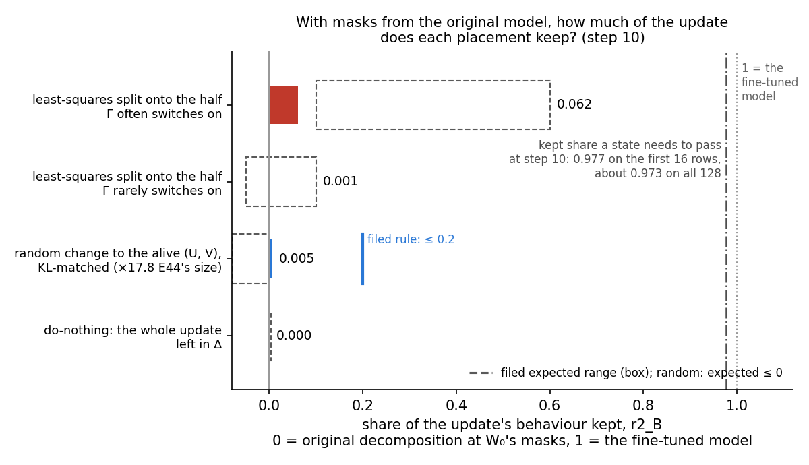
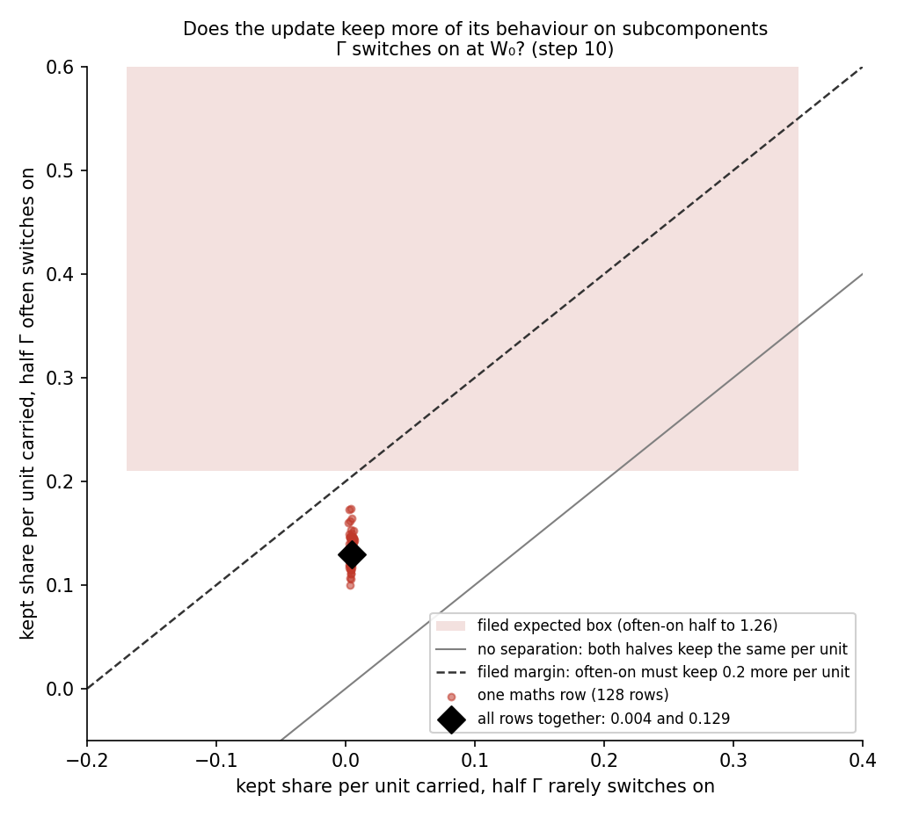

# Analysis: with masks from the original model, can the pass test tell a good placement of E40's update from a bad one? (E44 Amendment 2)

*2026-10-30, analysis agent for the lead. Plan: `reports/plans/2026-10-28_plan_qwen-q0q1.md`, section "Amendment
record (2026-10-30, Amendment 2: masks from the original model)". Decision: `decisions.md`, "E44 pass test (card
decision-e44-pass-test closed)", option 1, reading B (user, 2026-10-30). Predictions
`experiments/qwen_maps/results/predictions_amend2.json`, filed before the code and unedited. Code
`experiments/qwen_maps/amend2.py`. Results `experiments/qwen_maps/results/amend2/`, with its `run.log`. Figures from
`experiments/qwen_maps/plot_amend2.py`. Notebook `notebooks/E44_qwen_maps.ipynb`, section "Amendment 2". Every number
below was read from the results files with `jq`, or computed from them by the plot script.*

**In plain words.** We reran the pass test with masks from the original model, and placed the fine-tuning update on
subcomponents the decomposition often uses, on ones it rarely uses, or nowhere. The often-used placement kept more of
the update's behaviour on every text row, but by far less than the filed bar, so the run stopped before scoring any
split. For `GOALS.md`, no split of the update has been scored on Qwen, and the user confirmed on 2026-10-30 that
the line moves to describing where the update lands.

## The answer

On all 128 rows the placement on often-used subcomponents kept more than the one on rarely-used subcomponents, a
reported number, not a scored one; but the filed bar asked for a larger gap, and the test missed it. Put on
subcomponents the importance function switches on in the original model, the update keeps about 13% of its behaviour
per unit carried. Put on the ones it leaves off, it keeps under half a percent. The filed margin asked for 20 points.
A random change of matched effect kept 0.005, slightly more than the rarely-on half's 0.001, far under the 0.2 line.
Leaving the whole update outside the subcomponents now fails, as it should. By the filed outcome rule the test has no
teeth at step 10, and the job stopped before the splits.

## What we were trying to test

E44 found that the pass test could not fail do-nothing, the state that leaves the whole update in Δ and keeps the
original subcomponents. Amendments 1 and 1b showed why: Γ, the importance function, computes its CI masks from the
activations of the model it is run on, and those masks reproduce the fine-tuned model's behaviour whatever the
subcomponents hold. The user chose to compute every state's masks from the original model's activations instead. This
is **reading B**. Each state is then judged only on what its own subcomponents carry, under the masks the original
model would use.

Each state below is the fine-tuned weights split into the original decomposition's subcomponents, with their weights
moved, and Δ, the part left outside them. The masked forward runs the state's subcomponents with the masks of reading
B and Δ switched off. The update is E40's no-warm-up fine-tune of Qwen3-1.7B on maths answers, at step 10.

The readings, each on 128 maths rows cut to 256 tokens:

- $K_B$ is the masked state's KL from the fine-tuned model, averaged over every position.
- $K(D)$ is the same KL for the original decomposition at the original model's masks, which is do-nothing.
- $K_0$ is the original decomposition's own masked KL from the original model, its floor.
- The **kept share** is $r_2 = [K(D) - K_B] / [K(D) - K_0]$. It is 0 when the state is no closer to the fine-tuned
  model than do-nothing, and 1 when it is as close as the original decomposition is to its own model.
- The **carried share** of a state is the part of the update its subcomponents hold, $1 - \text{share in Δ}$, with
  the share measured in the norm weighted by the inputs' second moments, Σ. These are ratios of norms, so the shares
  of different states do not add up, and they need not track the energy in a state's moved subcomponents.
- The **kept share per unit carried** is $\rho = r_2 / \text{carried share}$.

Three placements test whether the test can tell good from bad. Each comes from stage S of E44, rerun unchanged.

- **The often-on half.** In each matrix, the alive subcomponents are ordered by how often Γ switches them on in the
  original model on maths text. The update's least-squares split is fitted onto the upper half alone. This is the
  positive control: the placement a test with teeth must credit.
- **The rarely-on half.** The same fit onto the lower half. Under these masks those subcomponents are almost always
  off, so the update placed there should be lost.
- **A random change.** E44's random change to the alive subcomponents' read and write vectors, scaled by a factor $a$
  until its KL from the original model matches the fine-tuned model's within a factor 1.5. Here $a$ multiplies E44's
  random change, which was already matched to the update's Σ-weighted size; $a = 1$ is that size. It rules out a test
  that credits any change of the right effect size.

The two halves carry different amounts of the update: 0.48 for the often-on half and 0.29 for the rarely-on one. That
difference voided E44's comparison of the halves, so this amendment compares kept share per unit carried.

The run was cluster job 46054 on one L40, $0, in 66 minutes.

## What we expected, and why

- **Do-nothing now fails.** Under reading B its masked model *is* the original decomposition at the original masks.
  So its kept share is 0 by construction, and its own-model ratio, the masked KL from its own model over the floor,
  should read about 23 against a line of 1.5.
- **The often-on half keeps more per unit carried than the rarely-on half, by at least 0.2.** The often-on half was
  expected to keep 0.10 to 0.60 of the behaviour. The rarely-on half was expected to keep −0.05 to 0.10. Per unit
  carried that is 0.21 to 1.26 against −0.17 to 0.35. The lean was medium-low. The rarely-on half was the safe side:
  under the earlier reading, moving its subcomponents changed the KL by almost nothing. The often-on half was the open side: its subcomponents act only through the original
  model's fractional masks, and nothing had measured how much of the update those carry.
- **The random change keeps at most 0.2.** It was expected at or below 0, with a high lean: a random change the size
  of the update's output effect moves the masked model away from the fine-tuned one.
- **Outcome.** The test has teeth at step 10 only if do-nothing, the halves and the random change all read as filed.
  Without teeth the job stops before the splits.

## The controls

All controls held. They ran first and alone, with a stop on any miss.

| control | rule | read | verdict |
|---|---|---|---|
| floor: the original model read twice on row 0 | relative gap ≤ 1e-3 | 0 | holds |
| reproduction, first 16 rows: $K_0$ against Amendment 1b's 0.0655816 | relative gap ≤ 1e-3 | 0, bitwise | holds |
| reproduction, first 16 rows: $K(D)$ at step 10 against Amendment 1's 1.4956749 | relative gap ≤ 1e-3 | 0, bitwise | holds |
| update files' sha256 against `regen_SHA256SUMS` | equal | equal, steps 1 and 10 | holds |
| do-nothing through the state path equals $K(D)$, first 16 rows, steps 10 and 1 | relative gap ≤ 1e-6; kept share 0 within 1e-5; own-model ratio > 1.5 | gaps 0 and 0; kept share 0 and 0; ratios 22.8 and 5.23 | holds |
| stage S: each state's share in Δ against `S.json` at steps 1 and 10; stored error | within 1e-3; ≤ 1e-3 | largest gap 5.4e-9; 1.6e-4 and 1.9e-4 | holds |

On all 128 rows of 256 tokens, $K_0$ read 0.0696 and $K(D)$ read 1.3738 at step 10 and 0.2905 at step 1. E44 read
0.0589 and 1.4156 on 128 rows of 512 tokens, on an A100; no limit applies across row sets. The do-nothing ratio at step
1 read 5.23, a little above the filed expectation of about 4 to 5, which was only a guide; the rule asked for over 1.5.

## What we observed

### How much of the update does each placement keep?

**Reading it.** Very little, for every placement. The often-on half keeps 0.062 of the update's behaviour, below its
filed range of 0.10 to 0.60. The rarely-on half keeps 0.0013, inside its range. The random change keeps 0.005, far
under its 0.2 line but above its filed expectation of at most 0. Do-nothing keeps exactly 0. The dash-dot line marks
the kept share a state holding the fine-tuned weights needs to pass at step 10. That is 0.977 on the first 16 rows,
about 0.973 on all 128. The best placement reaches about a sixteenth of it.

| state | $K_B$, nats | kept share | carried share | kept per unit carried | filed expectation |
|---|---|---|---|---|---|
| do-nothing | 1.3738 | 0 | 0 | not defined | 0 |
| random, $a = 17.8$ | 1.3668 | 0.0053 | not used | not used | rule ≤ 0.2, held; expected ≤ 0, missed |
| rarely-on half | 1.3721 | 0.0013 | 0.288 | 0.0044 | kept −0.05 to 0.10 |
| often-on half | 1.2933 | 0.0618 | 0.478 | 0.1292 | kept 0.10 to 0.60 |

Reference values on the same rows: $K(D) = 1.3738$ and $K_0 = 0.0696$, so the gap a kept share divides by is 1.304
nats.

### Does the update keep more on subcomponents Γ switches on in the original model?

**Reading it.** Yes, on every row, but by too little for the filed rule. Per unit carried, the often-on half keeps
0.129 and the rarely-on half 0.004, a difference of 0.125 against the filed 0.2. Each dot is one maths row. All 128
sit above the grey diagonal, where the halves would keep the same, and all sit below the dashed margin line. Per row,
the often-on half keeps 0.10 to 0.17 per unit and the rarely-on half 0.002 to 0.006. A 2000-sample bootstrap over rows
puts the difference between 0.123 and 0.127, so the miss is not row noise.

The rarely-on half holds 8.6 times the often-on half's Σ-weighted energy in its moved subcomponents at step 10. It
still keeps almost nothing. Our reading, not measured here: likely because under the original masks those
subcomponents are nearly always off.

### Does a random change of matched effect keep any of the update?

**Reading it.** Almost none: it keeps 0.005, against a filed line of 0.2. That is about four times the rarely-on
half's 0.0013, and above the filed expectation of at most 0. The search for $a$ took five evaluations. At $a = 1$,
E44's Σ-matched size, the random change moved the original model by 0.0013 nats on the first 16 rows. The fine-tuned
model moved it by 0.62 nats. At $a = 17.8$ the random change moved it 0.50 nats, a ratio of 0.81, inside the factor
1.5. So the update moves the output about 480 times further, in KL, than a random change of its Σ-weighted size. The random
state's own-model ratio at the original masks read 9.8 against the 1.5 line. That is the question E44's random control
raised, and under reading B the own-model ratio does fail a model the masks were not computed for.

## What we learned

The filed outcome rule reads "no teeth at step 10". The positive control missed its margin, so the job stopped before
the least-squares split, the in-span least-squares split and the scaled adjoint split were read. As the plan's
decision tree says for this branch, reading B has no teeth on Qwen either, and the line moves to Q3's descriptive rows.
The user confirmed that move on 2026-10-30.
For `GOALS.md` the weak version is still neither supported nor refuted on Qwen.

The reading below is ours, not a filed finding. The direction is right and clean: subcomponents Γ switches on in the
original model carry the update's behaviour about thirty times better per unit than ones it leaves off. But even that
placement keeps little in absolute terms, about 13% per unit carried. A state holding the fine-tuned weights must keep
97.7% to pass at step 10 on the first 16 rows, about 97.3% on all 128. If the kept share grew in proportion to the carried share, a split that put the whole update
on often-on subcomponents would keep about 13%. So under reading B the pass test looks near-unpassable for this update
rather than toothless: it fails bad placements, and it would likely fail good ones too. That extrapolation is untested.

Why so little is kept is not measured here. One candidate is that the original masks are fractional for many
subcomponents, so a moved subcomponent contributes only part of its change. Another is that much of the update's
effect runs through Γ switching subcomponents differently, which reading B gives no credit for by design. Amendment 1b
showed that effect is real and large on this update.

## How compelling is the evidence

The controls are tight. Both floors read exactly 0, the reproduction was bitwise, and do-nothing through the state
path matched $K(D)$ exactly at both steps. The halves' comparison held on all 128 rows, and the bootstrap interval is
narrow, so the margin miss is a property of the update, not of row sampling.

Limits: one update, E40's large format change, at step 10 only; step 1's halves and random were not read. One seed of
the random change. Maths rows only, cut to 256 tokens; no web rows past the original model's own. Reading B is blind,
by its definition, to any credit for Γ following changed activations.

## Surprises

The filed prediction for the halves did not hold: the often-on half was to keep at least 0.2 more per unit carried,
and it kept 0.125 more. Its kept share of 0.062 was also below the filed range of 0.10 to 0.60. The lean was
medium-low, so the miss was a live outcome, not a reversal.

The random change's filed expectation missed too, while its rule held. It was expected to keep at most 0, with a
high lean, and it kept 0.0053. That is about four times what the rarely-on half kept, though still far under the
0.2 line. A smaller note: the random change needed nearly eighteen times its Σ-matched size to move the output as
much as the update does.

## What next

- **Q3, as the user confirmed on 2026-10-30.** Q3 describes where the update lands and which subcomponents Γ switches
  on, on saved states, about $5 in the replan.
- **A different pass test** would be a new amendment with its own filed predictions. This amendment's verdict stands
  as filed either way.
- **Why the often-on half keeps so little.** A $0 reading of the original masks' values on the often-on half's
  subcomponents would show whether fractional masks cap it. It matters only if a new pass test is considered.

## Departures from the literature

- **Masks from another model's activations.** In VPD, Γ computes causal importances from the activations of the model
  being decomposed, on each forward pass. Here every state's masks come from the original model's activations, while
  the masked forward runs the state's own weights. Why: the user's decision of 2026-10-30, since computing masks from
  the judged model passed do-nothing for any update.
- **Moved read vectors in Γ's readouts.** VPD trains Γ on each site's input times the original read vectors $V$.
  Here the readouts use each state's moved $V'$, which Γ was never trained on. Why: the user settled this on
  2026-10-30, so that a state's moved read vectors can change its own masks.
- **The kept share and its per-unit form are ours.** VPD reports CI-masked KL to its own target model. Here the KL is
  to the fine-tuned model and is normalised between do-nothing and the original floor, then divided by the carried
  share. No source defines these.

## Scorecard

| id | claim in words | rule | read | verdict |
|---|---|---|---|---|
| control_W0 | the original model reads as in Amendments 1 and 1b | f ≤ 1e-3; K₀ and K(D) within 1e-3 relative; sha256 equal | f 0; gaps 0 and 0; equal | holds |
| control_do_nothing | do-nothing through the state path is K(D), keeps 0, and fails | gap ≤ 1e-6; r2_B 0 within 1e-5; r1_B maths > 1.5; steps 10 and 1 | 0, 0, 22.8; 0, 0, 5.23 | holds |
| control_S | stage S reproduces E44's shares | each share within 1e-3; stored error ≤ 1e-3 | 5.4e-9; 1.9e-4 | holds |
| teeth_i | the often-on half keeps at least 0.2 more per unit carried | ρ_lower ≤ ρ_upper − 0.2 | 0.0044 against 0.1292 − 0.2 = −0.0708 | **does not hold** |
| teeth_i, reported | direction per row; bootstrap of ρ_upper − ρ_lower | none | 128 of 128 rows; 95% from 0.123 to 0.127 | reported |
| teeth_i, expected | r2_B lower in [−0.05, 0.10]; upper in [0.10, 0.60] | expectation, not a rule | 0.0013 inside; 0.0618 below | upper missed |
| teeth_ii | a KL-matched random change keeps at most 0.2 | matched, r2_B ≤ 0.2 | a = 17.78, KL ratio 0.81; r2_B 0.0053 | holds |
| teeth_ii, expected | r2_B of the random change ≤ 0 | expectation, not a rule; lean high | 0.0053, about 4× the rarely-on half's 0.0013 | missed |
| teeth_ii, reported | random's own-model ratio at the original masks | none | r1_B maths 9.77 | reported |
| teeth_outcome | teeth at step 10 | all of do-nothing, teeth_i, teeth_ii hold | teeth_i does not | **no teeth: stop before the splits** |

## Not run

- The least-squares split, the in-span least-squares split and the scaled adjoint split, at step 10 and at step 1.
- Step 1's halves and random change; only step 1's controls were read.
- Step 100, which the plan kept for a split that passed.
- Web rows for any state; only the original model's web readings and its saved adversary replays were read.
- A second seed of the random change, and any update besides E40's.
- Any reading of why the often-on half keeps so little, such as the original masks' values on its subcomponents.

## Run and provenance

- Cluster job 46054, one L40, `normal` QoS, `--mem=80G`, `--time=03:00:00`, $0, code of commit 458ef41. Results
  committed in 6cb36a2. The job stopped at 3936 s with `stopped.json` reading "no teeth at step 10 (teeth_outcome):
  stop before the splits".
- Stage times: load 107 s; controls to 610 s; Σ 175 s; stage S 2392 s, against the plan's ~47 min; Γ reload and scale search
  263 s; the three step-10 reads 149 s, 150 s and 194 s.
- Peaks: GPU 45.8e9 bytes, 42.7 GiB, inside the 44 GiB stop rule; host 74.0 GB, against the 80 GB limit.
- δW: `~/commute-data/results-large/qwen_sft/nowarmup_regen/dW/step_{10,1}.safetensors`, sha256 8b8509d2…beb9 and
  91b57888…faa, matching `experiments/qwen_maps/results/regen_SHA256SUMS`.
- Figures: `experiments/qwen_maps/plot_amend2.py`, reading `results/amend2/score.json`, `controls.json` and `t10.json`
  only; it writes `figures/amend2_kept.png` and `figures/amend2_rows.png`.
