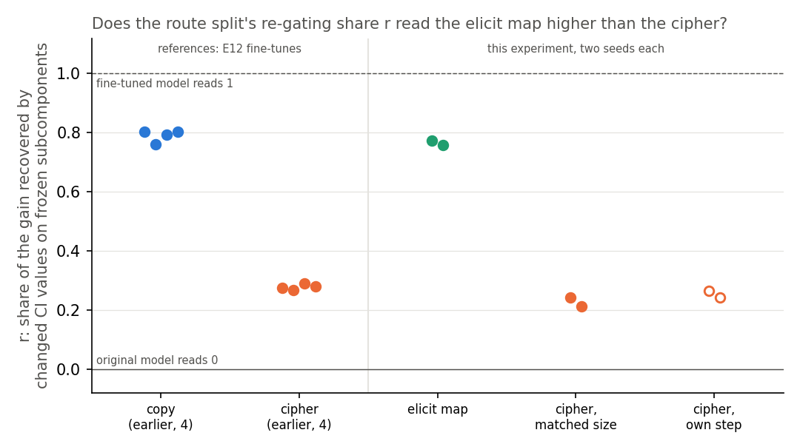
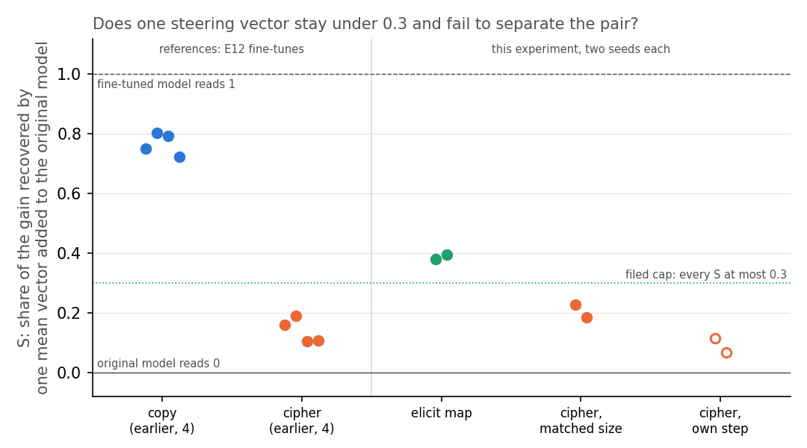
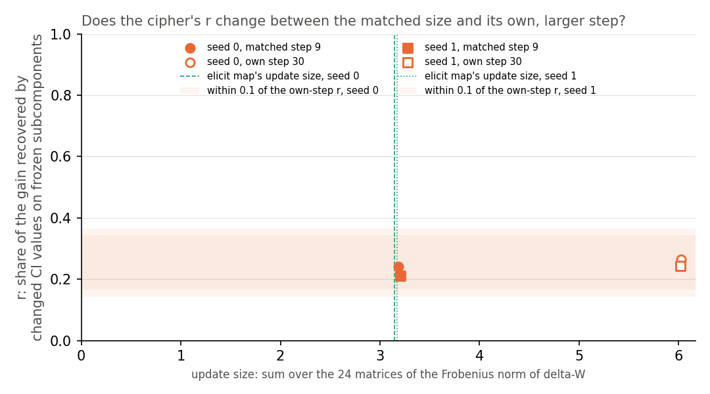

# Analysis: does the route split tell a half-known key map from a cipher where one steering vector cannot? (E54)

*2026-10-30, coding agent, baseline-lead E54 writer. Plan: `reports/plans/2026-10-29_plan_e54-keydependent-elicit.md`, with its two dated pre-run amendments. Rules: `experiments/keydependent_elicit/results/predictions.json`. Results: `stage0.json`, `stage1.json`, `stage2.json` in the same folder. Reading: `decisions.md`, E54 rows of 2026-10-30. Explanation: `notebooks/E54_keydependent_elicit.ipynb`. Provenance at the end.*

We fine-tuned the small model on two word tables over the same keys, one it already answers weakly and one arbitrary, and compared them at equal size of weight change. Switching existing subcomponents on carried about three quarters of the first table's gain and a quarter of the second's, while one added steering vector carried more of the first than we predicted. So the decomposition separates the two kinds more clearly than steering in every comparison, by a margin that depends on the units, and our steering prediction failed.

## The question, and why this pair

The project asks whether a VPD decomposition can tell a fine-tune that strengthens something the model already does from one that teaches something new. E52 found that one steering vector separates copying from an arbitrary map about as well as the decomposition does. That may be only because copying is the same for every key, so a single added vector can carry it, while a map is not.

E54 builds a pair where both tasks depend on the key. Each window is Pile text with a rare marker token, then a key word; the model must predict the key's value next. The two tasks share keys and windows and differ only in the table:

- **Elicit map.** Each key's value is a word the original model already ranks 2nd to 20th after the marker and key. Its probability there is between 0.01 and 0.1. It must also be at least ten times likelier after this key than after a typical other key. Examples: " think" → " it", " life" → " span", " best" → " practices", " action" → " potential". The top-ranked word is excluded, so a vector that only sharpens the model's existing first guess cannot get the answer.
- **Cipher.** The same keys mapped to words from E12's value pool that the original model gives under 1e-4 each.

Both are fine-tuned with E12's recipe on all 24 decomposed matrices, with seeds 0 and 1. The recipe is Adam at 3e-5, batch 32, and a KL term on other tokens. The elicit map is read at E12's scored step: the first checkpoint where the held-out probability of the target reaches 0.5. That was step 10 for both seeds. The cipher learns more slowly, so it is read twice. Its main reading is at the checkpoint whose update size matches the elicit map's: step 9 on both seeds. Update size here is the sum over the 24 matrices of the Frobenius norm of δW. It is also read at its own E12 step, 30, as a size check. The size match exists because earlier runs showed r tracking update size: E36's tiny null update read r = 0.82.

## The two readings

- **Gain** $G$: mean over the 97 held-out windows of $\log P_\text{tuned}(\text{target}) - \log P_{W_0}(\text{target})$ at the answer position, in nats. A state is read only if $G$ clears its floor of 0.05 nats; all six did, by a factor of over a hundred.
- **Steering share** $S$, E52's recipe unchanged. The held-out windows split into a fit half and a scoring half. For each block input, the vector $v$ is the mean over the fit half of the tuned minus the original residual stream at the answer position. Adding $v$ there to the original model gives a share $(\log P_{W_0+v} - \log P_{W_0})/G_\text{score}$ on the scoring half. The block is chosen on the fit half. $S$ reads 0 for the original model and 1 for the fine-tuned model.
- **Re-gating share** $r$, the route split of E12 and E46. The fine-tuned weights are first written as the least-squares split: least-norm changes to the subcomponents, the rest in Δ. Then $r = (L_{01} - L_{00})/(T_1 - T_0)$, all in log-odds of the target at the answer position. Here $L_{00}$ is the CI-masked model with the original subcomponents and the CI values Γ computes on the original model. The term $L_{01}$ keeps the original subcomponents but uses the CI values Γ computes on the fine-tuned model. The denominator $T_1 - T_0$ is the fine-tune's log-odds gain. So $r$ is the share of the gain recovered when no subcomponent changes, only which ones Γ switches on. It reads 0 if the fine-tune works only by changing subcomponents and 1 if switching existing ones on carries all of it.

The separation rule comes from E51 and E52, with a minimum added. With two seeds per task, the gap between task means must exceed the larger within-task range, strictly. It must also be at least 0.2.

## What we expected, and why

- **The decomposition separates the pair, elicit higher.** A half-known table should be reached mostly by switching on subcomponents that already produce those words. A cipher needs changed subcomponents.
- **Steering does not separate them, and every share stays at or under 0.3.** One mean vector is the same for every key. So it should not carry a map whose answer depends on the key, for either task. The worry filed beside it: a vector might still lower a rival shared by many keys.
- **The cipher's r barely moves between matched size and its own step,** within 0.1. If it moved more, r would depend on update size and the comparison would be valid only at matched size.

## Stage 0: the controls, run first and alone

Before any new fine-tune, the job re-read two saved E12 states and had to reproduce the earlier numbers.

| check | filed | copy state, seed 0 | cipher state, seed 0 | |
|---|---|---|---|---|
| r against E46 | within 0.03 | 0.8024, ref 0.8024 | 0.2733, ref 0.2733 | pass |
| S against E52 | within 1e-3 | 0.7503, ref 0.7503 | 0.1583, ref 0.1583 | pass |
| G of a zero δW | exactly 0 | 0.0 | 0.0 | pass |
| steering share at block 0, the embedding | \|share\| ≤ 1e-6 | −1.3e-7 | −4.2e-8 | pass |
| original model's held-out geometric-mean P(target) | reported | 3.9e-5 | 1.8e-6 | reported |

Every control matched its reference to four decimals. The original model's rates on the E12 tasks sit below the plan's rough figures, which were per-key averages from E12; they were reported, not gated.

## Stage 1: the elicit table, and the floor we lowered after seeing the value

Of 1000 candidate keys, 777 had a value that met the rule. Thirty-two were drawn from them by a seeded draw. On held-out windows, the original model's geometric-mean probability of the elicit target was 1.70e-3. The cipher target's was 1.08e-6.

The filed band for the elicit rate was 5e-3 to 0.1, so the first job stopped here, before any fine-tune. Values had been picked by the arithmetic mean of the probability over each key's windows, which read 0.032. The gate used the geometric mean, which is always lower. On the very windows used for selection it read 2.3e-3, so the gap comes from the averaging, not from held-out windows doing worse. The user then lowered the floor to 1e-3, keeping the same keys and values. **This floor was set after seeing the value of 1.70e-3.** It is recorded as a dated amendment in the plan and in `predictions.json`. No fine-tune had run. The second job then passed stage 1 with the same numbers.

What the original model gives each target varies widely by key. On the selection windows, not the held-out ones, the per-key geometric means run from about 7e-6 for " independent" → " increments" to 0.027 for " think" → " it". About half the values are common function words such as " of", " at", " the" and " that". Each is still at least ten times likelier after its own key than after a typical other key.

## Gains, update sizes and steps

| state | step | update size | held-out P(target) | G, nats | log-odds gain | S block |
|---|---|---|---|---|---|---|
| elicit, seed 0 | 10 | 3.145 | 0.967 | 6.34 | 10.79 | 2 |
| elicit, seed 1 | 10 | 3.173 | 0.952 | 6.32 | 10.82 | 2 |
| cipher matched, seed 0 | 9 | 3.185 | 0.228 | 10.56 | 11.10 | 3 |
| cipher matched, seed 1 | 9 | 3.204 | 0.226 | 10.35 | 10.89 | 3 |
| cipher own step, seed 0 | 30 | 6.022 | 0.997 | 13.73 | 20.80 | 3 |
| cipher own step, seed 1 | 30 | 6.020 | 0.997 | 13.73 | 20.46 | 2 |

The size match worked: neither matched step sat at the search's edge. It matched more than size. The log-odds gain, the denominator of r, is about 10.8 for the elicit map. For the matched cipher it is 10.9 to 11.1. The matched cipher is only part-learned, though. Its held-out target probability is 0.23, under E12's rule of 0.5 for "learned".

## Does the decomposition read the elicit map higher than the cipher?

**Reading it.** Yes, by a wide margin. Switching existing subcomponents on, with none changed, recovers 0.77 and 0.76 of the elicit map's gain. It recovers 0.24 and 0.21 of the matched cipher's gain. The gap is 0.54 and the larger seed range is 0.03. The new pair lands where E12's pair did. There copy read 0.76 to 0.80, and the cipher read about 0.28. Copy and the elicit map differ in whether the answer depends on the key, yet they read alike.

| state | r | S |
|---|---|---|
| elicit, seed 0 | 0.773 | 0.380 |
| elicit, seed 1 | 0.758 | 0.394 |
| cipher matched, seed 0 | 0.241 | 0.228 |
| cipher matched, seed 1 | 0.212 | 0.185 |
| cipher own step, seed 0 | 0.265 | 0.114 |
| cipher own step, seed 1 | 0.243 | 0.066 |

## Does one steering vector fail to separate the pair?

**Reading it.** The prediction failed. One mean vector recovers 0.38 and 0.39 of the elicit map's gain, above the filed cap of 0.3. On the matched cipher it recovers 0.23 and 0.19. The gap of 0.18 beats the larger seed range of 0.04. It falls short of the 0.2 minimum, so by the filed rule steering does not separate the pair. The prediction needed both halves, and the cap half failed. Steering separates this pair far less than it separated copy from cipher, where the gap was 0.63.

Both halves of this miss depend on choices made in the measurement:

- **The cap miss comes mostly from the unit.** S is a share of a gain in nats. The elicit map's nats gain is compressed, because its held-out target probability ends near 0.96. It reads 6.3 nats against 10.8 in log-odds. The cipher's is not compressed: about 10.5 nats against 11.0. In absolute terms the vector moves both tasks about equally. It recovers 2.54 and 2.62 nats on the elicit map. On the matched cipher it recovers 2.43 and 1.93.
- **"Steering does not separate" depends on the matched cipher being part-learned.** At step 9 its held-out target probability is 0.23. At the cipher's own step it is 0.997, and there S reads 0.114 and 0.066. Against the elicit map that gap is 0.296, with a larger range of 0.048. By the filed rule, S would separate the pair there.

The filed verdict stays as scored at matched size, which is the user's choice. The user's reading, recorded in `decisions.md`: the prediction stays failed as filed. The route split separates the pair more clearly than steering does, and one mean vector moves a real part of the elicit map without separating the pair by the filed bar.

**How much more clearly is not one number.** S is a share of a nats gain and r a share of a log-odds gain, so their gaps are in different units. The ratio of the r gap to the S gap depends on the unit and on which cipher checkpoint is read:

| comparison | r gap | S gap | ratio |
|---|---|---|---|
| cipher at its own step, S in nats | 0.51 | 0.30 | ~1.7x |
| matched cipher, S in nats, as filed | 0.54 | 0.18 | ~3x |
| matched cipher, each gap over its noise floor of 0.04 and 0.08 | 13.5 | 2.3 | ~6x |
| matched cipher, S estimated in log-odds units | 0.54 | ~0.04 | over 10x |

The last row is an estimate, not a measurement. It divides the vector's nats by each state's log-odds gain, which gives a lower bound near 0.235 and 0.242 for the elicit map and 0.22 and 0.18 for the cipher. The direction holds in every row: the decomposition separates the pair more clearly than one mean steering vector.

## Does the cipher's r depend on how far it was trained?

**Reading it.** No, within this range. Going from step 9 to step 30 nearly doubles the cipher's update size and its log-odds gain. Its r moves by 0.02 to 0.03 on the two seeds, well inside the band of 0.1. So the matched-size comparison above is not an artefact of where the cipher was stopped. The steering share does move with training. The cipher's S roughly halves between the matched step and step 30, ending at 0.11 and 0.07.

## What we learned

On a pair built so that one vector should fail on both tasks, the re-gating share still separates a half-known map from a cipher. The gap matches E12's copy-and-cipher pair. So r on E12 was not reading only whether the answer depends on the key. The vector moves both tasks by about the same amount, near 2.5 nats. Nothing here shows that it carries anything specific to the elicit keys; that it does is an unmeasured hypothesis. The supported claim is a direction: the decomposition separates this pair more clearly than one mean vector does. The size of that margin runs from under twofold to over tenfold, depending on the units and the cipher checkpoint. Both labels rest on the original model's behaviour, not on a check of its internal representations, and on one small model.

## What each number is blind to

- **r** is blind to which subcomponents switch on and to whether they formed one coherent mechanism before. It reads "existing subcomponents", not "existing behaviour". A new circuit assembled from existing subcomponents also reads as elicited. That is the user's granularity limit: at the resolution of subcomponents, "elicited" means "built from old parts". It is also blind to anything outside the CI-masked model, since Δ is left out of all four cells.
- **r's noise floor** is E12's seed spread, at most 0.04; here the larger range was 0.03. Two seeds per task give a range, not a variance.
- **S** is blind to anything a single input-independent vector at one position cannot carry, and it is a share of each state's own gain. The elicit map's gain is about 6.3 nats and the matched cipher's about 10.5. In nats, the vector recovers about 2.5 on the elicit map. On the matched cipher it recovers 1.9 to 2.4. Much of the gap in S comes from the denominator. This reading is computed from stored numbers, not filed.
- **S's noise floor** is E52's seed spread, at most 0.08; here 0.04.
- **The elicit label** is behavioural: the original model's probability of each target at the answer position. It is blind to whether the model represents the map internally, which is what Jain et al. define as possessing a capability. Per-key rates span more than three orders of magnitude, so some keys are barely "half-known".
- **The size match** equalises update size and, as it turned out, log-odds gain, but not learning progress. The matched cipher's target probability has reached 0.23, the elicit map's 0.95 or more.
- **Positive control.** Stage 0 checks that the code reproduces earlier numbers. It is not a positive control of known kind for either reading: no state whose kind is verified independently was read.

## Surprises

**Steering's prediction failed.** We predicted that one mean vector would recover at most 0.3 of either task's gain. It recovered 0.38 and 0.39 of the elicit map's. This is a miss of the filed cap, not a reversal; the two tasks still do not separate under steering by the filed bar. Two candidate readings, both hypotheses and not measured here. First, about half the elicit values are common function words. One vector can raise that whole group at once, close to the filed worry about a shared rival. Second, the vector recovers similar nats on both tasks, and the elicit map's smaller gain makes the same nats a larger share.

**The cipher's steering share halves with further training while its r does not move.** At its own step the cipher's S is 0.11 and 0.07. In nats the vector recovers 1.6 and 0.9, less than at step 9. A longer fine-tune moves the cipher further from anything one vector can carry.

**The original model's rates on E12's saved tasks were lower than the plan quoted,** 3.9e-5 against about 1e-4 for copy. The plan's figures were per-key averages; nothing reads them.

## What next

Following the plan's line for "both readings hold" was the user's choice, labelled provisional because the steering prediction failed:

- **The same pair on Qwen**, with E45's anchors. If r still separates and steering separates less, the narrow claim holds beyond the 67M model. If steering catches up, the claim is about this small model.
- **Jain et al.'s readout check on the elicit keys.** Read each key's value linearly from the original model's activations, then test it causally. That gives the elicit label a footing independent of behaviour. If the readout fails on many keys, the elicit label is weaker than the behaviour suggests.

## Scorecard

| id | claim | rule | read | verdict |
|---|---|---|---|---|
| S0 | controls reproduce E46's r and E52's S | r within 0.03, S within 1e-3, zero δW gives G = 0, block-0 share ≤ 1e-6 | r 0.8024, 0.2733; S 0.7503, 0.1583; 0.0; −1.3e-7, −4.2e-8 | pass |
| S1 | elicit rate in band, cipher under 1e-4 | elicit geometric mean in [1e-3, 0.1], floor amended after seeing the value; cipher < 1e-4; K ≥ 16 | 1.70e-3; 1.08e-6; K = 32 | pass at the amended floor; failed at the filed 5e-3 |
| P1 | r separates elicit from matched cipher, elicit higher (lean medium) | gap > larger range, strict, and ≥ 0.2 | 0.773, 0.758 vs 0.241, 0.212; gap 0.539, range 0.029 | pass |
| P2 | S does not separate them and every S ≤ 0.3 (lean medium) | no separation either way and all four ≤ 0.3 | 0.380, 0.394 vs 0.228, 0.185; gap 0.180 < 0.2; elicit over 0.3 | **fails** (predicted pass) |
| P3 | cipher's r within 0.1 between matched and own step (lean medium) | \|difference\| < 0.1 on both seeds | 0.024, 0.031 | pass |
| P4 | prompting share separates, elicit higher | only if E52 Amendment 1 found a working prompt format | it did not | not run |

The run's computed branch read, in full: "steering not blind to this key-dependence: the objection holds on both sets (P2 missed on the S bound only, S does not separate: the tree does not cover it; tell the user)". That is the tree's branch for P1 pass and P2 fail. The user did not take it; `decisions.md` records the reading above instead.

## Departures from the literature

- **Steering is credited to contrastive activation addition, Rimsky et al. 2024, and to Venhoff et al. 2025 and Ward et al. 2025.** Contrastive activation addition works within one model. It takes the mean activation difference between prompts that show a behaviour and prompts that do not. It adds that vector at every position after the prompt, and sweeps a multiplier and the layer. Ward et al. take a direction from the base model and add it to the reasoning model, where it induces backtracking. Venhoff et al. likewise steer models of billions of parameters along directions tied to a reasoning fine-tune. Both judge generated text. We instead take the difference between the fine-tuned and the original model on the same inputs. We add it once, at the answer position, with multiplier 1, and choose the block on a fit half. We read one token's log probability as a share of the fine-tune's gain. That asks how much of this particular fine-tune one vector can stand in for, which is the comparison we need. The cap of 0.3 and the minimum gap are ours.
- **The route split is not in the VPD paper.** VPD defines subcomponents, the causal-importance function Γ and the CI-masked model. It scores a decomposition by its reconstruction checks. It does not split a later fine-tune's gain into parts. The route split, the least-squares split it reads and the re-gating share are this project's, added 2026-10-16. They keep Γ and the decomposition of the original model frozen, and read the target's log-odds at one position with Δ left out.
- **Jain et al. 2024 define possessing a capability by a linear readout,** trained on pretraining data, that computes the capability on a sub-domain. Reuse adds that the fine-tuned map composes with it. Our elicit label instead uses the original model's next-token probability of each value, at a rank of 2 to 20. Our cipher label uses its near-zero probability. The readout and the causal check were not run. Behaviour was the cheapest label not tied to any decomposition, and the plan names the readout as the next check.
- **E12's fine-tune recipe and step rule are this project's own,** not a cited recipe. They are reused unchanged so the new states sit beside E12's.
- **S and r use different units,** nats and log-odds. That is an internal difference between our two readings, not a departure from a source, but it sets how large the margin between them looks.

## Not run

- Prompting the original model as a label check. E52's prompting re-run found no format in which this model performs a key map in context.
- Jain et al.'s linear readout and causal check on the elicit keys.
- Neuron patching and the weight statistics of E51 and E52 on the new pair.
- A random update of matched size as a null for r and S.
- The copy task on these keys, and a cipher read at matched learning progress rather than matched size.
- S read in log-odds units on the saved states, the direct test of how much more clearly the decomposition separates the pair.
- S at the cipher's own step scored as a separation.
- More than two seeds; any per-key breakdown of r or S; steering at more than one position or with a multiplier.
- Which subcomponents switch on for the elicit map, and whether they formed one mechanism in the original model.
- Qwen.

## Provenance

`experiments/keydependent_elicit/run.py`, `plot.py`; `src/commute/elicit.py`, `src/commute/steering.py`; `cluster/keydependent_elicit.sbatch`.

| field | value |
|---|---|
| where | MATS cluster L40, debug QoS, $0 |
| job 45963 | stages 0 and 1, 2026-10-30 10:35; stopped at stage 1 on the filed floor |
| code | commit 51319e4 for stages 0 and 1, recorded in `stage0.json` |
| job 45973 | stages 0 and 1 rerun at the amended floor, 11:59; results commit e3305cc, which stage 2 checks against |
| job 45974 | stage 2: six fine-tune readings, 12:01 to 12:02; results commit 9cb9c52 |
| logs | `cluster/logs/commute-keydependent-elicit-{45963,45973,45974}.out` |
| sha256 | stage2.json 4d743203…; stage1.json 398810c4…; predictions.json 4e9b8b90… |
| saved δW | `results/large/`, one file per scored state; hashes in `stage2.json` |

Figures regenerated by `plot.py` through `fleet/cpu-run`; titles and reference labels revised for this write-up.
