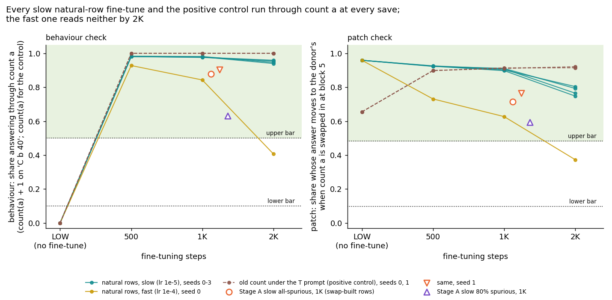

# Do fine-tunes trained on natural text, where the old count already gives the answer, keep using it?

E55 Amendment 5, reuse line, 2026-10-30. Plan `reports/plans/2026-10-30_plan_e55-amend5-natural-anchors.md`, with
Revision 1. Predictions `experiments/pcfg_anchors/results/predictions_amend5.json`, filed before the run and amended
twice before the run. Code `experiments/pcfg_anchors/amend5.py`. Result `experiments/pcfg_anchors/results/amend5.json`.
Notebook `notebooks/E55_pcfg_anchors.ipynb`, section "Amendment 5". Figure `experiments/pcfg_anchors/figures/amend5_saves.png`
from `plot_amend5.py`. Pre-run code review `reports/reviews/2026-10-30_review_e55-amend5-code.md`.

We fine-tuned the small model that counts only the letter a to count b, on natural texts where one more than the count of a is always the right answer, and read whether its answers run through the old count.
Every slow fine-tune, four seeds, ran through the old count at every save up to two thousand steps; a fast copy did at first and stopped by two thousand; a control that asks for the old count under a prompt that used to mean something else passed at once.
So the truth set for scoring methods now has many states on the "reuses the old count" side, but they reuse it nearly by construction, and they come from five training runs, not fourteen.

## The answer

Fine-tunes trained only on natural texts where one more than the count of a gives every answer do keep using the old
count. All four seeds of the slow recipe answer through the count of a at 500, 1,000 and 2,000 steps, and never
through a count of b. The fast copy does the same at first, then by 2,000 steps reads as neither. A positive control,
the old count asked for under a prompt that used to mean something else, passed by 500 steps. No state took a
shortcut. This was close to guaranteed by how the rows were chosen, so its value is as ground truth for scoring
methods, not as a discovery.

## What we were trying to test

`GOALS.md` asks whether post-training teaches new capabilities or strengthens existing ones. The reuse line answers
that on a small grammar with labels that need no decomposition, and then scores methods, VPD among them, against the
labels. That is Stage C. Stage A left only two fine-tunes labelled "reuses the old count", and Amendments 3 and 4
showed both had been pushed to change that count. This amendment adds fine-tunes that nothing pushes to change it.

**The model and the task.** LOW is a minGPT of 6 blocks, width 192, pretrained on Jain et al.'s counting grammar.
It counts the letter a in the last 40 text tokens when asked `C a 40`, and asked `C b 40` it answers its count of a.
The fine-tunes teach it to answer `C b 40` with the count of b.

**The training rows.** We sampled natural texts and kept only those on which the count of b is one more than the
count of a. About one natural text in five qualifies. On every kept row, LOW's own count of a plus one is the label,
so a fine-tune can learn the task by adding one to an answer LOW already gives. *Departure:* Jain, Kirk, Lubana et
al. build their spurious rows by editing texts. We sample texts that already carry the correlation, because Amendment 3
showed the edit breaks LOW's count. The cost is narrow labels. On unseen training-distribution rows (Amendment 2's streams; no model trained on them), 69% have label 14
and almost all the rest 13 or 15.

**What "reuses" means.** Jain et al.'s Def 2 calls a fine-tune reuse of a capability when the fine-tuned map is
$g \circ f_C$, the old count followed by some function $g$. Here $f_C$ is the count of a and $g$ adds one.
*Departure:* we require, by the user's decision of 2026-10-30, that $g$ learnt on the training rows also work on
held-out values. Adding one does, so this changes no reading here. *Departure:* the paper defines reuse by the map
alone. Stage 1 added two causal checks, their bars and a "neither" class, and this amendment uses them unchanged.

- The **behaviour share** is the share of 1,000 held-out natural texts on which the `C b 40` answer equals one more
  than the count of a. The texts are Stage A's, chosen so that the count of b is not one more than the count of a.
  So a count-a answerer reads near 1 and a count-b answerer near 0.
- The **patch share** uses 1,000 pairs of such texts that differ in the count of a but share the count of b. The
  residual at the answer position after block 5 is replaced by the other text's. The share is the fraction of pairs
  whose answer moves to the other text's answer.
- The count of a is **through** when both shares clear Stage A's upper bars, 0.500 for behaviour and 0.483 for the
  patch, and **not through** when both sit under the lower bars, about 0.10. Anything else is **neither**.
- The same two checks, with the count of b's own answer and pairs, read the count of b.
- A state **reuses** when the count of a is through and the count of b is not through. It is **new** in the mirror
  case, and **neither** otherwise. A state through on neither count whose answers look constant is a **shortcut**.

**The arms.** All start from LOW and use Stage A's recipe: AdamW, weight decay 0.1, batch 96.

| arm | training rows | learning rate | seeds | what it rules out |
|---|---|---|---|---|
| slow natural-row | natural, count b = count a + 1 | 1e-5, as Stage A's slow arms | 0, 1, 2, 3 | that the slow recipe abandons the old count even when nothing pushes it |
| fast natural-row | same | 1e-4, as Stage A's fast arms | 0 | that the learning rate, not the rows, decides |
| prompt control | natural texts, answer the count of a under the prompt `T a 40` | 1e-5 | 0, 1 | that the checks miss a fine-tune whose answers are the count of a |

**The prompt control.** In pretraining, the T prompt asked for a terminal 40 tokens back and never took a letter.
LOW, asked `T a 40`, answers a terminal, never a count: its behaviour share there is 0.000. The fine-tune must route
this prompt to LOW's existing count of a. Its behaviour share is the share answering the count of a itself, since
here $g$ is the identity. *Departure:* this arm is not in the paper. The code writer first pointed out that the
plan's choice, `C c 40`, would be a do-nothing control. Read once for description, LOW at `C c 40` already answers the
count of a on every text.

**The shortcut check.** On 4,000 unseen training-distribution rows (Amendment 2's streams; no model trained on them), the shortcut share is the fraction of
rows labelled other than 14 that the state answers with 14. A correct answerer reads 0 and a constant-14 answerer
reads 1. LOW reads 0.248, because it answers the count of a, which is 14 on rows labelled 15.

**When states are read.** Saves at 500, 1,000 and 2,000 steps. *Departure:* the paper reads each fine-tune at the end
of training; Stage A found the reading changes between 1,000 and 10,000 steps. *Departure, a recipe choice:* the
schedule is Stage A's 10,000-step schedule, 20% linear warm-up then cosine, stopped at 2,000 steps. So every save
sits in the warm-up, at a quarter, half and all of the peak rate, as Stage A's 1,000-step states did.

**Amended before the run.** The predictions file carries two dated amendments, both made before any model was read.
First, the lead lowered the positive control's lean from 85% to 65%. Re-routing a pretrained prompt in a thousand
warm-up steps seemed harder than keeping an answer. The lead also widened when the natural-row predictions go void:
only if the control fails at every save of both seeds, not just at 1,000 steps of seed 0. Second, after the code
review, the shortcut share was conditioned on the label. As first drafted, it was the share of all rows answered 14,
against a bar of 0.6. A correct answerer would score 0.69 there, so any state through on neither count that still
answered the training rows right would have been called a shortcut. Under the rule as first filed, the fast copy at 2K
(accuracy 1.000, 0.6885 answered 14) would have read "shortcut". The amendment, made before the run, makes it
"neither". The bar for the conditioned share is 0.5. The review also gave the shortcut prediction a scored step,
1,000. It fixed the wording that called the evaluation rows fresh, when they are the rows Amendment 2 drew (the code's
docstring and comment still say "fresh", to be fixed with the next code commit). The file's definitions block still
states the first rule; the amendments list governs, and the run used 0.5 on the label-conditioned share (amend5.json
constants). The second amendment also moved P3's lean: neither or shortcut 40% to 45%, new or both 20% to new 15%. The
scored "reuses" stays at 40%.

## What we expected, and why

- **LOW reproduces its Stage A references** through this code, at 95%. It should also give every training label by
  adding one to its count of a, and answer no count under the T prompt.
- **Each slow natural-row seed reuses the old count at 1,000 steps**, at 70% per seed. Nothing in the rows pushes the
  fine-tune off LOW's count, and Stage A's slow all-spurious arm read this way at 1,000 steps. The main alternative
  was a near-constant answer, since 14 is the label on two thirds of the rows.
- **The same at 2,000 steps**, at 60% per seed. Stage A's slow all-spurious arm left the count of a somewhere after
  1,000 steps, and when was not known for this recipe.
- **The fast copy at 1,000 steps** was a toss-up: reuses at 40%, neither or shortcut at 45%. Stage A's fast
  all-spurious arm read neither at 1,000 steps.
- **No shortcut state at 1,000 steps**, at 75%.
- **The prompt control through the count of a at 1,000 steps**, at 65% after the amendment.
- **Described only:** on Amendment 4's letter-swapped rows, the natural-row fine-tunes should answer like LOW, since
  they never saw swapped text.

## What we observed

### Do the controls hold?

Yes, all of them. Through this amendment's code LOW reproduces Stage A's two count-a references exactly: behaviour
0.99975 and patch 0.960. Its count of a plus one gives the label on all 38,400 rows of the four slow seeds' first
training chunk. Under the T prompt its behaviour share for the count of a is 0.000, under the stop bar of 0.05. The
T prompt with the letter a never occurs in 96,000 pretraining rows.

LOW, read as a fine-tuned state would be, is the do-nothing reference. On `C b 40` its behaviour share is 0.000 and
its patch share 0.959. The patch share is already high because LOW answers the count of a there, so swapping in
another count of a moves its answer. Only the behaviour share separates LOW from a fine-tune that adds one.

| LOW, before fine-tuning | behaviour, count a | patch, count a | behaviour, count b | patch, count b | reading |
|---|---|---|---|---|---|
| at `C b 40`, as the natural-row arms are read | 0.000 | 0.959 | 0.243 | 0.000 | neither |
| at `T a 40`, as the prompt control is read | 0.000 | 0.655 | 0.000 | 0.616 | neither |
| at `C c 40`, described | 1.000 | 0.960 | 0.243 | 0.000 | through count a |

### Do the natural-row fine-tunes run through the old count?

**Reading it.** Yes for the slow recipe at every save, and for the fast one until 1,000 steps. The left panel is the
behaviour share, the right the patch share, each by save; the first point of every line is LOW before fine-tuning.
"Through" needs both panels in the green region. By 500 steps the four slow seeds answer one more than the count of a
on about 0.98 of texts, where LOW answers it on none. Their patch share stays near 0.9 up to 1,000 steps. They sit above Stage A's two earlier anchors, the hollow
markers at 1,000 steps. Their patch share drifts down to between 0.748 and 0.804 at 2,000 steps, still far above the
bar. On the count of b they read zero behaviour and a patch share of at most 0.044 at every save, not through.

The fast copy reads through at 500 and 1,000 steps, though lower each time. By 2,000 steps it falls between the bars
on both checks, behaviour 0.407 and patch 0.373, and reads neither. It still answers every training row right, so it
has moved to some other rule that agrees with the label on the training rows. Those two count-a numbers sit close to
Stage A's slow all-spurious arm at 10,000 steps, 0.399 and 0.361, which answers a rule of two counts; the count-b
patch is 0.367 against 0.43 there. That resemblance is not filed and not tested. Each share reads 1,000 texts or pairs, a binomial standard deviation of at most 0.016.

| state | behaviour, count a | patch, count a | count a | behaviour, count b | patch, count b | count b | class |
|---|---|---|---|---|---|---|---|
| slow natural-row, seed 0, 500 | 0.981 | 0.924 | through | 0.000 | 0.008 | not through | reuses |
| seed 0, 1K | 0.979 | 0.898 | through | 0.000 | 0.007 | not through | reuses |
| seed 0, 2K | 0.940 | 0.748 | through | 0.000 | 0.044 | not through | reuses |
| seed 1, 500 | 0.981 | 0.925 | through | 0.000 | 0.009 | not through | reuses |
| seed 1, 1K | 0.977 | 0.902 | through | 0.000 | 0.007 | not through | reuses |
| seed 1, 2K | 0.959 | 0.804 | through | 0.000 | 0.015 | not through | reuses |
| seed 2, 500 | 0.983 | 0.926 | through | 0.000 | 0.009 | not through | reuses |
| seed 2, 1K | 0.981 | 0.908 | through | 0.000 | 0.010 | not through | reuses |
| seed 2, 2K | 0.947 | 0.765 | through | 0.000 | 0.035 | not through | reuses |
| seed 3, 500 | 0.981 | 0.923 | through | 0.000 | 0.010 | not through | reuses |
| seed 3, 1K | 0.976 | 0.911 | through | 0.000 | 0.007 | not through | reuses |
| seed 3, 2K | 0.955 | 0.793 | through | 0.000 | 0.031 | not through | reuses |
| fast natural-row, 500 | 0.928 | 0.731 | through | 0.000 | 0.055 | not through | reuses |
| fast, 1K | 0.843 | 0.627 | through | 0.000 | 0.190 | neither | reuses |
| fast, 2K | 0.407 | 0.373 | neither | 0.013 | 0.367 | neither | neither |
| *Stage A, slow all-spurious, 1K* | 0.879 | 0.715 | through | 0.001 | 0.104 | neither | reuses |
| *same, seed 1, 1K* | 0.903 | 0.764 | through | 0.001 | 0.073 | not through | reuses |
| *Stage A, slow 80% spurious, 1K* | 0.631 | 0.594 | through | 0.099 | 0.328 | neither | reuses |

Bars, from Stage A: behaviour for count a 0.100 and 0.500; patch for count a 0.097 and 0.483; behaviour for count b
0.342 and 0.635; patch for count b 0.100 and 0.500. Strict inequalities. The plan's literal wording of "reuses",
count b "not through", holds for every slow state and for the fast copy at 500 steps only. At 1,000 steps the fast
copy's count-b patch share of 0.190 sits between the bars, so it reuses under the filed rule but not the literal one.

### Did any state take a shortcut?

No. Every state from both natural-row arms answers 14 on none of the unseen training-distribution rows labelled otherwise: shortcut share
0.000 at every save. LOW reads 0.248 and a constant answerer would read 1. Every state, including the fast copy at
2,000 steps, answers all 4,000 unseen training-distribution rows (Amendment 2's streams; no model trained on them) right. Its share of answers equal to 14 is 0.6885,
exactly the share of rows labelled 14. So the label narrowness the plan worried about did not produce a constant
answer. The fast copy's drift at 2,000 steps is a change of rule off the training distribution, not a shortcut on it.

### Does the positive control pass?

Yes, already by 500 steps, in both seeds. Under the T prompt, both seeds answer the count of a on every held-out text
at every save, against 0.000 for LOW. Their patch share for the count of a is 0.898 to 0.921, above the bar of 0.483.
Their count-b patch share is 0.000 and behaviour 0.243, so count b reads not through. The 0.243 is the share of texts
whose count of b happens to equal their count of a. The training loss fell from about 15 to under 1 within 300 steps.

One caveat. LOW's own patch share for the count of a under the T prompt is 0.655, already above the bar. At block 5
the residual carries the answer, whatever it is, and LOW's terminal answer often differs between the two texts of a
pair. So the control's pass rests on its behaviour share, which went from 0 to 1. Its patch share shows only that the
answer now depends on the count of a. The count-b patch share fell from 0.616 to 0.

| prompt control | behaviour, count a | patch, count a | count a | behaviour, count b | patch, count b | class |
|---|---|---|---|---|---|---|
| LOW at `T a 40` | 0.000 | 0.655 | neither | 0.000 | 0.616 | neither |
| seed 0, 500 | 1.000 | 0.899 | through | 0.243 | 0.000 | reuses |
| seed 0, 1K | 1.000 | 0.911 | through | 0.243 | 0.000 | reuses |
| seed 0, 2K | 1.000 | 0.921 | through | 0.243 | 0.000 | reuses |
| seed 1, 500 | 1.000 | 0.898 | through | 0.243 | 0.000 | reuses |
| seed 1, 1K | 1.000 | 0.914 | through | 0.243 | 0.000 | reuses |
| seed 1, 2K | 1.000 | 0.915 | through | 0.243 | 0.000 | reuses |

### On letter-swapped text, do the natural-row fine-tunes answer like LOW? Described only

Yes, as the plan expected. Amendment 4's off-label rows are letter-swapped texts on which one more than the count of
a and the count of b are different answers. There the slow seeds at 1,000 steps answer one more than the count of a
on about 0.30 of rows. LOW reads 0.266 there and Stage A's slow all-spurious anchor 0.671. So the natural-row fine-tunes did not learn
to cope with swapped text, as that anchor had. Every natural-row state reads neither on these rows.

| state | behaviour, count a | patch, count a | behaviour, count b | patch, count b | reading |
|---|---|---|---|---|---|
| LOW, before fine-tuning | 0.266 | 0.575 | 0.109 | 0.404 | neither |
| slow natural-row, 4 seeds, 500 | 0.297 to 0.309 | 0.587 to 0.599 | 0.100 to 0.105 | 0.382 to 0.393 | neither |
| slow natural-row, 4 seeds, 1K | 0.296 to 0.303 | 0.584 to 0.595 | 0.098 to 0.105 | 0.349 to 0.374 | neither |
| slow natural-row, 4 seeds, 2K | 0.253 to 0.272 | 0.590 to 0.601 | 0.096 to 0.106 | 0.296 to 0.311 | neither |
| fast natural-row, 500 / 1K / 2K | 0.291 / 0.215 / 0.126 | 0.574 / 0.586 / 0.543 | 0.088 / 0.120 / 0.143 | 0.366 / 0.295 / 0.276 | neither |
| *Stage A slow all-spurious, 1K* | 0.671 | 0.505 | 0.001 | 0.191 | reads a |

## What we learned

A fine-tune whose training rows are all answered by the old count plus one keeps using that count, for at least
2,000 steps at the slow rate, in every seed. In the one fast seed, at ten times the rate, the state reads neither by 2,000
steps (count-a behaviour 0.407) while still answering every training row right. So the reading depends on the rate
and on when it is read; the rows were not varied in this amendment. For `GOALS.md` this supplies the reuse line with
ground-truth "strengthened an existing capability" states trained on rows that never pushed the count to change.

## What it means for Stage C

The decision recorded in `decisions.md` on 2026-10-30 was option C, then A with B. This amendment is option C.

- **The 'reuses' side grows from two states to sixteen** (seventeen counting Stage A's seed copy, which is outside the
  eleven labelled states). This amendment adds twelve slow natural-row states and the fast copy at 500 and 1,000
  steps. All were trained on rows where LOW's own count gives every label.
  Which saves enter the truth set was not filed; the Stage C plan fixes it before scoring.
- **The independent count is much smaller.** Saves within one run are not independent. The new states come from five
  runs, four of them independent: four seeds of one recipe and one fast copy. The fast copy sees the same rows in the
  same order as slow seed 0, so it is a paired comparison of learning rate, not an independent run. With Stage A's
  three runs, that is at most seven independent runs and four recipes. The four slow seeds read almost the same
  numbers, so they show the result is not a seed accident, but they are one recipe.
- **Option A** scores instruments on the labelled states. Stage A's pass bar, ten of eleven, was set for the old set
  and has to be set again for the new set before any instrument is read. The new set leans the other way, sixteen
  "reuses" against nine "new", so a method that always says "reuses" scores well. Whether to count states
  or runs is for the Stage C plan to fix before scoring.
- **Option B** holds the third class as the decision records it. It contains the three all-spurious states at
  10,000 steps that answer a rule of two counts, and no method gets a pass bar on them. The fast natural-row state at
  2,000 steps resembles them on the two count-a checks (count-b patch 0.367 vs 0.43; not filed). It joins only after the row-by-row read of Amendment 1 shows the same rule.
- **The prompt control** reuses the old count too, but under a different prompt. It shows the checks read "through" for answers that are the count of a, and is not
  part of Stage C's `C b 40` truth set.

## How compelling is the evidence

- **Close to guaranteed by construction.** The natural-row training labels are LOW's count of a plus one on every
  row, so adding one to an existing answer is the easiest fit. The loss fell from about 8 to under 0.004 within 500 steps.
  "Reuses" here is what one would expect; its value is as an anchor with a known answer, not as a finding about
  fine-tuning in general.
- **The positive control is a control, not a test.** It shows the checks read "through" for a fine-tune whose answers
  are the count of a. It cannot show the prompt was routed into LOW's counter rather than a new one, since the patch
  share was above the bar before training; its pass rests on behaviour.
- **The natural-row readings rest on behaviour too.** LOW's patch share for count a at `C b 40` is 0.959 before
  training, above the bar; the patch adds only that the answer is still carried at block 5.
- **The reading depends on when the state is read.** The fast copy reads reuses at 1,000 steps and neither at 2,000.
  The slow seeds' patch shares fall by 0.10 to 0.15 between 1,000 and 2,000 steps. Nothing was read past 2,000 steps,
  and the slow arms were stopped mid-schedule.
- **Every save sits in the warm-up.** The rate at 2,000 steps is the peak; the cosine decay never ran.
- **Margins.** The slow states clear the count-a bars by at least 0.44 in behaviour and 0.26 in the patch,
  many standard deviations. The fast copy at 1,000 steps clears the patch bar by 0.14.
- **Blind to.** Where the count of a is computed: block 5 sits next to the output, so the patch tests that the count
  is present late. Whether adding one generalises beyond answers 10 to 17. Anything a decomposition would show. The block-5 patch passes any answer that differs between the two texts of a
  pair, as LOW's terminal answer under the T prompt shows (0.655).
- **Coverage.** One base model, one pretraining seed, one grammar, one window of 40 tokens. Four seeds of the slow
  recipe, one of the fast, two of the control.

## Surprises

- The positive control passed by 500 steps, faster than the lowered lean expected.
- The fast copy left the old count by 2,000 steps while still answering every training row right. Its two count-a
  shares there (not its count-b patch, 0.367 vs 0.43) sit within 0.02 of Stage A's slow all-spurious arm at 10,000 steps. Not filed.
- LOW's patch share under the T prompt was 0.655 before any training. It means the patch check at block 5 cannot, on
  its own, show that a prompt was routed into a count.
- No filed prediction was reversed.

## What next

1. **Stage C, option A with B,** after the pass bar is set again for the new truth set. If the instruments agree
   with both sides, the line moves to scoring VPD. If one splits the anchors by recipe instead, it may be reading
   their narrow labels.
2. **The row-by-row read of the fast natural-row state at 2,000 steps,** $0. If it follows the rule of two counts, the
   third class gains a member trained without any swapped text, and that rule is not an effect of the swap.
3. **The slow natural-row recipe read to 10,000 steps,** $0 on the cluster. If it leaves the old count as Stage A's
   slow arm did, the anchors' label is a property of early training only.

## Scorecard

| id | claim in words | rule | read | verdict |
|---|---|---|---|---|
| W0 | LOW reproduces its references, gives every training label, and does not count a under the T prompt | behaviour within 0.01 of 0.99975; patch within 0.01 of 0.960; coverage ≥ 0.99; T-prompt behaviour ≤ 0.05 | 0.99975; 0.960; 1.000 of 38,400; 0.000 | met, the 95% lean |
| P1 | each slow natural-row seed reuses the old count at 1K | class == reuses, per seed | seeds 0-3 reuses: behaviour 0.976-0.981, patch 0.898-0.911, count b not through | met, 4 of 4 at the 70% lean; aggregate "reuses"; not void |
| P2 | the same at 2K | class == reuses, per seed | seeds 0-3 reuses: behaviour 0.940-0.959, patch 0.748-0.804 | met, 4 of 4 at the 60% lean |
| P3 | the fast copy reuses at 1K | class == reuses | reuses: 0.843, 0.627; count b neither, patch 0.190 | met, the 40% lean; fails the plan's literal "count b not through" |
| P4 | no natural-row state at 1K is a shortcut | no state at 1K classed shortcut (share ≥ 0.5 on a state through on neither count) | no shortcut state; share 0.000 at every save | met, but untestable: no state at 1K was through on neither count; the share 0.000 at every save is the informative reading (described) |
| P5 | the prompt control is through count a at 1K | count-a label == through, seed 0 | 1.000, 0.911; seed 1 1.000, 0.914; also at 500 and 2K | met, the 65% amended lean |
| D1 | on swapped rows the natural-row states answer like LOW | described | behaviour 0.296-0.303 at 1K vs LOW 0.266; all neither | described; as expected |

Both amendments to the predictions file were made before the run. The first set the control's lean and when the
natural-row predictions go void. The second, after the code review, conditioned the shortcut share on the label,
gave the shortcut prediction its scored step and fixed wording.

## Departures from the literature

- **Bounded g.** Jain, Kirk, Lubana et al. 2024, §3, Def 2, accept any $g$. We require $g$ learnt on the training
  rows to work on held-out values, by the user's decision of 2026-10-30. Here $g$ adds one or is the identity, both
  generalise, so no reading changes.
- **Natural rows instead of the paper's edited spurious rows.** The paper edits texts to make the count of b one more
  than the count of a. We sample texts that already have it, because the edit breaks LOW's count. The labels are
  narrow, mostly 13 to 15; the shortcut check covers it.
- **The prompt control** is not in the paper. It is our positive control for the "reuses" side.
- **The causal checks and the "neither" class.** The behaviour and patch checks, their bars and the "neither" class
  were added to Def 2 by this project in the Stage 1 plan, `reports/plans/2026-10-29_plan_reuse-stage1.md`. Unchanged here.
- **Early saves and the cut schedule.** The paper reads each fine-tune at the end of its schedule. We save at 500,
  1,000 and 2,000 steps of Stage A's 10,000-step schedule, all inside its 20% warm-up.
- **Evidence.** The paper never tests Def 2 directly. Its evidence is pruning, probing and reverse fine-tuning (§5).
  None is run here; the behaviour and patch checks replace them.
- **Unmatched label histogram.** The paper matches the class histograms of spurious and clean rows (Fig. 16). Ours are
  not matched: 69% of training rows carry label 14.
- **The shortcut check** is this project's. The paper's guard against a constant answer is a class-histogram check
  (Fig. 59).
- **Read position.** The patch is at `=`, the position that predicts the answer. The paper reads probes at the answer
  token.
- **Learning rates.** 1e-5 and 1e-4 are the paper's medium and large rates. Its small rate, 1e-6, where it reports
  wrappers at every test-time spurious rate, is not run.
- **Inherited from Stage A:** weight decay 0.1 from minGPT's defaults (not stated in the paper), pretraining details,
  and evaluation on qualifying texts rather than the paper's test sets; see the Stage 1 plan's recipe table.

## Not run

- Any natural-row state past 2,000 steps, or the cosine part of the schedule.
- More seeds of the fast natural-row recipe; a natural-row recipe that mixes in rows with other labels, to widen them.
- The row-by-row read of the fast natural-row state at 2,000 steps, or of any state here.
- Patches at positions other than the answer, at blocks other than 5, or per subcomponent with a decomposition.
- A positive control for the count of b at the T prompt, or a prompt control at the fast rate.
- Stage B, the bounded-$g$ readings of the cipher, copy and lowercase fine-tunes; Stage C's instruments; VPD.
- Stage A's "new" positive control (N1) re-read through this code.
- The paper's small rate, 1e-6.
- Pruning, probing and reverse fine-tuning on these states (Stage C1).

Provenance: `experiments/pcfg_anchors/results/amend5.json` at 82f6726; states in
`experiments/pcfg_anchors/results/large/amend5/`; logs `cluster/logs/commute-e55-amend5c-46022.out`,
`cluster/logs/commute-e55-amend5-46023.out` and `experiments/pcfg_anchors/results/large/amend5/amend5.log`. MATS
cluster debug QoS, job 46022 for the controls, 38 s, and job 46023 for the arms, 6 min 21 s; $0. Code at 7b5ef02.
Predictions filed at 8a83aec, amended at 30ab4f6 and 7b5ef02, all before the run. Figure from `plot_amend5.py`.
