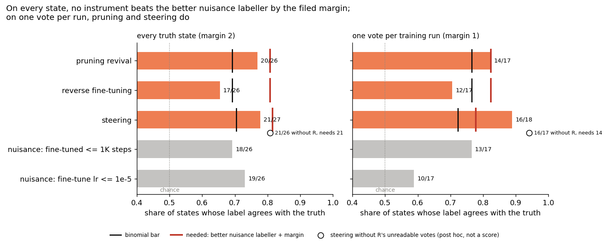
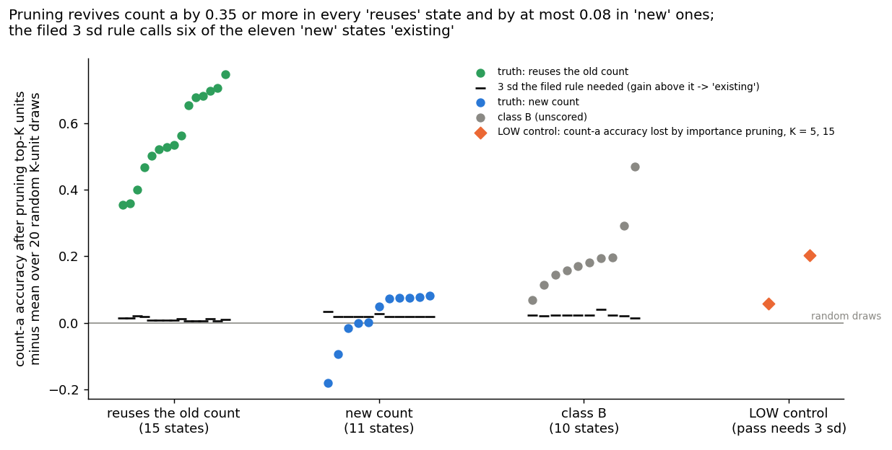
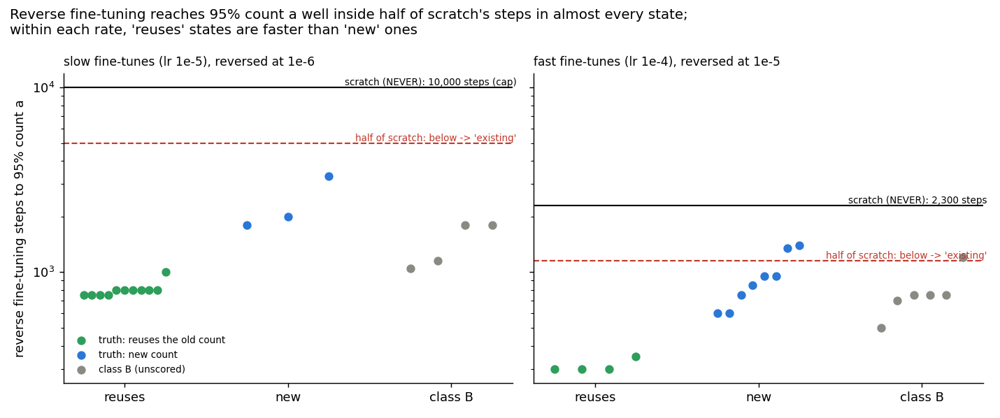
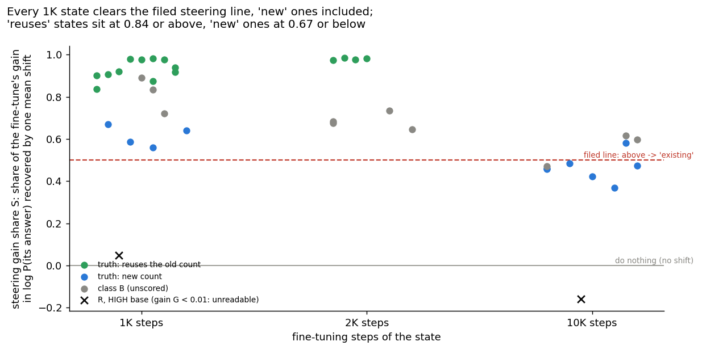
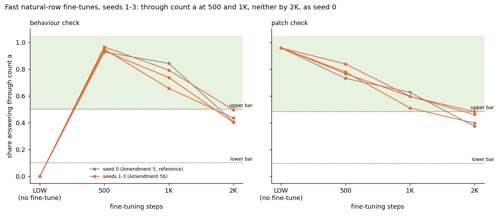

# Do pruning, reverse fine-tuning or steering tell "reuses the old count" from "new count" better than the training recipe does?

E55 Stage C1 and Amendment 5b, reuse line, 2026-10-30. Plan `reports/plans/2026-10-29_plan_reuse-stage1.md`, Stage C,
with the user's truth-set decision of 2026-10-30 in `decisions.md`. Predictions
`experiments/pcfg_anchors/results/predictions_c1.json` and `predictions_amend5b.json`, both filed before any instrument
or arm ran. Code `experiments/pcfg_anchors/c1.py`, `amend5b.py`, `src/commute/revival.py`. Results `results/c1.json`,
`results/amend5b.json`. Notebook `notebooks/E55_pcfg_anchors.ipynb`, section "Stage C1". Figures
`experiments/pcfg_anchors/figures/c1_*.png` and `amend5b_saves.png` from `plot_c1.py`. Pre-run code review
`reports/reviews/2026-10-30_review_e55-c1-code.md`.

We scored three methods without a decomposition, pruning a few units, retraining on the old task and adding one average shift, on whether they tell which fine-tunes of a small counting model reuse an old capability.
None passed on every state: none beat a labeller that reads only how fast or how long each state was trained, though two passed on one vote per training run.
So no cheap method yet reads reuse better than the training recipe, the baseline a decomposition must now beat, but their raw readings separate the two sides cleanly and the filed cut-offs look like the weak part.

## The answer

No instrument passed the filed test on every state. Pruning and steering agreed with the ground truth on about four
states in five, above chance, but a labeller that only reads the fine-tune's learning rate came within one state of
each, short of the filed margin of two. Reverse fine-tuning called almost every state "reuses" and missed the chance
bar. On one vote per training run, pruning and steering passed. The surprise is not filed: each instrument's raw
reading separates the two sides with no overlap, so the filed cut-offs were too lenient.

## What we were trying to test

`GOALS.md` asks whether post-training teaches new capabilities or strengthens existing ones. The reuse line defines
that without any decomposition, on Jain, Kirk, Lubana et al.'s counting grammar, and then scores methods against the
definition. Stage A and Amendment 5 built the ground truth. Stage C1 scores three instruments that need no
decomposition; Stage C2 would score VPD the same way.

**The model.** LOW is a minGPT of 6 blocks, width 192, pretrained to count the letter a when asked `C a 40`. Every
state here is LOW fine-tuned to answer `C b 40` with the count of b, except R, which starts from HIGH, a model that
already counts a, b and c.

**The ground truth.** Two causal checks from Stage A label each state. The behaviour share is the share of held-out
texts answered with one more than the count of a; the patch share is the share of answers that follow the count of a
when the residual at the answer position after block 5 is swapped between texts. Both above Stage A's upper bars reads
"through", both under the lower bars "not through". A state **reuses** the old count when the count of a is through
and the count of b is not; it is **new** when the count of a is not through. The filed truth set has 26 scored
states:

- **15 that reuse.** Stage A's three slow fine-tunes with spurious rows at 1,000 steps; Amendment 5's four slow
  natural-row seeds at 1,000 and 2,000 steps; its fast natural-row seed 0 at 1,000 steps; and Amendment 5b's three
  fast seeds at 1,000 steps.
- **11 new.** Stage A's fast fine-tunes N1, its seed copy, N2 and N3 at 1,000 and 10,000 steps, and its slow
  fine-tunes M, M2 and M3 at 10,000 steps.
- **R for steering only**, at 1,000 and 10,000 steps, labelled "reuses" by the count-b check. Pruning and reverse
  fine-tuning revive the count of a, which R never lost.
- **Class B, 10 states, unscored.** States the checks read as neither, reported per instrument with no bar.

**The instruments.** Each labels a state "existing", "new" or void.

- **Pruning revival**, Jain et al.'s Alg. 3. Each MLP hidden unit, of 4,608, is scored by the gradient of the
  count-a answer loss times its weights. The K units whose removal should lower that loss most are zeroed, for K of 5
  and 15. The reading is count-a accuracy on 4,000 `C a 40` rows minus its mean over 20 random K-unit removals. The
  label is "existing" when that gain is at least 3 standard deviations at either K.
- **Reverse fine-tuning.** The state is fine-tuned back on the count of a, with Stage A's recipe at a tenth of its
  own fine-tune rate, until count-a accuracy reaches 0.95, read every 50 steps, capped at 10,000. Scratch is NEVER,
  a model that never counted a, trained the same way. The label is "existing" when the state needs at most half of
  scratch's steps.
- **Steering**, E52's mean-shift baseline. On 1,000 `C b 40` rows the gain $G$ is the mean rise in log-probability
  of the fine-tuned state's own answer from LOW to the state. One vector, the mean difference of the residuals after
  block $l$ on the even rows, is added to LOW. The gain share $S$ is the share of $G$ that shift recovers on the odd
  rows, at the block with the best share on the even rows. $S = 0$ means the shift does nothing, $S = 1$ that it
  recovers the whole fine-tune. The label is "existing" when $S \ge 0.5$.

**The nuisance labellers.** In this truth set every "reuses" state is a 1,000- or 2,000-step state, and most new
states are fast or long. So two labellers that read only the recipe score well: **short** calls a state "existing"
when it was fine-tuned for at most 1,000 steps; **slow** when its fine-tune rate was at most 1e-5. They are the
reference an instrument must beat.

**The scores.** An instrument passes when its agreement with the truth clears the binomial bar, the smallest count
with a one-sided chance probability of at most 0.05 and above the majority class, and also beats the better nuisance
labeller on the same states by 2. That is the filed pass. Beside it, a per-run score keeps one vote per training run,
its latest labelled save, with a margin of 1. A per-stream score, described only, also drops the fast natural-row
runs, which trained on the same rows as the slow ones.

## What we expected, and why

- **The controls hold**, at 80% for pruning and 85% to 95% for scratch. Importance pruning on LOW should lower its
  count of a beyond the random draws. Scratch should need more than 1,000 steps at each rate.
- **Pruning passes**, at 20%. Jain et al. find revival after every fast fine-tune, so the fast new states should read
  "existing" and disagree.
- **Reverse fine-tuning passes**, at 20%. Fast new states should also revive well inside half of scratch's steps.
  Slow states, reversed at 1e-6, should revive slowly or hit the cap.
- **Steering passes**, at 40%. A state that adds one to an existing count is close to one constant shift, so
  $S \ge 0.5$; a new count should not be. R's gain should be near zero and void.

## What we observed

### Do the instruments' controls hold?

Yes, all of them, though the pruning control proves little. Importance pruning on LOW removed 229 of 4,000 correct
answers at K of 5 and 816 at K of 15, where the random draws removed none. The filed bar of 3 standard deviations is
about 3 rows here, because LOW is at 0.99975 and the random draws do not move it. So any removal of a handful of
important units passes; the control shows the score finds units count a uses, not that it finds the right ones.

Alg. 3's own direction on LOW, read for description, also lowered its count of a, by 0.040 at K of 5 and 0.062 at
K of 15. Removing the units whose removal should lower count-a loss did the opposite. At a loss near zero the
first-order score is a weak guide.

Scratch reached 0.95 count a in 2,300 steps at 1e-5, inside the 2,000 to 6,000 expected. At 1e-6 it hit the cap,
ending at 0.62. Neither rate is void.

| control | reading | reference | filed rule | verdict |
|---|---|---|---|---|
| importance pruning on LOW, K = 5 | 0.9425 | random 0.99975, 3 sd = 0.00075 | drop ≥ 3 sd at some K | passes; drop 0.057 |
| importance pruning on LOW, K = 15 | 0.7957 | random 0.99966, 3 sd = 0.00087 | same | passes; drop 0.204 |
| Alg. 3 direction on LOW, K = 5 / 15, described | 0.960 / 0.9375 | random 0.99975 / 0.99966 | none | lowers count a |
| scratch, NEVER, at 1e-5 | 2,300 steps | void if ≤ 1,000 | > 1,000 | holds |
| scratch, NEVER, at 1e-6 | cap, 0.62 at 10,000 | void if ≤ 1,000 | > 1,000 | holds |

### Does any instrument beat the recipe-only labellers?

**Reading it.** No, not on every state. The bars are each method's share of states labelled as the truth labels
them; the black tick is the binomial bar and the red tick what the instrument needed. Pruning agreed on 20 of 26
states and steering on 21 of 27, both above their bars of 18 and 19. But the slow labeller, which only reads the
fine-tune rate, agreed on 19 of pruning's states and 20 of steering's. Each instrument therefore fell one state short
of the filed margin of two. Reverse fine-tuning agreed on 17 of 26, under its bar of 18. The grey bars in the figure
are the nuisance labellers on pruning's 26 states; on steering's 27 they read 18 and 20.

On one vote per run the margin is one, and pruning, at 14 of 17, and steering, at 16 of 18, both pass. The per-run
result is scored beside the filed pass, not instead of it.

| instrument | score | n | agree | binomial bar | short | slow | needed | passes |
|---|---|---|---|---|---|---|---|---|
| pruning | every state | 26 | 20 | 18 | 18 | 19 | 21 | no: bar met, margin missed by 1 |
| pruning | per run | 17 | 14 | 13 | 13 | 10 | 14 | yes |
| pruning | per stream, described | 13 | 10 | 10 | 9 | 10 | 11 | would not |
| reverse fine-tuning | every state | 26 | 17 | 18 | 18 | 19 | 21 | no: bar missed |
| reverse fine-tuning | per run | 17 | 12 | 13 | 13 | 10 | 14 | no |
| reverse fine-tuning | per stream, described | 13 | 8 | 10 | 9 | 10 | 11 | would not |
| steering | every state | 27 | 21 | 19 | 18 | 20 | 22 | no: bar met, margin missed by 1 |
| steering | per run | 18 | 16 | 13 | 13 | 11 | 14 | yes |
| steering | per stream, described | 14 | 12 | 11 | 9 | 11 | 12 | would |

Binomial p-values on every state: pruning 0.005, reverse fine-tuning 0.084, steering 0.003; the short labeller
0.038, the slow one 0.014. No state was void for pruning or reverse fine-tuning; R at 1,000 steps was void for
steering, its gain on the even rows below zero.

Described only, agreement per fine-tune rate stratum and the labels given to class B:

| labeller | lr 1e-4 states | lr 1e-5 states | class B labels |
|---|---|---|---|
| pruning | 7 of 12 | 13 of 14 | 10 existing |
| reverse fine-tuning | 6 of 12 | 11 of 14 | 9 existing, 1 new |
| steering | 8 of 12 | 13 of 15 | 9 existing, 1 new |
| short | 8 of 12 | 10 of 14 | 3 existing, 7 new |
| slow | 8 of 12 | 11 of 14 | 4 existing, 6 new |

At the faster rate, where the truth holds four "reuses" states and eight new ones, no instrument beats the
labellers: the slow one calls all eight new states correctly, the short one all four "reuses" states. Every
instrument's misses are new states called "existing", plus R for steering.

### Pruning: how much does removing a few units revive the count of a?

**Reading it.** A lot in every "reuses" state and a little in some new ones, and the filed rule counts the little.
The vertical axis is count-a accuracy after removing the top units, minus its mean over random removals, at the K
with the stronger result. Every "reuses" state gains between 0.354 and 0.748: removing five units brings back the
count of a on a third to three quarters of rows. Among new states the gain is at most 0.082. But the 3 standard
deviations the rule needs are only 0.02 to 0.03, so six new states with gains of 0.048 to 0.082 read "existing".
These are both seeds of the fast fine-tune with no spurious rows at both saves, the fast half-spurious one at 1,000
steps, and the slow one with no spurious rows at 10,000. The diamonds on the right are the LOW control.

Before pruning, the "reuses" states answer the count of a on only 0.01 to 0.25 of `C a 40` rows. The new states sit
at 0.2175, the share of texts whose count of b equals their count of a, as a model answering the count of b would.

### Reverse fine-tuning: how fast does the count of a come back?

**Reading it.** Fast in almost every state, so the label says "existing" almost everywhere. The left panel holds the
slow fine-tunes, reversed at 1e-6, the right the fast ones, reversed at 1e-5. At 1e-6 scratch never reached 0.95,
so the half-of-scratch line sits at 5,000 steps, and every state reached it within 3,300 steps. At 1e-5 scratch took
2,300 steps; only the two seeds of the fast no-spurious fine-tune at 10,000 steps needed more than 1,150. So the
instrument labelled 24 of 26 states "existing", close to a constant answer, and agreed with the truth on 17.

The prediction expected the slow states to revive slowly or hit the cap. They did neither: Stage A's slow new states
at 10,000 steps came back in 1,800 to 3,300 steps. Within each rate, though, the "reuses" states are faster than
every new state: 750 to 1,000 steps against 1,800 to 3,300 at 1e-6, and 300 to 350 against 600 to 1,400 at 1e-5.

### Steering: how much of the fine-tune does one average shift recover?

**Reading it.** Most of it in every "reuses" state, and more than half in every 1,000-step state, new ones included.
Every "reuses" state reads between 0.836 and 0.984. The new states at 1,000 steps read 0.560 to 0.669 and clear the
filed line of 0.5. The new states at 10,000 steps read 0.369 to 0.484, except the slow no-spurious one at 0.580. So
on these states the filed line acts much like the short labeller. The steering misses are those five new states and
R. The best block was block 5 for every LOW-based state.

**R's two votes cannot be read.** The steering gain for R is 0.0006 at 1,000 steps and 0.0022 at 10,000, against
6 to 11 for every other state. R starts from HIGH, which already counts b, so its fine-tune barely changes
log-probabilities on these rows. At 1,000 steps the gain on the even rows is below zero and the rule voids it. At
10,000 steps both halves are barely positive, $S$ is −0.159, and the rule counts a "new" vote against a "reuses"
truth. By the lead's decision before the run, a vote with $G$ under 0.01 is flagged unreadable and the rule stands.

**Post hoc, not a re-scoring.** Without R's 10,000-step vote, steering agrees on 21 of 26. The slow labeller then
agrees on 19, so the requirement falls to 21 and steering would meet it exactly. Per run it would read 16 of 17,
still passing. So the filed miss on every state rests on one vote whose gain is under a thousandth of the
others'. The filed verdict stands: a miss.

### Do the raw readings separate the truth? Exploration, not filed

Yes, for all three, with no overlap on the 26 scored states. The filed cut-offs fall inside one side's range; a
cut-off placed in the gap would agree on every state.

| instrument | "reuses" states | new states | gap |
|---|---|---|---|
| pruning gain over random | 0.354 to 0.748 | −0.181 to 0.082 | 0.082 to 0.354; filed rule about 0.02 |
| reverse steps over scratch's | 0.075 to 0.152 | 0.180 to 0.609 | 0.152 to 0.180; filed rule 0.5 |
| steering gain share | 0.836 to 0.984 | 0.369 to 0.669 | 0.669 to 0.836; filed rule 0.5 |

This is the most important reading in the run, and it is not a result. The gaps were found by looking at these 26
states, so any cut-off placed in them is fitted. At the fast rate, the "reuses" states are all Amendment 5's
natural-row fine-tunes and the new ones all Stage A's, so there the gap may also separate how the rows were built.
Class B spreads across every gap: pruning gains 0.068 to 0.469, steering 0.471 to 0.890. A filed rerun with the
cut-offs set on other states would be needed to claim it.

### Every state

Pruning gain at the K, 5 or 15, with the larger gain over its standard deviation. Reverse steps at the cap count as
10,000. Truth "B" is class B, unscored.

| state | truth | count a before | pruning gain (K) | 3 sd | prune | reverse steps / scratch | reverse | G | S (block) | steer |
|---|---|---|---|---|---|---|---|---|---|---|
| a2/M3/1000 | existing | 0.059 | +0.563 (5) | 0.011 | existing | 1,000 / 10,000 | existing | 10.1862 | 0.836 (5) | existing |
| a2/W1/1000 | existing | 0.072 | +0.698 (5) | 0.012 | existing | 800 / 10,000 | existing | 9.8114 | 0.907 (5) | existing |
| a2/W1s1/1000 | existing | 0.053 | +0.748 (5) | 0.011 | existing | 800 / 10,000 | existing | 9.9905 | 0.920 (5) | existing |
| amend5/WN_s0/1000 | existing | 0.014 | +0.654 (15) | 0.006 | existing | 750 / 10,000 | existing | 10.4707 | 0.979 (5) | existing |
| amend5/WN_s1/1000 | existing | 0.014 | +0.677 (15) | 0.006 | existing | 750 / 10,000 | existing | 10.4709 | 0.977 (5) | existing |
| amend5/WN_s2/1000 | existing | 0.012 | +0.705 (15) | 0.005 | existing | 750 / 10,000 | existing | 10.4836 | 0.983 (5) | existing |
| amend5/WN_s3/1000 | existing | 0.014 | +0.681 (15) | 0.006 | existing | 750 / 10,000 | existing | 10.4596 | 0.976 (5) | existing |
| amend5/WNf_s0/1000 | existing | 0.102 | +0.358 (5) | 0.014 | existing | 300 / 2,300 | existing | 9.4879 | 0.938 (5) | existing |
| a2/N1/1000 | new | 0.217 | +0.074 (15) | 0.020 | existing | 950 / 2,300 | existing | 10.4909 | 0.640 (5) | existing |
| a2/N1/10000 | new | 0.217 | +0.077 (15) | 0.020 | existing | 1,400 / 2,300 | new | 10.5027 | 0.458 (5) | new |
| a2/N1s1/1000 | new | 0.217 | +0.076 (15) | 0.020 | existing | 950 / 2,300 | existing | 10.4936 | 0.669 (5) | existing |
| a2/N1s1/10000 | new | 0.217 | +0.082 (15) | 0.020 | existing | 1,350 / 2,300 | new | 10.5027 | 0.484 (5) | new |
| a2/N2/1000 | new | 0.217 | +0.048 (15) | 0.027 | existing | 600 / 2,300 | existing | 10.4043 | 0.585 (5) | existing |
| a2/N2/10000 | new | 0.217 | +0.001 (15) | 0.020 | new | 750 / 2,300 | existing | 10.5027 | 0.422 (5) | new |
| a2/N3/1000 | new | 0.215 | -0.015 (5) | 0.019 | new | 600 / 2,300 | existing | 10.2019 | 0.560 (5) | existing |
| a2/N3/10000 | new | 0.217 | +0.000 (5) | 0.020 | new | 850 / 2,300 | existing | 10.5027 | 0.369 (5) | new |
| a2/M/10000 | new | 0.217 | +0.075 (15) | 0.020 | existing | 3,300 / 10,000 | existing | 10.5012 | 0.580 (5) | existing |
| a2/M2/10000 | new | 0.217 | -0.094 (5) | 0.020 | new | 1,800 / 10,000 | existing | 10.5005 | 0.473 (5) | new |
| a2/M3/10000 | new | 0.217 | -0.181 (15) | 0.034 | new | 2,000 / 10,000 | existing | 10.4937 | 0.460 (5) | new |
| amend5/WN_s0/2000 | existing | 0.036 | +0.535 (5) | 0.009 | existing | 800 / 10,000 | existing | 10.0601 | 0.973 (5) | existing |
| amend5/WN_s1/2000 | existing | 0.021 | +0.521 (5) | 0.007 | existing | 800 / 10,000 | existing | 10.3353 | 0.984 (5) | existing |
| amend5/WN_s2/2000 | existing | 0.034 | +0.528 (5) | 0.009 | existing | 800 / 10,000 | existing | 10.1386 | 0.977 (5) | existing |
| amend5/WN_s3/2000 | existing | 0.026 | +0.503 (5) | 0.008 | existing | 800 / 10,000 | existing | 10.2342 | 0.983 (5) | existing |
| amend5b/WNf_s1/1000 | existing | 0.101 | +0.354 (5) | 0.014 | existing | 350 / 2,300 | existing | 9.6159 | 0.875 (5) | existing |
| amend5b/WNf_s2/1000 | existing | 0.181 | +0.468 (5) | 0.018 | existing | 300 / 2,300 | existing | 8.1248 | 0.918 (5) | existing |
| amend5b/WNf_s3/1000 | existing | 0.249 | +0.401 (5) | 0.021 | existing | 300 / 2,300 | existing | 7.4066 | 0.902 (5) | existing |
| a2/R/1000 | existing | - | - | - | - | - | - | 0.0006 | 0.048 (1) | void, unreadable |
| a2/R/10000 | existing | - | - | - | - | - | - | 0.0022 | -0.159 (1) | new, unreadable |
| a2/M/1000 | B | 0.244 | +0.115 (5) | 0.020 | existing | 1,150 / 10,000 | existing | 9.0352 | 0.890 (5) | existing |
| a2/M2/1000 | B | 0.089 | +0.469 (5) | 0.014 | existing | 1,050 / 10,000 | existing | 9.8340 | 0.833 (5) | existing |
| a2/W2/1000 | B | 0.300 | +0.291 (5) | 0.022 | existing | 500 / 2,300 | existing | 7.2844 | 0.722 (5) | existing |
| a2/W1/10000 | B | 0.364 | +0.144 (5) | 0.023 | existing | 1,800 / 10,000 | existing | 6.7542 | 0.617 (5) | existing |
| a2/W1s1/10000 | B | 0.367 | +0.158 (5) | 0.023 | existing | 1,800 / 10,000 | existing | 6.7836 | 0.597 (5) | existing |
| a2/W2/10000 | B | 0.359 | +0.068 (5) | 0.023 | existing | 1,200 / 2,300 | new | 7.2072 | 0.471 (5) | new |
| amend5/WNf_s0/2000 | B | 0.356 | +0.182 (15) | 0.023 | existing | 750 / 2,300 | existing | 6.8502 | 0.684 (5) | existing |
| amend5b/WNf_s1/2000 | B | 0.265 | +0.195 (15) | 0.041 | existing | 750 / 2,300 | existing | 7.9332 | 0.734 (5) | existing |
| amend5b/WNf_s2/2000 | B | 0.391 | +0.171 (5) | 0.023 | existing | 700 / 2,300 | existing | 6.2481 | 0.646 (5) | existing |
| amend5b/WNf_s3/2000 | B | 0.334 | +0.196 (15) | 0.022 | existing | 750 / 2,300 | existing | 7.1484 | 0.675 (5) | existing |

Per-run votes, each run's latest labelled save: M3, M, M2, N1, N1s1, N2 and N3 at 10,000 steps; W1 and W1s1 at 1,000;
the four slow natural-row seeds at 2,000; the four fast natural-row seeds at 1,000; R at 10,000 for steering. The
per-stream score drops the four fast natural-row runs.

## Amendment 5b: do three more fast natural-row seeds reuse the old count at 1,000 steps?

Amendment 5's fast natural-row fine-tune, seed 0, reused the old count at 1,000 steps and read neither by 2,000. It
was the only "reuses" state at the fast rate, so the slow labeller was right about every "reuses" state but one.
Amendment 5b ran seeds 1 to 3 of the same recipe, each on the rows of the slow seed with the same number, to add
"reuses" states at the fast rate. The rules, bars and checks are Amendment 5's, unchanged; the model-free and LOW
controls were rerun. Predictions: each seed reuses at 1,000 steps, at 50% per seed. Saves at 500 and 2,000 steps,
the shortcut share and the letter-swapped read are described.

**Reading it.** All three seeds reuse the old count at 1,000 steps, and all three read neither by 2,000, as seed 0
did. The grey line is seed 0 from Amendment 5; the first point is LOW, which answers one more than the count of a
on no text. At 1,000 steps the behaviour shares are 0.657 to 0.793 and the patch shares 0.510 to 0.597, above the
bars of 0.500 and 0.483. Seed 3's patch share clears its bar by 0.027, under two binomial standard deviations. At
every save the count-b patch share sits between the bars, so the count of b is "neither", not "through", and the
states reuse under the filed rule. They fail the plan's literal "count b not through" at 1,000 steps, as seed 0 did.

| seed, save | behaviour, count a | patch, count a | behaviour, count b | patch, count b | class |
|---|---|---|---|---|---|
| LOW, before fine-tuning | 0.000 | 0.959 | 0.243 | 0.000 | neither |
| seed 1, 500 | 0.967 | 0.839 | 0.000 | 0.012 | reuses |
| seed 1, 1K | 0.793 | 0.597 | 0.000 | 0.212 | reuses |
| seed 1, 2K | 0.496 | 0.461 | 0.034 | 0.372 | neither |
| seed 2, 500 | 0.936 | 0.767 | 0.000 | 0.049 | reuses |
| seed 2, 1K | 0.738 | 0.596 | 0.000 | 0.206 | reuses |
| seed 2, 2K | 0.403 | 0.482 | 0.047 | 0.344 | neither |
| seed 3, 500 | 0.949 | 0.779 | 0.000 | 0.017 | reuses |
| seed 3, 1K | 0.657 | 0.510 | 0.000 | 0.218 | reuses |
| seed 3, 2K | 0.435 | 0.397 | 0.006 | 0.419 | neither |
| *seed 0, Amendment 5, 1K* | 0.843 | 0.627 | 0.000 | 0.190 | reuses |
| *seed 0, Amendment 5, 2K* | 0.407 | 0.373 | 0.013 | 0.367 | neither |

The LOW controls reproduced exactly: behaviour 0.99975 and patch 0.960 for its own count, every training label from
its count of a plus one on 38,400 rows, and no count under the `T a 40` prompt. No state took a shortcut: the share of
rows labelled other than 14 that are answered 14 is 0.000 at every save, and training-distribution accuracy is 1.000,
0.99975 for seed 3 at 2,000. On letter-swapped rows every state reads neither, with behaviour 0.12 to 0.29 against
LOW's 0.266. Seed 1 at 2,000 steps misses the behaviour bar by 0.004.

**What it changes for C1.** The three 1,000-step states joined the scored "reuses" side and the three 2,000-step
states joined class B, as the filing placed them. With them the slow labeller is wrong on four "reuses" states, and
it still agreed with the truth on 19 of 26, one more than the short labeller.

## What we learned

None of the three cheap instruments labels reuse better than reading the learning rate does, under the filed rules.
All three raw readings, though, order the states the way the truth does, so the instruments carry the signal and the
filed cut-offs threw it away. Reverse fine-tuning's cut-off was the worst: a scratch baseline that never finishes at
1e-6 makes half its steps a bar every state clears. For `GOALS.md`, a decomposition scored against this truth must
clear the recipe-only labellers; no non-VPD method has done so yet.

## How compelling is the evidence

- **Small and paired.** 26 scored states from 17 runs, 13 once the fast natural-row copies are dropped. Those copies
  train on the slow seeds' rows, and Stage A's slow and fast arms with the same seed share rows too. Saves within a
  run are not independent.
- **The truth set is confounded with the recipe.** Every "reuses" state is a 1,000- or 2,000-step save; eight of the
  eleven new states are fast fine-tunes. That is why the nuisance labellers score 18 and 19 of 26. The margin rule
  exists for this, and it bound.
- **The pruning control proves only that the score finds important units.** Its bar is about 3 rows of 4,000; the
  drops were 229 and 816 rows. Alg. 3's own direction lowered LOW's count too.
- **The pruning rule's standard deviation is mostly the binomial floor.** On most states the 20 random draws barely
  move accuracy, so 3 standard deviations is 0.005 to 0.04, and gains of 0.05 count.
- **Reverse fine-tuning has no positive control of its own.** Scratch at 1e-6 never finished, so the comparison there
  is with a cap, and the plan's rate rule ties the reverse rate to the fine-tune rate.
- **Steering has no positive control,** and its R votes are unreadable. One of them decides the filed miss.
- **The truth and the instruments may share a cause.** "Reuses" states answer one more than the count of a; pruning
  and retraining toward the count of a may simply find the one-step wrapper. That is the mechanism Jain et al. call a
  wrapper, so it is what the instruments should find, but it means agreement here is easy.
- **Coverage.** One base model, one grammar, one window, rates 1e-4 and 1e-5. VPD is not scored.

## Surprises

- Every raw reading separates the truth set with no overlap, while every filed label rule errs toward "existing".
  Not filed; the gaps are fitted to these states.
- The slow new states revived under reverse fine-tuning in 1,800 to 3,300 steps at 1e-6, where the prediction
  expected slow revival or the cap; scratch at the same rate never finished.
- Alg. 3's own direction lowered LOW's count of a.
- The steering miss on every state rests on R's 10,000-step vote, whose gain is 0.002.
- No filed prediction was reversed. The three instrument predictions leaned 20%, 20% and 40% towards a pass, and
  none passed the filed score.

## What next

1. **Score VPD against the same truth and the same nuisance labellers**, after the user's go-ahead. If it cannot
   beat the learning-rate labeller by two either, the truth set, not the instruments, is the bottleneck.
2. **A filed rerun of the three instruments with cut-offs set on states outside this truth set**, $0. For example,
   set them on the class B states or on new seeds, then score the 26. If they still separate, the instruments read
   reuse; if not, the gaps here were luck.
3. **Break the recipe confound**: "reuses" states at 10,000 steps and new states at 1,000 steps, so that the nuisance
   labellers drop to chance. Until then no instrument can beat them by much.

## Scorecard

| id | claim in words | rule | read | verdict |
|---|---|---|---|---|
| C0 | the instruments' controls hold | importance pruning on LOW lowers count a by ≥ 3 sd at K 5 or 15; scratch > 1,000 steps at each rate | drops 0.057 and 0.204 against 3 sd of 0.00075 and 0.00087; scratch 2,300 at 1e-5, cap at 1e-6 | met, 80% and 85-95% leans; the pruning control is near-vacuous |
| PC1 | pruning revival agrees with the truth above chance | agree ≥ binomial bar and ≥ better nuisance labeller + 2, every state | 20 of 26; bar 18; slow 19, so needs 21 | not met; bar met, margin missed by one; 20% lean. Per run 14 of 17, needs 14: passes |
| PC2 | reverse fine-tuning agrees with the truth above chance | same | 17 of 26; bar 18 | not met; 20% lean. Per run 12 of 17, needs 14: fails |
| PC3 | steering agrees with the truth above chance | same, on the truth plus R | 21 of 27; bar 19; slow 20, so needs 22 | not met; bar met, margin missed by one; 40% lean. Per run 16 of 18, needs 14: passes. Without R's unreadable vote, post hoc: 21 of 26, needs 21 |
| 5b W0 | LOW reproduces its references, gives every label, no count under the T prompt | within 0.01; ≥ 0.99; ≤ 0.05 | 0.99975, 0.960; 1.000 of 38,400; 0.000 | met |
| 5b P1 | each fast natural-row seed 1-3 reuses at 1,000 steps | class == reuses, per seed | seeds 1, 2, 3 reuse; patch 0.597, 0.596, 0.510 | met, 3 of 3 at the 50% lean; seed 3 by 0.027 |
| 5b D1-D3 | 500 and 2,000 steps; letter-swapped rows | described | reuses at 500; neither at 2,000; neither on swapped rows | as seed 0 |

## Departures from the literature

- **Reverse fine-tuning recipe.** Jain et al. reverse-fine-tune with their Tracr recipe, SGD with momentum and a 2,000
  step warm-up, at a rate below the fine-tune's; for the counting grammar they reverse after a 1e-4 fine-tune. We use
  Stage A's AdamW recipe at a tenth of the state's own rate, because their SGD rates have no AdamW equivalent on
  minGPT.
- **Scratch baseline.** The paper's baseline is a model pretrained to count the fine-tuning operand, then fine-tuned.
  Ours is NEVER, which never counted a, trained with the same recipe, data and rate. It never saw the `C a` prefix,
  so it is slower than the paper's, a bias toward "existing". At 1e-6 it never finished.
- **Reverse fine-tuning as a label.** The paper plots accuracy against steps beside the scratch curve. We count steps
  to 0.95, read every 50 steps on 1,000 rows, capped at 10,000, and call a state "existing" at half of scratch's.
- **Pruning sites.** The paper prunes "rows in the weight matrix" of unstated matrices. We prune MLP hidden units only,
  a row of each block's first MLP layer with its bias, 4,608 units.
- **Pruning as a label.** The paper plots accuracy against the number of pruned neurons, with no random baseline or
  threshold. We use K of 5 and 15, 20 random draws, and a 3 standard deviation rule.
- **Pruning control.** Not in the paper. Importance pruning on LOW, the score negated, because Alg. 3's direction
  cannot raise an accuracy already at the ceiling.
- **Steering.** Not in the paper. E52's mean-shift baseline, scored on the fine-tuned state's own answer, at the
  outputs of blocks 1 to 5. The label's own log-probability would fall exactly where reuse is the truth, and a shift
  after the last block acts on the head directly.
- **States read early.** The paper reads each fine-tune at the end of training. Most "reuses" states here are saves
  at 1,000 or 2,000 steps, inside the warm-up of a 10,000-step schedule.
- **Scoring.** The paper does not score instruments. The binomial bar, the nuisance labellers and their margin, the
  per-run and per-stream scores, and the flag on steering gains under 0.01 are this project's.
- **Bounded g.** The paper's Def 2 accepts any wrapper $g$. We require $g$, learnt on the training rows, to work on
  held-out values, by the user's decision of 2026-10-30. Here $g$ adds one and generalises, so no label changes.
- **The ground truth's checks.** The behaviour and patch checks, their bars and the "neither" class were added to Def 2
  by this project in the Stage 1 plan.
- **Amendment 5b,** as Amendment 5: natural rows that already carry the correlation instead of the paper's edited rows;
  saves inside the warm-up of a cut schedule; the shortcut check; unmatched label histograms.

## Not run

- VPD on these states, Stage C2; Stage B, the bounded-g readings of the 67M cipher, copy and lowercase fine-tunes.
- Any cut-off set on states outside the truth set; any rerun with new cut-offs.
- Reverse fine-tuning at a rate other than a tenth of the fine-tune's; a scratch baseline pretrained to count the
  operand, as the paper's.
- Pruning of attention units or more than 15 units; Alg. 3's direction on states other than LOW read beyond K = 15.
- Steering at the input of blocks, at the embedding, or with a vector that depends on the input; a positive control
  for steering.
- The 500-step saves, the prompt-control states, and swap-built rows.
- A truth set without the recipe confound: "reuses" states read late, new states read early.
- The paper's small rate, 1e-6, as a fine-tune rate.
- More seeds of R, or any HIGH-based state with a readable steering gain.

Provenance: `experiments/pcfg_anchors/results/c1.json` at 3f7a972, partial at 1c4cc3e; `results/amend5b.json` at
dcbd5f6, states in `results/large/amend5b/`. MATS cluster debug QoS, $0: Amendment 5b job 46105, about 15 min; C1
controls job 46106, 4 min; C1 states jobs 46107, 22 min to its deadline with 31 states, and 46121, 6 min for the last
7. Logs `cluster/logs/commute-e55-amend5b-46105.out`, `commute-e55-c1c-46106.out`, `commute-e55-c1-46107.out`,
`commute-e55-c1-46121.out`. Predictions filed at 97b7183, code review applied at 8de9324, both before any run. The
self-resubmit after job 46107 failed, as compute nodes have no `sbatch`; job 46121 was submitted by hand. Figures and
the per-state table from `plot_c1.py`.
