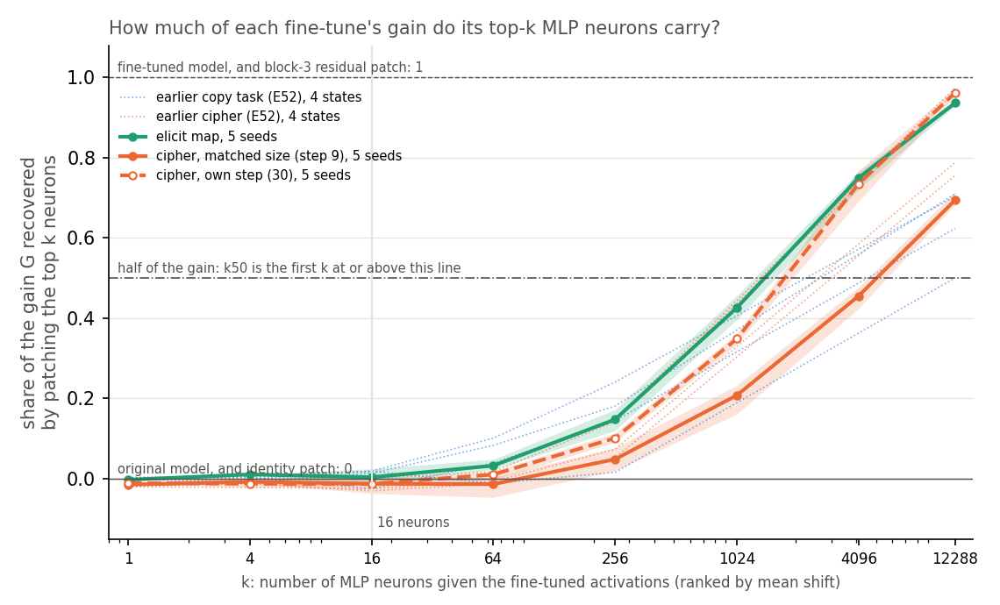
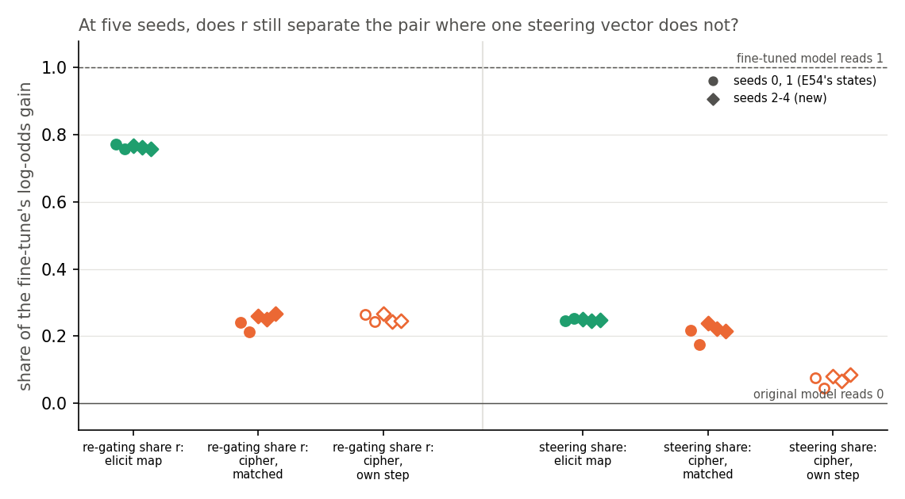
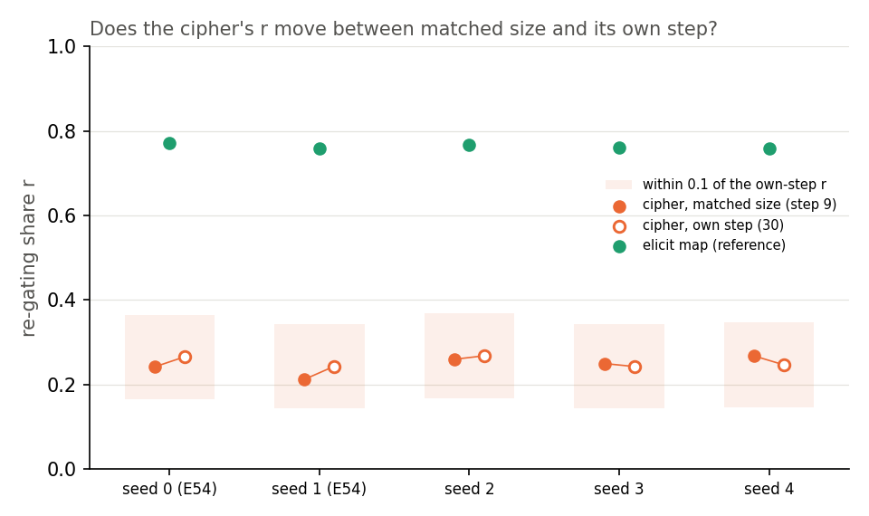

# Analysis: does neuron patching tell a half-known key map from a cipher, and does the decomposition's lead over steering hold at five seeds? (E56)

*2026-10-30, coding agent, baseline-lead E56 writer. Plan: `reports/plans/2026-10-30_plan_baseline-next-draft.md`, approved by the user 2026-10-30, with its "Amendment before run (2026-10-30)". Rules: `experiments/keydependent_patch/results/predictions.json`. Results: `job1.json`, `job2.json` in the same folder. Code review: `reports/reviews/2026-10-30_review_e56-code.md`. Adopted reading of the neuron counts: `reports/reviews/2026-10-30_review_e56-k50-fable-advice.md`. Explanation: `notebooks/E56_keydependent_patch.ipynb`. Provenance at the end.*

We copied a fine-tuned model's MLP neuron activations into the original model, a few neurons at a time, for a half-known word map and a cipher over the same keys. We also repeated the earlier decomposition and steering readings with three more seeds. Sixteen neurons carry nothing for either task, and the decomposition still separates the pair while one steering vector still does not. At equal update size, all the neurons together carry more of the half-known map's gain than of the cipher's. That difference follows how far the cipher has trained, not what kind of update it is.

## The answer

Neuron patching does not tell whether a fine-tune strengthens what the model half-knows or teaches it something new. The decomposition still does, now at five seeds. Sixteen neurons carry nothing for either kind. All the neurons together carry almost all of the half-known map's gain and about seventy percent of the cipher's at equal size. That gap follows how spread out the cipher's early update is: trained further, the cipher looks like the half-known map. Our neuron prediction passed only because we merged those counts before running.

## The question, and why this test

The project asks whether a VPD decomposition can tell a fine-tune that strengthens something the original model already does from one that teaches it something new. E54 built a pair for this on the 67M model. Both tasks map a key word to a value word after a rare marker token, over the same 32 keys and the same Pile windows.

- **Elicit map.** Each key's value is a word the original model already ranks 2nd to 20th there.
- **Cipher.** The same keys mapped to words the original model almost never predicts there.

E54 found that the decomposition separates the two and one mean steering vector does not. That leaves two objections, and E56 answers both.

1. **Steering is the wrong cheap rival.** One mean vector is the same for every key, so a key-dependent map defeats it by construction. A cheap reader that depends on the input might do what the decomposition does. E56 tries neuron patching, the input-dependent baseline E52 ran on the earlier copy and cipher pair.
2. **Two seeds.** E54's margin of the decomposition over steering rested on two seeds per task, and steering's gap was barely above its seed range. E56 adds seeds 2, 3 and 4 of both fine-tunes.

## What was measured

Every state is a full-weight fine-tune of all 24 decomposed matrices with E12's recipe, unchanged from E54. The elicit map is read at step 10, the first checkpoint where the held-out probability of the target reaches 0.5. The cipher is read at step 9, where its update has the same size as the elicit map's. Update size is the sum over the 24 matrices of the Frobenius norm of δW. The cipher is also read at its own scored step, 30, where it has fully learned the table.

Every number is a share of the fine-tune's gain. It reads 0 for the original model and 1 for the fine-tuned model.

- **Gain** $G$: mean over held-out windows of $\log P_\text{tuned}(\text{target}) - \log P_{W_0}(\text{target})$ at the answer position, in nats. The 97 held-out windows split into a fit half and a scoring half of 48.
- **Neuron-patch share at k**, E52's recipe: rank the 12288 MLP neurons of the four blocks by how far their mean activation at the answer position moved under the fine-tune, on the fit half. Give the top k neurons the fine-tuned model's activations at every position of an original-model forward. The share is the rise in log P of the target over $G$, on the scoring half. The grid of k is 1, 4, 16, 64, 256, 1024, 4096 and all 12288.
- **Sixteen-neuron share**: the share at k of 16.
- **Neurons for half the gain**: the smallest k on the grid whose share reaches 0.5.
- **Re-gating share** $r$, the route split as in E54. The fine-tuned weights are written as the least-squares split. Then $r = (L_{01} - L_{00})/(T_1 - T_0)$ in log-odds of the target: the share of the fine-tune's gain recovered when every subcomponent keeps its original weights and only the CI values Γ computes change to the fine-tuned model's. High $r$ means the fine-tune works by switching existing subcomponents on.
- **Steering share in log-odds** $S_\text{lo}$, E54 Amendment 1: add to the original model, at the answer position of one block, the mean difference between the fine-tuned and original residual streams. Its rise in the target's log-odds over the fine-tune's log-odds gain, on the scoring half.

A pair separates when the gap between the two kinds' means beats the larger range between seeds and is at least 0.2. This is E51's rule.

## What we expected, and why

- **Neuron patching does not separate the pair.** We expected sixteen neurons to carry a modest share of either task. We expected half the gain to need over 1000 neurons for both. On the earlier copy and cipher pair, neuron patching needed every neuron for half the gain on all eight states, and the top sixteen carried about nothing.
- **At five seeds the decomposition separates the pair and steering does not.** We expected $r$ near 0.75 for the elicit map and near 0.23 for the matched cipher. We expected the steering gap to stay under its range or under 0.2. The filed bar on the ratio was 3: the $r$ gap over the steering gap plus steering's larger seed range. E54's two seeds gave 5.6 on that formula.
- **The cipher stays a cipher.** On the new seeds the matched cipher's $r$ should sit within 0.1 of its own-step $r$, as on E54's seeds.

## Controls, run first and alone

Job 1 re-read E54's six saved weight changes before any patch was scored. Job 2 re-checked the task files and one saved state before any new fine-tune.

| check | filed | read | |
|---|---|---|---|
| sha256 of the six saved δW | equal to E54's | all six equal | pass |
| identity patch: every neuron given the original model's own activations | share within 1e-6 of 0; max change under 1e-4 nats | at most 9.5e-8; 1.1e-5 nats | pass |
| full residual patch: block 3's output given the fine-tuned model's | share within 1e-3 of 1 | within 6e-8 of 1 | pass |
| all 12288 neurons patched move log P | at least 0.01 nats | 13.4 to 16.8 nats | pass |
| $r$, $S$, $S_\text{lo}$ and the steering block reproduce E54 | within 1e-6 | difference 0 on all six | pass |
| job 2: task windows, keys, values and the original model's rates | sha256 and keys equal; rate within 1e-6 relative | equal; rate difference 0 | pass |
| job 2: seed-0 elicit $r$ reproduces | within 1e-6 | difference 0 | pass |
| job 2: steering at block 0 moves nothing on the new states | under 1e-5 nats | under 1e-6 nats | pass |

The identity patch checks that the patched forward runs; it replaces each neuron with its own value, so it cannot catch a wrong site. The full-width rise added before the run is the check that the neuron path moves the output.

## The new seeds

| state | step | update size | held-out P(target) | G, nats |
|---|---|---|---|---|
| elicit, seeds 2-4 | 10 | 3.18-3.21 | 0.95-0.97 | 6.28-6.34 |
| cipher matched, seeds 2-4 | 9 | 3.21-3.25 | 0.26-0.31 | 10.32-10.95 |
| cipher own step, seeds 2-4 | 30 | 6.00-6.05 | 0.99 | 13.72-13.73 |

All three seeds landed on the same steps as E54's seeds 0 and 1. None of the matched steps sat at the edge of the search.

## Does neuron patching tell the half-known map from the cipher?

**Reading it.** Not as a reader of kind. On the left of the figure, sixteen neurons carry nothing for either task. The elicit map's sixteen-neuron share runs from −0.02 to 0.02 over five seeds, the matched cipher's from −0.04 to 0.01. That is inside the do-nothing reading of 0. On the right, the curves part. With 4096 neurons the elicit map recovers 0.72 to 0.76 of its gain and the matched cipher 0.42 to 0.48. With all 12288, the elicit map recovers 0.93 to 0.94 and the matched cipher 0.68 to 0.72. The seed ranges are 0.03 to 0.06, so this gap at matched size is real.

The dashed orange curve is why we do not read it as kind. Trained on to its own step, the cipher's curve lies on the elicit map's. It recovers 0.69 to 0.77 at 4096 neurons and 0.95 to 0.97 with all of them. Its re-gating share does not move. The dotted lines are E52's earlier pair. There, all neurons carried 0.50 to 0.71 of the copy task's gain and 0.76 to 0.97 of the cipher's, the other way round. A reading that sides with the cipher on one pair and with the elicit map on the other does not read kind.

What the full-width share measures, on the reading we adopted: how much of the gain sits in the MLP neurons at that checkpoint. Patching block 3's whole residual stream recovers all of every gain. So about 30% of the matched cipher's gain travels outside the MLP neurons, through attention writing to the residual stream. For the elicit map it is about 6%. The early cipher update is more spread out across the model. By step 30 it has concentrated into the MLP neurons as much as the elicit map's.

### The neuron-count prediction passed only because we merged the counts before the run

We filed the prediction that neuron patching does not separate the pair, on two numbers: the sixteen-neuron share and the neurons needed for half the gain. The second is a position on the grid of k. The elicit map needs 4096 neurons on all five seeds. The matched cipher needs 12288 on all five. With no spread between seeds, one step on the grid clears the 0.2 minimum, so **on the rule as first filed, the prediction fails**. It would have failed on E54's two seeds in job 1, and the filed decision tree would have stopped the experiment there for the user.

The code review found this before any job ran. On its finding, a dated amendment merged every count over 1000 into one bin: 4096, 12288 and "no k reaches half". The plan had filed "over 1000 on all states, no separation" as the expected outcome, before any data. Under that merge both kinds read the same bin and the prediction passes. The amendment is recorded in `predictions.json` as `amended_2026_10_30_pre_run`, with the first rule kept as `rule_as_filed`.

We keep the merged verdict and report the unmerged one beside it. The merge was set before the data, for the reason the review gave. The plan's decision tree meant "neuron patching fails" as "a cheap reader does the decomposition's job". The full-width difference does not do that job, for the three reasons the adopted reading gives:

1. The cipher at its own step reads the elicit map's curve and needs 4096 neurons, while its $r$ stays at 0.24 to 0.27.
2. On E12's copy and cipher pair, E52 read the full-width share the other way round.
3. The cipher at its own step has the elicit map's concentration and the cipher's $r$, so this difference cannot explain the decomposition's separation.

Source of this reading: Fable's advice, `reports/reviews/2026-10-30_review_e56-k50-fable-advice.md`, adopted by the lead. A finer grid of k was not run. It would only place the elicit map's count near 2000 to 2500 and the cipher's near 4500 to 6000, numbers no claim reads.

**What this changes in the headline.** "No cheap activation baseline reads the kind of update" stands, with one phrase narrowed. Neuron patching at matched size does tell the two states apart, by how spread out the early cipher update is: all neurons carry 0.70 against 0.94. It does not tell them apart by which neurons carry the gain or by how few do, since sixteen neurons carry about nothing for both. And the difference is gone at the cipher's own step and reversed on E12's pair.

| state | sixteen neurons | 1024 | 4096 | all 12288 | neurons for half |
|---|---|---|---|---|---|
| elicit s0 | −0.007 | 0.396 | 0.743 | 0.937 | 4096 |
| elicit s1 | 0.006 | 0.453 | 0.764 | 0.937 | 4096 |
| elicit s2 | −0.019 | 0.422 | 0.765 | 0.942 | 4096 |
| elicit s3 | 0.025 | 0.456 | 0.754 | 0.936 | 4096 |
| elicit s4 | 0.014 | 0.402 | 0.722 | 0.929 | 4096 |
| cipher matched s0 | −0.009 | 0.218 | 0.453 | 0.685 | 12288 |
| cipher matched s1 | −0.037 | 0.161 | 0.424 | 0.683 | 12288 |
| cipher matched s2 | 0.008 | 0.233 | 0.469 | 0.694 | 12288 |
| cipher matched s3 | −0.008 | 0.227 | 0.477 | 0.715 | 12288 |
| cipher matched s4 | −0.017 | 0.201 | 0.453 | 0.692 | 12288 |
| cipher own step s0 | −0.014 | 0.361 | 0.762 | 0.973 | 4096 |
| cipher own step s1 | −0.013 | 0.360 | 0.768 | 0.972 | 4096 |
| cipher own step s2 | −0.018 | 0.335 | 0.692 | 0.952 | 4096 |
| cipher own step s3 | −0.012 | 0.335 | 0.731 | 0.958 | 4096 |
| cipher own step s4 | −0.007 | 0.351 | 0.720 | 0.953 | 4096 |

Shares at k of 1, 4, 64 and 256 are in the JSONs. None exceeds 0.18.

## At five seeds, does the decomposition still separate the pair where steering does not?

**Reading it.** Yes. Switching existing subcomponents on recovers 0.76 to 0.77 of the elicit map's gain on all five seeds. It recovers 0.21 to 0.27 of the matched cipher's. The gap between means is 0.52, against a larger seed range of 0.055. One steering vector recovers 0.25 of the elicit map's log-odds gain and 0.18 to 0.24 of the matched cipher's. Its gap of 0.034 is under its own seed range of 0.065, so steering does not separate the pair. The three new seeds, drawn as diamonds, fall inside or beside E54's two.

The filed ratio divides the $r$ gap by the steering gap plus steering's range, a deliberately cautious form. It reads 5.2 against the bar of 3. The plain ratio of the two gaps is about 15. E54's two seeds gave 5.6 on the cautious form and 10.3 on the plain one. More seeds widened steering's range and narrowed its gap; both moves keep it further from separating.

| state | $r$, five seeds | $S_\text{lo}$, five seeds |
|---|---|---|
| elicit | 0.773, 0.758, 0.767, 0.762, 0.759 | 0.246, 0.252, 0.250, 0.246, 0.248 |
| cipher matched | 0.241, 0.212, 0.259, 0.249, 0.267 | 0.219, 0.175, 0.240, 0.223, 0.214 |
| cipher own step | 0.265, 0.243, 0.268, 0.242, 0.246 | 0.075, 0.045, 0.081, 0.067, 0.085 |

## Does the cipher's re-gating share depend on where it was stopped?

**Reading it.** No. From step 9 to step 30 the cipher's update size nearly doubles, from about 3.2 to about 6.0. On the new seeds its $r$ moves by 0.008, 0.007 and 0.021. On E54's seeds it moved by 0.024 and 0.031. All five sit well inside the band of 0.1. The neuron-patch share and the steering share both move with the step; $r$ does not.

## What we learned

The decomposition's reading of this pair is now five seeds deep and keeps its margin over steering. An input-dependent cheap reader, neuron patching, does not reproduce it. At matched size neuron patching does see a difference between the two states. That difference tracks how far the cipher has trained, and it flips direction on the earlier pair. The claim stands on this pair against an input-dependent rival, with the narrower wording above. It reads: the route split tells whether an update strengthens what the model half-knows, where cheap activation baselines do not. It still rests on one pair, one 67M model, and a label of "half-known" taken from the original model's behaviour.

## What each number is blind to

- **Sixteen-neuron share and neurons for half the gain** are blind to anything attention carries, since only MLP neurons are patched. The neuron count's resolution is the grid: 4096 and 12288 are adjacent. The ranking is by mean shift on the fit half, so neurons that matter per key but cancel on average rank low. The noise floor is the seed range, here at most 0.045 on the sixteen-neuron share.
- **The full-width share** reads how much of the gain sits in MLP neurons at one checkpoint. It moves with training: 0.70 at step 9 to 0.96 at step 30 for the cipher.
- **$r$** is blind to which subcomponents switch on and to whether they formed one mechanism before. A new circuit assembled from existing subcomponents also reads as elicited. It is blind to anything in Δ, which is left out of all four cells. Its seed range here is 0.015 on the elicit map and 0.055 on the matched cipher.
- **$S_\text{lo}$** is blind to anything one input-independent vector at one position cannot carry. Its seed range here is 0.006 on the elicit map and 0.065 on the matched cipher.
- **The ratio** is a quotient of two gaps; its cautious form adds steering's range to the denominator, so it is a floor, not an estimate.
- **The elicit label** is behavioural: the original model's probability of each value. No readout of the model's internal representation was run.
- **Positive controls.** The full residual patch and the full-width rise show the patch path carries the gain. Seed-0 reproductions show $r$ and $S_\text{lo}$ are E54's code. No state of independently verified kind was read.

## Surprises

**The neuron counts differ by kind at matched size.** We expected both kinds to need over 1000 neurons for half the gain, with no difference. Both did. But the elicit map needs 4096 and the matched cipher 12288, on every seed. The rule as first filed would have scored this as a separation and stopped the experiment. The pre-run merge scored it as none. The adopted reading is that it tracks how spread out the early cipher update is, not kind.

**The cipher's update moves into the MLP neurons as it trains.** At step 9 about 30% of its gain sits outside the MLP neurons. At step 30 only about 4% does. Its $r$ does not move over the same steps.

**Sixteen neurons carry nothing on this pair either.** The plan expected 0.1 to 0.4. Every value lies between −0.04 and 0.03, as E52 found on the earlier pair. That was within the filed prediction, which reads only separation.

## What next

- **Jain et al.'s readout and causal check on the elicit keys**, the plan's first option, asked of the user per the decision tree. It gives the elicit label a footing independent of behaviour. If the readout fails on many keys, "half-known" is weaker than the behaviour suggests and the pair's label needs rebuilding.
- **Neuron patching on Qwen, if the Qwen line runs it.** File the full-width share there with this expectation: no separation that holds at both the matched step and the cipher's own step. A separation stable across steps and pairs would overturn the adopted reading.
- **The pair on Qwen** waits on $r$ for Qwen.

## Scorecard

| id | claim | rule | read | verdict |
|---|---|---|---|---|
| stage 0 | saved states, patch path and E54's readings reproduce | sha256 equal; identity within 1e-6; full residual patch within 1e-3 of 1; full width moves ≥ 0.01 nats; r, S, S_lo within 1e-6; job 2 rates and seed-0 r exact | all pass; differences 0 | pass |
| P1 | neuron patching does not separate elicit from matched cipher (lean medium) | E51's rule on N16 and on min(k50 index, 6), five seeds; both "none" | N16 gap 0.016 under range 0.045; k50 bin 6 on all ten states | **pass under the pre-run merge**; fails on the rule as first filed: k50 4096 on all five elicit vs 12288 on all five matched cipher, gap 1 index, range 0 |
| P1, two seeds | interim, decides job 2 | the same on seeds 0, 1 | N16 gap 0.022 under range 0.028; k50 bins equal | pass under the merge; would have failed and stopped the experiment as first filed |
| P2 | r separates elicit higher, S_lo does not, ratio ≥ 3 (lean medium-high) | r verdict elicit higher; S_lo verdict none; r gap / (\|S_lo gap\| + S_lo range) ≥ 3 | r gap 0.518, range 0.055; S_lo gap 0.034, range 0.065; ratio 5.22 | pass |
| P3 | matched cipher r within 0.1 of own-step r on seeds 2-4 (lean high) | each \|difference\| < 0.1 | 0.008, 0.007, 0.021 | pass |

The run's computed branch: "P1 holds; P2 holds: write up as the headline, ask (a)".

## Departures from the literature

- **Neuron patching departs from causal tracing**, Meng et al. 2022. Causal tracing restores clean activations into a corrupted run of one model. We give the fine-tuned model's MLP activations to the original model at every position. Neurons are ranked by mean activation shift on a fit half, and we read a share of the fine-tune's gain on the scoring half. Unit, ranking and the halves are this project's, from E52. The grid adds 1024 and 4096 to E52's so that "over 1000" is readable.
- **Steering departs from contrastive activation addition**, Rimsky et al. 2024, as in E54. The vector is the tuned-minus-original mean on the same inputs, added once at the answer position with multiplier 1, read as a share of a log-odds gain.
- **The route split is not in the VPD paper.** VPD defines subcomponents, Γ and the CI-masked model; the least-squares split and the re-gating share are this project's.
- **Jain et al. 2024 define possessing a capability by a linear readout.** Our elicit label is the original model's next-token probability instead; the readout was not run.
- **The thresholds have no source.** Ours are the separation rule's minimum gap, the ratio bar, the merge of neuron counts over 1000 and the gain floor.
- **E12's fine-tune recipe and step rule are this project's own**, reused unchanged.

## Not run

- Jain et al.'s readout and causal check on the elicit keys.
- A finer grid of k between 1024 and 12288; neuron patching restricted to one block; attention-head patching.
- Neuron patching ranked per key, or with a ranking fitted on the scoring half.
- A random update of matched size as a null for any reading.
- A cipher read at matched learning progress rather than matched size, other than its own step.
- A per-key breakdown of any share.
- The steering share with its block chosen in log-odds, at more than one position, or with a multiplier.
- Which subcomponents switch on for the elicit map, and whether they formed one mechanism in the original model.
- Neuron patching or any of these readings on Qwen.

## Provenance

`experiments/keydependent_patch/run.py`, `plot.py`; `src/commute/neurons.py`, `keydep.py`, `keydep_score.py`, `steering.py`, `elicit.py`; `cluster/keydependent_patch_job1.sbatch`, `_job2.sbatch`.

| field | value |
|---|---|
| where | MATS cluster L40, debug QoS, $0 |
| job 46170 | job 1: stage 0 and neuron patching on E54's six saved states, 2026-10-30 about 14:27 to 14:28; code commit e02debe; results commit 4555893 |
| job 46171 | job 2: stage 0, seeds 2-4 fine-tunes and readings, about 14:29 to 14:32; code commit 4555893; results commit 8752ee8 |
| git state | both runs record only `experiments/qwen_sft/results/run.log` as modified, a file the run does not read |
| logs | `cluster/logs/commute-keydependent-patch-1-46170.out`, `commute-keydependent-patch-2-46171.out` |
| sha256 | job1.json 5f7c161b…; job2.json bd82e3a0…; predictions.json 8746c6db… |
| saved δW | seeds 2-4 elicit and matched cipher in `results/large/`, hashes in `job2.json`; seeds 0, 1 are E54's |
| figures | `experiments/keydependent_patch/figures/{b2_curves,p2_shares,p3_size}.png`, from `plot.py` through `fleet/cpu-run` |
