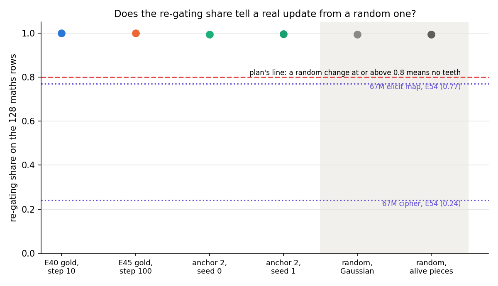
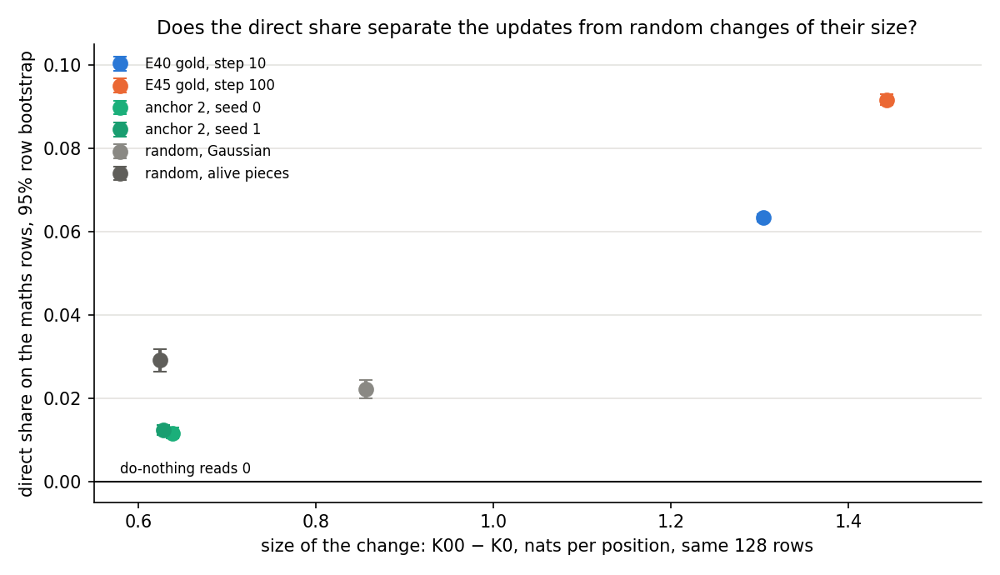
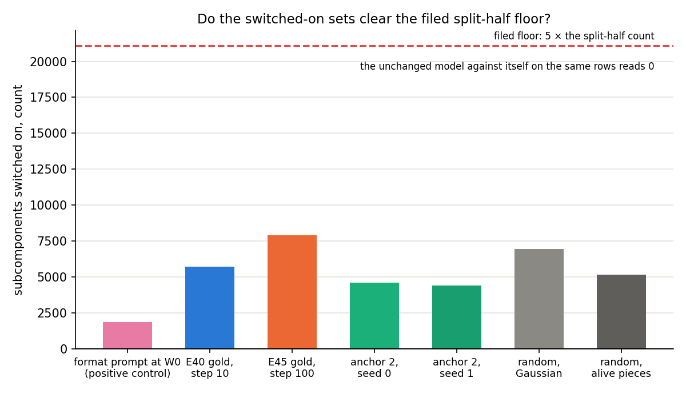
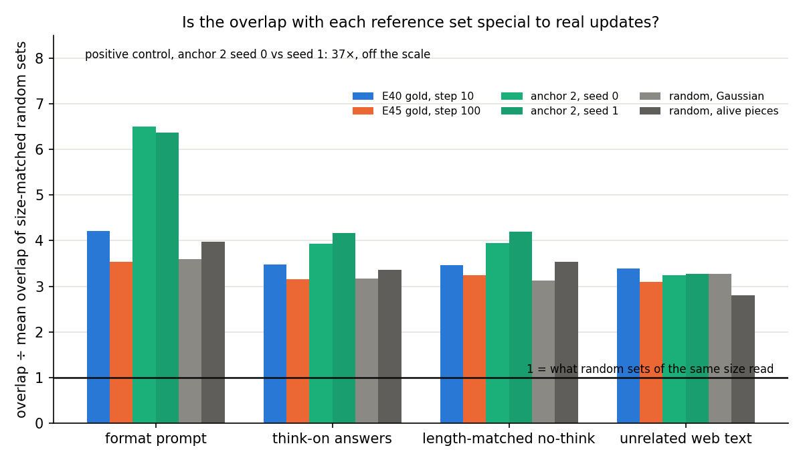
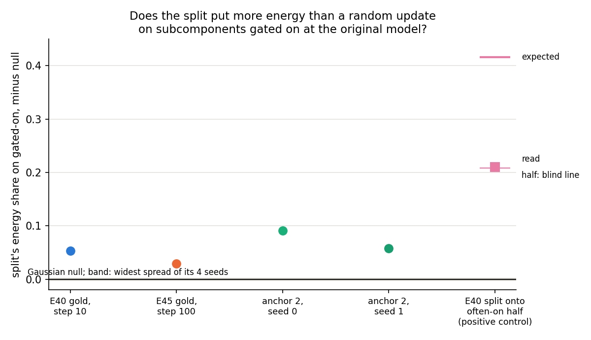
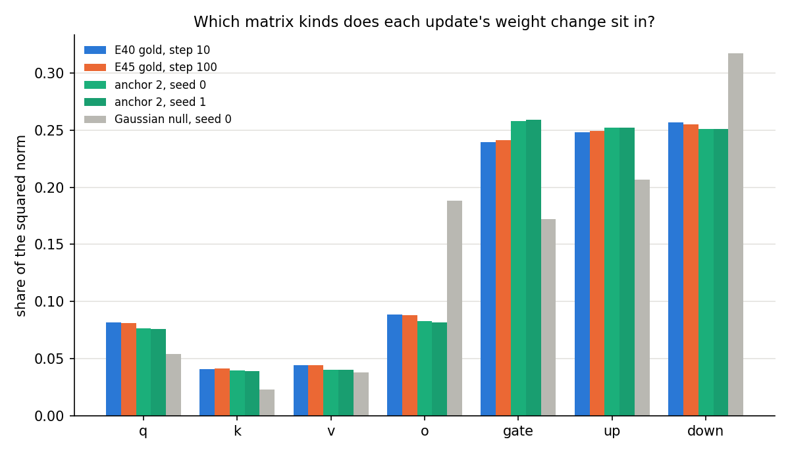

# What does each saved Qwen update do to the decomposition? E57 Stages A to C

*2026-10-30. Experiment `experiments/qwen_reading/`, E57, the Qwen line's Q3. Plan
`reports/plans/2026-10-30_plan_q3-reading-the-update.md`. Predictions `experiments/qwen_reading/results/predictions.json`,
unedited. Stage D has not run; it waits on the user's answer to `reports/decisions/2026-10-30_decision_e57-no-teeth.md`.
A Stage D amendment is appended at the end of this file when it runs.*

We read four saved Qwen3-1.7B fine-tunes and two random weight changes through the frozen decomposition, asking
which subcomponents carry each change and which ones the gate network switches on. The switching readings came out
the same for real and random changes, while the changed subcomponents at the original masks carried more of the maths
fine-tunes' effect, but those were also the largest changes. So at this scale switching cannot tell strengthening from
building, and the one reading that beats noise is confounded with size.

## The answer

The share of each update's effect that Γ recovers by switching subcomponents is about one for every change we tried,
random ones included, so it says nothing about the update. What does separate updates from random changes is the
direct share: what the split subcomponents carry when Γ's masks are kept as at the original model. The two maths
fine-tunes read 0.06 and 0.09, against 0.02 to 0.03 for random changes. But among the real updates the direct share
rises with the size of the change, and the maths fine-tunes are the largest, so size may explain the gap. The
invented-facts fine-tune, as large as one random change, reads below it.

## What we were trying to test

Qwen3-1.7B has a parameter decomposition: every weight matrix is a sum of rank-one subcomponents plus a remainder Δ,
and a gate network Γ reads the activations and gives each subcomponent a mask value between 0 and 1. A fine-tune
changes the weights by δW. We take the least-squares split of δW, which writes it as small changes to each
subcomponent's read and write vectors, and ask four things.

- **The route split.** With Δ off, we measure the mean per-token KL from the fine-tuned model to the CI-masked
  original-weights model in four cells. The masked model uses either the original or the split subcomponents. Its
  masks come from Γ run either on the original model's activations or on the fine-tuned model's. The **re-gating
  share** is the fraction of the masked model's error that changing only the masks removes. The **direct share** is
  the fraction that changing only the subcomponents removes, with the original masks. Both read 0 when the change does
  nothing and 1 when it does everything. A do-nothing update reads a re-gating share of 1 and a direct share of 0 by
  construction.
- **Switching.** The switched-on set is the subcomponents Γ gates on for the fine-tuned model and not for the original
  one, on the same rows. "Gated on" means a mask above 0.01 on at least 1% of positions.
- **Reference sets.** Four sets Γ switches on at the unchanged model in other contexts: a format system prompt, the
  model's own thinking-mode answers, the same no-think answers placed after a long earlier turn, and unrelated web
  text. We compare the overlap of each switched-on set with each reference against random sets of the same size,
  drawn site by site: as a fold enrichment, the overlap over the draws' mean, and as the filed excess in standard
  deviations of the draws.
- **Where δW lands.** The share of δW's squared norm in each matrix kind, the effective rank of each matrix, and the
  placement excess: how much more of the split's energy sits on subcomponents gated on at the original model than a
  Gaussian random update's split puts there.

The states, all read on the same 128 maths rows of 256 tokens. These are the unchanged model's own no-think answers to
GSM8K test problems.

| state | what it is | size: K00 − K0, same 128 rows |
|---|---|---|
| E40 gold, step 10 | full fine-tune on human GSM8K solutions, no warm-up, 10 steps | 1.304 |
| E45 gold, step 100 | the same data, warmed-up recipe, 100 steps | 1.444 |
| anchor 2, seeds 0 and 1 | 100 steps on invented facts the model cannot know | 0.638, 0.628 |
| random, Gaussian | a Gaussian δW, each site's input-weighted norm as E40's, scaled to E40's maths KL within 1.5× on 16 rows | 0.857 |
| random, alive pieces | random changes to the alive subcomponents' read and write vectors at E44 Amendment 2's matched scale | 0.625 |

The size column is one measurement on the same rows for every state. It is K00 − K0, in nats per position. K00 is
the KL from the changed model to the CI-masked original model, and K0 is that masking error at the original model. It
is not the KL to the start, which was not read on these rows for every state. On it, gold is 1.7 times the Gaussian
change and 2.3 times the alive-pieces change. E40 is 1.52 times the Gaussian change, just outside the 1.5× window the
Gaussian change was matched to on 16 rows. Anchor 2 is the one real update matched in size to a random change.

The two random changes rule out "any change of this size reads like this". The Gaussian change is mostly outside the
subcomponents' span. The alive-pieces change perturbs existing subcomponents at random, inside the span. Neither is
aimed at any behaviour, so whatever they read is what the instrument gives for an unaimed change.

Two more states were planned and are not here: anchor 1, a format fine-tune that teaches a prompt's answer style
without the prompt, and the own-sample and null updates. They belong to Stage D.

## What we expected, and why

- The unchanged model read through the changed-model path gives four equal cells and no switched-on subcomponents.
  The do-nothing update gives a re-gating share of exactly 1.
- E40's re-gating share was expected at about 0.9 to 0.95, from E44 Amendment 1b. There, Γ's masks alone recovered
  about 93% of E40's update.
- The random changes were the test of the re-gating share. If either reads 0.8 or more, the share has no teeth at this
  scale: Γ simply follows the activations it is given.
- The format prompt at the unchanged model should switch on enough subcomponents to clear the filed split-half floor.
  No weight moves there, so everything it changes is switching.
- The two anchor-2 seeds' switched-on sets should overlap far above chance, showing the overlap count can see a shared
  set. The random changes' overlap with the thinking set should be near zero.
- The filed predictions concern only the anchors: anchor 1 above anchor 2 on re-gating share and placement, and on
  overlap with the prompt's set. They wait for anchor 1.

## What we observed

### Does the re-gating share tell a real update from a random one?

**Reading it.** No. Every state, real or random, reads a re-gating share between 0.993 and 0.9995. That is far above
the 0.8 line at which the plan declared the share toothless. Both random changes sit on the line of the real updates.
For scale, on the 67M model the same share separated an elicited map at 0.77 from a cipher at 0.24. At Qwen scale,
recomputing the masks on the changed model's activations recovers almost all of any change, so the share measures
"Γ follows the activations", not re-gating. E40 sits above its expected range of 0.9 to 0.95. The row bootstrap is
tight, so the gap between E40 and each random change is real but only 0.0052 and 0.0065 wide.

| state | K0 | K00 | K01 | K10 | K11 | re-gating share [95% boot] | status |
|---|---|---|---|---|---|---|---|
| E40 gold, step 10 | 0.0696 | 1.3738 | 0.1044 | 1.2934 | 0.1034 | 0.9993 [0.9991, 0.9994] | scored |
| E45 gold, step 100 | 0.0696 | 1.5134 | 0.1403 | 1.3874 | 0.1396 | 0.9995 [0.9993, 0.9997] | scored |
| anchor 2, seed 0 | 0.0696 | 0.7079 | 0.1038 | 0.7008 | 0.0994 | 0.9927 [0.9920, 0.9934] | scored |
| anchor 2, seed 1 | 0.0696 | 0.6980 | 0.0957 | 0.6906 | 0.0927 | 0.9950 [0.9944, 0.9955] | scored |
| random, Gaussian | 0.0696 | 0.9266 | 0.1289 | 0.9089 | 0.1242 | 0.9940 [0.9933, 0.9948] | scored |
| random, alive pieces | 0.0696 | 0.6943 | 0.1173 | 0.6773 | 0.1131 | 0.9928 [0.9916, 0.9940] | scored |

Cells are mean per-position KL to the changed model, nats, maths rows, Δ off. K0 is the unchanged model's own masking
error. First index: original or split subcomponents; second: masks from the original or the changed model. The paired
gaps, E40 minus each control, are in the table below. The teeth rule's verdict is "no teeth".

| paired gap, E40 minus control | value | 95% row bootstrap |
|---|---|---|
| E40 − Gaussian | 0.0052 | [0.0044, 0.0060] |
| E40 − alive pieces | 0.0065 | [0.0053, 0.0077] |

On their own training rows the gold and anchor-2 states read the same, 0.995 to 0.999.

Behaviour kept, E45's filed row, is read here but not scored. Reading A takes masks from the state's own forward,
$(K00 - K11)/(K00 - K0)$. Reading B takes them from the original model, $(K00 - K10)/(K00 - K0)$. Reading A has the
re-gating share's problem; reading B carries the direct share's ordering.

| state | behaviour kept, reading A | reading B |
|---|---|---|
| E40 gold, step 10 | 0.974 | 0.062 |
| E45 gold, step 100 | 0.952 | 0.087 |
| anchor 2, seed 0 | 0.953 | 0.011 |
| anchor 2, seed 1 | 0.963 | 0.012 |
| random, Gaussian | 0.936 | 0.021 |
| random, alive pieces | 0.930 | 0.027 |

### Does the direct share separate the updates from random changes of their size?

**Reading it.** The maths fine-tunes read above the random changes, but they are also the largest changes, so size
may explain it. E45's gold update reads a direct share of 0.092 and E40 reads 0.063. The two random changes read 0.022
and 0.029. Gold is 3.2 to 4.1 times the random changes, E40 2.2 to 2.9 times. The figure plots each share against the
size of the change, K00 − K0, read on the same rows. Among the four real updates the direct share rises with size,
and gold is 1.7 to 2.3 times the size of the random changes. Anchor 2 is the one real update matched in size to a
random change, the alive-pieces one, and on the maths rows it reads below it: 0.012 against 0.029.

On the decision file's test, gold's interval, 0.090 to 0.093, does not meet the random changes' intervals. So its
condition for closing D3 now is not met. That test is weaker than it looks. The
row bootstrap covers only the choice of rows. The two random changes, one draw each, differ by 0.007, and their
intervals do not touch either. So 0.007 is a lower bound on the spread between random changes, and it is the practical
noise floor here, about three times the row half-width. The smallest gap between a maths fine-tune and a random
change, E40 against alive pieces, is 0.034, about five times that floor. The verdict holds, with size unresolved.

| state | size, K00 − K0 | direct share | 95% row bootstrap | own rows |
|---|---|---|---|---|
| E40 gold, step 10 | 1.304 | 0.0633 | [0.0624, 0.0642] | the maths rows |
| E45 gold, step 100 | 1.444 | 0.0917 | [0.0904, 0.0930] | 0.0906 [0.0890, 0.0923] |
| anchor 2, seed 0 | 0.638 | 0.0116 | [0.0103, 0.0129] | 0.0157 [0.0147, 0.0166] |
| anchor 2, seed 1 | 0.628 | 0.0123 | [0.0111, 0.0135] | 0.0135 [0.0126, 0.0144] |
| random, Gaussian | 0.857 | 0.0221 | [0.0199, 0.0243] | not read |
| random, alive pieces | 0.625 | 0.0291 | [0.0264, 0.0318] | not read |

The own-row values are not comparable with the random changes, which were read on the maths rows only.

Paired differences on the maths rows, the same 2000 row draws for both terms:

| difference | value | 95% row bootstrap |
|---|---|---|
| E45 gold − Gaussian | +0.0696 | [+0.0669, +0.0722] |
| E45 gold − alive pieces | +0.0626 | [+0.0595, +0.0657] |
| E40 − Gaussian | +0.0412 | [+0.0388, +0.0436] |
| E40 − alive pieces | +0.0342 | [+0.0313, +0.0370] |
| anchor 2 seed 0 − Gaussian | −0.0105 | [−0.0130, −0.0080] |
| anchor 2 seed 0 − alive pieces | −0.0175 | [−0.0203, −0.0146] |
| anchor 2 seed 1 − Gaussian | −0.0099 | [−0.0123, −0.0074] |
| anchor 2 seed 1 − alive pieces | −0.0169 | [−0.0197, −0.0139] |
| Gaussian − alive pieces, for the spread between random changes | −0.0070 | not computed; intervals disjoint |

Bootstrap: `experiments/qwen_reading/boot_direct.py`, output `results/boot_direct.json`, the same scheme as the filed
re-gating bootstrap: 2000 resamples of the 128 rows with `random.Random(0)`, shares from the resampled sums, 2.5th and
97.5th percentiles. It reuses `commute.qwen_reading`'s functions, so its re-gating intervals equal the saved ones.

The direct share's references: the do-nothing update reads exactly 0, checked in Stage A. Row noise is the bootstrap
half-width, 0.001 to 0.003. The spread between the two random changes is 0.007. The anchor-2 seed gap is 0.0006 on the
maths rows. There is no positive control, no state built to read a high direct share at this scale, and only one gold
seed. Gold and E40 are read on maths rows, their own domain, while anchor 2 is read off its domain there.

### Do the switched-on sets clear the filed floor?

**Reading it.** No set clears it, the positive control included. The filed floor is five times the number of
subcomponents gated on in one half of the maths rows and not the other, 4,222, so 21,110. The format prompt switches
on 1,860 at the unchanged model, and the updates and random changes switch on 4,402 to 7,916. The floor measures how
gating differs between different rows. The comparison it guards is between two models on the same rows, and the
unchanged model against itself there reads exactly 0. So the floor is the wrong noise for this comparison, and every
row built on the switched-on sets comes back unscored as filed.

| state | switched on | attention q, k, v, o | MLP gate, up, down |
|---|---|---|---|
| E40 gold, step 10 | 5,730 | 130, 106, 247, 1,129 | 1,116, 1,361, 1,641 |
| E45 gold, step 100 | 7,916 | 221, 134, 329, 1,678 | 1,493, 1,688, 2,373 |
| anchor 2, seed 0 | 4,606 | 173, 151, 317, 830 | 808, 954, 1,373 |
| anchor 2, seed 1 | 4,402 | 155, 144, 310, 735 | 795, 922, 1,341 |
| random, Gaussian | 6,961 | 167, 182, 531, 1,875 | 995, 1,172, 2,039 |
| random, alive pieces | 5,170 | 126, 144, 349, 1,425 | 758, 878, 1,490 |
| format prompt, unchanged model | 1,860 | | |

Out of 494,598 live subcomponents.

### Is the overlap with each reference set special to real updates?

**Reading it.** Mostly no, with one exception. Every switched-on set overlaps every reference about three to four times
more than random sets of its size do, and the random changes sit with E40 and gold on every reference. The exception
is anchor 2 on the format prompt's set: 6.4 to 6.5 times on both seeds, against 3.5 to 4.2 for every other change.
That is an observation, not a scored result. It also runs against the filed, unscored expectation that anchor 2's
prompt overlap sits at chance. The overlap count can see a shared set: the two anchor-2 seeds overlap 37 times more
than random sets.

The filed statistic, the excess in standard deviations, reads 19 to 76 for everything. It grows with the reference
set's size at a fixed enrichment, so its ordering, web text above thinking above length-matched above the prompt, is
just the order of the sets' sizes. Why every change, random ones included, reads three to four times chance is not
measured. One untested guess is that switched-on subcomponents sit near Γ's threshold, where any new context switches
them on. Its test is to compare the masks at the original model of the switched-on set with those of the draws. Fable's
proposed null, the random changes' own switched-on sets at matched size, would answer the same question, with fold
enrichment as the natural statistic.

The thinking set reads the same as the length-matched set for every state, within 0.01 to 0.17 in fold enrichment. So
the thinking reference reads maths context, not thinking, and by the spirit of the plan's "thinking ≈ length-matched"
branch, row 3 is not used for D3. The branch's letter does not fire. The two sets share 7,237 subcomponents, under 80%
of the thinking set, and the standard-deviation clause cannot fire while the thinking set is twice the other's size.
The random changes' thinking-set excess was expected near 0 and reads 44 and 48 standard deviations, 3.2 and 3.4 times
chance.

| state | format prompt | thinking | length-matched | web text |
|---|---|---|---|---|
| E40 gold, step 10 | 4.21× · 19.2 | 3.47× · 43.9 | 3.46× · 27.8 | 3.40× · 69.6 |
| E45 gold, step 100 | 3.53× · 18.8 | 3.16× · 46.9 | 3.25× · 32.4 | 3.10× · 73.2 |
| anchor 2, seed 0 | 6.50× · 27.1 | 3.93× · 51.0 | 3.95× · 32.7 | 3.24× · 55.7 |
| anchor 2, seed 1 | 6.37× · 25.7 | 4.17× · 52.7 | 4.19× · 34.8 | 3.28× · 54.5 |
| random, Gaussian | 3.60× · 19.2 | 3.17× · 48.4 | 3.13× · 31.5 | 3.28× · 75.6 |
| random, alive pieces | 3.98× · 19.6 | 3.36× · 44.2 | 3.53× · 33.3 | 2.81× · 51.3 |

Each cell: fold enrichment, the overlap over the mean of 1000 site-stratified draws from the live subcomponents not
gated on at the original model; then the filed excess in standard deviations of those draws. Reference sizes: prompt
1,860, thinking 22,316, length-matched 9,671, web text 45,232. Twenty of 128 thinking traces did not close within 2048
tokens and were dropped, under the 25% stop.

### Does the split put more energy on subcomponents gated on at the original model than a random update's split?

**Reading it.** Slightly, for every update, but the positive control sits at the line where the plan calls the reading
blind. Placement here is the share of the split's energy on subcomponents gated on at the original model, not on the
switched-on set. Each update's split puts 0.03 to 0.09 more there than a Gaussian update's split does. The positive
control, E40's update split onto the often-on half of the subcomponents alone, reads 0.2105 against a blind line of
0.2082, half the expected 0.42. Its margin, 0.0023, is smaller than the 0.0038 spread between the four Gaussian null
seeds, so it is at the blind line, not above it. The two anchor-2 seeds differ by 0.033, as much as the states differ.
E40's gated-on set comes from the maths rows and the others' from their own rows, so the null means differ and the
excesses do not share one reference.

| state | share on gated-on | null mean | excess | MLP share of the split's energy |
|---|---|---|---|---|
| E40 gold, step 10 | 0.637 | 0.584 | 0.053 | 0.20 |
| E45 gold, step 100 | 0.629 | 0.600 | 0.029 | 0.16 |
| anchor 2, seed 0 | 0.577 | 0.486 | 0.091 | 0.33 |
| anchor 2, seed 1 | 0.550 | 0.492 | 0.058 | 0.27 |

### Where does δW sit?

**Reading it.** All four updates spread their weight change over matrix kinds in nearly the same way: about a quarter
in each of the three MLP matrices and the rest in attention. The Gaussian null differs, with more in the attention
output and MLP down matrices. The updates are also lower-rank than the null: median effective rank 848 to 1,069 per
matrix, against 1,649 for every null seed. By layer, the gold updates are nearly flat, between 0.031 and 0.040 per
layer. Anchor 2's change is lowest-rank and sits in the late layers: 0.046 to 0.053 per layer from layer 21 on. This
row describes the updates; it has no filed comparison.

| state | median effective rank | q | k | v | o | gate | up | down |
|---|---|---|---|---|---|---|---|---|
| E40 gold, step 10 | 1069 | 0.082 | 0.041 | 0.044 | 0.089 | 0.239 | 0.248 | 0.257 |
| E45 gold, step 100 | 1006 | 0.081 | 0.041 | 0.044 | 0.088 | 0.241 | 0.249 | 0.255 |
| anchor 2, seed 0 | 857 | 0.076 | 0.040 | 0.040 | 0.083 | 0.258 | 0.252 | 0.251 |
| anchor 2, seed 1 | 848 | 0.076 | 0.039 | 0.040 | 0.082 | 0.259 | 0.252 | 0.251 |
| Gaussian null, seed 0 | 1649 | 0.054 | 0.023 | 0.038 | 0.188 | 0.172 | 0.207 | 0.318 |

## What we learned

At Qwen3-1.7B scale, any reading that lets Γ recompute its masks on the changed model's activations reads the same for
real and random changes. That covers the re-gating share and behaviour kept under reading A. So "re-gating" as these
rows define it cannot carry D3, whether post-training strengthens what exists or builds something new, at this scale.
The direct share is the one route-split number that separates real updates from random changes. The maths fine-tunes
read two to four times the random level, but they are also the largest changes, and among real updates the share
rises with size. So the separation may be size, not anything about the update. Anchor 2, a new-knowledge update
matched in size to one random change, reads below it on the maths rows. That fits "built, not strengthened", but no
prediction was filed for it, it is one anchor, and it is read off its domain. The overlap rows separate nothing except
anchor 2 on the format prompt's set, unscored.

## How compelling is the evidence

- The "no teeth" result for the re-gating share is strong: two random changes of different kinds, both 0.99, with tight
  intervals, on 128 rows.
- The direct-share gap between the maths fine-tunes and random changes is about five times the spread between the two
  random changes, 0.007. The row bootstrap alone is about three times narrower than that spread. The gap is confounded
  with size, which no run has varied at fixed kind.
- Everything is on one model, one decomposition, one row set for the maths reading, and one random draw per control.
- The direct share is blind to what the split leaves outside the subcomponents, which goes to Δ and is switched off in
  every cell.
- The overlap rows have no usable null as filed, and the thinking reference reads the same as the length-matched one.
  The switched-on rows have no usable floor as filed. The placement positive control sits at its blind line.

## Surprises

- **The random changes' overlap with the thinking set was expected near 0 and reads 44 and 48 standard deviations,
  about 3.3 times chance.** Every change reads three to four times chance on every reference. Why is not measured.
- **Anchor 2 overlaps the format prompt's set 6.4 to 6.5 times chance on both seeds**, against 3.5 to 4.2 for every
  other change. The filed, unscored expectation was "at chance".
- The format prompt, the switching positive control, fails to clear the filed floor; the floor is the problem, as
  above.
- E40's re-gating share read 0.999, above the expected 0.9 to 0.95.
- Anchor 2's direct share is below both random changes on the maths rows, on both seeds. No prediction covered it.

## What next

- **A dose check of the direct share first**, $0 on saved states: a random change scaled to gold's size, and E40 or
  gold at other steps. If the random direct share rises to gold's level at gold's size, the separation is size, not
  kind. Any kind reading of the direct share waits for it.
- **Stage D needs size matching too.** Anchor 1 reached maths KL 0.33, with a weight change of norm 3.14. Anchor 2 sits
  at 0.61 to 0.63, with norm 5.1. Since the direct share follows size among real updates, an anchor-1 against anchor-2
  gap in Stage D cannot by itself be read as a difference in kind. The decision file's option 6 removes this: rerun
  anchor 2 saving states between steps 12 and 100, and read the one nearest anchor 1's size. It costs $0 on the
  cluster, about 35 minutes per seed. Only with matched sizes would anchor 1 with gold and anchor 2 below random be a
  candidate kind signal, and a matched pair worth designing.
- Fable's amendment for the switching and overlap rows: a same-row floor for the switched-on sets, and the overlap
  measured against the random changes' switched-on sets at matched size, read as fold enrichment.

## Scorecard

No filed prediction is scored. Plan §11: anchor 1 never reached the matched KL window under E45 Amendment 2, so no
anchor prediction is scored; Stage D and the scoring (`run.py --stage score`) have not run.

| id | claim in words | rule | read | verdict |
|---|---|---|---|---|
| E45 regating_share | anchor 1 ≥ 0.5, anchor 2 below anchor 1 | E45 `rules.decomposition_rows` | anchor 2 0.993, 0.995; anchor 1 not read | unscored, §11; the row has no teeth |
| E45 behaviour_kept | anchor 1 ≥ 0.8, anchor 2 below, reading A | E45 | anchor 2 0.953, 0.963; anchor 1 not read | unscored, §11 |
| E45 placement | anchor 1 above anchor 2 | E45, seed gap | anchor 2 0.091, 0.058; anchor 1 not read | unscored, §11 |
| prompt_overlap | anchor 1 above q99, anchor 2 at or below q95 | E57 | the prompt set is 1,860, below the 21,110 floor | unscored, §11, and unscored for every state by the floor |
| think_overlap | anchor 2 at or below q95, on both seeds | E57 | 965 and 960 against q95 268 and 253; both sets below the floor | unscored, §11, and by the floor |
| validated | anchor gap above seed gap and 2 s.e. | E57 | no anchor 1 | not validated |

Filed expected values and early checks:

| check | expected | read | holds |
|---|---|---|---|
| unchanged model as the changed one | four cells equal, nothing switched on | K0 = K00 = K01 = 0.0696; zero split equal; 0 switched on | yes |
| E40 reproduction, first 16 rows | K0 0.06558, K00 1.4957 within 1e-3 | equal | yes |
| do-nothing | re-gating share 1 | 1.0 | yes |
| E40 on 128 rows | K00 1.3738, K0 0.0696 | equal | yes |
| E45 states' own-row KL | E45's records | equal | yes |
| Γ's gates at the original model, every state | Stage A's counts | equal | yes |
| GPU peak | ≤ 44 GiB | 42.6 GiB at most | yes |
| thinking traces dropped | ≤ 25% | 15.6% | yes |
| E40 re-gating share | about 0.9 to 0.95 | 0.9993 | no, above |
| random changes | either ≥ 0.8 means no teeth | 0.994, 0.993 | no teeth |
| format prompt's set | clears the floor | 1,860 against 21,110 | no |
| anchor-2 seed overlap | above q99 | 3,622 against q99 123 | yes |
| random excess with the thinking set | near 0 | 48.4, 44.2; 3.2× and 3.4× chance | no |
| placement positive control | near 0.42; below half, blind | 0.2105 against the line 0.2082, margin under the null seed spread 0.0038 | at the blind line |
| null effective rank | near full | median 1,649, against 2,048 for most matrices | roughly |

## Departures from the literature

- **Masks from another model's activations.** VPD computes masks from the model being decomposed. The K10 and K00
  cells of a changed model use masks from the original model's activations, with V′ in the readouts.
- **The route split and its shares** are this project's, from `GOALS.md` → "Where an update goes"; no source defines them.
- **"Gated on"** adds "on at least 1% of positions" to VPD's alive threshold of a mask above 0.01 somewhere.
- **Thinking reference.** The model card's thinking sampling is used as written, but capped at 2048 new tokens against
  its recommended 32,768; unfinished traces are dropped.
- **Unrelated set** is raw FineWeb text, not chat, a departure from the replan rather than a source.
- **KL to the start** is per-token, teacher-forced on fixed rows; RL's Razor measures it on the model's own samples of
  the new task. The size yardstick here, K00 − K0, is this project's, not a KL to the start.
- **E40's recipe** has no learning-rate warm-up, unlike standard fine-tuning recipes and E45's own recipe.
- **Effective rank** is Roy and Vetterli's, on the raw δW, not input-weighted.
- **Gaussian nulls** are seeded per site; E44's stage S used one seed for every site.
- **Bootstrap** intervals are plain percentile intervals over row resamples, with no bias correction.

## Not run

- Stage D: anchor 1 on both seeds, the own-sample update and the null; the scoring of every filed prediction.
- The decision file's option 6: anchor 2's states between steps 12 and 100, to match anchor 1's size.
- A dose check of the direct share: random changes at gold's size, or E40 and gold at other steps.
- A KL-to-start measurement on the same 128 rows for all six states.
- More than one draw per random control.
- A positive control for the direct share at this scale, and a second gold seed.
- The random changes on own training rows; they are read on the maths rows only.
- The random changes' placement, and a row bootstrap of the placement excess.
- The row bootstrap of the overlap excess, needed for the validated rule; not coded.
- A test of why every change overlaps the references three to four times chance: the original-model masks of the
  switched-on sets against those of the draws.
- A same-row floor for the switched-on sets, and the overlap against the random changes' switched-on sets at matched
  size. Fable's proposed amendment, not filed.
- A check that the null's kind shares follow its Gaussian energy, as the plan expected.
- E40 steps 1 and 100 and gold's earlier states.

## Provenance

- Jobs, all on MATS cluster L40s, $0: Stage A 46297, 1,225 s; B1 46331, 455 s; B2 46345, 292 s; C0 46350, 1,838 s;
  C 46394, 5,943 s. GPU peak 42.6 GiB, host peak 92.7 GB.
- Results: `experiments/qwen_reading/results/{A,B1,B2,C0,C_e40,C_gold_s0,C_a2long_s0,C_a2long_s1,summary,boot_direct}.json`,
  `run.log`. Gate counts and sets are in `results/large/`, a link to `~/commute-data/results-large/qwen_reading`.
- δW sha256: `results/dW_SHA256SUMS`, all matched in every stage.
- Figures: `experiments/qwen_reading/plot.py` → `experiments/qwen_reading/figures/`. Notebook
  `notebooks/E57_qwen_reading.ipynb`.
