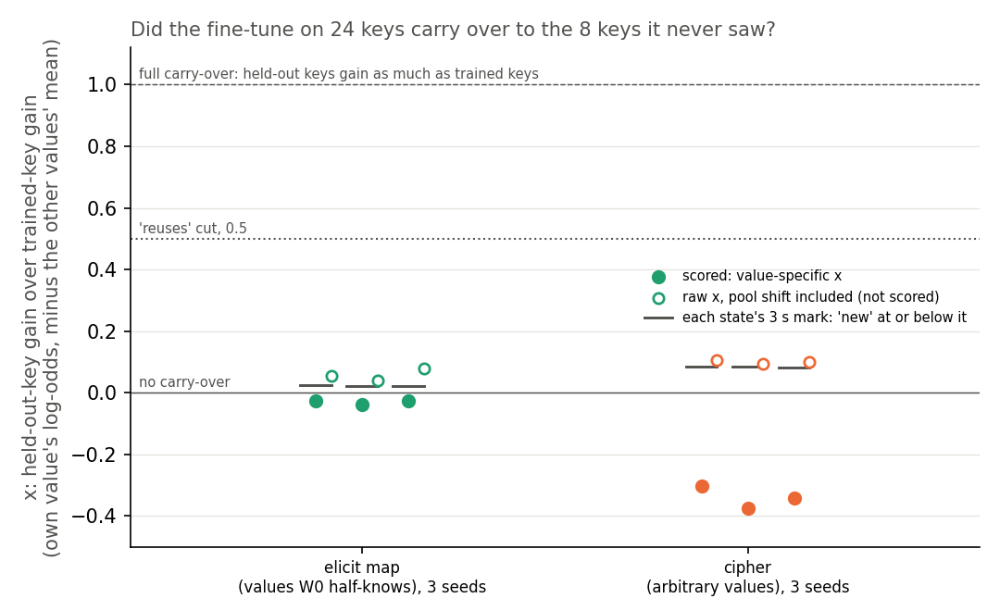
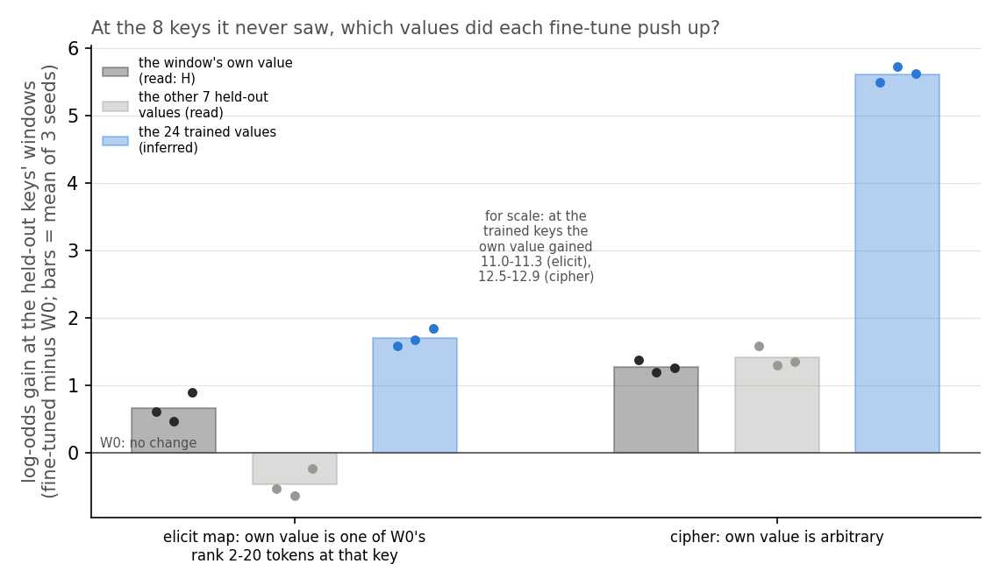
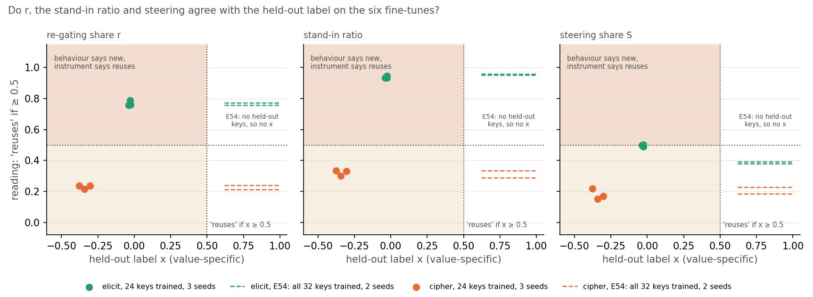

# Analysis: does a half-known word map learned on 24 keys carry to 8 unseen keys, and does VPD agree? (E58)

*2026-10-30, regating-lead writer. Plan: `reports/plans/2026-10-30_plan_e58-open-pair.md`, with its two dated pre-fine-tune
amendments. Rules: `experiments/open_pair/results/predictions.json`. Results: `experiments/open_pair/results/run.json`
(job 46266). Reading adopted by the lead: `reports/plans/2026-10-30_advice_e58-reading-FABLE.md`, `decisions.md` last
row. Explanation: `notebooks/E58_open_pair.ipynb`. Words as in `GOALS.md` → Terms. Provenance at the end.*

We fine-tuned the small model on a word map it already half-knows, on most of its keys, and tested the keys it never saw.
It did not improve on them in any of three seeds, yet the decomposition still says most of the gain comes from switching
on subcomponents the model already had. So a filed prediction, that the two would agree, failed; we read the gap as old
subcomponents serving a lookup that does not generalise, a reading and not yet a proof.

## The answer

No carry-over, and the decomposition reads the opposite. Trained on 24 keys, the half-known map gained nothing at the 8
unseen keys, on all three seeds. The arbitrary control map gained nothing there either, as it must. Yet switching on
existing subcomponents still carries about three quarters of the half-known map's gain, as when every key was trained.
Our reading: the values are words the model already says after these keys, so the subcomponents are old while the
lookup is new.

## What we were trying to test

The re-gating line asks whether a VPD decomposition can tell a fine-tune that strengthens something the model already
does from one that teaches something new. Its numbers have only ever been scored against labels set by how a task was
built. E58 earns a label from behaviour alone, with no decomposition, on a pair whose answer the construction does not
fix.

**The task**, from E54. Each window is Pile text, then a rare marker token, then a key word; the model must predict the
key's value next. Two maps share the 32 keys and the windows:

- **The elicit map.** Each key's value is a word the original model W₀ already ranks 2nd to 20th after the marker and
  that key. Two examples: " action" → " potential" and " formed" → " from". The model half-knows it.
- **The cipher.** The same keys mapped to arbitrary words W₀ gives under 1e-4 each. The model cannot know these, so
  nothing learned on some keys can tell it the others. It is the label's negative control.

**What changed.** E54's fine-tune recipe, unchanged, ran on only 24 of the 32 keys; 8 keys were held out by a seeded
draw and never sat at a training window's key position. Three seeds per map. The elicit map is read at E12's scored
step, the first checkpoint where the trained keys' held-out windows give the target probability 0.5 or more: step 10
on every seed. The cipher is read at the step whose total update size matches the same seed's elicit state, steps 8 to
9. Every fine-tune started from W₀.

**The label.** For one window, the *specific gain* is the fine-tune's rise in the log-odds of that window's own value,
minus the mean rise of the other 31 values of the same map. Subtracting the other values removes a shift shared by the
whole value set, which the stopped job 46259 found on E54's cipher, described under "Stage 0". Then:

- $G_\text{spec}$, the mean specific gain on the 75 windows of the trained keys that training never used;
- $H_\text{spec}$, the same on the 124 windows of the 8 held-out keys;
- $x = H_\text{spec} / G_\text{spec}$: 0 means the unseen keys gained nothing, 1 means they gained as much as the trained
  keys;
- $s$, the standard deviation of $x$ over 2000 bootstrap resamples of windows.

A state is labelled "reuses" if $x \ge 0.5$, "new" if $x \le 3s$, "neither" in between. The bar is the reuse line's
Stage B rule, read on behaviour; see "Departures from the literature".

**The readings**, E54's, unchanged. Each fine-tuned weight change gets the least-squares split: the least-norm change
to the alive subcomponents, the rest into Δ. All cells are the target's log-odds at the answer position, on the
trained keys' held-out windows.

- $r = (L_{01} - L_{00}) / (T_1 - T_0)$, the share of the fine-tune's gain $T_1 - T_0$ recovered in the CI-masked model
  when the subcomponents stay at W₀'s and only Γ's CI values move to those Γ computes on the fine-tuned model. It reads
  1 if switching existing subcomponents on carries all the gain, 0 if none.
- The stand-in ratio, $(L_{11} - L_{00}) / (U_1 - U_0)$: the CI-masked model's gain with the split subcomponents and the
  new CI values, over the gain of the split subcomponents with every mask open. As E46 Amendment 3 found, it is roughly
  the gain from Γ's new CI values alone over the subcomponent gain. It is not "the share Γ keeps", and it has no ceiling
  at 1.
- $S$, steering's share: one mean added vector at one block, E52's recipe, in log P. It never reads the decomposition.

Each reading turns into a label by the same cut: 0.5 or more reads "reuses".

## What we expected, and why

- **The elicit label was open.** Fable leaned toward "reuses" at about even odds: if the fine-tune worked by sharpening
  what W₀ already prefers after a key, unseen keys would gain too.
- **Every cipher reads "new"**, with high confidence, because its unseen values are unknowable.
- **r and the stand-in ratio agree with the elicit label.** We expected both readings high on every elicit state, as in
  E54, so this prediction would pass exactly when the label read "reuses": also about even odds.
- **The decomposition agrees with the label more often than steering does**, following whichever label came.
- **r and the stand-in ratio still separate the elicit map from the cipher**, as E54 found with every key trained.

## Stage 0: the controls, run first and alone

| check | filed | read | |
|---|---|---|---|
| zero update, largest gain on any window, four window sets | exactly 0 | 0.0 on all four | pass |
| E54 elicit seed 0 on its 32 keys: r | 0.7726 ± 0.03 | 0.7726 | pass |
| the same: stand-in ratio | 0.9564 ± 0.03 | 0.9564 | pass |
| the same: S, and its block-0 value | 0.3796 ± 0.001; ≤ 1e-6 | 0.3796; −9.4e-8 | pass |
| E54 cipher seed 0: specific gain over raw gain | ≥ 0.5 | 6.944 / 11.107 = 0.625 | pass |
| E54 elicit seed 0: specific gain over raw gain | reported | 16.243 / 10.787 = 1.506 | reported |
| $G_\text{spec}$ gate, 8 ÷ 10.79 × the smaller of the two specific gains | finite, ≤ 5.148 | 5.148 | pass |

**The stop before this run.** Job 46259 ran the first amendment's stage 0 and stopped there, as designed, before any
fine-tune. On E54's cipher, the other 31 cipher values gained 4.16 log-odds at every window, against the target's
11.11. A raw held-out ratio would therefore read a cipher with no carry-over as "neither", never "new". The second
amendment, filed before any fine-tune, moved the label to the specific gain and lowered the gate to 5.148. Every other
stage-0 number of job 46259 matched the table above.

## Did the fine-tune carry over to the keys it never saw?

**Reading it.** No. On all three elicit seeds the held-out keys' specific gain was slightly negative, so $x$ sits just
below 0, under each state's $3s$ mark of about 0.02, and the label is "new". The trained keys gained 18.2 to 18.5
log-odds on the same measure. The cipher reads "new" too, further below 0, so the label's negative control passed.
The hollow points show the raw ratio with the shared shift left in: 0.04 to 0.08 for the elicit map, which would read
"neither", still far from the 0.5 cut.

| state | step | update size | $G$ raw | $G_\text{spec}$ | $H$ raw | $H_\text{spec}$ | $x$ | $3s$ | $3s_\text{key}$ | raw $x$ | label |
|---|---|---|---|---|---|---|---|---|---|---|---|
| elicit, seed 0 | 10 | 3.169 | 11.03 | 18.18 | 0.61 | −0.50 | −0.027 | 0.024 | 0.045 | 0.056 | new |
| elicit, seed 1 | 10 | 3.120 | 11.35 | 18.43 | 0.46 | −0.70 | −0.038 | 0.021 | 0.030 | 0.041 | new |
| elicit, seed 2 | 10 | 3.183 | 11.31 | 18.51 | 0.90 | −0.48 | −0.026 | 0.021 | 0.041 | 0.079 | new |
| cipher, seed 0 | 9 | 3.260 | 12.86 | 10.67 | 1.38 | −3.24 | −0.303 | 0.085 | 0.232 | 0.107 | new |
| cipher, seed 1 | 9 | 3.194 | 12.53 | 9.39 | 1.19 | −3.54 | −0.377 | 0.084 | 0.210 | 0.095 | new |
| cipher, seed 2 | 8 | 3.073 | 12.65 | 9.94 | 1.26 | −3.40 | −0.342 | 0.082 | 0.198 | 0.099 | new |

Gains are log-odds of the target, fine-tuned minus W₀. Update size is the sum over the 24 decomposed matrices of the
Frobenius norm of δW. $s_\text{key}$ resamples the 8 held-out keys instead of windows; it was reported, not scored.
No label changes under $3 s_\text{key}$. Every elicit state cleared the gate of 5.148 by more than three times.

Per held-out key, the elicit map's $H_\text{spec}$ is negative on 21 of 24 key-seed pairs. The three positive ones are
key 2515 on seeds 0 and 1, at +0.77 and +0.21, and key 2250 on seed 2, at +0.92. Full per-key values are in
`run.json` under `H_spec_per_key`.

## Was carry-over possible, or did the task rule it out?

**Reading it.** Carry-over was possible and the fine-tune did not take it. There is no rule from key to value here,
so the one way unseen keys could gain is a general sharpening of what W₀ already prefers after each key. That would
raise each held-out key's own value, one of W₀'s top 20 there, more than the values of other keys. Instead the own value
rose by 0.5 to 0.9 log-odds. The 24 trained values rose by 1.6 to 1.8, more than twice as much. The other held-out values
fell, by about 0.5 on average.
The trained values' rise is inferred, not read directly: it follows from $H$, $H_\text{spec}$ and the other held-out
values' gain, since the 32 values are distinct. So at an unseen key the update pushes toward the 24 values it was trained
on, not toward what W₀ prefers there. The cipher shows the same push, much larger, at 5.5 to 5.7.

| state | own value, read | other 7 held-out values, read | 24 trained values, inferred |
|---|---|---|---|
| elicit, seed 0 | +0.61 | −0.53 | +1.59 |
| elicit, seed 1 | +0.46 | −0.64 | +1.68 |
| elicit, seed 2 | +0.90 | −0.23 | +1.84 |
| cipher, seed 0 | +1.38 | +1.58 | +5.50 |
| cipher, seed 1 | +1.19 | +1.29 | +5.73 |
| cipher, seed 2 | +1.26 | +1.35 | +5.62 |

The inference: $H - H_\text{spec}$ is the mean gain of the other 31 values, so the 24 trained values' mean is
$(31 (H - H_\text{spec}) - 7 H_\text{other}) / 24$, computed in `experiments/open_pair/plot.py`.

## Do the decomposition's readings agree with the label?

**Reading it.** No: both r and the stand-in ratio read "reuses" on every elicit state, while the label reads "new". The
three green points sit in the upper-left box of the first two panels, where behaviour says new and the instrument says
reuses. They sit where E54 put the same map with all 32 keys trained, the dashed lines. Both readings still separate
the elicit map from the cipher: r by a gap of 0.54 over a seed range of 0.03, and the stand-in ratio by 0.62 over 0.03.
So the filed agreement prediction fails for both readings, and the separation prediction passes.

| state | r | stand-in ratio | S | S block | label | r says | ratio says | S says |
|---|---|---|---|---|---|---|---|---|
| elicit, seed 0 | 0.787 | 0.946 | 0.501 | 2 | new | reuses | reuses | reuses |
| elicit, seed 1 | 0.757 | 0.934 | 0.498 | 2 | new | reuses | reuses | new |
| elicit, seed 2 | 0.758 | 0.934 | 0.490 | 2 | new | reuses | reuses | new |
| cipher, seed 0 | 0.236 | 0.330 | 0.171 | 3 | new | new | new | new |
| cipher, seed 1 | 0.238 | 0.336 | 0.220 | 3 | new | new | new | new |
| cipher, seed 2 | 0.217 | 0.302 | 0.152 | 3 | new | new | new | new |
| E54 elicit, 32 keys, seeds 0, 1 | 0.773, 0.758 | 0.956, 0.951 | 0.380, 0.394 | | none | | | |
| E54 cipher, 32 keys, seeds 0, 1 | 0.241, 0.212 | 0.336, 0.289 | 0.228, 0.185 | | none | | | |

Block 0 of the steering read 7e-8 or less in size on every state, under the 1e-5 stop.

**Steering's score is not a finding.** Scored as filed, steering agrees with the label on 5 of 6 states and each
decomposition reading on 3, so the comparison reads "steering better" for both. But steering's three elicit values are
0.501, 0.498 and 0.490, on its 0.5 cut, so it scores by sitting on the line, not by reading the label. This result is
kept out of the headline.

## The reading the lead adopted

This is a reading, not a proof. No check run here separates it from "the decomposition is wrong".

**The granularity limit, first concrete instance.** VPD's unit is the rank-one subcomponent. A new circuit built from
old subcomponents, switched on in a new pattern, reads "elicited" to r and the stand-in ratio. Here the elicit values
are words W₀ already says after these keys, so the subcomponents that write them already exist; the cipher's values are
not, and its readings are low. The held-out label asks a different question: does a rule carry to inputs never seen?
On a lookup over existing output words, the first answer can be yes and the second no, and E58 shows them disagreeing on
three seeds each way. Every claim here holds only at the level of VPD's subcomponents.

**The label is not empty.** One could worry that "new" was guaranteed by the task, since each value is a separate pick
per key. But the route to carry-over, sharpening W₀'s own preference at each key, was open, and the update pushed
toward the trained values instead. The label says something true: the fine-tune learnt 24 separate lookups.

**What is missing.** No 67M state has yet read "reuses" under this bar. Until the label's positive control does, E58
cannot be counted as a VPD failure either.

**The question for the user, ask #14.** Does "reuses" in this line mean A, built from subcomponents the model already
has under new switching, or B, generalises to inputs the fine-tune never saw? Under A, r and the ratio did their job
here and E58's filed agreement test was unfair on a lookup task. Under B, E58 counts against VPD. The lead proceeds with
A unless the user objects.

## What we learned

For `GOALS.md`'s question, new capabilities or strengthening, the decomposition answers a narrower question than
behaviour does. On this map, r and the stand-in ratio report that the gain runs through subcomponents W₀ already had,
three seeds each, with the same values as when every key was trained. Behaviour reports that no rule generalises to
unseen keys. Both can be true at once on a lookup over words the model already says. So r and the ratio can be scored
against a behavioural label only on tasks where "reuses" means a rule W₀ already has.

## How compelling is the evidence

- **Seeds and keys.** Three fine-tune seeds per map, one key split, one decomposition. The label's real unit is the 8
  held-out keys; resampling keys widens the elicit $3s$ to 0.03 to 0.045, and every label stays "new".
- **The label is blind** to a carry-over that raises every value of the map alike: that is the price of removing the shared
  shift. The raw ratio, which keeps it, reads 0.04 to 0.08, also far from "reuses".
- **No positive control for the label** exists on the 67M. The cipher shows the bar can read "new"; nothing yet shows it
  can read "reuses".
- **r and the stand-in ratio** reproduced E54 to four decimals in stage 0, and the elicit values here sit within 0.03 of
  E54's. They cannot tell a new circuit of old subcomponents from an old circuit.
- **The trained values' rise** at unseen keys is inferred by arithmetic from three read means, not read value by value.

## Surprises

- **A filed prediction failed.** The decomposition's labels disagreed with the behavioural label on all three elicit
  states, for both r and the stand-in ratio. It was filed at about even odds, so the direction is not a reversal of a
  confident lean, but it fails as filed and stands.
- The open lean toward "reuses" did not hold: all three elicit states read "new", far from the cut.
- Steering's share on the elicit map rose to about 0.5 with 24 keys trained, from about 0.39 with all 32. We have no
  explanation and assert none.
- The cipher's update raises its 24 trained values at unseen keys by about 5.6 log-odds, three times the elicit map's push.
- On the elicit map the specific gain on trained keys exceeds the raw gain, about 18 against 11. So at a trained key the
  map's other values fall by about 7 log-odds.

## What next

- **The label's positive control**, part of E58 Amendment 1 at no cost: a map whose rule W₀ already has, such as each
  key's top word, on the same key split, three seeds. If it reads "reuses", its r is the line's first state labelled
  reuse by behaviour. If it cannot, the bar is out of reach on the 67M and E58's label says little.
- **The W₀ rank-k readout**, the same amendment: at each held-out window, the gain of W₀'s top-20 words at that key. If
  they all rise in step with W₀'s rank, the update partly sharpens W₀ after all. If only the trained values rise, the
  lookup reading holds.
- **The user's answer to ask #14** sets how the step-2 plan's agreement test is scored: on rule tasks only under A,
  on every task under B.

## Scorecard

| id | claim | rule | read | verdict |
|---|---|---|---|---|
| P0 | the elicit label, open (a lean, not a test) | majority of three seeds | new, new, new | new; lean "reuses about 50%" missed |
| P1 | every cipher reads "new" | all three "new"; stop on any "reuses" | new, new, new | pass |
| P2, r | r's label equals the behavioural label on every labelled elicit state | r ≥ 0.5 → reuses | reuses ×3 vs new ×3 | **fail** |
| P2, ratio | the same for the stand-in ratio | ratio ≥ 0.5 → reuses | reuses ×3 vs new ×3 | **fail** |
| P3 | the decomposition agrees with the label more often than steering | lead of 2 or more agreements over six states | r 3, ratio 3, S 5 | "steering_better" for both, as scored; not a finding, S sits on its 0.5 cut |
| P4, r | r separates elicit from cipher, elicit higher, as E54 | gap > larger seed range and ≥ 0.2 | gap 0.537, range 0.029 | pass |
| P4, ratio | the same for the stand-in ratio | as above | gap 0.615, range 0.034 | pass |

Stage-0 checks all passed. Early stops: elicit seed 0's $G_\text{spec}$ 18.18 against the gate of 5.148, no stop; no
cipher read "reuses", no stop. Plan decision tree: branch 5, label "new" with the agreement test failed.

## Departures from the literature

- **The Stage B rule, adapted to behaviour only.** The bar is Jain et al.'s Definition 2 with the user's bounded g, as the
  reuse line wrote it in `reports/plans/2026-10-29_plan_reuse-stage1.md`, § "Stage B", patch row. There it reads
  "through iff P ≥ 0.5, not iff P ≤ 3 s, else neither", with P the share of the gain an interchange patch carries. Here
  P is read on behaviour as $x = H_\text{spec} / G_\text{spec}$, and the patch half is not run, on Fable's advice. So the
  label speaks to generalisation only, not to which mechanism carries it.
- **A value-specific gain.** Stage B reads a raw gain. Here each window's gain has the mean gain of the map's other
  values subtracted. The stopped job 46259 showed why: the cipher raises its whole value set. The change was filed
  before any fine-tune. It is blind to a carry-over that raises every value alike.
- **A window bootstrap, while windows share keys.** Stage B's row bootstrap resamples independent texts. Here windows of
  one key are not independent; the key-level $s_\text{key}$ is reported beside, unscored, and changes no label.
- **The 0.5 cut on the stand-in ratio** copies E12's rule for r; the ratio has no ceiling at 1, so the cut is a
  convention. Steering's 0.5 cut is E52's, not fitted here.
- **The gate** was lowered from 8 to 5.148 by the second pre-fine-tune amendment, keeping Fable's fraction of E54's gain;
  every elicit state cleared it by more than three times.

## Not run

- The W₀ rank-k readout on the six saved states: E58 Amendment 1, next.
- The label's positive control, a map whose rule W₀ has, on the same key split: E58 Amendment 1, next.
- The novelty column on Γ's CI patterns: no expected value until a labelled "reuses" state exists to compare against.
- The interchange-patch half of Stage B's rule.
- More key splits, more windows per held-out key, more than three seeds, a second decomposition seed.
- The cipher at its own E12 step; Qwen.

## Provenance

- Job 46266, MATS cluster `debug` QoS, one L40, account c11, $0; the script ran from 15:19:49 to 15:22:32 on
  2026-10-30. Code at `b11a921`, `run.py` and `src/commute/open_pair.py` clean. Results commit `16f43d6`.
- Stopped job 46259: stage 0 only, results commit `080b1f2`.
- `experiments/open_pair/results/run.json`; predictions sha256 `dbf47c98…`, recorded in `run.json`.
- Saved weight changes, six of 113 MB, with sha256 in `run.json`, and the log `run.out`:
  `~/commute-data/results-large/open_pair/`, linked as `experiments/open_pair/results/large`.
- Figures: `experiments/open_pair/plot.py`, from `run.json` and E54's values in
  `experiments/regating_truth_table/results/table.json`.
