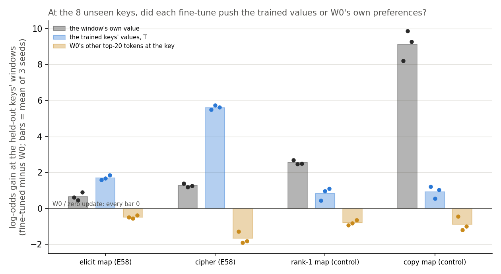
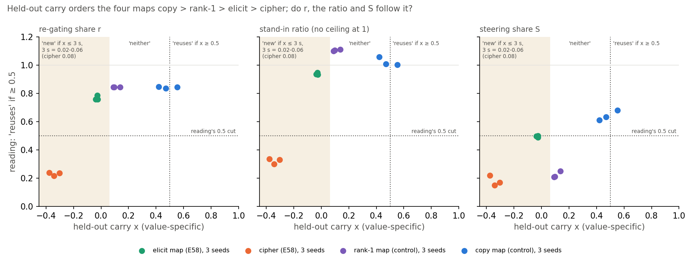
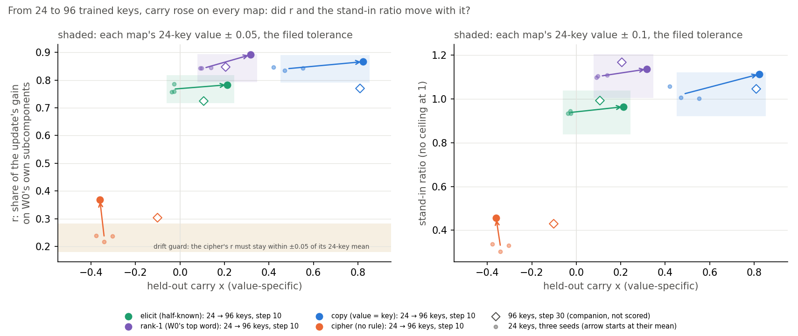
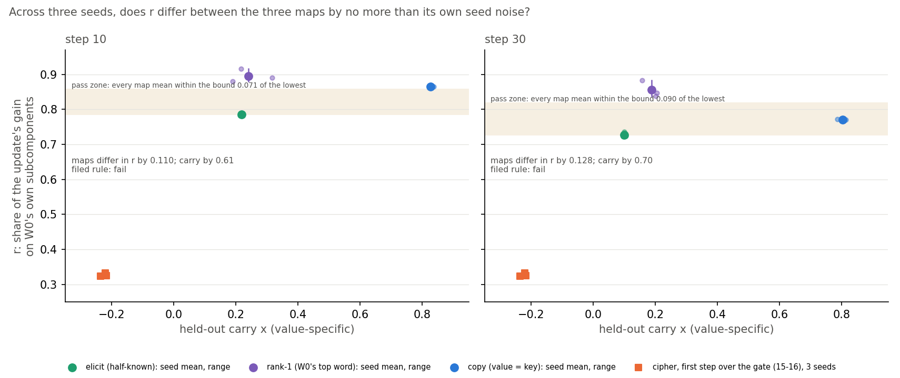
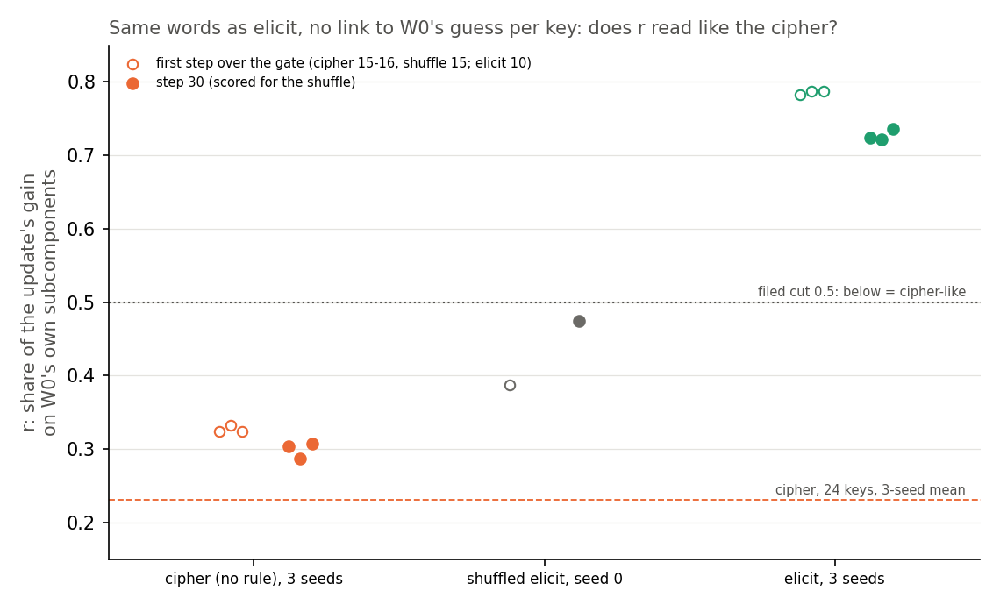
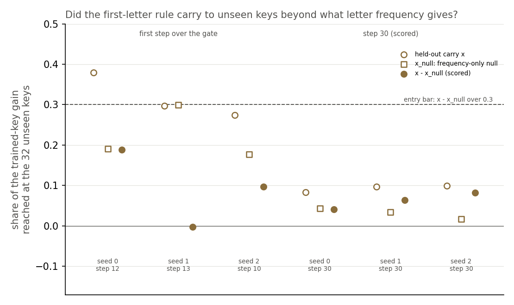

# Analysis: does a half-known word map carry to keys it never saw, at 24 and at 96 trained keys, and does VPD agree? (E58)

*2026-10-30, regating-lead writer. Plan: `reports/plans/2026-10-30_plan_e58-open-pair.md`, with its two dated pre-fine-tune
amendments and its Amendments 1 to 7. Rules: `experiments/open_pair/results/predictions.json` and
`predictions_amend1.json` to `predictions_amend7.json`. Results: `experiments/open_pair/results/run.json` (job 46266),
`amend1.json` (job 46332), `amend2.json` (job 46383, stopped), `amend3.json` (job 46398), `amend4.json` (job 46426),
`amend5.json` (job 46450), `amend6.json` (job 46489) and `amend7.json` (job 46673).
Reading adopted by the lead: `reports/plans/2026-10-30_advice_e58-reading-FABLE.md`, `decisions.md`; Fable's later
advice `reports/plans/2026-10-30_advice_e58a1-next-FABLE.md`, `..._advice_e58a2-control-FABLE.md` and
`..._advice_e58a3-next-FABLE.md`. Explanation: `notebooks/E58_open_pair.ipynb`. Words as in `GOALS.md` → Terms.
Provenance at the end.*

We fine-tuned the small model on word maps over some of their keys and asked whether the keys it never saw gained, and
whether the decomposition's main reading followed that. It did not: the reading was high for every map whose answer the
original model already guesses and low for every other map, including a new four-word rule that carried strongly to
unseen keys, which read like a plain lookup over the same words. For `GOALS.md`, the decomposition reads whether the
trained answer is one the model already gives, not whether what was learned generalises, so on its own it does not
yet tell elicitation from a new mechanism beyond that.

## The answer

The decomposition's main reading follows whether the trained answer is the model's own guess, not whether learning
carries to unseen keys. A new four-word rule, built on directions the model already has, carried most of the way to
unseen keys yet read as new, like a lookup over the same words. Copy, which carries as far, reads high. A lookup at
nearly copy's prior reads low, so the reading is not a smooth trend in the prior. All of this is one small model and
one decomposition, and provisional.

## What we were trying to test

The re-gating line asks whether a VPD decomposition can tell a fine-tune that strengthens something the model already
does from one that teaches something new. Its numbers have only ever been scored against labels set by how a task was
built. E58 earns a label from behaviour alone, with no decomposition, on a pair whose answer the construction does not
fix.

**The task**, from E54. Each window is Pile text, then a rare marker token, then a key word; the model must predict the
key's value next. Two maps share the 32 keys and the windows:

- **The elicit map.** Each key's value is a word the original model W₀ already ranks 2nd to 20th after the marker and
  that key. Two examples: " action" → " potential" and " formed" → " from". The model half-knows it.
- **The cipher.** The same keys mapped to arbitrary words W₀ gives under 1e-4 each. The model cannot know these, so
  nothing learned on some keys can tell it the others. It is the label's negative control.

**What changed.** E54's fine-tune recipe, unchanged, ran on only 24 of the 32 keys; 8 keys were held out by a seeded
draw and never sat at a training window's key position. Three seeds per map. The elicit map is read at E12's scored
step, the first checkpoint where the trained keys' held-out windows give the target probability 0.5 or more: step 10
on every seed. The cipher is read at the step whose total update size matches the same seed's elicit state, steps 8 to
9. Every fine-tune started from W₀.

**The label.** For one window, the *specific gain* is the fine-tune's rise in the log-odds of that window's own value,
minus the mean rise of the other 31 values of the same map. Subtracting the other values removes a shift shared by the
whole value set, which the stopped job 46259 found on E54's cipher, described under "Stage 0". Then:

- $G_\text{spec}$, the mean specific gain on the 75 windows of the trained keys that training never used;
- $H_\text{spec}$, the same on the 124 windows of the 8 held-out keys;
- $x = H_\text{spec} / G_\text{spec}$: 0 means the unseen keys gained nothing, 1 means they gained as much as the trained
  keys;
- $s$, the standard deviation of $x$ over 2000 bootstrap resamples of windows.

A state is labelled "reuses" if $x \ge 0.5$, "new" if $x \le 3s$, "neither" in between. The bar is the reuse line's
Stage B rule, read on behaviour; see "Departures from the literature".

**The readings**, E54's, unchanged. Each fine-tuned weight change gets the least-squares split: the least-norm change
to the alive subcomponents, the rest into Δ. All cells are the target's log-odds at the answer position, on the
trained keys' held-out windows.

- $r = (L_{01} - L_{00}) / (T_1 - T_0)$, the share of the fine-tune's gain $T_1 - T_0$ recovered in the CI-masked model
  when the subcomponents stay at W₀'s and only Γ's CI values move to those Γ computes on the fine-tuned model. It reads
  1 if switching existing subcomponents on carries all the gain, 0 if none.
- The stand-in ratio, $(L_{11} - L_{00}) / (U_1 - U_0)$: the CI-masked model's gain with the split subcomponents and the
  new CI values, over the gain of the split subcomponents with every mask open. As E46 Amendment 3 found, it is roughly
  the gain from Γ's new CI values alone over the subcomponent gain. It is not "the share Γ keeps", and it has no ceiling
  at 1.
- $S$, steering's share: one mean added vector at one block, E52's recipe, in log P. It never reads the decomposition.

Each reading turns into a label by the same cut: 0.5 or more reads "reuses".

## What we expected, and why

- **The elicit label was open.** Fable leaned toward "reuses" at about even odds: if the fine-tune worked by sharpening
  what W₀ already prefers after a key, unseen keys would gain too.
- **Every cipher reads "new"**, with high confidence, because its unseen values are unknowable.
- **r and the stand-in ratio agree with the elicit label.** We expected both readings high on every elicit state, as in
  E54, so this prediction would pass exactly when the label read "reuses": also about even odds.
- **The decomposition agrees with the label more often than steering does**, following whichever label came.
- **r and the stand-in ratio still separate the elicit map from the cipher**, as E54 found with every key trained.

## Stage 0: the controls, run first and alone

| check | filed | read | |
|---|---|---|---|
| zero update, largest gain on any window, four window sets | exactly 0 | 0.0 on all four | pass |
| E54 elicit seed 0 on its 32 keys: r | 0.7726 ± 0.03 | 0.7726 | pass |
| the same: stand-in ratio | 0.9564 ± 0.03 | 0.9564 | pass |
| the same: S, and its block-0 value | 0.3796 ± 0.001; ≤ 1e-6 | 0.3796; −9.4e-8 | pass |
| E54 cipher seed 0: specific gain over raw gain | ≥ 0.5 | 6.944 / 11.107 = 0.625 | pass |
| E54 elicit seed 0: specific gain over raw gain | reported | 16.243 / 10.787 = 1.506 | reported |
| $G_\text{spec}$ gate, 8 ÷ 10.79 × the smaller of the two specific gains | finite, ≤ 5.148 | 5.148 | pass |

**The stop before this run.** Job 46259 ran the first amendment's stage 0 and stopped there, as designed, before any
fine-tune. On E54's cipher, the other 31 cipher values gained 4.16 log-odds per window on average, against the target's
11.11. A raw held-out ratio would therefore read a cipher with no carry-over as "neither", never "new". The second
amendment, filed before any fine-tune, moved the label to the specific gain and lowered the gate to 5.148. Every other
stage-0 number of job 46259 matched the table above.

## Did the fine-tune carry over to the keys it never saw?

**Reading it.** No. On all three elicit seeds the held-out keys' specific gain was slightly negative, so $x$ sits just
below 0, under each state's $3s$ mark of about 0.02, and the label is "new". The trained keys gained 18.2 to 18.5
log-odds on the same measure. The cipher reads "new" too, further below 0, so the label's negative control passed.
The hollow points show the raw ratio with the shared shift left in: 0.04 to 0.08 for the elicit map, far from the 0.5 cut.
That sits above the value-specific $3s$ marks, but the raw ratio's own bootstrap was not computed, so it has no label.

| state | step | update size | $G$ raw | $G_\text{spec}$ | $H$ raw | $H_\text{spec}$ | $x$ | $3s$ | $3s_\text{key}$ | raw $x$ | label |
|---|---|---|---|---|---|---|---|---|---|---|---|
| elicit, seed 0 | 10 | 3.169 | 11.03 | 18.18 | 0.61 | −0.50 | −0.027 | 0.024 | 0.045 | 0.056 | new |
| elicit, seed 1 | 10 | 3.120 | 11.35 | 18.43 | 0.46 | −0.70 | −0.038 | 0.021 | 0.030 | 0.041 | new |
| elicit, seed 2 | 10 | 3.183 | 11.31 | 18.51 | 0.90 | −0.48 | −0.026 | 0.021 | 0.041 | 0.079 | new |
| cipher, seed 0 | 9 | 3.260 | 12.86 | 10.67 | 1.38 | −3.24 | −0.303 | 0.085 | 0.232 | 0.107 | new |
| cipher, seed 1 | 9 | 3.194 | 12.53 | 9.39 | 1.19 | −3.54 | −0.377 | 0.084 | 0.210 | 0.095 | new |
| cipher, seed 2 | 8 | 3.073 | 12.65 | 9.94 | 1.26 | −3.40 | −0.342 | 0.082 | 0.198 | 0.099 | new |

Gains are log-odds of the target, fine-tuned minus W₀. Update size is the sum over the 24 decomposed matrices of the
Frobenius norm of δW. $s_\text{key}$ resamples the 8 held-out keys instead of windows; it was reported, not scored.
No label changes under $3 s_\text{key}$. Every elicit state cleared the gate of 5.148 by more than three times.

Per held-out key, the elicit map's $H_\text{spec}$ is negative on 21 of 24 key-seed pairs. The three positive ones are
key 2515 on seeds 0 and 1, at +0.77 and +0.21, and key 2250 on seed 2, at +0.92. Full per-key values are in
`run.json` under `H_spec_per_key`.

## Was carry-over possible, or did the task rule it out?

**Reading it.** Carry-over was possible, and the fine-tune took that route only weakly. There is no rule from key to
value here, so the one way unseen keys could gain is a general sharpening of what W₀ already prefers after each key.
That would raise each held-out key's own value, one of W₀'s top 20 there, more than the values of other keys. The own
value rose by 0.5 to 0.9 log-odds. The 24 trained values rose by 1.6 to 1.8, more than twice as much. The other
held-out values fell, by about 0.5 on average.

The trained values' rise is inferred, not read directly: it follows from $H$, $H_\text{spec}$ and the other held-out
values' gain, since the 32 values are distinct. It is what hides a small key-specific boost from the label. Against its
7 held-out siblings alone, the own value gained 1.10 to 1.15 more on the elicit map. On the cipher the same contrast is
−0.10 to −0.21. Both come from two read means each, H and the siblings' gain. That boost is about 6% of the trained keys'
specific gain. So at an unseen key the update is mostly 24 lookups plus a push toward the trained values, with a small
key-specific boost toward what W₀ prefers there. The cipher shows the push toward trained values much larger, at 5.5 to
5.7. Amendment 1, below, reads the trained values' push directly. The label "new" stands as filed.

| state | own value, read | other 7 held-out values, read | own minus siblings | 24 trained values, inferred |
|---|---|---|---|---|
| elicit, seed 0 | +0.61 | −0.53 | +1.145 | +1.59 |
| elicit, seed 1 | +0.46 | −0.64 | +1.098 | +1.68 |
| elicit, seed 2 | +0.90 | −0.23 | +1.127 | +1.84 |
| cipher, seed 0 | +1.38 | +1.58 | −0.208 | +5.50 |
| cipher, seed 1 | +1.19 | +1.29 | −0.105 | +5.73 |
| cipher, seed 2 | +1.26 | +1.35 | −0.095 | +5.62 |

The inference: $H - H_\text{spec}$ is the mean gain of the other 31 values, so the 24 trained values' mean is
$(31 (H - H_\text{spec}) - 7 H_\text{other}) / 24$, computed in `experiments/open_pair/plot.py`.

## Do the decomposition's readings agree with the label?

**Reading it.** No: both r and the stand-in ratio read "reuses" on every elicit state, while the label reads "new". The
three green points sit in the upper-left box of the first two panels, where behaviour says new and the instrument says
reuses. They sit where E54 put the same map with all 32 keys trained, the dashed lines. Both readings still separate
the elicit map from the cipher: r by a gap of 0.54 over a seed range of 0.03, and the stand-in ratio by 0.62 over 0.03.
So the filed agreement prediction fails for both readings, and the separation prediction passes.

| state | r | stand-in ratio | S | S block | label | r says | ratio says | S says |
|---|---|---|---|---|---|---|---|---|
| elicit, seed 0 | 0.787 | 0.946 | 0.501 | 2 | new | reuses | reuses | reuses |
| elicit, seed 1 | 0.757 | 0.934 | 0.498 | 2 | new | reuses | reuses | new |
| elicit, seed 2 | 0.758 | 0.934 | 0.490 | 2 | new | reuses | reuses | new |
| cipher, seed 0 | 0.236 | 0.330 | 0.171 | 3 | new | new | new | new |
| cipher, seed 1 | 0.238 | 0.336 | 0.220 | 3 | new | new | new | new |
| cipher, seed 2 | 0.217 | 0.302 | 0.152 | 3 | new | new | new | new |
| E54 elicit, 32 keys, seeds 0, 1 | 0.773, 0.758 | 0.956, 0.951 | 0.380, 0.394 | | none | | | |
| E54 cipher, 32 keys, seeds 0, 1 | 0.241, 0.212 | 0.336, 0.289 | 0.228, 0.185 | | none | | | |

The stop on steering's block 0 is in nats: block 0's share times the scoring-half gain must stay under 1e-5. It read
4.0e-7 nats on the elicit states and 2.3e-7 on the cipher, at the largest.

**Steering's score is not a finding.** Scored as filed, steering agrees with the label on 5 of 6 states and each
decomposition reading on 3, so the comparison reads "steering better" for both. But steering's three elicit values are
0.501, 0.498 and 0.490, on its 0.5 cut, so it scores by sitting on the line, not by reading the label. This result is
kept out of the headline.

## The reading the lead adopted

This is a reading, not a proof. No check run here separates it from "the decomposition is wrong".

**The granularity limit, first concrete instance.** VPD's unit is the rank-one subcomponent. A new circuit built from
old subcomponents, switched on in a new pattern, reads "elicited" to r and the stand-in ratio. Here the elicit values
are words W₀ already says after these keys, so the subcomponents that write them already exist; the cipher's values are
not, and its readings are low. The held-out label asks a different question: does a rule carry to inputs never seen?
On a lookup over existing output words, the first answer can be yes and the second no, and E58 shows them disagreeing on
three seeds each way. Every claim here holds only at the level of VPD's subcomponents.

**The label is not empty.** One could worry that "new" was guaranteed by the task, since each value is a separate pick
per key. But the route to carry-over, sharpening W₀'s own preference at each key, was open. The update took it only
weakly, a boost of about 1.1 log-odds over the sibling values, and pushed harder toward the trained values. The label
says something true: the fine-tune learnt mostly 24 lookups, not a rule that carries.

**What is missing.** No 67M state had read "reuses" under this bar. Until the label's positive control does, E58
cannot be counted as a VPD failure either. Amendment 1, below, ran that control, and it failed at the filed bar.

**The question for the user, ask #14.** Does "reuses" in this line mean A, built from subcomponents the model already
has under new switching, or B, generalises to inputs the fine-tune never saw? Under A, r and the ratio did their job
here and E58's filed agreement test was unfair on a lookup task. Under B, E58 counts against VPD. The lead proceeds with
A unless the user objects.

## Amendment 1: what the update did at unseen keys, and can the label read "reuses"?

*Job 46332, after E58. Plan § "Amendment 1"; Fable's advice `reports/plans/2026-10-30_advice_e58-reading-FABLE.md`, "Two
$0 checks", adopted by the lead; rules `experiments/open_pair/results/predictions_amend1.json`, filed before the run;
results `experiments/open_pair/results/amend1.json`; code `experiments/open_pair/amend1.py`. E58's predictions and
`run.json` are unchanged.*

### What we were trying to test

Two questions about the label above. First, at the 8 unseen keys, what did E58's fine-tunes push up: the 24 trained
answers, or the words W₀ itself already preferred after each unseen key? A lookup pushes the first, and a general
sharpening of W₀ pushes the second. Second, can the label read "reuses" at all? The cipher showed it can read "new", but
no state had read "reuses". Two new maps give it the chance. Both use E58's windows, marker, keys and 24/8 key split,
E54's fine-tune recipe read at step 10, and three seeds:

- **The rank-1 map.** Each key's value is W₀'s own most probable next token after the marker and that key. The rule "say
  what you would have said anyway" holds at every key, trained or not, so a fine-tune that learns it should carry.
- **The copy map.** Each key's value is the key itself. The rule is the same at every key, and the small model ties its
  input and output embeddings, so a direct path can carry it.

Each control state gets E58's label unchanged: the value-specific gain, the same two bars, the same gate of 5.148. Each
also gets r, the stand-in ratio and S on its trained keys, as E58's states did.

**The readout** reads E58's six saved states at the held-out keys' 124 windows. Its numbers, all log-odds gains at the
answer position, fine-tuned minus W₀, all exactly 0 at W₀:

- *own*: the mean gain of the window's own value. On E58's states it is E58's raw $H$.
- $T$: per window, the mean gain of the trained keys' values other than the own value, averaged over windows.
- $R_\text{peer}$: per window, the mean gain of W₀'s top 20 tokens at that key, leaving out the own value and any trained
  value, averaged over windows.
- $d$: the mean over windows of $T - R_\text{peer}$, with $s_d$ and $s_R$ its and $R_\text{peer}$'s row-bootstrap
  standard deviations.

The verdict is "lookup" if $d > 0$ and $d \ge 3 s_d$. It is "sharpening" if $R_\text{peer} > 0$ and
$R_\text{peer} \ge 3 s_R$, "both" if both hold, and else "neither". $T$ is not new on E58's states: it follows exactly from E58's $H$, $H_\text{spec}$ and
the other held-out values' gain, as the table under "Was carry-over possible" inferred. That identity is the readout's
control. The new number is $R_\text{peer}$.

### What we expected, and why

- **E58's elicit update is a lookup**, about 85%. $T$ was fixed by arithmetic at 1.6 to 1.8, so only $R_\text{peer}$ was
  open, and E58 had already shown the own value gaining less than the trained values.
- **The rank-1 map is testable** at about 55%, and if testable reads "reuses" on two of three seeds at about 60%. The
  guard: at least 3 held-out keys must have a value no trained key has, or a carry could ride on the push toward trained
  values instead of on the rule.
- **The copy map reads "reuses" on two of three seeds**, about 75%. It was filed as always testable.
- **r and the stand-in ratio agree with any earned "reuses"**, about 75%.

### Controls, run first

The zero update read exactly 0 on every readout number and on all four control maps' window sets. Each of E58's six
states reproduced E58's $H$ and the trained-value push implied by E58's numbers within 1e-7, against a tolerance of 1e-4,
before the next state was read. No steering block-0 stop fired. Every control fine-tune learned by step 10, with the
trained keys' held-out windows at probability 0.93 to 0.98, and an update size of 3.10 to 3.18, beside E58's 3.12 to 3.18.

### At the unseen keys, did E58's update push the trained answers or W₀'s own preferences?

**Reading it.** The trained answers: on every elicit seed the update is a lookup, as filed. At the unseen keys the 24
trained values rose by 1.6 to 1.8 log-odds, while W₀'s other top-20 words at those keys fell by 0.4 to 0.6. The gap is
2.1 to 2.2, against three bootstrap deviations of about 0.23. The word W₀ ranks first at each unseen key also fell, by 0.3
to 0.6, so no sharpening hides in rank 1. The cipher reads the same, with a gap of 6.8 to 7.6. One caveat matters for the
next section: the verdict compares the trained values with W₀'s other preferences and leaves the own value out. So the
copy map, whose own value rose by 8 to 10 at unseen keys, also reads "lookup". The verdict says what else the update
pushed, not whether it carried.

| state | own | $T$ | $R_\text{peer}$ | $d$ | $3 s_d$ | W₀'s rank of own value, median | verdict |
|---|---|---|---|---|---|---|---|
| elicit, seed 0 | +0.61 | +1.59 | −0.50 | 2.09 | 0.23 | 9 | lookup |
| elicit, seed 1 | +0.46 | +1.68 | −0.56 | 2.24 | 0.24 | 9 | lookup |
| elicit, seed 2 | +0.90 | +1.84 | −0.38 | 2.22 | 0.23 | 9 | lookup |
| cipher, seed 0 | +1.38 | +5.50 | −1.28 | 6.78 | 0.35 | 5027 | lookup |
| cipher, seed 1 | +1.19 | +5.73 | −1.91 | 7.64 | 0.38 | 5027 | lookup |
| cipher, seed 2 | +1.26 | +5.62 | −1.81 | 7.43 | 0.38 | 5027 | lookup |
| rank-1, seeds 0-2 | +2.47 to +2.69 | +0.45 to +1.09 | −0.94 to −0.64 | 1.39 to 1.77 | 0.20-0.22 | 1 | lookup ×3 |
| copy, seeds 0-2 | +8.20 to +9.86 | +0.54 to +1.21 | −1.19 to −0.45 | 1.65 to 2.05 | 0.21-0.25 | 296 | lookup ×3 |

The peer set holds on average 16.5 of W₀'s top 20 on the elicit windows and 13.3 on the rank-1 map's, where more trained
values sit in the top 20. It holds all 20 on the cipher's and the copy map's. Every number reads 0 for the zero update.
The gain per W₀ rank is in `amend1.json` under `rank_gain`. On the elicit map rank 2 rose by 1.3 to 1.6 on every seed,
and rank 13 by 0.6 to 0.8. Most other ranks fell.

### Can the label read "reuses"?

**Reading it.** Not at its filed bar. Read the horizontal axis. The copy map carried most: its unseen keys gained 0.42
to 0.55 of the trained keys' value-specific gain. The label reads "reuses" on seed 1 only and "neither" on seeds 0 and
2. The rank-1 map carried 0.09 to 0.14, "neither" on all three seeds. So the copy map's prediction, filed at 75%, fails as
filed. The rank-1 map's could not be scored: only 1 of its 8 held-out keys has a value no trained key has, against the
3 required. The combined verdict is "none", and by the plan's decision tree the label is not used against r or the
ratio.

| state | $G_\text{spec}$ | $H_\text{spec}$ | $x$ | $3s$ | $3 s_\text{key}$ | raw $x$ | $x_\text{novel}$ | label |
|---|---|---|---|---|---|---|---|---|
| rank-1, seed 0 | 16.82 | 2.33 | 0.138 | 0.041 | 0.113 | 0.246 | 0.271 | neither |
| rank-1, seed 1 | 16.57 | 1.60 | 0.097 | 0.045 | 0.125 | 0.227 | 0.208 | neither |
| rank-1, seed 2 | 16.63 | 1.50 | 0.090 | 0.042 | 0.118 | 0.229 | 0.210 | neither |
| copy, seed 0 | 17.36 | 7.29 | 0.420 | 0.060 | 0.125 | 0.633 | 0.419 | neither |
| copy, seed 1 | 17.38 | 9.60 | 0.553 | 0.056 | 0.092 | 0.754 | 0.552 | reuses |
| copy, seed 2 | 18.18 | 8.54 | 0.470 | 0.053 | 0.102 | 0.698 | 0.469 | neither |

**Why the copy map stops short of 0.5.** In raw log-odds its unseen keys gained 8.2 to 9.9, against about 13 at the
trained keys, a raw ratio of 0.63 to 0.75. The value-specific gain subtracts the mean gain of the map's other 31 values.
At the trained keys' windows those fell by 4.3 to 4.9 log-odds, while at the unseen keys' windows they rose by 0.3 to 0.9.
So the trained-key gain grows from about 13 to 17 or 18, and $x$ falls below the raw ratio. We do not assert why the other
values fall at trained keys only. The label was moved to the value-specific gain before E58's fine-tunes, so that a shift
of the whole value set could not read as carry-over, and it stands as filed. The raw ratio has no bootstrap and no label.

**The rank-1 map is a weak control on this split.** Its 32 values hold only 18 distinct tokens. One token is the value of
9 keys, 5 of them held out. Since that token is also a trained value, most of the map's carry can ride on the push toward
trained values. Read on the one held-out key with a value of its own, $x_\text{novel}$ is 0.21 to 0.27. A code reviewer also
noted that the rank-1 values were picked from W₀'s next-token distribution over E54's training windows, which include the
held-out keys' scoring windows. That choice is in-sample for W₀ only. Picking W₀'s top token on the same windows starts it
higher there and leaves less room to gain, which biases $x$ slightly toward "new" (a direction reasoned, not measured); see "Departures from the literature".
Under three key-level deviations, two rank-1 seeds would read "new"; no copy label changes.

**What the stand-in ratio above 1 means.** It reads 1.00 to 1.11 on both control maps. It is not a share. It is close to
$g / U$, where $g$ is the gain from Γ's new CI values on W₀'s own subcomponents and $U$ the gain of the split
subcomponents with every mask open. On rank-1 seed 0, $g$ is 9.24 log-odds and $U$ is 8.58, with the whole fine-tune at
10.94. So $g / U$ is 1.08 and the ratio 1.11. A value over 1 says that changing which subcomponents are on, alone, gains
more than changing the subcomponents does. Nothing bounds $g$ by $U$, so the ratio has no ceiling at 1.

### Do r, the stand-in ratio and S follow the carry?

**Reading it**, same figure, vertical axes. No. Held-out carry orders the four maps copy, then rank-1, then elicit near
0, then cipher below 0. The re-gating share r reads 0.83 to 0.85 on both control maps and 0.76 to 0.79 on the elicit map.
It is nearly level whether unseen keys gained half the trained gain or nothing. The stand-in ratio is flat the same way
across those three maps. Both separate only the cipher, which sits far below. Steering does not follow the carry either.
It ranks the copy map highest, then the elicit map, and puts the rank-1 map beside the cipher. On the one earned
"reuses", copy seed 1, r reads 0.84 and the ratio 1.00, so both agree with it, as filed. That one state does not make the
label a working positive control.

| map | held-out carry $x$ | r | stand-in ratio | S |
|---|---|---|---|---|
| copy, seeds 0-2 | 0.42 to 0.55 | 0.83 to 0.85 | 1.00 to 1.06 | 0.61 to 0.68 |
| rank-1, seeds 0-2 | 0.09 to 0.14 | 0.84 | 1.10 to 1.11 | 0.21 to 0.25 |
| elicit, seeds 0-2 | −0.04 to −0.03 | 0.76 to 0.79 | 0.93 to 0.95 | 0.49 to 0.50 |
| cipher, seeds 0-2 | −0.38 to −0.30 | 0.22 to 0.24 | 0.30 to 0.34 | 0.15 to 0.22 |

The control readings sat mostly where the plan expected: copy r inside 0.7 to 0.85 and S inside 0.6 to 0.8; rank-1 r inside
0.6 to 0.9. Both maps' ratios sat above the filed 0.85 to 1.0 and 0.6 to 1.0. Both maps' $G_\text{spec}$ of 16.6 to 18.2 sat
far above the filed 4 to 10 and 8 to 13.

**The granularity limit.** Every claim here holds at the level of VPD's rank-one subcomponents. A new circuit built from
old subcomponents reads "elicited" to r and the stand-in ratio. The limit bites only where behaviour reads "new", as on
the elicit map; a control that reads "reuses" does not test it.

### What Amendment 1 changes

E58's "new" on the elicit map is a fair description of the update: 24 lookups and a push toward the trained values, with
W₀'s own preferences at unseen keys pushed down, not sharpened. But the label failed its positive control. A rule the
model applies at any key carried about half of its trained-key gain at best by the value-specific measure. So the 0.5 bar
may be beyond reach of E54's recipe at step 10 on the 67M, or the value-specific denominator (inflated by the other
values' drop at trained keys) may fall short; the evidence fits either. The label cannot yet tell a fine-tune that carries from
one that does not. E58's failed agreement prediction therefore counts neither for nor against the decomposition.
Among the three maps that are not the cipher, r and the stand-in ratio stay level while the carry ranges from none to
half. Whatever they read, it is not held-out carry. The lead is consulting Fable on what follows.

## Amendment 2: the three maps at four times the keys

*Job 46383, after Amendment 1. Plan § "Amendment 2" and its two dated notes; Fable's advice
`reports/plans/2026-10-30_advice_e58a1-next-FABLE.md`, item 3 and "What would change it", adopted by the lead; rules
`experiments/open_pair/results/predictions_amend2.json`, filed before the run; results `amend2.json`, partial; code
`experiments/open_pair/amend2.py`; log `results/large/amend2.out`.*

### What we were trying to test

At 24 trained keys every fine-tune mostly memorised its keys. Only the copy map carried to unseen keys, about half way,
while r and the stand-in ratio stayed level. That might only mean 24 keys are too few for a rule to beat a lookup.
Amendment 2 trains the same three maps on four times the keys: 128 keys drawn by E54's own selection rule, 96 trained and
32 held out, seed 0, E54's recipe. The draw walks E54's seeded order, so its first 32 keys are E54's, and the job checks
that they come back exactly. Windows keep E54's density, about 16 per key.

Every map is read at one common step, the elicit map's E12 step, so that the maps' updates are compared at one training
length. The question is Fable's. Does a rule now carry on the rank-1 or copy map, and if it does, do r and the ratio
move with it? Under reading A they should not. Reading A is the lead's working answer to ask #14: "reuses" means built
from subcomponents W₀ already has, not "generalises to unseen keys".

**The control.** The elicit map runs first and alone. It was filed as the map with no rule linking one key's value to
another's, so its held-out carry had to stay within ±0.05 of 0; above that the job stops.

### What we expected, and why

The control was filed to pass at about 70% and to read below 0 at about 25%. Its values are separate words per key, and
at 24 keys its carry was −0.03. A carry above 0.05 was given about 5%. The rank-1 map was expected to memorise or sit
between the bars. The copy map was expected to reach 0.6 at about 40%, and r and the ratio to stay flat at about 50%.

### The control missed, and the job stopped

Everything before the control passed. E54's selection came back exactly: marker, 777 qualified keys, and E54's 32 keys
with their values. The qualified pool held 319 distinct values, so all 128 keys were drawn. The zero update read exactly
0. Then the elicit map, read at step 10, carried 0.213 of its trained-key gain to the unseen keys. Three bootstrap
deviations were 0.041, so the label reads "neither". The job stopped there, as designed.

| number | filed | read |
|---|---|---|
| E54's selection: marker, qualified keys, E54's 32 keys and values | exactly E54's | 18214, 777, all 32 |
| keys drawn | 128, else 64 | 128 of 319 distinct values |
| zero update, largest gain | exactly 0 | 0 |
| elicit, E12 step; trained-key held-out probability | likely 30 | 10; 0.60, then 0.98 at step 30 |
| elicit $G_\text{spec}$, $H_\text{spec}$, log-odds | 10 to 19; about 0 | 9.34; +1.99 |
| elicit carry $x$, $3s$ | −0.05 to +0.05 | **0.213**, 0.041 |
| held-out keys with a positive $H_\text{spec}$ | — | 28 of 32 |
| other held-out values' mean gain | — | −0.79 |
| rank-1 map: distinct values; held-out keys with a value of their own | 1 to 6 novel | 49; 10 |

The filed control prediction is a **miss**. It stands as filed and is never edited. Rank-1, copy and the agreement test
were not run, so every other Amendment 2 prediction reads "stopped".

**The cause, as Fable states it; reasoned, not measured here.** The control was mis-specified, not the measurement. Each
elicit value is, by construction, a word W₀ already ranks 2nd to 20th after that key, ten times likelier there than after
other keys. So "after the marker, say what W₀ half-expects for this key" is a rule. Fable's reading is that 96 keys, at
about 3 views per key by step 10, let the fine-tune find that rule, where 24 keys only let it memorise. The held-out
gain moved from about −0.5 log-odds at 24 keys to +2.0. The smaller trained-key gain, 9.3 against about 18, can at most
double $x$; it cannot flip its sign. The map with no rule is the cipher. Amendment 3 makes it the control and tests this
cause.

## Amendment 3: the cipher as the control, the half-known map scored

*Job 46398, after job 46383. Plan § "Amendment 3" and its pre-run review note; Fable's advice
`reports/plans/2026-10-30_advice_e58a2-control-FABLE.md`, adopted by the lead; rules
`experiments/open_pair/results/predictions_amend3.json`, filed before the run; results `amend3.json`; code
`experiments/open_pair/amend3.py`, which reuses Amendment 2's key and map builders unchanged; log
`results/large/amend3.out`; figures `experiments/open_pair/plot_amend3.py`.*

### What we were trying to test

The keys, windows, recipe, seed and label are Amendment 2's. Four things change.

- **The control is the cipher.** The same 128 keys map to arbitrary words W₀ gives under 1e-4, so nothing learned on one
  key says anything about another. Its carry must stay at or under 0.05. It is read at the common step, or, if its
  trained-key gain is under the gate of 5.148 there, at the first kept checkpoint up to step 30 that clears it.
- **The elicit map is scored.** Its carry rose by about 0.24 against 24 keys, which is the movement a test of r needs.
- **Each map is compared with itself.** For elicit, rank-1 and copy, $dx$ is $x$ at 96 trained keys minus its 24-key
  three-seed mean, and $d_r$ and $d_\text{ratio}$ are the same differences for r and the stand-in ratio. A map is
  testable when $dx \ge 0.15$, the copy map's 24-key seed range. It reads "flat" if r moved by at most 0.05 and the ratio
  by at most 0.1, and "tracks" if either moved with $x$ by more.
- **A drift guard.** No map is a reference for the others now, so a shift of every r with the key count would go unseen.
  The guard reads the cipher's r at the step whose update size matches the elicit state's. If it differs from its
  24-key mean of 0.23 by more than 0.05, the test reads "untested_drift" and the verdict "untested".

Fable's checks run in the same job, reported and not scored. Check 2 was the cipher, now the control itself.

1. The elicit map's $x$ at steps 10, 30, 100 and 300, beside E58's 24-key elicit state re-trained in the same job.
2. The cipher, now the control, above.
3. A shuffled elicit map. Each trained key takes another trained key's elicit value, in a cycle so none keeps its own;
   held-out keys keep their true values. Carry near 0 says the elicit carry is tied to each key's own value; near 0.2
   says it rides on the pool of values.
4. The elicit update read on the rank-1 and copy maps' held-out windows: does it also raise W₀'s top word, or the key
   itself?
5. Spearman's rank correlation over the 32 held-out keys between each key's held-out gain and how strongly W₀ preferred
   that key's value, as a probability and as a key-specificity ratio.

### What we expected, and why

- **The cipher reads "below"**, about 75%. At 24 keys its carry was −0.30 to −0.38, and 96 trained values pull harder.
- **Elicit reproduces job 46383**, carry 0.20 to 0.23, with r 0.75 to 0.85 and the ratio 0.9 to 1.1 under reading A.
- **Rank-1 memorises or sits between the bars**, about 65%. **Copy reaches 0.6**, about 40%.
- **r and the ratio stay flat**, about 50%, track carry about 25%, and the drift guard fires about 10%. The filed
  verdict leaned to "reading A holds" at about 50%.
- **Check 1** open: kept or rising 40%, falling 35%, transient 25%. **Check 3** near 0, about 80%. **Check 4**: the copy
  key's gain within ±0.5 log-odds of 0. **Check 5** above 0, about 70%.

### Controls, run first

The key selection came back exactly again. Every zero update read 0, and the shuffle left no trained key its own value.
The elicit map reached its E12 step at step 10 and reproduced job 46383 exactly, with a largest weight difference of 0
and carry 0.2132 both times. The cipher's trained-key gain at step 10 was 1.94, under the gate, and stayed under it
through step 15. At step 16 it was 5.79. There the cipher's carry was −0.236 with label "new", so the control reads
"below": no carry, as filed at about 75%. No block-0 stop fired; the largest block-0 shift was 1.3e-7.

### With 96 trained keys, does the half-known map carry, and does the carry last?

**Reading it.** Yes, about a fifth of the way at step 10 and a tenth from step 30 on, where at 24 keys it carried
nothing. In the left panel the solid green line reads 0.21 at step 10 and 0.10 to 0.11 at steps 30 to 300. The dashed
line is E58's 24-key state re-trained in this job: −0.027 at step 10, as E58 read, and 0.01 to 0.02 after, inside the
control's band. The cipher stays below 0 at every step it was read. The right panel shows why $x$ halved after step 10.
The held-out keys' gain held at 2.0 to 2.4 log-odds from step 10 to 300, while the trained keys' gain doubled from 9.3
to 19 by step 30. The filed trajectory code is "falling": by step 30, $x$ lost more than 0.05 but stayed above 0.05. One
seed only; the 24-key seed range of the elicit $x$ was 0.012.

| step | trained-key held-out probability | $G_\text{spec}$ | $H_\text{spec}$ | $x$, 96 keys | $x$, 24 keys |
|---|---|---|---|---|---|
| 10 | 0.60 | 9.34 | +1.99 | 0.213 | −0.027 |
| 30 | 0.98 | 18.96 | +2.00 | 0.105 | +0.014 |
| 100 | 0.997 | 22.42 | +2.36 | 0.105 | +0.019 |
| 300 | 0.999 | 23.53 | +2.41 | 0.102 | +0.021 |

**Is the carry tied to each key's own value?** The three checks do not settle it.

- **Check 3 is unreadable as filed.** The shuffled map's trained-key gain at step 10 was 2.10, under the gate, so its
  label is "too_small". Unscored, at the held-out keys the raw gain of the own value was +0.88 log-odds against +2.09
  for the other held-out values. No reading is drawn from it.
- **Check 4.** Elicit's update raised W₀'s top word at the unseen keys by 0.32 log-odds over the rank-1 map's other
  values. It lowered the key itself by 1.0 against the copy map's other values, outside the filed ±0.5.
- **Check 5.** The rank correlation of each key's held-out gain with W₀'s probability of its value was 0.01, and with the
  key-specificity ratio 0.19. Both are above 0, as filed, but at 32 keys a rank correlation needs about 0.35 to clear
  chance at the 5% level. The rule's signature Fable proposed is not seen.

### From 24 to 96 trained keys, did r and the stand-in ratio move with carry?

**Reading it.** On no map did r or the ratio move beyond its tolerance, but the filed test reads "untested" because
the cipher's r moved too. Each arrow runs from a map's 24-key mean to its 96-key state at step 10. Carry rose by 0.24
on elicit, 0.21 on rank-1 and 0.34 on copy. Every arrow head stays inside its shaded band, so each map reads "flat". The
cipher's arrow leaves its band: its r rose from 0.23 to 0.37, a drift of 0.14 against the guard's 0.05. The filed rule
then reads "untested_drift" and the verdict "untested", not "reading A holds".

Two caveats. Rank-1's r moved by 0.048 and copy's ratio by 0.091, each just inside its tolerance. And the cipher state
the guard reads, matched in update size, had barely learned its values at 96 keys. Its trained-key held-out probability
was 0.007, against 0.41 to 0.57 for E58's matched ciphers. At step 30, probability 0.79, its r is 0.30, still 0.07 above
the 24-key mean. We do not know why the cipher's r rose. The guard was filed to stop a claim in exactly this case.

| map | $x$, 24 → 96 keys | $dx$ | r, 24 → 96 | $d_r$ | ratio, 24 → 96 | $d_\text{ratio}$ | reads |
|---|---|---|---|---|---|---|---|
| elicit | −0.030 → 0.213 | +0.243 | 0.767 → 0.783 | +0.016 | 0.938 → 0.965 | +0.027 | flat |
| rank-1 | 0.108 → 0.317 | +0.208 | 0.843 → 0.891 | +0.048 | 1.105 → 1.136 | +0.032 | flat |
| copy | 0.481 → 0.823 | +0.342 | 0.841 → 0.866 | +0.025 | 1.022 → 1.113 | +0.091 | flat |
| cipher, update size matched, step 10 | −0.341 → −0.361, under the gate | — | 0.231 → 0.368 | +0.138 | 0.323 → 0.456 | +0.133 | guard fires |

At step 30, the companion, reported and not scored:

| map | $x$ | $dx$ | r | $d_r$ | ratio | reads |
|---|---|---|---|---|---|---|
| elicit | 0.105 | +0.136 | 0.725 | −0.043 | 0.993 | not testable |
| rank-1 | 0.204 | +0.096 | 0.847 | +0.004 | 1.168 | not testable |
| copy | 0.808 | +0.327 | 0.771 | −0.070 | 1.046 | r moved against carry |
| cipher | −0.103, label "new" | — | 0.304 | +0.073 | 0.430 | guard fires, scored on the step-10 matched cipher, drift 0.138; the step-30 $d_r$ of +0.073 would also exceed 0.05 |

Step 30 is where the elicit map's trained-key probability, 0.98, matches the 24-key states' 0.93 to 0.98. There its
carry rise is 0.14, under the 0.15 needed to test it.

**The labels at 96 keys, and the label's positive control.** On the same figure's horizontal axis, the copy map now
carries 0.82 of its trained-key gain, with $3s$ of 0.038. It reads "reuses", and the filed copy prediction passes. At 24
keys it read "reuses" on one seed of three. So the held-out label can read "reuses" on this model, on one seed at 96
trained keys. The rank-1 map's $x$ is 0.32, but on its 10 held-out keys whose value no trained key shares it is 0.09.
Those disagree, so it reads "between", as filed at about 65%. The elicit map reads "neither". Steering's share does not
order the maps by carry either: it reads 0.72 on copy and 0.41 on elicit, but 0.31 on rank-1, below the matched
cipher's 0.40.

| state, step 10 | $G_\text{spec}$ | $x$ | $3s$ | label | r | ratio | S |
|---|---|---|---|---|---|---|---|
| elicit | 9.34 | 0.213 | 0.041 | neither | 0.783 | 0.965 | 0.409 |
| rank-1 | 8.19 | 0.317, novel keys 0.095 | 0.056 | neither | 0.891 | 1.136 | 0.311 |
| copy | 17.55 | 0.823 | 0.038 | reuses | 0.866 | 1.113 | 0.720 |
| cipher, update size matched | 1.94 | −0.361 | — | too_small | 0.368 | 0.456 | 0.403 |
| cipher, step 16, the control | 5.79 | −0.236 | 0.059 | new | not read | not read | not read |

### What Amendments 2 and 3 change

- **The elicit map is not a no-rule map at 96 trained keys.** Its unseen keys gained about 2 log-odds, a fifth of the
  trained gain at step 10 and a tenth later. At 24 keys they gained nothing. Whether this is a rule tied to each key's
  own value, the three checks do not settle.
- **The label has a positive control on one seed.** The copy map reads "reuses" at 96 trained keys, with carry 0.82.
- **r and the ratio stayed within tolerance while carry rose**, by 0.21 to 0.34 on three maps. Across those maps at 96
  keys, r sits at 0.78 to 0.89 while carry spans 0.21 to 0.82. That fits reading A, as Amendment 1 did.
- **The filed test of that is untested.** The cipher's r rose by 0.14 with the key count, so r's level is not shown to
  be comparable across key counts. No claim that r is blind to carry rests on this test.
- **The granularity limit holds throughout.** r and the ratio read whether a gain runs through subcomponents W₀ already
  has. A new circuit built from those old subcomponents reads "elicited" too. Nothing here can tell the two apart.

The plan's decision tree: the control read "below", so the job ran; the agreement test read "untested_drift", so the
verdict is "untested". Check 1 read "falling", a code no branch names. Check 3 read "too_small", not "fail", so the
"label reads the pool" branch did not fire, but check 3 did not read "pass" either. What follows goes to the lead.

## Amendment 4: three seeds for the level picture, and what the shuffled map's r reads

*Job 46426, after job 46398. Plan § "Amendment 4" and its before-run review note; Fable's advice
`reports/plans/2026-10-30_advice_e58a3-next-FABLE.md`, item 2 and "What would change my advice", adopted by the lead;
rules `experiments/open_pair/results/predictions_amend4.json`, filed before the run; results `amend4.json`; code
`experiments/open_pair/amend4.py`; log `results/large/amend4.out`; figures `experiments/open_pair/plot_amend4.py`.
Amendment 3's agreement test and verdict, "untested", stand.*

### What we were trying to test

At 96 trained keys, on one seed, three maps whose carry ran from a fifth to four fifths read nearly the same r. One seed
cannot say whether "nearly the same" is within noise. Amendment 4 trains two more seeds of every map and of the cipher.
Each map is read at fixed steps 10 and 30; seed 0's map reads are Amendment 3's, and seed 0's cipher is re-trained to
check that it reproduces them.

**The within-key-count rule**, filed before the run, one score per step and instrument:

- per map, the seed means of carry $x$ and of the instrument over its three seeds;
- $D_x$ and $D$, the largest minus the smallest of those means across the three maps;
- for r, the bound is twice the largest within-map range of r over seeds; for the stand-in ratio it is 0.2, absolute;
- with $D_x \ge 0.4$, the rule reads "pass" iff $D$ is within the bound. A step passes only if r and the ratio both pass.

A pass is an equivalence claim with a wide margin. For three seeds the bound is about 4.5 standard deviations of one
map's seed spread, so the plan's review asked that $D_r$ also be shown beside Amendment 3's tolerance of 0.05.

**The shuffled map.** It has the elicit map's words, but each trained key takes another trained key's value, so no
value is what W₀ already expects after its key. Fable's question: does r read the model's own guess for each key, which
would put the shuffled map near the cipher, or only the kind of word, which would put it near elicit? It is read at step
30, filed "cipher_like" iff r < 0.5, the midpoint of the cipher's 0.30 and elicit's 0.72 at step 30.

**The control** runs first for every seed: the cipher, read at its first step over the gate, must read "pass" or
"below".

### What we expected, and why

- **The within-key-count rule, filed with two leans.** Fable gave pass about 70% at both steps. The plan's writer gave
  about 30%. On seed 0, r's spread across maps was 0.11 to 0.12, and the r half passes only if some map's seed range of r
  is at least 0.055. At 24 keys those ranges were 0.002 to 0.029.
- **The shuffled map reads cipher-like**, Fable's lean about 60%.
- **The cipher reads "below" on every seed**, and its r sits near 0.30 at step 30.

Fable named what would change the advice. A shuffled map reading r about 0.8 would weaken the claim to "a token the
model can emit". Seeds showing r spread across maps by more than 0.15 at a step would drop the one-seed line.

### Controls, run first

Every seed's cipher read "below": seeds 0 and 1 at step 16, seed 2 at step 15, with carry −0.22 to −0.24. Seed 0's
re-trained cipher reproduced Amendment 3's r exactly, 0.368 at step 10 and 0.304 at step 30, so seed 0's map reads count.
No block-0 stop fired. The cipher's r at its first step over the gate was 0.32 to 0.33 on all three seeds, and 0.29 to
0.31 at step 30, against 0.23 at 24 keys.

### Across three seeds, does r differ between the three maps by no more than seed noise?

**Reading it.** No: the filed rule fails at both steps, on r. The shaded band is the pass zone, the bound measured up
from the lowest map mean. At step 10 the maps' mean r spans 0.110 against a bound of 0.071. At step 30 it spans 0.128
against 0.090. The rank-1 map sits above the band at both steps. The stand-in ratio's half passes, at 0.179 and 0.196
against 0.2, so close to its bound. So the claim that r reads the same across these three maps is not supported as filed.

What the figure also shows, unscored: the differences in r do not follow carry at step 10. Rank-1 has the highest r,
0.90, with a carry of 0.24, while copy carries 0.83 at r 0.87, and elicit carries 0.22 at r 0.79. Over the nine reads
the rank correlation of r with carry is 0.02 at step 10 and 0.42 at step 30, nine points with little power. Neither
step's spread reaches Fable's 0.15, so the plan's tree keeps the line but states that r separates the maps by more than
seed noise. All three maps stay far above the cipher, which sits near 0.33.

| map, step | carry $x$, seeds 0 / 1 / 2 | mean | r, seeds 0 / 1 / 2 | mean | ratio mean |
|---|---|---|---|---|---|
| elicit, 10 | 0.213 / 0.220 / 0.222 | 0.219 | 0.783 / 0.787 / 0.788 | 0.786 | 0.961 |
| rank-1, 10 | 0.317 / 0.216 / 0.190 | 0.241 | 0.891 / 0.916 / 0.880 | 0.896 | 1.140 |
| copy, 10 | 0.823 / 0.824 / 0.836 | 0.827 | 0.866 / 0.862 / 0.865 | 0.865 | 1.087 |
| elicit, 30 | 0.105 / 0.097 / 0.099 | 0.101 | 0.725 / 0.722 / 0.736 | 0.728 | 0.984 |
| rank-1, 30 | 0.204 / 0.158 / 0.201 | 0.188 | 0.847 / 0.883 / 0.838 | 0.856 | 1.180 |
| copy, 30 | 0.808 / 0.786 / 0.813 | 0.803 | 0.771 / 0.772 / 0.771 | 0.771 | 1.073 |

| step | $D_x$ | $D_r$ | r bound, 2 × largest seed range | $D_\text{ratio}$, bound 0.2 | rank correlation of r with $x$ | rule |
|---|---|---|---|---|---|---|
| 10 | 0.609 | 0.110 | 0.071 | 0.179, pass | 0.02 | **fail** |
| 30 | 0.702 | 0.128 | 0.090 | 0.196, pass | 0.42 | **fail** |

The copy map reads "reuses" on all three seeds at step 10, carry 0.82 to 0.84, and at step 30. The held-out label's
positive control now holds on three seeds at 96 trained keys.

### Same words, no link to the model's guess per key: does r read like the cipher?

**Reading it.** Yes as filed, but close to the cut. At step 30 the shuffled map's r is 0.475, under the cut of 0.5, so it
reads "cipher_like", Fable's lean at about 60%. It sits between the cipher's 0.29 to 0.31 and elicit's 0.72 to 0.74,
and nearer the cut than either. At its first step over the gate, step 15, its r was 0.388, against the cipher's 0.32 to
0.33 at its own. The shuffled map was trained enough to read: its trained-key gain at step 30 was 17.5, beside the
cipher's 16 to 18, and it carried nothing to unseen keys, −0.05. The scored read is seed 0's. Amendment 5, below, ran
seeds 1 and 2, unscored: they read 0.485 and 0.471, so all three seeds sit just under the cut.

| state | first step over the gate: step, r | step 30: r, ratio, $G_\text{spec}$ |
|---|---|---|
| cipher, seeds 0 / 1 / 2 | 16, 0.324 / 16, 0.332 / 15, 0.324 | 0.303 / 0.287 / 0.307; 0.41-0.43; 16.1-18.1 |
| shuffled elicit, seed 0 | 15, 0.388 | 0.475; 0.650; 17.5 |
| elicit, seeds 0 / 1 / 2 | 10, 0.783 / 0.787 / 0.788 | 0.725 / 0.722 / 0.736; 0.97-0.99; 18.5-19.1 |

### What Amendment 4 changes

- **The level picture is not supported as filed.** Across three seeds, r differs between the three maps by more than
  twice its seed noise at both steps. The one-seed line "r reads nearly the same across maps" is replaced by: r
  separates these maps by more than noise, and at step 10 not in carry order.
- **What remains, unscored:** the map with the highest r is not the one that carries most, so r does not rank these maps by carry.
- **The shuffled map sits under the cut, near it.** As filed, r reads more than the kind of word. The shuffled map's r of
  0.47 sits between elicit's 0.73 and the cipher's 0.30, 0.03 under the cut. Scored on seed 0; Amendment 5's two more
  seeds read the same, unscored.
- **The held-out label's positive control holds on three seeds**: the copy map reads "reuses" on every seed.
- **The granularity limit holds.** r reads whether a gain runs through subcomponents W₀ already has; a new circuit
  built from those old subcomponents reads the same way, and nothing here can tell the two apart.

Decision tree: no stop; branch 3, the rule fails, with $D_r$ under 0.15 at both steps; branch 5, the shuffle reads
"cipher_like". What follows goes to the lead.

## Amendment 5: the shuffled map on two more seeds

*Job 46450, after job 46426. Plan § "Amendment 5"; Fable's advice `reports/plans/2026-10-30_advice_e58a4-synthesis-FABLE.md`,
item 3, adopted by the lead; the write-up rule `results/predictions_amend5.json`, filed before the run; results
`amend5.json`; code `experiments/open_pair/amend5.py`; log `cluster/logs/commute-e58-open-pair-46450.out`. Reported,
not scored: Amendment 4's scored shuffle read, seed 0's, stands.*

**What ran, and why.** Amendment 4's shuffled map read r 0.475 on one seed, 0.025 under its cut, and the synthesis needs
one sentence on what r reads. This job trains seeds 1 and 2 of the same shuffled map, on the same keys and windows. Each
seed is read at step 30 and at its first step over the gate. It adds no new measurement code: it calls Amendment 4's
training and gate-step code and Amendment 3's reader. So no separate code review was run.

**The rule, fixed before the run.** On r at step 30 over the three seeds:
- both new seeds over 0.55: the claim's first clause becomes "targets the model can produce somewhere";
- else any seed at 0.5 or over: "the shuffle sits at the midpoint between the bands";
- else, with the three-seed mean under 0.5: "mostly the key-conditional guess, partly the token kind" stands.

It was expected to read 0.40 to 0.55 per seed, first over the gate at step 14 to 16.

**What it read.** Mostly the key-conditional guess, partly the token kind. The three seeds read r 0.475, 0.485 and
0.471 at step 30, mean 0.477, every one under 0.5. Every seed first cleared the gate at step 15, with r 0.36 to 0.39
there, beside the cipher's 0.32 to 0.33. The stand-in ratio at step 30 was 0.64 to 0.66. Each seed's trained-key gain
was 16.4 to 17.5 at step 30, beside the cipher's 16 to 18. The figure of Amendment 4 shows seed 0. At step 30 the other
two sit within 0.01 of it; at the gate step seed 2 reads 0.360 against seed 0's 0.388.

| shuffled map | gate step, r | step 30: r | ratio | $G_\text{spec}$ | carry $x$ |
|---|---|---|---|---|---|
| seed 0, Amendment 4 | 15, 0.388 | 0.475 | 0.650 | 17.48 | −0.048 |
| seed 1 | 15, 0.392 | 0.485 | 0.659 | 17.49 | −0.048 |
| seed 2 | 15, 0.360 | 0.471 | 0.643 | 16.44 | −0.033 |

So the sentence stands on three seeds: r mostly reads whether a target is the model's own guess for that key, with a
smaller part for a word the model can emit somewhere. All three seeds still sit close to the cut, and the shuffled map's
r rises from the gate step to step 30 where the other maps' falls; we assert no cause. The granularity limit applies: a
new circuit built from old subcomponents would read as old.

## Amendment 6: does r read only W₀'s prior of the trained value?

*Job 46489, after job 46450. Plan § "Amendment 6" and its before-run code-review note; Fable's advice
`reports/plans/2026-10-30_advice_regating-baseline-FABLE.md`, (b)1 and (c), adopted by the lead after the review of the
synthesis, `reports/reviews/2026-10-31_review_regating-synthesis-check.md`. Rules
`experiments/open_pair/results/predictions_amend6.json`, filed before the run and amended before it after the code
review `reports/reviews/2026-10-30_review_e58-amend6-code.md`; results `amend6.json`; code
`experiments/open_pair/amend6.py`; log `cluster/logs/commute-e58-open-pair-46489.out`; figures
`experiments/open_pair/plot_amend6.py`.*

We trained the small model on two new word maps: a no-rule lookup whose answers it already rates nearly as likely as
the copy map's, and a first-letter rule. The decomposition read the lookup like the other no-rule maps, far below copy,
while the first-letter rule did not carry to unseen keys, so its reading was not taken. For `GOALS.md`, on this one
pair the decomposition reads more than a smooth function of the original model's prior, though a cut on the prior
between the two maps would still sort every map, and whether it reads a new rule that generalises as new is untested.

### What we were trying to test

In every map so far, two things moved together: whether the target is W₀'s own guess for that key, and W₀'s prior of
the target. The prior is W₀'s geometric-mean probability of the trained value after the marker and its key, over the
trained keys' windows; it reads 1.4e-6 for the cipher and 5.9e-5 for copy. Since "own guess" is a cut on the prior, the
review of the synthesis asked whether r reads anything the prior does not. Amendment 6 splits the two, on Amendment
2's 128 keys, 96 trained and 32 held out, with E54's recipe and three seeds per map.

- **The prior-matched cipher.** Like E58's cipher, each key gets a distinct word with no link to the key, drawn from the
  same pool of word-like tokens. A word is admitted only if W₀'s prior of it after that key lies between 2e-5 and 2e-4,
  and at least 100 tokens rank above it. It tests whether r follows the prior smoothly: if it did, this map would read
  near copy. It cannot rule out a cut on the prior between this map's and copy's.
- **The first-letter rule.** Every key goes to one word per first letter, 22 words in all, each at the cipher's prior,
  under 1e-5. 31 of the 32 held-out keys share a letter with a trained key, so a fine-tune that learns the rule should
  carry. It would be the first map whose target is not W₀'s guess yet carries; r is read on it only where it carries.
- **The carry null.** The held-out keys mostly fall on letters trained often, so a fine-tune that only leans toward
  often-trained words raises carry with no letter rule. At each read, $x_\text{null}$ recomputes the carry with each
  held-out key's target swapped for the word of another letter with about as many trained keys. A seed carries iff
  $x - x_\text{null} > 0.3$.

**Controls, run first.** The W₀ control checks that a zero update reads exactly 0 on both maps and that each map's prior
sits in its filed range. The harness control re-trains E58's cipher seed 0 and must reproduce Amendment 4's r at step
16 within 1e-4. Either miss stops the job.

### What we expected, and why

- **The prior-matched cipher reads like the cipher**, every seed's r under 0.5 at step 30: Fable's lean, about 70%. The
  plan's writer leaned 40% for that, 35% for "between" and 25% for the own-guess band, at or over 0.6 on every seed. The
  writer's reason: r rose 0.17 from the cipher to the shuffle over less than one decade of prior, and the same slope
  carried on reaches about 0.6 at copy's prior.
- **The first-letter rule does not carry**, the writer's lean at about 70%: at 128 keys the elicit map carried only 0.1
  to 0.2. Given that it carried, the writer leaned 50% that it would read in the cipher band.

### Controls, run first

Both passed. The zero update read exactly 0 on both maps. The prior-matched cipher's prior on the trained keys read
3.7e-5, inside its band, and the first-letter rule's read 8.2e-7, under 1e-5. Both drew from E58's cipher pool, so no
fallback pool was used and the prior-matched cipher is scored. The harness control reproduced Amendment 4's r of 0.32413
at step 16 exactly. No block-0 stop fired.

### At a prior near copy's, does r read like copy or like the cipher?

**Reading it.** Like the cipher. The star is the prior-matched cipher: r 0.373, 0.381 and 0.382 on its three seeds at
step 30, every one under 0.5, so it reads "cipher_band", Fable's lean. Its prior of 3.7e-5 sits a factor of about 1.6
below copy's 5.9e-5, the blue point, yet copy reads 0.77. The dash-dot line runs through the shuffle's and copy's means:
one smooth prior-only trend, fitted after the data through two points. At the star's prior that line reads 0.69, and the
star sits 0.31 below it. The prior-matched cipher carried nothing to unseen keys, −0.007 to 0.005, so it was trained as
a pure lookup.

Three caveats. First, a cut on the prior anywhere between 3.7e-5 and 5.9e-5 still puts the cipher, the shuffle and the
star in the low band and copy, elicit and rank-1 in the high band, all six maps. So the run excludes a smooth trend in
the prior, not a step between these two priors. A step would need r to jump 0.39 inside 0.2 decades and stay within
about 0.13 over the next 2.3, which is unlike a smooth dependence, but it is not excluded. Second, among the three maps
with no own-guess link, r is not in prior order: the shuffle, at a prior about 3.6 times lower, reads 0.48, above the
star, so the word pool moves r on its own. Third, copy differs from the new cipher in the own-guess link, in carry, in
trained gain and in being a rule. It carries 0.8 to unseen keys, and its trained gain at step 30 is 25.4 to 25.7
against the lookup's 19.0 to 20.1. The elicit map carries 0.1 and still reads 0.73, so carry is not the whole of copy's
lead. Over the six maps read, the rank correlation of mean r with the log prior is 0.89.

| map, three seeds | prior of trained values | first step over the gate: r | step 30: r | step 30: ratio | step 30: carry $x$ |
|---|---|---|---|---|---|
| cipher, Amendment 4 | 1.4e-6 | 0.324 / 0.332 / 0.324 | 0.304 / 0.288 / 0.307 | 0.41-0.43 | −0.11 to −0.10 |
| shuffled elicit, Amendments 4-5 | 1.0e-5 | 0.388 / 0.392 / 0.360 | 0.475 / 0.485 / 0.471 | 0.64-0.66 | −0.05 to −0.03 |
| **prior-matched cipher** | **3.7e-5** | step 10: 0.454 / 0.431 / 0.446 | **0.373 / 0.381 / 0.382** | 0.515 / 0.533 / 0.533 | −0.001 / 0.005 / −0.007 |
| copy, Amendment 4 | 5.9e-5 | step 10: 0.866 / 0.862 / 0.865 | 0.771 / 0.772 / 0.771 | 1.07 mean | 0.79-0.81 |
| elicit, Amendment 4 | 1.3e-3 | step 10: 0.783 / 0.787 / 0.788 | 0.725 / 0.722 / 0.736 | 0.98 mean | 0.10 |
| rank-1, Amendment 4 | 1.3e-2 | step 10: 0.891 / 0.916 / 0.880 | 0.847 / 0.883 / 0.838 | 1.18 mean | 0.16-0.20 |

The prior-matched cipher's trained-key gain at step 30 was 19.0 to 20.1, beside the cipher's 16 to 18, and it read
"new" on every seed at both steps. Its trained-key gain was already over the gate at step 10, the first read step, on
every seed: 5.73, 6.34 and 5.86 against 5.148. So its true first step over the gate is unknown, and it missed the
filed expectation of steps 12 to 16. The cipher's was 15 to 16, so the gate-step reads are not same-step. At step 10
it reads "cipher_band" too, 0.43 to 0.45, but only 0.05 to 0.07 under the cut, at the edge of the 0.045 noise floor.

### Did the first-letter rule carry to unseen keys beyond what letter frequency gives?

**Reading it.** No. At step 30 the difference between the carry and its null read 0.040, 0.063 and 0.082, far under the
entry bar of 0.3, on all three seeds, so the class is "no_carry", the writer's lean. The carry itself was 0.08 to 0.10,
and the null took 0.02 to 0.04 of it. At each seed's first step over the gate, steps 10 to 13, the carry was higher,
0.27 to 0.38, but the null was also high, 0.18 to 0.30; the difference peaked at 0.19 on seed 0. So on the 67M the
fine-tune did not learn the letter rule beyond its null by step 30. It behaves like a per-key lookup, and its carry fell
after the gate as the elicit map's did. Its r was not read, by the filed rule, so the cell "a new target that carries"
stays empty.

| first-letter seed | gate step | at gate: $x$, $x_\text{null}$, difference | step 30: $x$, $x_\text{null}$, difference | step 30: $G_\text{spec}$ |
|---|---|---|---|---|
| 0 | 12 | 0.379, 0.191, 0.189 | 0.083, 0.043, 0.040 | 16.7 |
| 1 | 13 | 0.297, 0.300, −0.003 | 0.097, 0.034, 0.063 | 17.0 |
| 2 | 10 | 0.274, 0.178, 0.097 | 0.099, 0.016, 0.083 | 16.3 |

### What each number is blind to

- **The prior-matched cipher's r** tests one prior level, 3.7e-5, with the word pool held to E58's cipher pool. A pool
  effect and a prior effect inside it are not told apart, and the shuffle shows the pool matters. It is blind to a cut
  on the prior between 3.7e-5 and copy's 5.9e-5, which still sorts all six maps.
- **The prior** is one geometric mean over the trained keys per map. It is blind to how the prior spreads over keys.
- **Copy against the prior-matched cipher** differs in the own-guess link, in carry and in trained gain at once. That r
  separates them says a smooth function of the prior is not a complete baseline; it does not say which difference r
  reads. W₀'s own-guess ranking still sorts every map, and it never looks at the decomposition.
- **The prior-only line** is one smooth prior-only model, drawn through two points chosen after the data were seen,
  following the code review's power check. It is reported, not scored.
- **The first-letter carry** minus its null is blind to a rule learned after step 30 or at more keys.
- **Every number**: three seeds, one key split, one decomposition. The noise floor of r is 0.045, the largest
  within-map seed range at 128 keys; the prior-matched cipher's seed range is 0.009.
- **The granularity limit.** r reads whether a gain runs through subcomponents W₀ already has. A new circuit built from
  old subcomponents reads as old, and nothing here can tell the two apart.

### What Amendment 6 changes

- **r separates copy from a no-link lookup at a prior 1.6 times lower, on this one map pair.** Copy reads 0.77 and the
  prior-matched cipher 0.38. So r is not a smooth function of W₀'s prior. A cut on the prior between the two still
  sorts all six maps, and W₀'s own-guess ranking still predicts every band. This is provisional.
- **The missing cell stays empty on the 67M.** The first-letter rule did not carry beyond its frequency null, so
  whether r reads a new target that generalises as new is untested. Fable's later advice puts it on the 67M first,
  with a rule of few classes and many keys each (`reports/plans/2026-10-30_advice_regating-carry-cell-FABLE.md`).
- **Decision tree:** no stop; branch 2, the prior-matched cipher in the cipher band, so the synthesis keeps the band
  claim with this map as its baseline; branch 5, "no_carry". Branch 2's filed step, E45 Amendment 2's Job 2 going ahead
  as filed, is stale: E57's first control read r 0.99 on random weight changes, so no Qwen reading has teeth yet, and
  Job 2's ordering is open pending that (`reports/plans/2026-10-30_advice_regating-carry-cell-FABLE.md`). What follows
  goes to the lead.

### Not run, Amendment 6

- Fable's capitalised-key rule, (b)2, and the novelty column on Γ's CI patterns for the first-letter map.
- The prior-matched cipher at other prior levels, or drawn from elicit's words at copy's prior, which would separate
  pool from prior.
- The first-letter rule at more trained keys, longer training or on Qwen; any other rule over a feature W₀ has.
- Per-key prior against per-key r; a second key split; a second decomposition seed.

## Amendment 7: a new rule that carries, at a target W₀ does not guess

*Job 46673, after job 46489. Plan § "Amendment 7" and § "Amendment 7 before the run (code review)"; Fable's advice
`reports/plans/2026-10-30_advice_regating-carry-cell-FABLE.md`, step 1, taken by the lead. Rules
`experiments/open_pair/results/predictions_amend7.json`, filed before the run and amended before it after the code
review `reports/reviews/2026-10-30_review_e58-amend7-code.md`; results `amend7.json`; code
`experiments/open_pair/amend7.py`; log `cluster/logs/commute-e58-open-pair-46673.out`; figure
`experiments/open_pair/plot_amend7.py`.*

We trained the small model on a new four-word rule whose words it never says after these keys, and on a twin map with
the same words handed out at random. The rule carried strongly to keys it never saw while the twin did not, and the
decomposition read both as new, with the plain lookups, far below the maps whose answer is the model's own guess. For
`GOALS.md`, the main reading does not follow whether a learned rule generalises: it follows whether the trained answer is
one the original model already gives, so it does not by itself tell elicitation from a new mechanism beyond that.

### What we were trying to test

Every map so far that carried to unseen keys had W₀'s own guess as its target: copy, rank-1 and, weakly, elicit. Every
map whose target W₀ does not guess carried nothing. So "r reads the own-guess link" and "r reads carry" were never
pulled apart, and the first-letter rule meant to do it in Amendment 6 did not carry. Amendment 7 tries again with an
easier rule, on Amendment 3's 128 keys, 96 trained and 32 held out, with E54's recipe and three seeds per map.

- **The class map.** Each key's input-embedding row is projected onto the two leading principal components of the 96
  trained keys' rows. The key's class is the sign pair of its two scores, four classes in all. Each class goes to one
  word from E58's cipher pool that W₀ rates under 1e-5 after every key: " officers", " Plaintiff", " officer" and
  " electrode". The rule is a linear readout of the key's embedding, so a fine-tune can learn it, and its targets are
  never W₀'s guess.
- **The shuffled-class twin**, the trained negative control. The same four words and class sizes, with the class labels
  shuffled over the keys. It has no rule to carry, so its carry measures what leaks through without one.
- **The carry null.** $x$ is the held-out carry: the unseen keys' gain in their own word over the map's other words,
  over the same on trained keys. It reads 0 if unseen keys gained nothing and 1 if as much as trained keys.
  $x_\text{null}$ reads each class's word at the other classes' unseen keys, with the same weights. A lean toward a word
  that does not depend on the key then cancels exactly, so $x - x_\text{null}$ counts only gain that follows the key's
  class. A perfectly learned rule gives $x - x_\text{null}$ of about 4/3 of $x$.
- **The elicit-prior cipher**, a rider. A no-rule lookup whose values W₀ rates near elicit's 1.3e-3, to extend
  Amendment 6's prior test to a third level.

r is the share of the fine-tune's gain recovered when the subcomponents stay as W₀'s and only Γ's causal-importance
values change. The class map's r is read only where it carries, beyond 0.3 on at least two seeds, and only if the twin
stays under 0.15 on every seed. D is the class map's mean r minus the twin's: the two share words, prior, pool and key
count and differ only in whether a rule exists.

**Controls, run first.** The W₀ control checks that a zero update reads exactly 0 on every map and on both null terms,
that both maps' words sit under 1e-5 and that the class counts are as filed. The harness control re-trains E58's cipher
seed 0 and must reproduce r 0.32413 at step 16. Then the twin runs alone and stops the job unless it is clean.

### What we expected, and why

- **The twin stays clean**, the writer's lean 75%: it has no structure to learn, and Amendment 6's first-letter rule
  read 0.04 to 0.08 at step 30.
- **The class map carries**: Fable leaned 60%, the writer 50%. The writer's doubt: the two leading directions hold only
  3.0% and 2.8% of the trained keys' embedding variance, so each key's class signal is small.
- **Given carry, r**: Fable leaned 50% on the cipher band; the writer 40% cipher band, 30% between, 30% own-guess band.
  D: the writer leaned 50% that r sees carry, over 0.0904, and 40% that it reads the kind only.
- **The elicit-prior cipher**: Fable 50% cipher band; the writer 35% cipher band, 40% between.

Filed in advance as the one outcome not ambiguous under the granularity limit: the class map in the cipher band with D
inside its bound. Then r read a carrying rule built from directions W₀ already has as new.

### Controls, run first

All passed. The zero update read exactly 0 on both maps and on both null terms. The class words' prior on the trained
keys read 2.8e-7 and the twin's 3.3e-7, both under 1e-5, and the class counts matched the filed 29/30/19/18 and
27/36/19/14 trained keys. Both maps drew their words from the cipher pool, so the class map is scored. The harness
control reproduced r 0.32413 exactly. The twin read clean at step 30, so the job went on. No block-0 stop fired.

The elicit-prior cipher could not be built: 46 of the 128 keys had no word in either pool at a prior of 3e-4 to 3e-3
that also ranked below the key's top 20. It was skipped, as filed, and is not scored.

### Does r read a carrying new rule like copy, or like a lookup?

**Reading it.** Like a lookup. Start with the right panel. The gold star, the class map, carries 0.55 to 0.64 beyond its
null at step 30, nearly as far as copy's 0.8, yet its r reads 0.23 to 0.25 on the three seeds. That is in the cipher
band and a little below the cipher's 0.29 to 0.31. The hollow diamond is the twin: same words, no rule. It carries 0.08
to 0.09 and reads r 0.27 to 0.28, so D is −0.03, inside the shaded ±0.09 band. Carry moved by about 0.5 between the two
maps and r did not move with it. In the left panel the class map and twin sit at the lowest priors of any map, beside the
cipher, and every map with a low prior reads low.

So the filed classes are cipher band and kind only, the one outcome filed as unambiguous. A rule built on directions W₀'s
embedding already has, which carries to unseen keys, reads as new, like a lookup over the same words. Over the eight maps
the rank correlation of mean r with the log prior is 0.95 and with carry 0.29, both computed after the data.

| map, three seeds | prior of trained values | first step over the gate | step 30: r | step 30: carry beyond null | step 30: $G_\text{spec}$ |
|---|---|---|---|---|---|
| **class map** | **2.8e-7** | 11 / 11 / 11 | **0.231 / 0.241 / 0.254** | **0.637 / 0.623 / 0.555** | 17.9 / 19.1 / 17.9 |
| shuffled-class twin | 3.3e-7 | 16 / 16 / 19 | 0.279 / 0.279 / 0.271 | 0.093 / 0.083 / 0.091 | 13.9 / 13.4 / 12.3 |
| cipher, Amendment 4 | 1.4e-6 | 16 / 16 / 15 | 0.304 / 0.288 / 0.307 | $x$ −0.10 to −0.11, no null | 16-18 |
| prior-matched cipher, Amendment 6 | 3.7e-5 | 10 or earlier | 0.373 / 0.381 / 0.382 | $x$ −0.007 to 0.005, no null | 19.0-20.1 |
| copy, Amendments 3-4 | 5.9e-5 | 10 or earlier | 0.771 / 0.772 / 0.771 | $x$ 0.79 to 0.81, no null | 25.4-25.7 |

At step 100, reported only, the class map still carries 0.49 to 0.55 beyond its null and the twin 0.05 to 0.06. The
elicit, rank-1 and shuffle rows are in Amendment 6's table.

**Is the carry real, or a lean the null misses?** Real, as far as these checks go. The cross-class null cancels a word
lean that is the same at every key, but not one whose size follows the key. The code review found that the class map's
classes track embedding norm and token id a little, and the twin's do not. Two reported readings speak to it. First,
in the class map every class's own word gains more at its own unseen keys than at the other classes', on every seed. The
gap is 6.9 to 14.3 log-odds, so the carry is not one class's lean; in the twin the same gap is −1.8 to 2.8. Second, the
amplitude-normalised difference, which divides out each window's overall size of response, reads 1.64 to 1.92 for the
class map against 0.19 to 0.37 for the twin.

| class map, step 30 | word | unseen keys, windows | own-class gain, seeds 0 / 1 / 2 | other-class gain, seeds 0 / 1 / 2 |
|---|---|---|---|---|
| class 0 | " officers" | 4, 64 | 7.8 / 8.9 / 11.4 | 0.2 / 1.1 / 2.4 |
| class 1 | " Plaintiff" | 18, 280 | 10.1 / 10.1 / 8.0 | −3.3 / −4.2 / −3.5 |
| class 2 | " officer" | 9, 141 | 7.3 / 5.8 / 3.5 | −2.1 / −3.1 / −3.4 |
| class 3 | " electrode" | 1, 15 | 3.7 / 6.6 / 6.9 | −6.2 / −5.7 / −5.4 |

**At the gate step, reported.** Each run's first step over the gate is step 11 for the class map and 16 to 19 for the
twin, so the two are not read at the same step. There the class map carries more, 0.82 to 0.93 beyond its null, and reads r
0.315 to 0.317, still in the cipher band. E58's behavioural label reads it "reuses" on all three seeds, the first map
whose target W₀ does not guess to earn that label. The twin's seed 0 carries 0.154 at its gate step 16, just over the 0.15
bar, so at the gate step the class map's class reads "control_failed" and D is not read. Step 30 is the scored step,
as filed; at step 30 the twin is clean on every seed.

### What each number is blind to

- **The class map's r** is one rule over one linear feature of the key embedding, three seeds, one key split, one
  decomposition. The noise floor of r is 0.045.
- **What r reads low here.** The class map's targets are words W₀ never gives after these keys. A low r is what the
  own-guess account predicts whatever the mechanism, so this run cannot say whether r reads the mechanism or only the
  target. It does not test a new rule onto answers W₀ already gives, which the own-guess account says would read high.
- **The rule's pieces.** The class is a readout of two directions W₀'s embedding already has. That the fine-tune uses
  those directions, rather than other key features that track the classes, is not measured.
- **$x - x_\text{null}$** cancels any lean that does not depend on the key. It does not cancel one whose size follows
  the key. The code review measured the class map's classes tracking embedding norm with η² 0.070 and token id with
  η² 0.116. Those were on directions fit on all 128 keys, not recomputed on the trained-key directions used here. The
  per-class parts and the amplitude-normalised difference above are reported, not scored.
- **The unseen keys fall unevenly**: 4, 18, 9 and 1 per class, so 18 of 32 sit in class 1 and $x$ leans on it. The
  per-class table shows every class carrying.
- **The twin** keeps 39 of 128 keys in their class against 35.5 by chance, so a little real structure remains in it. Its
  trained class sizes, 27/36/19/14, differ from the class map's, and its trained gain at step 30 is lower, 12.3 to 13.9
  against 17.9 to 19.1. D is blind to those differences. D's bound is twice the noise floor of a three-seed range, not
  the noise of a difference of means.
- **The twin carries at the gate step**: 0.154 on seed 0, over its bar. At step 30, the scored step, it reads 0.08 to
  0.09 on every seed.
- **The prior's dose-response** inside the no-rule maps is not read: the elicit-prior cipher was skipped.
- **The granularity limit.** It did not make r read this rule as old. It still applies to a new circuit of old
  subcomponents whose output W₀ already gives, which this run does not test.

### What Amendment 7 changes

- **The empty cell is filled on the 67M, for one rule.** A map whose target W₀ does not guess, built by a rule that
  carries to unseen keys, reads r 0.23 to 0.25, in the cipher band. It sits within 0.04 of its no-rule twin. Decision
  tree: branch 3.
- **So r does not read carry.** Across all eight maps at 96 keys, r follows whether the trained answer is W₀'s own guess,
  and W₀'s prior ranks the maps nearly as r does. A rule that generalises and a lookup over the same words read alike.
- **What this means for elicitation against new mechanism.** r reads "the answer is one the model already gives" as
  elicited and anything else as new, whether learned as a rule or a lookup. It does not read generalisation, and on this
  run it cannot be told apart from reading the target alone. This is provisional until the independent check.
- **EP skipped**, branch 8. The band claim's prior range stays at two levels, 1.4e-6 to 3.7e-5, inside the no-rule kind.

### Not run, Amendment 7

- The elicit-prior cipher, skipped; Fable's fallback, a prior-matched shuffle with elicit's words at copy's prior.
- A rule onto answers W₀ already gives, which would test the granularity limit where it bites.
- r on the class map at step 100; the cipher and copy re-trained to step 100.
- η² of embedding norm and token id on the trained-key classes; a probe of which key feature the fine-tune uses.
- A second rule or feature, a second key split, more seeds, a second decomposition seed; the class rule on Qwen.
- The independent check of this write-up and of the updated synthesis.

## What we learned

For `GOALS.md`'s question, new capabilities or strengthening, the decomposition answers a narrower question than
behaviour does. At 24 trained keys, r and the stand-in ratio report that the elicit map's gain runs through
subcomponents W₀ already had, on three seeds, while behaviour reports that nothing carries to unseen keys. Both can be
true at once on a lookup over words the model already says, and Amendment 1 confirms the lookup. At 24 keys the held-out
label's positive control failed.

Amendments 2 and 3 gave carry room to move. With 96 trained keys every map carried further, and the copy map cleared the
label's bar; Amendment 4 showed it on all three seeds, so the label has a positive control at 96 keys. The filed test of
whether r follows carry across key counts reads "untested", because the no-rule cipher's r itself rose by 0.14 with the
key count.

Amendment 4 replaced the one-seed level picture, and Amendment 5 added two shuffle seeds. Over three seeds r differs
between the three own-guess maps by more than twice its seed noise at both read steps, so r is not level across them.
Its order is not carry order: rank-1 has the highest r and carries about a fifth, while copy carries over four fifths at
lower r. All three stay far above the cipher. The shuffled map, elicit's words with no link to the model's guess per key,
reads r 0.477 over three seeds, under the cut but only 0.015 to 0.03 below it. So r agrees with whether the target is
W₀'s own guess for that key, which W₀'s prior already gives.

Amendment 6 tested whether r reads more than that prior. A no-rule lookup whose values W₀ rates at 3.7e-5, a factor of
about 1.6 under copy's 5.9e-5, read r 0.37 to 0.38 at step 30, with the cipher, while copy reads 0.77. So on this one
pair r is not a smooth function of the prior. A cut on the prior between the two still sorts all six maps, so a step
in the prior is not excluded. Copy also differs from that lookup in the own-guess link, carry and trained gain, so this
does not say which of those r reads. The first-letter rule,
built to be the first new target that carries, did not carry beyond its frequency null. So no map here has a target W₀
does not guess that still carries to unseen keys. Under the granularity limit a new circuit of old subcomponents reads
the same way. Ask #14 stays open.

Amendment 7 filled that cell for one rule. A four-word rule over the sign pair of the key's two leading embedding
directions carried 0.55 to 0.64 beyond its null at step 30, while its shuffled twin carried under 0.1. Both read r 0.23
to 0.28, in the cipher band and within 0.04 of each other. So r does not read carry: a rule that generalises and a lookup
over the same new words read alike, and copy, which carries about as far, reads 0.77. What r follows across all eight
96-key maps is whether the trained answer is W₀'s own guess, which W₀'s prior already gives. The rule is built from
directions W₀ has, and r still read it as new, so the granularity limit did not bite here. It is still untested where
it would bite: a new rule onto answers W₀ already gives.

## How compelling is the evidence

- **Seeds and keys.** Three fine-tune seeds per map, one key split, one decomposition. The label's real unit is the 8
  held-out keys; resampling keys widens the elicit $3s$ to 0.03 to 0.045, and every label stays "new".
- **The label is blind** to a carry-over that raises every value of the map alike: that is the price of removing the shared
  shift. The raw ratio, which keeps it, reads 0.04 to 0.08, also far from "reuses".
- **The label's positive control failed.** The cipher shows the bar can read "new". The copy map, a rule the model applies
  at any key, read "reuses" on one seed of three, and the rank-1 map was not testable on this split. The readout's
  "lookup" verdict is blind to the own value's gain, so it reads the copy map "lookup" too; it describes what else an
  update pushed, not whether it carried.
- **One key split** for the controls as for E58: it left the rank-1 map with one held-out key whose value is its own.
- **r and the stand-in ratio** reproduced E54 to four decimals in stage 0, and the elicit values here sit within 0.03 of
  E54's. They cannot tell a new circuit of old subcomponents from an old circuit.
- **The trained values' rise** at unseen keys: Amendment 1 read it directly (`amend1.json` `.readout.*.T`) and it agrees
  with the arithmetic (`T_implied`) to within 5e-8 on all six states.
- **Amendments 2 and 3: one seed, one key split.** Every 96-key number carries the 24-key seed spread: 0.012 on the
  elicit carry, 0.13 on the copy carry, up to 0.03 on r and 0.055 on the ratio. Two of the "flat" calls sit within 0.01 of
  their tolerance. The training was deterministic on the card: job 46398 reproduced job 46383's elicit update exactly.
- **The drift guard reads a cipher at another stage of training.** Matched in update size, the 96-key cipher had
  barely learned its values, while E58's matched ciphers were half way. The guard compares them as filed; it cannot say
  whether the rise in r comes from the key count or from that difference.
- **The checks on the elicit carry are weak.** The shuffled map was under the gate; the rank correlations rest on 32 keys.
- **Amendment 4: three seeds, one key split, one decomposition.** The rule's bound is wide, about 4.5 standard
  deviations of one map's seed spread, and r still exceeded it; the ratio passed within 0.02 and 0.004 of its bound. The
  shuffled map's scored read is one seed, 0.025 under its cut; Amendment 5's two more seeds sit 0.015 to 0.03 under it,
  unscored. The rank correlations rest on nine reads.
- **Amendment 6: one prior level, one pool, three seeds.** The prior-matched cipher sits 0.12 under the cut, with a seed
  range of 0.009 against the 0.045 noise floor. It is one map at one prior from the cipher's word pool; the shuffle,
  at a lower prior, reads 0.10 higher, so the pool moves r too. The first-letter rule's "no_carry" covers step 30 and
  each run's gate step on the 67M only.
- **Amendment 7: one rule, one feature, three seeds.** The class map sits 0.25 under the cut with a seed range of 0.023.
  Its unseen keys fall 4/18/9/1 over the classes, and its classes track embedding norm and token id a little, measured
  on the all-key directions. The twin carries 0.154 on one seed at its gate step, over its bar; it is clean at step 30,
  the scored step. The elicit-prior cipher was skipped, so the prior's dose-response is not read.

## Surprises

- **Amendment 7: the class map carried 0.55 to 0.64 beyond its null**, where the writer leaned 50% on any carry over
  0.3, because each class direction holds under 3% of the embedding variance. At its gate step E58's label read it
  "reuses" on all three seeds.
- Amendment 7: the class map's r, 0.23 to 0.25, sits under the cipher's 0.29 to 0.31, the lowest of any map at 96 keys.
- Amendment 7: the twin first cleared the gate at steps 16 to 19, against the filed 10 to 13.
- Amendment 7: the elicit-prior cipher could not be built; 46 of 128 keys had no admissible word.

- **Amendment 6: the prior-matched cipher read 0.37 to 0.38**, under the shuffle's 0.48, though its prior is 3.6 times
  higher.
  Fable leaned cipher_band at about 70%; the plan's writer leaned 40%, expecting it nearer 0.6. Not a reversal of a
  confident lean, but the writer's slope argument, about 0.6, missed by about 0.2.
- Amendment 6: the prior-matched cipher was already over the gate at step 10, the first read step, against the filed
  expectation of steps 12 to 16; its true first step over the gate is unknown.
- Amendment 6: the first-letter rule's carry was 0.27 to 0.38 at each run's gate step and fell to 0.08 to 0.10 by step
  30; its frequency null took most of the early part.

- **Amendment 4: the within-key-count rule failed at both steps.** Fable filed pass at about 70%; the plan's writer
  filed about 30%, from seed 0's numbers. r's spread across maps, 0.110 and 0.128, exceeded twice its seed noise.
- **Amendment 4: at step 10 the rank-1 map has the highest r** while carrying about as little as elicit.
- **Amendment 4: the shuffled map read r 0.475**, 0.025 under the cut; the step-30 ratio spread of the maps over seeds
  was 0.13, on copy, larger than the 0.055 seen at 24 keys.
- **Amendment 2: something unexpected happened, and its control stopped the job.** We filed the elicit map at 96
  trained keys as a no-rule control, carry within ±0.05 at about 70% and above 0.05 at about 5%. It carried 0.213, on 28
  of 32 held-out keys. Fable's reasoned cause is that the elicit values are W₀'s own key-specific second choices, a rule
  that 96 keys make learnable; Amendment 3's checks did not confirm or refute that.
- **Amendment 2: three set-up expectations missed.** The rank-1 map had 10 held-out keys with a value of their own,
  where the plan said probably 1 to 6. The elicit map's trained-key gain was 9.34, under the filed 10 to 19.
  Its trained-key probability at step 10 was already 0.60, where the plan expected under 0.5 and a scored step of 30.
- **Amendment 3: the drift guard fired.** Filed at about 10%, the cipher's r rose from 0.23 to 0.37 between 24 and 96
  keys. We do not know why.
- **Amendment 3: check 3 could not be read.** Filed to read near 0 at about 80%, the shuffled elicit map's trained-key
  gain fell under the gate, at 2.1 against 5.148.
- **Amendment 3: elicit's update lowered the key itself** at unseen keys by 1.0 log-odds against other keys, outside
  the filed ±0.5.
- **Amendment 3: the elicit carry halved after step 10**, a "falling" trajectory filed at about 35%. The held-out gain
  stayed at about 2 log-odds while the trained gain doubled.
- **Amendment 3: the copy map passed**, filed at about 40%, at 0.82.

- **Amendment 1: a filed prediction failed against a confident lean.** We predicted, at about 75%, that the copy map would
  read "reuses" on two of three seeds. It did on one; the other two carried 0.42 and 0.47 of the trained gain and read
  "neither". The prediction was filed as always testable, so this is a fail, not a "not testable". The arithmetic is
  above: at trained keys the map's other values fall by over 4 log-odds, which enlarges the denominator. Why they fall
  there and not at unseen keys, we do not know.
- The rank-1 map had one held-out key with a value of its own, at the bottom of the plan's expected 1 to 6. W₀ gave its
  values a geometric-mean probability of 0.006 on the trained keys' held-out windows, under the expected 0.03 to 0.3.
- The stand-in ratio read above 1 on both control maps, up to 1.11, above the filed ranges.
- **A filed prediction failed.** The decomposition's labels disagreed with the behavioural label on all three elicit
  states, for both r and the stand-in ratio. It was filed at about even odds, so the direction is not a reversal of a
  confident lean, but it fails as filed and stands.
- The open lean toward "reuses" did not hold: all three elicit states read "new", far from the cut.
- Steering's share on the elicit map rose to about 0.5 with 24 keys trained, from about 0.39 with all 32. We have no
  explanation and assert none.
- The cipher's update raises its 24 trained values at unseen keys by about 5.6 log-odds, three times the elicit map's push.
- On the elicit map the specific gain on trained keys exceeds the raw gain, about 18 against 11. So at a trained key the
  map's other values fall by about 7 log-odds.

## What next

After Amendment 7 the tree takes branch 3, the cell filled on the 67M for one rule, and branch 8, the rider reported.
What follows is the lead's. Two steps the data point to:
- **A new rule onto answers W₀ already gives**, the case the granularity limit is about. If it reads high like copy,
  r reads the target, not the mechanism; if it reads low, r sees more than the target.
- **The independent check** of Amendment 7 and the updated synthesis, before any claim leaves the testbed.

After Amendment 6, the plan's tree takes branches 2 and 5. Branch 2 filed E45 Amendment 2's Job 2 on Qwen3-1.7B as going
ahead with W₀'s prior beside r. That is stale: E57's first control read r 0.99 on random weight changes, so Job 2's
ordering is open until a Qwen reading fails a random change. Fable's later advice puts a new target that carries on the
67M first, with few classes of many keys each (`reports/plans/2026-10-30_advice_regating-carry-cell-FABLE.md`). If the Qwen anchors' r follows their prior with no effect of the own-guess link, this one
67M pair is the only evidence that r is more than a smooth function of the prior.

Earlier steps, kept as the record. The plan's decision tree, verdict "none": the held-out label is not used against r or the stand-in ratio, and the user
is told. The lead is consulting Fable on what follows; no next step is set here. Ask #14 to the user stays open.

After Amendment 3 the verdict is "untested". The lead filed Amendment 4 (plan § "Amendment 4", commits `0ce43b1` and
`e87d3a0`; job 46426), which added seeds 1 and 2 and read the shuffled map over the gate. Its results are above; the
next step is the lead's. Of the three items that follow, the second and third are now done:

- **The drift guard at matched training.** Read the cipher's r at 24 and 96 keys at matched trained-key probability, not
  matched update size, by a $0 re-train of about 15 s; the cipher states were not saved. If the two agree within 0.05,
  the agreement test can be re-read. If they still differ by 0.14, r's level depends on the key count and the test needs
  a new reference.
- **More seeds at 96 keys.** Two flat calls sit within 0.01 of their tolerance; a second and third seed say whether they
  hold.
- **Check 3 at a step over the gate.** The shuffled map at step 30 would say whether the elicit carry is tied to each
  key's own value; a carry near 0.1 there would say it rides on the value pool instead.

## Scorecard

| id | claim | rule | read | verdict |
|---|---|---|---|---|
| P0 | the elicit label, open (a lean, not a test) | majority of three seeds | new, new, new | new; lean "reuses about 50%" missed |
| P1 | every cipher reads "new" | all three "new"; stop on any "reuses" | new, new, new | pass |
| P2, r | r's label equals the behavioural label on every labelled elicit state | r ≥ 0.5 → reuses | reuses ×3 vs new ×3 | **fail** |
| P2, ratio | the same for the stand-in ratio | ratio ≥ 0.5 → reuses | reuses ×3 vs new ×3 | **fail** |
| P3 | the decomposition agrees with the label more often than steering | lead of 2 or more agreements over six states | r 3, ratio 3, S 5 | "steering_better" for both, as scored; not a finding, S sits on its 0.5 cut |
| P4, r | r separates elicit from cipher, elicit higher, as E54 | gap > larger seed range and ≥ 0.2 | gap 0.537, range 0.029 | pass |
| P4, ratio | the same for the stand-in ratio | as above | gap 0.615, range 0.034 | pass |
| A1 | at unseen keys every elicit update is a lookup | $d > 0$ and $d \ge 3 s_d$ on each state; fail on any sharpening, both or neither | $d$ 2.09, 2.24, 2.22; $3 s_d$ 0.23-0.24 | pass |
| C1 | the rank-1 map reads "reuses" | not testable if under 3 novel held-out keys or seed 0 too small; else 2 of 3 seeds | 1 novel key; neither ×3, $x$ 0.09-0.14, $x_\text{novel}$ 0.21-0.27 | not testable |
| C2 | the copy map reads "reuses" | 2 of 3 seeds; always testable | neither, reuses, neither; $x$ 0.42, 0.55, 0.47 | **fail** (lean pass ~75%) |
| verdict | the label has a positive control | rank1 / copy_fallback / copy_only / none | C1 not testable, C2 fail | none |
| C3, r | r agrees with each earned label on the control runs | scored on the copy map, C1 not testable | copy seed 1: reuses vs reuses, n = 1 | pass |
| C3, ratio | the same for the stand-in ratio | as above | copy seed 1: reuses vs reuses, n = 1 | pass |
| A2 E | the elicit map, filed as rule-free, does not carry at 96 trained keys | pass iff −0.05 ≤ $x$ ≤ 0.05; "below" iff $x$ < −0.05; fail (stop) iff $x$ > 0.05 | $x$ 0.213, $3s$ 0.041, step 10 | **fail** (lean pass ~70%); job stopped |
| A2 R, C, B, verdict | rank-1, copy, the agreement test | as filed | not run | stopped |
| A3 control | the cipher at 96 trained keys does not carry | as A2 E, at the common step or the first checkpoint up to 30 over the gate | step 10 under the gate; step 16: $x$ −0.236, $G_\text{spec}$ 5.79 | below (lean ~75%); continue |
| A3 R | the rank-1 map at 96 keys | reuses iff label reuses and $x_\text{novel}$ ≥ 0.5; carries iff $x$, $x_\text{novel}$ ≥ 0.3; memorises iff both ≤ 0.15; else between | $x$ 0.317, $x_\text{novel}$ 0.095 on 10 novel keys | between (lean memorises or between ~65%) |
| A3 C | the copy map at 96 keys | $x$ ≥ 0.6 | $x$ 0.823 | pass (lean ~40%) |
| A3 B | r and the ratio move with $x$, map by map, against 24 keys | testable iff $dx$ ≥ 0.15; flat iff $\lvert d_r \rvert$ ≤ 0.05 and $\lvert d_\text{ratio} \rvert$ ≤ 0.1; "untested_drift" iff the matched cipher's r moved > 0.05 | $dx$ 0.24, 0.21, 0.34; $d_r$ +0.016, +0.048, +0.025; $d_\text{ratio}$ +0.027, +0.032, +0.091; cipher drift 0.138 | untested_drift; every map flat |
| A3 verdict | reading A holds, r tracks, or neither | `verdict2` | B untested_drift | **untested** (lean reading_A_holds ~50%, untested ~10%) |
| A3 B, step 30 | companion, reported | as B | elicit, rank-1 not testable; copy $d_r$ −0.070; drift 0.138 | untested_drift |
| A3 check 1 | the elicit carry over training | no_carry, rising, kept, transient, falling | $x$ 0.213, 0.105, 0.105, 0.102 | falling (~35%) |
| A3 check 1, re-train | E58's 24-key state re-trained, step 10 | within 0.01 of −0.027 | −0.0273 | as expected |
| A3 check 3 | the shuffled elicit map does not carry | as A2 E, reported | $G_\text{spec}$ 2.10, under the gate | too_small (pass or below ~80%) |
| A3 check 4 | elicit's update on copy's held-out windows | $H_\text{spec}$ within ±0.5 | −1.00; on rank-1's +0.32 | outside the expected range |
| A3 check 5 | held-out gain follows W₀'s preference | Spearman ρ > 0 | 0.011 with probability; 0.188 with specificity | both above 0, neither clear of chance at 32 keys |
| A3 reproduction | the elicit update of job 46383 | largest difference 0 or under 1e-3; $x$ within 0.01 | 0; 0.2132 both | as expected |
| A4 control | the cipher does not carry, per seed | as A3, from step 10 to the first step over the gate | steps 16, 16, 15: $x$ −0.236, −0.220, −0.217 | below ×3 |
| A4 seed-0 check | the re-trained cipher reproduces Amendment 3 | r within 1e-4 at steps 10 and 30 | 0.368, 0.304 both | comparable |
| A4 W10 | r and the ratio differ across maps by no more than seed noise, step 10 | $D_x$ ≥ 0.4; r: $D$ ≤ 2 × largest seed range; ratio: $D$ ≤ 0.2; both | $D_x$ 0.609; $D_r$ 0.110 vs 0.071; $D_\text{ratio}$ 0.179 | **fail** (Fable ~70% pass; writer ~30%) |
| A4 W30 | the same at step 30 | as W10 | $D_x$ 0.702; $D_r$ 0.128 vs 0.090; $D_\text{ratio}$ 0.196 | **fail** (Fable ~70% pass; writer ~30%) |
| A4 rank correlation | r against $x$ over nine reads, reported | Spearman | 0.017 at step 10; 0.417 at step 30 | reported |
| A5 shuffle, seeds 1-2 | a write-up rule, not scored | both new seeds > 0.55: change; any ≥ 0.5: midpoint; else mostly key-conditional | r 0.475, 0.485, 0.471; mean 0.477 | mostly key-conditional, reported |
| A4 shuffle | the shuffled map's r reads like the cipher | step 30: cipher_like iff r < 0.5 | r 0.475, ratio 0.650, $G_\text{spec}$ 17.5; step 15 r 0.388 | cipher_like (Fable ~60%) |
| A6 W₀ control | zero update reads 0; priors in their bands | stop if not | 0 on both maps; 3.73e-5 in [2e-5, 2e-4]; 8.2e-7 under 1e-5 | pass |
| A6 harness control | E58 cipher seed 0 re-trained reproduces r at step 16 | within 1e-4 of 0.32413 | 0.32413, identical | pass |
| A6 PM | the prior-matched cipher's r at step 30, seeds 0-2 | cipher_band iff every r < 0.5; own_guess_band iff every r ≥ 0.6; else between; unreadable on a missing seed | r 0.373, 0.381, 0.382; pool: cipher pool, so scored; near_cut false | **cipher_band** (Fable ~70%; writer ~40%) |
| A6 FL | the first-letter rule carries, then its r | unreadable if under 2 labellable seeds; no_carry if under 2 seeds with $x - x_\text{null}$ > 0.3; else band class of their r | 3 labellable; $x - x_\text{null}$ 0.040, 0.063, 0.082 | **no_carry** (writer ~70%) |
| A6 at gate step | the same classes at each run's own gate step, reported | as PM, FL | PM r 0.454, 0.431, 0.446 at step 10; FL difference 0.189, −0.003, 0.097 | cipher_band; no_carry |
| A6 prior beside r | Spearman of seed-mean r on log prior, reported | six maps with r | 0.886 | reported |
| A7 controls | zero update and null terms read 0; class words under 1e-5; filed class counts; E58 cipher seed 0 reproduces r 0.32413 | stop if not | 0; 2.8e-7 and 3.3e-7; counts as filed; 0.32413, identical | pass |
| A7 T | the shuffled-class twin is clean at step 30 | clean iff 3 labellable reads, finite null, every $x - x_\text{null}$ < 0.15 | 0.093, 0.083, 0.091 | **clean** (writer ~75%) |
| A7 CL | the class map carries, then its r at step 30 | control_failed unless T clean; no_carry if under 2 seeds with $x - x_\text{null}$ > 0.3; else band class of their r | carry 0.637, 0.623, 0.555 on 3 seeds; r 0.231, 0.241, 0.254; cipher pool, so scored | **cipher_band** (Fable carry ~60%, cipher_band ~50% given carry; writer ~50%, ~40%) |
| A7 D | class-map mean r minus twin mean r | sees_carry iff > 0.0904; sees_carry_low iff < −0.0904; else kind_only | 0.242 − 0.277 = −0.034 | **kind_only** (writer ~40%) |
| A7 EP | the elicit-prior cipher's r band | skipped if its table cannot be built | 46 keys with no admissible word in either pool | **skipped**, not scored |
| A7 near_cut | some counted r within 0.0452 of 0.5 | reported | largest 0.279 | false |
| A7 at gate step | the same classes at each run's gate step, reported | as T, CL, D | twin seed 0 0.154 at step 16, so T "carries"; class map carry 0.82-0.93, r 0.315-0.317 at step 11 | CL control_failed, D not read |
| A7 step 100 | $x - x_\text{null}$, reported | — | class map 0.55, 0.49, 0.50; twin 0.06, 0.06, 0.05 | reported |
| A7 prior beside r | Spearman of seed-mean r on log prior and on carry, eight maps, computed after the data | — | 0.95 on prior, 0.29 on carry | reported |

Stage-0 checks all passed. Early stops: elicit seed 0's $G_\text{spec}$ 18.18 against the gate of 5.148, no stop; no
cipher read "reuses", no stop. Plan decision tree: branch 5, label "new" with the agreement test failed.
Branch 5's filed next steps, the novelty column and a costed second-decomposition-seed card, were replaced by Fable's
E58 Amendment 1, the rank-k readout and the label's positive control, which the lead adopted
(`reports/plans/2026-10-30_advice_e58-reading-FABLE.md`, `decisions.md` row of 2026-10-30). The novelty column waits
until a labelled "reuses" state exists to compare against. The seed card is deferred because a second decomposition can
only re-read the disagreement: without a state the label calls "reuses", it cannot tell a VPD error from the
granularity limit, so the $0 positive control comes first.

Amendment 1: every stop passed. Decision tree: branch 2, A1 pass, so the lookup reading stands with $T$ and
$R_\text{peer}$ beside $H$; branch 5, verdict "none", so the label is not used against r or the ratio and the user is
told. C3's pass rests on one state and does not change branch 5.

Amendment 2: the key and zero-update stops passed; the control stop fired, branch 1, to the lead, who took Fable's
advice and filed Amendment 3. Amendment 3: every stop passed. Decision tree: branch 2, B "untested_drift", so the
verdict is "untested". Check 1's "falling" and check 3's "too_small" match no filed branch.

## Departures from the literature

- **The Stage B rule, adapted to behaviour only.** The bar is Jain et al.'s Definition 2 with the user's bounded g, as the
  reuse line wrote it in `reports/plans/2026-10-29_plan_reuse-stage1.md`, § "Stage B", patch row. There it reads
  "through iff P ≥ 0.5, not iff P ≤ 3 s, else neither", with P the share of the gain an interchange patch carries. Here
  P is read on behaviour as $x = H_\text{spec} / G_\text{spec}$, and the patch half is not run, on Fable's advice. So the
  label speaks to generalisation only, not to which mechanism carries it.
- **A value-specific gain.** Stage B reads a raw gain. Here each window's gain has the mean gain of the map's other
  values subtracted. The stopped job 46259 showed why: the cipher raises its whole value set. The change was filed
  before any fine-tune. It is blind to a carry-over that raises every value alike.
- **A window bootstrap, while windows share keys.** Stage B's row bootstrap resamples independent texts. Here windows of
  one key are not independent; the key-level $s_\text{key}$ is reported beside, unscored, and changes no label.
- **The 0.5 cut on the stand-in ratio** copies E12's rule for r; the ratio has no ceiling at 1, so the cut is a
  convention. Steering's 0.5 cut is E52's, not fitted here.
- **The gate** was lowered from 8 to 5.148 by the second pre-fine-tune amendment, keeping Fable's fraction of E54's gain;
  every elicit state cleared it by more than three times.
- **Amendment 1, the rank-1 map's values are picked in-sample.** Fable's spec takes W₀'s top token after the marker and
  key. Here it is the top of W₀'s mean next-token distribution over E54's training windows of that key. Those windows
  include the held-out keys' scoring windows. Picking on windows apart from the scoring ones was the clean choice. The
  overlap starts W₀ higher at the scoring windows and biases $x$ slightly toward "new" (reasoned, not measured). The code reviewer found it after
  the run.
- **Amendment 1, ranks over the full vocabulary.** Fable's spec reads "W₀'s rank 1-20 word-like tokens"; here ranks
  are over every token, as E54's value ranks were.
- **Amendment 1, the gate.** Fable advised setting the control's gate from W₀'s rank-1 probability before filing; that
  cannot be read off the GPU, so the gate is E58's 5.148. Every control state cleared it by more than three times.
- **Amendment 1, the copy map always ran**, not only as a fallback, and `min_novel` = 3 was added to Fable's guard on
  the rank-1 map.
- **Amendment 2, one common step for every map.** Fable asked for $x$ and r on each map without fixing a step. Every
  map is read at the elicit map's E12 step, so that training length does not differ between maps.
- **Amendments 2 and 3, the control's bar is one-sided as a stop.** Fable's bar is $x$ within ±0.05 of 0. Here only
  $x$ > 0.05 stops; $x$ < −0.05 reads "below", because a negative $x$ is the push toward trained values.
- **Amendments 2 and 3, the ratio's tolerance is 0.1**, not Fable's 0.05: the copy map's ratio already spans 0.055 over
  three seeds at 24 keys. The testable bar $dx$ ≥ 0.15 is measured, the copy map's 24-key seed range of 0.13.
- **Amendments 2 and 3, the rank-1 bars need the novel keys to agree.** Fable's bars read $x$ alone; here $x_\text{novel}$
  must agree, because Amendment 1's rank-1 carry could ride on shared values.
- **Amendment 3, the cipher's fallback.** Fable reads the control at the common step. Here, if the cipher is under the
  gate there, it is read at the first checkpoint up to 30 that clears it; it did, at step 16.
- **Amendment 3, the shuffle is a cycle**, so no trained key keeps its value; Fable asked for a permutation.
- **Amendment 3, check 3 is reported, not a stop.** Fable asked it to stop the job before rank-1 if it read about 0.2.
- **Amendment 3, every map is compared with itself.** Fable gave the elicit map its own difference; the same is applied
  to rank-1 and copy, since elicit can no longer be their reference. The drift guard on the cipher's r was added to
  cover what that loses.
- **Amendment 3, check 4 reads this job's elicit state**, not Amendment 2's saved file; the two are identical.
- **Amendment 4, definitions Fable left open.** The seed spread is the largest within-map range of r; $D$ uses seed
  means; a map needs two counting seeds; the ratio's 0.2 is an absolute bound on $D$. All filed before the run.
- **Amendment 4, seed 0's cipher is re-trained** so all seeds share the control; the shuffle runs on seed 0 only, where
  Fable gave no seed count; no weights are saved, since states reproduce exactly.
- **Amendment 6, the prior-matched cipher's prior.** Fable asked for values at copy's prior, 5.9e-5, from a band of
  2e-5 to 2e-4 at ranks "well past 20". The draw admits any word in that band, and the realised prior is 3.7e-5, a
  factor of about 1.6 under copy's; the minimum rank is 100, filed here.
- **Amendment 6, the first-letter rule.** Fable proposed 26 values; there is one per first letter present, 22. A word
  may not start with its own letter. The entry bar of 0.3 is on $x - x_\text{null}$, not $x$, after the code review.
- **Amendment 7, departures from Fable's step 1**, each filed before the run. The carry null is cross-class, not
  Fable's nearest-count swap, because the classes are unequal and the swap leaves a bias of either sign. The principal
  components come from an exact float64 SVD of the 96 trained keys' rows, where Fable named a randomised fit over all 128;
  the code review showed held-out keys then set their own class. Class words sit under 1e-5 after every key, not only
  their own class's. D has a third class for D under −0.0904, and its bound is 0.0904, twice the measured floor, not 0.09.
  The twin runs first as an early stop. r is not read at step 100. An out-of-band elicit-prior cipher is reported, not a
  stop.
- **Amendment 6, additions and omissions.** The harness control was added. Fable's capitalised-key rule and the novelty
  column were not run. Step 30 is scored and each run's own gate step reported, where Fable named both.

## Not run

- A rank-1 map on a key split with 3 or more held-out keys whose value is their own, or with values picked on windows
  apart from the scoring windows.
- The control maps at later steps than E12's scored step 10, or under another recipe.
- A label bar set from the controls; the filed bar stays.
- The novelty column on Γ's CI patterns: no expected value until a labelled "reuses" state exists to compare against.
- The interchange-patch half of Stage B's rule.
- More key splits, more windows per held-out key, more than three seeds, a second decomposition seed.
- The cipher at its own E12 step; Qwen.
- Amendments 2 and 3: a second key split; 64 keys. Seeds 1 and 2 at 96 trained keys ran in Amendment 4.
- The drift guard at matched trained-key probability; the 96-key cipher's r at steps 100 and 300.
- The agreement test at matched trained-key probability as a scored rule. The shuffled map over the gate ran in
  Amendment 4.
- r and the ratio on the elicit map at steps 100 and 300, where its carry stayed at a tenth.
- A label read against a random token pool rather than the task's values, Fable's redesign if check 3 had read about 0.2.
- Amendment 4: the rule at matched trained-key probability; the shuffled map's seeds 1 and 2 ran in Amendment 5; a second key split at 96
  keys; a second decomposition seed.
- Amendment 6: the capitalised-key rule; the novelty column on the first-letter map; the prior-matched cipher at other
  priors or from elicit's words; the first-letter rule at more keys, longer training or on Qwen; per-key prior against
  per-key r; the independent check of the updated synthesis.
- Amendment 7: the elicit-prior cipher, skipped, and Fable's prior-matched shuffle as its fallback; a new rule onto
  answers W₀ already gives; r on the class map at step 100; η² of norm and token id on the trained-key classes; a
  second rule, key split or decomposition seed; the class rule on Qwen; the independent check of this write-up.

## Provenance

- Job 46266, MATS cluster `debug` QoS, one L40, account c11, $0; the script ran from 15:19:49 to 15:22:32 on
  2026-10-30. Code at `b11a921`, `run.py` and `src/commute/open_pair.py` clean. Results commit `16f43d6`.
- Stopped job 46259: stage 0 only, results commit `080b1f2`.
- `experiments/open_pair/results/run.json`; predictions sha256 `dbf47c98…`, recorded in `run.json`.
- Saved weight changes, six of 113 MB, with sha256 in `run.json`, and the log `run.out`:
  `~/commute-data/results-large/open_pair/`, linked as `experiments/open_pair/results/large`.
- Figures: `experiments/open_pair/plot.py`, from `run.json` and E54's values in
  `experiments/regating_truth_table/results/table.json`; Amendment 1's `a1_readout.png` and `a1_carry.png` from
  `amend1.json` and `run.json`.
- Amendment 1: job 46332, MATS cluster `debug` QoS, one L40, $0; readout from 15:50:52, last reading 15:53:25 on
  2026-10-30. Code at `0714b79`, `git status` of the code clean. Results commit `c1b4ef9`,
  `experiments/open_pair/results/amend1.json`. Six control states of 113 MB and their windows in
  `~/commute-data/results-large/open_pair/amend1/`, log `amend1.out` beside it.
- Amendment 2: job 46383, MATS cluster `debug` QoS, one L40, $0; keys at 16:27:53, stop at 16:28:13 on 2026-10-30. Code
  at `aff6e79`, clean; predictions sha256 `9977e5c2…`. Results commit `fe29938`, `amend2.json` with "stopped". The
  elicit state and windows in `results-large/open_pair/amend2/`, log `amend2.out`.
- Amendment 3: job 46398, MATS cluster `debug` QoS, one L40, $0; keys at 16:47:43, score at 16:52:39 on 2026-10-30.
  Code at `a37d68d`, clean; predictions sha256 `d9fcebeb…`. Results commit `568bb41`, `amend3.json`. Six saved states of
  113 MB, elicit, rank-1 and copy at steps 10 and 30, with sha256 in `amend3.json`, and the windows in
  `results-large/open_pair/amend3/`, log `amend3.out`. The cipher and shuffled states were not saved.
- Figures: `experiments/open_pair/plot_amend3.py` draws `a3_carry.png` and `a3_shift.png` from `amend3.json`, with the
  24-key references from `run.json` and `amend1.json`.
- Amendment 4: job 46426, MATS cluster `debug` QoS, one L40 on host vm9377243875336, $0; host line at 17:07:34, score at
  17:18:58 on 2026-10-30. Code at `e87d3a0`, clean; predictions sha256 `cbf2709d…`. Results commit `4c9c983`,
  `amend4.json`; no weights saved. Figures `a4_within.png` and `a4_shuffle.png` from
  `experiments/open_pair/plot_amend4.py`, with seed 0's map reads from `amend3.json`.
- Amendment 5: job 46450, MATS cluster `debug` QoS, one L40 on host vm9377243875336, $0; fine-tune from 17:25:57, last
  read 17:28:44 on 2026-10-30. Code at `3ea5a27`; predictions sha256 `4493fa15…`. Results commit `672b22e`,
  `amend5.json`; no weights saved; log `cluster/logs/commute-e58-open-pair-46450.out`. No new measurement code, so no
  separate code review.
- Amendment 6: job 46489, MATS cluster `debug` QoS, one L40 on host vm9377243875336, $0; host line at 18:09:16, score
  at 18:15:14 on 2026-10-30. Code at `5643589`, `git status` clean; predictions sha256 `9af9f9ef…`, recorded in
  `amend6.json`. Results commit `21685e0`; no weights saved; windows in `results-large/open_pair/amend6/`; log
  `cluster/logs/commute-e58-open-pair-46489.out`. Code review before the run:
  `reports/reviews/2026-10-30_review_e58-amend6-code.md`. Figures `a6_prior.png` and `a6_first_letter.png` from
  `experiments/open_pair/plot_amend6.py`, which reads `amend6.json` only and prints every plotted value.
- Amendment 7: job 46673, MATS cluster `debug` QoS, one L40 on host vm9377243875336, $0; host line at 19:02:29, score
  at 19:13:50 on 2026-10-30, about 11 min against the filed 15 to 19. Code at `9c47c08`, a merge carrying `adf2271`,
  `git status` clean; predictions sha256 `603ba179…`, recorded in `amend7.json` and equal to the file's. Results commit
  `bf7087f`; no weights saved; windows in `results-large/open_pair/amend7/`; logs `results/large/amend7.out` and
  `cluster/logs/commute-e58-open-pair-46673.out`. Code review before the run:
  `reports/reviews/2026-10-30_review_e58-amend7-code.md`. Figure `a7_r.png` from `experiments/open_pair/plot_amend7.py`,
  which reads `amend7.json` with the step-30 carry from `amend3.json` to `amend6.json` and prints every plotted value.
