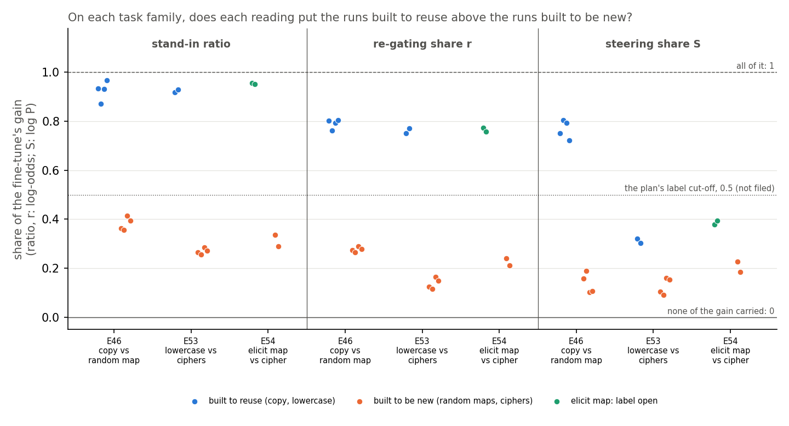
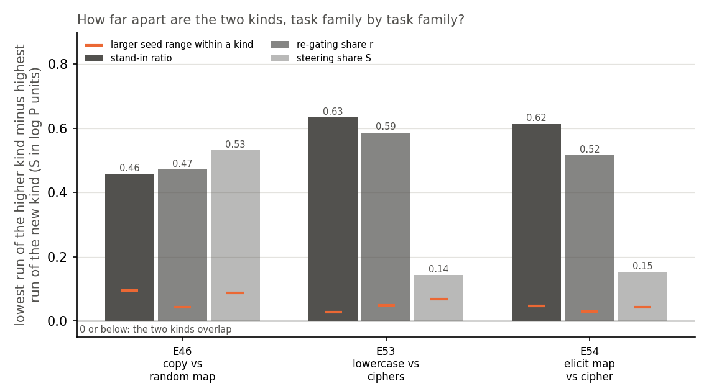
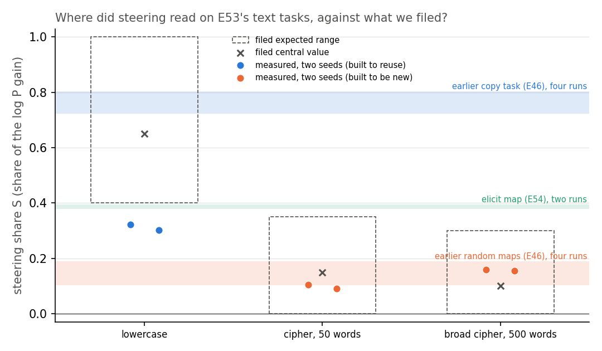

# Do the decomposition's readings and steering order 18 saved fine-tunes by how they were built? E60, the re-gating step-2 table

*2026-10-30, regating-lead writer. `experiments/regating_truth_table/run.py`, MATS cluster job 46258, run at commit
`b4cd9e2`, results committed at `d040fb8`. Plan: `reports/plans/2026-10-30_plan_regating-ground-truth.md`, sections
"States", "Stage 0" and "Stage 1"; taken up as item 2 of `reports/plans/2026-10-30_advice_regating-step2-FABLE.md`
(`decisions.md`, 2026-10-30). Rules and expected values: `results/predictions.json`, filed before the run, not edited
since. Results: `results/stage0.json`, `stage1.json`, `table.json`. Figures: `figures/{table_shares,gaps,lowercase_S}.png`
from `plot.py`. Notebook: `notebooks/E60_regating_table.ipynb`. Words as in `GOALS.md` → Terms. E59 is taken by the
baselines line's draft plan, so this run is E60.*

## In plain words

We put three readings of how much of a fine-tune's gain comes from parts the model already had into one table, for all
18 saved fine-tunes of the small model. The two readings that use the decomposition rank every fine-tune built to reuse
above every fine-tune built to learn something new, widely on all three task families; steering keeps the order, but
narrowly on two. Reuse here means reuse at the level of the decomposition's pieces, and no outside label exists yet
for these runs, so this is the table a test of the readings will use, not that test.

## The answer

Yes, on all three task families we have, for both readings that use the decomposition. Each put every fine-tune built
to reuse something the model already does above every fine-tune built to learn something new, with a gap of about half
the scale. Steering keeps the same order. But on the lowercase task its gap shrinks to about a seventh of the scale, and
lowercase read lower than we filed. Nothing is scored, because no outside label exists yet.

## What was tested

The re-gating line reads from the decomposition whether a fine-tune reuses parts the model already has. Every label it
has been checked against so far was set by how we built each task. Step 2 of the adopted programme scores its readings
against a label it did not make: the reuse line's bounded-g reading of Jain et al.'s Definition 2, from behaviour and an
interchange patch. No 67M run has that label yet. This job fills the readings for all 18 saved runs so the scoring can
run once labels arrive.

**The 18 runs.** All are fine-tunes of target `t-9d2b8f02`, read through decomposition `s-55ea3f9b`, two seeds each.

| family | runs | task | label by construction |
|---|---|---|---|
| E46 copy | ident32, ident32b × 2 seeds | marker windows; the value is the key itself | reuses |
| E46 random map | rand32, rand32b × 2 seeds | marker windows; an arbitrary 32-key table | new |
| E53 lowercase | lowercase step 300 × 2 seeds | Pile text lowercased, which the model already writes | reuses |
| E53 cipher | cipher step 300 × 2 seeds | 50 words swapped by a fixed shuffle | new |
| E53 broad cipher | broad_cipher step 300 × 2 seeds | 500 words swapped | new |
| E54 elicit map | elicit × 2 seeds | each key's value is a word the model already ranks 2nd to 20th | open |
| E54 cipher | cipher at matched update size × 2 seeds | values the model gives under 1e-4 | new |

E46's and E54's runs are read on their 97 held-out marker windows of 41 tokens. E53's are read on up to 500 windows
of 127 tokens of Pile validation text, at a position whose next token the task changes, with that token as target.

**The readings.** Each is a share of the fine-tune's gain, 0 when none of it is carried and 1 when all of it is.

- *Gain* $G = T_1 - T_0$: the change in log-odds of the target at the answer position, original model to fine-tuned,
  averaged over windows.
- *Stand-in ratio* $\rho = (L_{11} - L_{00}) / (U_1 - U_0)$. The fine-tune's weight change is first written as the
  least-squares split. $U$ is the model built from the subcomponents with no masks, and $L$ the CI-masked model with Δ
  left out; index 0 is the original, 1 the split state. So $\rho$ is the masked gain over the subcomponent gain. E53
  found it roughly tracks the gain from Γ's new CI values alone, over the subcomponent gain. It has no ceiling at 1.
- *Re-gating share* $r = (L_{01} - L_{00}) / G$, E12's route split: the CI-masked model with the original
  subcomponents, with Γ's CI values computed on the fine-tuned model in $L_{01}$ and on the original in $L_{00}$.
- *Steering share* $S$, E52's recipe, no decomposition. Windows alternate into a fit half and a scoring half. For each
  block input, the vector is the mean over the fit half of the fine-tuned minus the original activation at the answer
  position. It is added there to the original model. $S$ is the rise this gives in the target's log probability, over
  the fine-tune's own rise, on the scoring half. The block is the one that does best on the fit half.

$S$ shares a gain in log probability; $\rho$ and $r$ share a gain in log-odds. A gap in $S$ and a gap in $r$ are in
different units, so only their orders compare directly.

**What ran.** Only $S$ on E53's six step-300 runs was empty on disk. Every other cell is copied from the saved file
`predictions.json` → `table_sources` names, and `table.json` records each cell's source. The GPU job ran stage 0, the
controls, alone first; then stage 1, $S$ on the six E53 runs; then built the table from saved JSON.

## What we expected, and why

- **Lowercase $S$ in 0.4 to 1, central 0.65.** Lowercasing the next word is one change shared by every window, as
  copying is in E46, where $S$ read 0.72 to 0.80. Medium confidence.
- **Cipher $S$ in 0 to 0.35, central 0.15; broad cipher 0 to 0.3, central 0.1.** A word-by-word lookup cannot be one
  mean vector; E46's random maps read 0.10 to 0.19. Medium-high.
- **Order: both lowercase runs above all four cipher runs.** High, 0.8.
- **Ratio and r as on disk**, listed in `predictions.json` → `expected_from_disk`.

These were reported, not scored, and not stops. The plan's three label tests were not filed: no label exists.

## The controls

All passed. Stage 0 ran first and alone; a miss would have stopped the job.

| check | filed | read | |
|---|---|---|---|
| sha256 of the 18 state files and 2 window files | equal to the source runs' records | 0 mismatches of 20 | pass |
| gain of a zero weight change | exactly 0 on all five tasks | 0.0 on each | pass |
| E53 lowercase_s0 through E53's code | ratio 0.9186 ± 0.01, $G$ 1.6708 ± 0.02, r 0.7519 ± 0.01 | identical to the reference | pass |
| E54 elicit_s0 | r 0.7726 ± 0.03, $S$ 0.3796 ± 0.001 | identical | pass |
| E46 ident32_s0 | r 0.8024 ± 0.03, $S$ 0.7503 ± 0.001, block 0's share ≤ 1e-6 | identical; block 0 1.3e-7 | pass |
| the new next-token path on lowercase_s0 | its log-odds gain within 0.02 of the split's $G$ read in this job; block 0 ≤ 1e-5 nats | 1.6721 vs 1.6708; block 0 7.5e-9 nats | pass |
| block 0 on each E53 run, stage 1 | ≤ 1e-5 nats | at most 1.3e-8 | pass |

**The new path's control was wired correctly.** `run.py` `next_path` compares `G_logodds`, the full model's mean
log-odds gain of each window's next token read through `steering.read` with `steering.logodds_at`, with `G_split`, the
gain $T_1 - T_0$ that E53's `split_row` returned in the same job, also in log-odds. The difference is 0.0013 against a
tolerance of 0.02. The value 1.5914 stored beside them as `G` is the steering path's gain in log probability,
`steering.gains`, which is $S$'s denominator unit; it is not compared with anything, and its distance from 1.6708 is
the unit, not a fault.

The tolerance's source is wrong, as the code review noted. It cites E53 Amendment 2's `repro_G_tol`, a regeneration of
one path against itself. The measured floor between the steering log-odds path and the route split's is E54
Amendment 1's: absolute differences of 0.0025 to 0.0052 on six states, relative 1.4e-4 to 4.7e-4. Here the absolute
difference, 0.0013, is under that floor; the relative one, 8.0e-4, is above it, because lowercase's gain is small. The
control would pass under the absolute floor. The filed 0.02 is about 4 to 8 times that floor; it is about 15 times
this run's own difference.

## Do the readings put every run built to reuse above every run built to be new?

**Reading it.** Yes, for all three readings and on every family: in each of the nine columns the runs built to reuse
sit above the runs built to be new. Across families the stand-in ratio reads 0.87 to 0.97 on the reuse runs and 0.26
to 0.41 on the new runs. The share r reads 0.75 to 0.80 against 0.12 to 0.29. Steering also orders all three
families, and pooled its lowest reuse run, lowercase at 0.30, sits above its highest new run, E54's cipher at 0.23.
The plan's cut-off at one half, not filed, is drawn dotted; what follows from it is orientation, not a result. Under
it the ratio and r would label all 16 built runs as built, and steering would label 14, calling both lowercase runs
new. On the open elicit map the ratio and r sit with the reuse runs. Steering also places it with the reuse runs by
order: its 0.380 and 0.394 lie above lowercase's 0.321 and 0.303, inside the reuse runs' range. It reads "new" only
under the unfiled cut at one half.

| run | kind | stand-in ratio | r | S |
|---|---|---|---|---|
| e46/ident32_s0 | copy, reuse | 0.934 | 0.802 | 0.750 |
| e46/ident32_s1 | copy, reuse | 0.872 | 0.761 | 0.804 |
| e46/ident32b_s0 | copy, reuse | 0.931 | 0.792 | 0.794 |
| e46/ident32b_s1 | copy, reuse | 0.968 | 0.804 | 0.722 |
| e46/rand32_s0 | random map, new | 0.364 | 0.273 | 0.158 |
| e46/rand32_s1 | random map, new | 0.356 | 0.266 | 0.190 |
| e46/rand32b_s0 | random map, new | 0.414 | 0.290 | 0.103 |
| e46/rand32b_s1 | random map, new | 0.394 | 0.280 | 0.107 |
| e53/lowercase_s0 | lowercase, reuse | 0.919 | 0.752 | 0.321 |
| e53/lowercase_s1 | lowercase, reuse | 0.929 | 0.770 | 0.303 |
| e53/cipher_s0 | cipher, new | 0.264 | 0.124 | 0.105 |
| e53/cipher_s1 | cipher, new | 0.257 | 0.116 | 0.091 |
| e53/broad_cipher_s0 | broad cipher, new | 0.285 | 0.165 | 0.159 |
| e53/broad_cipher_s1 | broad cipher, new | 0.273 | 0.150 | 0.155 |
| e54/elicit_s0 | elicit map, open | 0.956 | 0.773 | 0.380 |
| e54/elicit_s1 | elicit map, open | 0.951 | 0.758 | 0.394 |
| e54/cipher_s0 | cipher, new | 0.336 | 0.241 | 0.228 |
| e54/cipher_s1 | cipher, new | 0.289 | 0.212 | 0.185 |

Every cell is defined: no denominator fell under its floor. Sources per cell: `table.json` → `runs` → `<run>` →
`<reading>` → `source`.

## How far apart are the two kinds, family by family?

**Reading it.** The two decomposition readings keep a wide gap on every family; steering's gap is wide on copying only.
Each bar is the lowest run of the higher kind minus the highest run of the new kind, E51's separation quantity; the
orange tick is the larger seed range within either kind. For the ratio and r every bar lies between 0.46 and 0.63.
Steering's is 0.53 on copy against random map, but 0.14 on lowercase against the ciphers and 0.15 on the elicit pair.
Every bar clears its seed range. The caveat is the unit: steering's share is of a log-probability gain, the other two
of a log-odds gain, so steering's bars compare with each other, not with the ratio's or r's. The one same-unit
comparison is E54 Amendment 1's: on the elicit pair, steering's gap in log-odds is 0.052, against r's 0.54.

| family | ratio gap | r gap | S gap | larger seed range: ratio, r, S |
|---|---|---|---|---|
| E46 copy vs random map | 0.458 | 0.471 | 0.532 | 0.096, 0.042, 0.087 |
| E53 lowercase vs ciphers | 0.633 | 0.587 | 0.143 | 0.028, 0.049, 0.069 |
| E54 elicit vs cipher | 0.615 | 0.516 | 0.152 | 0.047, 0.029, 0.043 |

E53's new kind pools the cipher and the broad cipher, and each E46 kind pools two key sets, ident32 and ident32b or
rand32 and rand32b, so those ranges span two tasks. E54's higher member is the open
elicit map, not a run built to reuse.

## Did steering read where we expected on lowercase?

**Reading it.** No. Steering carried 0.32 and 0.30 of lowercasing's gain, under the filed range, which starts at 0.4.
That is far below copying's band and below the elicit map's. Both ciphers landed inside their ranges, at 0.09 to 0.16,
level with E46's random maps. The filed order held: both lowercase runs sit above all four cipher runs. So one mean
vector moves about a third of lowercasing, not most of it, though the rule is the same for every word. The caveat runs
the other way: the fit and scoring halves share documents, which can only push $S$ up. Both lowercase runs chose the
last block, block 3, as every random map and cipher run did; every copy and elicit run chose block 2. That is
descriptive and unfiled.

| run | $G$ in log P, all windows | $G$ fit half | $G$ scoring half | block | $S$ | filed range |
|---|---|---|---|---|---|---|
| lowercase_s0 | 1.591 | 1.674 | 1.509 | 3 | 0.321 | 0.4-1.0 |
| lowercase_s1 | 1.551 | 1.629 | 1.473 | 3 | 0.303 | 0.4-1.0 |
| cipher_s0 | 3.781 | 3.648 | 3.913 | 3 | 0.105 | 0-0.35 |
| cipher_s1 | 3.715 | 3.604 | 3.826 | 3 | 0.091 | 0-0.35 |
| broad_cipher_s0 | 3.285 | 3.478 | 3.091 | 3 | 0.159 | 0-0.3 |
| broad_cipher_s1 | 3.249 | 3.424 | 3.074 | 3 | 0.155 | 0-0.3 |

Every gain is far above $S$'s floor of 0.05, so every $S$ is defined.

## What we learned

On the 67M model the two decomposition readings now order three task families the same way, and steering's gap
narrows on two of them. Under the plan's unfiled cut at one half, for orientation only, lowercase is the first task
built to reuse that steering would call new, while the decomposition readings would not. It does not yet say that the
readings track reuse, because every label here but the elicit map's was set by how we built the task. Any "reuse"
they read is reuse at the level of VPD's pieces: a new circuit built from old subcomponents under new CI values would
read the same. For `GOALS.md`'s question, whether post-training teaches new capabilities or strengthens existing ones,
this widens the base the reading stands on but does not yet earn it a label from outside.

## How compelling is the evidence

- **Coverage.** Two seeds per task, nine tasks, three families, one model, one decomposition. Not on every kind of
  fine-tune: the families are lookup tables and a case rule.
- **Noise floor.** Seed ranges within a kind reach 0.10 at most, under every gap. $S$ regenerates within 0.001; r
  within 0.03 across regenerations.
- **Power.** On 16 of the 18 runs the label is fixed by construction, so agreement there was expected and repeats E46,
  E53 and E54. The one open task has two runs.
- **Blind to.** The decomposition's granularity limit: a new circuit assembled from old subcomponents under new CI
  values reads as reuse, here and in every re-gating claim. $S$ reads one mean vector at one position and never reads
  the decomposition. The readings are taken on each task's own windows.
- **Units.** $S$ is a share of a log-probability gain, $\rho$ and $r$ of a log-odds gain. Gap sizes compare within a
  reading, not across.

## Surprises

- **Steering on lowercase read under its filed range**: 0.32 and 0.30 against 0.4 to 1, central 0.65. The filed order
  against the ciphers held, so this is a narrow miss of a reported range, not a reversal. Why one vector carries so
  little of a rule that is the same for every word is untested; the next token differs per window, so the shared part
  may be only the case feature.
- **No other.** The lead's query whether the next-token control should have failed is answered under "The controls":
  it compared log-odds with log-odds and agreed within 0.0013.

## What next

- **The open pair, E58**, coded and filed: the elicit map trained on 24 of its 32 keys and labelled by behaviour on the
  8 unseen keys. If its runs read "new", the ratio and r disagree with the label while steering agrees: a candidate for
  the granularity limit. If "reuses", it is the first outside label the decomposition readings get right where
  steering does not.
- **The reuse line's labels** for these 18 runs, when its Stage B runs; the label tests are filed then, before any label is
  read, with each rule run on its edge cases.
- **$S$ in log-odds on E53's six runs**, $0, minutes. It would put steering's lowercase gap in r's unit; if it shrinks
  as E54's did, steering's gap on lowercase is near zero.

## Scorecard

| id | claim | rule | read | verdict |
|---|---|---|---|---|
| stage 0 | controls reproduce | as in "The controls" | all exact; new path 1.6721 vs 1.6708 | pass |
| stage 1 lowercase | one vector carries most of lowercasing | $S$ in [0.4, 1.0], reported only | 0.321, 0.303 | outside, under the range |
| stage 1 cipher | little | $S$ in [0, 0.35] | 0.105, 0.091 | inside |
| stage 1 broad cipher | little | $S$ in [0, 0.3] | 0.159, 0.155 | inside |
| stage 1 order | lowercase above both ciphers | min lowercase $S$ > max cipher $S$ | 0.303 > 0.159 | as expected |
| P1 | ratio and r rank reuse above new | AUC, permutation p ≤ 0.05 | not filed | not scored, no labels |
| P2 | ratio and r get the open runs right | equal to the label on each | not filed | not scored |
| P3 | VPD readings beat steering | agreement count lead ≥ 2 | not filed | not scored |

Not a score, for orientation only: against the construction labels, AUC is 1 for all three readings over the 16 built
runs.

## Not run

- Any label test. No label exists for a 67M run, so the label tests stay unfiled.
- $S$ in log-odds on E53's runs, and $S$ with the block chosen in log-odds.
- $S$ with the fit and scoring halves drawn from different documents.
- A random update of matched size as a null for $S$ on E53's tasks.
- r and the ratio re-read on E46's and E54's runs: copied from their saved files, with one reference run per family
  reproduced in stage 0.
- E53's earlier saves at steps 10 and 100, and E46's learned-nothing runs.
- A second decomposition seed; Qwen.

## Departures from the literature

- **Steering departs from contrastive activation addition**, Rimsky et al. 2024, as in E54. The vector is the
  fine-tuned-minus-original mean on the same inputs, added once at the answer position with multiplier 1, read as a
  share of a log-probability gain.
- **The fit and scoring halves are not independent on E53's windows.** E52's recipe, made for marker windows,
  alternates windows into the two halves. E53's windows are kept in document order, about two per Pile row, so
  neighbouring windows often come from the same document and can overlap. The vector is then fit
  on text that shares documents with the scoring half, which can only bias $S$ upward. Its size was not measured.
- **The next-token path's tolerance cites the wrong source.** It cites E53 Amendment 2's regeneration tolerance, where
  the measured floor between the two log-odds paths is E54 Amendment 1's, 0.0025 to 0.005. The read difference, 0.0013,
  is under that floor in absolute terms.
- **The route split, the least-squares split, r and the stand-in ratio are this project's**, not in the VPD paper,
  which defines subcomponents, Γ and the CI-masked model and does not split a later fine-tune's gain.
- **Jain et al. 2024's Definition 2** is the label the plan scores against, with the user's bound on g; no label of
  that kind was read here. The construction labels in this report are ours.
- **Thresholds.** The expected ranges for $S$, the 0.5 cut-off in the figure and the floors are ours, with no outside
  source.

## Provenance

- Job 46258, MATS cluster `debug` QoS, 15:14:13 to 15:15:42 on 2026-10-30 after start-up, peak GPU 22.5 GB, $0.
  Log `cluster/logs/commute-truth-table-46258.out` in the main clone. `stage0.json` records commit `b4cd9e2`;
  `stage1.json` and `table.json` record `957501a`, because a merge landed mid-job, changing no code this run uses.
  Results committed at `d040fb8`. Job 46252 crashed earlier while loading E53's run module, before reading anything; fixed in `1341411`.
- States: E46 `regating_table/results/large/{ident32,ident32b,rand32,rand32b}_s{0,1}.pt`; E53
  `performed_anchor/results/large/dW_{lowercase,cipher,broad_cipher}_s{0,1}_step300.pt`; E54
  `keydependent_elicit/results/large/{elicit,cipher}_s{0,1}.pt`; all sha256-checked in stage 0.
- Copied cells: E46 ratio `regating_table/results/amend3.json`, r `stage0b.json`, $S$
  `baseline_neurons/results/baseline_neurons.json` → `b3`; E53 ratio and r `performed_anchor/results/read.json` and
  `read_amend1b.json`; E54 ratio, r and $S$ `keydependent_elicit/results/stage2.json`.
- Figures: `experiments/regating_truth_table/plot.py`. Notebook built by
  `~/commute-data/scratch/regating-lead/table-writeup/make_e60_nb.py`.
