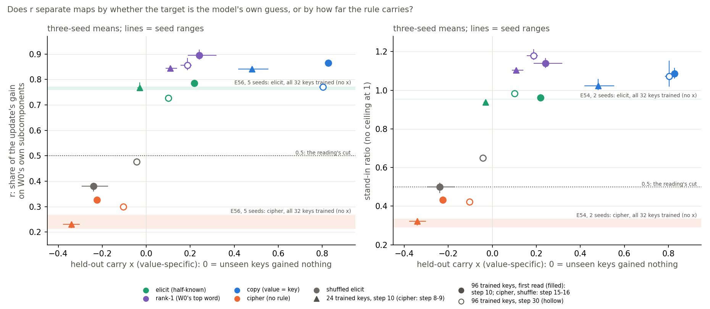

# Analysis: on the 67M, does VPD tell elicitation from a new mechanism? The re-gating line's synthesis (E54, E56, E58)

*2026-10-30, regating-lead writer. Claim wording, evidence split and figure follow Fable's advice
`reports/plans/2026-10-30_advice_e58a4-synthesis-FABLE.md`, adopted by the lead. The record behind every number:
`reports/analyses/2026-10-30_analysis_e58-open-pair.md` (E58 and its Amendments 1 to 5),
`reports/analyses/2026-10-30_analysis_e54-keydependent-elicit.md`, `reports/analyses/2026-10-30_analysis_e56-keydependent-patch.md`.
Figure: `experiments/open_pair/plot_synthesis.py`. Words as in `GOALS.md` → Terms. Provenance at the end.*

We asked whether a parameter decomposition of the small model can tell a fine-tune that draws out something the model
already does from one that builds something new. Across five kinds of word map and three seeds, its main reading agreed
with the original model's own ranking of the trained answer, high when the answer was the model's guess for that key and
low when not, and it did not follow whether the learning carried to unseen keys. For `GOALS.md` this is not yet evidence
that VPD detects elicitation, because the original model's ranking separates these maps by construction, nothing here
shows the decomposition adds to it, no map had a new answer that carries to unseen keys, and a new circuit built from old
subcomponents would read as elicited too.

## The answer

On the small model, with trigger-to-word maps, VPD's r agrees with W₀'s prior of the trained answer: maps whose answer
the model already guessed for each key read high, maps whose answer it did not read low. That prior is how "own guess" is
defined, so it separates the maps by construction; whether r reads more than the prior is untested. E58's one comparison with a reading that never looks at the decomposition, a steering vector, scored
steering as the better match, though steering sat on its cut. Among answers the model already guessed, r does not follow
whether the rule carries to unseen keys. No map has an answer the model did not guess that still carries to unseen
keys, so a new mechanism that generalises was never tested. The gap between the high and low readings is wide, but the
shuffled map sits only 0.015 to 0.03 under the 0.5 cut. VPD's unit is the subcomponent, so a new circuit assembled from
existing subcomponents would also read as already there. This holds on one small model, one decomposition and synthetic
maps only.

## What we were trying to test

The re-gating line asks whether a VPD decomposition can tell a fine-tune that strengthens something the model already
does from one that teaches something new. On 2026-10-27 the user de-prioritised the fixed-shift hypothesis, recorded in
`reports/decisions/2026-10-27_decision_regating-fixed-shift-deprioritised.md`. That work, E18 to E36, is set aside here,
and none of its results are used.

**The task.** Each training window is Pile text, then a rare marker token, then a key word; the model must predict the
key's value next. One set of keys, five maps from key to value:

- **elicit**: a word the original model W₀ already ranks 2nd to 20th after that key;
- **rank-1**: W₀'s own top word after that key;
- **copy**: the key itself;
- **cipher**: an arbitrary word W₀ gives under 1e-4 there;
- **shuffled elicit**: elicit's words, but each trained key takes another trained key's value, so no value is W₀'s
  guess for its own key.

The first three have targets that are W₀'s own guess for each key; the last two do not. A fine-tune trains some keys,
24 or 96, and holds out a quarter of the keys it never sees.

**Two measurements per fine-tune.**

- $x$, the held-out carry: the unseen keys' gain in their own value's log-odds over the map's other values, divided by
  the same on the trained keys. It reads 0 if unseen keys gained nothing and 1 if they gained as much as trained ones.
- r: Γ is VPD's function that sets each subcomponent's causal importance. r is the share of the fine-tune's gain
  recovered when the subcomponents stay as W₀'s and only Γ's importance values change to those on the fine-tuned model.
  It reads 1 if switching existing subcomponents on carries the whole gain, 0 if none of it. The stand-in ratio is a
  companion reading with no ceiling at 1.

The question in these terms: does r follow whether the target is W₀'s own guess, or whether $x$ is high? Since "own
guess" is defined by W₀'s ranking of the target, that ranking alone already sorts the maps; it is the baseline r would
have to beat to show the decomposition adds anything.

## What we expected, and why

The line's working reading, adopted by the lead after E58 and called reading A, was that r reads which subcomponents an
update runs through, not whether what it learned generalises. Two filed tests were meant to score it. Amendment 3
predicted r would stay flat on each map as carry rose from 24 to 96 trained keys, about 50%. Amendment 4 predicted r
would read the same across the three own-guess maps within twice its seed noise; Fable leaned pass at about 70%, the
plan's writer at about 30%. The shuffled map was expected to read like the cipher, about 60%.

## Does r separate maps by the model's own guess, or by how far the rule carries?

**Reading it.** By the model's own guess, which is also W₀'s prior ranking of the target. Read the vertical axis of the
left panel. Every own-guess map, green, purple
and blue, sits at r 0.72 to 0.92 at 96 trained keys. Every map whose target is not W₀'s guess for that key, orange and
grey, sits at 0.29 to 0.49. At 24 trained keys the same split reads 0.76 to 0.85 against 0.22 to 0.24. E54 and E56, which
train all 32 keys, read 0.76 to 0.77 against 0.21 to 0.27, on the same sides of the cut. The gap between the bands is at least 0.24 at every read point,
over five times the largest seed range of 0.045. Every map in the lower band also has carry at or under zero. The
plot's lower right is empty: no map has a target W₀ did not guess that still carries to unseen keys.

Now the horizontal axis. Inside the upper band carry runs from 0.10 to 0.84 at 96 trained keys, and from about −0.03
to 0.55 at 24. r is not in carry order. At 96 trained keys the rank-1 map has the highest r at both read points and
carries about a fifth, while the copy map carries over four fifths at lower r. Nor is r unrelated to carry. The elicit
map has both the lowest carry and the lowest r at every read point, and over the nine 96-key reads the rank correlation
of r with carry is 0.42 at step 30. So r is not blind to which map was trained, but carry is not what orders it there.
The stand-in ratio, right panel, splits the same way: 0.96 to 1.21 against 0.41 to 0.66 at 96 trained keys.

**The shuffled map** is the sharpest single test. It has elicit's words but not their link to each key. At step 30 it
reads r 0.47 to 0.49 over three seeds, only 0.015 to 0.03 under the 0.5 cut, and 0.17 to 0.19 above the cipher. If r read only the kind of
word, it would sit with elicit at 0.72 to 0.74. If it read only the key-to-guess link, it would sit on the cipher at
0.29 to 0.31. So r mostly reads the model's own guess for that key, and partly whether the word is one the model can
emit at all. It sits at the cut, not deep under it.

**W₀'s prior as baseline.** The prior here is W₀'s geometric-mean probability of the trained value after its key, one
number per map, saved in `amend3.json`. It reads 1.4e-6 for the cipher, 1.0e-5 for the shuffle, 5.9e-5 for copy, 1.3e-3
for elicit and 1.3e-2 for rank-1. It separates the two bands perfectly, by construction, since "own guess" is a cut on
it. Over the five maps at 96 trained keys, the rank correlation of mean r with the log prior is 0.9 at both read
points. The one swap is copy, whose r sits above elicit's though its prior is 20 times lower. The one contrast that is
not just the prior is copy against the shuffle: their priors are about 6 times apart, but r at step 30 is 0.29 apart,
0.77 against 0.48, where the full prior span of about 10⁴ carries an r span of 0.56. That is five points, one swap and no
seeds on the prior: suggestive only. So r agrees with W₀'s prior; whether it reads more than the prior is untested.

**The granularity limit.** VPD's unit is the rank-one subcomponent. A new circuit built from old subcomponents, switched
on in a new pattern, reads as "already there" to r. Nothing in this line can tell the two apart.

## Scored and unscored evidence

| | for the claim | against, or limiting it |
|---|---|---|
| **Scored**, filed before each run | The cipher control read "below" on every seed at 96 keys. The ratio half of the within-key-count rule passed at both steps, at its bound: 0.18 and 0.20 against 0.2. The shuffled map read "cipher_like", 0.475 against 0.5, a near miss. Seed 0 reproduced exactly. The filed separation of elicit from cipher in r passed in E54 and E56 at 32 keys and in E58 at 24 keys. The held-out label's positive control holds at 96 keys: the copy map read "reuses" on all three seeds. | The r half of the within-key-count rule failed at both steps: 0.11 and 0.13 against bounds of 0.07 and 0.09, so "r reads the same across own-guess maps" is false as filed. Amendment 3's test of r against carry across key counts read "untested", because the cipher's r itself rose by 0.14 with the key count. E58's first agreement test and the label's first positive control failed. E58's comparison with steering, a reading that never looks at the decomposition, scored "steering better" for both r and the ratio, with steering's elicit values on its cut. None is refiled. |
| **Unscored**, reported with seed ranges | The 0.24 or larger gap between the bands at every read point, seed ranges 0.002 to 0.045. The shuffled map on three seeds, mean 0.477. | The rank correlation of r with carry is 0.02 at step 10 and 0.42 at step 30, over nine points with no power. r falls by 0.04 to 0.10 from step 10 to step 30 on every own-guess map, copy's by 0.09 while its carry stays near 0.8, while the shuffled map's r rises from 0.36-0.39 to 0.47-0.49. Every low-band map has carry at or under zero, so no map tests a target W₀ did not guess that carries. W₀'s prior alone ranks the five maps as r does, rank correlation 0.9 with one swap. |

The within-key-count failure, worded as Fable advised. r is not blind to which map was trained. Inside the own-guess
band the three maps differ by 0.11 to 0.13, about three times the largest seed range, and the order, top word above
copy above half-known, is the same at both read points. That order does not follow carry. Trained gain, update size
and the value pool all differ between the maps, and we do not assert which one sets the order. The plan's decision
tree, branch 3, keeps the one-seed line as a reported number and never as a scored claim.

## What we learned

For the user's question, can VPD distinguish elicitation from a new mechanism: on the 67M with trigger maps, r agrees
with whether W₀ already ranked the trained answer as its guess for that key. That ranking defines the split, so it is
the baseline r must beat, and nothing here shows that r beats it. Among answers W₀ already guessed, r does not follow
whether the learned rule carries to unseen keys. Whether r would read a new answer that does carry as new was never
tested, because no such map was trained. Under the granularity limit, a new circuit assembled from existing
subcomponents reads as elicited. A single r means nothing off its row: it moves by about 0.1 with read step and key count
on its own.

## How compelling is the evidence

- **One model, one decomposition seed, synthetic maps.** Everything here is the 67M, one VPD decomposition and
  trigger-to-word maps. No real post-training update has been read through this table.
- **Seeds.** Three fine-tune seeds per map and point, five for E56's pair. One key split per key count.
- **Rows.** The bands hold within a row of the same keys and key count. At step 30, and in E54 and E56, which compare
  at matched update size, every map is read at the same step. The first reads are not same-step. At 96 keys the
  own-guess maps are read at step 10 and the cipher and shuffle at steps 15 to 16, their first step over the gate. At 24
  keys step 10 sits against the cipher's update-size-matched steps 8 to 9. Across rows r drifts by about 0.1, so
  comparisons across rows are not used.
- **No baseline that ignores the decomposition was scored.** W₀'s prior of each target sorts these maps by
  construction; set beside r after the fact, it ranks the five maps with one swap. The one such comparison filed,
  steering in E58, scored "steering better".
- **One empty cell.** Every map whose target W₀ did not guess has carry at or under zero, so the claim that r does not
  follow carry is tested only among own-guess maps.
- **Earlier tables agree, and leave the same cell empty.** E60's table collects them with E54. There, E46's copy
  map reads r 0.76 to 0.80 against random maps at 0.27 to 0.29. E53's lowercase reads 0.75 to 0.77 against ciphers at
  0.12 to 0.17. In E53 and E54 the high member's targets are ones W₀ already favours there, so W₀'s prior would sort those
  pairs too; for E46's copy map W₀'s prior was not read. None has a held-out carry, so they are not plotted and cannot
  fill the empty cell.
- **The shuffled map sits at the cut**, 0.015 to 0.03 under it on three seeds; its scored read is one seed.
- **What r is blind to.** A new circuit built from old subcomponents; whether learning carries.

## Surprises

- **The within-key-count rule failed**, against Fable's 70% lean: r differs between own-guess maps by more than seed
  noise, though not by carry.
- The shuffled map's r rises with training while every other map's falls. Its trained gain matches the cipher's, so it
  is not under-trained. We assert no cause.
- The cipher's r rose from 0.23 at 24 trained keys, read at its update-size-matched step, to 0.37 at 96 trained keys
  at step 10, a drift of 0.14. That 96-key state had barely learned its values; at its first step over the gate it reads
  0.32 to 0.33.

## The next question

On a real post-trained update, where does r sit, and does the same-row separation survive? E45 Amendment 2
(`reports/plans/2026-10-29_plan_e45-amendment2.md`, approved, $0, in progress) gives the Qwen3-1.7B anchors. The
invented-facts update is the cipher's analogue, targets the model cannot guess. The format-template update and the
GSM8K fine-tune are candidates for the upper band. They would be read through the same table at matched trained gain,
with the 67M bands as the filed expectation: the invented-facts anchor under 0.5, the format anchor over, GSM8K open.
That run is gated by its own rules; nothing here adds to its spend. If the Qwen anchors read under 0.1 apart, the bands
are a 67M artefact, and no re-gating claim leaves the testbed without a real-model number.

## Not run

- **Whether r reads more than W₀'s prior.** The test that would decide it is a prior-matched cipher: a lookup whose
  values W₀ gives at copy's prior, about 6e-5, read beside r. Fable's sketch is in
  `reports/plans/2026-10-30_advice_regating-baseline-FABLE.md`, not approved.
- **The missing cell.** A map whose target W₀ does not guess for that key yet carries to unseen keys, a new mechanism
  that generalises, such as a fixed word per first letter of the key. Without it, whether r would read such an update as
  new is untested.
- Any of this on Qwen3-1.7B or another model; any real post-training update.
- A second decomposition seed; more key splits; key counts other than 24, 32 and 96 trained.
- What orders the three own-guess maps' r: trained gain, trained-key probability or the value pool. Fable advised
  against it, since the Qwen result would overwrite the sentence.
- The within-key-count rule at matched trained-key probability; the cipher drift at matched training.
- The interchange-patch half of the reuse line's Stage B rule.
- The fixed-shift work, E18 to E36, de-prioritised by the user on 2026-10-27.

## Departures from the literature

- **r is this project's route split**, not a quantity from the VPD paper. VPD defines Γ and causal importance; the
  share of a fine-tune's gain recovered by Γ's new values alone is E12's construction.
- **The held-out carry adapts the reuse line's Stage B rule**, from Jain et al.'s Definition 2 with the user's bounded g.
  Stage B reads the share an interchange patch carries; here the share is read on behaviour, with a value-specific gain.
- **The 0.5 cuts** on r and the stand-in ratio are conventions copied from E12; the ratio has no ceiling at 1.
- **The shuffle's cut of 0.5** is Fable's midpoint of the cipher and elicit at step 30, not a published threshold.
- **The figure.** Fable asked for every map with seed ranges. E54's and E56's states train all 32 keys and have no
  held-out carry, so they are drawn as horizontal bands, not points: E56's five seeds for r and E54's two seeds for the
  ratio. The 24-key cipher is read at its update-size-matched step, 8 to 9, as E58 filed it. At 96 keys the first read
  of the cipher and shuffle is their first step over the gate, 15 to 16, against step 10 for the own-guess maps, so the
  filled points are not same-step; only step 30 is. Under-gate states, such as
  the 96-key cipher at step 10, have no readable carry and are left out.
- **Numbers updated from Fable's text.** Fable's low band, 0.29 to 0.47, and gap of 0.25 predate Amendment 5. With its two
  shuffle seeds the low band reads 0.29 to 0.49 and the gap at step 30 is 0.24. Fable's baseline advice puts copy and
  the shuffle 0.4 apart in r at step 30; `amend4.json` and `amend5.json` give 0.771 against a mean of 0.477, 0.29 apart.
  The rank correlation of 0.9 was recomputed here from the plotted means.

## Provenance

- Points: `experiments/open_pair/results/run.json` (E58, job 46266), `amend1.json` (job 46332), `amend3.json` (job
  46398), `amend4.json` (job 46426), `amend5.json` (job 46450). Bands: `experiments/keydependent_patch/results/job2.json`
  (E56, r over five seeds) and `experiments/regating_truth_table/results/table.json` (E54, ratio over two seeds).
- All on the MATS cluster `debug` QoS, one L40 each, $0. Commits and code hashes per job in the E58 analysis report.
- Figure `experiments/open_pair/figures/synthesis.png` from `experiments/open_pair/plot_synthesis.py`, which prints every
  plotted value.
