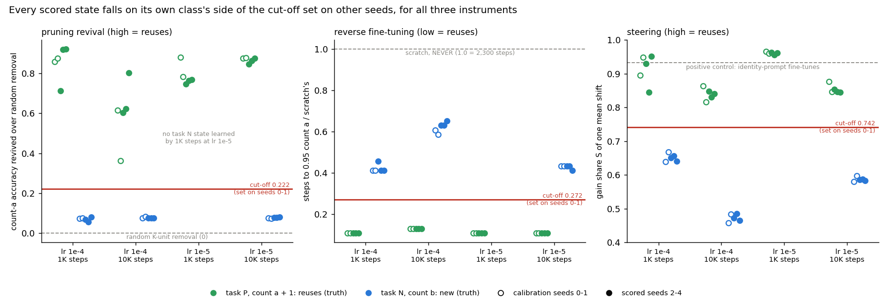
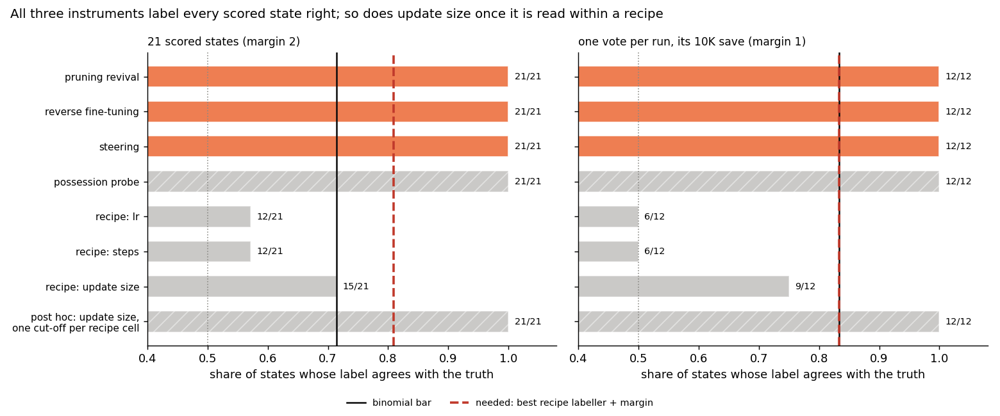
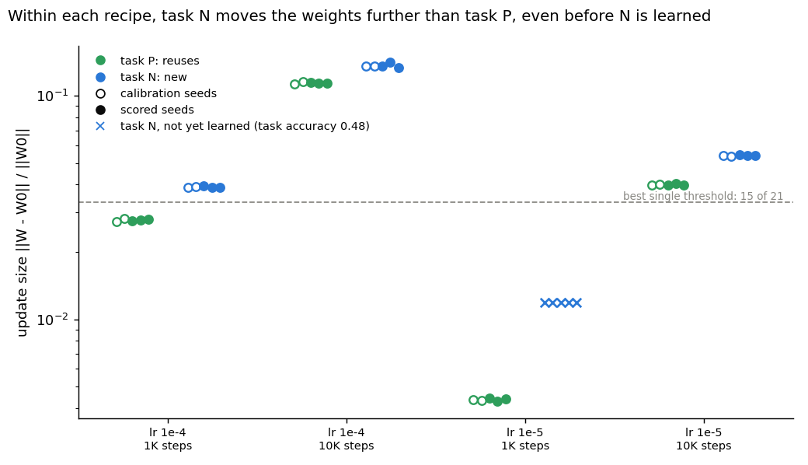

# With cut-offs set on other seeds, do pruning, reverse fine-tuning and steering tell reuse from a new count?

E55 Stage C1b, reuse line, 2026-10-31. Plan `reports/plans/2026-10-30_plan_e55-c1b-refined-instruments.md`.
Predictions `experiments/pcfg_anchors/results/predictions_c1b.json`, filed at b118997 and amended at c6ec7d2 before any
job ran. Cut-offs `results/c1b_cutoffs.json`, committed at d361649 before the first scored reading. Code
`experiments/pcfg_anchors/c1b.py`, `src/commute/revival.py`. Results `results/c1b.json`. Figures
`experiments/pcfg_anchors/figures/c1b_{readings,scores,update_size}.png` from `plot_c1b.py`. Notebook
`notebooks/E55_pcfg_anchors.ipynb`, section "Stage C1b". Pre-run code review
`reports/reviews/2026-10-30_review_e55-c1b-code.md`.

We fine-tuned a small counting model on two tasks, one that reuses its old count and one that needs a new count, and scored three methods without a decomposition on whether they tell the two apart, with each method's cut-off fixed on separate seeds first.
All three methods labelled every scored fine-tune correctly, well clear of labellers that read only the learning rate, the step count or the size of the weight change.
But a probe that reads only the fine-tune's answers also scores perfectly, and so does the size of the weight change once it is compared within one training recipe, so this set shows that the methods tell these two tasks apart, not that they read reuse better than simpler signals.

## The answer

All three cheap methods passed the filed test, on every scored state and on one vote per run. Each cut-off, set
on two held-out seeds, put all 21 scored states on the right side, with room to spare against each method's noise.
The test was easier than it looks. Every state performs one of two fixed tasks perfectly, so anything that tells the
tasks apart scores full marks. The answer-only probe does, and so does the size of the weight change within a recipe.
The benchmark has no headroom left to rank VPD above these methods.

## What we were trying to test

`GOALS.md` asks whether post-training teaches new capabilities or strengthens existing ones. The reuse line defines
that without a decomposition, following Jain, Kirk, Lubana et al. 2024, and scores methods against the definition.
Stage C1 scored three methods on a truth set where every "reuses" state was a short or slow fine-tune, so the
recipe alone almost matched them. Its cut-offs were also guessed. C1b fixes both.

**The model.** LOW is a minGPT of 6 blocks, width 192, pretrained to count the letter a when asked `C a 40`.

**Two tasks on the same natural texts.** Every state is LOW fine-tuned on `C b 40` rows of natural text, never on
rows built by swapping letters.

- **Task P, plus one**, answers one more than the count of a on every row. The count of b fits only 18% of rows, so a
  state that performs P can only be computing the count of a. By construction it **reuses** the old count.
- **Task N** answers the count of b. The answer does not depend on the count of a, so the state has a **new** count.

**The grid.** Both tasks at learning rates 1e-4 and 1e-5, saved at 1,000 and 10,000 steps, five seeds each. Seeds 0
and 1 are the calibration set; seeds 2 to 4 the scored set. Three of the N runs are Stage A's existing N1, its seed
copy and M. Each state also passes Stage A's behaviour and patch checks before it joins the truth. A state that
has not reached 0.9 accuracy on its own task is "not yet learned" and left out.

**The instruments.** Each gives one number per state.

- **Pruning revival**, after Jain et al.'s Alg. 3. Score each of 4,608 MLP units by the gradient of the count-a loss
  times its weights. Zero the top 5 or 15 units and measure count-a accuracy on 4,000 `C a 40` rows. The reading is
  that accuracy minus its mean over 20 random removals of as many units, at the better of the two sizes. High means
  "reuses": a few units hide the old count.
- **Reverse fine-tuning.** Fine-tune the state back to the count of a at one rate, 1e-5, for every state. Count the
  steps to 0.95 accuracy, read every 50 steps, capped at 5,000. Divide by the steps scratch needs. Scratch is NEVER,
  a model that never counted a, trained the same way. Low means "reuses".
- **Steering**, E52's mean-shift baseline after CAA. Let $G$ be the mean rise in log-probability of the state's own
  answer from LOW to the state. Add one vector, the mean residual difference after block $l$, to LOW. The gain share
  $S$ is the share of $G$ that this shift recovers on held-out rows; 0 means nothing, 1 the whole fine-tune.
- **Possession probe, a reference only.** A linear probe on LOW's residual, trained to predict the state's own
  answers, minus the same probe on shuffled labels. It reads nothing but the answers. Since the task fixes both the
  answers and the label, the code review had it filed as a check on the truth set, never as a scored instrument.

**Calibration, then scoring.** Each cut-off is the midpoint of the gap between the two classes on the 14 calibration
states. It was committed before any scored state was read, and the scoring job refuses to start without it. A method
passes when its agreement clears the binomial bar and also beats the best recipe-only labeller by 2. The recipe-only
labellers read the learning rate, the step count and the update size $\|W - W_0\|_F / \|W_0\|_F$, each at its best
threshold chosen with hindsight on the scored states. One vote per run, its 10,000-step save, is scored beside it
with a margin of 1.

## What we expected, and why

- **The controls hold**, at 90%. LOW, scratch and the pruning control are C1's identical calls.
- **The truth forms as built and the recipe cannot read it**, at 85%. The grid matches P and N at every recipe, so the
  learning rate and step count should score about 12 of 21. The update size might separate the tasks: the filing gave
  that 40%.
- **Pruning passes**, at 60%. C1's raw readings separated the classes with no overlap.
- **Reverse fine-tuning passes**, at 45%. The risk was that N states at 1,000 steps would revive about as fast as P.
- **Steering passes**, at 60%. Adding one to an existing count is close to one constant shift.
- **The probe agrees with the task**, near every state, as a reference.

## What we observed

### Do the controls and the truth set hold?

Yes, all of them. LOW reproduced Stage A exactly: count-a accuracy 0.99975 and patch share 0.960. Scratch reached
0.95 in 2,300 steps, C1's number. Importance pruning on LOW dropped its count of a to 0.94 and 0.80, as in C1. The
identity-prompt fine-tunes, steering's positive control, read a gain share of 0.93 and 0.94.

Every P state reached task accuracy 1.000 at 10,000 steps, and at least 0.9987 at 1,000. No state disagreed with its
construction. As expected, task N at 1e-5 had not learned by 1,000 steps in any seed, at 0.48 accuracy, so the
scored set is 21 states. The learning rate and step count labellers each reach 12 of 21, the size of the larger
class. The update-size labeller reaches 15, the branch the filing gave 40%. A method therefore needed 17 of 21.
The plan's design target was a recipe ceiling of at most 12 of 21, so that a perfect method would win by 8. That
target was missed: at 15 the best possible margin was 6.

| control | reading | expected | stop or void if | verdict |
|---|---|---|---|---|
| LOW count-a accuracy, patch share | 0.99975, 0.960 | 0.99975, 0.960 | off by > 0.01 | holds |
| scratch steps to 0.95 at 1e-5 | 2,300 | 2,300 ± 300 | ≤ 1,000 or capped | holds |
| importance pruning on LOW, K 5 / 15 | 0.9425 / 0.7958, random 0.99975 | C1's identical | no drop | holds |
| probe on LOW, true count a | 0.6645, block 5 | 0.45-0.65 | < 0.4 | holds; 0.015 above the expected range |
| probe on LOW, count b | 0.2785, block 2 | 0.28 ± 0.03 | none | as expected |
| steering S, identity-prompt fine-tunes | 0.937, 0.930 | ≥ 0.8 | < 0.5 on both | holds |
| probe on identity-prompt fine-tunes | 0.6655, 0.6655 | LOW's own answers, 0.6655 | < 0.3 | holds |
| P task accuracy at 10K, 10 runs | 1.000 every run | ≥ 0.95 | < 0.9 on ≥ 3 | holds |
| disagreements with construction | 0 of 35 truth states | 0 or 1 | ≥ 3 scored | holds |
| N at 1e-5, 1K, five seeds | not yet learned, 0.48 | not yet learned | none | as expected |

### Does each cut-off, set on other seeds, split the scored states?

**Reading it.** Yes, for all three, and with a wide gap. Each panel groups the states by recipe, task P in green on
the left of each group and task N in blue on the right. Hollow points are the calibration seeds that set the red
cut-off; filled points are the scored seeds. Every filled green point sits on the "reuses" side and every filled
blue point on the "new" side. No scored reading falls inside the gap the calibration seeds left between the classes.

Steering sits closest to its line. Its nearest scored states are 0.088 above and 0.086 below the cut-off. Its
noise is the difference between its fit and score halves, at most 0.021 on the scored states. So the nearest point
is about four noise widths away. Pruning's nearest states are 0.38 above and 0.14 below its cut-off, where 20 random removals
spread over at most 0.05 on any state. Reverse fine-tuning's nearest states are 325 steps either side of its cut-off at 625 steps,
where steps are counted in units of 50.

The two reference lines frame each reading. Random removal of as many units revives nothing, so pruning's zero line
is what an unrelated state reads. Every scored P state revives 0.60 to 0.92 of count a; every scored N state 0.06
to 0.08. One calibration P state, lr 1e-4 seed 1 at 10,000 steps, revives only 0.36. Scratch
needs 2,300 steps, the reverse panel's line at 1. P states need 250 or 300 steps, N states 950 to 1,500. The
identity-prompt fine-tunes read a gain share of 0.93. Scored P states read 0.83 to 0.96 and scored N states 0.47
to 0.66.

Steering falls with training length in both classes, as in C1. That is why C1's fixed line of 0.5 behaved like a
step-count labeller. The calibrated line sits in the gap between N at 1,000 steps and P at 10,000.

| instrument | cut-off | "reuses" scored, range | "new" scored, range | calibration gap |
|---|---|---|---|---|
| pruning gain over random | 0.2219 | 0.6022-0.9203 | 0.0576-0.0804 | 0.0820-0.3618 |
| reverse steps over scratch's | 0.2717 | 0.1087-0.1304 | 0.4130-0.6522 | 0.1304-0.4130 |
| steering gain share | 0.7421 | 0.8302-0.9623 | 0.4650-0.6560 | 0.6686-0.8156 |
| probe selectivity, reference | 0.4735 | 0.6685 every state | 0.2770-0.2785 | 0.2785-0.6685 |

### Does any method beat the recipe, and what else scores as well?

**Reading it.** The three methods beat the filed recipe labellers easily, but they do not beat two simpler signals.
The bars are the share of scored states each labeller gets right. The black line is the binomial bar and the red
dashed line what a method needed. Pruning, reverse fine-tuning and steering each agree on 21 of 21, against a
requirement of 17. On one vote per run each agrees on 12 of 12, against 10. So the margin over the filed recipe
labellers is 6 states, not the bare 2 the rule asked for.

The hatched bars are not scored. The probe, which reads only the state's answers, also agrees on 21 of 21. The last
bar is post hoc: update size with one cut-off per recipe cell, at the midpoint of the gap between 2 calibration
states per class. That is below the filed minimum of 3 per class, so it is not the instruments' rule. It gets 18 of
18 in the three cells that hold both tasks. The other 3 come from cell membership alone: at lr 1e-5 and 1,000 steps
only P states learned, so the cell is labelled "reuses" whatever their size. Both readers still tie the methods.

| method | score | n | agree | binomial bar | lr | steps | update size | needed | passes |
|---|---|---|---|---|---|---|---|---|---|
| pruning revival | every state | 21 | 21 | 15 | 12 | 12 | 15 | 17 | yes |
| pruning revival | per run | 12 | 12 | 10 | 6 | 6 | 9 | 10 | yes |
| reverse fine-tuning | every state | 21 | 21 | 15 | 12 | 12 | 15 | 17 | yes |
| reverse fine-tuning | per run | 12 | 12 | 10 | 6 | 6 | 9 | 10 | yes |
| steering | every state | 21 | 21 | 15 | 12 | 12 | 15 | 17 | yes |
| steering | per run | 12 | 12 | 10 | 6 | 6 | 9 | 10 | yes |
| probe, reference | every state | 21 | 21 | 15 | 12 | 12 | 15 | 17 | not scored |
| update size per recipe, post hoc | every state | 21 | 21 | 15 | - | - | - | - | not scored |
| update size per recipe, post hoc | per run | 12 | 12 | 10 | - | - | - | - | not scored |

No state was void for any method. Binomial p-value of 21 of 21 is 4.8e-7; per run, 12 of 12 is 2.4e-4. The best
single thresholds were lr at most 5.5e-5, steps at most 5,500 and update size at most 0.0335, each "small means
reuses". Per run, lr and steps fall to the constant labeller, 6 of 12.

### Why does the update size read the task within a recipe?

**Reading it.** Task N moves the weights further than task P at every recipe, even before N has learned. The
vertical axis is the update size on a log scale; LOW's own update is zero. Within each recipe group, every blue N
state sits above every green P state. The N update is 1.15 to 1.45 times the P update, depending on the recipe; the table
below gives each. Across recipes the sizes span a factor of 30. So no single threshold separates the tasks, and the
grey line, the best one, gets 15 of 21. The blue crosses are the five N states at lr 1e-5 and 1,000 steps, outside
the truth set because their task accuracy is only 0.48. Their update is already 0.0119, 2.7 times P's in that cell.

So the filed ceiling, one threshold per labeller, is beaten, but a labeller that reads the update size and the
recipe together is not. The plan named update size as a nuisance. The unlearned N states argue that it is one: the gap
is there before the new count exists. It fits how far each task's training signal pushes from LOW, since P is one
relabelling away from what LOW already answers, better than the size of a finished new capability. Either way it
needs only the weights and no reading of the model's activations, and VPD would have to beat it.

| recipe | P update size, 5 seeds | N update size, 5 seeds | ratio N / P |
|---|---|---|---|
| lr 1e-4, 1K | 0.0273-0.0283 | 0.0388-0.0394 | 1.37-1.44 |
| lr 1e-4, 10K | 0.1124-0.1154 | 0.1331-0.1409 | 1.15-1.25 |
| lr 1e-5, 1K | 0.0043-0.0044 | 0.0119, not yet learned, task accuracy 0.48 | 2.7-2.8 |
| lr 1e-5, 10K | 0.0397-0.0404 | 0.0537-0.0543 | 1.33-1.37 |

### Every scored state

Count a before is count-a accuracy on `C a 40` before pruning. P states answer one more than the count of a there
too, so they read 0. N states answer the count of b there and read 0.2175, the share of texts whose two counts are
equal. Labels in the order pruning, reverse, steering, probe; E is "existing", N is "new". Steering's best block was
block 5 for every state, and $G$ was 10.48 to 10.58 for every state, P and N alike.

| state | truth | update size | count a before | pruning gain | reverse steps | S (block) | labels |
|---|---|---|---|---|---|---|---|
| P_1e-4_s2/1000 | existing | 0.0275 | 0.0000 | 0.713 | 250 | 0.930 (5) | EEEE |
| P_1e-4_s2/10000 | existing | 0.1151 | 0.0000 | 0.602 | 300 | 0.847 (5) | EEEE |
| P_1e-5_s2/1000 | existing | 0.0044 | 0.0005 | 0.747 | 250 | 0.962 (5) | EEEE |
| P_1e-5_s2/10000 | existing | 0.0398 | 0.0000 | 0.846 | 250 | 0.854 (5) | EEEE |
| N_1e-4_s2/1000 | new | 0.0394 | 0.2172 | 0.068 | 1,050 | 0.650 (5) | NNNN |
| N_1e-4_s2/10000 | new | 0.1360 | 0.2175 | 0.077 | 1,450 | 0.472 (5) | NNNN |
| N_1e-5_s2/10000 | new | 0.0543 | 0.2175 | 0.078 | 1,000 | 0.586 (5) | NNNN |
| P_1e-4_s3/1000 | existing | 0.0278 | 0.0005 | 0.919 | 250 | 0.844 (5) | EEEE |
| P_1e-4_s3/10000 | existing | 0.1133 | 0.0000 | 0.622 | 300 | 0.830 (5) | EEEE |
| P_1e-5_s3/1000 | existing | 0.0043 | 0.0005 | 0.762 | 250 | 0.956 (5) | EEEE |
| P_1e-5_s3/10000 | existing | 0.0404 | 0.0000 | 0.864 | 250 | 0.847 (5) | EEEE |
| N_1e-4_s3/1000 | new | 0.0389 | 0.2175 | 0.058 | 950 | 0.656 (5) | NNNN |
| N_1e-4_s3/10000 | new | 0.1409 | 0.2175 | 0.075 | 1,450 | 0.485 (5) | NNNN |
| N_1e-5_s3/10000 | new | 0.0539 | 0.2175 | 0.078 | 1,000 | 0.588 (5) | NNNN |
| P_1e-4_s4/1000 | existing | 0.0281 | 0.0005 | 0.920 | 250 | 0.952 (5) | EEEE |
| P_1e-4_s4/10000 | existing | 0.1137 | 0.0000 | 0.802 | 300 | 0.840 (5) | EEEE |
| P_1e-5_s4/1000 | existing | 0.0044 | 0.0005 | 0.767 | 250 | 0.962 (5) | EEEE |
| P_1e-5_s4/10000 | existing | 0.0398 | 0.0000 | 0.875 | 250 | 0.845 (5) | EEEE |
| N_1e-4_s4/1000 | new | 0.0388 | 0.2175 | 0.080 | 950 | 0.641 (5) | NNNN |
| N_1e-4_s4/10000 | new | 0.1331 | 0.2175 | 0.076 | 1,500 | 0.465 (5) | NNNN |
| N_1e-5_s4/10000 | new | 0.0540 | 0.2175 | 0.080 | 950 | 0.583 (5) | NNNN |

### C1's states with the new cut-offs, described only

Re-labelled from C1's own readings, pruning and steering agree with C1's truth on all 26 of its scored states.
Reverse fine-tuning, readable only on the 12 states C1 reversed at this rate, agrees on 10. Its two misses are C1's
fast half-spurious and 80%-spurious N fine-tunes at 1,000 steps. Both needed 600 steps, 0.261 of scratch, just
under the cut-off at 625 steps. This is described, not scored. C1's set shares N1, its seed copy and M with the
calibration seeds. Several of its states were also trained on swap-built rows.

## What we learned

With cut-offs set on held-out seeds, pruning revival, reverse fine-tuning and steering each label every scored
state right. They tell a fine-tune that adds one to the old count from one that learns a new count. C1's misses came
from its guessed cut-offs: with the new ones, C1's own readings sort its states too, described only. But on this set the label is the same thing as which of two tasks the state
performs. Any reader of the task, such as the answer-only probe or the update size within a recipe, ties the
methods. For `GOALS.md`, this truth set can show that a decomposition is at least as good as these methods. It
cannot show that it is better, because the ceiling is already reached.

## How compelling is the evidence

- **The set is degenerate in one way: two tasks, each done perfectly.** Every P state answers one more than the count
  of a on every natural row. Every N state answers the count of b. The probe reads 0.6685 on all 20 P states, to
  four decimals, because their answers are identical. So "reuses" and "performs task P" coincide on every state. A
  method that reads only which task was trained cannot be told apart from one that reads the mechanism.
- **The margins are wide, not knife-edge.** The closest method, steering, sits about four noise widths from its
  cut-off on both sides. Pruning and reverse fine-tuning sit much further away. No scored reading falls inside the
  gap the calibration seeds left between the classes.
- **The nuisance margin is not the weak point as filed.** The best filed labeller, update size, reaches 15 of 21.
  The methods clear it by 6, three times the required margin, though the plan aimed for a ceiling of 12 and a
  margin of 8. The weak point is the post hoc labeller that reads update size within a recipe. It gets 18 of 18 in
  the cells that hold both tasks, and the other 3 by cell membership.
- **No swap-built rows.** Every training row, every evaluation row and every probe row is natural `C b 40` or
  `C a 40` text: `task_rows`, `eval_seqs` and `rft_rows` all draw with no swapped rows. The steering rows are natural
  texts, filtered to drop those whose count of b already equals the count of a plus one. Only the C1
  re-labelling, described only, includes states trained on swap-built rows.
- **Accuracies against their floors.** The task accuracies of 1.000 compare with 0.1765, the accuracy of the other
  task's answers. The pruning gains compare with random removal, which moves accuracy by at most 0.001 on P states.
  The probe's count-a selectivity of 0.66 is over a shuffled-label probe at 0.32 to 0.34.
- **Small and partly paired.** 21 states come from 12 runs, two saves per run. P and N runs with the same seed
  train on the same texts. One base model, one grammar, two learning rates, two saves.
- **Reverse fine-tuning is coarse.** All P states read 250 or 300 steps, five or six readings of 50 steps.

## Surprises

- The update size separates the two tasks perfectly within every recipe, by a factor of 1.15 to 1.45. The gap is
  there even for N states that have not learned, at 2.7. The filing gave 40% to update size reaching 15 of 21 on a
  single threshold, which happened; it did not consider a within-recipe reading.
- The filing's lean on the truth set called the update size reaching 15 and the "no method can pass" stop "the same
  event". They are not. At 15 the requirement is 17, which is possible, and the stop did not fire.
- The probe on LOW's own count of a read 0.6645, just above its expected range of 0.45 to 0.65. The void bar was 0.4;
  no effect on any score.
- Reverse fine-tuning's cut-off came out at 0.27 of scratch, where the filing guessed about 0.4. N states at 1e-5
  revived in 950 to 1,000 steps, which the filing had left unknown.
- No filed prediction was reversed. All three methods passed at leans of 60%, 45% and 60%.

## What next

1. **Decide what C2 can show before spending on it.** On this set VPD can at best tie at 21 of 21, as the probe and
   the update size already do. A tie says VPD reads the task; it does not say VPD reads reuse better. If the user
   still wants C2 here, its framing should be "does VPD match the cheap methods", not "does it beat them".
2. **A truth set where the answers do not give the label away.** Pairs of states that give the same answers through
   different mechanisms. For example, task P fine-tuned from NEVER, which must build a count of a, against task P from
   LOW, which reuses one. The probe would read the two identically, so any method that separates them reads more than
   the task. This needs `/design` first.
3. **Add the update size within a recipe to the nuisance labellers** for any later scoring, or argue in a decision
   row that it is a legitimate reading of new capability. If it stays a nuisance, nothing on this set beats it.

## Scorecard

| id | claim in words | rule | read | verdict |
|---|---|---|---|---|
| C0 | the apparatus and the instruments' controls hold | `rules.controls_stops` | LOW 0.99975 / 0.960; scratch 2,300; pruning control passes; probe on LOW 0.6645 count a, 0.2785 count b; identity-prompt S 0.937 / 0.930 | met; leans 90%, 85%, 80% all held. Probe count a 0.015 above its expected range, well over the void bar |
| C1 | the truth forms as built and the recipe cannot read it | `rules.train_stops` incl. the no-method-can-pass row | P 10K accuracy 1.000 on 10 of 10; 0 disagreements; N 1e-5 1K not yet learned on 5 of 5; n 21; ceiling lr 12, steps 12, update size 15, needs 17 ≤ 21 | met, 85% lean; the 40% update-size branch happened; the stop did not fire, so the filing's "same event" was wrong |
| PC1 | pruning revival beats chance and the recipe by 2 | `rules.cutoff`, `label`, `score` | 21 of 21; bar 15; best labeller 15; needs 17. Per run 12 of 12, needs 10 | met, 60% lean |
| PC2 | reverse fine-tuning at one rate beats chance and the recipe by 2 | same, low = existing | 21 of 21; needs 17. Per run 12 of 12 | met, 45% lean |
| PC3 | steering beats chance and the recipe by 2 | same | 21 of 21; needs 17. Per run 12 of 12 | met, 60% lean |
| PC4 | the probe agrees with the task, a reference only | `rules.cutoff`, `label`; never a pass | 21 of 21; P 0.6685 every state, N 0.277-0.2785 | as expected; not a benchmark result |
| post hoc | update size, one cut-off per recipe cell from 2 calibration states per class | not filed | 18 of 18 in two-class cells, plus 3 by cell membership: 21 of 21; per run 12 of 12 | ties the three methods |

## Departures from the literature

- **Task P is not in Jain et al.** Their wrapper setting keeps the count of b as a competing answer on every edited
  row. P drops the competitor, so the label holds at 10,000 steps.
- **Pruning.** Jain et al.'s Alg. 3 prunes by gradient times weight and plots accuracy against units pruned. We prune
  MLP hidden units only, at 5 and 15 units, against 20 random removals. One number per state, best of the two sizes,
  is thresholded by a calibrated cut-off.
- **Pruning target.** In Jain et al. pruning revives a capability the fine-tune suppressed. Here P states answer one
  more than the count of a even under `C a 40`, so the revival removes the plus one.
- **Reverse fine-tuning rate.** Jain et al. reverse with their Tracr SGD recipe at a rate below the fine-tune's. We use
  one AdamW rate, 1e-5, for every state, so scratch finishes and the rate does not encode the recipe.
- **Reverse fine-tuning cap and schedule.** Steps to 0.95 accuracy, capped at 5,000, inside a 20% warm-up and cosine
  schedule over 10,000 steps. The paper plots curves and gives no cap for the counting grammar.
- **Scratch baseline.** The paper fine-tunes a model pretrained on the target. Ours is NEVER, which never counted a.
  It is slower than the paper's, a constant bias the calibrated cut-off absorbs.
- **Steering.** CAA takes the mean residual difference between contrastive prompts on one model and adds it back to
  that model, scored as a behaviour rate. We take the mean difference between the fine-tuned state and LOW, add it
  to LOW and score the share of the fine-tune's log-probability gain recovered.
- **Possession probe.** Jain et al.'s Def 1 trains a probe on pretraining data for the capability. Ours is trained on
  LOW's residual to predict the state's own answers. Hewitt and Liang's control task is replaced by labels shuffled
  within each batch, since counts have no word types.
- **Calibrated cut-offs, recipe labellers, hindsight ceiling, margin, binomial bar, per-run score and the post hoc
  labeller** are this project's. The papers plot curves and score nothing.
- **Bounded wrapper, natural rows, saves inside the schedule and the behaviour and patch checks** are as recorded in
  the Stage 1 plan, Amendment 5 and C1.

## Not run

- VPD on these states, Stage C2.
- States whose answers are matched but whose mechanism differs, such as task P from NEVER or task N from HIGH.
- A second reuse task with a wrapper other than plus one, or a new-count task correlated with the count of a.
- Task N at 1e-5 read at a save between 1,000 and 10,000 steps, where it would be learned and short.
- The probe or new reverse fine-tuning on C1's states; steering on LOW, which is zero by construction.
- Attention-unit pruning; more than 15 units; reverse rates other than 1e-5.
- CMAP, crosscoders and other dictionary instruments, ruled out in the plan.
- Swap-built rows, by the truth-set decision.

Provenance: MATS cluster debug QoS on an L40, $0. Controls job 46330, 9 min; training and checks jobs 46346 and 46381,
44 min; calibration jobs 46399 and 46443, 39 min; scoring jobs 46459, 46476 and 46499, 61 min. Logs
`cluster/logs/commute-e55-c1b-<job>.out`. Predictions b118997, amended c6ec7d2 before job 46330. Cut-offs committed at
d361649, 17:34:32 UTC, before job 46459's first scored reading at 17:37:20. Final `c1b.json` at 50bd0cd. States in
`results/large/c1b/`, about 10 MB each. Figures and tables from `plot_c1b.py`.
