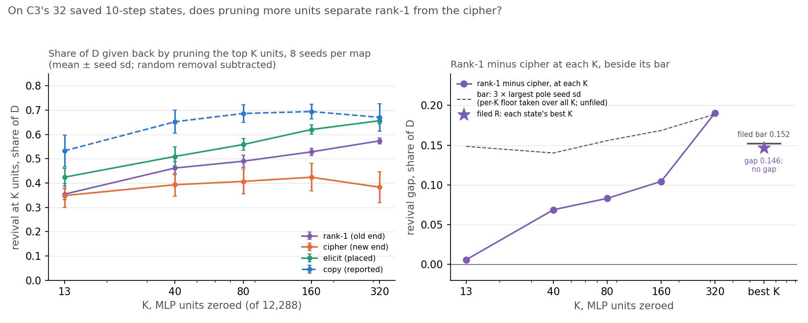
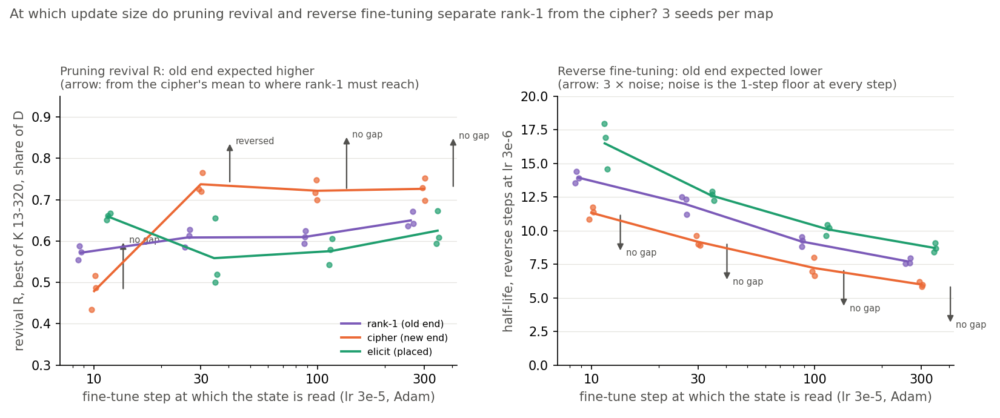
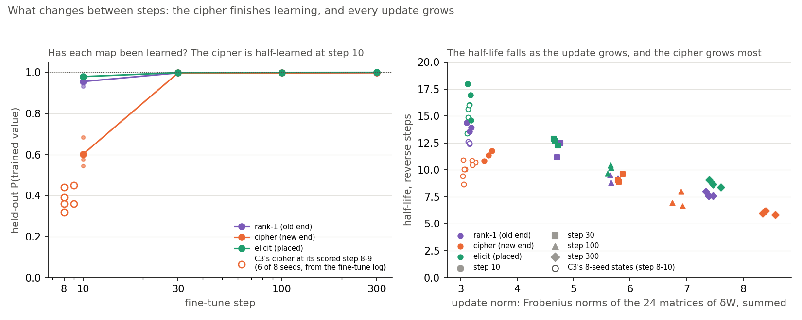

# Do pruning revival and reverse fine-tuning tell an old map from a new one at any update size on the 67M model?

E55 C3 step ladder, reuse line, 2026-10-31. Plan `reports/plans/2026-10-31_plan_e55-c3-ladder.md`. Predictions
`experiments/open_pair_instruments/results/predictions_ladder.json`, filed at db5618e before the job, sha256 b39587b7.
Code `experiments/open_pair_instruments/ladder.py`, run as `run.py --stage ladder`, with the rules `pole_gap` and
`first_ok_step` in `src/commute/revival_kv.py`. Results `experiments/open_pair_instruments/results/ladder.json` at
8a90db0. Figures `experiments/open_pair_instruments/figures/ladder_{k,steps,size}.png` from `plot_ladder.py`. Code review
`reports/reviews/2026-10-31_review_e55-c3-ladder-code.md`. Notebook `notebooks/E55_pcfg_anchors.ipynb`, section
"Stage C3 ladder".

We fine-tuned the 67M model on a map that strengthens its own answers and on one that teaches arbitrary new ones, and read both at four training lengths.
Neither pruning neurons nor fine-tuning back toward the original model told the two apart at any length, and pruning ordered them the wrong way once both were learned.
So these two cheap methods, as ported, fail their positive control here, and the open-pair maps cannot benchmark VPD against them.

## The answer

At no update size. Pruning revival and reverse fine-tuning were read on the old-by-construction map and the
new-by-construction map after 10, 30, 100 and 300 fine-tune steps. Neither separated them by the filed margin at any
length. After 30 steps, once both maps were learned, pruning gave back more of the new map's change than the old one's,
beyond the margin, the wrong way. Reverse fine-tuning undid the old map more slowly at every length. Pruning more neurons
widened the gap on the earlier 10-step states, but not past the filed margin.

## What we were trying to test

C3 asked whether two methods without a decomposition, from Jain et al. 2024, can tell an old mechanism from a new one
on real fine-tunes of the 67M model. Neither could, on 10-step updates. Its report left two causes open that this stage
can vary: the update size and the number of neurons pruned.

**The maps.** Each state is a fine-tune of the 24 decomposed matrices on 24 key-to-value pairs, with E58's recipe:
Adam at a learning rate of 3e-5. Three maps, three seeds each:

- the **rank-1 map** sends each key to W₀'s own top guess, so it only strengthens an answer W₀ already gives. It is old
  by construction.
- the **cipher** sends each key to an arbitrary word W₀ gives under one in a million. It is new by construction.
- the **elicit map** sends each key to one of W₀'s ranks 2 to 20. Its position is reported, never scored.

The same fine-tune of each map and seed is read at steps 10, 30, 100 and 300. Unlike C3, every map is read at the same
step. C3 read the cipher at 8 or 9 steps, to match the others' update norm.

**The old behaviour and the distance from it.** As in C3, the old behaviour is W₀'s whole next-token distribution at the
answer position. A state's distance from it is $D = \mathrm{KL}(p_{W_0} \| p_{\text{state}})$ in nats, averaged over
held-out windows of the trained keys. $D$ reads 0 at W₀.

**The two instruments**, unchanged from C3:

- **Pruning revival** ranks the 12,288 MLP neurons by Jain et al.'s gradient-times-weight score and zeroes the top $K$.
  Its reading at one $K$ is the drop in $D$, minus the mean drop from 20 random removals of $K$ neurons, as a share of
  $D$. $R$ is the best of those shares over $K$ = 13, 40, 80, 160 and 320. It reads 0 if pruning gives nothing back
  and 1 if it restores W₀. The old end should read higher.
- **Reverse fine-tuning** trains the state back toward W₀'s distribution at a tenth of the forward rate, 3e-6. Its
  reading $t_{1/2}$ is the number of steps until the distance falls to half of $D$. The old end should read lower.

**The positive control.** Each instrument passes at a step if rank-1's and the cipher's means differ, in the filed
direction, by at least three times the noise. The noise is the larger of the two maps' seed standard deviations, or a
floor if that is larger. The floor for $R$ is the largest spread of the random removals among that step's rank-1 and
cipher states. For $t_{1/2}$ it is one step. A gap of the same size the other way reads "reversed". Rank-1 against the
cipher is the only comparison here whose answer is known, so this is the test of the instruments.

**Part A, first and alone.** The zero update, then C3's 32 saved states re-read at all five $K$. These are the four maps
of C3, including copy, at eight seeds each. The re-read had to reproduce C3's $D$ and its shares at 13 and 40 neurons.

**Part B.** Nine new fine-tunes. The step-10 states of rank-1 and elicit had to match E58's saved states and C3's
readings, and every reverse run had to leave the weights at W₀ again.

## What we expected, and why

- **The controls hold**, at 85%. The recipe is E58's, unchanged, and C3's retrains matched to five decimals.
- **More neurons on C3's states**: the filed reading at 25%, and the gap at 320 neurons larger than at 40 at 60%. C3's
  gap had grown tenfold from 13 to 40 neurons.
- **Pruning passes** at 15%, 20%, 25% and 30% for steps 10 to 300. **Reverse fine-tuning passes** at 5%, 10%, 10% and
  15%. Jain et al. fine-tune to convergence at small rates, so if the port works at all it should work at the longer
  lengths. The plan expected $D$ to grow by a few nats, the norm to double, the half-life to grow two to five times and
  $R$ to move little.
- **Reverse fine-tuning reads "reversed" at step 10** at 45%. On the poles' own spread, C3's wrong-way lean was about
  four seed standard deviations.
- **Neither instrument passes at any step**, at 55%.

## What we observed

### Do the controls hold?

Yes, all of them.

| check | read | filed bar | result |
|---|---|---|---|
| zero update | $D$ = 0 exactly | exactly 0 | met |
| C3's 32 states re-read: $D$, shares at 13 and 40 neurons | 96 of 96 checks true; every $D$ equal to C3's to the printed 6 decimals | 1e-5 relative; 0.001 | met |
| step-10 states of rank-1 and elicit, seeds 0-2: state, two shares, half-life | 24 of 24 checks true; rank-1 seed 0 half-life 13.910132881927666, C3's to every digit | 1e-5; 0.001; 0.05 steps | met |
| weights back at W₀ after every reverse run | 36 of 36 | all | met |

Nothing was void or censored. Every reverse run halved within 19 steps, far under the 3,000-step cap. The job ran once,
with no resume, in about five minutes.

The cipher has no step-10 reproduction control, because E58 saved it at the norm-matched step 8 or 9. Its states share
the recipe and code path that the rank-1 and elicit controls cover. The review found the same.

### On C3's saved states, does pruning more neurons separate rank-1 from the cipher?

**Reading it.** No, not on the filed reading, though the gap does grow with the number of neurons. On the left, rank-1
and elicit give back more of their distance at every larger $K$, up to 0.57 and 0.66 at 320 neurons. The cipher stops
rising after 160 neurons and falls back to 0.38. On the right, the gap between rank-1 and the cipher grows from 0.006
at 13 neurons to 0.19 at 320. The filed reading takes each state's best $K$, which for the cipher is mostly 160. Its gap
is 0.146 against a bar of 0.152, so it reads no gap. Copy, reported only, is the most revived map at every $K$, as
in C3.

The single-$K$ statuses in the table below are not filed. They use the same noise floor as the filed reading, the
largest random spread over all five $K$, not each $K$'s own. On that floor the gap at 320 neurons alone clears its bar,
0.191 against 0.189. That is not the filed reading, and it is the edge of the range tried. Rank-1's and elicit's
revival is still rising there, so a larger $K$ might widen the gap further; it was not run.

| $K$ | rank-1 | cipher | elicit | copy | gap | 3 × noise | status, unfiled |
|---|---|---|---|---|---|---|---|
| 13 | 0.354 ± 0.023 | 0.348 ± 0.049 | 0.424 ± 0.037 | 0.532 ± 0.066 | +0.006 | 0.148 | no gap |
| 40 | 0.462 ± 0.028 | 0.393 ± 0.047 | 0.509 ± 0.039 | 0.652 ± 0.047 | +0.069 | 0.140 | no gap |
| 80 | 0.490 ± 0.025 | 0.407 ± 0.052 | 0.558 ± 0.024 | 0.686 ± 0.036 | +0.083 | 0.156 | no gap |
| 160 | 0.528 ± 0.014 | 0.424 ± 0.056 | 0.620 ± 0.020 | 0.694 ± 0.031 | +0.104 | 0.168 | no gap |
| 320 | 0.573 ± 0.012 | 0.383 ± 0.063 | 0.656 ± 0.014 | 0.670 ± 0.056 | +0.191 | 0.189 | ok |
| **$R$, best $K$, filed** | 0.573 | 0.427 | 0.656 | 0.706 | **+0.146** | **0.152** | **no gap** |

Share of $D$ given back, minus random removal; mean ± sample sd over 8 seeds. The best $K$ was 320 on all 16 rank-1 and
elicit states. For the cipher it was 160 on 7 of 8 states and 40 on one. Random removal gave back at most 0.09 of $D$ on
any state at any $K$, so the pruned neurons are far better than chance.

### At which update size do the two instruments separate rank-1 from the cipher?

**Reading it.** At none, for either instrument. In each panel the arrow starts at the cipher's mean and ends where
rank-1's mean would have to be to pass. On the left, at step 10 rank-1 is revived a little more than the cipher, 0.57
against 0.48, under the bar. From step 30 on the order flips. The cipher is revived most, at 0.72 to 0.74, and rank-1 at
0.61 to 0.65. At step 30 that wrong-way gap clears the bar, so pruning reads "reversed" there. At steps 100 and 300 the
gap stays the wrong way, under the bar. On the right, reverse fine-tuning undoes rank-1 more slowly than the cipher at
every step, by 1.7 to 2.8 steps, the wrong way. That is always under the bar of 3 steps. The bar is set by the one-step
floor: the poles' own seed spread is only 0.2 to 0.7 steps. On that spread the wrong-way lean is 2.8 to 7.5 seed
standard deviations, a clear ordering against the filed direction. Elicit sits beyond rank-1, on the side away from the
cipher, on both instruments at every step.

| step | $R$ rank-1 | $R$ cipher | $R$ gap / 3 × noise | $R$ status | $t_{1/2}$ rank-1 | $t_{1/2}$ cipher | $t_{1/2}$ gap / 3 × noise | $t_{1/2}$ status |
|---|---|---|---|---|---|---|---|---|
| 10 | 0.572 ± 0.017 | 0.479 ± 0.041 | +0.093 / 0.123 | no gap | 13.95 ± 0.42 | 11.33 ± 0.47 | +2.62 / 3.00 | no gap |
| 30 | 0.608 ± 0.022 | 0.737 ± 0.025 | −0.129 / 0.104 | **reversed** | 12.00 ± 0.71 | 9.17 ± 0.39 | +2.83 / 3.00 | no gap |
| 100 | 0.610 ± 0.016 | 0.721 ± 0.024 | −0.112 / 0.136 | no gap | 9.20 ± 0.36 | 7.21 ± 0.71 | +1.98 / 3.00 | no gap |
| 300 | 0.650 ± 0.019 | 0.726 ± 0.027 | −0.076 / 0.128 | no gap | 7.71 ± 0.23 | 6.00 ± 0.18 | +1.72 / 3.00 | no gap |

Mean ± sample sd over 3 seeds. Gap = rank-1 minus cipher. For $R$ the filed direction is a positive gap; for $t_{1/2}$
it is a negative one, so every $t_{1/2}$ gap here is the wrong way. The $R$ noise is the random-removal floor at steps
30, 100 and 300 and the cipher's spread at step 10. The $t_{1/2}$ noise is the one-step floor at every step. Pass step:
none for either instrument.

| step | elicit $R$ | elicit $t_{1/2}$ | elicit position on $R$ | elicit position on $t_{1/2}$ |
|---|---|---|---|---|
| 10 | 0.660 ± 0.008 | 16.49 ± 1.73 | 1.95 | 1.97 |
| 30 | 0.558 ± 0.084 | 12.62 ± 0.33 | 1.39 | 1.22 |
| 100 | 0.576 ± 0.032 | 10.09 ± 0.41 | 1.30 | 1.45 |
| 300 | 0.625 ± 0.042 | 8.71 ± 0.34 | 1.32 | 1.58 |

Elicit's position is $p = (\bar v_{\text{elicit}} - \bar v_{\text{cipher}}) / (\bar v_{\text{rank-1}} - \bar
v_{\text{cipher}})$, reported only. No column passed its control, so no position counts. A position above 1 means elicit
is further from the cipher than rank-1 is, whichever way the poles are ordered. The advice's trigger, a passing
instrument that puts elicit at the new end, did not fire.

### What changes between the steps?

**Reading it.** Two things change, and neither is old against new. On the left, the cipher has not learned its map at
step 10. Its held-out probability of the trained value is 0.60, against 0.96 for rank-1 and 0.98 for elicit. C3's
cipher, read at step 8 or 9, was further behind, at 0.32 to 0.45 on the six seeds whose fine-tune log has it. By step 30
every map is above 0.99. So the step-10 comparison, in C3 and here, pits a learned old map against a half-learned new
one. Once the cipher has learned, both instruments read it as the easier one to undo. On the right, the half-life falls
as the update grows, for every map. The correlation over all 36 states is −0.90. The cipher's update is the largest at
every step, 5.8 against rank-1's 4.7 at step 30, so it also halves fastest. The plan expected the half-life to grow two
to five times by step 300. It shrank by about 45% instead.

| step | map | held-out P(value) | $D$, nats | norm | $t_{1/2}$ / $D$, unfiled | top-guess drop, nats | top-guess half-life |
|---|---|---|---|---|---|---|---|
| 10 | rank-1 | 0.955 ± 0.022 | 8.72 ± 0.05 | 3.14 | 1.60 | 7.59 | 14.56 |
| 10 | cipher | 0.602 ± 0.074 | 6.30 ± 1.21 | 3.49 | 1.84 | 6.88 | 11.64 |
| 10 | elicit | 0.979 ± 0.005 | 10.53 ± 0.08 | 3.16 | 1.57 | 9.48 | 15.80 |
| 30 | rank-1 | 0.997 ± 0.002 | 10.34 ± 0.49 | 4.73 | 1.16 | 9.25 | 12.71 |
| 30 | cipher | 0.997 ± 0.001 | 11.82 ± 0.30 | 5.81 | 0.78 | 12.06 | 9.16 |
| 30 | elicit | 0.998 ± 0.001 | 11.39 ± 0.59 | 4.68 | 1.11 | 10.24 | 12.40 |
| 100 | rank-1 | 0.997 ± 0.004 | 10.15 ± 0.40 | 5.70 | 0.91 | 8.93 | 9.47 |
| 100 | cipher | 0.997 ± 0.003 | 11.36 ± 0.63 | 6.86 | 0.63 | 11.52 | 7.13 |
| 100 | elicit | 0.999 ± 0.000 | 11.25 ± 0.19 | 5.64 | 0.90 | 10.11 | 9.93 |
| 300 | rank-1 | 0.999 ± 0.001 | 10.54 ± 0.20 | 7.40 | 0.73 | 9.13 | 7.65 |
| 300 | cipher | 0.998 ± 0.001 | 11.44 ± 0.08 | 8.44 | 0.52 | 11.57 | 5.89 |
| 300 | elicit | 0.999 ± 0.000 | 11.20 ± 0.09 | 7.49 | 0.78 | 9.93 | 8.44 |

The norm is the summed Frobenius norm of δW over the 24 matrices; its seed sd is at most 0.12. On $D$ the poles differ
beyond the bar at steps 30 and 300, with the cipher further from W₀, and not at steps 10 and 100. That reading is
undirected and only a baseline.

**The two reported columns that were meant to help, and why they do not.**

- **The half-life over $D$** was C3's unfiled lead. It read 2.3 seed sd in the filed direction there. Here it leans the
  filed way at step 10, under its bar. At steps 30, 100 and 300 it reads "reversed", because the cipher's $D$ is now the
  largest and its half-life the shortest. The lead does not survive longer fine-tunes.
- **The top-guess column** was meant as a target that does not reward sharpening. It is the mean drop in log
  probability of W₀'s top guess at the answer, with its own half-life. The plan said rank-1 raises that guess, so its drop
  would be negative. As measured it is positive on every state, 5.9 to 12.3 nats: every map, rank-1 included, lowers W₀'s
  top guess at the held-out answer position. Its half-life stays within 1.05 steps of $t_{1/2}$ on every state, so it
  tracks the KL reading and gives no independent read. Its "reversed" statuses repeat the half-life's ordering on a
  smaller noise without the one-step floor. Its pole gap would also drop a censored seed silently, the review found;
  no seed was censored here, so that had no effect.

### Why did the instruments miss? The candidate causes against the numbers

| candidate | what the numbers say | verdict |
|---|---|---|
| the update size | No length from 10 to 300 steps passes, at norms from 3.1 to 8.4. From 30 steps, when both poles are learned, pruning orders them the wrong way | **ruled out within this recipe**; Jain et al.'s regime, small rates run to convergence on a labelled capability, is not run |
| the number of neurons | On C3's states the gap grows to 0.19 at 320 neurons, while the filed best-$K$ reading stays under its bar. At steps 30 to 300 the cipher is revived more than rank-1 at every $K$ from 40 to 320 | **not the fix for longer fine-tunes**; above 320 neurons is not run, and on 10-step states it might still widen |
| the cipher half-learned at the step read | At step 10 the cipher's held-out probability is 0.60, and at C3's step 8 or 9 it was 0.32 to 0.45. Rank-1 is at 0.96. The only pruning gap in the filed direction appears while the cipher is half-learned, and it flips once the cipher is learned | **supported as a confound of C3's and step 10's comparison**; it explains why the step-10 gap is in the filed direction, not why the longer ones are reversed |
| the instruments read whether W₀'s answer survives under the update, not whether the new behaviour runs through it | Every map at every length gives back 0.48 to 0.74 of $D$ to pruning on average, and every state halves within 19 reverse steps. That is, W₀'s behaviour is recoverable under all of them. Jain et al. use revival to show a capability is retained under a wrapper; the filed control asks it to tell reuse from new | **candidate, untested**; no run separated retention from reuse |
| the KL target rewards sharpening | The cipher's $D$ exceeds rank-1's from step 30 on. KL from W₀ grows with how peaked a state is, whatever answer it gives The top-guess target was meant to test this and tracks the KL reading instead | **candidate, untested**; a target like W₀'s ranking of its top answers was not run |
| update norm drives the half-life | Over the 36 states the half-life falls with the norm, correlation −0.90, and the cipher has the largest norm at every step | **candidate for the half-life's ordering, untested**: within a step the norm barely varies between seeds, and no run matched norms at the longer lengths |

## What we learned

Pruning revival and reverse fine-tuning toward W₀ do not tell the map that strengthens W₀'s answers from the map that
teaches arbitrary ones. That holds within E58's recipe at every length tried, and at up to 320 pruned neurons. Once
both maps are learned, pruning orders them the wrong way, and reverse fine-tuning always does. C3's small gap in the
filed direction came from comparing a learned old map with a half-learned new one.

For the brief, this closes the 67M open-pair set as a VPD benchmark. Scoring VPD against a pragmatic instrument needs an
instrument that passes its positive control on the same states, and neither port does here. VPD's two readings
separated the same two maps by 7 to 10 times their bar in C3, at 10 steps only. That makes VPD the only method of the
three that reads the known order on these maps. It is not a benchmark win: a benchmark needs a working rival.

The cheap instruments got a fair chance on update size within this recipe, on neuron count up to 320, and on a noise
bar from the poles alone. They did not get one on Jain et al.'s own setting: a labelled capability scored by accuracy,
small rates run to convergence, and a scratch model to compare against. Nor did they get one on a target that does not
reward sharpening, on attention-head pruning, or on more than three seeds per length. On Jain's own counting setting,
in C1b, the same kinds of instrument did work. So the result is about these ports on this axis, not about the methods
in general.

## How compelling is the evidence

- **Three seeds per map and length**, nine fine-tunes in all, plus C3's 32 states re-read on eight seeds. Retrains
  reproduce saved states to 1e-5, so the spread is between seeds.
- **The filed bars are conservative where the floors bind.** For $R$ at steps 30 to 300 the noise is the random-removal
  floor. For the half-life it is the one-step floor at every step, 1.4 to 4.4 times the poles' own spread. This
  conservatism decides the half-life's "no gap" verdicts. It cannot turn them into passes, because every gap is the
  wrong way.
- **One model, one task family, one recipe.** Adam at 3e-5, 24 keys, the 67M model. Lengths are steps of one run, not
  independent update sizes.
- **The reversals are robust to the floor.** Pruning's step-30 reversal clears a bar set by the floor, not by the
  poles' smaller spread. The half-life's wrong-way ordering holds on every seed at every step.
- **No cause is tested by a run.** The half-learned cipher is read from the fine-tune logs, not varied.

## Surprises

- **Something unexpected happened.** Pruning revival was filed to separate rank-1 from the cipher in the old-end-higher
  direction at every length. At step 30 it separated them the other way, beyond the bar: the cipher revived 0.74, rank-1
  0.61. The same wrong-way order holds at 100 and 300 steps, under the bar. The filed-direction gap at step 10 appears
  only while the cipher is half-learned. Why a learned cipher is more revivable than rank-1, I cannot explain.
- **The half-life shrinks as the fine-tune grows**, by about 45% from step 10 to 300 on every map, while the norm more
  than doubles. The plan expected two to five times longer.
- **The top-guess column has the opposite sign to the plan's**: every map lowers W₀'s top guess at the held-out answer,
  rank-1 included. Its half-life tracks the KL's within about one step.
- **C3's unfiled half-life-over-$D$ lead reverses** at 30 steps and beyond.

## What next

1. **Stop spending on the open-pair set as a benchmark.** The ladder was its last planned job. Any further work there
   would be a new instrument design, not a refinement, and should go through `/design` against C2 first.
2. **C2 on the counting set** is where the brief's comparison can still be made: there the cheap instruments pass their
   positive control, so VPD meets a working rival. If VPD fails there, that is the sceptic's result; if it ties, the
   brief's anchor item is met.
3. **If the retention reading matters for C2**, the plan should state for each cheap instrument whether it reads
   retention of the old behaviour or reuse by the new one. That changes how a tie is read.

## Scorecard

| id | claim in words | rule | read | verdict |
|---|---|---|---|---|
| C0 | zero update, 32-state re-read, six step-10 checks, every W₀ restore | `controls` | $D$ 0; 96/96; 24/24; 36/36 | met, 85% lean |
| PK | on C3's 32 states, $R$ at the best $K$ up to 320 separates rank-1 from the cipher | `pole_gap` on $R$ | gap 0.146 < 3 × 0.0508 = 0.152 | not met, no gap, 25% lean |
| PK_trend | the gap at 320 neurons exceeds the gap at 40 | `R_per_K` gaps | 0.191 > 0.069 | met, 60% lean |
| PR 10 | $R$ passes at step 10 | `pole_gap` | +0.093 < 0.123 | not met, no gap, 15% lean |
| PR 30 | $R$ passes at step 30 | `pole_gap` | −0.129, beyond 0.104 the wrong way | **not met, reversed**, 20% lean |
| PR 100 | $R$ passes at step 100 | `pole_gap` | −0.112, under 0.136 | not met, no gap, 25% lean |
| PR 300 | $R$ passes at step 300 | `pole_gap` | −0.076, under 0.128 | not met, no gap, 30% lean |
| Pt 10 | $t_{1/2}$ passes at step 10 | `pole_gap` | +2.62 wrong way, < 3.00 | not met, no gap, 5% lean |
| Pt 30 | $t_{1/2}$ passes at step 30 | `pole_gap` | +2.83 wrong way, < 3.00 | not met, no gap, 10% lean |
| Pt 100 | $t_{1/2}$ passes at step 100 | `pole_gap` | +1.98 wrong way, < 3.00 | not met, no gap, 10% lean |
| Pt 300 | $t_{1/2}$ passes at step 300 | `pole_gap` | +1.72 wrong way, < 3.00 | not met, no gap, 15% lean |
| Pt_reversed_10 | $t_{1/2}$ reads "reversed" at step 10 | `pole_gap` | +2.62 < 3.00, floor binding; 5.6 pole sd | not met, no gap, 45% lean |
| Ppass | neither instrument passes at any step | `pass_step` | both null | met, 55% lean |

PR 30 is a reversed prediction. Pt_reversed_10 missed because the filed one-step floor sets the bar at three steps, while
the poles' own spread would have set it near 1.4.

## Departures from the literature

All of C3's departures stand. The old behaviour is W₀'s whole answer distribution scored as KL, not a labelled
capability scored by accuracy. Pruning uses Alg. 3's score with the KL's gradient, on MLP neurons only, against random
removals. Reverse fine-tuning runs toward W₀ at a tenth of the forward rate, read as a half-life, with no scratch model.
New here:

- **Neuron counts.** Jain et al. plot accuracy against the number of pruned neurons. Here five counts up to 320 of
  12,288, about 2.6%, are reduced to the best share per state. Taking the best biases every state up by the same rule.
- **Training length.** Jain et al. fine-tune to convergence at a tenth or a hundredth of the pretraining rate. Here
  the length is varied at E58's fixed rate, and states are read at fixed steps, not at matched norm or distance.
- **The bar.** Three times the larger pole seed sd, with floors, is this project's control rule; the paper reports
  curves without a separation rule.
- **The reverse cap** of 3,000 steps is this project's; it never bound.
- **The top-guess column** is this project's reported variant, not a target from the paper.

## Not run

- Pruning above 320 neurons; attention-head pruning.
- Jain et al.'s regime: a labelled capability, small rates run to convergence, a scratch-model baseline.
- Reverse targets other than KL to W₀; W₀'s ranking of its top answers as a target; other reverse rates.
- Poles matched on $D$ or on norm at the longer lengths; seeds beyond three per length.
- Copy at the ladder lengths; E58 Amendment 6's prior-matched cipher as a pole.
- VPD's $r$ and stand-in ratio at steps 30 to 300.
- A test of retention against reuse, or of the norm driving the half-life.
- Any edit to C3's or E58's files or predictions.

## Provenance

- Job 46954 on the MATS cluster `debug` QoS, one GPU, 4 CPUs, 24G; about 5 minutes, $0, one job, no resume. Log
  `cluster/logs/commute-e55-c3-ladder-46954.out`.
- `results/ladder.json` committed at 8a90db0, run at git head 1e2c122 with a clean tree. Ladder predictions sha256
  b39587b742d7…; it is 786 KB, under the 1 MB limit, so it stays in `results/`.
- Code review `reports/reviews/2026-10-31_review_e55-c3-ladder-code.md`: no wrong-number or crash findings. Its minor
  items 4 to 6 are reflected above: the top-guess sign, the unfiled per-$K$ statuses on an all-$K$ floor, and the silent
  censoring in the top-guess half-life, which did not occur.
- Numbers beyond the score blocks, such as per-$K$ shares by map, pole sds in steps, correlations and the best $K$ per
  state, were computed from `ladder.json` for this report. C3's cipher held-out probabilities at step 8 or 9 are the
  `p_o` at the scored checkpoint in job 46815's log, for seed 0 retrained and seeds 3-7.
