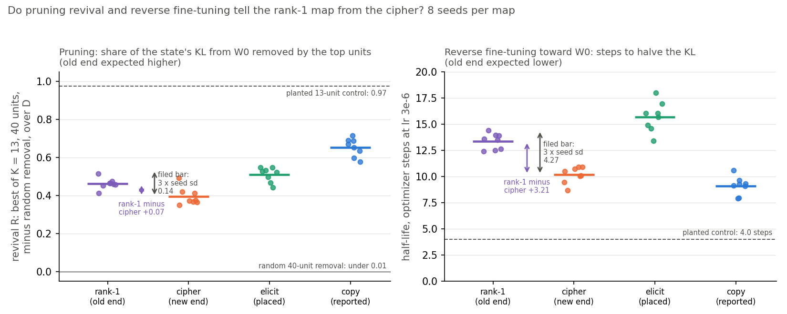
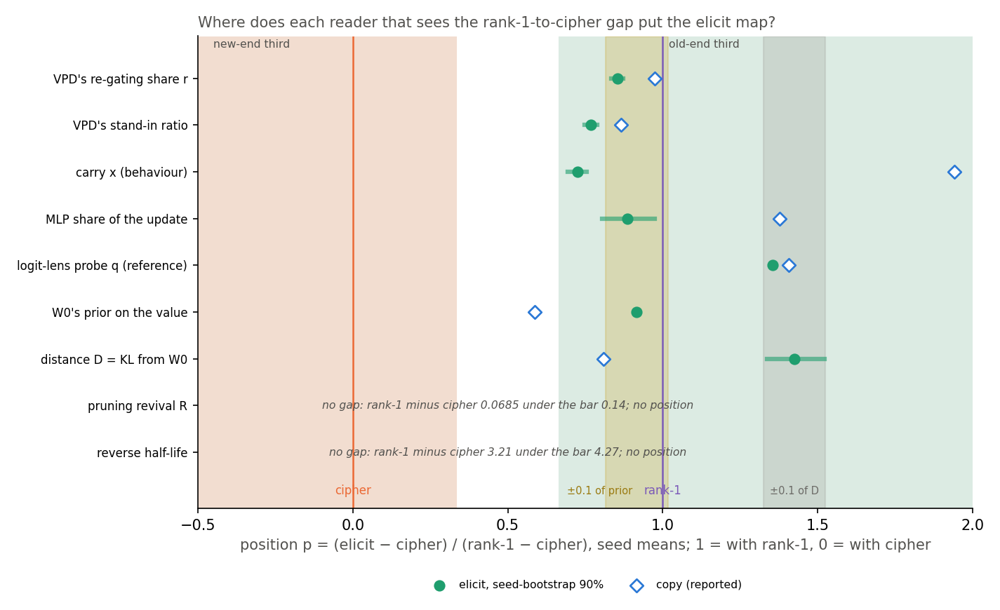
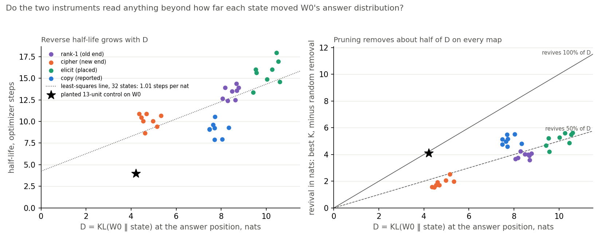

# Can pruning revival and reverse fine-tuning tell an old map from a new one on the 67M model?

E55 Stage C3, reuse line, 2026-10-31. Plan `reports/plans/2026-10-31_plan_e55-stage-c-open-pair.md`, with its
Amendment 1 and the Filing B note. Predictions `experiments/open_pair_instruments/results/predictions.json`: filing A at
fd8be40, Amendment 1 at 87a375f, filing B at 906330b, each before the job that reads it; the file's top-level
"status" string still describes filing A and is stale. Code `experiments/open_pair_instruments/{measure,seeds,instruments,run}.py`
and `src/commute/revival_kv.py`. Results `results/{measure,seeds,run}.json`. Figures
`experiments/open_pair_instruments/figures/c3_{poles,positions,distance}.png` from `plot.py`. Notebook
`notebooks/E55_pcfg_anchors.ipynb`, section "Stage C3". Reviews `reports/reviews/2026-10-31_review_e55-c3-plan.md`
and `reports/reviews/2026-10-31_review_e55-c3-code.md`.

We fine-tuned the 67M model on four word maps, from one that strengthens its own guesses to one that teaches arbitrary answers, and read each with two methods that need no decomposition.
Neither method told the old-by-construction map from the new one beyond seed noise, and both mostly tracked how sharply each fine-tune peaked the answer.
Only the decomposition separates the two ends on these maps, so the cheap methods have not yet had a fair test and the comparison the reuse line needs stays open.

## The answer

No. Pruning a few neurons and fine-tuning back toward the original model both failed to separate the old-by-construction
map from the new one, on eight seeds each. Pruning gave back about half of every fine-tune's change,
whatever the map. The time to undo half the change grew with how far the fine-tune had sharpened the answer, which put
the old-end map on the wrong side. VPD's two readings separate the ends widely and put the disputed map at the old end,
but filed rules mark that position as one W₀'s prior already gives.

## What we were trying to test

E58 found one map, the **elicit map**, where VPD and behaviour disagree. Each of 24 trained keys maps to a value the
original model W₀ already half-guesses, one of its ranks 2 to 20 at that key. VPD reads the fine-tune as running on
subcomponents W₀ already had. The held-out keys say nothing learnt carries over. This stage asks whether two methods
without a decomposition side with VPD there.

**The states.** Each state is a finished update δW on the 24 decomposed matrices of the 67M model, trained on 24 of 32
keys with E54's recipe. Four maps, eight seeds each, 32 states:

- the **rank-1 map**, each key to W₀'s own top guess: old by construction, it only strengthens W₀'s answer;
- the **cipher**, each key to an arbitrary word W₀ gives under one in a million: new by construction;
- the **elicit map**, the one placed between them;
- the **copy map**, each key to itself, reported beside the others and not scored.

Seeds 0 to 2 are E58's states, read from disk. Seeds 3 to 7 are 20 new fine-tunes with the same code. Every state is
read at E58's scored step, 10 steps for three maps and 8 or 9 for the cipher, at an update norm of about 3.1.

**The old behaviour.** Jain et al. revive a labelled capability. Here the old behaviour is W₀'s whole next-token
distribution at the answer position, and the distance from it is $\kappa(m) = \mathrm{KL}(p_{W_0} \| p_m)$ in nats,
averaged over held-out windows of the trained keys. A state's own value of it is $D$. $D$ reads 0 at W₀.

**The two instruments.**

- **Pruning revival** ranks the 12,288 MLP neurons by Jain et al.'s gradient-times-weight score and zeroes the top 13
  or 40. Its reading $R$ is the drop in $\kappa$, minus the drop from 20 random removals of the same size, as a share of
  $D$, taking the better of the two sizes. It reads 0 if pruning gives nothing back and 1 if it restores W₀ exactly.
  The old end should read higher.
- **Reverse fine-tuning** trains the state back toward W₀'s distribution at a tenth of the forward rate. Its reading
  is the half-life, the number of steps until $\kappa$ falls to $D/2$. The old end should read lower.

**The axis.** Every column is read as a position $p = (\bar v_{\text{elicit}} - \bar v_{\text{cipher}}) / (\bar
v_{\text{rank-1}} - \bar v_{\text{cipher}})$ on seed means. A position of 1 puts elicit with rank-1, 0 with the cipher.
Copy's position is computed the same way. Before any position counts, the column must separate rank-1 from the cipher by
at least three times its largest within-map seed standard deviation. That bar is each instrument's positive control on
real states.

**Beside them.** VPD's re-gating share $r$ is the share of the fine-tune's gain recovered when only Γ's causal
importances move to the fine-tuned model's, with the subcomponents left at W₀'s. The stand-in ratio is E58's second VPD
reading. Also beside them: steering's share, the carry to held-out keys with its label, and the update norm. The baselines
are the MLP share of the update, $D$ itself and W₀'s prior on the map's values; a logit-lens probe on W₀ is a reference.

**Controls.** A planted wrapper on W₀ is the built-in positive control. Thirteen answer-selective block-3 neurons get
their output columns pushed away from the rank-1 values. Pruning must find at least 10 of them and revive at least 0.8
of what zeroing them could, and reverse fine-tuning must undo half of it before 1,000 steps. A zero update must read
exactly 0, and seed 0 of every map must retrain to the saved state.

## What we expected, and why

- **The controls hold**, at 95% for the file checks and 85% for retraining and the planted wrapper. The planted
  wrapper had already passed in the measurement job.
- **Each instrument separates rank-1 from the cipher**, at 55% for pruning and 65% for reverse fine-tuning. Rank-1
  only sharpens W₀'s own answer, so W₀'s distribution should hide behind a few neurons and come back fast. The cipher
  overwrites it.
- **No instrument could read "VPD" under the filed rules.** The measurement job found that both baselines without a
  decomposition already put elicit at the old end: $D$ at 1.47 and the prior at 0.92. Filed rules turn any reading on
  the baselines' side into "distance and prior". So filing B set the leans for a VPD reading to 0 and the joint "not
  settled" to 85%. The one live outcome was that the instruments put elicit at the new end, against VPD, at 15%.
- **Copy**: where an instrument reads the gap, its copy position was expected nearer $r$'s, about 1.0, than the
  prior's 0.59, at 55%.
- **The probe reference**: the cipher near 0, elicit at least 1 nat, rank-1 at least elicit, at 65%.

## What we observed

### Do the controls hold?

Yes, all of them. The figure for the next claim marks the planted readings as dashed lines.

| check | read | filed bar | result |
|---|---|---|---|
| 12 state files and windows match their sha256; tokens identical across maps; gain within 1e-4 | all true, job 46808 | exact | met |
| zero update | $D$ = 0 exactly | exactly 0 | met |
| seed-0 retrain, four maps | step, norm, gain, carry and $r$ equal to 5 decimals | step exact, norm 1e-4, others 1e-3 | met |
| lens check, block 4 against W₀'s log-softmax | 0 | 1e-5 | met |
| planted pruning | 12 of 13 found; $R$ 0.973 | 10 of 13; 0.793 | met |
| planted reverse | half-life 3.97 steps | before 1,000 | met |
| weights back at W₀ after every reverse | 33 of 33 | all | met |

The planted wrapper sits on the off-answer KL fallback: its $D$ is 4.21 nats against a target of 7.0, above the
floor of 3.50 that Amendment 1 set. It is a strong control of one shape, all of its effect in 13 neurons of one block.

### Do pruning and reverse fine-tuning tell the rank-1 map from the cipher?

**Reading it.** No, for both. Pruning gives back a little more of rank-1's change than of the cipher's, 0.46 against
0.39. That gap of 0.07 is half the bar of 0.14 set by the seed spread. Reverse fine-tuning takes 13.3 steps to halve
rank-1's change and 10.1 to halve the cipher's. That is the wrong way round, and 3.2 steps is under the bar of 4.3, so
it counts as no gap rather than reversed. The dashed lines show each instrument does what it should on a planted
wrapper. Pruning gives back 0.97 of it and reverse fine-tuning halves it in 4 steps. Random removal of 40 neurons gives
back under 0.01 of any state's change, so the pruned neurons are the right ones. The elicit map reads beyond rank-1 on
both instruments, and copy sits highest on pruning and fastest on reverse.

| column | rank-1 | cipher | elicit | copy | gap | 3 × noise | status |
|---|---|---|---|---|---|---|---|
| pruning revival $R$ | 0.462 ± 0.028 | 0.393 ± 0.047 | 0.509 ± 0.039 | 0.652 ± 0.047 | +0.069 | 0.140 | no gap |
| reverse half-life, steps | 13.34 ± 0.75 | 10.14 ± 0.78 | 15.68 ± 1.42 | 9.09 ± 0.87 | +3.21 | 4.27 | no gap (leans reversed) |
| $D$, nats | 8.47 ± 0.27 | 4.76 ± 0.35 | 10.05 ± 0.49 | 7.76 ± 0.29 | +3.71 | 1.45 | ok, undirected |

Means ± sample sd over 8 seeds. Noise is the largest within-map sd among rank-1, the cipher and elicit. Its floors, the random-removal spread
of 0.0135 for $R$ and 1 step for the half-life, did not bind. Every state ended
its reverse run by reaching half; none was censored, and none was void.

### Where do the readers that see the gap put the elicit map?

**Reading it.** Every column that separates the ends puts elicit at the old end, and none of them needs a decomposition
except $r$ and the stand-in ratio. VPD's $r$ places elicit at 0.85 and the stand-in ratio at 0.77, each with a narrow
bootstrap interval. So does W₀'s prior on the value, at 0.92, by construction: elicit's values are W₀'s ranks 2 to 20,
and W₀ is nearly flat over its top 20. So does $D$, at 1.42, beyond rank-1. Under filed rules 5 and 6 a reading on the
same side as a firm baseline is relabelled. So $r$ and the stand-in ratio both read "distance and prior" rather than
"VPD". The carry now reads at the old end too, 0.72 on eight seeds, where three seeds left it straddling the edge.
Copy is the map that separates the prior from $r$: the prior puts it at 0.59 and $r$ at 0.98. No instrument read the
gap, so copy's filed prediction has nothing to score.

| column | status | gap / (3 × noise) | elicit p | 90% interval | copy p | filed reading | unfiled 0.1-only reading |
|---|---|---|---|---|---|---|---|
| VPD $r$ | ok | 9.8 | 0.853 | 0.835-0.871 | 0.975 | distance and prior | prior |
| VPD stand-in ratio | ok | 7.4 | 0.768 | 0.748-0.788 | 0.866 | distance and prior | VPD |
| carry x, reported | ok | 4.5 | 0.724 | 0.693-0.756 | 1.941 | VPD side | VPD side |
| MLP share, baseline | ok, undirected | 2.8 | 0.886 | 0.805-0.973 | 1.377 | VPD side | prior |
| probe q, reference | ok | n/a, no seed spread | 1.355 | 1.355 | 1.407 | VPD side | distance |
| W₀'s prior, baseline | ok, undirected | n/a, no seed spread | 0.916 | 0.916 | 0.587 | VPD side | — |
| $D$, baseline | ok, undirected | 2.6 | 1.425 | 1.337-1.522 | 0.808 | VPD side | — |
| steering S | no gap | 0.47 | — | — | — | no gap | no gap |
| update norm | no gap | 0.13 | — | — | — | no gap | no gap |
| pruning revival $R$ | no gap | 0.49 | — | — | — | no gap | no gap |
| reverse half-life | no gap | 0.75 | — | — | — | no gap | no gap |

Rules 5 and 6 are scored on $r$, the stand-in ratio and the two instruments; the other rows apply the same rule for
reference. The **unfiled 0.1-only reading** fires the distance or prior relabel only when a position lies within 0.1
of the baseline's, dropping the filed "same side" clause. It is not filed and does not replace the verdict; filing B
promised it as a reported column. On it, $r$ is 0.063 from the prior and reads "prior", while the stand-in ratio is
0.148 from the prior and 0.66 from $D$ and reads "VPD". It changes nothing for the instruments, which have no position.

**On $D$.** Filing B's $D$ position was 1.47 on three seeds and is 1.42 on eight, against a pre-run guess of 0.2. KL
from W₀ to the state rewards sharpening: a state that takes mass away from W₀'s many plausible answers scores high
whatever it puts in their place. So $D$ reads how peaked each state became, not how far its mechanism moved.

### Why can't the instruments read the axis?

**Reading it.** Both instruments read mostly how far each state sharpened W₀'s answer, and the map adds little. On the
left, the half-life rises about one step per nat of $D$. Across the 24 rank-1, cipher and elicit states the
correlation is 0.92. Rank-1 sharpened W₀'s answer more than the cipher did, 8.5 nats against 4.8, so it takes longer
to halve; that is why reverse fine-tuning leans the wrong way. On the right, pruning gives back 39% to 65% of
$D$ on average for every map, so the revival in nats mostly restates $D$. The planted star sits far off both lines: half-life 4
steps, 97% revived. On a real state the instruments find a thin layer over an intact W₀ whatever the map, so asking
whether W₀'s behaviour is still underneath gets "yes" every time.

The candidate causes, checked against the numbers:

| candidate | what the numbers say | verdict |
|---|---|---|
| the 10-step, norm-3.1 maps | Every state is a small layer: the largest per-matrix relative change at the scored step is about 1.4%. Pruning 40 of 12,288 neurons removes 35-71% of each state's change, the cipher's included. Reverse fine-tuning at a tenth of the forward rate halves every map's change in 8.7-18.0 steps, after a forward run of 8-10 steps | main cause: on every map W₀'s behaviour is still underneath, which is the question Jain's instruments answer |
| the KL target | $\kappa$ rewards sharpening, so $D$ orders the maps elicit, rank-1, copy, cipher; the half-life follows $D$ at about one step per nat | cause for reverse fine-tuning; for pruning, normalising by $D$ removes it, leaving shares that do not separate |
| the noise | The bar comes from real seed spread: the cipher's sd is 0.047 for $R$. Dropping its outlier seed, at 0.49, the gap becomes 0.083 against a bar of 0.116 from elicit's sd. On the standard error of the mean the $R$ gap is 3.6 standard errors | not the cause: the rule asks for separation of single states, and the gap is about 1.5 seed sd |
| $K$ | At 13 neurons the $R$ gap is 0.006; at 40 it is 0.069, and 40 is the better size on 31 of 32 states | open: the gap grows with $K$; above 40 is not run |
| attention changes | MLP share is 0.68-0.71 on every map; the cipher's is the highest | not the cause of the missing gap |

**An unfiled observation, not a result.** Dividing the half-life by $D$ removes the distance. That ratio reads 1.58 on
rank-1 and 2.14 on the cipher, the filed direction, at 2.3 times the largest seed sd. It places elicit at 1.03. Copy
reverts fastest per nat, at 1.17. This ratio was chosen after seeing the data and is not scored.

### Every map, per column

| column | rank-1 | cipher | elicit | copy |
|---|---|---|---|---|
| VPD $r$ | 0.858 ± 0.021 | 0.235 ± 0.009 | 0.766 ± 0.012 | 0.842 ± 0.008 |
| stand-in ratio | 1.130 ± 0.036 | 0.327 ± 0.012 | 0.943 ± 0.010 | 1.023 ± 0.027 |
| steering S | 0.215 ± 0.022 | 0.183 ± 0.020 | 0.482 ± 0.018 | 0.640 ± 0.030 |
| carry x | 0.081 ± 0.032 | −0.344 ± 0.023 | −0.036 ± 0.007 | 0.482 ± 0.047 |
| carry label, 8 seeds | neither 7, new 1 | new 8 | new 8 | neither 6, reuses 2 |
| update norm | 3.150 ± 0.028 | 3.115 ± 0.089 | 3.142 ± 0.025 | 3.120 ± 0.019 |
| MLP share of ‖δW‖² | 0.686 ± 0.002 | 0.705 ± 0.002 | 0.688 ± 0.002 | 0.678 ± 0.002 |
| W₀'s prior, mean log p of the value | −5.00 | −14.32 | −5.78 | −8.85 |
| $D$, nats | 8.47 ± 0.27 | 4.76 ± 0.35 | 10.05 ± 0.49 | 7.76 ± 0.29 |
| revival at 13 neurons, share of $D$ | 0.354 ± 0.023 | 0.348 ± 0.049 | 0.424 ± 0.037 | 0.532 ± 0.066 |
| revival at 40 neurons, share of $D$ | 0.462 ± 0.028 | 0.393 ± 0.047 | 0.509 ± 0.039 | 0.652 ± 0.047 |
| revival at 40 neurons, nats | 3.91 ± 0.22 | 1.88 ± 0.32 | 5.12 ± 0.50 | 5.06 ± 0.34 |
| random 40-neuron removal, share of $D$ | 0.004 | 0.003 | 0.007 | 0.005 |
| reverse half-life, steps | 13.34 ± 0.75 | 10.14 ± 0.78 | 15.68 ± 1.42 | 9.09 ± 0.87 |
| half-life over $D$, unfiled | 1.58 ± 0.08 | 2.14 ± 0.24 | 1.56 ± 0.12 | 1.17 ± 0.13 |
| top-13 neurons shared between seeds, of 13 | 11.2 | 10.7 | 11.0 | 10.1 |
| probe q per block 1-4, nats | 2.79, 3.13, 3.25, 3.03 | −0.22, −0.20, −0.09, −0.54 | 3.93, 4.43, 4.08, 4.10 | 4.60, 3.71, 3.04, 3.02 |

Within a map the top 13 neurons are stable, with 10 to 11 of 13 shared between two seeds on average. Across maps they differ, with
4 to 6 shared at seed 0. So pruning finds a consistent set per map; the shares it gives back do not differ by map.

**The probe reference missed one of three parts.** The cipher reads near 0 and elicit above 1 nat, but rank-1 reads
3.25 against elicit's 4.43. Rank-1's 32 keys have only 18 distinct values, W₀'s generic top guesses, which W₀ also
rates fairly high at other keys. That likely shrinks the contrast with the other values; it was not checked further.
Copy's block-1 reading of 4.60 is the lens decoding the key as itself, as the plan review expected.

## What we learned

On the 67M open-pair maps, pruning revival and reverse fine-tuning toward W₀ cannot tell a map that only strengthens
W₀'s own answers from one that teaches arbitrary new ones. Every 10-step update is a thin layer over an intact W₀, so
both instruments find W₀'s behaviour underneath every map. Their readings follow how sharply each state peaked, not
which pieces it used. VPD's $r$ and stand-in ratio separate the same two ends by 7 to 10 times the filed bar. So the
comparison the user asked for, VPD against refined pragmatic methods, has not yet had a fair test on these maps. The
cheap methods as ported fail their positive control on real poles, which is a statement about the port, not about the
methods. The granularity question stays open.

## How compelling is the evidence

- **Eight seeds per map**, 32 states; the seed spread sets every bar, and the retrain control shows the training is
  exactly reproducible, so the spread is between seeds, not within a run.
- **One model, one task family, one update size.** Every state is at about norm 3.1 and 10 steps. Nothing here says
  what the instruments do at the plateau or on longer fine-tunes.
- **The planted control is one shape**: 13 neurons of one block, all of the effect at the answer. Real updates spread
  over attention and many neurons. Passing it shows the code works; it does not show the instruments can read real
  states.
- **No censoring, no void state.** Every reverse run reached half in under 20 steps.
- **The baselines decide the scored verdicts for VPD's readings.** On an axis whose old end is built from W₀'s top
  guesses, the prior must put elicit near the old end. "Distance and prior" on $r$ is therefore a property of the axis.
  E58 Amendment 6 already showed $r$ does not follow the prior: a cipher at a prior below copy's read $r$ 0.37-0.38.
- **The cause is read from the numbers, not tested.** No run varied the update size, the target or $K$.

## Surprises

- **Reverse fine-tuning leans the wrong way.** Rank-1 took longer to undo than the cipher, by 3.2 steps against a bar
  of 4.3. It is under the bar, so it is not a reversal under the rule, but it is the opposite of the filed reasoning.
  The cause is in "Why can't the instruments read the axis?".
- **Elicit is the hardest map to undo**, by both instruments in nats: the most sharpened, the slowest to halve.
- **The carry reads at the old end on eight seeds**, 0.72 with an interval above two thirds, where three seeds left it
  between.
- **The MLP share separates the ends** at 2.8 times its bar, though the difference is only 0.02.
- The probe reference missed: rank-1 reads below elicit.

## What next

Proposals for `/design`, not decisions.

1. **Give the instruments a test they can pass on real states.** Keep the rank-1-to-cipher axis. Read fine-tunes long enough that the
   cipher must overwrite W₀ at the trained keys, such as E12.s later checkpoints at 100 and 300 steps. If the instruments then separate the ends, place elicit there. If they still cannot, the port is the
   problem, not the update size.
2. **Take distance out by design.** Read each pole at a step where its $D$ matches the others, instead of matching
   norm. Alternatively, file the half-life over $D$ as a column before any reading. The unfiled ratio reads 2.3 seed sd
   in the filed direction here, a lead only.
3. **A target that does not reward sharpening.** Examples are W₀'s ranking of its top answers, or the log-probability
   of W₀'s own top guess. Then rank-1, which agrees with W₀'s top guess, is not scored as far away.

If option 1 shows a gap and puts elicit at the old end, the granularity limit is shared by the cheap methods. If it
shows a gap and puts elicit at the new end, VPD is the odd one out, which goes to the user at once.

## Scorecard

| id | claim in words | rule | read | verdict |
|---|---|---|---|---|
| C0a | job 1's file, token, gain and zero-update checks pass | § 5 job 1 | all pass, job 46808 | met, 95% lean |
| C0b | seed-0 retrain, lens, both planted controls, weights back at W₀ | § 5 | all pass; planted 12/13, R 0.973 ≥ 0.793; t½ 3.97 | met, 85% lean |
| P1 R | pruning separates rank-1 from the cipher, filed direction | rules.gap | gap 0.069 < 3 × 0.0468 = 0.140 | not met, no gap, 55% lean |
| P1 t½ | reverse separates rank-1 from the cipher, filed direction | rules.gap | gap +3.21 steps, wrong sign, < 4.27 | not met, no gap, 65% lean |
| P2 | pruning places elicit at the old end | rules 3-6 on R | no gap | outcome in the "no gap, reversed or void" bucket, 50% lean |
| P3 | reverse places elicit at the old end | rules 2-6 on t½ | no gap | outcome in the "no gap, reversed or censored" bucket, 35% lean |
| V | joint verdict | rule 7 | not settled: pruning no gap; reverse no gap | as leaned, 85% |
| P_copy | an instrument that reads the gap puts copy above 0.791 | filing B | no instrument read the gap | no reading |
| ref | probe: cipher within ±0.5, elicit ≥ 1, rank-1 ≥ elicit | § 3 | −0.086; 4.43; 3.25 < 4.43 | not met, rank-1 below elicit, 65% lean |
| reported | $r$ and stand-in ratio through rules 5-6 | rules 5-6 | p 0.853 and 0.768, both firm VPD side | distance and prior; unfiled 0.1-only: prior and VPD |

No filed prediction was reversed. The half-life leaned against its filed direction, under the bar.

## Departures from the literature

- **The old behaviour.** Jain et al. 2024 revive a labelled pretraining capability, scored by accuracy. Here it is
  W₀'s whole next-token distribution at the answer position, scored as KL from W₀. No labels exist for these keys, and
  the distribution is readable on every map. This choice rewards sharpening, as found above.
- **Pruning.** Jain et al.'s Alg. 3 score, gradient times weight, on each neuron's input row, with the gradient of the
  KL; as in C1b. Neurons are zeroed as an activation edit, which is the same as zeroing the row because GELU of zero is zero. Two sizes, 13 and 40 of
  12,288, scaled from C1b's 5 and 15 of 4,608, with one number per state instead of the paper's curve; the better
  size is kept, which biases every state up by the same rule. The random-removal baseline is C1b's.
- **Reverse fine-tuning.** Jain et al. reverse fine-tune below the forward rate on the pretraining task and compare
  with a scratch model. Here the rate is a tenth of the forward rate, Adam, with KL to W₀ as the loss, read as a
  continuous half-life; there is no scratch model, because no 67M model lacks W₀'s behaviour.
- **The planted wrapper** is this project's control, not the paper's.
- **The probe.** Def 1's readout is W₀'s own unembedding at each block, the logit lens of nostalgebraist 2020, not a
  trained probe. The control is the map's other values, not Hewitt and Liang's control task.
- **The axis, the thirds, the 3-sd bar, the bootstrap, the distance and prior rules and the 0.1 tolerance** are this
  project's; the papers plot curves.
- **Steering, $r$, the stand-in ratio and the carry label** are E58's, unchanged; their departures are in its report.

## Not run

- Neuron counts above 40; attention-head pruning; other reverse rates; reverse targets other than KL to W₀.
- Longer fine-tunes or other update sizes; states matched on $D$ instead of norm.
- The half-life over $D$ as a filed column; it is an unfiled observation here.
- The interchange-patch label, Stage B. VPD on the counting anchors, a gated stage.
- The 96-key states, the shuffled map, E58 Amendment 6's prior-matched cipher and Amendment 7's maps.
- A tuned lens; any check of why rank-1's probe reads below elicit.
- Any edit to E58's or C1b's files or predictions.

## Provenance

- Jobs on the MATS cluster `debug` QoS, one L40 each, $0: 46808 measurement, about 1 min; 46815 seeds, about 10 min;
  46840 instruments, about 1 min, 1.5 s per state. Logs `cluster/logs/commute-e55-c3-{measure-46808,seeds-46815,instruments-46840}.out`.
- `results/run.json` committed at 49507ee, run at git head 8a1f4ac, clean tree, predictions sha256 d0ba715a.
  `results/seeds.json` at cf86116; `results/measure.json` at a0eaa06.
- 20 new states in `results/large/`, gitignored, each with its sha256 in `seeds.json`.
- Numbers beyond `run.json`'s score block, such as per-K shares, the half-life over $D$, correlations and neuron
  overlaps, were computed from `run.json` for this report.
