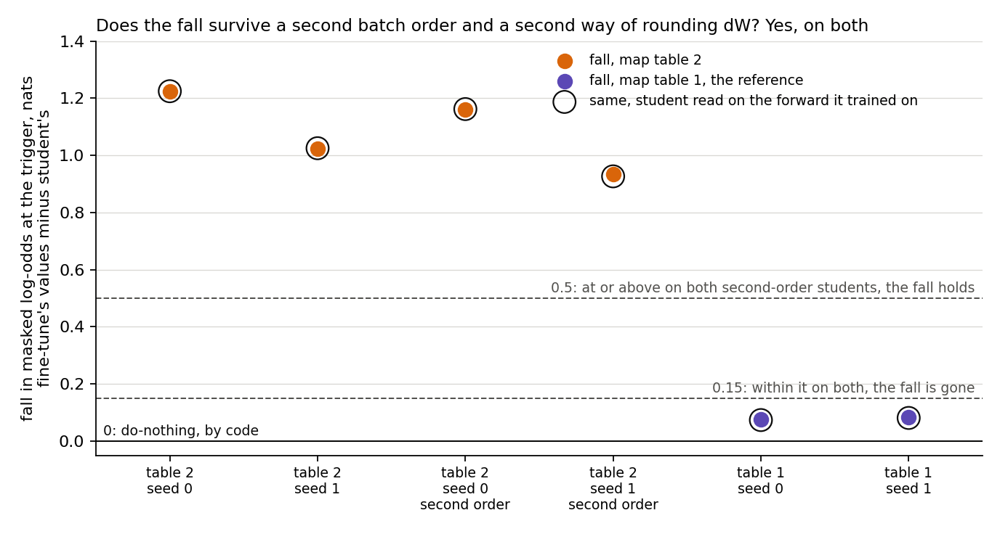
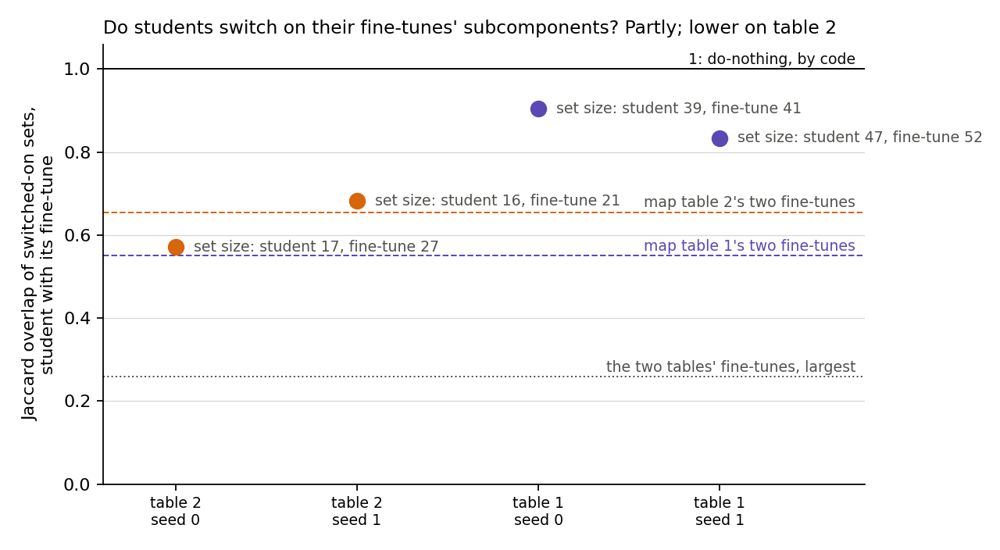
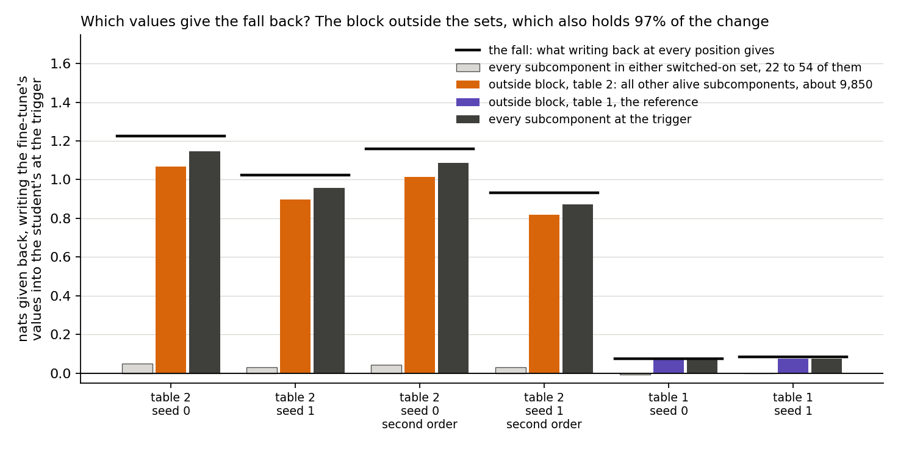
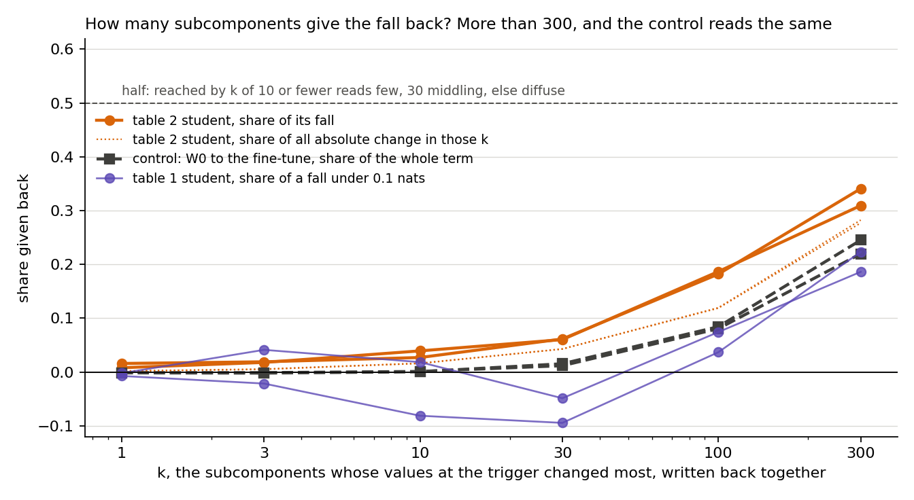
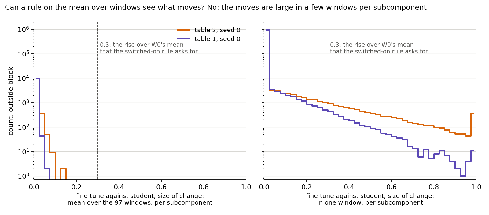
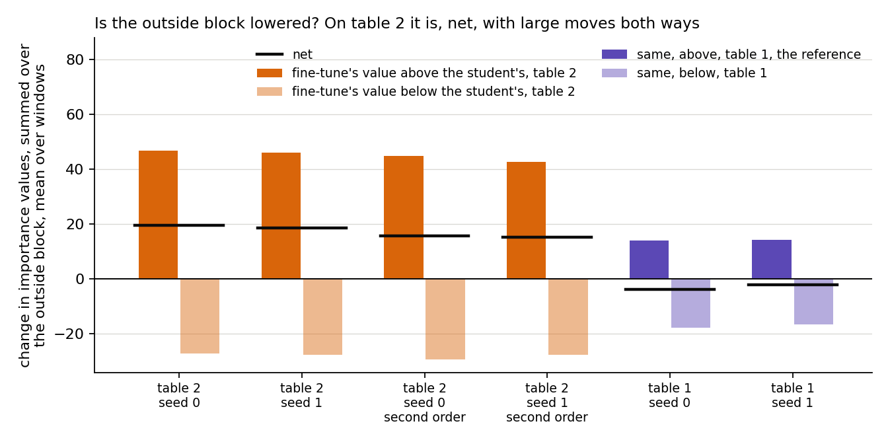
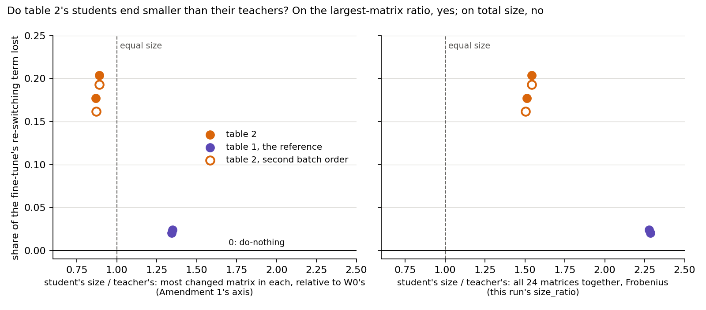
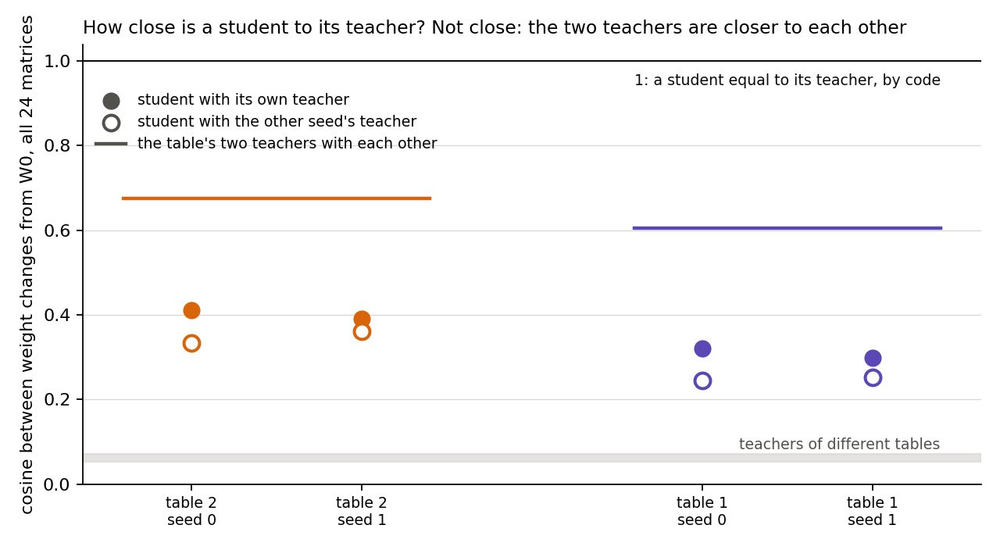

# Analysis: why does the re-switching term fall on the second map table's students? (E12 Amendment 2)

*2026-11-02, coding agent. Plan `reports/plans/2026-11-02_plan_e12-amend2-rand32b-fall.md`; code review `reports/reviews/2026-11-02_review_e12-amend2-code.md`; predictions `experiments/new_vs_existing/results/predictions_amend2.json`, filed before the run and scored as filed; notebook `notebooks/E12_new_vs_existing.ipynb`, last section; figures from `experiments/new_vs_existing/plot_amend2.py`. Reference: `reports/analyses/2026-11-02_analysis_e12-teacher-route-split.md`, called Amendment 1 below.*

We retrained six students of fine-tunes on two random-map tables, and wrote the fine-tune's importance values back into each student to see which values restore the falling term. The fall survives a second batch order. About seven-eighths of it comes back from the block of everything outside the switched-on sets, which also holds 97% of the change in values, so this says little about which subcomponents carry it. The 300 most changed give back a third. On total weight size these students end larger than their teachers, not smaller. For `GOALS.md`: on the second table a student keeps its fine-tune's P(target), but loses about a fifth of the re-switching term and part of the switched-on set. On the first table it keeps the term and most of the set. On both, its weight change is far from its teacher's. So P(target) does not imply the term or the set, and the cause stays open.

## What we were trying to test

Amendment 1 trained subcomponents to imitate eight fine-tunes, with Γ and Δ frozen, and called each result the student. On one map table the student lost about a fifth of the fine-tune's re-switching term. That table is `rand32b`, the second map table below. `rand32`, the first map table, lost about 2% and is the reference here. Amendment 1 had read neither a second batch order on the second table nor any set of subcomponents.

This job retrained four students at batch order 0 from Amendment 1's recipe and two second-table students at batch order 1. Teacher training was unchanged: the teacher is the fine-tuned model, Adam at 1e-5, 1,000 steps. Held fixed: Γ, Δ, the released components, 97 held-out windows, the L40 card and the trigger position. Varied: the table, the fine-tune seed and, on the second table only, the batch order.

The quantities, in the filing's words:

- $L_{01}$: mean log-odds of the target at the trigger, with the released components, Δ left out, masked by Γ's values at the state. It depends on the state only through Γ's values.
- **The re-switching term** $L_{01} - L_{00}$: what Γ's changed values give the released subcomponents.
- **The fall:** $L_{01}$ on the fine-tune's values minus $L_{01}$ on the student's. It reads 0 for do-nothing, by code.
- **The switched-on set:** alive subcomponents whose mean trigger value over the 97 windows is up by more than 0.3 on W₀'s, E12's rule.
- **Jaccard overlap** of two sets: 1 if they are equal, 0 if disjoint.
- **Writing back:** start from the student's values everywhere, write the fine-tune's values at the trigger position on a chosen group, and read the nats given back.
- **The four blocks:** dropped is in the fine-tune's set only, kept is in both, added is in the student's only, and outside is every other alive subcomponent.

**Controls.** Each fine-tune's $L_{01}$ and each order-0 student's $L_{01}$ had to reproduce Amendment 1's or the job stopped. All 22 filed checks passed, and every one of those differences read exactly 0. Writing back every value at every position gave the fine-tune's $L_{01}$ exactly, on the first student only, as filed.

**Limit carried.** A new circuit from old pieces reads "elicited" to VPD, and E50 Amendment 1 did not show W₀ performs the copy task. So these are "random maps", not "new" capability. This run has no copy table.

## What we expected, and why

We leaned towards the fall holding across batch orders, with medium-high confidence. We leaned towards partial set overlap, with low confidence. We leaned towards the kept block giving the fall back, also with low confidence, since a fall of a fifth looked like lower values on the same members. We leaned towards a diffuse answer on how many subcomponents, and towards no separation between the tables on the student-to-teacher cosine.

## What we observed

### 1. Does the fall survive a second batch order and a second way of rounding dW? Yes, on both

| state | fine-tune's term, nats | fall, nats | share of term lost | $L_{01}$, weights | $L_{01}$, hook | hook minus weights |
|---|---|---|---|---|---|---|
| second table s0 | 6.011 | 1.225 | 20.4% | −7.1974 | −7.1969 | +0.0005 |
| second table s1 | 5.770 | 1.023 | 17.7% | −7.2366 | −7.2383 | −0.0017 |
| second table s0, order 1 | 6.011 | 1.159 | 19.3% | −7.1318 | −7.1344 | −0.0026 |
| second table s1, order 1 | 5.770 | 0.933 | 16.2% | −7.1467 | −7.1399 | +0.0069 |
| first table s0 | 3.751 | 0.076 | 2.0% | −8.2373 | −8.2350 | +0.0023 |
| first table s1 | 3.500 | 0.084 | 2.4% | −8.4961 | −8.4933 | +0.0028 |

**Reading it.** The fall is not a batch-order effect on this table. The two second-order students fall by 1.16 and 0.93 nats, against the filed 0.5 line. Changing batch order moves $L_{01}$ by 0.066 and 0.090 nats here, about ten times Amendment 1's 0.007 and 0.009 on other tables. So this table's term is noisier, but that noise is under a tenth of the fall. Sharing first batches with the teacher does not show a consistent effect: it goes with a larger fall on seed 0 and a smaller one on seed 1.

**The bf16 and hook pair.** The weights-form read runs W₀ + dW under bf16 autocast, and the hook form adds the student's offsets to the activations, the forward it trained on. The largest difference on any state is 0.0069 nats. That is under Amendment 1's batch-order noise of 0.007 and 0.009, and it is about 0.7% of the smallest fall. So rounding dW into the weights does not carry the fall. Both forms read Γ under bf16 autocast, so this is not a test of precision as such. No read here is in fp32, on either the student or the fine-tune, and a fine-tune has only the weights form.

### 2. Do students switch on their fine-tunes' subcomponents? Partly on the second table; lower than on the first by the filed order-0 rule

| state | fine-tune's set size | student's | dropped | kept | added | Jaccard | mean value of kept: fine-tune, student |
|---|---|---|---|---|---|---|---|
| second table s0 | 27 | 17 | 11 | 16 | 1 | 0.571 | 0.542, 0.522 |
| second table s1 | 21 | 16 | 6 | 15 | 1 | 0.682 | 0.573, 0.549 |
| second table s0, order 1 | 27 | 18 | 10 | 17 | 1 | 0.607 | 0.530, 0.518 |
| second table s1, order 1 | 21 | 18 | 4 | 17 | 1 | 0.773 | 0.554, 0.542 |
| first table s0 | 41 | 39 | 3 | 38 | 1 | 0.905 | 0.554, 0.542 |
| first table s1 | 52 | 47 | 7 | 45 | 2 | 0.833 | 0.541, 0.536 |

Anchors: the second table's two fine-tunes overlap at 0.655, the first table's at 0.550, and the most similar fine-tunes across tables at 0.259. Order 0 against order 1 reads 0.944 and 0.889.

**Reading it.** Partly. Second-table students overlap their own fine-tunes at 0.57 and 0.68, either side of the other seed's 0.66 and well above the other table's 0.26. So a student on this table is about as near its fine-tune as another seed's fine-tune is, and the claim "a student switches on the same subcomponents" is not made. First-table students read 0.83 and 0.91, higher by 0.15 against a batch-order change of 0.11. Lower by the filed order-0 rule; a second-order student reaches 0.77, and with it the gap (0.833 − 0.773 = 0.060) falls under the noise of 0.111, which would read "no different". The noise comes from the second table alone: the first table's second batch order (`rand32_s0_o1`, Amendment 1) has no set read here, and its larger sets also damp each member's effect on the overlap.

The sets shrink by near-threshold losses, not by large moves. A dropped member's mean falls by 0.03 to 0.13 at order 0, but from 0.022 at order 1 on the same table and from 0.004 on the first. Second-order students drop no member that their order-0 student kept, so the drop list is stable, and four members drop on all four students. The kept block's mean value moves by under 0.03 on either table; single kept members move by up to 0.094.

### 3. Which values give the fall back? The block outside the sets, which also holds 97% of the change

| state | fall | every value at trigger | outside | dropped | kept | added | outside / fall | subcomponents outside |
|---|---|---|---|---|---|---|---|---|
| second table s0 | 1.225 | 1.147 | 1.068 | 0.035 | 0.010 | 0.006 | 0.872 | 9,853 |
| second table s1 | 1.023 | 0.957 | 0.896 | 0.013 | 0.017 | −0.000 | 0.876 | 9,859 |
| second table s0, order 1 | 1.159 | 1.086 | 1.015 | 0.027 | 0.012 | 0.006 | 0.875 | 9,853 |
| second table s1, order 1 | 0.933 | 0.873 | 0.820 | 0.011 | 0.019 | 0.000 | 0.879 | 9,859 |
| first table s0 | 0.076 | 0.069 | 0.076 | 0.000 | −0.008 | −0.000 | 0.995 | 9,839 |
| first table s1 | 0.084 | 0.075 | 0.076 | 0.003 | −0.004 | −0.001 | 0.904 | 9,827 |

**Reading it.** Our lean was wrong. We leaned towards the kept block, and it gives back about 2% or less of the fall on every second-table state (2.04% at most). The outside block gives back 87% and 88%, on both batch orders. The trigger position holds 94% of the fall.

The outside block is not a group we chose. It is every alive subcomponent that neither state's rule switches on: 99.7% of the 9,881 alive subcomponents, against 22 to 28 in the two sets on this table. So its label says the fall is not in the set members, and says nothing about which of the others carry it.

The reference is the block's share of the change. The outside block holds 97% to 98% of all absolute change in values on the second table and returns 87% to 88% of the fall. The set members hold 2.4% to 3.0% of the change and return 3.0% to 4.2% of the fall. So nats given back roughly follow where the change is, and the set members return slightly more per unit of change. "Outside" is close to the null, not a localisation.

### 4. How many subcomponents give it back? More than 300, though the ladder is a weak test here

| k most changed, written back | 1 | 3 | 10 | 30 | 100 | 300 |
|---|---|---|---|---|---|---|
| second table s0, nats | 0.020 | 0.023 | 0.033 | 0.075 | 0.223 | 0.417 |
| second table s1, nats | 0.008 | 0.018 | 0.040 | 0.062 | 0.191 | 0.317 |
| second table s0, order 1 | 0.017 | 0.019 | 0.028 | 0.056 | 0.201 | 0.400 |
| second table s1, order 1 | 0.018 | 0.030 | 0.037 | 0.057 | 0.168 | 0.329 |
| first table s0 | −0.001 | −0.002 | −0.006 | −0.007 | 0.003 | 0.017 |
| first table s1 | −0.000 | 0.003 | 0.002 | −0.004 | 0.006 | 0.016 |
| control s0: W₀ to fine-tune, term 6.01 | −0.007 | −0.006 | 0.007 | 0.071 | 0.485 | 1.321 |
| control s1: W₀ to fine-tune, term 5.77 | −0.008 | −0.011 | 0.003 | 0.089 | 0.487 | 1.414 |

**Reading it.** The top 300 of 9,881 give back 34% and 31% of the fall, under the filed half, so the label is "diffuse". The control reads diffuse as well, against our expectation of few or middling. Writing back the 30 most changed values from W₀ to the fine-tune gives 1% to 2% of a term that writing back every trigger value recovers at 95%. The filing says what follows: "the ladder is a weak test of concentration here and P4 is reported as such". The control's top 30 contain 19 of 27 and 17 of 21 of the fine-tune's set members, and its smallest change is 0.35, so the set members alone hold almost none of the term itself: 1.2% and 1.5% when written back from W₀ at the trigger. This run cannot tell values that are truly spread from values that only work together.

The dotted line shows the top k's share of the absolute change. It is about the give-back share only near k = 300, at 1.1 to 1.2 times. The give-back share is about 1.5 times the change share at k = 100, 1.1 to 1.4 times at 30, and 5 to 11 times at 1, so the most changed return more per unit of change. The control sits below the student at every k, so "the control reads the same" holds for the label only. The top 1,000 hold 63% of that change, and the top 3,000 hold 97%. First-table states are about as spread, at 34% to 36% for the top 300.

### 5. What moves in the outside block, and can a rule at 0.3 see it? No

| outside block | second s0 | second s1 | second s0, order 1 | second s1, order 1 | first s0 | first s1 |
|---|---|---|---|---|---|---|
| largest change of a mean over windows | 0.128 | 0.113 | 0.124 | 0.098 | 0.065 | 0.049 |
| subcomponents with mean change over 0.05 | 60 | 62 | 58 | 45 | 2 | 0 |
| subcomponents with mean change over 0.3 | 0 | 0 | 0 | 0 | 0 | 0 |
| window entries with change over 0.3, of about 955,000 | 8,348 | 8,268 | 8,423 | 7,654 | 2,259 | 2,100 |
| subcomponents with such an entry | 2,538 | 2,496 | 2,556 | 2,433 | 1,201 | 1,121 |
| share of absolute change in those entries | 59% | 59% | 59% | 57% | 31% | 30% |
| outside's share of all absolute change | 97% | 98% | 97% | 98% | 94% | 92% |

**Reading it.** A set rule cannot see this, by construction. The rule reads a mean over 97 windows against 0.3, and no outside subcomponent's mean differs between fine-tune and student by even 0.13. Yet 59% of the absolute change sits in per-window moves larger than 0.3, typically in two or three of the 97 windows for a given subcomponent, on about a quarter of alive subcomponents. A subcomponent with an entry over 0.3 has 3.2 to 3.3 such entries on average (median 2, up to 21 of 97), and only 31% to 33% have exactly one. Those moves touch under 1% of window entries, so they average away. This is the filing's stated blind spot: values that move for a few keys only. Per-key values were not read, so "a few keys" is the blind spot's name and not a measured fact here. Whether those moves return the nats was not tested.

Two further readings from the saved files. The top 5 of 97 windows hold 16% to 18% of these entries and 14% to 15% of the absolute change, against 5% if uniform: uneven, but not a few windows. The fine-tune is above the student on 62% to 66% of these entries on the second table and 41% to 44% on the first, which matches the net sign in section 6; this was not filed. The figure's 0.3 line is the rise over W₀ that the rule asks for, drawn on an axis of fine-tune minus student, which is a different quantity. The row "mean change over 0.3" reads 0 close to by construction, since every outside subcomponent has a rise of at most 0.3 on both sides.

Of the outside subcomponents with a fine-tune mean over 0.3 (74 and 81, not "already on at W₀": W₀'s trigger values are not saved), about 6% of the absolute change sits there (5.9% to 6.7%), so they are not where most of the change is. Their net change is 0.13 and 0.23 of a net 19.6 and 18.5. This speaks to change, not to effect.

### 6. Is the outside block lowered? On the second table, net, with large moves both ways

| outside block | sum of means: fine-tune | student | relative | fine-tune above student | fine-tune below student |
|---|---|---|---|---|---|
| second table s0 | 265.2 | 245.6 | −7.4% | 46.7 | 27.1 |
| second table s1 | 263.0 | 244.5 | −7.0% | 46.0 | 27.5 |
| second table s0, order 1 | 265.2 | 249.5 | −5.9% | 44.9 | 29.3 |
| second table s1, order 1 | 263.0 | 247.9 | −5.8% | 42.7 | 27.5 |
| first table s0 | 199.8 | 203.7 | +1.9% | 14.0 | 17.8 |
| first table s1 | 196.9 | 199.1 | +1.1% | 14.3 | 16.5 |

**Reading it.** The filed clause records the fall as a spread lowering, recorded as filed; this run supports neither "spread" (it fails the ladder's control) nor "lowering" as a cause (it fails the first table). The summed values support the word "lowered" as a description on this table: students sit 6% to 7% below their fine-tunes across the block. It is a net figure, since over a third of the absolute change goes the other way. Absolute change is 2.3 times the first table's.

Net lowering is not shown to be the mechanism. On the first table the block is net raised, and writing the fine-tune's values back still gives 0.08 nats, the same sign as the fall. Raises and lowers were not written back separately, so we name no cause. What was moved by an intervention is this: writing back this block returns 87% to 88% of the fall.

### 7. Do the second table's students end smaller than their teachers? On the largest-matrix ratio, yes; on total size, no

| state | teacher, all matrices | student, all matrices | ratio, `size_ratio` | teacher, most changed matrix | student, most changed matrix | ratio, Amendment 1's |
|---|---|---|---|---|---|---|
| second table s0 | 1.317 | 2.031 | 1.54 | 0.0254 | 0.0226 | 0.89 |
| second table s1 | 1.344 | 2.033 | 1.51 | 0.0260 | 0.0226 | 0.87 |
| second table s0, order 1 | 1.317 | 2.033 | 1.54 | 0.0254 | 0.0226 | 0.89 |
| second table s1, order 1 | 1.344 | 2.022 | 1.50 | 0.0260 | 0.0226 | 0.87 |
| first table s0 | 0.750 | 1.714 | 2.29 | 0.0151 | 0.0203 | 1.34 |
| first table s1 | 0.761 | 1.733 | 2.28 | 0.0153 | 0.0206 | 1.35 |

**The two numbers divide different things.** `size_ratio` is $\|\delta W_s\|_F / \|\delta W_t\|_F$ over all 24 matrices together, in fp64, absolute (`amend2.py`, `change_stats`). Amendment 1's ratio is $\max_k \|\delta W_{s,k}\| / \|W_{0,k}\|$ divided by $\max_k \|\delta W_{t,k}\| / \|W_{0,k}\|$, each student or teacher taking its own most changed matrix, relative to W₀ (`component_training.py:160`, `finetune.py:182`, `plot_amend1.py`). Both are correct arithmetic on the same student and teacher. I read the teachers' total size directly from E46's files, and it matches what the results file implies to 15 digits.

**Reading it.** "Ends smaller than its teacher" does not survive on the weights' own size. On all matrices together the second table's students end 1.50 to 1.54 times larger than their teachers. The ratio of each model's own most changed matrix is under 1. Since the student is larger in total, it must be larger than its teacher on at least one matrix; how many was not read, and student and teacher may not share their most changed matrix. The teachers' top three matrices are close (0.442, 0.438, 0.420 on seed 0; 0.448, 0.446, 0.429 on seed 1), so a student could be below its teacher on several. Per-matrix sizes need the released U and V and were not read.

What survives is smaller. The ratio is lower on the second table on both measures, because its teachers are 1.76 times the first table's by total size and its students only 1.18 times. The line at 1 means nothing on the total measure, where no state is near it. This is one correlation between two tables, and it is mostly teacher size. Amendment 1's review already said so. E42's points and the copy tables have no total size on file. So the four-setting correlation cannot be redrawn here, and the filing's clause applies: it "stays a correlation".

**Corrections to Amendment 1.** Applied in commit 4aba4934 (Amendment 1's report, notebook cell 31 and `plot_amend1.py`).

One error also sits in filed text, which stays as filed. The alignment rule's text, plan line 71 and the code review's M1 put Amendment 1's largest-matrix ratio into $1 + r^2 - 2rc$, whose $r$ must be total size. So their $r$ is too low on both tables, and the table above has the true values. The rule itself scores the cosine, so no verdict changes. The tilt M1 warned of remains: distance over teacher size reads 1.45 and 2.19, so rand32b still reads nearer. Unnormalised distance reads the other way, at 1.91-1.95 against 1.64-1.67.

### 8. How close is a student to its teacher? Not close

| state | cosine, own teacher | cosine, other seed's teacher | teachers with each other | distance, student to teacher | distance / teacher size | along teacher, in teacher sizes | off teacher, in teacher sizes |
|---|---|---|---|---|---|---|---|
| second table s0 | 0.412 | 0.334 | 0.675 | 1.913 | 1.45 | 0.63 | 1.41 |
| second table s1 | 0.391 | 0.361 | 0.675 | 1.950 | 1.45 | 0.59 | 1.39 |
| second table s0, order 1 | 0.396 | 0.356 | 0.675 | 1.935 | 1.47 | 0.61 | 1.42 |
| second table s1, order 1 | 0.411 | 0.343 | 0.675 | 1.913 | 1.42 | 0.62 | 1.37 |
| first table s0 | 0.320 | 0.244 | 0.605 | 1.636 | 2.18 | 0.73 | 2.17 |
| first table s1 | 0.298 | 0.253 | 0.605 | 1.673 | 2.20 | 0.68 | 2.18 |

Teachers of different tables read 0.05 to 0.07.

**Reading it.** A student is far from its teacher on every state, though it matches the teacher's behaviour. Each student ends further from its teacher than W₀ is, since distance exceeds teacher size on all six. A cosine of 0.30 to 0.41 leaves 83% to 91% of a student's squared size off its teacher's direction. How high a cosine a student could reach with Δ fixed was not read, and part of the off-teacher length may be drift over 1,000 steps (teachers trained 10 or 30 steps, students 1,000; Amendment 1's student with nothing to learn still grows). So this shows the weights differ, not that the student failed to reach anything it could reach. The filing says the same: a low cosine "can be what a student cannot express with Delta fixed, so this bears on 'the student reaches its teacher' only loosely".

The control holds, but thinly. Each student is nearer its own teacher than the other seed's, by 0.03 to 0.08. The two teachers of one table are far closer to each other, at 0.61 and 0.68, than a student is to either. So the cosine separates teacher from teacher only weakly, and most of what it reads is direction shared by the table.

Our lean was wrong here too. We leaned towards no separation, and the second table's students are more aligned, 0.39 to 0.41 against 0.30 to 0.32. The gap of 0.07 is three times the within-table range. Against the reach reading, which was that this table's students fall because they do not reach their teachers, this removes its one direct test on alignment, as filed.

One caution on that verdict, unfiled and worked out afterwards. A student's length along its teacher's direction, in teacher sizes, reads 0.59 and 0.63 against 0.68 and 0.73. By E12's rule that does not separate: the gap of 0.04 is under the range of 0.05. Absolute length off the teacher's direction is 1.85 to 1.87 against 1.62 to 1.65, 14% apart, and the length along the teacher in absolute terms is 0.80 to 0.84 against 0.52 to 0.55, 1.5 times. So the higher cosine may largely follow from a larger teacher, which we have not tested.

## What we learned

For the goal's second branch: on these two map tables, this card and this position, a student's P(target) does not imply its re-switching term, its switched-on set or its weights. The term and the set fall together here, on one table of two. On the first table a student keeps the term (2.0% and 2.4% lost) and most of its set (overlap 0.91 and 0.83, against 0.55 between that table's two fine-tunes), though its P(target) is 0.629 against the fine-tune's 0.585 and 0.571 against 0.544. On the second it loses a fifth of the term and overlaps its fine-tune's set at 0.57 and 0.68 (lower by the filed order-0 rule; a second-order student reads 0.77), while its held-out P(target) stays within 0.0023 to 0.0031 of the fine-tune's. No state keeps the term and loses the set. The loss comes back from values outside both sets, a block that also holds 97% of the change, so the 0.3 rule does not read what the fall is made of. The same holds for the term itself on the ladder's control, so this is not a property of the fall alone; it rests on one group, written back alone. On the second table the student does not keep the term in nats: it loses 16% to 20%, and Amendment 1's "keeps its fine-tune's re-switching" holds there only in units of the gain. The claim that these students end smaller than their teachers is withdrawn for total size. This run does not test faithfulness, covers no copy table and gives no cause for the fall.

## How compelling is the evidence

- **Coverage.** Two map tables, two seeds each, teachers at first learned step, one format, one trigger position, one card. Nothing here covers copy tables, other tasks or the larger model.
- **Noise.** Batch order on the second table only, one extra order on two seeds. Retraining at the same order reproduces exactly, so that adds no noise on this card.
- **Writing back.** A block is written back alone from the student's values, so the blocks need not sum to the whole. Here they sum to 1.119 of 1.147 and 0.927 of 0.957, close to additive at this coarse level; the gap to the whole includes dead subcomponents, which are in "every value" only.
- **Blind to.** Per-key values, positions other than the trigger beyond the one 94% figure, effect per unit of value, and W₀'s trigger values, which the saved files lack. A sweep of the 0.3 line therefore needs a rerun.
- **Saved values.** The outside block's change statistics come from fp16 trigger values, which round at under 0.001 near these sizes. That could shift the tail counts by a few entries, and nothing above rests on differences that small.
- **The reference differs in more than the fall.** The first table's teachers hold P(target) at only 0.54 to 0.59, so a comparison with it also compares a half-learned teacher against a well-learned one. Amendment 1 read 0.0005 and 0.0006 of the gain for batch-order noise on other tables, and this table reads 0.0032 and 0.0044.

## Surprises

**Something unexpected happened that I cannot explain.** We leaned towards the kept block carrying the fall, on the reasoning of lower values on the same members. It carries about 2% or less, and nearly all of it sits outside both sets. We also leaned towards no separation on the cosine and read "more aligned". Both are misses against the filed leans, and both stand as filed.

Not explained, each stated without a cause:

- **Why those values fall** on the second table and hardly on the first. Size, teacher strength and learned state all differ between the tables, and nothing here varies one alone.
- **The first table's sign.** Its outside block is net raised, yet writing it back gives nats in the same direction as the fall.
- **The control ladder.** The top 30 of 9,881 changes hold 17 to 19 of the fine-tune's set members and give 1% to 2% of the term. E12 already read mapping behaviour as running through subcomponents the rule leaves off, so a flat ladder is less surprising than the filing's guess made it. Spread and joint action cannot be told apart here.
- **The batch-order noise** on the second table is about ten times the first's. The teachers' first learned step differs between the tables, but this was not tested.
- **The window entries near a full flip.** On the second table 368 entries change by over 0.975, against 11 on the first, on seed 0. We did not look at which.

Not surprising: the filed guesses on set sizes held within one member of E12's, and the guess that hook and weights agree within batch-order noise held. The cosine guess of 0.3 to 0.9 missed by 0.002 on one state.

## What next

The filing's clause for this outcome fires: "P1 holds and P4 middling or diffuse: the fall is recorded as a spread lowering of Gamma's values, the student/teacher size correlation stays a correlation, and nothing further runs."

Also firing: "P2 partly or different: the claim is not made, and 'keeps its fine-tune's re-switching' stays about nats only." And: "P5 no separation or more aligned: the reach reading loses its one direct test on alignment."

The catch-all takes P3's block label: "Any combination of outcomes no clause above names (including P1 holds with P4 mixed, and P3's block labels) is reported to the user with both numbers, and nothing further runs." The two numbers are 1.068 of a 1.225 fall and 0.896 of a 1.023 fall. The preamble applies: "Each clause ends with the user hearing the result first."

The clause's words "spread lowering" are recorded as filed; this run supports neither word as a cause. So nothing further is proposed from this run. An fp32 read of Γ has since run as Amendment 3 (`reports/analyses/2026-11-02_analysis_e12-amend3-fp32-read.md`): no fall moved by more than 0.0064 nats, so the fall does not depend on the read's precision.

## Scorecard

Each rule was re-applied by hand to the raw numbers in the results file, without importing the run's code. All match `.score`.

| id | claim | rule | read | verdict | lean |
|---|---|---|---|---|---|
| P1 | the fall is not a batch-order effect | all second-order falls ≥ 0.5 holds; all ≤ 0.15 gone; else varies | 1.159, 0.933 | **holds** | holds: held |
| P2 | students switch on the same subcomponents | all J ≥ J_seed same; all J ≤ J_other different; else partly | 0.571, 0.682; J_seed 0.655; J_other 0.259 | **partly** | partly: held |
| P2, reference | against the first table | gap > batch-order noise | gap 0.833 − 0.682 = 0.152; noise 1 − 0.889 = 0.111 | **lower** | none filed |
| P3 | which block gives the fall back | at trigger ≥ half; largest block ≥ half, both states | at trigger 0.936, 0.935; outside 0.872, 0.876 | **outside** | kept: **missed** |
| P4 | few or many | smallest k reaching half of fall | half 0.612, top 0.417; half 0.512, top 0.317: no k | **diffuse** | diffuse: held; its control is diffuse too, so weak |
| P5 | alignment against the first table | gap > larger table range | min 0.391 − max 0.320 = 0.071; range 0.023 | **more aligned** | no separation: **missed** |

Controls and expected values:

| number | filed | read |
|---|---|---|
| order-0 $L_{01}$ against Amendment 1's | within 0.05 | 0 on all four |
| fine-tune's $L_{01}$ against Amendment 1's | within 0.02 | 0 on all four |
| writing back all values everywhere | within 1e-6 | 0 |
| J_seed against E12's | about 0.655, 0.533 | 0.655, 0.550 |
| fine-tune set sizes | 27, 21, 41, 51 within a few | 27, 21, 41, 52 |
| J, first table | at least 0.7 | 0.905, 0.833 |
| J, second table | 0.5 to 1 | 0.571, 0.682 |
| cosine, students | 0.3 to 0.9, a guess | 0.298 to 0.412 |
| other seed's cosine below own | on each state, reported | yes on all six |
| hook against weights | within about 0.009 nats, a guess | at most 0.0069 |
| ladder control's label | few or middling | **diffuse** |

## Departures from the literature

- **VPD trains U, V, Γ and Δ together on masked losses.** Here only the alive U and V train, on an unmasked KL to a teacher, with Γ and Δ frozen and no sparsity or masked loss. It keeps the question well defined.
- **Γ's input.** VPD's Γ trained on rows of 512 tokens and is bidirectional; it sees 41-token windows here, as in E12.
- **Writing back** sets Γ's values by hand, which VPD never does. It is this project's intervention. So is the masked log-odds it is read on, and so is the switched-on rule.
- **Adam (Kingma and Ba).** Default betas, plus gradient clip at 1 and no warm-up, carried from E34.
- **Jaccard, Frobenius norm and cosine** are the standard definitions, with no departure.

Departures from this project's sources, for the record. From Amendment 1: six students of ten, and $L_{01}$, sets, blocks and cosines rather than the whole table. From E12: the set rule on E46's rebuilt fine-tunes, on an L40 rather than an A40.

## Not run

- **Per-matrix sizes of a student's change.** They need the released U and V, which means a model load on a GPU, about seconds of work.
- **Total size on the copy tables and E42's states,** and on Amendment 1's student with nothing to learn. So how much of a student's total size is drift is unread on this measure.
- **A rank of subcomponents by effect,** and writing back raises and lowers separately. Both would test whether net lowering carries the fall.
- **Which keys hold the per-window moves, and whether they return the nats;** values per key.
- **The fall per window.** The filing's blind spot "per-window sign, since nats are means" stands; `local_faith.masked_lo_windows` exists and would read it.
- **A set read on Amendment 1's `rand32_s0_o1`,** the first table's second batch order, which has saved offsets.
- **How high a cosine a student could reach with Δ fixed.**
- **Writing back at other positions;** only the one figure that 94% lies at the trigger.
- **Γ in fp32 on any state:** run since as Amendment 3 (`reports/analyses/2026-11-02_analysis_e12-amend3-fp32-read.md`): no fall moved by more than 0.0064 nats, so the fall does not depend on the read's precision.
- **A second batch order on the first table;** a third on the second; other steps, learning rates or teacher steps on the second table; E42's step-1000 teachers.
- **A sweep of the 0.3 line.** W₀'s trigger values are not in the saved files.
- **Reloading the bf16 offsets** to measure their rounding: retraining made it unnecessary.
- **Any harness of faithfulness** on these students. Comparisons with cheaper methods are another lead's line.

**Provenance.** `experiments/new_vs_existing/results/new_vs_existing_amend2.json` sha256 6e8e8b01dc9c1871bf8e7fb83f329c17cdd3c7a4e9e8debe56a3846cb37edeb8; predictions sha256 fc597722b4938065f424bf52040e4f91f38238acdb145eb2355b05bc8a61b8ec, matching the results file's record. MATS cluster job 49052, NVIDIA L40, `debug` QoS, 13 minutes, $0, code at commit 8d69671, log `cluster/logs/commute-e12-amend2-49052.out`. Offsets and trigger values: `experiments/new_vs_existing/results/large/amend2/`. Statistics from them and from E46's teachers: `experiments/new_vs_existing/results/amend2_summary.json`, written by `plot_amend2.py` on a CPU worker with no model load.
