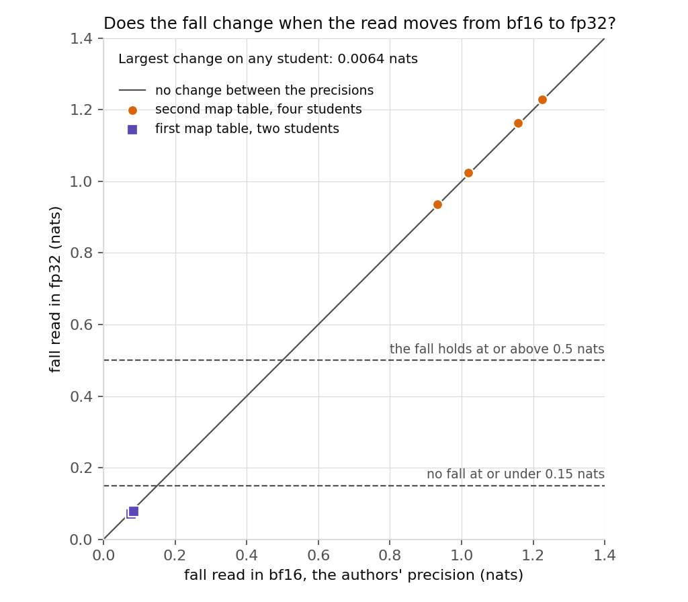

# Analysis: does the fall on the second map table depend on the read's precision? (E12 Amendment 3)

*2026-11-02, coding agent. Plan `reports/plans/2026-11-02_plan_e12-amend3-fp32-read.md`; review `reports/reviews/2026-11-02_review_e12-amend3-code.md`; predictions `experiments/new_vs_existing/results/predictions_amend3.json`; notebook `notebooks/E12_new_vs_existing.ipynb`, last section. Amendment 2 is `reports/analyses/2026-11-02_analysis_e12-amend2-rand32b-fall.md`.*

We read the last job's saved students and fine-tunes again, with the importance values and masked forward in 32-bit as well as the usual 16-bit precision, and trained nothing. The second map table's students still fall by about one nat, the first table's by under a tenth of one, and no fall moved by more than 0.0064. For `GOALS.md`, a student's loss of about a fifth of the re-switching term on the second table does not come from the read's precision, and its cause stays open.

## What was read

A student is the decomposition after teacher training, with Γ and Δ frozen. $L_{01}$ is the mean masked log-odds of the target at the trigger, under Γ's values at the state, Δ left out. The re-switching term is $L_{01}$ minus the same read at W₀. The fall is the fine-tune's $L_{01}$ minus its student's, and it reads 0 for do-nothing, by code.

Amendment 2 read all of this under bf16 autocast. Here W₀, four fine-tunes and six students are read in bf16 and in fp32, on the same 97 windows and the same L40 card. We expected the fall to hold with nothing moved.

## What we observed

**Reading it.** No, the fall does not depend on the read's precision. All six students sit on the line of no change, and each table stays on its side of the filed lines. This rules out read precision and nothing else, so it does not explain the fall.

| student | fall, bf16 | fall, fp32 | change | term lost, fp32 |
|---|---|---|---|---|
| `rand32b` seed 0 | 1.2260 | 1.2283 | +0.0023 | 20.4% |
| `rand32b` seed 0, second order | 1.1568 | 1.1622 | +0.0055 | 19.3% |
| `rand32b` seed 1 | 1.0195 | 1.0240 | +0.0045 | 17.7% |
| `rand32b` seed 1, second order | 0.9330 | 0.9363 | +0.0032 | 16.2% |
| `rand32` seed 0 | 0.0777 | 0.0713 | −0.0064 | 1.9% |
| `rand32` seed 1 | 0.0842 | 0.0790 | −0.0052 | 2.3% |

**The sizes.** The do-nothing read at W₀ differs between the precisions by 0.0008 nats at most. The filed tolerance is twice that plus a guard of 0.01, so 0.0115. It is a size to compare with, not a noise model. Every change above exceeds twice the floor alone, so precision does move these numbers slightly. The second table's largest change is under a tenth of its batch-order difference of up to 0.09 nats.

**Each side of the fall.** A fall cancels what fine-tune and student share, so we read the sides too. The fine-tune's term is 3.5 to 6.0 nats and changes by 0.0051 at most. Each $L_{01}$ changes by 0.0059 at most. Γ did run in fp32: the largest gap in any alive subcomponent's window mean is 0.0086, and the mean gap on a state is about 0.0003.

**Controls.** All 17 filed checks passed and no stop fired. The bf16 side reproduces Amendment 2 exactly at W₀ and on each fine-tune. Students rebuilt from saved offsets differ from Amendment 2's $L_{01}$ by 0.0037 at most, against a stop at 0.05.

**How far it goes.** This covers two tables, one card and the read only. Γ's gap is a window mean, so one entry on one window could move further.

**Limit carried.** A new circuit from old pieces reads "elicited" to VPD, and this run has no copy table. So these are random maps, not "new" capability.

**Surprises.** None. The floor came in under its guessed range of 0.001 to 0.05, and neither verdict turns on it.

**What next.** The filed clause closes the precision item and runs nothing further. The cause stays open.

## Scorecard

Re-scored by hand from the file's raw reads, with floor, tolerance, falls, terms and comparisons all recomputed. All match the stored values.

| id | claim | rule | read | verdict |
|---|---|---|---|---|
| P1 | The second table's fall stays in fp32 | all four ≥ 0.5 nats, tol < 0.5 | smallest 0.936, tol 0.0115 | holds |
| P2 | The first table has no fall in fp32 | all \|fall\| ≤ 0.15 nats, tol < 0.15 | largest 0.079, tol 0.0115 | holds |
| beside | `moved`: \|fall change\| > tol | six students | largest 0.0064 | none |
| beside | `term_moved`: \|term change\| > tol | four fine-tunes | largest 0.0051 | none |

## Departures from the literature

- **Precision.** This decomposition's `artifacts/vpd/s-55ea3f9b/final_config.yaml` has `autocast_bf16: true`, so bf16 is the authors' setting. The fp32 side tests whether the reading depends on precision, and it is not a truer value.
- **Γ's input,** carried from Amendment 2. VPD's Γ trained on rows of 512 tokens and sees 41-token windows here.
- **The masked log-odds, the term and the fall** are this project's measures, not VPD's.

## Not run

- **Training a student or a fine-tune in fp32.** Both trained under bf16 autocast, and this job varies only the read.
- **The students' fp32 weights.** Saved offsets are bf16, so that rounding sits on the student side only, and it is measured in the bf16 read only.
- **Mixed reads,** fp32 Γ with a bf16 forward and the reverse.
- **Sets, writing back or the ladder in fp32,** falls per window, other cards and the copy tables.

**Provenance.** `experiments/new_vs_existing/results/amend3.json` sha256 b5cac53eef96363322bb6ec02d6b69fc20c203e2c71f383a50a63557e1b1cdc0; predictions sha256 04d3e53f07db79745af21a019d3828e39a5f3fa4ca678ab92c426f1aa3f04088, matching the results file. Job 49192, L40, `debug`, about a minute of logged reads, $0, commit 2771c37f, log `cluster/logs/commute-e12-amend3-49192.out`. Figure from `experiments/new_vs_existing/plot_amend3.py`.
