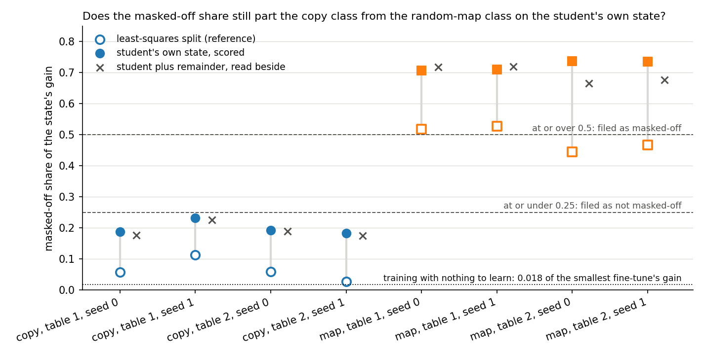
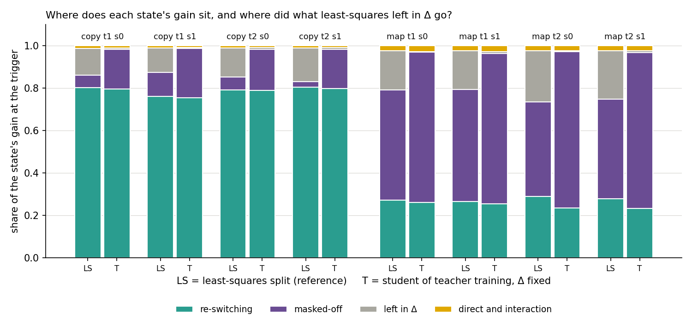
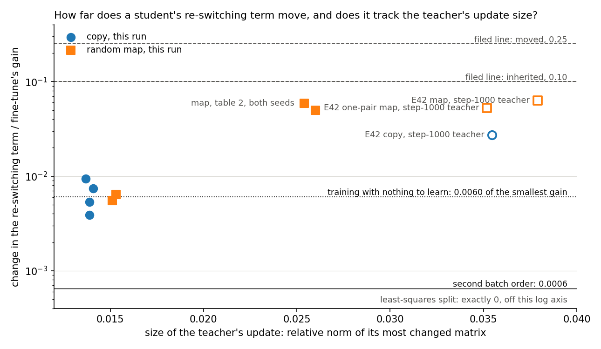
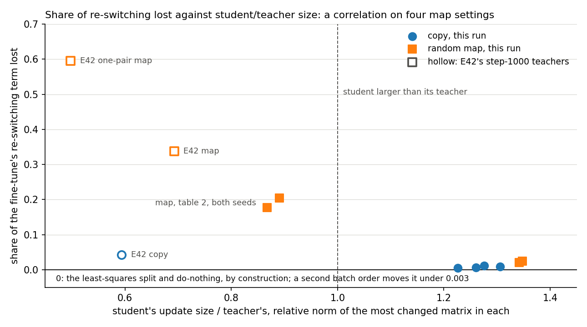
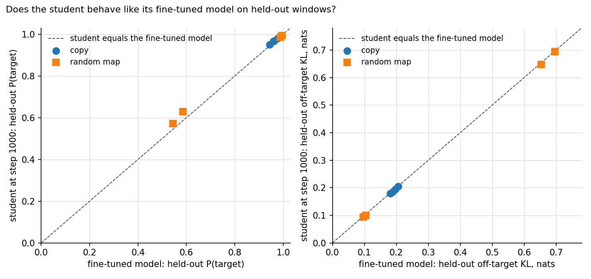

# Analysis: does the route split still part copy tasks from random maps on teacher training's own states? (E12 Amendment 1)

*2026-11-02, coding agent. Plan `reports/plans/2026-11-02_plan_e12-teacher-route-split.md`; code review
`reports/reviews/2026-11-02_review_e12-amend1-code.md`; predictions `experiments/new_vs_existing/results/predictions_amend1.json`, filed before
the run and scored as filed; notebook `notebooks/E12_new_vs_existing.ipynb`, last section; figures from `experiments/new_vs_existing/plot_amend1.py`.*

We trained the decomposition's subcomponents to imitate eight fine-tunes on copy tasks and random word maps, with the leftover weights held fixed, and asked how each imitation carries its gain at the cue. On this card and at this position the two classes stay far apart and each imitation keeps its fine-tune's re-switching by the filed line, though one random-map table lost about a fifth of that term, cause unknown. For `GOALS.md`, the re-switching share that divides the classes barely depends on whether the update sits in the subcomponents or in the leftover weights, except for a fall of a fifth on one map table; this run does not test faithfulness or why the classes differ.

## What we were trying to test

E12 fine-tuned the model on key → value tasks and read each fine-tune through the least-squares split. E12's filed route numbers parted the classes; no number about the weight update did. The route numbers say how the gain at the trigger divides between subcomponents Γ switches on and subcomponents it keeps off. The least-squares split leaves a remainder in Δ, so the question stood open for a map that leaves nothing there.

Teacher training is that map. It trains the alive U and V to imitate the fine-tuned model, with Γ and Δ frozen, so the whole update ends up in the components. We call its result the student. The classes are the copy class, whose target is the key itself, and the random-map class, whose target is a fixed other word. Each class has two tables of 32 pairs and two fine-tune seeds, so there are eight fine-tunes.

Every teacher is a fine-tune at its first learned step. That is step 10, or step 30 on the second map table. Each student trained for 1,000 steps with Adam at 1e-5, as in E42's arm A. The state read here is the student's own, with Δ fixed: target weights W₀ plus the student's change, components the student's U′ and V′. The user chose this state on 2026-11-02. The plus-remainder state, the same components with the fine-tune's target weights, is read beside it and decides nothing.

The route split reads mean log-odds of the target at the trigger on 97 held-out windows. Each cell needs four symbols:

- $T_0$, $T_1$: the target model at W₀ and at the state.
- $U_0$, $U_1$: the components unmasked, Δ left out, at W₀ and at the state.
- $L_{CG}$: the components masked by Γ's importance values, Δ left out. $C$ picks the released or the state's components, $G$ picks Γ's values at W₀ or at the state; 0 is W₀ and 1 is the state.
- The gain is $T_1 - T_0$.

Every share below is over the state's own gain, and the shares sum to 1.

- **Re-switching share** $r = (L_{01} - L_{00}) / (T_1 - T_0)$: what Γ's changed values give the released subcomponents. It is 0 if Γ's values do not change, and 1 if that alone carries the gain.
- **Masked-off share** $= ((U_1 - L_{11}) - (U_0 - L_{00})) / (T_1 - T_0)$: gain carried by subcomponents Γ does not switch on. It is 0 if the masked model holds all the components hold.
- **The rest:** the direct and interaction shares and the share left in Δ.

Three references run first. Do-nothing keeps the released components, so it reads the masked-off share as exactly minus the re-switching share. The least-squares split shares the fine-tuned weights, so its re-switching share equals do-nothing's, and it is the reference for every figure. The third is a teacher equal to W₀, trained from a saved random start, which shows what training alone writes when there is nothing to learn. Its gain is near zero, so it is read in nats. A second batch order on two fine-tunes gives the noise floor.

**Limit carried.** A new circuit from old pieces reads "elicited" to VPD, and E50 Amendment 1 did not show W₀ performs the copy task. So the classes are "copy" and "random map" here, not "existing" and "new".

## What we expected, and why

The masked-off share should separate the classes by E12's rule, with medium-high confidence: E42 read it at 0.31 for a copy table and 0.84 and 0.92 for random maps, at step-1000 teachers. We leaned towards the re-switching term moving partly, with medium confidence, because E43 saw students of step-10 teachers overshoot. We leaned towards the copy class's gain sitting not masked-off, with low to medium confidence, since E42's copy table read just over the filed line.

The filing warned that the three are close to one number. On these states the masked-off share is nearly one minus the re-switching share.

## What we observed

Held fixed throughout: Γ, Δ, the windows and the card. Varied: the table, the fine-tune seed and, on two fine-tunes, the batch order.

### 1. Does the masked-off share still part the classes? Yes, by more than the least-squares split did

| state | class | least-squares masked-off | student masked-off | plus-remainder masked-off |
|---|---|---|---|---|
| ident32 s0 | copy | 0.058 | 0.188 | 0.178 |
| ident32 s1 | copy | 0.113 | 0.232 | 0.227 |
| ident32b s0 | copy | 0.060 | 0.193 | 0.190 |
| ident32b s1 | copy | 0.027 | 0.184 | 0.175 |
| rand32 s0 | map | 0.519 | 0.708 | 0.718 |
| rand32 s1 | map | 0.527 | 0.710 | 0.720 |
| rand32b s0 | map | 0.445 | 0.737 | 0.666 |
| rand32b s1 | map | 0.468 | 0.735 | 0.676 |
| **gap between classes** | | **0.331** | **0.476** | **0.439** |
| **larger within-class range** | | **0.086** | **0.048** | **0.054** |

**Reading it.** Yes. On the student's own state the copy fine-tunes read 0.18 to 0.23 and the random maps read 0.71 to 0.74. That gap is ten times the wider class's spread. The hollow markers are the least-squares reference, which also separates with a smaller gap, and every state moves up from it. The plus-remainder state agrees with the student's own, so no filed disagreement arises. The second batch order moves the share by 0.002, and training with nothing to learn writes under 0.02 of the smallest gain. This covers eight fine-tunes, one card and one position.

### 2. Where does the gain sit? Re-switching stays, and what least-squares left in Δ lands masked-off

| state | LS re-switching | LS masked-off | LS in Δ | LS direct + interaction | student re-switching | student masked-off | student in Δ | student direct + interaction |
|---|---|---|---|---|---|---|---|---|
| ident32 s0 | 0.802 | 0.058 | 0.128 | 0.012 | 0.795 | 0.188 | 0.006 | 0.010 |
| ident32 s1 | 0.761 | 0.113 | 0.115 | 0.010 | 0.755 | 0.232 | 0.004 | 0.009 |
| ident32b s0 | 0.792 | 0.060 | 0.138 | 0.010 | 0.788 | 0.193 | 0.009 | 0.009 |
| ident32b s1 | 0.804 | 0.027 | 0.159 | 0.010 | 0.799 | 0.184 | 0.009 | 0.008 |
| rand32 s0 | 0.273 | 0.519 | 0.184 | 0.023 | 0.262 | 0.708 | 0.003 | 0.027 |
| rand32 s1 | 0.266 | 0.527 | 0.182 | 0.025 | 0.254 | 0.710 | 0.008 | 0.028 |
| rand32b s0 | 0.290 | 0.445 | 0.241 | 0.025 | 0.235 | 0.737 | 0.005 | 0.024 |
| rand32b s1 | 0.280 | 0.468 | 0.229 | 0.024 | 0.233 | 0.735 | 0.007 | 0.024 |

**Reading it.** The copy class's gain is about four-fifths re-switching, and the random-map class's is about a quarter. Those are the fine-tunes' own shares, within 0.012 on six states. What changed is the grey block. The least-squares split left 0.12 to 0.24 of the gain in Δ, and the student leaves under 0.01.

That block moved almost wholly into the masked-off share. In nats, the student's extra masked-off gain on the copy tables is 1.67 to 2.23, against 1.62 to 2.26 that the least-squares split left in Δ. On the first map table the extra is about 0.2 to 0.3 nats larger, the size of that student's gain surplus. On the second map table it is 0.6 to 0.8 nats larger, and the fall in re-switching described next accounts for that. So the components now hold the whole update, but the masked model holds no more than before. Unmasked components gain 1.6 to 4.6 nats over the least-squares split, while the masked read stays within 0.16 nats on six states.

### 3. Does a student keep its fine-tune's re-switching? By the filed line yes, on every state

| state | fine-tune's gain, nats | gain ratio, student / fine-tune | re-switching term, fine-tune, nats | student, nats | change, nats | filed move: change / fine-tune's gain | move a learning shortfall alone would give, (1 − ratio) × r |
|---|---|---|---|---|---|---|---|
| ident32 s0 | 13.99 | 0.997 | 11.23 | 11.10 | −0.132 | 0.0094 | 0.0024 |
| ident32 s1 | 14.07 | 1.001 | 10.71 | 10.64 | −0.075 | 0.0053 | none, ratio over 1 |
| ident32b s0 | 14.60 | 1.000 | 11.57 | 11.52 | −0.056 | 0.0039 | none, ratio 1 |
| ident32b s1 | 14.26 | 0.997 | 11.46 | 11.36 | −0.106 | 0.0074 | 0.0027 |
| rand32 s0 | 13.73 | 1.021 | 3.75 | 3.68 | −0.076 | 0.0055 | none, ratio over 1 |
| rand32 s1 | 13.16 | 1.022 | 3.50 | 3.42 | −0.084 | 0.0064 | none, ratio over 1 |
| rand32b s0 | 20.74 | 0.984 | 6.01 | 4.79 | −1.225 | 0.0591 | 0.0047 |
| rand32b s1 | 20.64 | 0.986 | 5.77 | 4.75 | −1.023 | 0.0496 | 0.0038 |

The batch-order noise on the same scale is 0.0005 and 0.0006, which is 0.007 and 0.009 nats, read on ident32 s0 and rand32 s0.

**Reading it.** The largest move is 0.059 of the fine-tune's gain, under the filed 0.10 line, so the filed verdict is "inherited". This misses our lean towards "partly". The students of step-10 teachers did overshoot in size, ending 1.23 to 1.35 times their teachers, as E43 saw. That did not move the re-switching term, which is what we had leaned on. E43's remainder size was not read here. The figure shows two groups. Six states move by 0.004 to 0.009, about what training with nothing to learn writes, though that control's term goes up and all of these go down. The second map table's two seeds move by 0.05 to 0.06, about ten times more. E42's map students sit near that upper group. The verdict's line is generous for a map: it is a third of a map's re-switching share, as the filing says.

### 4. Why does the second map table move ten times as far? Narrowed, not explained

| state or E42 task | teacher's size | student's size | student / teacher | term lost |
|---|---|---|---|---|
| ident32 s0, s1 | 0.0137, 0.0139 | 0.0175, 0.0175 | 1.28, 1.26 | 1.2%, 0.7% |
| ident32b s0, s1 | 0.0139, 0.0141 | 0.0170, 0.0184 | 1.23, 1.31 | 0.5%, 0.9% |
| rand32 s0, s1 | 0.0151, 0.0153 | 0.0203, 0.0206 | 1.34, 1.35 | 2.0%, 2.4% |
| rand32b s0, s1 | 0.0254, 0.0260 | 0.0226, 0.0226 | 0.89, 0.87 | 20.4%, 17.7% |
| E42 ident32, step-1000 teacher | 0.0355 | 0.0210 | 0.59 | 4.3% |
| E42 rand32, step-1000 teacher | 0.0379 | 0.0262 | 0.69 | 33.8% |
| E42 rand1, step-1000 teacher | 0.0352 | 0.0175 | 0.50 | 59.5% |

Size is the relative norm of the most changed matrix in each state. E42's terms are share times gain, by the same arithmetic.

**Reading it.** The numbers rule out three explanations, leave a fourth unmeasured, and leave the cause open.

- **The denominator.** Not it: the change itself is about ten times larger, 1.0 to 1.2 nats against 0.06 to 0.13.
- **A student that learned less.** Not it: the second map table's gain shortfall of under 2% would explain a twelfth of the move, by the table in section 3.
- **Which components are read.** Not it, for the read-out; the student's components still produce the weights that produce those activations. The same nats fall appears with the released components and with the student's. The masked read with the student's components, on the student's and the fine-tune's values of Γ, differs by 1.23 and 1.01 nats, against falls of 1.23 and 1.02. So the fall is in Γ's values on the student's activations.
- **Batch order.** Unmeasured on this table. Both seeds' students used the same batch order, so their agreement bears only on the teacher's seed. Noise on the other two tables is 0.0006.

What goes with the fall is shown in the figure, but its axis is mostly teacher size. After 1,000 steps student size stays within 0.0170 to 0.0262 while teacher size spans 0.0137 to 0.0379, and a ratio under 1 coincides exactly with a teacher step of 30 or more. The control's size also grows by a third with nothing to learn (0.0182 to 0.0242), so the student's size includes drift. "The only ones that end smaller" is close to "the only teachers larger than a 1,000-step student reaches". The second map table's students are the only ones in this run that end smaller than their teachers, and a map student's lost share grows as that ratio falls. This is a correlation on four map settings, two of them the first map table at different teacher steps. The teacher's size, its training length and its confidence all change together, and two points are from E42, whose windows nobody has compared with these. The copy class does not follow: E42's student on the copy table ends at 0.59 of its teacher and loses 4%. That loss is no more than its own gain shortfall of 5% would give. We do not assert a cause. Which subcomponents' values changed was not read, and the distance between student and teacher weights could not be read on the CPU. The first needs a GPU job, the second needs the released U and V, and neither was run.

This does not block the separation, since the fall moves the map class further from the copy class and the plus-remainder read, where the fall is absent, also separates. It does limit the second reading: "a student keeps its fine-tune's re-switching" holds cleanly on six of the eight, and on the second map table only in units of the gain.

### 5. Do the students behave as the fine-tuned models do? Yes, with one small surplus

| state | P(target), fine-tuned model | student, step 1000 | off-target KL, fine-tuned model, nats | student | KL to teacher at the trigger, last batch |
|---|---|---|---|---|---|
| ident32 s0 | 0.959 | 0.965 | 0.189 | 0.186 | 0.00054 |
| ident32 s1 | 0.962 | 0.967 | 0.181 | 0.180 | 0.00095 |
| ident32b s0 | 0.977 | 0.979 | 0.205 | 0.205 | 0.00136 |
| ident32b s1 | 0.944 | 0.949 | 0.196 | 0.195 | 0.00137 |
| rand32 s0 | 0.585 | 0.629 | 0.696 | 0.693 | 0.01816 |
| rand32 s1 | 0.544 | 0.571 | 0.653 | 0.647 | 0.02476 |
| rand32b s0 | 0.996 | 0.993 | 0.097 | 0.093 | 0.00004 |
| rand32b s1 | 0.988 | 0.986 | 0.104 | 0.100 | 0.00067 |

The off-target KL is against W₀, on held-out windows.

**Reading it.** Yes. The student's off-target KL sits within 0.007 of the fine-tuned model's on all eight, including the first map table's high value. E46's fine-tune log suggests why that value is high. The second map table's training KL falls from about 0.5 at step 10 to 0.1 at step 30, so stopping at step 10 may catch the first map table near its peak. E42's step-1000 teacher on that table reads 0.06, which fits, though the first table's path between those steps was not read. Held-out P(target) sits within 0.006 on six states.

The first map table is the exception, and we cannot explain it. Its students beat their half-learned teachers by 0.03 to 0.04 in P(target), and by 0.29 nats in log-odds. All three students of that table read gain ratios over 1, and it has the poorest fit of any table. The surplus is 2% of the gain and no reading rests on it.

### The control: training with nothing to learn

| table read | start: gain, nats | end: gain | end: re-switching term | end: masked-off term | stop line |
|---|---|---|---|---|---|
| ident32 | 0.025 | 0.293 | 0.067 | 0.172 | 1.5 |
| rand32 | 0.022 | 0.328 | 0.079 | 0.235 | 1.5 |

One training, read under both tables. The stop did not fire, and the filing marks it as weak. The terms are 6 to 22 times under the line, and as a share of the smallest teacher's gain they are at most 0.018.

Three things here are not explained. The student against W₀ ends further from it than it began: size 0.0182 to 0.0242, loss 0.0078 at step 1, 0.179 at step 10 and 0.0266 at step 1000. Both targets' log-odds rise by about 0.3 nats. And most of that sits masked-off. The masked-off term is three to four times what Amendment 8 read on emoticon windows, about 0.06 nats. This run's start gain of 0.02 nats also corrects the plan's "about 1 nat", as the review expected. None of this bears on a 13-nat gain, but it is a reason not to read small moves as signal.

### How far the three verdicts are independent

They are not three pieces of evidence. On the student's state the rest is 0.013 to 0.037, so the masked-off share is one minus the re-switching share to within that.

| number used for the separation rule | copy range | map range | gap | larger range |
|---|---|---|---|---|
| fine-tune's re-switching share, E12's fact | 0.76-0.80 | 0.27-0.29 | 0.471 | 0.042 |
| student's re-switching share | 0.76-0.80 | 0.23-0.26 | 0.493 | 0.044 |
| student's masked-off share, the scored one | 0.18-0.23 | 0.71-0.74 | 0.476 | 0.048 |

So there is one new fact: on six of eight states, Γ's values on the student's activations give the released subcomponents about the same masked log-odds as on the fine-tune's; on the second map table they give 1.0 to 1.2 nats less, about a fifth of the term. Whether the same subcomponents switch was not read. Given that, a small rest and E12's separation, the first and third verdicts follow by arithmetic. The small rest is itself mostly expected, since Δ is fixed and E42 read 0.03 to 0.05. A separation by a wider gap than least-squares' is therefore no extra support. It only records that the remainder moved from Δ to masked-off.

## What we learned

For the goal's second branch, the class difference survives on teacher training's own output. On six of eight states, Γ's values on the student's activations give the released subcomponents about the same masked log-odds as on the fine-tune's; on the second map table they give 1.0 to 1.2 nats less, about a fifth of the term. Whether the same subcomponents switch was not read. So the re-switching share that divides the classes barely depends on whether the update sits in the components or in Δ, except for that fall, on these eight fine-tunes, this card and this position. The masked-off share takes up what Δ no longer holds. This run does not test faithfulness or why the classes differ. Teacher training fills the components without filling the masked model. For the random maps, more than seven-tenths of the gain is carried by subcomponents Γ keeps off, against about half under the least-squares split. The route split is a mechanism reading, not the weak version's pass criterion, and no faithfulness harness ran here, so this run gives no verdict on the weak version. The classes are copy and random map: a new circuit from old pieces reads "elicited", so this does not say the map is new capability.

## How compelling is the evidence

- **Coverage.** Two tables and two seeds per class, one key → value format, one position, one card. Teachers are at first learned step only. Nothing here covers other tasks or the larger model.
- **Noise.** Two batch-order pairs, on ident32 s0 and rand32 s0, at 0.002 on the masked-off share and 0.0006 on the filed move. Nothing was read on the second map table, where the moves are large.
- **Blind to.** Which subcomponents switch on: the same share could be other subcomponents. This run read shares, not sets.
- **Confound carried from E12.** The first map table's teachers hold P(target) at only 0.54 to 0.59. The first map table's agreement is with a half-learned teacher, and the well-learned second map table is the one that moves.
- **The inherited verdict.** Its 0.10 line is a third of a map's share. Read against a map's own re-switching term, the second map table lost a fifth.
- **Batches.** Seed-0 students share their first batches with their teachers, seed-1 students do not. No difference between the seeds shows here, but all eight students train at batch order 0, so the s0/s1 comparison cannot separate shared batches from teacher seed.
- **Controls.** All 44 filed checks passed. Do-nothing's identities read exactly. The re-switching share against E12's differs by at most 0.0013, across cards.

## Surprises

- **Filed lean missed.** We leaned towards "partly" on the re-switching term and it read "inherited". An overshoot in size appeared on the step-10 teachers but did not move re-switching.
- **The second map table's fall** is ten times the others', unexplained beyond section 4.
- **The first map table's students** beat their teachers on held-out P(target), unexplained.
- **The control's student moved further from W₀** with nothing to learn, unexplained, small.

## What next

`what_changes_next` in the filing has this clause fire: "P1 separates and P2 inherited: E42's claim widens to two tables per class; nothing further runs." Its preamble applies: "Each clause ends with the user hearing the result first." This also applies: "P3 masked-off, not masked-off or mixed is reported against E42's lean and changes no step." No plus-remainder disagreement arises, so that clause does not.

So nothing further is proposed as filed. The fall is being run down as E12 Amendment 2, a free cluster job; saved students are bf16 offsets, so that job first reproduces the falls from fp32 weights.

## Scorecard

| id | claim | rule | read | verdict | lean |
|---|---|---|---|---|---|
| C0 | references behave, stop rule | r within 0.03 of E12, identities within 1e-6, least-squares separates | at most 0.0013, 0, gap 0.331 over 0.086 | pass | as expected |
| C1 | training alone stays under the line, stop rule | abs r and e_gate terms at most 1.5 nats | at most 0.235 | pass | as expected; weak |
| P1 | e_gate of state (a) separates by E12's rule | gap > within | min map 0.7078, max copy 0.2318, gap 0.4760; within 0.0480; swapped −0.553 | **separates** | separates: holds |
| P1, state (b), reported | same | same | gap 0.4388, within 0.0545 | separates | |
| P2 | a student keeps its re-switching | under 3 states, or no pair: unscorable. noise > 0.05 with move < 3 × noise: no power. Any ≥ 0.25: moved. All ≤ 0.10: inherited. Else partly | largest move 0.0591, largest noise 0.00065 | **inherited** | partly: **missed** |
| P3 | where the copy class's gain sits | ≥ 0.5 masked-off; ≤ 0.25 not; strict majority of copy states | 0.188, 0.232, 0.193, 0.184: 4 of 4 not masked-off | **not masked-off** | not masked-off: holds |
| P3, state (b), reported | same | same | 0.178, 0.227, 0.190, 0.175 | not masked-off | |

Rechecked by hand from the raw cells in the results file, without importing the run's code: all shares, the gaps, the moves, the pool. Pool: all eight states, none dropped; gain 13.5 to 20.4 nats, ratio 0.984 to 1.022.

Filed expected values on the student, all held:

| number | filed | read |
|---|---|---|
| r, copy | 0.55-0.85 | 0.755-0.799 |
| r, map | 0.10-0.30 | 0.233-0.262 |
| e_gate, copy | 0.10-0.40 | 0.184-0.232 |
| e_gate, map | 0.60-0.85 | 0.708-0.737 |
| 1 − r − e_gate | at most 0.06 | at most 0.037 |
| gain ratio | at least 0.7 | at least 0.984 |
| e_gate of state (b) against (a) | within 0.1, a guess | within 0.0711 |

## Departures from the literature

- **VPD trains U, V, Γ and Δ together on masked losses.** Here only the alive U and V train, on an unmasked KL to a teacher, with Γ and Δ frozen and no sparsity or masked loss. It keeps the weak version testable.
- **Γ's input.** VPD's Γ trained on rows of 512 tokens and is bidirectional; it sees 41-token windows here, as in E12.
- **The route split is this project's measure,** not the paper's. VPD has no such reading.
- **Adam (Kingma and Ba).** Default betas, plus gradient clip at 1 and no warm-up, carried from E34.

Departures from this project's own sources, for the record. From E12: a different state, only the two route numbers, an L40 rather than an A40, and teachers that are E46's rebuilds. From E42: teachers at first learned step rather than step 1000, and no Pile harness. Seed-0 students share their first batches with their teachers.

## Not run

- **Which subcomponents' values fall on the second map table,** fine-tune against student. Being run as E12 Amendment 2 (see What next).
- **Distance between student and teacher weights.** It needs the released U and V, and the project's hook refuses loading the model on a CPU. A GPU job would read it in seconds.
- **A second batch order on the second map table.**
- **The plan's other reads:** the Pile harness on any student, the Pile-text arm, step 100, more than two batch orders, step-1000 teachers on the second tables, switched-on counts and overlap with E12's sets, a null teacher on these windows, a second random start, E12's other numbers on these states, other tasks, Qwen.

**Provenance.** `experiments/new_vs_existing/results/new_vs_existing_amend1.json` sha256 3de19ebe243f65f3d5af6db8ce4cfd4e69842e64e0c6f4ae1dbcea991c03a6db. MATS cluster job 48885, NVIDIA L40, `debug` QoS, 23 minutes, $0, code at commit 48cf644, log `cluster/logs/commute-e12-amend1-48885.out`. Students' offsets `experiments/new_vs_existing/results/large/amend1/`. Teachers and windows: `experiments/regating_table/results/large/`, E46's rebuilds, sha256 checked at the job's start. The E42 comparison uses `experiments/teacher_training/results/teacher_training_e42_{ident32,rand32,rand1}.json`.
