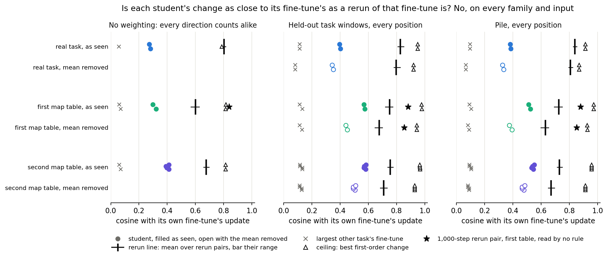
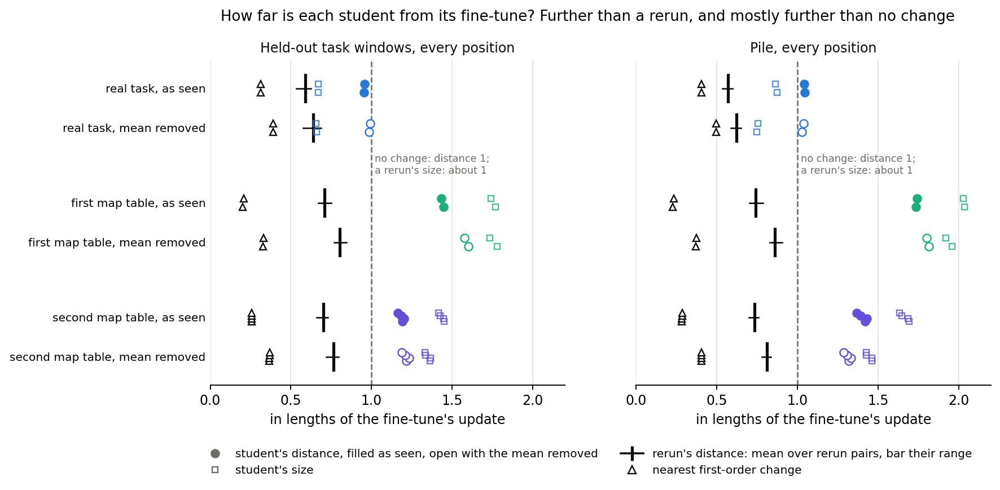

# Does the decomposition after teacher training copy the fine-tune's change on real inputs?

*E34 Amendment 10, 2026-11-02. Plan `reports/plans/2026-11-02_plan_e34-amend10-input-weighted.md`. Rules `experiments/teacher_training/results/predictions_amend10.json`. Results `results/amend10.json`, job 49467: L40, `debug`, $0. Figures `plot_amend10.py`. Review `reports/reviews/2026-11-02_review_e34-amend10-code.md`; only that one review, as this was a free job with the controls first.*

We compared each decomposition after teacher training with its fine-tuned model's update, on the inputs the model sees, and against reruns of the same fine-tune. On every task the change is further from the fine-tune's than a rerun is, in angle and in distance, so "copies the fine-tune's change on real inputs" is not available. For `GOALS.md`, the wording comes per task from the filed table below, its behaviour half cited from earlier runs, and the commute line closes on this model.

## The wording, per family

The filed outcome is "further than a rerun", in angle and in length, on both families. No sentence joins them.

- **Real task.** Reproduces its behaviour by a change further from the fine-tune's than a rerun is. The behaviour is cited from E34, 0.0286 nats from the fine-tuned model.
- **First map table, `rand32`.** Reproduces its behaviour by a change further from the fine-tune's than a 10-step rerun is. The behaviour is cited from E12 Amendment 2: its gain ratio is 1.02, and the re-switching term moves 2%.
- **Second map table, `rand32b`.** Further than a 30-step rerun, keeps its gain, and loses about a fifth of the re-switching term. Both are cited from E12 Amendment 2. "Reproduces its behaviour" is not available here.

**Scope of each sentence.** Each holds at each matrix's output on W₀'s inputs, at every position of held-out windows and of Pile. None is about the trigger, and this job read no behaviour. "Different change" may mean only "further than a rerun". The re-switching term is what Γ's changed values give the released subcomponents.

**Read apart.** At the trigger alone, and under the training's own weighting of trigger plus task, both families also read further on both axes. Neither read decides against the sentences.

## What we measured

The *student* is the decomposition after teacher training. $S$ is its weight change from W₀ and $\delta W$ its fine-tune's update. The inner product is $\sum_k \mathrm{tr}(A_k \Sigma_k B_k^\top)$ over the 24 matrices, with $\Sigma_k$ the second moment of matrix $k$'s input on W₀.

Cosine reads 1 for the same direction. Distance $\lVert S-\delta W\rVert/\lVert\delta W\rVert$ reads 1 for no change. Size is the length ratio.

The references are reruns differing only in batch order, the largest cosine from another task's fine-tune, and the ceiling, the best first-order change. Both forms below must agree for a verdict.

## Is a student as close as a rerun?

**Reading it.** No, for all eight students, in both forms on both input sets. Each student sits far above another task's fine-tune, so it follows its task, and far under the rerun line. The ceiling is above the line everywhere, so "further" is not forced by construction. On the map tables the shortfall is at least 0.17, and on the real task at least 0.42. Margins are about 0.05.

| As seen; mean removed | Student | Rerun line | Other task | Ceiling |
|---|---|---|---|---|
| Real, task windows | 0.40; 0.35 | 0.83; 0.80 | 0.11; 0.08 | 0.95; 0.92 |
| Real, Pile | 0.38; 0.33 | 0.84; 0.81 | 0.10; 0.07 | 0.91; 0.87 |
| `rand32`, task windows | 0.57; 0.45 | 0.75; 0.68 | 0.13; 0.13 | 0.98; 0.94 |
| `rand32`, Pile | 0.52; 0.38 | 0.72; 0.63 | 0.11; 0.09 | 0.97; 0.93 |
| `rand32b`, task windows | 0.58; 0.50 | 0.76; 0.71 | 0.13; 0.13 | 0.97; 0.93 |
| `rand32b`, Pile | 0.54; 0.47 | 0.73; 0.67 | 0.11; 0.09 | 0.96; 0.91 |

Student is each family's midpoint; its students lie within 0.02. Other task is the largest; ceiling the family's value, to 0.01. No cause of the gap was measured, and none is claimed. Whether the differences cancel downstream is unread.

## Distance and size

**Reading it.** Every student is further than a rerun, and reruns read 0.57 to 0.86 at size 1. Map-table students are further than no change would be, at 1.16 to 1.82. Their sizes are 1.33 to 2.04. Real students read just under 1 on task windows, at most 0.99, and just over on Pile, at most 1.04. Their sizes are 0.66 to 0.87.

## How far weighting moved the reading

Amendment 9 counted every direction alike. Weighting raised the student's cosine by 0.10 to 0.26, raised the reruns' less, and narrowed the gap. No student reached the rerun line, so the side of the line did not change.

| | Student: none; task; Pile | Mean removed: task; Pile | Rerun: none; task; Pile | Gap: none; narrowest |
|---|---|---|---|---|
| Real | 0.28; 0.40; 0.38 | 0.35; 0.33 | 0.80; 0.83; 0.84 | 0.53; 0.43 |
| `rand32` | 0.31; 0.57; 0.52 | 0.45; 0.38 | 0.60; 0.75; 0.72 | 0.29; 0.18 |
| `rand32b` | 0.40; 0.58; 0.54 | 0.50; 0.47 | 0.67; 0.76; 0.73 | 0.27; 0.18 |

Roughly half of the student's rise goes when the mean is removed. Gaps here are between midpoints.

## The control stop, and what the control can say

Job 49463 stopped on the power control's Frobenius bound, before any input-weighted read of a student. That control adds a random change on input directions with an eigenvalue under 1e-3 of the mean. The input-weighted cosine should then stay near 1. The third revision, commit `5c0d54d6`, made the Frobenius side written and not a stop.

| Set | Input-weighted cosine | Frobenius cosine | Matrices with $k/d$ = 1 | The rest |
|---|---|---|---|---|
| Pile | 1.00000 | 1 | 24 of 24 | none |
| emoticon windows | 0.99999 | 0.567 | 20 of 24 | 0.86 to 0.90 |
| `rand32` windows | 0.99999 | 0.562 | 21 of 24 | at least 0.996 |
| `rand32b` windows | 0.99999 | 0.579 | 21 of 24 | at least 0.996 |

Here $k/d$ is the share of a matrix's input directions above that threshold. On Pile it is 1 on every matrix, so nothing was added and the control has no content there. At this threshold, Σ has no near-empty input direction on most matrices. So this control does not show that weighting had power. The only evidence is the movement in the table above.

## What the seed read can and cannot mean

On task windows and Pile, each map-table student reads nearer its own fine-tune than the other seed's students do, by 0.065 to 0.106. The filed label is "follows its own run", against the filed lean of "cannot tell" or "mixed". It can mean the student holds something tied to the run it imitated, beyond what the task's runs share.

It cannot mean closeness to that run, since the student stays under the rerun line. It rests on two seeds per table, with no read on the real task. Shared batches cannot carry it alone, because the batch orders cross them. With sharing matched on Pile, as seen, the excess is still 0.08 or more; this comparison is unfiled. At the trigger alone the label is "mixed", with three of four second-table students reading "follows the task only".

## The length limit

Map-table reruns run 10 and 30 steps, the real task's 1,000. So a difference between families cannot be read as task rather than length. One 1,000-step `rand32` pair reads 0.88 as seen, on both input sets. The 10-step line reads 0.72 on Pile and 0.75 on task windows. No rule reads this pair, and no student of a 1,000-step map fine-tune exists.

The plan and filing give map-table fine-tunes a target probability of about 0.55. The controls read that on `rand32` only, 0.557 to 0.585. On `rand32b` at 30 steps they read 0.988 to 0.996. The filed text stands; this report uses the reads.

## Surprises

Four filed leans missed. The seed read is above. The trigger alone leaned "cannot tell", for wide margins that did not come. The power control's Frobenius bound stopped the first job. Real-task ceilings on Pile, 0.91 and 0.87, sit under the leaned 0.93.

## What next

The line closes on this model with these sentences. Only a downstream read could change them.

## Scorecard

| Id | Claim | Read | Verdict | Lean |
|---|---|---|---|---|
| P1 | Map tables: angle, length | by table and input, all further | further; further | hit |
| P2 | Real task: angle, length | all further | further; further | hit |
| P3 | Own run or task only | task windows, Pile | follows its own run | **miss**: "cannot tell" or "mixed" |
| P4 | Trigger alone | map 0.46 to 0.66, line 0.68 to 0.81; real 0.31 to 0.34, line 0.72 | further; further | **miss**: "cannot tell" |
| P5 | Trigger + task | map 0.45 to 0.63, line 0.68 to 0.80; real 0.33 to 0.35, line 0.73 to 0.76 | further; further | hit |

Other controls passed: layout, the Frobenius re-read of Amendment 9, each recipe at its saved seed, and the real reruns' target probability. Rounding is at most 1e-5; the largest matrix share is 0.14 to 0.17.

## Departures from the literature

None. No cited procedure is reproduced. The cosine and rerun recipes are the project's own.

## Not run

- A behaviour test of whether the differences on inputs matter downstream.
- Each model's own activations as inputs, which are second order.
- Per-matrix verdicts; the inner products are saved.
- A stricter power control, or one on the trigger sets.
- E42's students; a 1,000-step pair on the second table.
- Anything on Qwen. Comparisons with cheaper or baseline methods are other leads' lines: none here.
