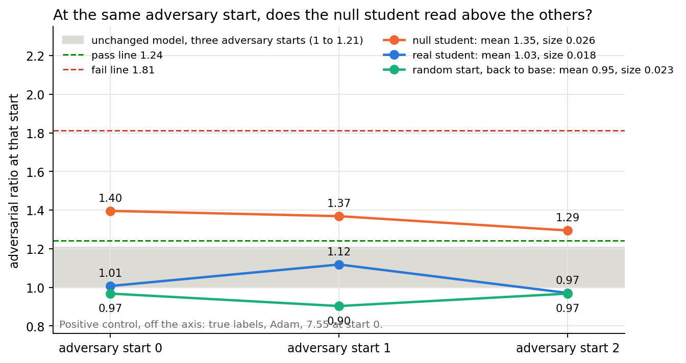
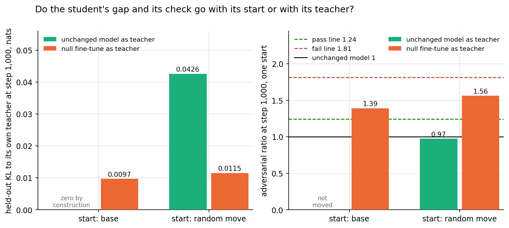
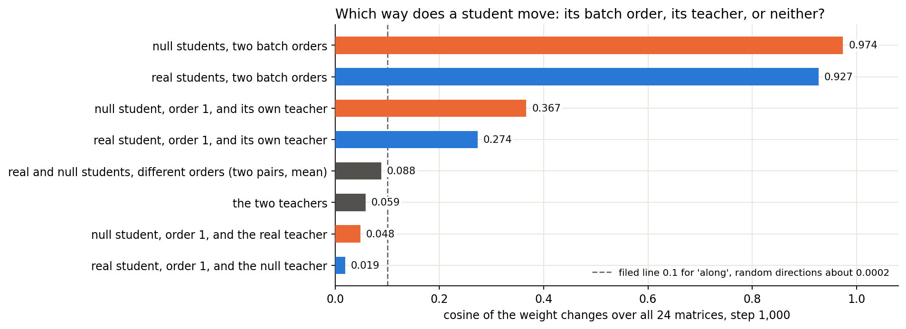

# What does training do when the unchanged model is the only thing to learn from?

*E34 Amendment 8, with Amendments 8b and 8c, 2026-11-02. Plan `reports/plans/2026-11-02_plan_base-control.md`, audit
`reports/reviews/2026-11-02_review_base-control-audit.md`, code review `reports/reviews/2026-11-02_review_amend8-code.md`,
independent check `reports/reviews/2026-11-02_review_amend8-analysis-check.md`, predictions
`experiments/teacher_training/results/predictions_amend8{,b,c}.json`. Figures from `experiments/teacher_training/plot_amend8.py`.
The author did not run the jobs. Corrected the same day; the review section lists what changed.*

We trained the decomposition's read and write vectors with the unchanged model, or a fine-tune that taught nothing, as the only
thing to learn from, to see whether these methods learn a gap between base and decomposition. Nothing breaks: runs learning from
the base end at its level on the adversarial check, while a student of the teach-nothing fine-tune reads above a real student at
all three adversary starts, which the filed test calls within noise. So a pass means "no harm seen"; on this task how far a
student moves barely depends on its teacher, and about a tenth of its move lies along that teacher.

**Limits on all of it.** One narrow task for the teacher runs, one label draw, one null teacher, the 67M model.

## What we were trying to test

The user's worry: a method might be learning the difference between the base model and its decomposition, not the
difference between the base and the fine-tuned model. A control for that trains with the base as the only thing to learn.

The obvious control cannot fail. Teacher training's student is the stored base model plus a hook that adds only the offsets'
change, so with teacher = base and zero offsets the two forwards are the same bytes. The gradient is exactly zero
(`src/commute/teacher.py:31-37`), no step moves anything, and E34's control read zero by construction. A useful control must
really move. Every arm below uses E34's task-text recipe unless stated: emoticon windows, Adam at 1e-5, batch 32, 1,000
steps, Γ and Δ frozen. Each job read the unchanged model first and stopped on a miss. All jobs ran on one L40, at $0.

- **Random start, back to base.** Teacher = the base, start = a random move of the alive read and write vectors at the real
  student's size. It asks whether training restores the base's outputs and weights from a small gap.
- **Round trip, back to base.** Teacher = the base, start = the real student. It asks whether teacher training can be undone.
- **Null fine-tune and null student.** A full-weight Adam 3e-5 fine-tune whose every label is drawn afresh from the base's own
  predictions, so it teaches no behaviour. It does move the predictions: at step 100, the checkpoint nearest the real fine-tune's
  size, its KL to the base is 0.53 nats. So its student has something to copy. It is the one arm matched to the real student in
  start, batches and having a fine-tune as teacher. Beside it is the real student at two batch orders.
- **Self-labels.** Labelled component training on lowercase rows, with labels drawn from the base, at E39 Amendment 2's Adam
  and SGD rates; beside each, the same recipe on true labels. It asks whether E39's fail belongs to the recipe.
- **Masked recipe at coefficient 0.** The component path with every mask 1 and no masked term, on the 32-pair cipher windows.
  It asks whether the path and Adam, rather than the masked terms, caused the masked control's 25.99.

**Readings.** The *adversarial ratio* or *check* is a state's KL under a 20-step adversary on 256 Pile rows, over the same
job's unchanged model at the same adversary start; 1 means at the base. This card's pass line is 1.241 and its fail line 1.813.
*Size* is the largest ‖δW‖ / ‖W₀‖ over the 24 matrices. *Damage* is mean KL from the base away from the trigger; rows are under
"Rows and masks". The *Δ-out ratio* is the state's KL when Δ is removed and every mask is 1, over the base's 0.0120 nats on
Pile (`pile_ratios.unmasked_kl`). It is not damage. *Gap to the teacher* is unmasked KL to the student's own teacher.

## What we expected, and why

We expected walks, not returns. With a small gap and fresh batches, Adam should keep moving, so the random start should end
larger with its gap not closed, but passing. The round trip should recover outputs and pass, while only part of its size
comes back. The null student should reach a comparable size in another direction and pass. Self-labels should stay near the
base, and coefficient 0 should pass.

## With the base or a null teacher to learn from, does the check stay at the base's level?


**Reading it.** In five of the six runs, yes. The grey band is the base's own spread over three adversary starts. Above the
divider sit the six runs with no behaviour to learn. Five of their six end states sit at or below the band's top, and so do 12 of
the 13 reads, 7 of which are earlier reads of the same runs or the untrained start. The one that does not is the null student at
step 1,000, 1.39, inconclusive, and Amendment 8b shows that this is not simply one start's reading. Below the divider,
true-label Adam reads 7.33 and the masked recipe at coefficient 0.5 reads 25.99, so the check can fail on this card.

| State | Check | Stochastic | CI-masked | Δ-out | Size | Damage | Gap to own teacher | Verdict |
|---|---|---|---|---|---|---|---|---|
| Random start, start | 0.999 | 1.003 | 1.003 | 1.004 | 0.0182 | 0.0037 | 0.0068 | pass |
| Random start, 100 | 0.944 | 0.998 | 1.003 | 0.973 | 0.0187 | 0.0041 | 0.0289 | pass |
| Random start, 1,000 | 0.975 | 0.992 | 1.005 | 0.945 | 0.0228 | 0.0050 | 0.0437 | pass |
| Round trip, start = real student | 0.987 | 0.955 | 0.984 | 0.874 | 0.0182 | 0.0181 | 12.38 | pass |
| Round trip, 100 | 0.970 | 0.947 | 0.982 | 0.848 | 0.0181 | 0.0160 | 0.0597 | pass |
| Round trip, 1,000 | 0.963 | 0.966 | 0.994 | 0.876 | 0.0214 | 0.0101 | 0.0578 | pass |
| Null student, 100 | 1.030 | 0.952 | 0.986 | 0.876 | 0.0123 | 0.0856 | 0.0437 | pass |
| Null student, 1,000 | 1.391 | 0.957 | 1.010 | 0.821 | 0.0257 | 0.1198 | 0.0097 | inconclusive |
| Null teacher, random start, 1,000 (8b) | 1.562 | 0.959 | 1.010 | 0.821 | 0.0296 | 0.1205 | 0.0115 | inconclusive |
| Real student, 1,000 | 0.987 | 0.955 | 0.984 | 0.874 | 0.0182 | 0.0181 | 0.0286 | pass |
| Self-labels Adam, 100 | 0.923 | 1.001 | 1.009 | 0.985 | 0.0102 | 0.0129 | no teacher | pass |
| Self-labels Adam, 1,000 | 0.984 | 0.993 | 1.006 | 0.958 | 0.0236 | 0.0225 | no teacher | pass |
| Self-labels SGD, 100 | 1.196 | 0.999 | 1.007 | 0.997 | 0.0071 | 0.0174 | no teacher | pass |
| Self-labels SGD, 1,000 | 0.998 | 0.999 | 1.001 | 0.955 | 0.0173 | 0.0213 | no teacher | pass |
| Coefficient 0, 100 | 0.989 | 0.986 | 1.001 | 0.956 | 0.0057 | 0.0057 | 0.0441 | pass |
| Coefficient 0, 1,000 | 1.006 | 0.979 | 0.996 | 0.906 | 0.0173 | 0.0078 | 0.0665 | pass |
| Real fine-tune left in Δ | 1.390 | 0.920 | 0.993 | 5.749 | 0.0315 | 0.0554 | 0 | inconclusive |
| Null fine-tune left in Δ | 2.636 | 0.970 | 1.018 | 9.171 | 0.0277 | 0.1222 | 0 | fail |
| True labels Adam, 1,000 | 7.333 | 1.352 | 1.352 | 1.348 | 0.0540 | 0.2708 | no teacher | fail |
| True labels SGD, 100 | 1.314 | 1.084 | 1.102 | 0.992 | 0.0137 | 0.1251 | no teacher | inconclusive |

The base in every job: adversary KL 0.692, 0.836, 0.705 at seeds 0, 1, 2; floor 0.2088; CI-masked 0.348; stochastic 0.248;
Δ-out 0.0120. The real student reads identically in two jobs, so the regeneration is exact across jobs.

### Check ratios below 1

Nine of the 13 reads sit below 1, between 0.923 and 0.999. So a reading below 1 does not need a fine-tuned teacher or any behaviour,
and it cannot be read as "better than the base". The base's seed 0 is the lowest of its three starts, so these are not lucky
denominators. A small real fall of up to 8% is possible. Averaged over three starts, the random start's state reads 0.946 and the
real student 1.03. The plain reading is "at the base". The audit's list of 0.89 to 0.96 fits that reading, give or take a few
hundredths on another card. E41 Amendment 2's "excess removed" of 1.18 at step 1,000 should read "all the excess removed", not
"more than all".

## Which methods can learn from a base-to-decomposition gap?

| Method | Can its loss see the gap? | What this says | What cannot be said |
|---|---|---|---|
| Teacher training on the hook path, all E34, E37, E39, E41, E42 and E43 hook-path arms | No: no component forward in the loss; exactly zero at teacher = base from zero offsets; rounding off the base 0.0005 to 0.0012 | It does not learn that gap directly. From a moved start the gradient is nonzero and the student moves, at the base's level on the check | Whether part of the Δ-out fall, in no loss, is an indirect effect of that gap; see the bound below |
| Plain-SGD arm S | No, same loss | Nothing new: not rerun | Whether SGD's fail survives with nothing to copy |
| Labelled component training (E4, E21, E26, E39 A2) | No: masks and Δ are not in the loss. The loss is nonzero, from labels | With self-labels the same recipe moves to 0.0236 and 0.0071 and stays near the base. E39's 7.24 needs the true labels at this step count; no self-label state reached the true-label size | Why SGD at step 100 reads 1.20 and then 1.00; narrow tasks were not rerun |
| Masked teacher training (E37 A1 arm 2, E42 A1, A2) | Yes: the masked terms | Coefficient 0 reads 1.006 against 25.99 at coefficient 0.5, same card, windows and batch order. The path and Adam do not cause the fail; the masked terms do | E37's rows were not run at coefficient 0. A rounding gradient alone still moved the state to 0.0173 |
| Γ refit, E15 | Yes | No new reading; its control already failed | Which term |
| Least-squares, adjoint, rescaling and step splits; Γ shift map | No training on data; zero at δW = 0 | This control adds nothing | Nothing further |

The worry was right for the recipes containing the gap, and those recipes have no standing pass. The hook-path recipes cannot
learn it directly. There is also a bound. The whole gap on Pile is 0.012 nats, against a start gap of 5 to 13 nats for a real
teacher, so even if all of it were learned indirectly it could not be the update.

## How much of a student's size and direction is the recipe?


**Reading it.** On this narrow task, size barely depends on the teacher. Every Adam student ends within 0.76 to 1.41 of the real
one, however measured. The real student ends at 0.0182 and the null student at 0.0257. On lowercase rows, true labels at 0.054
depart from self-labels at 0.0236, and E37's real student there, 0.0365, departs too, on another card. So this holds on the
emoticon task and not generally. Self-labels at SGD reach 0.52 of the real student in offsets, and no arm varied the optimiser or the
rate on the hook path. This fits the earlier puzzle that student size barely follows its teacher, 0.014 to 0.018 for teachers of
0.011 to 0.032. The random start's and round trip's sizes include their start.


**Reading it.** Which way a student moves depends on which teacher it copies, on the one pair of teachers tried. It overlaps that
teacher's own change only modestly, and Amendment 8c reads this at both batch orders. The null and real students share 0.090. That
sits just under the filed 0.1 line, so "a walk elsewhere" is one draw's class: 0.11 would read "some", class "partly", outcome
"fails" by the filed rule, with no change in meaning. All four cross pairs read 0.086 to 0.091 in Amendment 8c, far from the 0.93 and
0.97 within a teacher.

### How close each student gets to its own teacher


**Reading it.** Not a floor. Held-out gaps at step 1,000 run from 0.0097 for the null student through 0.0286 for the real one
to 0.0437 and 0.0578 for the two with the base as teacher. The random start's gap rose under training, from 0.0068. These four
numbers measure different things, as the table shows.

| Student, step 1,000 | Teacher's P(target) | Start gap | Held-out gap | At the trigger | Elsewhere | Train batch at trigger | Train batch elsewhere | Gradient norm, before clip |
|---|---|---|---|---|---|---|---|---|
| Real | 0.999 | 5.35 | 0.0286 | at most about 0.003 (estimate from CE 0.0032) | about 0.025 | 0.00001 | 0.0020 | 0.34 |
| Null | 0.0036 | 0.46 | 0.0097 | unread | unread | 0.0031 | 0.0028 | 0.92 |
| Null teacher, random start | 0.0036 | 0.47 | 0.0115 | unread | unread | 0.0032 | 0.0028 | 1.13 |
| Random start | 0.004 (E34's plan) | 0.0068 | 0.0437 | 0.0386 | 0.0050 | 0.0108 | 0.0024 | 2.11 |
| Round trip | 0.004 (E34's plan) | 12.38 | 0.0578 | 0.0477 | 0.0101 | 0.0119 | 0.0028 | 3.28 |

**Rows and masks.** All these gaps use no masks: the state's merged weights W₀ + δW against its teacher's merged weights, Γ
unused, Δ inside the weights. Rows are the 73 held-out emoticon windows, one number per window: KL at the trigger plus the mean
KL over the other positions. The trigger part above is held-out gap minus damage, both on those windows, so it holds only with
the base as teacher. The start gap of the real and null students, and the train columns, are single batches of 32. In the main
table, damage is on those 73 windows for the teacher runs, on plain Pile rows for self-labels and true labels, and on the cipher
windows for coefficient 0.

**What explains it, and what stays open.**

- *Why the real student reads low at the trigger.* Its teacher is almost one-hot there, so matching one token costs little.
  Most of its gap is elsewhere, on held-out windows, 12 times the train batch's value. That is a different quantity from the
  others, whose gap is largely at a broad trigger distribution.
- *Why the random start rose above its start.* From the curve and the code, explained in part, not tested. Adam moves every
  entry by about the learning rate from its first step, however small the gradient. The train loss goes from 0.0070 to 0.296
  to 0.457 in two updates (`results/large/amend8/run_n1.log`), then decays, and 1,000 steps leave it at 0.0132, still above the
  start. The masked recipe at coefficient 0 shows the same shape from a gradient that is only rounding: 0.0016, then 0.113 at
  step 10, then 0.0216. This rise appears with the base as teacher. E41's real links do not show it, as the comparison says.
- *Not rounding.* Curves on the hook path and reads on merged weights agree within 1%: damage 0.00507 against 0.00504 at the
  random start's end. The hook-path floor, 0.0005 to 0.0012, sits ten times under.
- *Why the null student ends so low.* Amendment 8b answers: the low gap goes with the null teacher, not with starting at W₀.
- *Open: why the base as teacher ends so far above a null teacher, from the same start.* The difference is at the trigger in the
  train batches, 0.0165 against 0.0032. The base and the null teacher hardly differ in P(target) there.
- *Open: why the random start's held-out trigger gap keeps rising,* from 0.0248 at step 100 to 0.0386 at 1,000, while the train
  batch's trigger KL falls from 0.0133 to 0.0108.

## The Δ-out ratio across every arm


**Reading it.** The fall does not need a fine-tuned teacher. The audit called a 3-28% fall unexplained because teacher-trained states
read 0.72 to 0.97. Here it appears with the base as teacher or as the source of labels, and grows with steps: random start 1.004 to
0.945, self-labels 0.958 and 0.955, coefficient 0 0.906. A random move with no training reads 1.004, so training does it, not moving.
A moved teacher adds more, and the one-factor contrast is clean: from the same random start, 0.945 with the base as teacher against
0.821 with the null teacher. From W₀ the null teacher also reads 0.821, so the start does not matter here. By the hook-path runs, a
third to a half of the real student's fall is there with the base as teacher. The windows and rows differ, so that share is rough.
The round trip returns the outputs but keeps the fall. The masked terms add nothing to it: 0.900 at coefficient 0.5, 0.906 at 0.

So part of the fall needs no fine-tuned teacher and none of it is a loss term; the rest comes with copying a moved teacher, by a
mechanism unread. Δ-out is the one reading of the user's gap itself, the KL between a state's weights and those weights without Δ. The
fall is small: 0.126 of 0.0120 nats is 0.0015 nats, against CI-masked 0.348. E34's Pile-text arm at 0.73 falls further than any run
here, and that part stays unexplained.

## Why does the null student read above the real one?


**Reading it.** Not settled; Amendment 8b below says what the readings allow. At one start the difference is 0.40, about twice the
base's 0.21 between starts, at size 0.0257 against 0.0182. Size alone does not explain it: the random start at 0.0228 and self-labels at
0.0236 read below 1. The clearest difference is damage, 0.120 against 0.018 on task windows. The null student copied its teacher's 0.122
almost whole, where the real one carries a third of its teacher's 0.055. Across this figure the check rises with damage, but the states,
rows and teachers differ, and null at step 100 reads 1.03 at damage 0.086. The nearest test goes against damage alone: the null teacher
in Δ and its student have the same damage, 0.122 and 0.120, and read 2.64 and 1.39. Those two are different states, so that is no clean
test, but it shows damage does not set the check by itself. The real fine-tune in Δ also reads 1.39; no reason connects them.

## Amendment 8b

Two checks. Read the same saved states at three adversary starts. Run the missing cell of start by teacher: the null teacher from the
random start's start.

### Is the null student's reading more than an adversary start's noise?



**Reading it. Filed answer: within noise.** The filed rule pools the three KLs of each state. It finds them overlapping, null 0.913 to
1.144 against real 0.684 to 0.935, and the excess of 0.305 sits under the spread of 0.367. Most of that spread is adversary start 1, which
is high for every state, the base included. The rule says it ignores pairing by start.

**Beside it, not the filed rule.** Pairing by start, the null student exceeds the real one at each of the three starts, by 1.22 to
1.39 times, mean ratio 1.35 against 1.03. Three of three has a chance of 1 in 8 if neither were higher. The null student is also
filed-class "apart" from the random start's state, of similar size 0.0228 against 0.0257, which averages 0.95. Over three starts the
null student reads inconclusive, the real student and random start pass, and true-label Adam at start 0 reads 7.55, so the test had power.

### Does the gap go with the start or the teacher?



**Reading it.** The teacher, by the filed rule. The gap with a null teacher is 0.0115 from the random start and 0.0097 from the base; with
the base as teacher from that start it is 0.0426. The position between those references is 0.117, under the 0.33 line. Damage, stochastic,
CI-masked and Δ-out also match the null student at the other start, and the train batches match. The check is the reading that moves
further: 1.56 at size 0.0296, inconclusive. The bar marked with the base as teacher is the random start's own run, 0.975, since the job's
control took no adversary read; its gap reproduced within 3%. The fourth cell, start and teacher both the base, is zero by construction,
so an interaction cannot be separated from a main effect.

### What these allow, and what they do not

- **Allowed.** With one null teacher, a student can read above the real student without any behaviour being taught, more than the size or
  the start alone accounts for. From one start, changing only the teacher takes 0.975 to 1.56, 0.59 at one adversary start. So teacher
  training's reading depends on what it copies, and a null teacher gives no guarantee of the base's level.
- **Allowed, as a lean only.** The filing says that "the teacher" with a check above 1.24 gives the null teacher's damage more weight as a
  candidate. It does, and the same-damage do-nothing state above limits how far. From E39 on H100 and plain rows, teacher-trained
  states at damage about 0.125 read 1.27 for a LoRA teacher and 2.12 for a rank-8 SGD one.
- **Not allowed.** A cause. No run varied damage alone. Any statement about real teachers' states beyond their own reads. That 1.39 is a
  fail, or that it generalises; a second label draw or another task may differ. That moved exceeds null: 1.56 against 1.39 is one start, 0.17
  apart, inside the 0.21. That size has no part once the teacher is fixed.

### Scorecard, Amendment 8b

| Id | Rule, verbatim | Read | Lean: hit or miss |
|---|---|---|---|
| S1 | "From the three KLs of the null student at 1,000 (a) and of the real student (b), same starts. separation: every a above every b, strictly: 'apart'; every b above every a: 'reversed'; any tie or crossing: overlap. On overlap, excess = mean a / mean b - 1 against spread = the larger of max / min - 1 of a and of b, relative: excess at or under spread 'within noise', above 'suggestive'. A KL not finite or not above 0, or fewer than three readings of either: 'unscorable'. answer = that class, or 'no power' if true-label Adam's seed-0 KL is not 'apart' from the real student's three. Six readings in two groups of three give 'apart' by chance 1 time in 20 if the two states did not differ, ignoring the pairing by start. 'apart': yes, more than start noise. 'within noise': no. 'suggestive': three starts do not settle it" | null KL 0.966, 1.144, 0.913; real 0.697, 0.935, 0.684; excess 0.305, spread 0.367; control apart. **Answer: within noise** | 'within noise', low-medium: **hit**. Null over real above 1 at two of three or more, medium: **hit**, three of three |
| S2 | "faith_score.verdict of the null student's mean_ratio over three starts against this job's floor: pass at or under 1.5 / (1 + f), fail at or above 1.5 (1 + f), inclusive; else inconclusive; a None or non-finite mean 'unscorable'. Same for the real student and the random start. The lines already carry W0's own spread, so an average of three read against them is conservative" | null 1.353 inconclusive; real 1.032 pass; random start 0.946 pass; true labels 7.553 fail | Null pass, medium-low, 1.05-1.30: **miss**. Real pass, high, 0.90-1.05: **hit** |
| S3 | "S1's class with the random start at 1,000 as b. The report's reason that size alone does not explain the null's reading rests on this state, size 0.0228 at 0.975. 'apart' keeps that reason at three starts; otherwise it does not hold on the check" | random start KL 0.669, 0.755, 0.682. **Apart** | Same class as S1, medium: **miss** |
| M1 | "g = the arm's held-out gap to the null teacher at 1,000. a = the null student's, 0.00970 (start W0, null teacher; n3b's file). b = the control's, this job (the arm's start, teacher W0), about 0.0437. position = ln(g / a) / ln(b / a), 0 at a and 1 at b. At or under 0.33 'the teacher': the null student's low gap goes with its teacher, whatever the start. At or above 0.67 'the start': it goes with starting at W0. Between 'both'. Below 0 and above 1 fall in the end classes. b / a under 2, or reversed: 'no power'. Any of g, a, b not finite or not above 0: 'unscorable'. The report asks for 'a null teacher from a moved start' and leaves the start open: this takes the random start's saved start, the one choice where the arm differs from one reference only in teacher and from the other only in start. The round trip's start, 12 nats from the null teacher, is not run" | g 0.01154, a 0.00970, b 0.04258; position 0.117. **The teacher** | 'the start', low: **miss**. Check under 1.24, medium: **miss**, 1.562 |

Controls: all early checks passed. W₀ at seed 0 matched Amendment 8's exactly. Rebuilt bf16 states read within 3.1% of their fp32 reads at
seed 0, inside the 7% stop. The control's gap was 0.975 of the random start's, inside the 25% stop.

## Amendment 8c

Reruns the null and real students at two batch orders and reads all 15 cosines between the four students and two teachers.



**Reading it.** Null students reproduce: cosine 0.974 between batch orders against the real students' 0.927, a ratio of 1.05. So
reproducing does not mark the real student. Each student also lies more along its own teacher than along the other: 0.274 against 0.019 for
the real, 0.367 against 0.048 for the null. Those are the order-1 students, which share no batches with a teacher, so the filed
`follows_own_teacher` is true.

- **What that supports.** A student's direction overlaps its own teacher's, more than the other's, on this one pair of teachers. As a
  share of squared length that is about 7% for the real student and 13% for the null, 7.5% and 13.4% at order 1. Shared batches do not
  explain it: order 0 and order 1 read within 0.008, and the students' inflation is 0.002, "not shown".
- **What it does not support.** That "a student's direction is its teacher's", or that a student copies its teacher's move. That the
  overlap carries the behaviour, since a cosine says nothing of that. That any reading generalises past one task, one label draw and two
  teachers. The two students also have about 11% of the real student's squared length in common, if each is a shared vector plus an
  orthogonal walk, at different batch orders; that amount is about what its own teacher accounts for, and the quantities differ.
- **Unknown.** The remaining 87-93% of each student's squared length lies along neither teacher, and it reproduces across batch orders,
  so it is not batch noise. It is fixed by some combination of teacher, start, windows and recipe. What it is, and whether it matters
  to behaviour or to the check, is unread. Per-matrix and other readings can start from the saved offsets for $0.

### Scorecard, Amendment 8c

| Id | Rule, verbatim | Read | Lean: hit or miss |
|---|---|---|---|
| C1 | "r = cos(null o0, null o1) / cos(real o0, real o1), relative, same job. r at or above 0.75 'reproduces'; at or under 0.25 'does not', a negative cosine included; between 'partly'. Real cosine under 0.2 'no power' (it is stopped earlier, at 0.92731 within 0.001, so only a fault reaches this). Either cosine not finite: 'unscorable'. Different batch orders, so nothing is shared but teacher and start. At the control's 0.927 the lines are 0.695 and 0.232. 'reproduces' means reproducibility does not mark the real student; 'does not' means it does, on this one null teacher" | 0.974 / 0.927, r 1.050. **Reproduces** | 'partly', low-medium, r 0.4-0.75: **miss** |
| C2 | "own, other = the student's cosines with its own teacher and with the other. Both under 0.1 'neither'. Own at or above 0.1 and share(own) at or above 4 x share(other) 'own' (four times the share is twice the cosine). The same with own and other swapped: 'other'. Otherwise 'both'. An opposite direction has share 0. A cosine not finite: 'unscorable'. Scored on order 1 only. follows_own_teacher: true if both order-1 students read 'own', false otherwise, None if either is unscorable. True supports 'a student's direction overlaps its own teacher's, more than the other's'; false corrects the review's replacement sentence too. Edge: own and other both exactly 0.1 reads 'both'; a share of 0 with own at the line reads 'own'" | real own 0.2735, other 0.0190; null own 0.3666, other 0.0483. **Both 'own'; follows_own_teacher true** | Real 'own', medium: **hit**. Null 'own', medium-low: **hit**. True, medium-low: **hit** |
| C3 | "students_inflation as above; not finite 'unscorable'. Ties at the line read 'not shown'. Reported beside it: review item 2's shared share of the real student with the null, at the same order and at different orders" | same-order 0.0897, 0.0908; cross 0.0913, 0.0855; d 0.0019. **Not shown**; shared share 0.110 same order, 0.111 and 0.105 cross | 'inflated', medium-low: **miss**. Cross cosines 0.04-0.07: **miss**. Shared share under 12%: **hit** |

Controls: every regenerated cosine matched Amendment 8's within 0.001. Gaps at the two orders agree: null 0.0097 and 0.0101, real 0.0286 and 0.0277.
Sizes: null 0.0257 and 0.0251, real 0.0182 and 0.0184.

## Comparison with E41's chain, E37 Amendment 1 arm 3 and E39 Amendment 2

The references ran on an H100, with lines at 1.40 and 1.61. This amendment ran on an L40, with lines at 1.24 and 1.81.
The two floors are 0.0748 and 0.2088, and the denominators at seed 0 agree, 0.699 and 0.692. The same recipe's student reads 0.959 and
0.987 on the two cards, regenerated: T1000's size differs 2%. E37 and E39 use lowercase rows of 512 tokens with a plain mean, where E41 and
this amendment's teacher runs use emoticon windows.

| State | Card | Check | Size | Damage | Gap to teacher | Δ-out |
|---|---|---|---|---|---|---|
| E41 one-shot, T100 | H100 | 1.016 | 0.0168 | 0.0363 | | |
| E41 one-shot, T1000 | H100 | 0.959 | 0.0184 | 0.0180 | 0.0284 | 0.881 |
| E41 chain, T100 link, 1,000 steps | H100 | 1.054 | 0.0214 | 0.0460 | 0.0094 | 0.837 |
| E41 chain, T1000 link, 1,000 steps | H100 | 1.000 | 0.0251 | 0.0269 | 0.0166 | 0.824 |
| E41 A2, T300 link, 100 steps | H100 | 0.956 | 0.0149 | 0.0249 | 0.0175 | 0.871 |
| E41 A2, T1000 link, 100 steps | H100 | 0.910 | 0.0152 | 0.0217 | 0.0290 | 0.863 |
| Real student | L40 | 0.987 | 0.0182 | 0.0181 | 0.0286 | 0.874 |
| Round trip, 1,000 steps, teacher = base | L40 | 0.963 | 0.0214 | 0.0101 | 0.0578 | 0.876 |
| Random start, 1,000 steps, teacher = base | L40 | 0.975 | 0.0228 | 0.0050 | 0.0437 | 0.945 |
| E37 A1 arm 3, start | H100 | 1.049 | 0.0399 | 0.0500 | 0.111 | 0.957 |
| E37 A1 arm 3, 1,000 | H100 | 1.758 | 0.0533 | 0.2367 | 0.0113 | 0.910 |
| E37 A1 arm 3, 2,000 | H100 | 1.836 | 0.0566 | 0.2440 | 0.0090 | 0.897 |
| E39 A2 labels, Adam 1,000 | H100 | 7.242 | 0.0541 | 0.2704 | n/a | 1.344 |
| Same recipe, this job | L40 | 7.333 | 0.0540 | 0.2708 | n/a | 1.348 |
| E39 A2 labels, SGD 100 | H100 | 1.275 | 0.0138 | 0.1247 | n/a | 0.992 |
| Same recipe, this job | L40 | 1.314 | 0.0137 | 0.1251 | n/a | 0.992 |
| Self-labels SGD, 100 | L40 | 1.196 | 0.0071 | 0.0174 | n/a | 0.997 |

- **E41's chain, long links.** E41's report flagged size growing per link as "the pattern accumulation would show", untested. The T1000 link
  grew 17% and the T100 link 52%. On the L40 the round trip grew 17% and the random start 25%, from another start size. So some growth is
  what the recipe does anyway; one pair cannot say how much, and the earlier link grew more. The excess damage over one-shot, 0.009, was
  already there after the T100 link, 0.010, and the last link lowered damage; so this does not show a link adding damage.
- **E41 Amendment 2, short links.** After 100 steps the round trip changed size by under 1% and the random start by 2.5%. The last link grew
  2%, the smallest; earlier ones grew 7% to 29% from smaller sizes. The short chain's 0.83 times the one-shot's size fits fewer steps, 700
  against 1,000, untested. Restarting Adam raised train KL to 0.3 to 0.5 nats with the base as teacher. The real links in
  `run_e41_amend2.log` show no such rise, at most 18% at the logged steps, on an H100.
- **E37 Amendment 1 arm 3.** Here a moved start with the base as teacher does not raise the check. Arm 3's rise comes with damage going from
  0.05 to about its teacher's 0.235, and the gap to the teacher falling tenfold. Amendment 8b's moved-start reading points the same way:
  from one start, copying a moved teacher raises the check. That leans toward copying over drift, on another text and card; the lowercase
  form of the control was not run.
- **E39 Amendment 2, the labelled-SGD reversal.** The recipe reproduces across cards: same size, gain and damage, check 1.275 and 1.314.
  Two things change how that pass reads. On the L40's wider lines the state is inconclusive rather than a pass. And the self-label state
  reads 1.20, a difference of 0.12 inside the 0.21 between adversary starts, though it gains nothing: gain −0.004 against 0.125. The
  stochastic ratios separate them, 1.08 against 1.00. So one start's check hardly distinguishes labelled SGD from a walk here, which fits the
  standing line that SGD's passes carry no weight. Labelled Adam's 7.33 against self-label Adam's 0.98 is clear, at this step count.

## Does the round trip come back?


**Reading it.** The outputs do; the size does not, though about a quarter of the original direction is undone. KL to the base falls from
12.38 to 0.058, inside the 5% line, and P(target) from 0.997 to 0.014. Its bar was 0.04. Size grows from 0.0182 to 0.0214, so the filed return
fraction is −0.17 against a filed 0.76, and from a random start −0.25. The filed miss stands. Size is blind to direction: in offsets, the
review's reading has the round trip's end at cosine 0.64 with the real student, with its length along the real move falling to 0.74 of the
original; the random start undoes about 1% of its own. Squared-offset return reads −0.33. The states still pass. Many read and write
vectors may compute nearly the base's function. Damage does return in part, 0.018 to 0.010.

## The round trip's filed card, and what it says about E41's chains

The card fired only on the size return, not on the check or the outputs. It does not change the claim that a chain's states keep the
behaviour and pass with Δ fixed. It does change what size in a chain may be read as, in either direction. Draft for
`docs/research_log/parts/sections/decisions.html`:

```html
<div class="card key decision" id="decision-chain-size"><span class="chip uninf urgency">No rush</span><div class="k">Question for you · commute · new 2026-11-02</div><p class="small">Nothing runs until this is decided.</p><h3>When teacher training is repeated along a fine-tune, may we read how far the subcomponents moved as what the fine-tune taught?</h3>
<p><strong>The question.</strong> Teacher training can be repeated: each round starts from the last round's subcomponents and copies the fine-tune at a later step. This is the only test we have of keeping a decomposition current along training. We have read the size each round reaches as error piling up, or not piling up. We now have a first reference for what a round does when there is nothing new to copy.</p>
<p><strong>The evidence.</strong> We took the decomposition after one teacher training and ran 1,000 more steps with the unchanged model as the teacher. Its predictions came back: the KL to the unchanged model fell from 12.4 to 0.06 nats. Its largest relative weight change grew from 0.018 to 0.021, though about a quarter of the original direction was undone. It passed the adversarial check, at 0.96. From a random start of that size it grew to 0.023. In the real repeated run, on another card, the last long round grew by 17% and the one before by 52%. So some growth would happen with nothing to copy, and this one pair cannot say how much. The long repeated run ends with more damage on other text than one round (0.027 against 0.018); the excess was there a round earlier, and the last round lowered it. The check and the kept behaviour are read on each state, so they stand.</p>
<p><strong>Options.</strong> (a) Change the wording only. Nothing runs, $0. We keep "each state keeps the behaviour and passes", and do not read size in either direction until a repeated run with nothing to teach exists. It does not tell us how such a run would read. Nothing follows. (b) The same wording, plus a repeated run with nothing to teach: seven rounds of 100 steps against a fine-tune whose labels come from the unchanged model's own predictions. One free cluster job, about 35 minutes. We read it against a single round on the same teacher, which averages 1.35 over three adversary starts. If it reads above that at all three starts, repeating harms by itself, and any repeated run on the larger model needs a new recipe first. If about the same or lower, repeating adds no harm we can see, and size in repeated runs says nothing either way. One task, one label draw.</p>
<p><strong>Recommendation: (a).</strong> No plan repeats teacher training now, and no pass depends on reading size. Run (b) first if the larger model's plan chooses repeated rounds.</p>
<div class="links"><a href="#e34">E34</a><a href="#e41">E41</a></div>
<p class="small">Names in the reports: repeated rounds are E41's "chain" and "links"; the 1,000 steps with the unchanged model as teacher is Amendment 8's N2. <code>reports/analyses/2026-11-02_analysis_e34-amend8-base-control.md</code></p></div>
```

**The other flag: `gap_line_needs_amendment` on the random start.** Its warm start read 0.00122 on this card, above the 0.0007
limit filed from H100 readings, so the rule asks for a dated amendment before the gap reading is used. This is that amendment,
2026-11-02; the predictions file is not edited. The line becomes three times the card's reading, 0.0037 in place of 0.002. The
start at 0.0068 and the end at 0.0437 sit above both, so "not closed" holds and the outcome does not move. This job's other warm
start, from the real student, read 0.00048, so one card gives two values. The reading is hook path against merged weights at a
single batch. The gap itself is merged against merged, so this floor bounds the training path and not the read.

## Standing claims: breaks, complicates, or stands

None breaks.

| Claim, file | Verdict | Why |
|---|---|---|
| "Teacher training is a map of a finished update that keeps the behaviour, faithfulness and Δ together", `docs/research_log/parts/sections/claims.html:57` | **Complicates**; behaviour, check and Δ stand | Each read is on the state. Five of six runs with no behaviour to learn end at about 1, so a pass near 1 shows no harm and no more; the matched null student does not pass, over three starts. "Map" cannot claim the student's size on this task, and 7-13% of its direction lies along its teacher |
| Teacher training passes where do-nothing fails, E34, E47, `claims.html:57` | **Complicates** | Each read stands. The fall from do-nothing to student also happens on a null teacher, 2.64 to 1.39 at one start, so it does not by itself show the update was carried |
| "The only map of a finished update that keeps the behaviour, passes the check and leaves Δ alone", `techniques.html:32` | **Stands** | Add that on narrow tasks its size says little |
| Cosine with δW 0.05 to 0.44, scored ✗, `techniques.html:70` | **Stands**, now with its cross pairs | Own 0.27 and 0.37; other 0.02 and 0.05: more than the other teacher, about 7-13% of squared length. The ✗ stays |
| E41's chains and "no pile-up", `experiments/TRIED.md` E41 and E41 Amendment 2, `experiments/e41.html` figure 4 | **Complicates**, card | Passes stand. Some size growth would happen anyway; do not read size either way |
| E41 Amendment 2 "removes 1.18", TRIED row | **Complicates**, wording | Below 1 is "at the base"; say "all removed" |
| E34 "teacher = W₀ moves nothing", TRIED row | **Stands**, wording corrected | Zero by construction; no step moved anything |
| Teacher training fails on a broad fine-tune, also from the adjoint split, `claims.html:59` | **Stands** | Arm 3's rise leans toward copying; lowercase control not run |
| E39 Amendment 2: labelled Adam fails, TRIED, E39 card | **Stands**, stronger | Self-labels 0.98 with true labels 7.33 in the same job: the fail needs the labels, at this step count |
| E39 Amendment 2: labelled SGD passes, reversing its prediction, E39 card | **Complicates** | Inconclusive on the L40's lines, and within seed noise of its own self-label state |
| "SGD's passes carry no weight", `claims.html:57`, E49 | **Stands**, more support | As above |
| The masked line closed; "with nothing to copy reads 3.84", `techniques.html:75` | **Stands**, stronger | Coefficient 0 reads 1.006: the path and Adam do not cause the fail, on E42's windows |
| Do-nothing's fail, `claims.html:44`, `claims.html:49` | **Complicates** | A fine-tune teaching no behaviour, at size 0.028 and step 100, fails do-nothing at 2.64, one start. So that fail does not need new behaviour, and it fits "size alone does not decide" |
| E43, E47's own reads, E48, E49; every split; Γ refit; Γ shift map; Pile-text claim, `claims.html:58` | **Stands** | Nothing here reads them |
| Audit's "unexplained fall" in Δ-out, `reports/reviews/2026-11-02_review_base-control-audit.md` | **Complicates** | Part needs no fine-tuned teacher, the rest goes with a moved teacher; mechanism unread |

## What we learned

Hook-path teacher training cannot learn a base-to-decomposition gap directly, and with the base as teacher it stays at the base on the check.
The recipes that can see that gap are the masked ones, and the masked terms are what fail them. For `GOALS.md`'s weak version this leaves
teacher training as the map, with its verdicts on real teachers intact, but a pass now means "no harm seen" and no more. One teacher that taught
no behaviour gave students above the base at every start read, so the reading depends on what is copied, and a cause is not known. On this
task, a student's size is nearly independent of its teacher; no arm varied the optimiser or the learning rate on the hook path. Its direction
differs between the two teachers tried, with 7-13% along its own, and most of the move is unidentified.

## How compelling is the evidence

One task for the teacher arms, one cipher task for the masked recipe, lowercase rows for self-labels. One label draw, one null teacher, one
random direction, a 20-step adversary, 67M, one card. Three adversary starts for three states and one for the rest, so read classes. A pass
is a lower bound. The stochastic and CI-masked floors are 0.002 and under. The size is the largest matrix and the cosine all matrices. Size
is blind to direction; the cosines are blind to function. All filed early checks passed, every job's W₀ read passed with one floor, and
true-label Adam failed as the positive control. The filed S1 reads "within noise"; the pairing beside it is unfiled and has three pairs.

## Surprises

Something unexpected happened that I cannot explain: the null student was expected to pass, and reads inconclusive, 1.35 on average
over three starts, 1.39 at one, and 1.56 from a moved start.

- **Filed lean missed.** The low gap was expected to go with the start; it goes with the teacher.
- **Filed lean missed.** Null students reproduce at least as well as real ones, 0.974 against 0.927.
- **Reversed sign.** The round trip's size was expected to return 0.2 to 0.6 of the way and grew, −0.17.
- **Do-nothing on a null fine-tune fails at 2.64,** above the dated note's guide of 1.0 to 2.5 and above the real fine-tune's 1.39, one start.
- **The random start's gap rose under training.** It rose sixfold with the base as teacher.
- **Size under the estimates.** Random start 0.0228 against 0.028 to 0.039; null fine-tune 0.0705 at step 1,000 against about 0.09,
  damage 0.229 against 0.3 to 0.8.
- **Null fine-tune's KL to the base is 1.86 after one step** and 0.52 to 0.58 from step 30 on.
- **P(target) moves by itself.** The random move alone reads 0.0121, three times E34's plan's 0.004, not reread on this card; the null
  fine-tune reads 0.0015 to 0.0131. A mean probability of that size is not a measure of learning.

## What next

1. A test varying one factor of the null teacher: students of the null fine-tune at steps 10, 30 and 100, whose damage is similar, 0.11 to 0.12,
   at sizes 0.012 to 0.028. If the check holds across them, size drops out; if it follows size, damage alone does not set it.
2. A second label draw of the null teacher, one job. If its student reads near 1, the reading belongs to a draw, not to null teachers.
3. Per-matrix and direction readings of the unidentified 87-93% from the saved offsets, $0. Nothing proposed yet says what it is.
4. The chain card above. Qwen's lead gets a note: its teacher training has this shape, and its size has the same missing reference.

## Scorecard, Amendment 8

| Id | Rule, verbatim | Read | Lean: hit or miss |
|---|---|---|---|
| N1 | "gap = gap_class(kl_w0 at 0, kl_w0 at 1000, line 0.002 nats, absolute: about 3 x the largest hook-floor reading, H100): non-finite 'invalid'; start at or under the line 'no power' (stopped at read 0, so reached only by a fault); end at or under it 'closed'; end under start 'partly'; else 'not closed'. Verdict at 1000 by base_verdict. outcome: verdict fail -> 'fails'; invalid or gap invalid or no power -> 'unscorable'; gap other than 'closed' -> 'fails, gap not closed'; else pass -> 'holds', inconclusive -> 'inconclusive'. Return fraction reported, classed at 0.76, not in the outcome: the plan gives it no expected value here. Decision-tree card: verdict fail only; 'fails, gap not closed' has its own row, no card (plan Tree)" | gap 0.0068 to 0.0437, not closed; check 0.975 pass; return −0.251. **Outcome: fails, gap not closed**; no card; line amendment above | outcome medium: **hit**. Pass medium-low: **hit**. Not returned high: **hit**. Expected size 0.028-0.039: **miss**, 0.0228 |
| N2 | "gap_class with line = 0.05 x kl_w0 at 0 (relative); kl_w0 at 0 of 0 is stopped at read 0. p_back: P(target) at 1000 at or under 0.04, absolute, ten times W0's, because 5% of KL(W0 \|\| state) allows P about 0.25; NaN None. Return fraction at 1000, 'returned' at or above 0.76. Verdict at 1000. outcome: verdict fail -> 'fails'; invalid, gap unscorable, p_back None or return None -> 'unscorable'; gap other than 'closed', P not back or not returned -> 'fails'; pass -> 'holds'; inconclusive -> 'inconclusive'. Decision-tree card: verdict fail, not returned, or P not back. Score also carries the T1000 student's own verdict and check on this card" | gap 12.38 to 0.0578, closed; P 0.0143, back; return −0.172, not returned; check 0.963 pass; T1000 student 0.987 pass. **Outcome: fails; card** | Pass medium-high: **hit**. Gap closed and P back, medium: **hit**. Not returned medium-low: **hit**. Fraction 0.2-0.6: **miss** |
| N3a | "size, kl_w0, damage, P(target) of the null fine-tune at 1, 3, 10, 30, 100, 300, 1000, logged and saved; no harness; chosen checkpoint by nearest_checkpoint. Nothing scored" | sizes 0.0035, 0.0066, 0.0118, 0.0184, 0.0277, 0.0425, 0.0705; chosen step 100 | Step 100 medium: **hit**. Under 0.09 medium-low: **hit**. P near W0's: **miss in part**, up to threefold of E34's plan's value |
| N3b | "class by 'the recipe (n3b)' in measurements. Verdict at 1000. outcome: verdict fail -> 'fails'; invalid or unscorable -> 'unscorable'; class 'the recipe' or 'partly' -> 'fails'; class 'not the recipe' or 'a walk elsewhere' with pass -> 'holds', with inconclusive -> 'inconclusive'. Decision-tree card: class 'the recipe' or verdict fail. 'partly' goes to the user as a surprise, no automatic card. Damage reported, not in the rule. Score also carries the real student's verdict and check" | size ratio 1.41 "about"; cosine 0.0897 "none" against control 0.927; class a walk elsewhere; check 1.391 inconclusive. **Outcome: inconclusive**; no card | Class medium-low: **hit**. r 1-1.8: **hit**. Under 0.1: **hit**, narrowly. Pass medium: **miss** |
| N4 | "at E39's scored state (Adam 1e-5 step 1000; SGD 0.03 step 100; SGD's step 1000 reported): base_verdict of the self-label state. pass 'near base'; inconclusive 'inconclusive'; invalid 'unscorable'. fail with the PGD ratio not failing: 'fails on the stochastic ratio'. fail on PGD: share = (self check - 1) / (same-job true-label check - 1); true check at or under 1 or not finite: 'fails, no reference'; share at or above 0.5: 'fails, about the true labels'; else 'fails, under the true labels'. n4_adam only: true-label verdict not 'fail' -> class and outcome 'no reference' for a self-label state not failing, 'fails, no reference' for one failing: a pass there has no power. E39's 7.24 itself is not read against: another card. Decision-tree card: verdict fail. SGD's true-label state may read inconclusive on this card (H100 1.28 against 1.24), its filed exemption: SGD has no 'no reference' rule" | Adam 0.984 near base, true labels 7.33 fail; SGD 1.196 near base, true labels 1.31 inconclusive, exempt; SGD at 1,000 0.998. **Outcome: holds for both**; no card | Adam medium-low: **hit**. SGD medium-high: **hit** |
| N5 | "base_verdict at step 1000 on the component path. outcome: fail -> 'fails'; invalid -> 'unscorable'; inconclusive -> 'inconclusive'; pass -> 'holds'. Decision-tree card: verdict fail, then 'the masked terms did it' becomes 'path plus Adam; masked terms worsen it'. Size and kl_w0 reported" | check 1.006 pass; size 0.0173; KL to base 0.0665. **Outcome: holds**; no card | Pass medium-low: **hit** |

Controls: W₀ first passed in all seven jobs, floor 0.2088. Regenerated T1000 P 0.99910, size 0.03149, student P 0.99694, size 0.01824.
Warm starts 0.00122 and 0.00048, under the 0.005 stop. Self-label CE minus entropy −0.024 and 0.104. Step-1 unmasked term at
coefficient 0, 0.00163. True-label step-1 CE 3.5300, gains 0.1340 and 0.1255, as E39's. Second batch order, cosine 0.927.

Filed guides for the null student in the dated note. The note's 0.59 for the fine-tune's KL is a slip for 0.58, left as filed.

| Guide | Filed | Read |
|---|---|---|
| Step-1 KL | 0.1 to 2 | 0.46 |
| Gap at 1,000 | at or under about 0.1 | 0.0097 |
| Size at 1,000 | 0.015 to 0.03 | 0.0257 |
| Do-nothing check | 1.0 to 2.5 | 2.64, a miss |

## Provenance

Jobs, in the order random start, round trip, null curve, null student, self-labels Adam, self-labels SGD, masked recipe: 48408, 48409,
48433, 48462, 48434, 48435, 48436. Amendment 8b: seeds 48582, moved 48583. Amendment 8c: 48613. MATS L40, `debug` QoS, $0. Results
`experiments/teacher_training/results/teacher_training_amend8_*.json`, `teacher_training_amend8b_{seeds,moved}.json`,
`teacher_training_amend8c.json`; states and logs `experiments/teacher_training/results/large/amend8/`; code `amend8.py`, `amend8b.py`,
`amend8c.py`. E41's Δ-out values are from `results/large/run_e41.log` and `run_e41_amend2.log`; other references from
`teacher_training_e41.json`, `teacher_training_e41_amend2.json`, `teacher_training_e42_amend1_rand32.json`,
`experiments/teacher_spread/results/amend1.json`, `experiments/broad_fragility/results/amend2.json`. Offset cosines and norms:
`~/commute-data/scratch/commute-lead/amend8-check/cos.out`.

## Review of this analysis

`reports/reviews/2026-11-02_review_amend8-analysis-check.md`. The first draft's headline read "a student's direction is its teacher's, its size
the recipe's". That was wrong in its first half and too broad in its second; this version replaces it. Rejected: none.

| Item | What it asked | Done |
|---|---|---|
| 1 | "Direction is its teacher's" overstates | Applied; the new wording rests on Amendment 8c's numbers |
| 2 | "Under 1% shared" is wrong; about 12% | Applied with the measured values, 10.5-11.1% at different orders |
| 3 | Reproducibility as a mark; 0.366 as a null | Applied, then superseded: Amendment 8c read it, null students reproduce, cross pairs read |
| 4 | "Restarted optimiser jolts" refuted by E41's logs | Applied; clause gone from the card. Its remark that option (c) could stay: I dropped (c), since its rationale went with that clause |
| 5 | "The same 17%" picks a link | Applied: 17% and 52% |
| 6 | Chain damage comparison mixes quantities | Applied, in text and card |
| 7 | Size claim only on this task | Applied |
| 8 | "The weights do not" too strong | Applied; squared-offset return read, removed from Not run; filed miss kept |
| 9 | "Nothing to copy" and "12 of 13" flatter | Applied; its replacement headline is superseded by the one above, from the later runs |
| 10 | Δ-out statement goes past the data; add the bound | Applied, with Amendment 8b's one-factor contrast |
| 11 | Missed claim on do-nothing against student | Applied, new row |
| 12 | Option (b)'s branches | Applied, read against the single round's 1.35 mean; inconclusive covered by "about the same" |
| 13 | Recommendation's wording; card or FYI | Applied wording; card kept, because the filed tree requires it |
| 14 | Nearest test of damage omitted | Applied |
| 15 | Shared batches: "can only inflate" | Applied, then read: Amendment 8c, "not shown"; class fragility stated |
| 16 | Smaller points | All applied: 0.58, same recipe's student, damage rows, fits fewer steps, link growth range, step count, E34's plan's 0.004 |
| What next | Null student at batch order 1 | Run as Amendment 8c |

## Departures from the literature

- **VPD trains U, V, Γ and Δ together on masked losses.** Every arm here trains only the alive U and V with Γ and Δ frozen, and all
  but the masked recipe use no masked loss. It keeps the project's weak version testable: Δ may not absorb the update.
- **VPD's masked losses at coefficient 0.** The masked recipe here has none of them; it is a control, not VPD's objective.
- **The adversarial check.** A 20-step adversary on 256 rows from one start, or three in Amendment 8b, read as a ratio to the base with this
  card's lines; the user kept it so on 2026-10-27. VPD reports its reconstruction under its own adversary and draws no such lines. A pass is a lower bound.
- **Adam, from Kingma and Ba.** Default betas, with gradient clipping at norm 1 and no warm-up. Clipping and the restart per run are
  the recipe's own, carried over from E34. E40 showed warm-up matters on Qwen; this recipe was not tested with one.
- **Self-labels.** Drawing labels from the model's own distribution has no cited source here; it is this project's null, as in E45.

## Not run

- Any second label draw, null teacher, random direction or task for the null runs; any third batch order.
- Adversary starts beyond 0 for every state but the null student, real student and random start; the moved state and do-nothing at other starts.
- Damage varied alone; the check at other null checkpoints.
- The null student's gap split at the trigger against its own teacher, and any per-window reading of trigger KL.
- The lowercase-row form of the random start and round trip, which would settle E37 Amendment 1 arm 3.
- Teacher = the student's own start at 1e-5, the audit's cheapest form; a real chain with Adam's memory kept; a chain with nothing to teach.
- The base's P(target) on this card: 0.004 is E34's plan's.
- Plain SGD as the teacher-training optimiser from a moved start; Pile-text teacher training from a moved start, so arm B's 0.73 stays unexplained.
- Other tasks; Qwen; H100. E15, the splits and the step split, which take no training or are done.
- The mechanism of the Δ-out fall; what the 87-93% of a student's move is; whether the small fall below 1 on the check is real.
