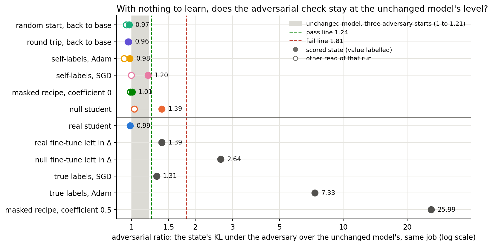
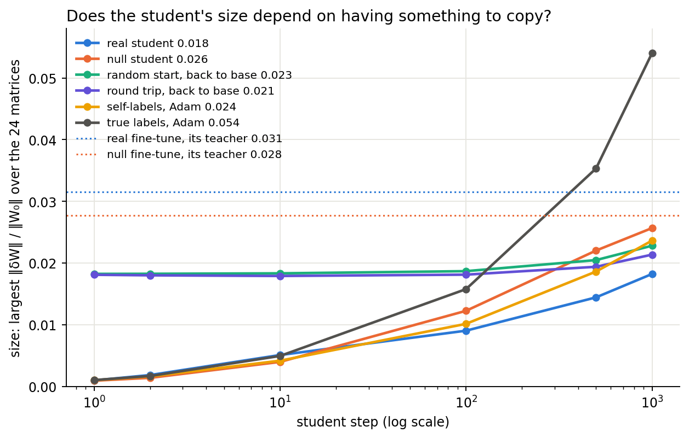
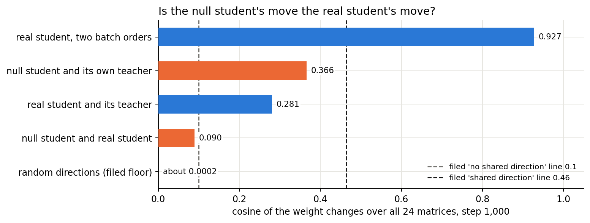
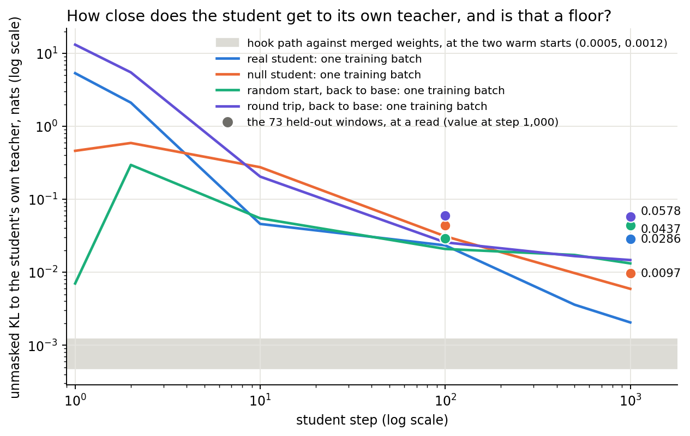
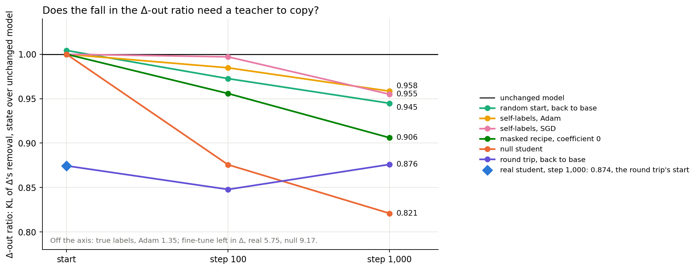
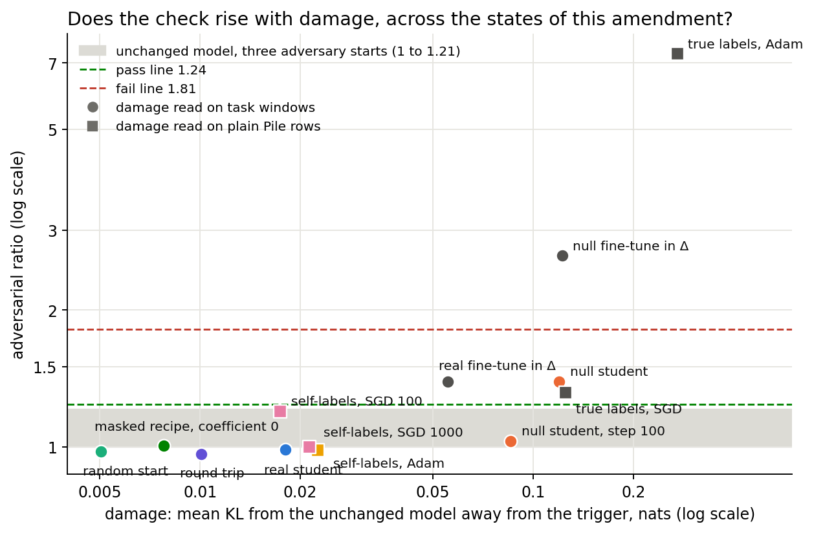
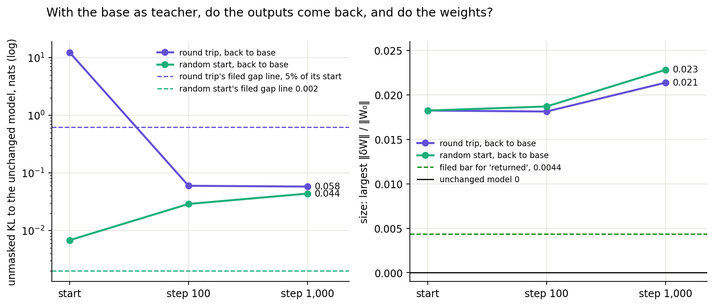

# What does training do when the unchanged model is the only thing to learn from?

*E34 Amendment 8, 2026-11-02. Plan `reports/plans/2026-11-02_plan_base-control.md`, audit
`reports/reviews/2026-11-02_review_base-control-audit.md`, code review `reports/reviews/2026-11-02_review_amend8-code.md`,
predictions `experiments/teacher_training/results/predictions_amend8.json`. Figures from
`experiments/teacher_training/plot_amend8.py`. The author did not run the jobs.*

We trained the decomposition's read and write vectors with only the unchanged model to learn from, to see whether these methods
learn a gap between base and decomposition. Nothing breaks: students with nothing to copy move about as far as a real one, in another
direction, and nearly all read at the unchanged model's level on the adversarial check. So passes stand and a student's direction is
its teacher's, but its size is the recipe's, and ratios below 1 mean only "at the base".

## What we were trying to test

The user's worry: a method might be learning the difference between the base model and its decomposition, not the
difference between the base and the fine-tuned model. A control for that trains with the base as the only thing to learn.

The obvious control cannot fail. Teacher training's student is the stored base model plus a hook that adds only the offsets'
change, so with teacher = base and zero offsets the two forwards are the same bytes. The gradient is exactly zero
(`src/commute/teacher.py:31-37`), no step moves anything, and E34's control read zero by construction. A useful control must
really move. Every arm below uses E34's task-text recipe unless stated: emoticon windows, Adam at 1e-5, batch 32, 1,000
steps, Γ and Δ frozen. Each job read the unchanged model first and stopped on a miss. All jobs ran on one L40, at $0.

- **Random start, back to base.** Teacher = the base, start = a random move of the alive read and write vectors at the real
  student's size. It asks whether training restores the base's outputs and weights from a small gap.
- **Round trip, back to base.** Teacher = the base, start = the real student. It asks whether teacher training can be undone.
- **Null fine-tune and null student.** A full-weight Adam 3e-5 fine-tune whose every label is drawn afresh from the base's own
  predictions, so it teaches nothing. We stopped it at step 100, the checkpoint nearest the real fine-tune's size. A student
  then copies it from the base. Beside it is the real student at two batch orders. It asks how much of a student's move
  would happen anyway.
- **Self-labels.** Labelled component training on lowercase rows, with labels drawn from the base, at E39 Amendment 2's Adam
  and SGD rates; beside each, the same recipe on true labels. It asks whether E39's fail belongs to the recipe.
- **Masked recipe at coefficient 0.** The component path with every mask 1 and no masked term, on the 32-pair cipher windows.
  It asks whether the path and Adam, rather than the masked terms, caused the masked control's 25.99.

**Readings.** The *adversarial ratio* or *check* is a state's KL under a 20-step adversary on 256 Pile rows, over the same
job's unchanged model at adversary seed 0; 1 means at the base. This card's pass line is 1.241 and its fail line 1.813.
*Size* is the largest ‖δW‖ / ‖W₀‖ over the 24 matrices. *Damage* is mean KL from the base away from the trigger; on rows, see
"Rows and masks". The *Δ-out ratio* is the state's KL when Δ is removed and every mask is 1, over the base's 0.0120 nats on
Pile (`pile_ratios.unmasked_kl`). It is not damage. *Gap to the teacher* is unmasked KL to the student's own teacher.

## What we expected, and why

We expected walks, not returns. With a small gap and fresh batches, Adam should keep moving, so the random start should end
larger with its gap not closed, but passing. The round trip should recover outputs and pass, while only part of its weight
change comes back, because part of the forward move was the optimiser. The null student should reach a comparable size in
another direction. Self-labels should stay near the base, and coefficient 0 should pass.

## With nothing to learn, does the check stay at the base's level?



**Reading it.** Yes, in every state but one. The grey band is the base's own spread over three adversary starts. Above the
divider sit the six runs with nothing to learn; 12 of their 13 reads sit at or below the band's top. The exception is the
null student at step 1,000, which reads 1.39, inconclusive. Below the divider, true-label Adam reads 7.33
and the masked recipe at coefficient 0.5 reads 25.99, so the check can fail on this card and these states do not trigger it.
One adversary start per state, so read classes rather than differences.

| State | Check | Stochastic | CI-masked | Δ-out | Size | Damage | Gap to own teacher | Verdict |
|---|---|---|---|---|---|---|---|---|
| Random start, start | 0.999 | 1.003 | 1.003 | 1.004 | 0.0182 | 0.0037 | 0.0068 | pass |
| Random start, 100 | 0.944 | 0.998 | 1.003 | 0.973 | 0.0187 | 0.0041 | 0.0289 | pass |
| Random start, 1,000 | 0.975 | 0.992 | 1.005 | 0.945 | 0.0228 | 0.0050 | 0.0437 | pass |
| Round trip, start = real student | 0.987 | 0.955 | 0.984 | 0.874 | 0.0182 | 0.0181 | 12.38 | pass |
| Round trip, 100 | 0.970 | 0.947 | 0.982 | 0.848 | 0.0181 | 0.0160 | 0.0597 | pass |
| Round trip, 1,000 | 0.963 | 0.966 | 0.994 | 0.876 | 0.0214 | 0.0101 | 0.0578 | pass |
| Null student, 100 | 1.030 | 0.952 | 0.986 | 0.876 | 0.0123 | 0.0856 | 0.0437 | pass |
| Null student, 1,000 | 1.391 | 0.957 | 1.010 | 0.821 | 0.0257 | 0.1198 | 0.0097 | inconclusive |
| Real student, 1,000 | 0.987 | 0.955 | 0.984 | 0.874 | 0.0182 | 0.0181 | 0.0286 | pass |
| Self-labels Adam, 100 | 0.923 | 1.001 | 1.009 | 0.985 | 0.0102 | 0.0129 | no teacher | pass |
| Self-labels Adam, 1,000 | 0.984 | 0.993 | 1.006 | 0.958 | 0.0236 | 0.0225 | no teacher | pass |
| Self-labels SGD, 100 | 1.196 | 0.999 | 1.007 | 0.997 | 0.0071 | 0.0174 | no teacher | pass |
| Self-labels SGD, 1,000 | 0.998 | 0.999 | 1.001 | 0.955 | 0.0173 | 0.0213 | no teacher | pass |
| Coefficient 0, 100 | 0.989 | 0.986 | 1.001 | 0.956 | 0.0057 | 0.0057 | 0.0441 | pass |
| Coefficient 0, 1,000 | 1.006 | 0.979 | 0.996 | 0.906 | 0.0173 | 0.0078 | 0.0665 | pass |
| Real fine-tune left in Δ | 1.390 | 0.920 | 0.993 | 5.749 | 0.0315 | 0.0554 | 0 | inconclusive |
| Null fine-tune left in Δ | 2.636 | 0.970 | 1.018 | 9.171 | 0.0277 | 0.1222 | 0 | fail |
| True labels Adam, 1,000 | 7.333 | 1.352 | 1.352 | 1.348 | 0.0540 | 0.2708 | no teacher | fail |
| True labels SGD, 100 | 1.314 | 1.084 | 1.102 | 0.992 | 0.0137 | 0.1251 | no teacher | inconclusive |

The base in every job: adversary KL 0.692, 0.836, 0.705 at seeds 0, 1, 2; floor 0.2088; CI-masked 0.348; stochastic 0.248;
Δ-out 0.0120. The real student reads identically in two jobs, so the regeneration is exact across jobs.

### Check ratios below 1

Nine of the 13 reads with nothing to learn sit below 1, between 0.923 and 0.999. So a reading below 1 does not need a teacher,
an update or any behaviour, and it cannot be read as "better than the base". The base's seed 0 is the lowest of its three
starts, so these are not lucky denominators; a small real fall of up to 8% with no teacher stays possible and is untested
across starts. The plain reading is "at the base". The audit's list of 0.89 to 0.96 fits that reading, give or take a few
hundredths on another card. E41 Amendment 2's "excess removed" of 1.18 at step 1,000 should read "all the excess removed", not
"more than all".

## Which methods can learn from a base-to-decomposition gap?

| Method | Can its loss see the gap? | What this says | What cannot be said |
|---|---|---|---|
| Teacher training on the hook path, all E34, E37, E39, E41, E42 and E43 hook-path arms | No: no component forward in the loss; exactly zero at teacher = base from zero offsets | It does not learn that gap directly. From a moved start the gradient is nonzero and the student moves, at the base's level on the check | Whether the Δ-out fall, in no loss, is an indirect effect of that gap: no mechanism read |
| Plain-SGD arm S | No, same loss | Nothing new: not rerun | Whether SGD's fail survives with nothing to copy |
| Labelled component training (E4, E21, E26, E39 A2) | No: masks and Δ are not in the loss. The loss is nonzero, from labels | With self-labels the same recipe moves to 0.0236 and 0.0071 and stays near the base, so E39's 7.24 needs the true labels | Why SGD at step 100 reads 1.20 and then 1.00; narrow tasks were not rerun |
| Masked teacher training (E37 A1 arm 2, E42 A1, A2) | Yes: the masked terms | Coefficient 0 reads 1.006 against 25.99 at coefficient 0.5, same card, windows and batch order. The path and Adam do not cause the fail; the masked terms do | E37's rows were not run at coefficient 0. A rounding gradient alone still moved the state to 0.0173 |
| Γ refit, E15 | Yes | No new reading; its control already failed | Which term |
| Least-squares, adjoint, rescaling and step splits; Γ shift map | No training on data; zero at δW = 0 | This control adds nothing | Nothing further |

The worry was right for the recipes containing the gap, and those recipes have no standing pass. The hook-path recipes cannot
learn it directly, and their null runs read at the base. What they do learn with nothing to copy is covered next.

## How much of a student's size and direction is the recipe?



**Reading it.** Size is mostly the recipe. Every student here is at 0.017 to 0.026 by step 1,000, whatever it copies. The real
student is near the bottom, at 0.0182; the null student reaches 0.0257, a ratio of 1.41. Self-labels at Adam reach 0.0236
and the rounding-only masked recipe reaches 0.0173. True labels, with real signal, are the one thing that departs, at 0.054.
This explains the earlier puzzle that student size barely follows its teacher, 0.014 to 0.018 for teachers of 0.011 to 0.032.
The size comparison uses the largest matrix only.



**Reading it.** Direction is the teacher's. Two real students at different batch orders share a cosine of 0.927, on the L40 as
E34 Amendment 5's 0.913 did on the H100. The null and real students share 0.090, and they share a batch order, which can only
inflate it. That sits just under the filed 0.1 line, so "a walk elsewhere" is a narrow call; 0.1 would have read "partly".
Two rough estimates follow, assuming a walk orthogonal to the shared part. About 7% of the real move's squared length varies
with batch order, and under 1% is shared with the null student. The null student sits nearer its own teacher than the real one
does, 0.366 against 0.281, so a cosine with the teacher in the listed range of 0.05 to 0.44 is no evidence of copying by
itself. What marks the real student is that it reproduces and that it carries the behaviour.

### How close each student gets to its own teacher



**Reading it.** Not a floor. Held-out gaps at step 1,000 run from 0.0097 for the null student through 0.0286 for the real one
to 0.0437 and 0.0578 for the two with the base as teacher. The random start's gap rose under training, from 0.0068. These four
numbers measure different things, as the table shows.

| Student, step 1,000 | Teacher's P(target) | Start gap | Held-out gap | At the trigger | Elsewhere | Train batch at trigger | Train batch elsewhere | Gradient norm, before clip |
|---|---|---|---|---|---|---|---|---|
| Real | 0.999 | 5.35 | 0.0286 | at most about 0.003 (estimate from CE 0.0032) | about 0.025 | 0.00001 | 0.0020 | 0.34 |
| Null | 0.0036 | 0.46 | 0.0097 | unread | unread | 0.0031 | 0.0028 | 0.92 |
| Random start | 0.004 (E34's plan) | 0.0068 | 0.0437 | 0.0386 | 0.0050 | 0.0108 | 0.0024 | 2.11 |
| Round trip | 0.004 (E34's plan) | 12.38 | 0.0578 | 0.0477 | 0.0101 | 0.0119 | 0.0028 | 3.28 |

**Rows and masks.** All four gaps use no masks: the state's merged weights W₀ + δW against its teacher's merged weights, Γ
unused, Δ inside the weights. Rows are the 73 held-out emoticon windows, one number per window: KL at the trigger plus the mean
KL over the other positions. The trigger part above is held-out gap minus damage, both on those windows, so it holds only with
the base as teacher. The start gap of the real and null students, and the train columns, are single batches of 32.

**What explains it, and what stays open.**

- *Why the real student reads low at the trigger.* Its teacher is almost one-hot there, so matching one token costs little.
  Most of its gap is elsewhere, on held-out windows, 12 times the train batch's value. That is a different quantity from the
  other three, whose gap is largely at a broad trigger distribution.
- *Why the random start rose above its start.* From the curve and the code, explained in part, not tested. Adam moves every
  entry by about the learning rate from its first step, however small the gradient. The train loss goes from 0.0070 to 0.296
  to 0.457 in two updates (`results/large/amend8/run_n1.log`), then decays, and 1,000 steps leave it at 0.0132, still above the
  start. The start's own small gap is smaller than what Adam's restart adds. The masked recipe at coefficient 0 shows the same
  shape from a gradient that is only rounding: 0.0016, then 0.113 at step 10, then 0.0216.
- *Not rounding.* Curves on the hook path and reads on merged weights agree within 1%: damage 0.00507 against 0.00504 at the
  random start's end. The hook-path floor, 0.0005 to 0.0012, sits ten times under.
- *Open: why its held-out trigger gap keeps rising.* From 0.0248 at step 100 to 0.0386 at 1,000, while the train batch's trigger
  KL falls from 0.0133 to 0.0108.
- *Open: why the null student ends four to six times below the two with the base as teacher.* The whole difference is at the
  trigger, in the train batches at least, where they read 0.0108 and 0.0119 against 0.0031; elsewhere all read 0.0024 to 0.0028.
  It is not distance in weights: by size and cosine the null student is about 0.030 from its teacher, the random start 0.023.
  Start and teacher differ together here. A null teacher from a moved start would separate them.

## The Δ-out ratio across every arm



**Reading it.** The fall does not need a teacher. The audit called a 3-28% fall unexplained because teacher-trained states read
0.72 to 0.97. Here it appears in every run with nothing to copy and grows with steps: random start 1.004 to 0.945, self-labels
0.958 and 0.955, coefficient 0 0.906. A random move with no training reads 1.004, so training does it, not moving. A teacher
adds more: the real student's 0.874 falls about twice the random start's, and the null student's 0.821 falls most. By the hook-path runs, a third to a half of the real student's fall
is there with no teacher. The windows and rows differ, so that share is rough. The round trip returns the outputs but keeps the fall, 0.876 after 1,000 steps. The masked recipe at coefficient 0.5 reads
0.900 against 0.906 at 0, so the masked terms add nothing to it.

So the fall is not the student learning the fine-tune and is not a loss term. Its mechanism is still unread, it does not track
the check, and it is small: 0.126 of 0.0120 nats is 0.0015 nats, against CI-masked 0.348. It no longer needs reading as a sign
of copying. E34's Pile-text arm at 0.73 falls further than any run here, and that part stays unexplained.

## Why does the null student read 1.39 where the real one reads 0.99?



**Reading it.** Not settled; here is what the readings allow. The difference of 0.40 is about twice the base's 0.21 between
adversary starts, on one start each, at size 0.0257 against 0.0182. Size alone does not explain it: the random start at 0.0228
and self-labels at 0.0236 read below 1. The clearest difference is damage, 0.120 against 0.018 on task windows. The null student
copied its teacher's 0.122 almost whole, where the real one carries a third of its teacher's 0.055. Across this figure the check
rises with damage, but the figure is a pattern over different states, rows and teachers, not a test, and null at step 100 reads
1.03 at damage 0.086. No run varied damage with all else fixed, so damage is a candidate and no more. Two lookalikes are
coincidence: the real fine-tune in Δ reads the same 1.39, as a different state.

## Comparison with E41's chain, E37 Amendment 1 arm 3 and E39 Amendment 2

The references ran on an H100, with lines at 1.40 and 1.61. This amendment ran on an L40, with lines at 1.24 and 1.81.
The two floors are 0.0748 and 0.2088, and the denominators at seed 0 agree, 0.699 and 0.692. The same real student reads 0.959 and 0.987 on the two cards. E37 and E39 use
lowercase rows of 512 tokens with a plain mean, where E41 and this amendment's teacher runs use emoticon windows.

| State | Card | Check | Size | Damage | Gap to teacher | Δ-out |
|---|---|---|---|---|---|---|
| E41 one-shot, T1000 | H100 | 0.959 | 0.0184 | 0.0180 | 0.0284 | 0.881 |
| E41 chain, T100 link, 1,000 steps | H100 | 1.054 | 0.0214 | 0.0460 | 0.0094 | 0.837 |
| E41 chain, T1000 link, 1,000 steps | H100 | 1.000 | 0.0251 | 0.0269 | 0.0166 | 0.824 |
| E41 A2, T300 link, 100 steps | H100 | 0.956 | 0.0149 | 0.0249 | 0.0175 | 0.871 |
| E41 A2, T1000 link, 100 steps | H100 | 0.910 | 0.0152 | 0.0217 | 0.0290 | 0.863 |
| Real student | L40 | 0.987 | 0.0182 | 0.0181 | 0.0286 | 0.874 |
| Round trip, 1,000 steps, teacher = base | L40 | 0.963 | 0.0214 | 0.0101 | 0.0578 | 0.876 |
| Random start, 1,000 steps, teacher = base | L40 | 0.975 | 0.0228 | 0.0050 | 0.0437 | 0.945 |
| E37 A1 arm 3, start | H100 | 1.049 | 0.0399 | 0.0500 | 0.111 | 0.957 |
| E37 A1 arm 3, 1,000 | H100 | 1.758 | 0.0533 | 0.2367 | 0.0113 | 0.910 |
| E37 A1 arm 3, 2,000 | H100 | 1.836 | 0.0566 | 0.2440 | 0.0090 | 0.897 |
| E39 A2 labels, Adam 1,000 | H100 | 7.242 | 0.0541 | 0.2704 | n/a | 1.344 |
| Same recipe, this job | L40 | 7.333 | 0.0540 | 0.2708 | n/a | 1.348 |
| E39 A2 labels, SGD 100 | H100 | 1.275 | 0.0138 | 0.1247 | n/a | 0.992 |
| Same recipe, this job | L40 | 1.314 | 0.0137 | 0.1251 | n/a | 0.992 |
| Self-labels SGD, 100 | L40 | 1.196 | 0.0071 | 0.0174 | n/a | 0.997 |

- **E41's chain, long links.** E41's report flagged size growing per link as "the pattern accumulation would show", untested.
  That growth now has a reference. The T1000 link grew 17%, from 0.0214 to 0.0251; the round trip grew 17% and the random start
  25% over 1,000 steps with nothing new to copy. So a chain's size growth at this link length is what the recipe does anyway,
  across cards. Damage is another matter: the chain's excess of 0.009 is more than the random start's rise of 0.0014, so the
  recipe alone does not account for it.
- **E41 Amendment 2, short links.** After 100 steps the round trip changed size by under 1% and the random start by 2.5%; the last
  link there grew 2%. So the short chain's size of 0.83 times the one-shot's reflects fewer steps. It is no evidence that short
  links transport better. Each link also restarts Adam, whose first steps here raised train KL to 0.3 to 0.5 nats, and links after
  the first start at only 0.055 to 0.34.
- **E37 Amendment 1 arm 3.** Here a moved start plus training with no teacher does not raise the check. Arm 3's rise from 1.05 to
  1.84 comes with damage rising from 0.05 to about its teacher's 0.235, and the gap to the teacher falling tenfold. That leans
  toward copying over drift, on another text and card. The lowercase form of the control was not run, so this is a lean.
- **E39 Amendment 2, the labelled-SGD reversal.** The recipe reproduces across cards: same size, gain and damage, check 1.275 and
  1.314. Two things change how that pass reads. On the L40's wider lines the same state is inconclusive rather than a pass. And the
  self-label state of that recipe reads 1.20, a difference of 0.12 inside the 0.21 between adversary starts, though it gains nothing:
  gain −0.004 against 0.125. The stochastic and CI-masked ratios do separate them, 1.08 and 1.10 against 1.00 and 1.01. So the
  check on one start hardly distinguishes labelled SGD from a walk here, which fits the standing line that SGD's passes carry no
  weight. Labelled Adam's 7.33 against self-label Adam's 0.98 is unambiguous: the fail needs the true labels.

## Does the round trip come back?



**Reading it.** The outputs do; the weights do not. KL to the base falls from 12.38 to 0.058, inside the 5% line, and P(target)
falls from 0.997 to 0.014. Its bar was 0.04, ten times the base's 0.004, and it ends 3.6 times the base's, a figure from E34's
plan not reread on this card. Size grows from 0.0182 to 0.0214, so the return fraction is −0.17 against a filed 0.76, and from a
random start −0.25. The states still pass. Many read and write vectors compute nearly the base's function, and training with the
base as teacher does not choose the original ones. Damage does return in part, 0.018 to 0.010.

## The round trip's filed card, and what it says about E41's chains

The card fired only on the weight return, not on the check or the outputs. It does not change the claim that a chain's states
keep the behaviour and pass with Δ fixed. It does change what size in a chain may be read as. Draft for
`docs/research_log/parts/sections/decisions.html`:

```html
<div class="card key decision" id="decision-chain-size"><span class="chip uninf urgency">No rush</span><div class="k">Question for you · commute · new 2026-11-02</div><p class="small">Nothing runs until this is decided.</p><h3>When teacher training is repeated along a fine-tune, may we read how far the subcomponents moved as what the fine-tune taught?</h3>
<p><strong>The question.</strong> Teacher training can be repeated: each round starts from the last round's subcomponents and copies the fine-tune at a later step. This is the only test we have of keeping a decomposition current along training. We have read the size each round reaches as error piling up, or not. We now have a reference for what one round does when there is nothing new to copy.</p>
<p><strong>The evidence.</strong> We took the decomposition after teacher training and ran 1,000 more steps with the unchanged model as the teacher. Its predictions came back: the KL to the unchanged model fell from 12.4 to 0.06 nats. Its weights did not: the largest relative change grew from 0.018 to 0.021. It still passed the adversarial check, at 0.96. A round of the same length in the real repeated run grew by the same 17%. So that growth happens with nothing to copy, and every round's restarted optimiser jolts the predictions as well. The check and the kept behaviour are read on each state, so they stand. The extra damage on other text in the long repeated run is more than the recipe alone showed.</p>
<p><strong>Options.</strong> (a) Change the wording only. Nothing runs, $0. We keep "each state keeps the behaviour and passes" and stop reading size as piled-up error or as the update. It does not tell us whether a repeated run with nothing to copy would also pass. Nothing follows. (b) The wording, plus a repeated run with nothing to teach: seven rounds of 100 steps against a fine-tune whose labels come from the unchanged model's own predictions. One free cluster job, about 35 minutes. If it passes at the same size, size in repeated runs says nothing; if it fails, repeating harms the decomposition by itself, and any repeated run on the larger model needs a new recipe first. (c) The wording, plus a real repeated run that keeps the optimiser's memory between rounds. One free cluster job, about 35 minutes. If the rounds end closer to the fine-tune, the restart was costing accuracy and later repeated runs change recipe; if not, the recipe stays.</p>
<p><strong>Recommendation: (a).</strong> No running plan repeats teacher training, and no pass depends on reading size. Run (b) first if the larger model's plan chooses repeated rounds.</p>
<div class="links"><a href="#e34">E34</a><a href="#e41">E41</a></div>
<p class="small">Names in the reports: repeated rounds are E41's "chain" and "links"; the 1,000 steps with the unchanged model as teacher is Amendment 8's N2. <code>reports/analyses/2026-11-02_analysis_e34-amend8-base-control.md</code></p></div>
```

**The other flag: `gap_line_needs_amendment` on the random start.** Its warm start read 0.00122 on this card, above the 0.0007
limit filed from H100 readings, so the rule asks for a dated amendment before the gap reading is used. This is that amendment,
2026-11-02; the predictions file is not edited. The line becomes three times the card's reading, 0.0037 in place of 0.002. The
start at 0.0068 and the end at 0.0437 sit above both, so "not closed" holds and the outcome does not move. This job's other warm
start, from the real student, read 0.00048, so one card gives two values. The reading is hook path against merged weights at a
single batch, and the gap itself is merged against merged, so this floor bounds the training path and not the read.

## Standing claims: breaks, complicates, or stands

None breaks.

| Claim, file | Verdict | Why |
|---|---|---|
| "Teacher training is a map of a finished update that keeps the behaviour, faithfulness and Δ together", `docs/research_log/parts/sections/claims.html:57` | **Complicates**, behaviour, check and Δ stand | Each read is on the state. Direction is the teacher's. Size is the recipe's, so "map" cannot claim the student's size. A pass at about 1 is what the recipe reads with nothing to copy, so the pass shows no harm and no more |
| "The only map of a finished update that keeps the behaviour, passes the check and leaves Δ alone", `techniques.html:32` | **Stands** | Add that its size is the recipe's |
| Cosine with δW 0.05 to 0.44, `techniques.html:70` | **Complicates** | The null student reads 0.366 with its teacher, so this range has a reference and is weak evidence of copying |
| E41's chains and "no pile-up", `experiments/TRIED.md` E41 and E41 Amendment 2, `experiments/e41.html` figure 4 | **Complicates**, card | Passes stand. Size growth is the recipe's. Short links' smaller size reflects fewer steps |
| E41 Amendment 2 "removes 1.18", TRIED row | **Complicates**, wording | Below 1 is "at the base"; say "all removed" |
| E34 "teacher = W₀ moves nothing", TRIED row | **Stands**, wording corrected | Zero by construction; no step moved anything |
| Teacher training fails on a broad fine-tune, also from the adjoint split, `claims.html:59` | **Stands** | Arm 3's rise leans toward copying; lowercase control not run |
| E39 Amendment 2: labelled Adam fails, `experiments/TRIED.md` E39 Amendment 2, E39 card | **Stands**, stronger | Self-labels 0.98 with true labels 7.33 in the same job: the fail needs the labels |
| E39 Amendment 2: labelled SGD passes, reversing its prediction, E39 card | **Complicates** | Inconclusive on the L40's lines, and within seed noise of its own self-label state |
| "SGD's passes carry no weight", `claims.html:57`, E49 | **Stands**, more support | As above |
| The masked line closed; "with nothing to copy reads 3.84", `techniques.html:75` | **Stands**, stronger | Coefficient 0 reads 1.006: the path and Adam do not cause the fail, on E42's windows |
| Do-nothing's fail, `claims.html:44`, `claims.html:49` | **Complicates** | A fine-tune teaching nothing, at size 0.028 and step 100, fails do-nothing at 2.64. So that fail does not need new behaviour, and it fits "size alone does not decide" |
| E43, E47, E48, E49 read verdicts; every split; Γ refit; Γ shift map; Pile-text claim, `claims.html:58` | **Stands** | Nothing here reads them |
| Audit's "unexplained fall" in Δ-out, `reports/reviews/2026-11-02_review_base-control-audit.md` | **Complicates** | It needs no teacher; mechanism still unread |

## What we learned

Hook-path teacher training cannot learn a base-to-decomposition gap directly, and with nothing to copy it stays at the base on
the check. The recipes that can see that gap are the masked ones, and the masked terms are what fail them. For `GOALS.md`'s weak
version this leaves teacher training as the map. Its verdicts stand, the direction it finds is specific to the update, and how
far it moves is mostly the optimiser's. A round trip shows the state carries its history in the weights after the outputs return,
which matters for continuous use. "At the base" now has a measured spread with training included.

## How compelling is the evidence

One task for the teacher arms, one cipher task for the masked recipe, lowercase rows for self-labels. One batch order, one label
draw, one random direction, one adversary start for each state, a 20-step adversary, 67M, one card. A pass is a lower bound. The base
moves 0.21 between adversary starts here, so read classes; stochastic and CI-masked floors are 0.002 and under, so their small
differences are real for the state. The size is the largest matrix and the cosine all matrices, so the combined estimates are
indicative. Size is blind to direction; the cosines are blind to function. All filed early checks passed, every job's W₀ read
passed with one floor, and true-label Adam failed as the positive control.

## Surprises

Something unexpected happened that I cannot explain: the null student was expected to pass, medium, and reads 1.39, inconclusive.

- **Reversed sign.** The round trip's weights were expected to return 0.2 to 0.6 of the way and moved further out, −0.17.
- **Do-nothing on a null fine-tune fails at 2.64,** above the dated note's guide of 1.0 to 2.5 and above the real fine-tune's 1.39.
- **The random start's gap rose under training.** It rose sixfold with the base as teacher.
- **Size under the estimates.** Random start 0.0228 against 0.028 to 0.039; null fine-tune 0.0705 at step 1,000 against about 0.09,
  damage 0.229 against 0.3 to 0.8.
- **Null fine-tune's KL to the base is 1.86 after one step** and 0.52 to 0.59 from step 30 on.
- **P(target) moves threefold by itself.** The random move alone reads 0.0121 against the base's 0.004; the null fine-tune reads
  0.0015 to 0.0131. A mean probability of that size is not a measure of learning.

## What next

1. Read the null student, the real student and the null fine-tune at adversary starts 1 and 2, plus plain-row damage, from the saved
   states: $0, one debug job. If the null student passes on the others, 1.39 is one start's noise; if it stays high, it goes to a
   test that varies damage alone.
2. A null teacher from a moved start: one debug job. It separates start from teacher in why the null student's gap is the lowest.
3. The chain card above. Qwen's lead gets a note: its teacher training has this shape, and its size has the same missing reference.

## Scorecard

| Id | Rule, verbatim | Read | Lean: hit or miss |
|---|---|---|---|
| N1 | "gap = gap_class(kl_w0 at 0, kl_w0 at 1000, line 0.002 nats, absolute: about 3 x the largest hook-floor reading, H100): non-finite 'invalid'; start at or under the line 'no power' (stopped at read 0, so reached only by a fault); end at or under it 'closed'; end under start 'partly'; else 'not closed'. Verdict at 1000 by base_verdict. outcome: verdict fail -> 'fails'; invalid or gap invalid or no power -> 'unscorable'; gap other than 'closed' -> 'fails, gap not closed'; else pass -> 'holds', inconclusive -> 'inconclusive'. Return fraction reported, classed at 0.76, not in the outcome: the plan gives it no expected value here. Decision-tree card: verdict fail only; 'fails, gap not closed' has its own row, no card (plan Tree)" | gap 0.0068 to 0.0437, not closed; check 0.975 pass; return −0.251. **Outcome: fails, gap not closed**; no card; line amendment above | outcome medium: **hit**. Pass medium-low: **hit**. Not returned high: **hit**. Expected size 0.028-0.039: **miss**, 0.0228 |
| N2 | "gap_class with line = 0.05 x kl_w0 at 0 (relative); kl_w0 at 0 of 0 is stopped at read 0. p_back: P(target) at 1000 at or under 0.04, absolute, ten times W0's, because 5% of KL(W0 \|\| state) allows P about 0.25; NaN None. Return fraction at 1000, 'returned' at or above 0.76. Verdict at 1000. outcome: verdict fail -> 'fails'; invalid, gap unscorable, p_back None or return None -> 'unscorable'; gap other than 'closed', P not back or not returned -> 'fails'; pass -> 'holds'; inconclusive -> 'inconclusive'. Decision-tree card: verdict fail, not returned, or P not back. Score also carries the T1000 student's own verdict and check on this card" | gap 12.38 to 0.0578, closed; P 0.0143, back; return −0.172, not returned; check 0.963 pass; T1000 student 0.987 pass. **Outcome: fails; card** | Pass medium-high: **hit**. Gap closed and P back, medium: **hit**. Not returned medium-low: **hit**. Fraction 0.2-0.6: **miss** |
| N3a | "size, kl_w0, damage, P(target) of the null fine-tune at 1, 3, 10, 30, 100, 300, 1000, logged and saved; no harness; chosen checkpoint by nearest_checkpoint. Nothing scored" | sizes 0.0035, 0.0066, 0.0118, 0.0184, 0.0277, 0.0425, 0.0705; chosen step 100 | Step 100 medium: **hit**. Under 0.09 medium-low: **hit**. P near W0's: **miss in part**, up to threefold |
| N3b | "class by 'the recipe (n3b)' in measurements. Verdict at 1000. outcome: verdict fail -> 'fails'; invalid or unscorable -> 'unscorable'; class 'the recipe' or 'partly' -> 'fails'; class 'not the recipe' or 'a walk elsewhere' with pass -> 'holds', with inconclusive -> 'inconclusive'. Decision-tree card: class 'the recipe' or verdict fail. 'partly' goes to the user as a surprise, no automatic card. Damage reported, not in the rule. Score also carries the real student's verdict and check" | size ratio 1.41 "about"; cosine 0.0897 "none" against control 0.927; class a walk elsewhere; check 1.391 inconclusive. **Outcome: inconclusive**; no card | Class medium-low: **hit**. r 1-1.8: **hit**. Under 0.1: **hit**, narrowly. Pass medium: **miss** |
| N4 | "at E39's scored state (Adam 1e-5 step 1000; SGD 0.03 step 100; SGD's step 1000 reported): base_verdict of the self-label state. pass 'near base'; inconclusive 'inconclusive'; invalid 'unscorable'. fail with the PGD ratio not failing: 'fails on the stochastic ratio'. fail on PGD: share = (self check - 1) / (same-job true-label check - 1); true check at or under 1 or not finite: 'fails, no reference'; share at or above 0.5: 'fails, about the true labels'; else 'fails, under the true labels'. n4_adam only: true-label verdict not 'fail' -> class and outcome 'no reference' for a self-label state not failing, 'fails, no reference' for one failing: a pass there has no power. E39's 7.24 itself is not read against: another card. Decision-tree card: verdict fail. SGD's true-label state may read inconclusive on this card (H100 1.28 against 1.24), its filed exemption: SGD has no 'no reference' rule" | Adam 0.984 near base, true labels 7.33 fail; SGD 1.196 near base, true labels 1.31 inconclusive, exempt; SGD at 1,000 0.998. **Outcome: holds for both**; no card | Adam medium-low: **hit**. SGD medium-high: **hit** |
| N5 | "base_verdict at step 1000 on the component path. outcome: fail -> 'fails'; invalid -> 'unscorable'; inconclusive -> 'inconclusive'; pass -> 'holds'. Decision-tree card: verdict fail, then 'the masked terms did it' becomes 'path plus Adam; masked terms worsen it'. Size and kl_w0 reported" | check 1.006 pass; size 0.0173; KL to base 0.0665. **Outcome: holds**; no card | Pass medium-low: **hit** |

Controls: W₀ first passed in all seven jobs, floor 0.2088. Regenerated T1000 P 0.99910, size 0.03149, student P 0.99694, size 0.01824.
Warm starts 0.00122 and 0.00048, under the 0.005 stop. Self-label CE minus entropy −0.024 and 0.104. Step-1 unmasked term at
coefficient 0, 0.00163. True-label step-1 CE 3.5300, gains 0.1340 and 0.1255, as E39's. Second batch order, cosine 0.927.

Filed guides for the null student in the dated note:

| Guide | Filed | Read |
|---|---|---|
| Step-1 KL | 0.1 to 2 | 0.46 |
| Gap at 1,000 | at or under about 0.1 | 0.0097 |
| Size at 1,000 | 0.015 to 0.03 | 0.0257 |
| Do-nothing check | 1.0 to 2.5 | 2.64, a miss |

## Provenance

Jobs, in the order random start, round trip, null curve, null student, self-labels Adam, self-labels SGD, masked recipe: 48408, 48409,
48433, 48462, 48434, 48435, 48436. MATS L40, `debug` QoS, $0. Results `experiments/teacher_training/results/teacher_training_amend8_*.json`;
states and logs `experiments/teacher_training/results/large/amend8/`; code `experiments/teacher_training/amend8.py`.
E41's Δ-out values are from `results/large/run_e41.log` and `run_e41_amend2.log`; other references from
`teacher_training_e41.json`, `teacher_training_e41_amend2.json`, `teacher_training_e42_amend1_rand32.json`,
`experiments/teacher_spread/results/amend1.json`, `experiments/broad_fragility/results/amend2.json`.

## Departures from the literature

- **VPD trains U, V, Γ and Δ together on masked losses.** Every arm here trains only the alive U and V with Γ and Δ frozen, and all
  but the masked recipe use no masked loss. It keeps the project's weak version testable: Δ may not absorb the update.
- **VPD's masked losses at coefficient 0.** The masked recipe here has none of them; it is a control, not VPD's objective.
- **The adversarial check.** A 20-step adversary from one start on 256 rows, read as a ratio to the base with this card's lines; the
  user kept it so on 2026-10-27. VPD reports its reconstruction under its own adversary and draws no such lines. A pass is a lower bound.
- **Adam, from Kingma and Ba.** Default betas, with gradient clipping at norm 1 and no warm-up. Clipping and the restart per run are
  the recipe's own, carried over from E34. E40 showed warm-up matters on Qwen; this recipe was not tested with one.
- **Self-labels.** Drawing labels from the model's own distribution has no cited source here; it is this project's null, as in E45.

## Not run

- Any adversary start beyond 0 on any state; any second random direction, label draw or batch order for the null runs.
- A null teacher from a moved start; a state varying damage alone; plain-row damage of the emoticon arms.
- The null student's gap split at the trigger against its own teacher, and any per-window reading of trigger KL.
- The lowercase-row form of the random start and round trip, which would settle E37 Amendment 1 arm 3.
- Teacher = the student's own start at 1e-5, the audit's cheapest form; a real chain with Adam's memory kept; a chain with nothing to teach.
- The base's P(target) on this card: 0.004 is E34's plan's.
- Plain SGD as the teacher-training optimiser from a moved start; Pile-text teacher training from a moved start, so arm B's 0.73 stays unexplained.
- The return fraction on squared offsets; other tasks; Qwen; H100. E15, the splits and the step split, which take no training or are done.
- The mechanism of the Δ-out fall, and whether the small fall below 1 on the check is real across adversary starts.
