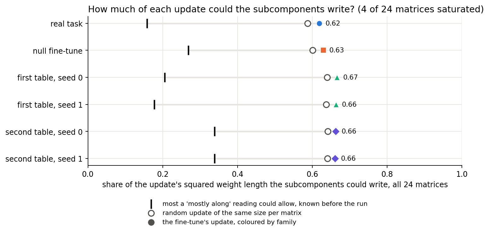
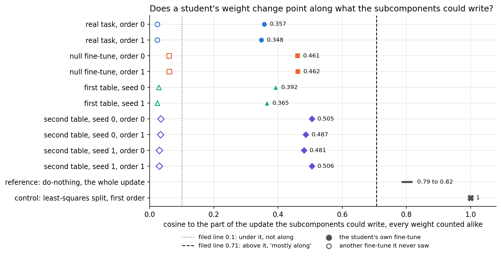
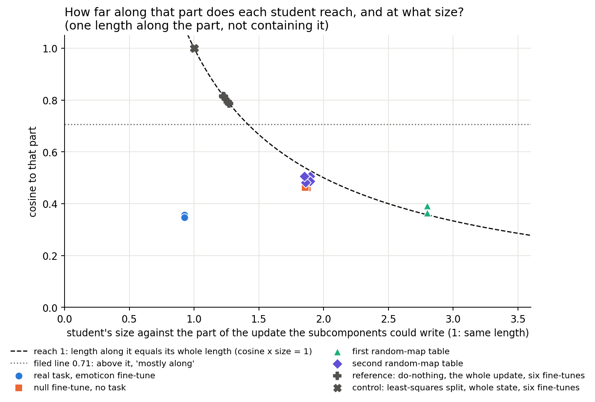

# Does the weight change after teacher training point along what the subcomponents could write?

*E34 Amendment 9, 2026-11-02. Plan `reports/plans/2026-11-02_plan_e34-amend9-student-move.md`, predictions
`experiments/teacher_training/results/predictions_amend9.json`, code `experiments/teacher_training/amend9.py`, results
`experiments/teacher_training/results/amend9.json`, figures from `experiments/teacher_training/plot_amend9.py`. The author did not run
the job. No code review ran before this report; an independent check followed it (`reports/reviews/2026-11-02_review_e34-amend9-analysis.md`), and this text was corrected with its findings. Numbers marked "independent check" were read by `~/commute-data/scratch/commute-lead/e34a9-check/recheck.py` and are not filed. The filed numbers and verdicts are unchanged.*

We compared each decomposition after teacher training with the part of its fine-tuned model's update that the subcomponents could write, and on the real task about an eighth of the squared weight change lies along that part. A fine-tuned model trained on labels drawn from the unchanged model's own predictions, which teaches no task but still moves predictions 0.53 nats, reads about a fifth, inside the range of the two map tables that did learn a task (0.13 to 0.26), so this cosine cannot be read as how much was taught; this comparison was not filed. Arithmetic had nearly ruled out a close match before the run; what the run adds is the size of that part, about two-thirds of the update and barely more than a random update's, plus the checks that each weight change stays within what the subcomponents can write, as it must to first order, and follows its own task's fine-tune far above another task's. Every weight direction counts alike here, including directions no input excites, so this cannot show that the decomposition after teacher training behaves differently from the fine-tuned model on real inputs, and it cannot by itself change the wording of the line's headline claim.

**The filed verdict, and what is held back.** The filed rule reads "expressible change" on all eight scored states, and my by-hand scoring agrees. The filing says that verdict picks the wording "reproduces its behaviour by a change the pieces can express". This report does not carry that step, for the reason in the opening, which the filing's own blind spot names. The verdict stands as filed; only its consequence waits for an input-weighted read.

The filed choice was also weaker than it looked: the second wording's "can express" holds for any student by construction, so P1 could only say "not copies, counted by weight". That is a flaw in the filing, not a new verdict, and `predictions_amend9.json` is not edited. Before the run the plan read as a fork between two live wordings; it was not.

**One thing the verdict's label hides.** "Mostly elsewhere" does not mean short of the target. On the null fine-tune and both random-map tables, the student's length along that part is 0.86 to 1.10 of the part's whole length, a ratio to the fine-tune's length. On the real task it is a third. The reach section below shows it, and that most of the split is the real fine-tune's length.

## What we were trying to test

Call the decomposition after teacher training the *student*. Teacher training keeps Γ and Δ frozen and trains the alive write and read vectors $U, V$ until the model's outputs match the fine-tuned model's.

An earlier read found that the student's weight change has cosine about 0.28 with the fine-tune's update on the real task. That looks low, but it might only be low because the subcomponents cannot write all of the update. This run divides that out.

- $s = (U + dU)(V + dV)^\top - U V^\top$ is the student's weight change.
- $\delta W$ is the fine-tune's finished update.
- $O(\delta W) = (I - P_U)\,\delta W\,(I - P_V)$ is the least-squares split's remainder, per matrix.
- $I(\delta W) = \delta W - O(\delta W)$ is the *inside part*, what a first-order change of $U$ and $V$ can write.

All inner products run over the 24 matrices together, every weight counted alike, in fp64 (the stored $s$ is fp32; the independent check's fp64 rebuild agrees to 9 decimals, so no number moves). No model was loaded and nothing ran forward.

**Numbers read.**

- **Cosine to the inside part:** $\cos(s, I(\delta W))$. It reads 1 for a student wholly along the inside part, and 0 for one at right angles to it.
- **Inside share:** $\lVert I(\delta W)\rVert^2 / \lVert\delta W\rVert^2$. It reads 0 if the subcomponents could write none of the update and 1 if all. A random update of the same size per matrix is its reference.
- **Student's own inside share:** the same for $s$. The first-order part of $s$ is inside by construction; only $dU\,dV^\top$ can leave.
- **Reach:** cosine times $\lVert s\rVert / \lVert I(\delta W)\rVert$. It reads 1 when the student's length along the inside part equals the inside part's whole length.

**States.**

| Family | Fine-tune | Students | What it rules out |
|---|---|---|---|
| Real task | emoticon, Adam 3e-5, step 1,000 | 2, batch orders 0 and 1 | the scored case |
| Null fine-tune | every label drawn from W₀'s own predictions, Adam 3e-5, step 100 | 2, batch orders 0 and 1 | that a high cosine needs a task to teach |
| First random-map table | first learned step, seeds 0 and 1 | 2 | that one task sets the number |
| Second random-map table | first learned step, seeds 0 and 1 | 4, batch orders 0 and 1 | the same |

**Controls.** On each of the six fine-tunes, before any student, the least-squares split's first-order change must read cosine 1, and the do-nothing must read the square root of the inside share. Each student's earlier cosine to $\delta W$ must also reproduce within 1e-3. That last check also tests that E12's offsets belong to the $U, V$ used here, since E12 saved none of its own.

## What we expected, and why

The algebra was written down first. With $O$ an orthogonal projector,
$\cos(s, \delta W) = \cos(s, I(\delta W))\sqrt{\text{share}} + \text{overlap outside}$.

So a student with no outside overlap can read "mostly along", meaning a squared cosine of at least a half, only if the inside share is at most twice the earlier squared cosine. That ceiling was 0.15 to 0.34 on the real and map-table students. The isotropic reference is about 0.6. So we leaned to "expressible change" with high confidence, and said in the filing that the verdict was close to decided by arithmetic.

The open numbers were the share, which we leaned to 0.5 to 0.8, the overlap outside, and the student's own inside share. We leaned to the real students reading 0.31 to 0.40, the null student on its own fine-tune 0.41 to 0.52, and a student against a fine-tune it never saw near 0.05. We leaned to the other map table reading above 0.1, with medium-low confidence.

## How much of each update could the subcomponents write?

**Reading it.** About 0.62 to 0.67, barely more than a random update. Four of the 24 matrices are saturated, so anything in them can be written; they give over half of the inside part. On the other 20 the share is 0.44 to 0.47, against 0.40 to 0.43 for a random update (read by the independent check, not filed). The coloured marks read 0.62 to 0.67, on every family. The open circles are an isotropic update with the same energy per matrix, and each sits 0.02 to 0.03 below its fine-tune. The black ticks are the ceiling known before the run: a share above it rules out "mostly along". Every share sits well above its tick.

**What the run added beyond the arithmetic.** The verdict itself needed only this one new number, since the earlier cosines were already filed. Four things are new. The share is measured, not guessed, and it is close to what a random update's would be. The overlap outside is at most 0.0003, so the identity holds and the earlier cosines can be rescaled by the square root of the share and nothing else; that is small only because the outside part of $s$ is tiny, and within it $O(s)$ has cosine 0.16 to 0.27 with $O(\delta W)$ on the short families and 0.01 to 0.02 on the real one (independent check, not filed; nothing here rests on it). The student's own inside share is above 0.99999, so the second-order term that could leave the span is negligible; that is true by construction to first order, as "What we learned" says, so it is not a check the run added. And the reach below was not read before, but it is about the earlier cosine times size divided by the share, so only the share was unknown; no rule reads it.

This share is the weight-counted one, not the input-weighted outside share of `GOALS.md`.

| Fine-tune | Inside share | Random update | Ceiling for "mostly along" | Do-nothing's cosine | Least-squares, first order | Least-squares, whole state | Its size against the inside part |
|---|---|---|---|---|---|---|---|
| Real task | 0.619 | 0.587 | 0.158 | 0.787 | 1.000000 | 0.99942 | 1.0018 |
| Null | 0.629 | 0.600 | 0.269 | 0.793 | 1.000000 | 0.99970 | 1.0020 |
| First table, seed 0 | 0.666 | 0.640 | 0.205 | 0.816 | 1.000000 | 0.99993 | 1.0003 |
| First table, seed 1 | 0.663 | 0.637 | 0.177 | 0.814 | 1.000000 | 0.99993 | 1.0005 |
| Second table, seed 0 | 0.662 | 0.641 | 0.339 | 0.814 | 1.000000 | 0.99979 | 1.0002 |
| Second table, seed 1 | 0.661 | 0.640 | 0.338 | 0.813 | 1.000000 | 0.99978 | 1.0004 |

## Does a student's weight change point along that part, and does a null student?

**Reading it.** No student reads "mostly along". The filled marks run from 0.348 to 0.506, all left of the filed line at 0.71. The do-nothing and the least-squares control both sit right of it. In squared length that is 12% to 26% along the inside part. The open marks are the same students against a fine-tune they never saw, and they read 0.023 to 0.061, so the number does follow the student's own task. Against the same table's other seed, a read by the independent check (not filed, not in `amend9.json`), own against other seed is 0.392/0.299, 0.365/0.310, 0.505/0.411, 0.487/0.437, 0.481/0.443 and 0.506/0.421, so a student's own fine-tune reads higher in all six, by 0.04 to 0.09, 1.5 to 4 times the largest batch-order change (0.025), against a gap of 0.33 or more across tables.

**The reference for the real student's number is the null student, and it reads higher.** The real students read 0.357 and 0.348. The null students, of a fine-tune that taught no task, read 0.461 and 0.462 on their own fine-tune. That is 0.10 to 0.11 above the real students at the same batch order, four times the largest batch-order change seen here, 0.025. Batch order says the gap is not rounding or order. The yardstick for what it means is the spread between tasks: the null does not read above the taught tasks but inside them, first table 0.365 to 0.392, null 0.461 and 0.462, second table 0.481 to 0.506, and both map tables learned their task (held-out P(target) above 0.5). The gap of 0.10 to 0.11 is the same size as the gap between the two map tables, 0.09 to 0.14. With one label draw, nothing here shows where a second null would read.

**This contradicts no filed expectation.** The filing expected the null student at 0.41 to 0.52 on its own fine-tune, from the 0.366 already read by Amendment 8c. No filed rule compares the two, and the run did not create the gap: Amendment 8c's cosines to the whole update were already ordered this way.

**What it means.** The real student's cosine cannot be read as a measure of what was taught, because taught tasks and the null overlap. Tasks taught and a fine-tune that taught no task read in the same range, so a high value does not need a task. It may still need an output change to reproduce: the null student had one. The real task's lower value does not say less was learned. The cosine tells which task's fine-tune a student followed, and only weakly which seed's.

**What it does not say.** The cause is not tested. The two fine-tunes differ in labels and in length, 1,000 steps against 100, and the real update is about 1.67 times as long. The null fine-tune moved predictions 0.53 nats to the base by Amendment 8's read, and Amendment 8's report says of that state "So its student has something to copy". The null student ends 0.0097 nats from its fine-tuned model and the real student 0.0286, so the cosine may go with how closely outputs were reproduced; this run did not test that. It varied none of these, and there is one label draw.

| Student | Cosine, inside part | Squared | Cosine, whole update | Against another fine-tune | Own inside share | Overlap outside |
|---|---|---|---|---|---|---|
| Real, order 0 | 0.357 | 0.127 | 0.281 | 0.024 | 0.999997 | 0.00002 |
| Real, order 1 | 0.348 | 0.121 | 0.274 | 0.024 | 0.999997 | 0.00001 |
| Null, order 0 | 0.461 | 0.212 | 0.366 | 0.060 | 0.999994 | 0.00026 |
| Null, order 1 | 0.462 | 0.213 | 0.367 | 0.061 | 0.999994 | 0.00026 |
| First table, seed 0 | 0.392 | 0.154 | 0.320 | 0.028 | 0.999995 | 0.00033 |
| First table, seed 1 | 0.365 | 0.133 | 0.298 | 0.023 | 0.999996 | 0.00031 |
| Second table, seed 0, order 0 | 0.505 | 0.255 | 0.412 | 0.034 | 0.999995 | 0.00022 |
| Second table, seed 0, order 1 | 0.487 | 0.237 | 0.396 | 0.033 | 0.999995 | 0.00022 |
| Second table, seed 1, order 0 | 0.481 | 0.231 | 0.391 | 0.030 | 0.999995 | 0.00023 |
| Second table, seed 1, order 1 | 0.506 | 0.256 | 0.411 | 0.030 | 0.999995 | 0.00025 |

## How far along that part does each student reach, and at what size?

**Reading it.** Three families read a reach near 1 and the real task reads a third. Reach is one length, the student's length along the inside part over that part's whole length; it does not mean the student contains the inside part. The dashed curve is where the two lengths are equal. The do-nothing and the least-squares control lie on it, as they must, to first order (the whole state's product is up to 1.0017, 0.99970 times 1.0020 on the null). The null and map-table students sit on or near it, 0.86 to 1.10, with the first table above it (1.02, 1.10), at 1.85 to 2.80 times the inside part's length. The real students sit well below it, 0.32 and 0.33, at 0.92 times.

In absolute weight length, read by the independent check (not filed):

| Family | Steps | Inside part's length | Student's length | Student's length along the inside part | Reach |
|---|---|---|---|---|---|
| Real | 1,000 | 1.73 | 1.60 | 0.56, 0.57 | 0.32, 0.33 |
| Null | 100 | 1.05 | 1.94, 1.96 | 0.90 | 0.86 |
| First table | 10 | 0.61, 0.62 | 1.71, 1.73 | 0.63, 0.67 | 1.02, 1.10 |
| Second table | 30 | 1.07, 1.09 | 2.02 to 2.03 | 0.98 to 1.03 | 0.90 to 0.96 |

A student's length along the inside part (0.56 to 1.03) does not follow the inside part's own length (0.61 to 1.73). So reach depends heavily on how long the fine-tune was: the real student's length along it is close to the first table's, and its reach is a third of theirs because its fine-tune is 2.8 times as long. Against the null and second table, half of the difference is that length and half is the student's own shorter move along it. Reach 1 means one length matches, alongside a part at right angles about twice as long; it does not mean the student contains the inside part. In every family the part at right angles is 1.7 to 2.7 times the part along. The student's size against its fine-tune is what differs most, and students' sizes do not follow their fine-tunes' (1.60 to 2.03 against 0.61 to 1.73), as the Amendment 8 recheck also found. This is one direction over all matrices together.

Pooled reach hides a block split, read by the independent check: on the 4 saturated matrices it reads 1.00 to 1.26 on the three short families, on the other 20 it reads 0.70 to 0.90, and the real student reads 0.38 to 0.39 and 0.26. The split between real and the rest holds in both blocks. Per matrix, the real student's reach has median about 0.3 and runs from -0.09 to 0.50, so no one matrix carries it; other families' medians are 0.76 to 1.02, ranging 0.42 to 1.49. No matrix in any student crosses the filed line: the largest per-matrix cosine is 0.654.

This is not a filed rule, and it does not break a filed expectation: the filed cosines and sizes imply about these values for the real and map-table students (the filing gave the null no size range). The fine-tunes on the curve are the short ones, at 10, 30 or 100 steps, and the one below it ran 1,000. Nothing here varied length, so this is an observation and not a cause.

**An open oddity.** `h.3.attn.k_proj` reads cosine -0.10 and -0.13 on the real students at both orders, where the null reads +0.56. It holds 1.2% of the student's squared length. No cause is asserted, and it was not run down.

| Student | Size, whole update | Size, inside part | Reach |
|---|---|---|---|
| Real, orders 0, 1 | 0.727, 0.728 | 0.924, 0.926 | 0.330, 0.322 |
| Null, orders 0, 1 | 1.487, 1.473 | 1.874, 1.858 | 0.864, 0.858 |
| First table, seeds 0, 1 | 2.285, 2.279 | 2.801, 2.799 | 1.098, 1.022 |
| Second table, seed 0, orders 0, 1 | 1.542, 1.543 | 1.895, 1.897 | 0.958, 0.923 |
| Second table, seed 1, orders 0, 1 | 1.513, 1.504 | 1.862, 1.851 | 0.895, 0.936 |

## Did the controls behave?

Yes. The least-squares split's first-order change reads 1 within 2.2e-16 on all six fine-tunes, against a tolerance of 1e-6. The do-nothing reads the square root of the share within the same margin. Every student's cosine to the whole update reproduces its filed value within 1.8e-6, against a tolerance of 1e-3, so E12's offsets do belong to these $U, V$.

## What we learned

The weight-counted split of an update tells us little by itself: the subcomponents could write 0.62 to 0.67 of every update tried, about what they could write of a random one, and a good part of that is four saturated matrices. Dividing that out raises the real student's cosine from about 0.28 to about 0.35, and no conclusion changes. The cosine tells which task's fine-tune a student followed, and only weakly which seed's. It cannot say how much was taught, because tasks taught and a fine-tune that taught no task read in the same range.

For `GOALS.md`, this leaves the commute line's headline wording where it was. "Copies the fine-tune into the subcomponents" is not supported by weights counted alike: map-table students read 0.37 to 0.51 against 0.63 to 0.70 for the same table's fine-tune at another seed (the inside parts of two fine-tunes of one table at two seeds have cosine 0.63 on the first table and 0.70 on the second, read by the independent check, not filed). But the filed line at 0.71 is one that this rerun fails too, so the reading is "less aligned than a rerun", not "elsewhere". The reruns are 10 and 30 steps; what a rerun reads at 1,000 steps is unknown, since the real task has no second fine-tune saved. That read also cannot speak to the directions inputs actually excite. "A change the pieces can express" is true of any student by construction, as its own inside share shows, so it needs its behavioural half from other runs. That half is not read here.

## How compelling is the evidence

- **Blind to input weighting.** A student could match the inside part on every direction inputs excite and differ elsewhere, and it would read "mostly elsewhere". Amendment 8 reads the real student at 0.0286 nats from its fine-tuned model on held-out windows, so its outputs there are already close while its weights read this far apart.
- **Blind to matrices.** All 24 are pooled, so the larger matrices dominate, and four saturated matrices hold 32 to 37% of each update's squared length and 51 to 56% of the inside part (independent check, not filed). The per-matrix reads above are the independent check's.
- **Noise.** Batch order moves the cosine to the inside part by 0.001 to 0.025 here. Rounding moved re-read cosines by at most 1.8e-6.
- **Coverage.** One null fine-tune and one label draw; one real task; two map tables at two seeds; the 67M model. E42's students are absent, as their fine-tunes were not saved.
- **Random maps** here means random-map tables, not a demonstrated new capability; a new circuit from old parts reads "elicited" to VPD.

## Surprises

One filed lean missed. We leaned to the other map table reading above 0.1, class "partly", and it reads 0.023 to 0.034, class "reads its own". The filing's reason was a student's cosine to the same table's other seed, 0.24 to 0.36 on the whole update. A different table reads far lower than that.

The reach split between the real task and the rest was implied by the filed ranges for the real and map-table students, but no one had pointed at it. Everything else fell inside its filed range. Only a range for each of the null and the real student was filed, so the null student above the real one is not a surprise against the filing, and it is still the most important thing in the run.

## What next

1. **The input-weighted form of this cosine.** It needs input moments from one forward pass, on a free cluster card. If it stays low, "mostly elsewhere" holds on the data and the wording can move. If it nears 1, the students match the inside part where it counts, and "copies" returns as a live wording.
2. **Per-matrix cosine and reach, $0 on saved states.** Answered by the independent check, not filed: no one matrix carries the real student's reach (see the reach section). One matrix, `h.3.attn.k_proj`, is an open oddity.
3. **A null fine-tune at step 1,000, needing training.** If it reaches about a third, reach goes with fine-tune length and not with what was taught. If it stays near 1, the real task differs for another reason. This would need `/design` first.

## Scorecard

Rules are in `predictions_amend9.json`, in force as filed; summarised here. Scored by hand with `jq` from `amend9.json`; every label agrees with the file's `score`.

| Id | Claim in words | Rule | Read | Verdict | Lean |
|---|---|---|---|---|---|
| P1 | Which wording | Cosine to the inside part per real student: squared at or above 0.5 and positive, "mostly along"; else at or above 0.1, "mostly elsewhere"; else "not along". All "mostly along": "copies". None: "expressible change". Otherwise "mixed" | 0.348 to 0.506 on eight students, all "mostly elsewhere", both families | **"expressible change"**; its filed consequence held back, see opening | hit, high |
| P2, read 1 | The real fine-tune's inside part tells real students from null ones | Other's maximum under 0.1, own's minimum at or above 0.1, "reads its own" | own 0.348, 0.357; other 0.060, 0.061 | **"reads its own"** | hit, high |
| P2, read 2 | A student's own fine-tune tells it from the other table's | Same rule | own at least 0.365; other at most 0.034 | **"reads its own"** | **miss**, lean "partly", medium-low |
| P3 | The cosine to the whole update is the rescaled cosine to the inside part | Absolute difference at or under 1e-3, "in the span"; all ten alike | largest 0.00033 | **"in the span"** | hit, medium-low |
| C1 | Least-squares split reads 1, first order | Within 1e-6 of 1, or stop | largest difference 2.2e-16 | pass | |
| C2 | Do-nothing reads the square root of the share | Within 1e-6, or stop | largest difference 2.2e-16 | pass | |
| Re-read | Earlier cosines reproduce | Within 1e-3, or stop | largest difference 1.8e-6 | pass | |

P1 could only say "not copies, counted by weight", because "can express" holds for any student by construction (a flaw in the filing; see the opening).

Other filed expected values, all read inside their ranges:

| Number | Filed | Read |
|---|---|---|
| Inside share | 0.5 to 0.8 | 0.619 to 0.666, four map fine-tunes and two teachers |
| Cosine to the inside part, real | 0.31 to 0.40 | 0.348, 0.357 |
| Same, first table | 0.33 to 0.45 | 0.365, 0.392 |
| Same, second table | 0.44 to 0.58 | 0.481 to 0.506 |
| Same, null on its own fine-tune | 0.41 to 0.52 | 0.461, 0.462 |
| Same, null on the real fine-tune | 0.05 to 0.07 | 0.060, 0.061 |
| Size against the inside part: real, first table, second table | 0.8 to 1.0; 2.6 to 3.2; 1.7 to 2.2 | 0.92; 2.80; 1.85 to 1.90 |
| Student's own inside share | 0.85 to 1 | above 0.99999 |
| Overlap outside | under 1e-3 | at most 0.00033 |
| Least-squares, whole state | above 0.9 | at least 0.9994 |

## Departures from the literature

None. No cited procedure is reproduced: the cosine is the project's own, as in E12 Amendment 2 and E34 Amendment 8c, and the inside part follows the Terms' least-squares split. From the project's own brief, one: the least-squares control is read to first order, since the whole state carries $dU\,dV^\top$; the whole state is reported beside it.

## Not run

- An input-weighted cosine and share: they need input moments from a forward pass. This is what a change of wording needs.
- Per-matrix cosines and reach as a filed run: only the independent check's unfiled read exists.
- Why `h.3.attn.k_proj` reads -0.10 and -0.13 on the real students and +0.56 on the null: not run down.
- E42's students: their fine-tunes were regenerated in-job and not saved.
- A second null fine-tune or label draw; a null fine-tune at step 1,000; a second real fine-tune, which needs training. (Another seed's fine-tune as a reference was read by the independent check, unfiled.)
- Anything on Qwen, and any comparison with cheaper methods, which are other leads' lines.

## Provenance

`amend9.json` is from commit `fe676ce6`, predictions sha256 `c62d5b9c…`, which matches the committed file, filed in `88a98bbf` before the run. One `cpu-run` job, about 2 minutes from the first logged line, no GPU, $0. Log `~/commute-data/results-large/teacher_training/run_amend9.log`. Bases and offsets: `amend8c/uv0.pt`, with E12's students from `new_vs_existing/results/large/amend2/`.
