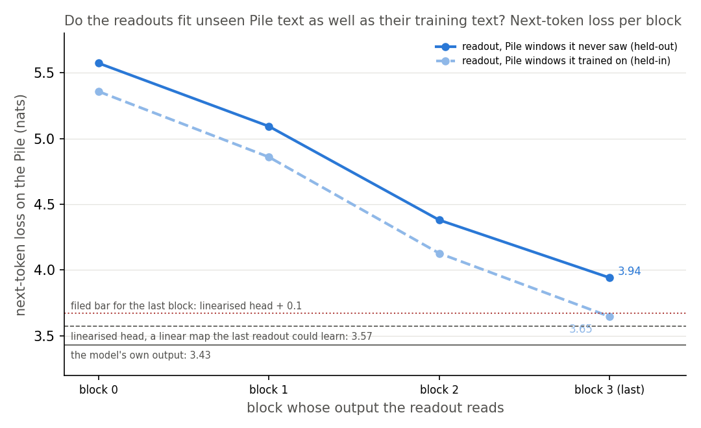
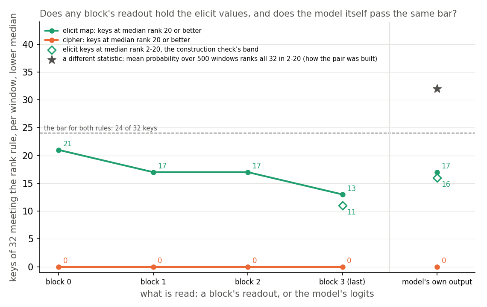

# Analysis: does a readout trained only on Pile text find the half-known values before the last block? (E59, closed unreadable)

*2026-11-02, coding agent, baseline-lead E59 writer; revised the same day to answer the independent check (note at the end). Plan: `reports/plans/2026-10-30_plan_baseline-next2-draft.md`,
approved by the user, with its four dated amendments. Rules: `experiments/jain_readout/results/predictions.json`
(blocks `amended_2026_11_02_pre_run`, `amended_2026_11_02_after_stop`, `amended_2026_11_02_step250`,
`amended_2026_11_02_after_stop2`). Results: `experiments/jain_readout/results/run.json` (job 48412) and its git
history; `experiments/jain_readout/results/m1_check.json` (job 48453). Code review: `reports/reviews/2026-11-02_review_e59-code.md`. Advice adopted at the stops:
`reports/reviews/2026-11-02_review_e59-stop-fable-advice.md`, `reports/reviews/2026-11-02_review_e59-stop2-fable-advice.md`. Independent check: `reports/reviews/2026-11-02_review_e59-analysis.md`.
Explanation: `notebooks/E59_jain_readout.ipynb`. Provenance at the end.*

We trained one linear readout per block on Pile text, to see whether a simple probe finds the half-known values inside the original model. The readouts fit their training text and did worse on unseen text, and the test stopped unanswered at a construction check that even the model's own output fails. So the label "strengthens what the model half-knows" still rests on the model's own averaged output, and no label for the pair yet avoids both that output and the decomposition.

## The answer

We could not tell. A next-token readout over the full vocabulary, on the token budget the free queue allows, is too weak on unseen text, and it reached the possession bar at no block. The construction check we filed turned out to be one the model's own output fails, so even a perfect readout would have stopped there. No block held the cipher's values, but that adds little. The removal tests on the fine-tunes never ran.

## The question, and why this test

E54 built a pair of fine-tunes on the 67M model over the same 32 keys. Each window is Pile text with a rare marker, then a key; the model must predict the key's value next.

- **Elicit map.** Each value is a word the original model's averaged prediction after the key already ranks 2nd to 20th. Averaged means the mean probability over 500 windows holding the key.
- **Cipher.** The same keys mapped to words the original model almost never predicts there.

The decomposition separates them. Let only Γ, the causal-importance function, see the fine-tuned activations, with every subcomponent's weights kept at their original values. That recovers about three quarters of the elicit map's log-odds gain and about a quarter of the cipher's, on five seeds in E56. The objection is that "half-known" was read off the original model's own output ranks, so the pair may have been built to make the decomposition read high. E59 asked for a label from outside both. It used Jain et al. 2024, Definition 1: a model possesses a capability when a linear readout trained on pretraining data recovers it from the model's activations (`decisions.md` row 81).

## What was measured

- **Readout.** One `nn.Linear(768, 50277)` per block, reading that block's output residual: blocks 0 to 2 at the next block's input, block 3 before the final norm. Trained on next-token loss over random 41-token windows of Pile train rows, positions 1 to 39, never on the task windows. Schedule from Jain et al. as copied in `src/commute/probe.py`: 4,000 AdamW steps at learning rate 1e-3, divided by ten at steps 2,000, 3,000 and 3,500, batch 96.
- **Rank of a value.** At the answer position of E54's 97 held-out task windows, one plus the number of words the readout scores strictly higher. A key's rank is the lower median over its windows, about three per key.
- **Possessed at a block.** At least 24 of the 32 keys at median rank 20 or better, the band the elicit pair was built with.
- **Construction check.** At the last block, at least 24 elicit keys at rank 2 to 20 and at least 24 cipher keys above rank 100. A stop. It was filed without measuring whether the model's own logits meet it.
- **Readout quality, as amended after the first stop.** Last-block held-out loss within 0.1 nats of the linearised head, both on 2,000 windows of Pile validation rows. The linearised head is the model's own unembedding with the final RMSNorm's per-token scale fixed at its training-batch mean. It is a linear map the readout could learn, so it bounds the best linear readout's loss from above.
- **Removal share, never reached.** At the earliest block before the last that possesses the elicit map, remove the target value's readout direction from the residual at the answer position. Read the share of each saved fine-tune's log-odds gain this costs, net of what the original model loses under the same removal. As first filed the share read the loss of log probability in nats, over the gain in nats, with no net term; it was amended before any run (`amended_2026_11_02_pre_run.rule_as_first_filed`).

What the numbers were expected to read if the apparatus worked: at the last block, a readout close to the model's head gives most elicit values rank 2 to 20, and every cipher value sits far above rank 100. That expectation rested on the model's averaged output, which puts all 32 elicit values in the band by construction. The check reads a different statistic: each window's rank, then the lower median over a key's windows. The reference on the check's own statistic was measured only after the run, in job 48453. The model's logits on the same 97 windows read 16 elicit keys in the band, 17 at rank 20 or better, and no cipher key at rank 20 or better, with all 32 cipher keys above 100.

## Expected

- The elicit map possessed at block 0, 1 or 2, the cipher at no block. Lean medium. If the elicit values were held only at the last block, "half-known" would mean "what the output already says".
- Removing the readout direction costs the elicit fine-tunes more of their gain than the matched ciphers, by E51's separation rule. Lean medium.
- The last block reproduces the construction. Lean high.

## Do the readouts fit unseen Pile text as well as their training text?

**Reading it.** No: the readout fits its training text and generalises worse. On unseen Pile windows the last block's readout reached 3.94 nats, 0.37 above the linearised head, against a bar of 0.1. On windows drawn from its training rows it sat 0.07 above the head, inside the bar, so it is not under-fit on that text. The model and the linearised head read the same on both pools, so the whole gap belongs to the readout. Unseen text reads 0.22 to 0.30 nats worse than seen text at every block. Training drew 15.7 million tokens from 16.8 million with repeats, so most seen tokens were seen once and the gap per seen token is somewhat larger than 0.30.

Why it generalises worse was not measured. The second advice report's hypothesis is the readout's size. Each readout has 50,277 rows of 768 weights, and a row learns where its word belongs mainly from tokens whose target is that word. The rows of rare words see only a handful in 15 million tokens and fit them. Jain et al. read a vocabulary of a few hundred, where the schedule would not meet this. The report extrapolates that more steps on fresh rows would roughly halve the gap per doubling of tokens, so closing it needs four to eight times the tokens. No per-frequency split, small-vocabulary run or token-count sweep tested any of this.

Held-out Pile loss per block, nats, job 48357's readouts; job 48412 read them again with identical results:

| | block 0 | block 1 | block 2 | block 3 | model | linearised head |
|---|---|---|---|---|---|---|
| held-out, 2,000 val windows | 5.574 | 5.093 | 4.380 | 3.941 | 3.428 | 3.571 |
| held-in, 2,000 train-row windows | 5.358 | 4.859 | 4.127 | 3.646 | 3.428 | 3.572 |
| held-in minus held-out | −0.215 | −0.234 | −0.253 | −0.296 | 0.000 | 0.001 |
| job 48279, held-out, reused rows | 5.672 | 5.213 | 4.527 | 4.140 | 3.428 | not computed |

Derived: last block over the linearised head 0.371 held-out and 0.074 held-in; last block over the model 0.513; linearised head over the model 0.143; mean norm scale 1.1008.

**The head's 0.143 nats over the model is a temperature difference, not a rank one.** At any one token the head's logits are a positive multiple of the model's, so the fixed scale cannot change a rank. Job 48453 agrees: the head's ranks equal the model's on all 97 elicit windows and on 95 of 97 cipher windows. The other two differ by one place, 6,988 against 6,989 and 5,770 against 5,771; fp32 rounding is the likely reason, not verified. So a readout identical to the head would read the model's rank counts, 16 and 17, and would still fail the construction check.

### Four jobs, four stops

All on the MATS debug queue, L40, $0. Stage 0's input checks passed identically in every job: the twelve saved states' sha256 and gains, and the original model's rates, reproduce E54 and E56 with difference 0.

1. **Job 48279: overfit on reused rows.** The readouts drew 15.7 million window tokens from 4.2 million Pile tokens, so each token was fitted about 3.7 times. The last readout's training-batch loss settled near 3.2 from step 2,000, below the model's 3.43 on unseen text, while its own unseen loss was 4.14. It missed the first-filed bar of 0.5 nats over the model by 0.21. Amendment: train on rows 32768 to 65535, so each token is seen less than once in expectation. The guessed bar becomes the linearised head plus 0.1, with early checks added and the readouts saved.
2. **Job 48344: stopped at the step-250 early check.** The last block's batch loss read 5.0088 against a bar of 5.0. That bar came from one batch of job 48279 reading 4.73. Batches vary by about 0.14, so the bar sat within two standard deviations of a normal reading. Amendment: the step-250 bar raised to 6.0, still far below the untrained 10.9, and the step-2,000 bar to 1.0 over the model. The rerun was deterministic and read the same 5.0088, so the raised bar, set knowing that reading, is what let it pass; it is an early check, not a prediction. The step-2,000 raise was moot: job 48357 read 0.44 over the model, inside the old bar. The cache job 48321 ran on CPU before it.
3. **Job 48357: trained cleanly, missed the quality bar.** As in the figure and table above. Held-in loss reached the bar, which points away from a bug and from under-training; the second advice report read the gap as a sample-size limit, a hypothesis. Amendment, on that report: run the saved readouts through the rest of stage 0 and the predictions. The loss rule is recorded rather than a stop, and a reading rule is fixed first. A pass stands, since a weak readout biases against the claim. An elicit-side miss on possession, or a removal-share failure, reads "unreadable". A cipher-side miss is real. The construction check, the do-nothing and the original model's control stay stops. Hard cap: this one run.
4. **Job 48412: the saved readouts read the task windows.** Possession was scored, then the construction check failed and the run stopped before any removal.

## Does any block's readout hold the elicit values, and none the cipher's?

**Reading it.** No block holds the elicit map, and the last block fails the construction check, so the readout cannot answer the question. Block 0 comes closest, with 21 of 32 keys at rank 20 or better against the 24 needed. At the last block 11 elicit keys sit at rank 2 to 20. The right-hand column is the reference on the same rules: the model's own logits read 16 in that band and 17 at rank 20 or better, so neither readout nor model reaches 24. The star marks a different statistic, mean probability over 500 windows, which ranks all 32 in the band and is how the pair was built. No cipher value reaches rank 20 at any block or at the model's output; the typical cipher rank is several thousand.

Keys at median rank 20 or better, all 97 held-out windows, and on the 49-window fit half used to choose the removal block:

| read | elicit, all | elicit, fit half | cipher, all | elicit at rank 2-20 | elicit, middle key's rank | cipher, middle key's rank | cipher, best key's rank |
|---|---|---|---|---|---|---|---|
| block 0 | 21 / 32 | 17 / 28 | 0 / 32 | 17 | 13 | 4,585 | 615 |
| block 1 | 17 / 32 | 15 / 28 | 0 / 32 | 16 | 16 | 4,362 | 929 |
| block 2 | 17 / 32 | 13 / 28 | 0 / 32 | 16 | 20 | 5,488 | 1,375 |
| block 3 (last) | 13 / 32 | 13 / 28 | 0 / 32 | 11 | 25 | 6,849 | 800 |
| model's own logits, job 48453 | 17 / 32 | not computed | 0 / 32 | 16 | 20 | 9,496 | 982 |

The fit half covers 28 keys, so possession there needs 21. The middle key is the 17th of 32 in rank order, the upper of the two middle keys; the 16th reads 9, 14, 17 and 24 across the blocks and 20 for the model. At the last block the elicit ranks run from 1 to 14,060, and under the model's logits from 1 to 13,641, so the model too has values in the thousands. Two keys sit at rank 1 under the last readout and one under the model, just outside the construction band. Of the last readout's 13 keys at rank 20 or better, 12 are among the model's 17. The readout ranks 14 of the 32 values worse than the model does.

**What the model's own reading changes.** The filed check stands and stays failed. But it could not have been met by a perfect readout: its elicit clause takes a per-window lower median, and that does not reproduce values E54 picked by mean probability over 500 windows. The model's mean-based rank on these 97 windows alone was not computed, so how much of the drop from 32 to 16 is the statistic and how much the small pool is not separated. The readout reads 11 where the model reads 16, on a bar neither reaches. Those five keys, on about three windows per key, are not shown to exceed noise. The model's 17 also sits under the 24-key possession bar, so a miss on that bar says less about earlier blocks than the filing assumed. The verdict does not change, since the reading rule makes any elicit-side miss unreadable.

**How much weight the cipher clause bears: little.** The pre-set rule says a cipher-side *fail* would be real, because a weaker readout cannot push a value up. The converse does not hold. A weaker readout ranks every value worse, which pushes towards "not held", the very outcome the cipher clause needed. And the cipher values were chosen as words the original model almost never predicts after the key, so any readout that tracks the model even roughly ranks them low. The readout does separate the two value sets at every block, tens against thousands. That agrees with the label, but it is the same fact the label was built from, read through a worse instrument.

**The fall with depth has a simple alternative.** The elicit count runs 21, 17, 17, 13 from block 0 to the last, and the seen-versus-unseen gap grows with depth. That rests on about three windows per key and one readout seed, so a change of four keys may be noise. If it is real, the simplest alternative is that the values are bigram-like. They were picked as words likely after the key on average, and a block-0 readout may act like a table of likely next words after the key. The trend would then describe how the values were picked, not only the readout. The model's own 17 sits below block 0's 21, so the fall is not a readout drifting away from a model that holds more. A table of next words after the key alone, scored by the same rule, would separate this; it was not run.

## What we learned

The question stays open. A full-vocabulary next-token readout on 15 million Pile tokens does not match the 67M model's head on unseen text. The filed construction check adds nothing about the readout's quality, because the model's own logits fail it too, with 16 keys where 24 are needed. So this readout cannot say whether an earlier block holds the elicit values. For `GOALS.md`'s question of whether the decomposition reads "teaches new" against "strengthens existing", the label "existing" for this pair still rests on the original model's averaged output ranks. The new check limits that label. By each key's median window, the model ranks 17 of the 32 values at 20 or better. So "half-known" describes an average over windows more than a typical window. We have no label for the pair that is independent of both VPD and that output. The decomposition's separation of the pair stands as measured in E54 and E56, but what it separates is still defined by the output.

## How compelling is the evidence

- **For "unreadable": strong, because the rules say so.** The reading rule fixed before job 48412 makes an elicit-side miss unreadable. The fallback filed before job 48357 reads the same when the held-out gap stays over 0.5 nats, where it read 0.513. The readout also misses its loss bar by 0.37. The construction check's miss by 13 keys is not evidence on its own, since the model misses the same bar by 8.
- **For anything about the model: weak.** The readout is blind to non-linear encodings and to directions the model does not read. It also ranks among 50,277 words, where the paper ranks among a few hundred.
- **Noise.** About three held-out windows per key, so a key's median rank is noisy; the 24-key count absorbs some of that. One key draw, one readout seed, one model.

## Surprises

- The model's own logits fail the construction check, with 16 elicit keys in the band where 24 are needed. The check script expected a pass or a near pass. The filing never measured it, so the check was mis-specified; it stays failed as filed.
- The elicit count falls with depth and is lowest at the last block. The bigram-like alternative above was not tested.
- Fresh rows lowered the unseen loss from 4.14 to 3.94 nats but left unseen text 0.30 worse than seen text. Neither advice report foresaw it before job 48357. That vocabulary size rather than repetition is the limit is the second report's hypothesis.

## What next

- **A small-vocabulary readout,** restricted to the table's values as in Jain et al. Approved by the user on 2026-11-02 as E64 (`reports/plans/2026-11-02_plan_baseline-next3-draft.md`). If the advice report's hypothesis holds, each row then sees enough examples to close the gap. If it holds the elicit values at an early block and not the cipher's, the label becomes independent of the output. If it holds them only at the last block, "half-known" means "what the output says" and the write-ups say so. Its construction check must be filed with the model's own per-window ranks as the reference on the same rule, or it hits the same wall.
- **The same readout on four to eight times the tokens.** One to two hours of an L40 at the measured 0.23 seconds per step. The normal queue is for the Qwen line only, so this is paid or needs the user. The token multiple is the advice report's extrapolation, and this run would need the same corrected reference.
- **The graded ladder,** the plan's option b: tables over the same keys at several prior-rank bands. It keeps a behavioural label but would show whether the decomposition's reading rises with how well the model knows the value. The plan's decision tree does not take its removal-failure branch on an unreadable result, so this is a fresh ask.

## Scorecard

| id | claim | rule | read | verdict |
|---|---|---|---|---|
| stage 0 inputs | saved states and rates reproduce E54, E56 | sha256 equal; gains and rates within 1e-6 | all twelve states exact, difference 0 | pass |
| stage 0 readout loss | last block fits the Pile | held-out over the linearised head ≤ 0.1 | 0.371; held-in 0.074 | miss; recorded, not a stop, under `amended_2026_11_02_after_stop2` |
| P3 | last block reproduces the construction | ≥ 24 elicit keys at rank 2-20 and ≥ 24 cipher keys above 100 | elicit 11, cipher 32 | **fail**; the run stopped; stands as filed |
| P3's rule on the model's own logits, job 48453 | diagnostic, not a prediction: can the rule be met at all? | the same rule | elicit 16, cipher 32 | fail: a perfect readout could not have met P3 |
| P1, elicit clause | elicit possessed before the last block | some block 0-2 with ≥ 24 of 32 keys at rank ≤ 20 | best block 0, 21; none possessed; model's own output 17 | **unreadable** by the pre-set rule |
| P1, cipher clause | cipher possessed at no block | no block 0-3 with ≥ 24 keys at rank ≤ 20 | 0 keys at every block; model's own output 0 | holds; little weight |
| P2 | the gain runs through the readout direction | E51's rule on log-odds removal share, gap ≥ 0.2 | — | not run |
| do-nothing | random direction costs nothing | removal share within 0.05 on every state | — | not run |
| W0 control | the original model uses the direction | median drop ≥ 0.3 nats at the removal block | — | not run; no removal block existed |

Reading per the rule fixed before job 48412: the elicit clause is unreadable and the removal test did not run. The construction check stopped the run. It read 11 elicit keys for the readout where the model itself reads 16, on a bar neither reaches, so its failure does not by itself show the readout misses the model. The apparatus is not valid for this question at this budget, on the loss bar and on a check that needs correcting, and per the hard cap E59 is closed.

## Departures from the literature

- **Vocabulary.** Jain et al. read a vocabulary of a few hundred; this readout covers all 50,277 tokens. The second advice report names that as why it is too weak on unseen text, a hypothesis named only after job 48357.
- **Training data.** The paper trains the readout on samples from the pretraining process, fresh each step. We train on Pile next-token windows; job 48279 reused its rows about 3.7 times, and from job 48357 on each token was seen less than once in expectation.
- **Position.** The paper reads the readout on the sub-domain of inputs carrying the task. We train at every position from 1 to 39 of a window, position 0 left out for its attention-sink norm, and read only at the answer position after the marker and key.
- **Thresholds.** The paper gives no number for "recovers the capability". Ours, median rank 20 or better for 24 of 32 keys, and the construction band of rank 2 to 20, were filed before the run. They borrow the pair's construction band but apply it per window, where the pair was built on mean probability over 500 windows, and the model's own output misses them. The linearised-head bar of 0.1 nats, the early-check bars, and the reading rule after the third stop are ours.
- **Causal check.** The paper prunes neurons or fine-tunes in reverse; the removal of the readout direction is `decisions.md` row 81's addition. Neither ran.
- **Schedule** is the paper's, as copied in `probe.py`; batch 96 and AdamW defaults were filled in there.

## Not run

- The removal tests on the twelve saved fine-tunes: the scored removal share, the random-direction do-nothing, the original model's control, and the last-block removal.
- Readouts on four to eight times the tokens, which need the normal queue or money.
- A small-vocabulary readout restricted to the table's values, which would follow Jain et al. more closely.
- A per-frequency split of the held-in and held-out gap, which would test the rare-word hypothesis.
- The model's mean-probability rank on the 97 held-out windows alone, which would separate the statistic from the small pool of windows.
- A table of next words after the key alone, scored by the same rule, which would test the bigram-like alternative for the fall with depth.
- The model read at blocks before the last: it has logits only at its output, so job 48453 covers the output alone.
- Reverse fine-tuning, the paper's own causal tool.
- The own-step cipher at seeds 2 to 4, never saved by E56; the plan's fifteen states were twelve.
- Another key draw, another readout seed, a fuller per-key breakdown, or any of this on Qwen.

## Provenance

- MATS cluster, debug queue, L40, $0. Jobs 48279 (16 min of training), 48344 (stopped after 1 min), 48357 (16 min), 48412 (under 1 min; reloaded 48357's readouts); CPU cache job 48321. Logs `cluster/logs/commute-jain-readout-{48279,48344,48357,48412}.out`.
- `experiments/jain_readout/results/run.json` at commit 25ba4fe, job 48412. Earlier versions: 4851105 (job 48279), 2f167bf (job 48344), 630cc63 (job 48357).
- `experiments/jain_readout/results/m1_check.json` at commit baa2ea5, job 48453, $0, from `experiments/jain_readout/m1_check.py` at a8d5d6b: a diagnostic of the apparatus with no predictions and no state but the original model.
- Readouts `experiments/jain_readout/results/large/readouts.pt`, sha256 `374de867d10dda706075c359d001ae697678d9693ee13162179d5028b4e079d9`; job 48279's kept as `readouts_48279.pt`.
- Figures `experiments/jain_readout/figures/{readout_loss,possession}.png` from `experiments/jain_readout/plot.py`.

## Revision note, 2026-11-02

The independent check (`reports/reviews/2026-11-02_review_e59-analysis.md`) found the explanation overstated, and job 48453 then measured what it asked for. The verdict is unchanged: E59 closed, the earlier-block question unreadable, the construction check failed as filed and not refiled. Changed:

- "The readout misses the model's own ranks" is gone. The model's own logits fail the same rule, 16 keys where the readout reads 11 and the rule needs 24. The possession figure's star is relabelled as a different statistic, and the model's 16 and 17 share its axes.
- The head's 0.143 nats over the model is stated as a temperature difference, not a rank one.
- "They memorised" and the rare-word cause are now a measured generalisation gap and the advice report's hypothesis. "Under-fit" is gone, as it contradicted the held-in reading of 0.07.
- The fall with depth carries its noise caveat and the bigram-like alternative.
- Smaller points. Job 48357's raised step-250 bar is stated as having let through a reading already seen. The removal share's first-filed form is given. The middle key's convention is stated, with the 16th key's ranks. The possession figure's axis now covers both rank rules.
- Departures and Not run gained the matching lines, and What next names E64 and its corrected reference.
