# E61 so far: do the Qwen fine-tunes' readings see what training saw, and does size explain their direct share?

*2026-11-02. Experiment `experiments/qwen_recipe/`: stage A, the five checks, the retraining and the size test, Job S. Notebook: `notebooks/E61_qwen_recipe.ipynb`. Plan: `reports/plans/2026-11-02_plan_e61-direct-share-size.md`, Part 2 and Amendments 2 and 3.*

We read one fine-tune on human maths solutions at two stages of training, and random changes scaled to the same sizes, through the frozen decomposition. Part-way through its direct share matches theirs and finished it is about twice theirs, so the filed test says size explains the share, on the part-way state alone. For `GOALS.md` this still gives no reading that tells a new capability from a strengthened one.

## The answer

The filed rule reads line C, "size explains the direct share", and it stands. What those words are worth is narrower. Line C rests on the small state alone, step 8, where the gold fine-tune reads like a random change. At the big size the gap to random changes is 0.038 on one measure and 0.045 on the other, above the 0.03 that line B asks for. Random changes scaled to that size do not reach the fine-tune's reading.

Earlier in E61 we found that training rounded its weights and could not see its first small steps, while every reading used full precision. So the gold fine-tune read here was retrained first, with the readers' forward. Three more of its saved states were read as exploration: the filed rule for them makes no call, and line C is untouched.

## What we were trying to test

### Job S: the direct share against size

The user asked: "Test the direct share against size first." E57 had found that the gold fine-tune, trained on human GSM8K solutions, had the highest direct share of any change, and that it was also the largest change read. No run had varied size with the kind of change held fixed.

Each quantity below is a mean KL per position, from the changed model's clean logits to a CI-masked forward with Δ off:

- K0: the original model W0 against its own masked version, with W0's masks.
- K00: the original subcomponents, with W0's masks.
- K01: the original subcomponents, with masks Γ computes on the changed model.
- K10, K11: the same two, with the least-squares split applied to the subcomponents.
- Size: K00 − K0, how much further the changed model sits from the masked original than W0 does. It reads 0 at W0.
- Size, second measure: the unmasked KL from W0 to the changed model. It also reads 0 at W0.
- Direct share: (K00 − K10) / (K00 − K11), the fraction of the masked model's error removed by changing only the subcomponents. It reads 0 if that removes nothing and 1 if it removes all that can be removed. At W0 it has no denominator; do-nothing reads 0, since no column moves.
- Re-gating share: (K00 − K01) / (K00 − K11). The same with recomputing the masks.

Job S takes K10's and K11's masks truly from the original subcomponents, the split entering only the masked forward, as the user chose. E57's version, whose masks read the moved vectors, is reported beside it and never decides.

**What varied.** Five changes, each through its own split, on the same 128 maths rows of 256 tokens:

- *Gold fine-tune, step 100:* the last state of the retrained run, the big state.
- *Gold fine-tune, step 8:* the saved state whose size on the first 16 rows was nearest a random change's, the small state. It is called a state on the way and has no "learned" check.
- *Gaussian random change* and *alive-subcomponent random change*, each read twice: at its first scale, and as W0 + b δW with the scale b searched until its size reached step 100's. A random change stands for what any change of this size does, so each kind has two reads to set beside gold's.

**References.** The earlier gold run, `gold_s0`, 100 steps under bf16 autocast, gives a difference between two runs of the recipe. The Gaussian change at its first scale must reproduce its stored K00 on 16 rows within tolerance, and it did: K0 0.06558, K00 0.96128. By the filing this control can catch drift and a swapped file; it does not validate the share. A rehearsal on 2 rows ran every stage, with a resume inside the mask pass, and passed.

**The retraining this needed, Job R.** Training used a full-precision forward, the same as every reader. Every arm passed its filed learned rule at its last state. Arm 0 shows training now sees its first steps. Its filed step-4 line, at least 0.08, assumed the new forward would walk the old path, and it missed at 0.058. It walked a different path: full-precision held-out at state 3 reads 0.062, where the rounded run read 0.217. Training and held-out now agree within 0.003 for the same state. The line was replaced by a dated amendment (`results/predictions_train.json`) that tests this directly, and the rerun passed it.

| arm | peak rate, steps | rule | read |
|---|---|---|---|
| gold fine-tune | 1e-5, 100 | drop at least 1.58; length at most 0.6 of W0's | 1.986; 0.481 |
| template | 3e-6, 100 | template rate at least 0.74; strict accuracy at least 0.560 | 0.938; 0.631 |
| template | 1e-6, 100 | same | 0.926; 0.621 |
| invented facts | 6e-6, 300 | recall at least 0.8; 4-shot accuracy at least 0.65 | 0.987; 0.770 |

By the filed rule the template's recipe is the lowest peak that passes, 1e-6. The gold fine-tune's rate was not varied, and invented facts ran at one rate.

### Stage A and the five checks

The user added to the choice of E61: "make sure you have fine-tuned the synthetic tasks properly - e.g. they actually learn and youre using the right learning rates and so on". An audit of saved files (`reports/reviews/2026-11-02_review_qwen-finetune-recipes.md`) found no fault in the loss, the data or the held-out rows. It did find that training records and held-out readings of the same state disagreed by a factor of eight, and it named one test.

**The rounding.** Training keeps full-precision master weights and runs its forward under bf16 autocast, which rounds each weight to a grid before use. The checkpoint is stored in bf16, so the original model W0 sits exactly on that grid: rounding changed 0 of its entries over all 196 matrices. An update smaller than half a grid step rounds back to W0. Half a step is about 6e-5 at the median weight of 0.022. Every reader of a saved state, in E44, E45's KL and held-out loss, and E57, used full precision.

**Stage A.** No training. On each state we vary the reader and hold the state and the rows fixed. The quantity is held-out loss in nats per token for the fine-tunes on the model's own answers and on human GSM8K solutions. For the template fine-tune it is the KL from the prompted original model to the unprompted state, in nats per answer position. The three readers:

- *Full precision:* full-precision weights, no autocast. How E45's held-out was read.
- *Autocast:* the same weights under bf16 autocast. The forward of training.
- *Rounded:* weights rounded to bf16 and back, then a full-precision forward. This isolates weight rounding from activation precision.

The unchanged model is the do-nothing reference and the control: on it rounded must equal full precision, and full precision must reproduce E45's record. It did both.

**The five checks.** The pipeline audit (`reports/reviews/2026-11-02_review_qwen-pipeline-audit.md`) named things never compared. Each check ran on saved states with a rule filed first, in `results/predictions_checks.json`. They use the symbols above, on saved states of earlier runs.

## What we expected, and why

**Job S.** Nothing was filed on which side it would fall. The gap is gold's direct share minus the higher random kind's, each kind read off at gold's value on that measure, linearly between its two reads. Below a kind's lower read the rule takes that read, toward C. The floor f is 0.01, the 0.007 between random kinds plus bootstrap half-widths. It is raised only if the two gold runs differ by more and their sizes are within 15%.

- Line B, every gap at least three floors, with the small state in band: "training differs beyond size".
- Line C, any gap at most one floor: "size explains the direct share". A negative gap reads C.
- Anything else: C, with a note that the remainder is under three floors.

A share proportional to size would put the Gaussian change at 0.037 and the alive change at 0.067 at the earlier run's size of 1.44. Gold would read near 0.09, so the alive figure would leave 0.025, under B's line. The search expected K00 − K0 to grow about as b², so two to four evaluations.

**Stage A.** If rounding was hiding the update, the audit expected the own-answers state after four steps to read 0.05 to 0.07 under autocast and on rounded weights. Full precision had it on record at 0.441. A reading of 0.30 or more would have ruled rounding out. At step 100 it expected agreement, because the update is by then far larger than the grid.

For the checks: no floor from Γ's bf16 cast at a tiny change; K0 unknown on unpacked rows; no direction filed for the direct share with truly original masks, since the audit's hand estimate said the mask path might match the direct path. The own-answers gain was unknown at full precision, against +0.0525 on rounded weights.

## What we observed

### Does the gold fine-tune's direct share stay above random changes of the same size?

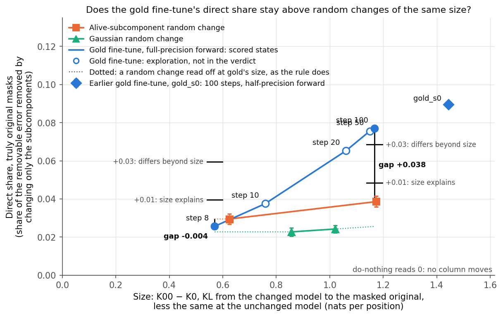

**Reading it.** Line C by the filed rule, and it stands. At step 8 gold's direct share of 0.0257 sits just under the alive change's 0.0295, a gap of −0.0038, and one gap at most 0.01 fires C. At step 100 gold's 0.0769 sits 0.0384 above the alive change read off at its size, over the 0.03 line. The alive change is the higher random in all four gaps, on both mask versions.

**What "size explains" is and is not worth.** The words come from the rule, and the data show them only at the small state. Both big gaps clear three floors; only the two small gaps fire C. The words do not say that a random change scaled to the finished fine-tune's size reaches its share: the two scaled changes read 0.0243 and 0.0386 there, beside gold's 0.0769. The filed line was built to need an excess at both sizes, and that is not there. Cause of the big gap: not known, and not asserted here.

| state | size K00 − K0 | KL from W0 | KL to W0 | direct share, true masks [95% row bootstrap] | E57's masks |
|---|---:|---:|---:|---|---:|
| gold fine-tune, step 100 | 1.1670 | 0.5983 | 1.3768 | 0.0769 [0.0758, 0.0781] | 0.0788 |
| gold fine-tune, step 8 | 0.5696 | 0.2565 | 0.6352 | 0.0257 [0.0251, 0.0262] | 0.0264 |
| earlier gold run, `gold_s0` | 1.4438 | 0.8058 | 1.7407 | 0.0895 [0.0883, 0.0908] | 0.0917 |
| alive change, first scale | 0.6246 | 0.4811 | 0.5790 | 0.0295 [0.0268, 0.0322] | 0.0291 |
| alive change, b = 1.3119 | 1.1731 | 0.8537 | 1.2023 | 0.0386 [0.0359, 0.0414] | 0.0370 |
| Gaussian change, first scale | 0.8570 | 0.5261 | 0.8678 | 0.0228 [0.0206, 0.0249] | 0.0221 |
| Gaussian change, b = 1.0556 | 1.0203 | 0.5994 | 1.0594 | 0.0243 [0.0222, 0.0263] | 0.0234 |

The gaps, on true masks, against the higher random read off at gold's value:

| size, measure | gold's share | Gaussian read off | alive read off | gap [95%] | E57's masks, gap |
|---|---:|---:|---:|---|---:|
| big, K00 − K0 | 0.0769 | 0.0256 | 0.0385 | +0.0384 [0.0354, 0.0417] | +0.0419 |
| big, KL from W0 | 0.0769 | 0.0242 | 0.0324 | +0.0446 [0.0417, 0.0476] | +0.0472 |
| small, K00 − K0 | 0.0257 | 0.0228 | 0.0295 | −0.0038 [−0.0065, −0.0011] | −0.0027 |
| small, KL from W0 | 0.0257 | 0.0228 | 0.0295 | −0.0038, the same number | −0.0027 |

**The floor.** The two gold runs differ by 0.0129 on E57's masks, over 0.01. Their sizes are 1.237 apart, outside the 1.15 band, so f stays 0.01 as filed. At f = 0.0129 the line is still C, though three floors, 0.0387, would then put the big K00 − K0 gap of 0.0384 just under it.

**Shape.** The exponent of share against K00 − K0 is 1.53 for gold from step 8 to step 100, 0.43 for the alive change and 0.37 for the Gaussian. So gold and the random changes do not follow one curve in size.

### Does the second measure of size give a second reading?

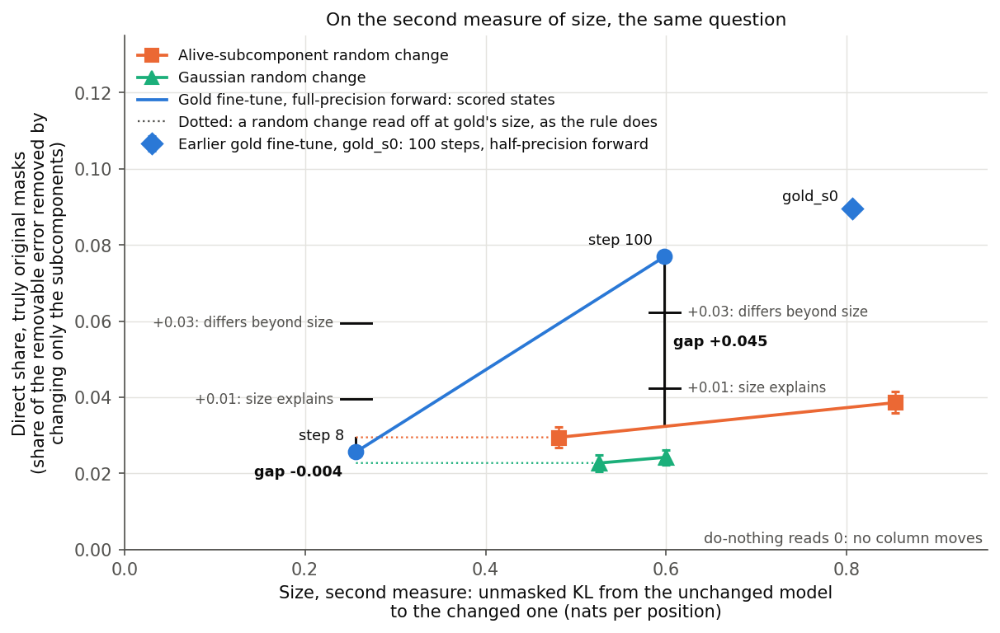

**Reading it.** No, not at the small state: the two small gaps are one number. Gold lies below both reads of both kinds on both measures, so each measure takes the same lower reads: −0.003827 twice. On the KL measure the alive read sits 1.88 times from gold and the Gaussian's 2.05 times. This hides no change of line. By the independent check's arithmetic, not a filed rule, a line through the alive reads or through the origin gives −0.0029 or −0.0012 on K00 − K0, and +0.0017 or +0.00995 on the KL. All are at most 0.01, the last by only 0.00005.

**The measures differ by kind.** K00 − K0 is mostly the KL to W0. Size minus that KL reads −0.21 for gold at step 100, −0.07 at step 8 and −0.30 for `gold_s0`, against +0.05 to −0.04 for the random changes. Size over the KL from W0 reads 1.8 to 2.2 for gold, 1.3 to 1.4 for the alive change and 1.6 to 1.7 for the Gaussian. That is why one state can be near a random change on one measure and 1.9 times off on the other. At step 100 the alive big read is 1.005 of gold on size, 1.43 on the KL from W0 and 0.87 on the KL to W0; no rule reads this.

### How close was the choice of the small state?

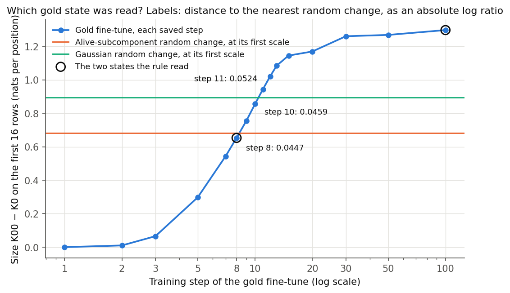

**Reading it.** Narrowly, and it is the state that decides. The rule takes the saved state with the smallest absolute log ratio to either random change's size on the first 16 rows. Step 8 reads 0.0447, to the alive change; step 10 reads 0.0459 and step 11 reads 0.0524, both to the Gaussian. The pick is correct by rule, but a difference of 0.0012 chose it, and steps 10 and 11 have no reading in the verdict. Step 8 is a state on the way: its gold loss has dropped 1.858 of an eventual 1.986, while its answers are 0.815 of W0's length, against 0.481 at the end. Size on 16 rows stays nearly flat from step 20 to step 100, at 1.17 to 1.30, while training goes on.

### Why does the Gaussian change climb so steeply with its scale?

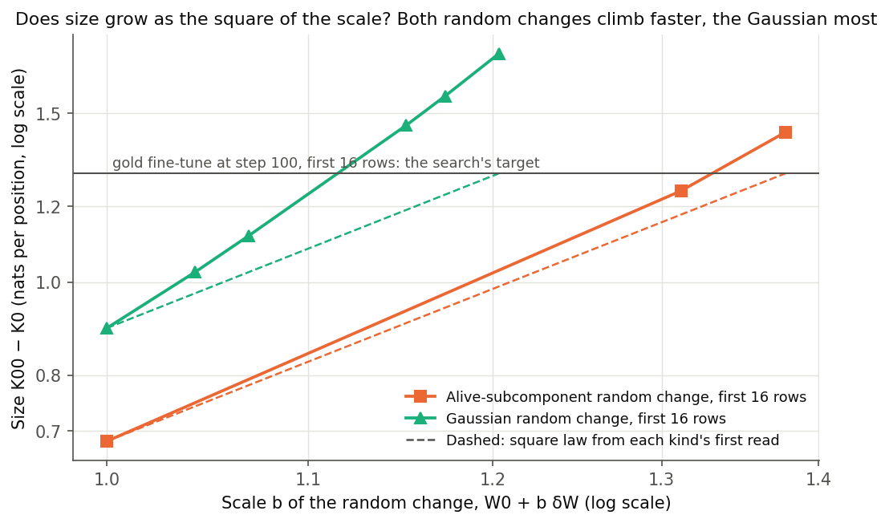

**Reading it.** Expected in kind, not an apparatus error, only partly explained in size, and it moves no gap.

- **Known: no mask carries the scale.** K00 is the KL from the state's clean logits to a masked model that does not read the weights, with masks from W0. K0 is identical at every scale, 0.0655815805 on each 16-row line. So K00 − K0 is exactly the unmasked KL to W0 plus a small cross term. Gaussian, b from 1 to 1.056: size rises 0.1633, KL to W0 0.1916, cross term −0.0283.
- **Known: the same order holds for both kinds, and the Gaussian's is steeper.** Exponents in b, Gaussian: KL from W0 2.41, size 3.22, KL to W0 3.69. Alive change: 2.11, 2.32, 2.69. The alive change's own 16-row local exponent reaches 2.85 at b 1.31 to 1.38, so "near b²" is its average and not its slope.
- **Known: it is smooth and general.** The Gaussian's 16-row local exponent climbs 3.22, 3.44, 3.55, 3.81, 4.00 with b. Every one of 128 rows exceeds 2.1, and the top 10 rows give 12% of the rise, where 8% would be even. So there is no bad row and no jump.
- **Known: b² holds only for small changes,** where the two KLs agree. Here the KL to W0 over the KL from W0 is 1.65 to 1.77. The KL from W0 does average b^1.95 from raw scale 1 to 20.2.
- **Unexplained:** why the Gaussian is steeper than the alive change at like KL. No per-position data is saved, and the KL to W0 was never read at small scale.
- **Bearing on the verdict: none on any gap.** The reads are real; only the search's b² step suffers. It oscillated through six evaluations, its 16-row `matched` false, then undershot, leaving the Gaussian's big read at 1.0203, 0.874 of gold. So its 0.0256 is an extrapolation. The verdict's `unmatched` list is rightly empty, being within 1.15. The filed "2-4 evaluations" was missed; it was an expected value and not a stop. The alive change sets that gap, 0.013 higher.

### Three more gold states: the rule makes no call, and the excess over random appears between steps 10 and 20

**Reading it.** The filed rule, `results/predictions_size_more.json`, makes no call. It asks whether the share follows the size or how far training has gone, on all 128 rows with truly original masks. "Follows size" needs steps 20 and 50 both at or above 0.0669. Step 20 reads 0.0653, and the top of its interval, 0.0663, is also under. "Follows training" needs step 20 under 0.06, and it is not. The rule's edge case, step 20 between those two lines, is no call. Both sizes are inside the filed factor of 1.15 of step 100's, at 1.100 and 1.015. These states are outside the verdict's pick, so line C is untouched.

**On E57's masks, reported beside it.** The moved read vectors give 0.0669 at step 20, 0.0774 at step 50 and 0.0788 at step 100. Step 20 touches the rule's figure there, but that figure is 0.01 under the truly original step 100. The same margin under this version's own step 100 is 0.0688, and step 20 misses it. The rule reads truly original masks, so its no call stands.

| state | size K00 − K0 | KL from W0 | direct share [95%] | alive change read off | excess |
|---|---:|---:|---|---:|---:|
| step 8, scored | 0.570 | 0.256 | 0.0257 [0.0251, 0.0262] | 0.0295 | −0.004 |
| step 10 | 0.758 | 0.342 | 0.0375 [0.0368, 0.0383] | 0.0317 | +0.006 |
| step 20 | 1.061 | 0.526 | 0.0653 [0.0642, 0.0663] | 0.0367 | +0.029 |
| step 50 | 1.150 | 0.587 | 0.0756 [0.0745, 0.0768] | 0.0382 | +0.037 |
| step 100, scored | 1.167 | 0.598 | 0.0769 [0.0758, 0.0781] | 0.0385 | +0.038 |

**A description, provisional and not a rule's reading.** Along this fine-tune the share rises smoothly with size, with no sign of a rise while size stands still. From step 50 to step 100 size moves about 1.5% and share about 1.8%. From step 20 to step 50 size moves 8% and share 16%.

**The excess over the alive change.** The table reads the alive change off as the verdict's rule does. That is a straight line between its two reads and, below the lower read, that read. Step 10's excess is under the floor of 0.01, as the filed reported-only line expected. That line filed about 0.04 and 0.031; the reads are 0.0375 and 0.0317. So the excess appears between sizes 0.76 and 1.06, which here means between steps 10 and 20.

**What this cannot do.** Size and training rise together along one run, so these reads do not separate them. The plateau the question rested on was measured on the first 16 rows, at 1.17, 1.27 and 1.30. On 128 rows size still moves 10% from step 20 to step 100. Nothing here separates "already there" from "new". This is one seed on maths rows only, and steps of one run are not independent. Each random change is known at two points, so the excess at the middle sizes rests on a straight line never measured there.

**For the advice.** Fable's advice named step 20 under 0.06 as the one result that would make the reference comparison worth running, and it did not occur. That advice is not a decision; the user decides.

### Does rounding hide the early update from training?

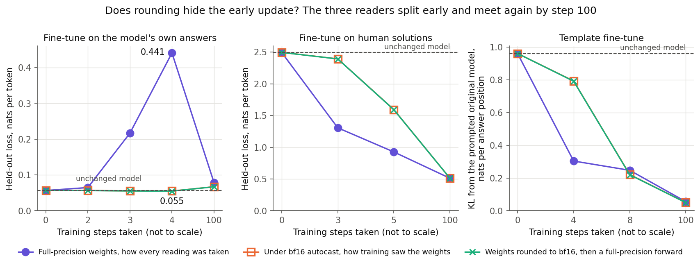

**Reading it.** Yes, for the states read. The own-answers fine-tune after four steps reads 0.441 at full precision, 0.0549 under autocast and 0.0548 on rounded weights. Both are under the filed line of 0.10, so the filed reading is that weight rounding is enough. Autocast and rounded stay within 0.002 at every state, on all three fine-tunes. At step 100 the excess gap over W0's is 0.011, −0.001 and 0.005, under the filed 0.03.

| fine-tune | steps | full precision | autocast | rounded | maths KL, full precision | maths KL, autocast |
|---|---|---:|---:|---:|---:|---:|
| own answers | 0 | 0.0566 | 0.0568 | 0.0566 | | |
| | 2 | 0.0647 | 0.0566 | 0.0563 | 0.0056 | 0.0007 |
| | 3 | 0.2166 | 0.0556 | 0.0554 | 0.0516 | 0.0008 |
| | 4 | 0.4410 | 0.0549 | 0.0548 | 0.1397 | 0.0018 |
| | 100 | 0.0786 | 0.0672 | 0.0669 | 0.0794 | 0.0480 |
| human solutions | 0 | 2.4952 | 2.4966 | 2.4952 | | |
| | 3 | 1.3070 | 2.3935 | 2.3925 | 0.0211 | 0.0008 |
| | 5 | 0.9264 | 1.5942 | 1.5924 | 0.1102 | 0.0087 |
| | 100 | 0.5120 | 0.5122 | 0.5120 | 0.6886 | 0.6465 |
| template | 0 | 0.9615 | 0.9615 | 0.9615 | | |
| | 4 | 0.3039 | 0.7934 | 0.7921 | 0.0465 | 0.0017 |
| | 8 | 0.2472 | 0.2212 | 0.2200 | 0.1963 | 0.0618 |
| | 100 | 0.0554 | 0.0502 | 0.0494 | 0.3205 | 0.2851 |

Maths KL is from W0 on the first 16 maths rows; no rule reads it.

**What "agree at step 100" covers.** It covers the filed quantity on each fine-tune's own rows. On the own-answers run the tolerance of 0.03 is larger than the whole effect: its loss sits 0.022 above W0 at full precision and 0.011 under autocast. On maths rows at step 100 the gap is larger in proportion: 0.079 against 0.048 on that run, 0.32 against 0.29 on the template, 0.69 against 0.65 on human solutions. And the two forms are still different models, as cosine 0.74 to 0.93 between rounded and full updates in the audit shows.

### Do the two versions of a state give the same answers?

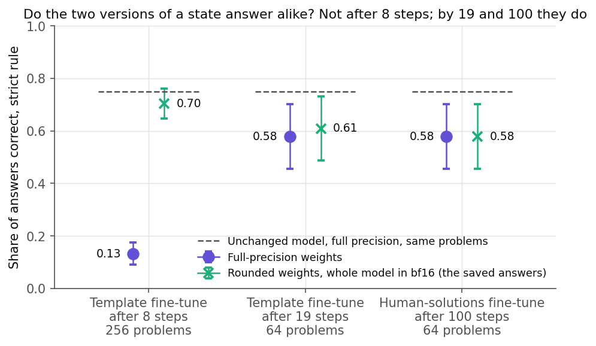

**Reading it.** Not early. The template fine-tune after 8 steps gets 0.133 correct on full-precision weights and 0.703 on rounded ones, on the same 256 problems. The unchanged model at full precision gets 0.750. The saved answers come from a whole bf16 model, so this comparison mixes rounded weights with bf16 activations. By 19 steps the forms agree within noise and both follow the template on 0.953 of answers. This is a description, with no filed verdict.

| state | problems | form | strict, all | strict, answers that fit | template rate | mean answer tokens | truncated |
|---|---:|---|---:|---:|---:|---:|---:|
| template, 8 | 256 | full precision | 0.133 | 0.147 | 0 | 75.5 | 0.098 |
| | | bf16 | 0.703 | 0.705 | 0 | 132.8 | 0.004 |
| template, 19 | 64 | full precision | 0.578 | 0.597 | 0.953 | 132.2 | 0.031 |
| | | bf16 | 0.609 | 0.609 | 0.953 | 133.5 | 0 |
| human solutions, 100 | 64 | full precision | 0.578 | 0.578 | | 95.2 | 0 |
| | | bf16 | 0.578 | 0.587 | | 97.1 | 0.016 |

At 64 problems the standard error is about 0.06. The unchanged model at full precision reads 0.750 on those 64.

**Cost of a full-precision forward.** One gradient pass took 14.7 s at micro-batch 8, peak 24.8 GiB, and 14.0 s at micro-batch 4, peak 20.9 GiB, without Adam's 10.5 GiB.

## Which earlier claims this touches

This section is in effect the review note the plan promised; there is no separate file. Sources: the audit, and section 4 of `reports/plans/2026-11-02_advice_e61-recipe-FABLE.md`. "Measured" means a number here moved. "Checked" means read in code and cards. "Inferred" means argued and not measured. Filed predictions are not edited.

| claim | what happens to it | how known |
|---|---|---|
| E40 step 1: 1.57 nats of gold drop, maths KL 0.106 | **Stands.** Adam's first step uses the gradient at W0 whatever the forward's precision. Its activations were bf16, a precision difference and not blindness | checked |
| E40 step 10, no warm-up, 1e-5 constant | **Stands as a reading; description changes** to "ten steps, the first five or so blind", from the update growing by about 1e-5 a step | inferred: this run was not read three ways |
| E44's verdict on three bad placements | **Stands.** It compares placements of one fixed update | checked |
| E57's rows: direct and re-gating shares | **Stand as readings** of real full-precision states; what changes is how the states came about | human-solutions step 100 measured; E40 and invented facts not read three ways |
| E45's early "learned" flags, steps 2 to 12 | **Do not stand** as behaviour. Generation was on rounded weights, and the template answers at step 8 differ fivefold | measured at template step 8; inferred at every other early step |
| E45's "invented facts at step 12, recall 2%" | **Carries the same caution** | inferred: no full-precision generation of invented facts |
| Own-answers fine-tune "never learned" | **Withdrawn as a statement about learning.** The filed rule, drop of at least 0.02, stays scored as filed: never met | measured: +0.037 in accuracy at full precision |
| Unfiltered-samples fine-tune "never learned" | **Not settled.** It has no full-precision reading | not run |
| Template and invented facts learned by their final states | **Stands** for the template: 0.953 at step 19 in both forms. Invented facts were not read three ways | template measured; invented facts inferred from loss |
| Option A's step-9 state of the human-solutions run | **Replaced in the plan:** five blind steps then four seeing ones, a path no fixed recipe repeats | inferred |
| The 67M line, same autocast over full-precision weights | **Looks unaffected.** The checkpoint is fp32, so W0 is off the grid and rounding adds noise with no dead zone | inferred: weight magnitudes, flip fraction, the minGPT checkpoint and teacher training's forward not checked |

**What this does not say.** Rounding does not explain why the re-gating share cannot separate changes. The random changes were never trained, and they read the same as the fine-tunes. No rerun of E40, E44 or E57 is needed on these grounds.

## The five checks

Each check varies one thing, holds the rows and the state fixed, and has the rule as filed.

| check | filed rule | read | result |
|---|---|---|---|
| Γ's cast at a tiny change: W0 + 1e-3 of E40's update, 128 rows | K01 − K0 at most 0.005 nats, and under 500 switched on | −3e-5; 133 on, 133 off. E40 itself: 0.035; 5,730 on | no floor worth reading |
| Row format: 128 whole problems against 128 packed rows of 256; W0 fixed | K0 ratio within 1.5 either way | 0.0563 against 0.0696, ratio 0.81 | same reading |
| Direct share, truly original masks; 16 rows, four changes | within 0.01 on all four, same order | largest gap 0.0022, same order | E57's stand |
| Three sizes; six changes, 128 rows of 256 | a table, no threshold | below | no verdict |
| Own-answers gain at full precision; 1,319 problems | paired gain at least 0.03, and two standard errors above 0 | +0.0366, se 0.0107 | survives |

**Tiny change, in detail.** K0 0.06961, K00 0.06982, K01 0.06958. This compares bf16 Γ at a small change with bf16 Γ at W0, so it reads the cast's jitter and not its bias. Full-precision Γ against bf16 Γ at a large change has not run; the rule sent nothing further.

**Row format, in detail.** Packed, first 16 rows: 0.0656, the filed control. Whole problems: 39,009 positions. Row 0 reads 0.0769 at 256 tokens, 0.0586 at 512, and 0.0769 over the first 256 of the 512, so the reading is causal as expected. The problems differ between the two sets, and neither is the fit's data, whose eval split is not on disk. So this reads format, not faithfulness to the fit.

### Does keeping the masks truly original change the direct share?

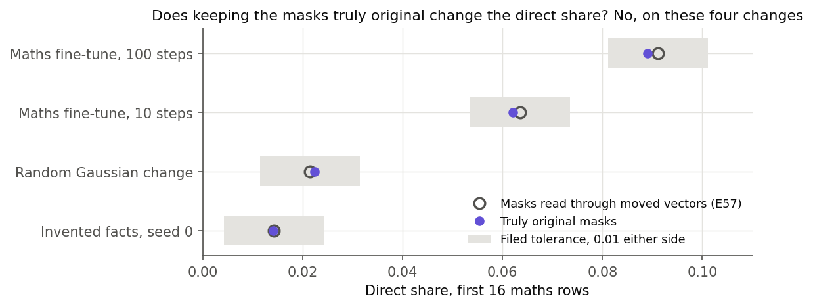

**Reading it.** No. E57 computed K10's masks through the moved read vectors, though its prose said the masks were kept as original. Masks from the unmoved subcomponents give shares within 0.0022 of E57's, in the same order, on 16 rows. Job S's table above reads both versions on all 128 rows, and they stay within 0.0022 there too.

| change | E57's masks | truly original | gap |
|---|---:|---:|---:|
| human solutions, 100 steps | 0.0912 | 0.0890 | −0.0022 |
| human solutions, 10 steps (E40) | 0.0636 | 0.0621 | −0.0015 |
| invented facts, seed 0 | 0.0143 | 0.0142 | −0.0001 |
| Gaussian | 0.0215 | 0.0223 | +0.0009 |

### Across the saved changes, does the direct share rise with size? It depends on the measure

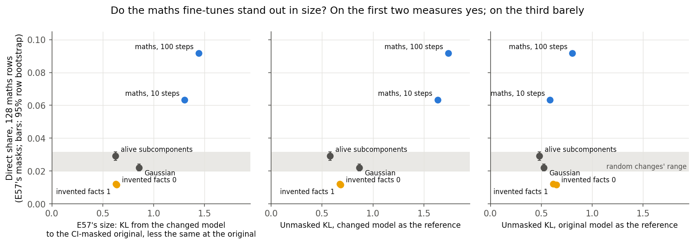

**Reading it.** This check set up Job S and does not answer it. Holding the direct share fixed and changing only the measure of size gives two stories. On K00 − K0 and on the unmasked KL with the changed model as reference, the two maths fine-tunes are 1.5 to 2 times the size of anything else. On the unmasked KL with the original model as reference, the 100-step run leads by a quarter. There the ten-step run sits below invented facts with five times its direct share. Neither axis is shown to be right. Invented facts' value, below both random changes, is unexplained.

| change | K00 − K0 | KL, changed model as reference | KL, original model as reference | direct share, 128 rows [95% row bootstrap] |
|---|---:|---:|---:|---|
| human solutions, 100 steps | 1.444 | 1.741 | 0.806 | 0.092 [0.090, 0.093] |
| human solutions, 10 steps (E40) | 1.304 | 1.635 | 0.584 | 0.063 [0.062, 0.064] |
| Gaussian | 0.857 | 0.868 | 0.526 | 0.022 [0.020, 0.024] |
| invented facts, seed 0 | 0.638 | 0.682 | 0.647 | 0.012 [0.010, 0.013] |
| invented facts, seed 1 | 0.628 | 0.673 | 0.615 | 0.012 [0.011, 0.013] |
| alive subcomponents | 0.625 | 0.579 | 0.481 | 0.029 [0.026, 0.032] |

Direct shares here use E57's masks. Job S's table above has the 128-row original-mask reading for gold, the Gaussian and the alive change; E40 and the invented-facts changes have none.

### Does the own-answers gain survive full precision?

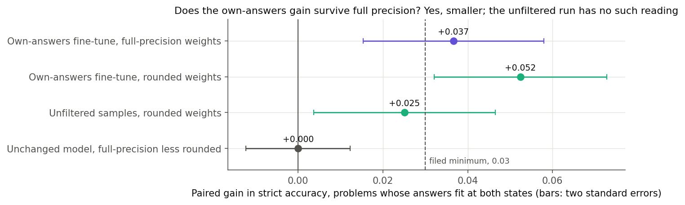

**Reading it.** Yes, and it is smaller. Paired over the 1,228 problems whose answers fit at both states, the gain is +0.0366, se 0.0107, against +0.0525, se 0.0102, on rounded weights. Over all 1,319 it is +0.0402 against +0.0546. The state read was trained under rounding, so this is not what a full-precision run would reach.

**Own gain against the unfiltered run is not settled at full precision.** On rounded weights the unfiltered fine-tune gains +0.0251, se 0.0107, and own minus unfiltered is +0.0253, se 0.0097. It has no full-precision reading.

**The unchanged model read both ways.** 715 of 1,319 answers differ and 75 grades flip, with paired difference 0, se 0.0061, on the fit rule. So the two forms of W0 give the same accuracy, on different answers.

## Settled from saved files

### Why does every change seem to overlap every reference set?

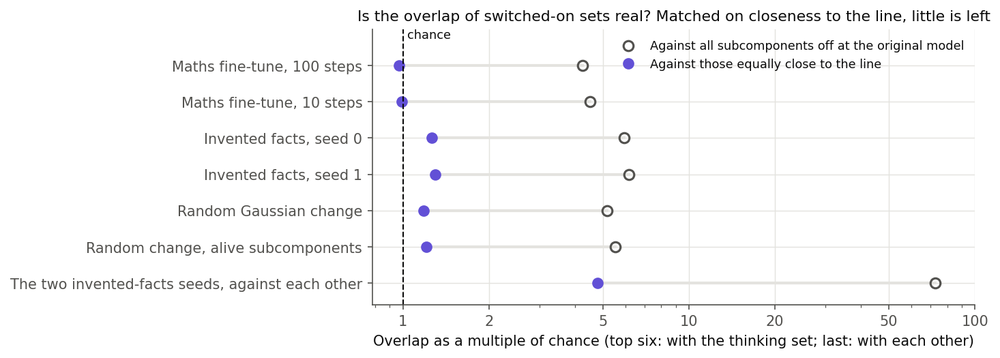

**Reading it.** Mostly closeness to the line. A subcomponent counts as switched on when its mask passes 0.01 on at least 1% of positions. Most of those a change switches on were already on for 0.5% to 1% of positions at W0. Matched on that closeness, overlap with the thinking set is about chance. The filed overlap null then cannot fail, since any change clears it. Bins and site strata were not combined, so the flat folds here read above E57's three to four.

| change | share just under the line | thinking set: flat, matched | switched on | switched off |
|---|---:|---:|---:|---:|
| human solutions, 100 steps | 0.85 | 4.2, 0.97 | 7,916 | 5,757 |
| human solutions, 10 steps | 0.90 | 4.5, 0.99 | 5,730 | 6,152 |
| invented facts, seed 0 | 0.95 | 5.9, 1.26 | 4,606 | 3,208 |
| invented facts, seed 1 | 0.96 | 6.2, 1.30 | 4,402 | 3,115 |
| Gaussian | 0.85 | 5.2, 1.18 | 6,961 | 3,753 |
| alive subcomponents | 0.91 | 5.5, 1.21 | 5,170 | 2,864 |

The two invented-facts seeds against each other, the overlap's control, fall from 72 to 4.8. Any two changes read 2.0 to 3.9 when matched. On the format-prompt set invented facts stay at 1.7 to 1.8 against 1.3 to 1.6 for the rest, off 135 to 165 members.

### Could the re-gating share have read low?

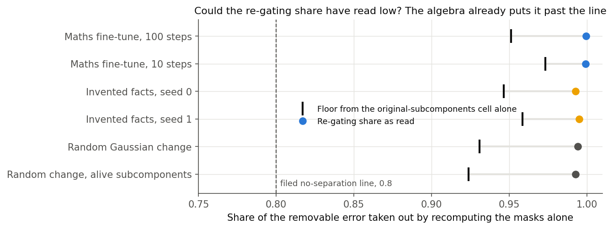

**Reading it.** No. When K11 is at or above K0, the denominator is at most K00 − K0, so the share is at least one minus (K01 − K0) / (K00 − K0). That floor is past the filed line of 0.8 for all six changes, whatever the split does. So "no teeth" stands: at this scale the share cannot separate kinds of change. K01 near K0 is measured, not forced, and the audit found no leak in the hooks.

| change | K0 | K00 | K01 | K11 | floor | re-gating share |
|---|---:|---:|---:|---:|---:|---:|
| human solutions, 100 steps | 0.0696 | 1.5134 | 0.1403 | 0.1396 | 0.951 | 0.9995 |
| human solutions, 10 steps | 0.0696 | 1.3738 | 0.1044 | 0.1034 | 0.973 | 0.9993 |
| invented facts, seed 0 | 0.0696 | 0.7079 | 0.1038 | 0.0994 | 0.947 | 0.9927 |
| invented facts, seed 1 | 0.0696 | 0.6980 | 0.0957 | 0.0927 | 0.958 | 0.9950 |
| Gaussian | 0.0696 | 0.9266 | 0.1289 | 0.1242 | 0.931 | 0.9940 |
| alive subcomponents | 0.0696 | 0.6943 | 0.1173 | 0.1131 | 0.924 | 0.9928 |

## What we learned

The direct share of a finished gold fine-tune is about twice that of random changes of its size, and at step 8 it is not above theirs. The filed words "size explains the direct share" describe the step 8 state, on one fine-tune and these two random kinds. `GOALS.md` asks whether a simple map fails because training teaches something new. This model still has no reading that separates the two cases: nothing here tells "already there" from "new".

Rounding is confirmed for the readings listed, and not tested elsewhere. Early states of the earlier fine-tunes are not what their labels said. The retrained arms all pass their learned rules, and arm 0 shows retraining sees its first steps, by the amended test; its first filed line missed because it assumed the old path. Final states are usable as readings.

## How compelling is the evidence

**Job S.** An independent script, sharing no code with `size.py`, matches every size, share, gap, interval and the floor to all printed digits. It re-ran no forward, so every cell is taken as logged. The logged checks read ok and there is no stop file. Filed controls reproduce on `gold_s0`, the Gaussian and the alive change. Per-row K0 is identical across states, and base and true K00 agree row by row.

The bootstrap intervals, about 0.003 wide either side of a gap, resample rows only; a point estimate decides at the line. Each kind of change is one seed, on maths rows only. The direct share is blind to anything but itself, and it cannot itself separate "already there" from "new". The floor is not run-to-run noise, since the two gold runs differ in forward and share their data. Each kind's read-off is a straight line between two reads of one seed, and nothing tests that line. The Gaussian's value at step 100's size is an extrapolation. Whether a share of a small denominator means anything at the small state is untested: the denominator there is the smallest read, and every change reads 0.02 to 0.03. Whether the direct share means what it is taken to mean is not shown by the control, as the filing itself says.

**Stage A and the checks.** The filed rounding verdict rests on one state, one run, one set of rows. Nine other non-W0 states read the same way, and the effect is eightfold at the filed state. Each state is one seed. Teacher-forced loss is blind to answers, as template step 8 shows. The step-100 rule compares losses, so two different models with equal loss pass it. The original-mask check is 16 rows and four changes. Sizes are maths rows only, so each fine-tune's size on its own task is not here.

## Surprises

- **The filed proportional expectation did not occur.** It had the alive change at 0.067 at size 1.44; the change reads 0.0386 at 1.17. The random changes barely rise with scale, gold rises steeply, and we do not know why.
- **The Gaussian's size climbs far faster than b²,** and the search's filed "2-4 evaluations" was missed. It is set out above; no gap moves.
- **A difference of 0.0012 chose the state that decides the line.** Set out above.
- **The two gold runs are further apart than the floor,** 0.0129 on E57's masks. The rule keeps the floor at 0.01 because their sizes differ too.
- **Arm 0 missed its filed step-4 line, for a reason that favours the fix.** Loss read 0.058 against at least 0.08, a line that assumed training would walk the rounded run's path. With rounding gone it corrects its update instead: gradient norm at step 3 reads 8.84 against 4.03, and held-out at state 3 reads 0.062 against 0.217. The filed prediction stands as missed; the amendment and the first job's record are kept.
- **Size against the training record.** The filed "2.1 times the training record's KL" read 2.5 to 2.8; this was an expected value, not a stop. The trainer's 16-row KL of 0.520 and 0.235 sits below Job S's 0.628 and 0.289. That looks like row format, since the trainer's rows come through `job.rows`, which was not read. It touches no gap.
- **Agreement in KL hid a gap in answers.** At template step 8 the KL reads 0.247 at full precision and 0.221 under autocast, while answers read 0.133 against 0.703 correct. Not tested why.
- **Step 100 is less alike on maths rows than on the filed rows.** See the table above. No rule reads this, and its tolerance is larger than the own-answers run's whole rise.
- **E57's size tracks the unmasked KL with the changed model as reference,** at a ratio of 0.93 to 1.25 over six changes. Nobody filed this. Job S shows why: K00 − K0 is exactly that KL plus a cross term, which is larger for gold than for the random changes.
- **A filed expected value missed.** At the tiny change K00 − K0 read 2.1e-4; the filing said under 1e-4 by a square law. A KL to the masked model can carry a first-order term; that is an argument, not a test. The rule does not read this number.
- **Switched on and switched off are both exactly 133.** The two counts are computed separately in `checks.py`. Coincidence is not excluded; we did not look further.

### Numbers on file that differ from the reviews

- Fable's section 1 gives the step-100 excess for human solutions as 0.0002. That is the raw gap; the filed excess in `A.json` is −0.0011.
- The audit's "2.1 to 2.5" K00 − K0 per unit of KL for maths fine-tunes, and "2.5-fold", use 128 rows of 512. On 128 rows of 256 they read 1.8 to 2.2, and 2.3-fold.
- The audit gives template step 8 as 0.15 against 0.70, on the rule that drops unfit answers. Fable's 0.133 against 0.703 is all problems. Both are right; this report uses all problems.
- The plan's amendment says no filed check missed. That is true of rules; the tiny check's expected value above did miss.

## What next

- **Three more gold states were read,** steps 10, 20 and 50, as exploration. The filed rule makes no call, the reads do not separate size from training, and the line stays C.
- **The user decides** whether to stop or run the reference comparison, which reads the template and invented-facts fine-tunes at equal size. The filed line is C. The plan says only that B or C sets what runs next, and that the test decides whether the comparison is worth running.
- **Fable's advice, marked as advice and not a decision** (`reports/plans/2026-11-02_advice_e61-after-size-FABLE.md`, written before the independent check and before step 10 was added). Read the saved states, then write up under C with the wording above. Do not run the reference comparison. The template's KL from W0 of 0.10 to 0.13 lies under step 8's 0.26, where even gold reads at the random level, so a null there would be the measure's floor. Fable names what would change this: the template's K00 − K0 on 128 rows coming out near 1, or step 20 reading well under step 100.

## Departures from the literature

- **Mixed precision.** Standard training uses a bf16 autocast forward, from memory and not checked in the repo. The earlier saved states used it. Job R replaced it with a full-precision forward, since the first steps are what we read. Job S's gold states have bf16 δW files read with a full-precision forward.
- **Rate and warm-up.** Four files cite LLaMA-Factory's full-SFT setting, 1e-5, cosine, warm-up ratio 0.1; none holds a copy. A ratio written for multi-epoch runs became 10 steps of 100. Treat it as unsourced for this length. Job R measured template rates by the grid, and kept warm-up at 10 steps, which for 300 steps of invented facts is not the cited ratio.
- **Masks from another model.** VPD computes masks from the model being decomposed. K00 and K10 use the original model's. Job S's true-mask pass takes all masks from the original subcomponents, the split entering only the masked forward. It holds masks per chunk of 8 rows, where the review worded one row at a time, for run time.
- **Direct share, re-gating share, K00 − K0 as size, closeness bins, and the gap lines of 0.01 and 0.03** are this project's; no source defines them.
- **Scaled random changes.** W0 + b δW is one straight line in weight space for both kinds, the user's "scale up". For the alive change this scales its quadratic term dU dV^T by b rather than b², so above b = 1 it is a multiple of E57's change and not exactly a move of alive columns.
- **Switched on** adds "on at least 1% of positions" to VPD's alive threshold of a mask above 0.01.
- **KL per token, teacher-forced on fixed rows.** RL's Razor measures KL to the start on the model's own samples of the new task.
- **Row format.** The fit read documents with per-document attention and position resets; the packed rows have neither. The check above reads K0 on both.
- **Bootstrap** intervals are plain percentile intervals over row resamples.

## Scorecard

| id | claim | rule | read | verdict |
|---|---|---|---|---|
| S line, true masks | direct share against size | B: every gap at least 3f, small state in band. C: any gap at most f. f = 0.01 | four gaps below | **C** |
| S line, E57's masks | same, never decides | same | +0.0419, +0.0472, −0.0027, −0.0027 | C |
| S big, K00 − K0 | gold over the higher random | gap | +0.0384 | over 3f |
| S big, KL | same | gap | +0.0446 | over 3f |
| S small, K00 − K0 | same | gap | −0.0038 | at most f |
| S small, KL | same reads as the row above | gap | −0.0038 | at most f |
| S control | Gaussian reproduces C0; zero split at W0 equals K0 | within tolerance | identical | passes |
| S search | 2-4 evaluations, expected value | expected, not a stop | Gaussian 6 then one more; alive 3 | missed, no stop |
| S more | follows size or follows training | `predictions_size_more.json` | step 20 0.0653, step 50 0.0756 | no call, not scored |
| R-G gold | gold fine-tune learned | drop at least 1.58, length at most 0.6 | 1.986, 0.481 | learned |
| R-G template | template learned, 3e-6 and 1e-6 | rate at least 0.74, strict at least 0.560 | 0.938, 0.631; 0.926, 0.621 | learned |
| R-G facts | invented facts learned, 6e-6 | recall at least 0.8, 4-shot at least 0.65 | 0.987, 0.770 | learned |
| R1 autocast | hides own step 4 | at most 0.10 confirmed, at least 0.30 ruled out | 0.0549 | confirmed |
| R1 rounded | same | same | 0.0548 | confirmed |
| R2 own | readers agree at 100 | excess at most 0.03 | 0.0112 | holds |
| R2 human solutions | same | same | −0.0011 | holds |
| R2 template | same | same | 0.0052 | holds |
| R3 | generation at full precision | description, no verdict | table above | none |
| tiny | no floor from Γ's cast | gap at most 0.005, under 500 on | −3.0e-5, 133 | passes |
| k0 | row format does not change K0 | ratio within 1.5 | 0.808 | passes |
| sizes | three measures | table | table above | none |
| gen | own gain survives | at least 0.03, two se above 0 | +0.0366, se 0.0107 | passes |
| k10 | mask path does not change the reading | within 0.01, same order | 0.0022, same | passes |

E45's filed predictions stand as filed.

## Not run

- A second seed of the gold fine-tune or of either random change, at either size.
- Any rows but the 128 maths rows in Job S; each fine-tune's size on its own task.
- The verdict's reading at gold's steps 9 to 15 and at 20, 30 and 50. Steps 10, 20 and 50 were read as exploration, outside the verdict; the rest were not.
- Any test of the straight line between each random kind's two reads, or a third scale.
- A KL to W0 at small scale, per-position data on the Gaussian's climb, or X at the other 192 sites of each scaled kind.
- `job.rows` against the 128 rows, the source of the training record's lower KL.
- Whether the share's small-state value is a floor of the measure.
- The own-answers fine-tune or the null at a new rate; whether the own-answers rate is too high, which the audit reads from training records. A second rate for gold or invented facts.
- The three readers on E40, on invented facts, or on the unfiltered run.
- Full-precision generation from the earlier rounded states of invented facts, the unfiltered run or the twice-the-rate run, and from their early states other than template step 8.
- The direct share with truly original masks on 128 rows, on E40 or invented facts.
- Full-precision Γ against bf16 Γ directly at a large change.
- The retrained template and invented-facts fine-tunes through the decomposition, and any reference fine-tunes compared at equal size.
- The 67M's weight magnitudes and flip fraction, the minGPT checkpoint's dtype, teacher training's forward under TF32.
- Overlap with bins and site strata together.

## Provenance

L40, MATS cluster, $0. Stage A: job 48367, `results/A.json`. Checks, `results/checks_*.json`, code `experiments/qwen_recipe/checks.py`: tiny 48473, row format 48494, sizes 48506, generation 48538 and 48624, masks 48645, 48675, 48721 and 48747. The full log is `results/run.log`. Rules: `results/predictions.json`, `results/predictions_checks.json`. The closeness table is the audit's `near_threshold.txt`, copied to `results/`. Other bases: `experiments/qwen_reading/results/C_*.json`, `C0.json`, `boot_direct.json`. Figures: `experiments/qwen_recipe/plot.py`, `plot_size.py`.

Job S, code `experiments/qwen_recipe/size.py`, rule `results/predictions_size.json`, L40, $0. Rehearsal, 2 rows, files `results/size2_*`: jobs 49188 to 49382. Scored, files `results/size_*`: control 49418, select 49436, state 49452, search 49623, state 49632; verdict on CPU, `results/size_verdict.json`. Peak GPU 42.43 GiB, host 89.6 GB. Independent check: `reports/reviews/2026-11-02_review_e61-size-check.md`. Exploration, `results/predictions_size_more.json`: job 49673, files `results/size_state_gold_1e-5_{10,20,50}.json`, log `cluster/logs/commute-qwen_recipe_size-49673.out`. Job R: `results/train_*.json`.
