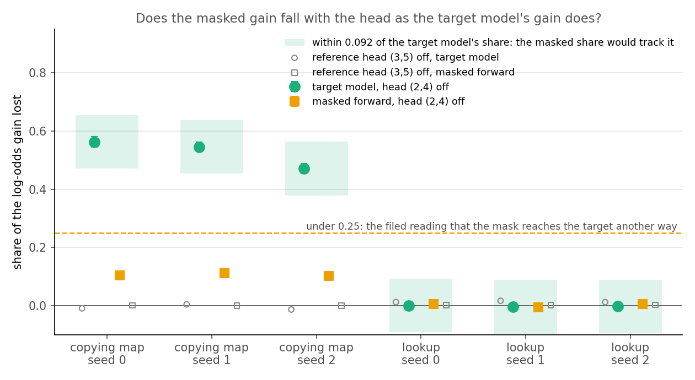
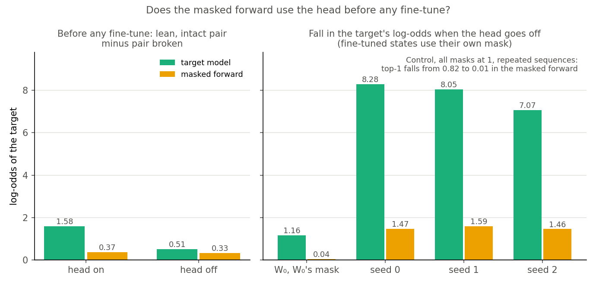
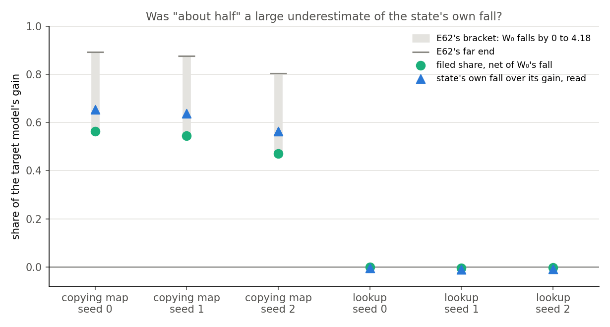
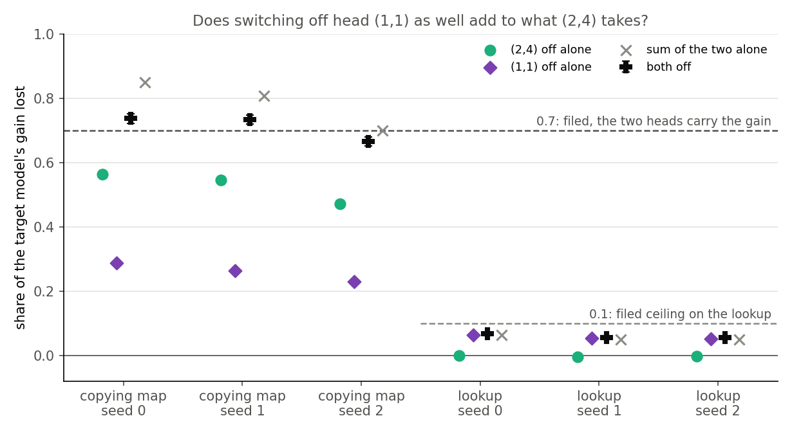
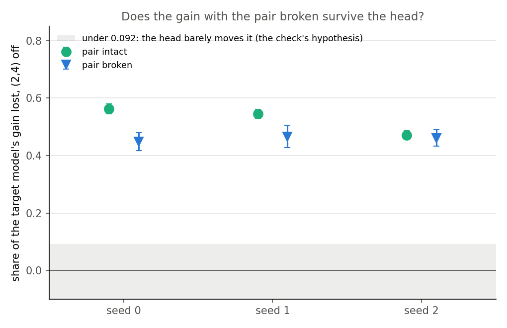
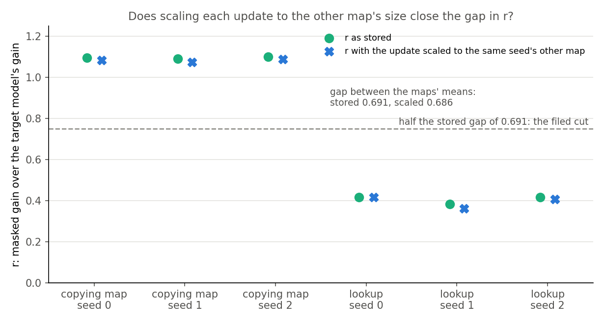

# Analysis: does the mask's gain on the copying map go through the old copying head? (E62 Amendment 2)

*Coding agent, written the day of the run. Plan: `reports/plans/2026-11-02_plan_e62-copying-heads.md`, section "Amendment 2 (2026-11-02)". Rules:
`experiments/induction_cue/results/predictions_amend2.json`. Results: `experiments/induction_cue/results/amend2.json`. Code: `experiments/induction_cue/amend2.py`.
Figures: `experiments/induction_cue/plot_amend2.py`. Earlier analysis: `reports/analyses/2026-11-02_analysis_e62-copying-heads.md`. Explanation: `notebooks/E62_induction_cue.ipynb`, section Amendment 2. Provenance at the end. Revised the same day after the independent check, `reports/reviews/2026-11-02_review_e62-amend2-check.md`: no rerun, and the filed verdicts stand as filed.*

We re-read six saved fine-tuned states with the model's old copying head switched off, in the full model and in the forward that keeps only what a mask lets through. The full model lost about half its learned gain, while the masked forward lost about a tenth with its masks frozen, and those masks are the only way the update reaches that forward. So for the goals, whether r's height on this map reflects the old mechanism is untested, and the stop the plan names is held until the read is repeated with the masks recomputed.

## The answer

**This read could not test whether the masked gain depends on the old copying head, so the plan's stop is held, not taken.** With the head off and the masks frozen, the target model's probability of the copied token falls to a few percent, while the masked forward still says about nine in ten. The filed label stands, but the masks were written with the head on and are the update's only way in. That forward also never holds the fine-tuned head. Amendment 3, which recomputes the masks with the head off, is coded and has not run.

## What we were trying to test

E62 taught the 67M to copy at a new marker, "A B ... A M" giving B, and taught a lookup at the same marker, where "A M" gives A's own fixed word. Switching off head (2,4), W₀'s copying head, took about half of the copying map's gain and none of the lookup's. r read 1.09 on the copying map and 0.40 on the lookup, unscored. The worry was that r was high for a reason other than that head.

r is $(L_{01} - L_{00})/(T_1 - T_0)$, each a mean log-odds of the target at the marker over 200 read windows. $T_0$ and $T_1$ are the target model, W₀ and fine-tuned. $L_{00}$ is the original subcomponents under the mask Γ gives at W₀. $L_{01}$ is the same subcomponents under the mask Γ gives at the fine-tuned state, with Δ out.

This amendment trained nothing. It read the six saved step-30 states and asked five things:

- **The masked share.** Replace the head's output by its mean, inside the masked forward, with the masks held as read with every head on. Does $L_{01} - L_{00}$ fall by the share the target model's gain falls?
- **W₀'s own fall.** E62 computed W₀'s log-odds with the head off and discarded it. Its share was therefore net of an unread number.
- **Two heads.** Heads (2,4) and (1,1) off together, target model, to see whether the circuit's two heads carry the gain.
- **The pair broken.** The first A overwritten by another key, target model, to test the independent check's hypothesis that the looser copying runs outside the head.
- **Update size.** r with each update scaled to the same seed's other map, since size separated the maps as cleanly as r did.

The zero update, reading exactly 0, is the do-nothing reference. Head (3,5) is the reference head, which should change nothing much. The first control runs alone: repeated-sequence top-1 through the masked forward with every mask at 1, which should collapse under (2,4) as the target model's does.

The tolerance throughout is 0.092, derived in the plan from E62's seed range. The plan took a masked share within it of the target share to mean r and the label read the same head. The fourth account below shows that reading needed an elicitation done wholly by the mask.

## What we expected, and why

The lean was that the masked share would track the target share, because the original subcomponents reaching B ought to use the mechanism W₀ copies with. At W₀ the same forward was expected to show the target model's lean of about 1.57 log-odds, intact pair over broken pair, and to lose over half of it with the head off. The plan expected the state's own fall to exceed the filed share by more than the tolerance. It leaned towards the second head adding nothing, as two steps of one chain would, towards the pair-broken gain surviving the head, and towards size not explaining the gap.

## Does the masked gain fall with the head?

**Reading it.** No, with the masks frozen as read with the head on; what happens when they are not was not read. The target model loses 0.47 to 0.56 of its gain, and the masked forward loses 0.10 to 0.11, far outside the shaded tolerance on all three seeds. Each masked share is under the filed 0.25, so the filed reading follows. The row sd is 0.006, well under the 0.0217 the tolerance assumed. The lookup reads about 0 in both forwards, but that agreement has little power, since every account below predicts it.

| state | $T_1 - T_0$ | target share | $L_{01}-L_{00}$ | with head off | masked share ± sd | (3,5), masked | (3,5), target |
|---|---|---|---|---|---|---|---|
| copying map, seed 0 | 12.65 | 0.563 | 13.85 | 12.42 | 0.103 ± 0.006 | 0.0004 | −0.010 |
| copying map, seed 1 | 12.64 | 0.545 | 13.80 | 12.25 | 0.112 ± 0.006 | 0.0000 | 0.004 |
| copying map, seed 2 | 12.55 | 0.471 | 13.79 | 12.37 | 0.103 ± 0.006 | 0.0000 | −0.014 |
| lookup, seed 0 | 15.36 | 0.000 | 6.38 | 6.35 | 0.005 ± 0.004 | 0.0016 | 0.012 |
| lookup, seed 1 | 14.99 | −0.004 | 5.72 | 5.76 | −0.007 ± 0.006 | 0.0012 | 0.016 |
| lookup, seed 2 | 15.33 | −0.003 | 6.37 | 6.34 | 0.005 ± 0.004 | 0.0025 | 0.012 |

The copying map's 0.0000 is under the numeric floor, not a reading of zero: see the two precisions under "How compelling is the evidence".

**In probability.** These are probabilities at the mean log-odds, not mean probabilities.

| state | target model, head on | target model, head off | masked, head on | masked, head off |
|---|---|---|---|---|
| copying map, seed 0 | 0.990 | 2.4% | 0.978 | 0.910 |
| copying map, seed 1 | 0.990 | 3.0% | 0.977 | 0.895 |
| copying map, seed 2 | 0.989 | 7.1% | 0.976 | 0.906 |

So with the head off the target model mostly stops producing B, and the masked forward, its masks frozen, mostly does not.

## Does the control support the masked share?

**Reading it.** Only partly. The control shows the hook works and that the head matters when every mask is 1. It cannot show that the head matters under the masks actually used, and the W₀ reading suggests it barely does before any fine-tune.

**What the control establishes.** With every mask at 1, top-1 falls from 0.818 to 0.0095 with the head off, the same count as the target model's. Head (3,5) leaves 0.698, against the target model's 0.707. The hook also works under real masks. The masked fall at each state is 1.46 to 1.59 log-odds, so the edit reaches the forward.

**What it leaves open.** The control ran on repeated sequences with no mask applied. Three readings under the actual masks show the head has little effect at W₀:

- W₀'s lean, intact pair over broken pair, reads 1.58 in the target model and 0.37 in the masked forward. The filed expectation was near 1.57.
- With the head off the masked lean keeps 91% of itself, reading 0.33, while the target model's keeps 32%, reading 0.51. The filed expectation was under half.
- Under W₀'s mask the head's removal moves $L_{00}$ by 0.04 log-odds, about thirty times less than the 1.16 it moves W₀ in the target model.

So $L_{00}$ sits near −10 against the target model's −8 before any update exists. E62's report asked whether that low start was the lean being lost, and now it can be sized. Of the low start of 2.01 log-odds on intact windows, 1.21 is lean lost, and the other 0.80 is shared with the broken windows. The masked forward is also less sensitive to the reference head on the lookup, 0.001 to 0.003 against 0.012 to 0.016, though those are small numbers.

**The state's mask is not W₀'s mask, and it opens something.** The fall under the head rises from 0.04 at W₀'s mask to about 1.5 at the state's mask. That is still 18% to 21% of the target model's own fall on the same state, 7.07 to 8.28. Three things could produce that fall, and none was read. The state's mask may let the head through weakly. It may let the head through fully while the head contributes little to that forward. Or the fall may be partly injection rather than removal. The mean passes through `o_proj`'s subcomponents, each multiplied by its mask, and a slot that real masks had nearly closed upstream now holds a nonzero vector it never carried. The mean's norm is small, 0.47 for this head among 0.05 to 3.55 across heads, so injection is not expected to carry the gap to the target share.

**The masked forward does separate the maps by this head.** This is unfiled. Net of W₀'s mask, the head moves the masked forward by 1.43, 1.55 and 1.42 log-odds on the copying map, and by 0.03, −0.04 and 0.03 on the lookup. That is the label's order, at about 40 times, in r's own forward. As a share it is about 0.10 against 0.005. Head (3,5)'s net shift on the copying map is at most 0.005, so (2,4) stands out by at least 260 times. The masked forward passes 0.20 to 0.24 of (2,4)'s net fall in the target model and at most 0.05 of (3,5)'s, with 0.03 to 0.09 of (3,5)'s on the lookup. So the forward is not uniformly deaf to heads. The shift is small against a gain of 13.8 and the masks are still frozen, so this is a pointer and not a pass.

**The frozen mask is not one blind spot among several: it freezes the update's only way into $L_{01}$.** $L_{01}$ uses W₀'s subcomponents with Δ out, and every one of the 24 matrices is replaced, so no target weight remains. The update can reach that cell only through the mask. The saved cells agree: on the copying map the update's weights under W₀'s mask carry 0.002 to 0.003 of the gain, and their interaction with the mask at most 0.002 in size.

Γ here is `global_shared_transformer`, a bidirectional transformer reading the inputs of all 24 matrices over the whole row. Those inputs include block 2's `o_proj` input, which is head (2,4)'s output itself, and everything downstream of it. So the mask at any matrix and position can carry what the head wrote; whether Γ in fact encodes it was not read.

In the target model, switching the head off cuts everything downstream of it. In this read, the part of the state's effect that the head passes on to Γ is kept, by design. So the read asks a narrower question than its name: given masks already written with the head on, does the head's output still matter to the forward? It says nothing about whether the update's masked gain depends on the head. The plan named this under "Blind to", so the filing is honest, and `mask_reaches_b_another_way` is the right label under the rule. But the plan's tree treats "barely falls" as "not head-dependent", and that does not follow from a read that holds the only way in fixed.

**Four accounts fit these numbers, and this read cannot separate them.**

1. **The masks close the head's way.** Sparse masks may keep few of the subcomponents the head's output needs, at W₀ and at the state. Then "the mask reaches B another way" is a statement about what masks keep, not about the update.
2. **The update's masked gain really does go elsewhere.** The head's way may be open under the state's mask, with the gain carried by other subcomponents.
3. **The head acts through the mask itself.** As above: the mask may carry what the head wrote. Switching the head off in the masked forward alone cannot see that, and on this account the gain would still depend on the head.
4. **The fine-tuned head is not in the masked forward.** The target share reads a head whose q, k and v have been fine-tuned. The masked share reads W₀'s q, k and v under a mask. If the fine-tune's use of the head at this new marker lies in the weight change, the redirected query the plan already counts as reuse, W₀'s head under a mask may be unable to reproduce it. Then `mask_reaches_b_another_way` fires on reuse. So a masked share within 0.092 of the target share was not the expected reading of elicitation: it needs an elicitation done wholly by the mask.

The W₀ readings favour the first account at W₀'s mask. The cells below speak to the state's mask, though not at the head.

| state | $L_{10}-L_{00}$, update's weights under W₀'s mask | $L_{11}-L_{01}$, update's weights under the state's mask | $U_1-U_0$, update's weights, every mask at 1 |
|---|---|---|---|
| copying map, seeds 0, 1, 2 | 0.039, 0.020, 0.030 | 0.015, 0.010, 0.031 | 11.13, 11.01, 11.23 |
| lookup, seeds 0, 1, 2 | 0.141, 0.129, 0.125 | 0.338, 0.373, 0.344 | 11.98, 12.06, 12.05 |

$L_{10}$ and $L_{11}$ are the least-squares split's subcomponents under W₀'s mask and the state's mask. $U_0$ and $U_1$ are the original and split subcomponents with every mask at 1. With every mask open, the split's change carries about 11 log-odds of the update, and under either real mask almost none of it passes. So the state's mask closes nearly everything the least-squares split places the update on. This is not specific to the head and depends on how that split spreads the update, so it does not separate the first two accounts at the head. It does mean r's forward is cut off from the update's weights by construction, and r is blind to reuse by a redirected query.

The reads that would separate the four are first under "Not run".

## Was "about half" a large underestimate?

**Reading it.** Not on the log-odds scale. W₀'s own fall under the head is 1.16 log-odds, inside E62's bracket of 0 to 4.18 and over the lean of at least 1. So the state's own fall is 0.56 to 0.65 of its gain, against the filed 0.47 to 0.56 and E62's far end of 0.80 to 0.89.

| seed | filed share | state's own fall over gain | E62's far end | W₀'s fall over the gain |
|---|---|---|---|---|
| 0 | 0.563 | 0.655 | 0.894 | 0.0919 |
| 1 | 0.545 | 0.637 | 0.877 | 0.0920 |
| 2 | 0.471 | 0.564 | 0.804 | 0.0927 |

The far end recomputes as 0.893, 0.876 and 0.804; the filed column's fourth digit carries rounding from E62's bracket.

The state's own fall is not a share of what the fine-tune did. Its numerator holds W₀'s 1.16, which is there before any fine-tune. The net share, 0.47 to 0.56, is the fine-tune's reading, and it is the number on which E62 filed `copy_not_elicitation`.

"About half" and "behaviour mostly goes" are both true. A log-odds fall of 7 to 8 from a level near 4.5 takes the probability at the mean log-odds from 0.99 to 2.4% to 7.1%, inside E62's bracket of 0.12% to 19%. This also gives the 0.5 bar a partial reference, unfiled: W₀ loses 0.68 of its own lean under the head at this marker. The states' shares of 0.47 to 0.56 sit under that. It is a share of a lean, not of a gain, so it is a rough comparison.

**The lookup.** W₀'s lookup log-odds rise by 0.09 under the head, and each lookup state's own fall stays within 0.01 of zero.

## Does a second head add to the first?

**Reading it.** Yes on net shares, and only there. Both heads off takes 0.67 to 0.74 of the copying map's gain, where (2,4) alone takes 0.47 to 0.56, so the net share rises by 0.17 to 0.20. Strict series is refuted, since (1,1) off does something with (2,4) already off. It does not follow that the fine-tune's copying leans on (1,1). The lean of "no more" was filed conditional on series, with "no prior strong enough to call it", and it was not met. Each head alone still takes W₀'s repeated-sequence top-1 to about 0.01, and both together to exactly 0, so the two scales disagree and this read does not say why.

| state | (2,4) alone | (1,1) alone | sum | both off ± sd | filed label |
|---|---|---|---|---|---|
| copying map, seed 0 | 0.563 | 0.287 | 0.850 | 0.737 ± 0.015 | at or over 0.7 |
| copying map, seed 1 | 0.545 | 0.263 | 0.808 | 0.734 ± 0.014 | at or over 0.7 |
| copying map, seed 2 | 0.471 | 0.229 | 0.700 | 0.666 ± 0.014 | under 0.7, not near the single head |
| lookup, seed 0 | 0.000 | 0.063 | 0.063 | 0.066 ± 0.004 | at most 0.1 |
| lookup, seed 1 | −0.004 | 0.054 | 0.050 | 0.055 ± 0.005 | at most 0.1 |
| lookup, seed 2 | −0.003 | 0.052 | 0.049 | 0.056 ± 0.004 | at most 0.1 |

The filed reading over seeds is mixed, because seed 2 sits 0.034 under a bar with no published source. The shares are net of W₀ under both heads, a level the run did not save, so the state's own fall under both cannot be stated. Both heads were not read in the masked forward.

That unsaved level matters. If the state did not fall at all beyond (2,4) alone, W₀ under both would have to read −7.01, −6.83 and −6.77. That is 2.2 to 2.4 above W₀ under (2,4) and 1.0 to 1.3 above intact W₀: unusual, but not excluded. Part of the rise is also general damage. Both heads off cost the lookup, where (2,4) does nothing, 0.82 to 1.02 log-odds, against the copying map's added 2.2 to 2.4.

## Does the pair-broken gain survive the head?

**Reading it.** No, so the independent check's hypothesis fails. It predicted the head off would barely move the gain with the pair broken. That gain loses 0.45 to 0.47 on all three seeds, against a bar of 0.092 for "barely" and a row sd of 0.03 to 0.04. The looser copying goes through the head at about the rate the prefix-matched gain does.

| seed | broken gain | with head off | broken share ± sd | intact share | filed label |
|---|---|---|---|---|---|
| 0 | 5.01 | 2.76 | 0.449 ± 0.031 | 0.563 | between |
| 1 | 4.25 | 2.27 | 0.466 ± 0.039 | 0.545 | near the intact share |
| 2 | 6.84 | 3.68 | 0.461 ± 0.028 | 0.471 | near the intact share |

The filed "in between" across seeds comes from seed 0's high intact share. The three broken shares themselves agree within 0.02. So the closeness of E62's surviving gain and broken gain, 5.53 beside 5.01 on seed 0, does not mean the broken gain sits outside the head.

**An unfiled reading.** At W₀ the head moves the broken-window level by only 0.09 log-odds, from −9.63 to −9.72. After the fine-tune it takes nearly half the broken gain. So what the fine-tune added on broken windows leans on the head far more than W₀'s own level there does. The hypothesis's other prediction, that the share falls by step 300, was not read.

**Pair dependence survives the head, also unfiled.** Take intact minus broken. The state's pair-specific gain is 7.64, 8.39 and 5.71 with the head on, and 2.77, 3.48 and 2.96 with it off, a share of 0.64, 0.59 and 0.48. The state's lean, intact over broken, falls from 9.2, 10.0 and 7.3 to 3.3, 4.0 and 3.5, where W₀'s with the head off is 0.51. So something outside (2,4) now computes the pair.

## Does update size explain the gap in r?

**Reading it.** No, over the range tried. Scaling each copying-map update up by 1.18 to 1.20 and each lookup update down by 0.83 to 0.85 moves the gap between the maps' mean r from 0.691 to 0.686. Closing it by half was the filed cut. This scales an update along its own direction, so it is not a shorter fine-tune, and it does not separate a map's size from how easy the map is. Scaling barely changes the copying map's gain, which reads 12.69 to 12.89 against 12.55 to 12.65.

| state | scale | r stored | r scaled | gain scaled |
|---|---|---|---|---|
| copying map, seed 0 | 1.179 | 1.095 | 1.082 | 12.82 |
| copying map, seed 1 | 1.200 | 1.091 | 1.073 | 12.89 |
| copying map, seed 2 | 1.189 | 1.099 | 1.088 | 12.69 |
| lookup, seed 0 | 0.848 | 0.415 | 0.417 | 14.18 |
| lookup, seed 1 | 0.833 | 0.382 | 0.362 | 13.79 |
| lookup, seed 2 | 0.841 | 0.415 | 0.407 | 14.11 |

## What this does to the line

**The stop the plan's branch names is held, not taken, until Amendment 3 reads back.** The plan's tree says that if the masked gain does not fall with the head, r is reported as "the original subcomponents can write this target under some mask", weaker than mechanism, and the 67M copy work stops. The filed label fires that branch as a label. But this read held fixed the only way the update reaches the masked forward, and that forward never holds the fine-tuned head. So whether r's height on this map reflects the label's mechanism is untested, on one map, one marker, step 30. Amendment 3 recomputes Γ with the head off; it is coded and has not run. Its plan is `reports/plans/2026-11-02_plan_e62-copying-heads.md`, section Amendment 3.

**What must not be said.** "The mask found a different mechanism" is not read here, and neither is "r's height is no evidence of the old mechanism": this read could not test it. The filed name is a label for a share under 0.25, and it does not establish any other way. It is also wrong beyond that overclaim, since on the fourth account it fires on reuse. The filing stays as it stands.

**Granularity limit.** A new circuit built from old pieces reads as elicited to VPD. The target-model rows hold at the level of heads, and the masked row at the level of VPD's subcomponents and heads. A redirected query still counts as reuse. Nothing here can split "the same circuit redirected" from "a new circuit of old parts".

**E58's other maps.**

- **Can still be read as:** the masked gain's share of the target model's gain, the fact that the original subcomponents reach that much under the state's mask, and the differences between maps at step 30, as numbers.
- **Cannot be read as:** evidence that the high-r maps, E58's copy, elicit and rank 1, use a mechanism W₀ has. None of them has a head-level label, and on this one map, the only one with such a label, that reading is untested. The masked forward's separation of the maps by the head is a pointer towards it, unfiled and with frozen masks.
- **Not shown:** that r fails on those maps. This map has the largest deficit of $L_{00}$ under $U_0$ of ten, 2.18 log-odds, and the low-prior maps have the mask raising the target. So W₀'s mask shutting out this head may be particular to this map. The low r of the cipher and class maps is untouched.

**The other live readings of the gap in r.** Target in context stays open and unread here. Update size is weakened over a scale of about 1.19 along each update's own direction, and only that.

## What we learned

At the level of heads, the target-model answer is unchanged in size, with W₀'s fall now read. The fine-tune's net share under the head stays 0.47 to 0.56, and what this amendment adds is W₀'s fall and a pair-broken share of 0.45 to 0.47. Strict series between the two heads is refuted, though the fine-tune's lean on the second head is not shown. For `GOALS.md`, that favours reuse of an old circuit over a new capability on this map, within the granularity limit.

Whether the decomposition reads the same thing is untested. With the masks frozen most of the masked gain survives the head. But those masks are the update's only way into that forward, and the forward never holds the fine-tuned head. r gives no mechanistic reading here, for a stronger reason than the head alone. Its forward is cut off from the update's weights by construction, and it is blind to reuse by a redirected query.

## How compelling is the evidence

- **Coverage.** One model, one marker, 32 keys, 200 read windows, three seeds, step 30. Nothing here generalises beyond this format.
- **Noise.** The masked share's row sd is 0.006, its seed range 0.01. The gap to the target share, 0.37 to 0.45, is many times both.
- **Controls.** Top-1 through the masked forward passed. The target share re-read `run.json` with a difference of exactly 0 on all six states. $L_{00}$ and $L_{01}$ re-read within the filed 1e-3.
- **Do-nothing reference.** The zero update read exactly 0 in the target model on both maps, and in the masked forward on the copying map's windows only. It is not a control: its Γ output equals W₀'s by determinism, so it reads 0 under any hook, correct or wrong.
- **Blind spots of the masked share.** Γ's reaction to the head, as masks are held fixed, which is the update's only way in. The fine-tuned head, which that forward never holds. Which subcomponents carry the gain. A mean taken from the target model, which may sit off the masked forward's own distribution. $L_{00}$ and $L_{01}$ take the same vector, but it passes through subcomponents under different masks, so it does not cancel to first order as the plan said. Head (3,5) cannot test this, as its slot barely moves anything under these masks.
- **Blind spots of the target share.** Downstream compensation after ablation, the hydra effect of McGrath et al. 2023, which would make it low.
- **The reference head.** Its target-model shares are already near zero on the copying map, so a low floor there could not by itself detect a masked forward that responds weakly to every head. The separation in the section above partly answers that worry. On seeds 1 and 2 its masked fall at the state's mask matches its fall at W₀'s mask to 1e-4 and 2e-4, closer than two unrelated numbers on this floor should be. Seed 0 differs by 0.005. That is unexplained, per-window values were not saved, and nothing rests on it.
- **Two precisions.** Target-model reads are fp32, and masked reads and the saved cells bf16, so the plan's "differ only in the forward" omits precision. $T_0$ differs by 0.004 between the paths, and $T_1 - T_0$ by up to 0.012. That has no effect on the (2,4) comparison. The masked (3,5) shift at $L_{00}$ is 0.0035, on that offset, so the table's 0.0000 is under the numeric floor. On the same scale, r computed from the fp32 gain differs from the stored r in the fourth digit, 1.0951 against 1.0946.

## Surprises

**Something unexpected happened that I cannot explain.** The lean was that the masked share would track the target share, and it reads 0.10 to 0.11 against 0.47 to 0.56. The masked forward at W₀ was expected to show a lean near 1.57 that the head removes, and it shows 0.37 that the head barely moves. This run gives four accounts and reads none of them.

- Both heads off raises the net share by 0.17 to 0.20, against the lean of nothing and E62's reading of the two in series.
- The pair-broken gain loses 0.45 to 0.47, against the lean of barely any.
- W₀'s top-1 under both heads reads exactly 0, under the filed 0.02.
- Row 4's labels split on a coincidence, described in the scorecard's note.

## What next

The plan's stop waits on Amendment 3, a $0 read with Γ recomputed with the head off, chosen by the lead, coded and not run. If the masked gain then falls by about the target share, that points to the third account and r reading the head through the mask. If it barely falls, the plan's stop can be taken, with the fourth account still open. Γ was never trained on activations with a head's slot held constant, so a fall may be Γ reacting off its distribution. So neither outcome separates without three reads beside it. The lookup should not fall, (3,5) with Γ recomputed should not fall, and W₀'s mask is recomputed the same way. If the head's output under the state's mask is near its mean or its slot is closed, the first account holds, and the statement becomes one about what masks keep.

## Scorecard

| row | claim | rule | read | verdict |
|---|---|---|---|---|
| 1 | hook works through the masked forward, every mask 1 | intact and (3,5) over 0.66, (2,4) under 0.05 | 0.818, 0.698, 0.0095 | `pass` |
| 2 | target share re-reads | within 1e-3; zero update exactly 0 | difference 0; 0 | holds |
| 3 re-read | masked cells re-read | within 1e-3; zero update exactly 0 | no stop; 0 | holds |
| 3 copy | masked share against target share | every seed under 0.25 and out of tolerance | 0.103, 0.112, 0.103 | `mask_reaches_b_another_way`; lean `r_reads_the_head` **wrong**, though it needed an elicitation done wholly by the mask; stop held |
| 3 lookup | masked share within tolerance | `agree` over seeds | 0.005, −0.007, 0.005 | `within` |
| 3 floor | (3,5) masked share under 0.15 | every state | at most 0.0025 | holds |
| 3 W₀ lean | near 1.57, off under half | reported, no rule | 0.366; off 0.334 | **near 1.57 missed**; off misses under half of its own 0.366, the reading used here; literally under half of 1.57 |
| 4 bracket | W₀'s fall in [0, 4.18], lean at least 1 | | 1.163 | `inside`; lean holds |
| 4 target lean | off under half of 1.57 | reported | 1.580; off 0.507 | holds, by the literal reading |
| 4 own fall, copy | over filed share + 0.092 | `own_fall_class`, `agree` | `stands`, `undercounts`, `undercounts` | `in_between`; expected `undercounts` |
| 4 own fall, lookup | small | `own_fall_class` | all `stands` | holds |
| 5 copy | at least 0.7, or within 0.092 of single | `two_head_class`, `agree` | `circuit`, `circuit`, `between` | `in_between`; lean `no_more`, filed conditional on series, not met |
| 5 lookup | at most 0.1 | `lookup_two_head` | 0.066, 0.055, 0.056 | `clean` |
| 5 top-1 | under both at or under 0.02 | reported | 0 | holds |
| 6 | broken share at most 0.092, or near intact | `broken_class`, `agree` | `between`, `through_head`, `through_head` | `in_between`; lean `outside_head` **wrong**; re-read holds |
| 7 | swapped gap under half the gap | `size_reading` | 0.686 against 0.691 | `size_does_not`; lean holds; `near_half` false; alpha 1 reproduced exactly |

Filed verdict line: `copy mask_reaches_b_another_way lookup within own fall in_between two heads in_between broken in_between size size_does_not`. `predictions.json`'s `copy_not_elicitation`, r not scored, stands.

**Rules that misbehaved, applied as filed and reported as filed.**

- **Row 4, the own-fall label is on a knife edge.** A state's own fall minus its filed share is exactly W₀'s fall over the state's gain, 0.0919, 0.0920 and 0.0927. The tolerance is 0.092. So seed 0 reads `stands` and the others `undercounts` on a difference in the fourth decimal, and the `in_between` carries no information about the seeds. All three undercount by the same 0.09.
- **Row 3, the verdict does not read the W₀ lean.** The plan lists the lean near 1.57 as expected at W₀, but no rule reads it. So the verdict fired while the forward it depends on had missed that expectation, and its name states a way the read did not show. Nothing was degenerate in the arithmetic.
- **Row 3, the floor has little power here.** Head (3,5)'s target-model share on the copying map is about 0, so its masked share could not read high on that map on any account. It holds, and it says little.
- **Row 3, the floor in code.** The filing and docstring say (3,5) under 0.15 fails "on some state", while `amend2.py:158` passes only the copying map's three. This has no effect here: the lookup reads 0.0012 to 0.0025, so "every state" is true of the numbers.
- **Row 3, the zero update.** It cannot fail, as under "How compelling is the evidence". The rule's "exactly 0" is a do-nothing reference, not a control.
- **Row 7, the rule is lenient and the range short.** If size were the cause, swapping sizes should reverse the gap, not just halve it. A scale of 1.19 moves the copying map's gain by only 1% to 2%.
- **Row 6's per-seed comparison.** Seed 0's `between` comes from its intact share being high, not from its broken share differing. Row 6's sd of 0.03 to 0.04 is over the 0.0217 the tolerance assumed, as the plan warned. The rejection of `outside_head` is clear on all three seeds regardless.

## Departures from the literature

- **Olsson et al. 2022** zero-ablate a head's contribution, on small models. We mean-ablate over ordinary text, one vector per head, as approved for E62. Zero ablation was not run.
- **Ablation inside a decomposition's masked forward** has no source we know of. The masks are held as read with every head on, and the means are W₀'s target-model means, as the plan explains.
- **Top-1 control.** Olsson et al. read induction on repeated random sequences. So do we, with word-like tokens as in E62, here with every mask at 1.
- **Thresholds.** The 0.25, 0.7 and 0.1 are Fable's, 0.05, 0.66 and 0.02 are chosen or derived in the plan, 0.15 is E62's and 0.092 is derived from E62's seed range. None is published.
- **The half rule on update size** is the lead's filing, not a published standard.
- **Unfiled here.** Probabilities at the mean log-odds, absolute falls, the masked fall over the target fall, W₀'s 0.68 of its lean, the broken-window level under the head, the net falls between the maps, the cells $L_{10}$, $L_{11}$ and $U_1$, and the pair-specific gain are this report's readings of saved numbers.

## Not run

Separating the four accounts, each a $0 read on the saved states:

- Γ recomputed with the head off, the one read of the third account, beside the lookup, (3,5) and W₀'s mask recomputed the same way. This is Amendment 3, coded and not run; the plan had listed it as not planned, and `ablated` must wrap Γ deliberately for it.
- The head off on $L_{11}$ and $U_1$, with its attention, which reads the fourth account: how far the update's weights use the head.
- An own-mask mean and zero ablation in row 3's cells, which settle whether the fall is removal or injection.
- The o_proj subcomponents that read head (2,4)'s slot: how much of that slot's weight passes under W₀'s mask and under each state's mask.
- The masked forward's head output against the mean it is replaced by, under each mask. If it already sits near the mean, the head's way is closed upstream, through q, k or v.
- Head (2,4)'s attention at the marker in the masked forward, under each mask, beside the target model's. `copying.attention_patterns` exists for the target model.
- The head off with every mask at 1 on the 200 read windows, $U_0$ and $U_1$. It joins row 1, which ran on repeated sequences, to the windows row 3 read.
- Each of the 24 heads off in the masked forward at the state's mask: which head, if any, the masked gain does lean on.
- Both heads off in the masked forward.

Also not run:

- W₀'s level under both heads, computed and discarded, so the state's own fall under both.
- W₀'s log-odds under the head on repeated sequences, the other half of the 0.5 bar's reference.
- The target model's attention at the marker, under W₀ and each state; does the fine-tune move the query.
- Shares at steps 100 and 300, including the hypothesis's remaining prediction.
- Downstream compensation after ablation.
- $L_{01}$ for another in-context token; the lookup state's mask read for B; the copying state's mask read for the lookup's word; a map with its target in context and no prefix relation.
- A head-level label for E58's copy, elicit and rank-1 maps; r for a random update of matched size at this target.
- Which subcomponents the copying state's mask changes.
- More seeds, other markers, other key counts; zero ablation.

## Provenance

Job 48698, MATS `debug`, NVIDIA L40, about 4.5 minutes, $0. Code at `7d5f309`. Predictions sha256 `11884d00...`, committed at `a8fca8d` before the job. Results committed at `65d9e99`. Log: `cluster/logs/commute-e62-amend2-48698.out`. States and windows: `experiments/induction_cue/results/large/`, sha256 checked against `run.json` at load. `heads.pt` is not in that list at load; row 2's exact 0 difference covers it. Figures use the project's reference palette; the palette validator could not run because this node has no `node`.
