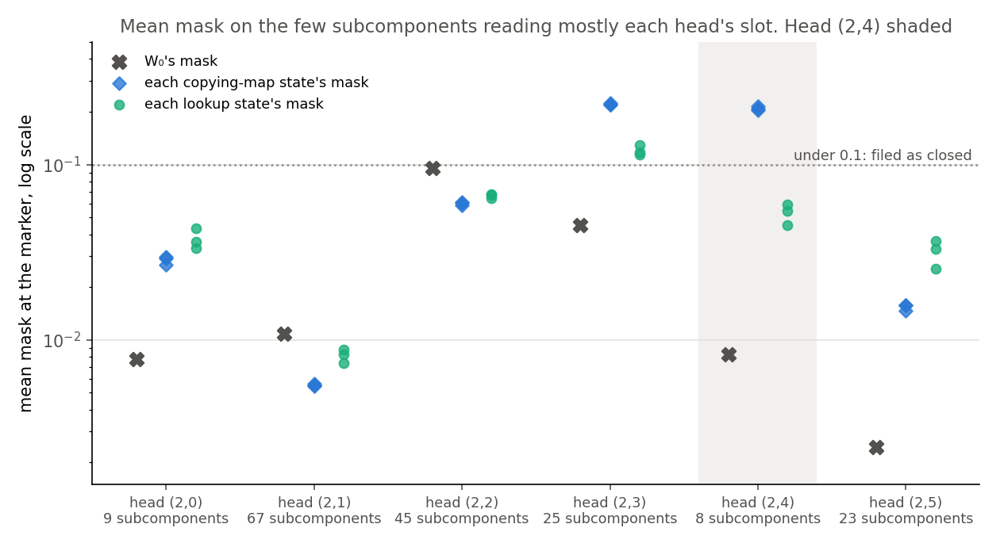
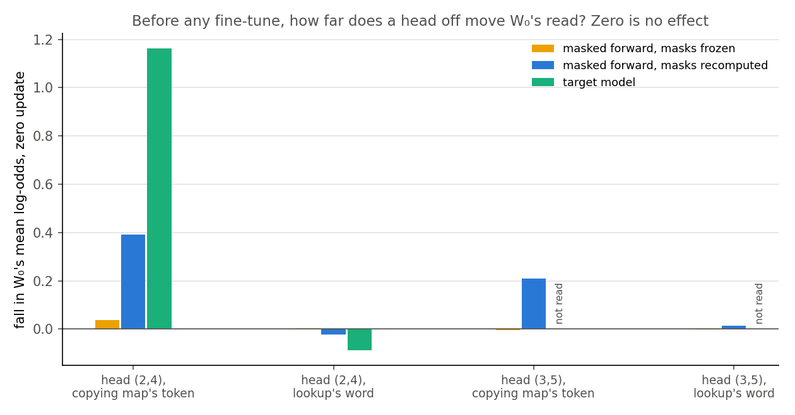
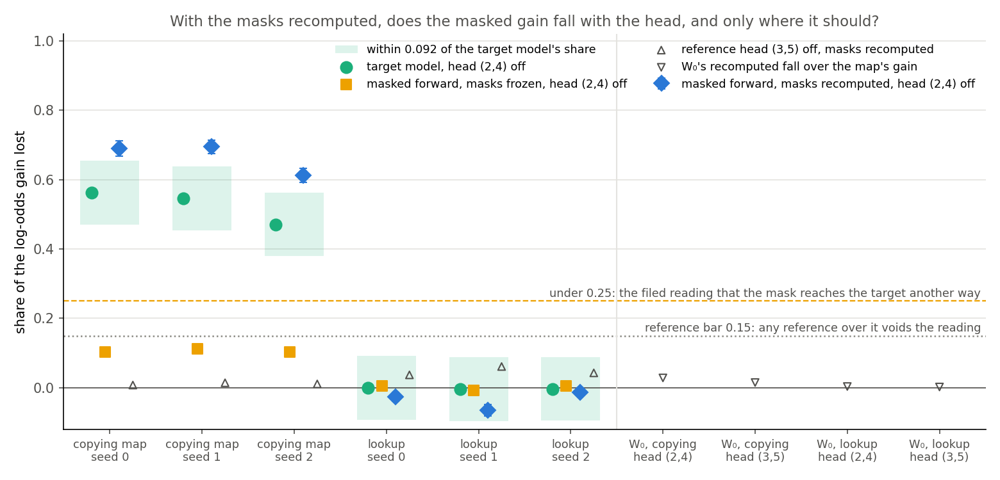
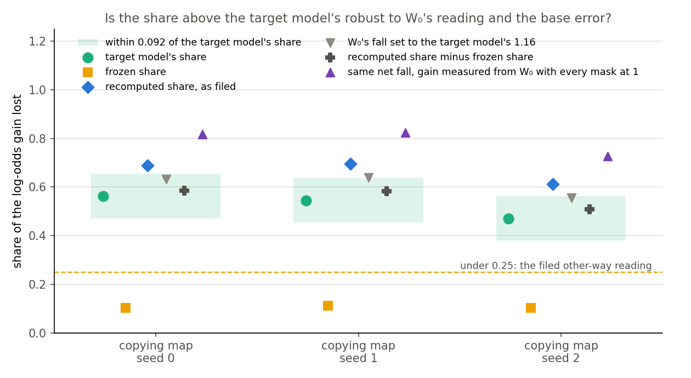

# Analysis: with the masks read again with the old copying head off, does the masked gain fall? (E62 Amendment 3)

*Coding agent, written the day of the run. Plan: `reports/plans/2026-11-02_plan_e62-copying-heads.md`, section "Amendment 3 (2026-11-02)". Rules:
`experiments/induction_cue/results/predictions_amend3.json`. Results: `experiments/induction_cue/results/amend3.json`. Code: `experiments/induction_cue/amend3.py`.
Figures: `experiments/induction_cue/plot_amend3.py`. Earlier analysis: `reports/analyses/2026-11-02_analysis_e62-amend2-masked-head.md`. Explanation: `notebooks/E62_induction_cue.ipynb`, section Amendment 3. Provenance at the end.*

We re-read six saved fine-tuned states with the model's old copying head switched off, this time also in the pass that the decomposition's mask function reads. The gain the masks produce on the copying map then fell by at least as much as the model's own gain did, and barely moved on the lookup or under a reference head. For the goals, the plan's stop does not fire, but the result shows that the masks follow that head, not that the decomposition has found the old mechanism.

## The answer

**The masked gain on the copying map depends on the old copying head, through the masks.** That holds on this one map at step 30. The gain loses about two thirds of itself with the head off, both in the pass the masks are read from and in the masked forward. With the masks frozen it loses a tenth. So the plan's stop does not fire. This does not show that the subcomponents those masks open carry the old mechanism. The mask function reads the fine-tuned model's activations, so it may simply inherit that model's dependence. And before any fine-tune, switching the head off in the unchanged model's masked forward barely moves it, 0.04 log-odds against 1.16, which remains unexplained. A sample of the subcomponents reading that head reads nearly shut.

**Flag for the lead: this reverses what Amendment 2's filed label implied.** That label stands as filed, as a share under 0.25 with frozen masks. Its name, that the mask reaches the target another way, is no longer a fair summary: with the masks recomputed the gain does fall, so the masks are not independent of the head. The account behind it, that the gain is carried inside the masked forward by subcomponents other than those reading the head, is not removed. The frozen share still supports it, and it can hold together with the masks following the head. The four accounts' status is in "What does the fall mean?".

## What we were trying to test

**The story across the two amendments.** E62 taught the 67M to copy at a new marker, "A B ... A M" giving B, and taught a lookup at the same marker. Head (2,4), W₀'s copying head, carries about half the copying map's gain in the target model and none of the lookup's. r read 1.09 on the copying map and 0.40 on the lookup, unscored.

r is $(L_{01} - L_{00})/(T_1 - T_0)$. $T_0$ and $T_1$ are the target model's mean log-odds of the target at the marker, at W₀ and at the fine-tuned state. $L_{00}$ is the original subcomponents under the mask Γ gives at W₀. $L_{01}$ is the same subcomponents under the mask Γ gives at the state, with Δ out. We call $L_{01} - L_{00}$ the masked gain.

Amendment 2 switched the head off inside the masked forward, with the masks held as read with every head on. It lost a tenth of the masked gain. But that read froze the update's only way into $L_{01}$, since every target weight is replaced by W₀'s subcomponents and the update can arrive only through the mask. So it could not test the question, and the plan's stop was held.

This amendment reads Γ again with the head off. Nothing was trained. The same hook replaces the head's output by its mean in the target-model pass Γ reads, and again in the masked forward, at W₀ and at each of the six step-30 states. Three shares are compared, each net of W₀:

- **Target share.** What the target model's gain loses with the head off, from Amendment 2.
- **Frozen share.** What the masked gain loses with the masks read with every head on, from Amendment 2.
- **Recomputed share.** What the masked gain loses with the masks read with the head off, new here.

Each reference tests one alternative. The lookup under (2,4) has the same head at the same depth on a map the head does not carry: it should not fall even if Γ reacts. Head (3,5) with Γ recomputed checks that switching off some other head does not break the masks. W₀'s recomputed fall checks how far Γ's reaction alone moves a net share. The filed bar voids every reading if any of these ten reads 0.15 or more in size.

That bar has limited power on W₀. On the copying map 0.15 of the mean gain is 2.07 log-odds, more than the target model's own W₀ fall of 1.16, so that reference could hardly fire. On the lookup it is 0.92. W₀ was also read at a mask change a tenth of the state's, so it does not bound a break at the states.

A third row reads the mean mask on the few subcomponents that read mostly one head's slot in block 2's `o_proj`, under W₀'s mask and each state's mask.

## What we expected, and why

The prediction was weak and said only that the share would not stay under 0.25, as Γ's masks follow activations that the head moves by 7 to 8 log-odds in the target model. Where it would land was not predicted. The lookup was expected within 0.092 of about 0 on every account. W₀'s fall was expected between the frozen 0.039 and the target model's 1.163. Head (3,5) was expected near its frozen readings if Γ tolerates the ablation. If the masks close the head's way, its slot was expected to read closed at W₀, near 0.03; the other accounts filed no expected value.

## First, the anomaly: what does the head do in W₀'s masked forward?

**Reading it.** The measurement that stands is W₀'s frozen fall. With the masks read with every head on, switching the head off moves W₀'s masked forward by 0.04 log-odds, against 1.16 in the target model. Whether W₀'s mask shuts this head is not shown. The slot read covers eight subcomponents holding 5.4% of the slot's read weight, among the 524 alive in that matrix, and the rest was not read.

Those eight read nearly shut, with a mean mask of 0.008 at W₀. That fits Amendment 2's low lean, the intact pair's log-odds over the broken pair's, though nothing shows that it causes it. The copying states read 0.20 to 0.22, and the lookup states 0.045 to 0.059. Those eight masks sum to 0.066 at W₀, so no one of them averages above that. So this sample sits nearly shut before any fine-tune and opens 25-fold under the copying state's mask. It also opens five- to seven-fold on the lookup, whose target share and recomputed share are both about 0, so a slot opening does not imply dependence on the head.

| mask | (2,0) | (2,1) | (2,2) | (2,3) | (2,4) | (2,5) |
|---|---|---|---|---|---|---|
| subcomponents read | 9 | 67 | 45 | 25 | 8 | 23 |
| their share of the slot's read weight | 0.109 | 0.347 | 0.266 | 0.211 | **0.054** | 0.268 |
| W₀ | 0.008 | 0.011 | 0.095 | 0.045 | **0.008** | 0.002 |
| copying map, seeds 0, 1, 2 | 0.030, 0.029, 0.027 | 0.006, 0.005, 0.006 | 0.059, 0.060, 0.061 | 0.224, 0.220, 0.220 | **0.209, 0.203, 0.216** | 0.016, 0.016, 0.015 |
| lookup, seeds 0, 1, 2 | 0.043, 0.033, 0.036 | 0.008, 0.007, 0.009 | 0.068, 0.064, 0.067 | 0.115, 0.130, 0.117 | **0.054, 0.059, 0.045** | 0.036, 0.026, 0.033 |
| W₀, summed over the subcomponents | 0.070 | 0.73 | 4.28 | 1.12 | **0.066** | 0.056 |
| copying map, seed 0, summed | 0.27 | 0.38 | 2.65 | 5.60 | **1.68** | 0.36 |

The mean is unweighted, at the marker only, over the 200 windows, and covers only subcomponents with at least half their read vector's squared norm in the slot. So 347 of the 524 alive subcomponents have no majority slot and are left out. Head 4's weight is spread thinly: 163 alive subcomponents have at least a quarter of their read norm in its slot, and none holds over 1.6% of its energy. The other 95% may be shut too. Their masks are not in `amend3.json`, so this is unread, not contradicted. W₀ reads one mask for both maps, because the two maps share their window tokens and differ only in which token is read. That is why row 3's W₀ entries and `gates_moved` at W₀ are identical across maps.

Three things stop this being a tidy story about head (2,4). At W₀ all six samples sit under the filed 0.1, so the bar does not single this head out. At the copying states head (2,3)'s sample opens as far as (2,4)'s. Head (2,3) is W₀'s second-ranked prefix head, under the bar, and no one has read its target share. And the columns cover unequal parts of their slots, 5.4% to 34.7%, while the summed rows also scale with how many subcomponents pass the threshold. So neither row compares the heads' output.

**What fits.**

- Switching the head off in W₀'s masked forward moves it little, 0.04 log-odds against 1.16 in the target model, and the eight sampled subcomponents read nearly shut. The other 95% of the slot is unread.
- The size of the lost lean, as arithmetic. The target model's lean, intact pair over broken pair, falls from 1.58 to 0.51 with the head off. The masked forward reads 0.37. So W₀'s masked forward leans roughly as the target model does with this head already gone.

**What is not explained.**

- Why the head barely moves W₀'s masked forward when the original model's copying runs through it, and whether Γ shuts this head at this marker at all. No read here touches that.
- Whether a closure causes the low lean. The numbers fit, and nothing re-opened the slot to see the lean return.
- The rest of the low start. $L_{00}$ sits 2.01 log-odds under $T_0$. A closed head could account for at most 1.16 of that, since $L_{00}$ still sits 0.85 under the target model with the head off.
- Upstream. A closed `o_proj` slot says nothing about q, k and v.

**Which readings are built on this number.** Per the user's rule, an unexplained apparatus number blocks the readings that rest on it.

| reading | built on W₀'s mask? | status |
|---|---|---|
| The masked gain falls far with the head off, on this map and not the lookup | Only by subtraction. W₀'s recomputed fall is 0.028 of the gain. With no W₀ term at all the fall is 0.64 to 0.72; with the target model's 1.16 in its place it is 0.56 to 0.64. | Stands |
| The share sits above the target model's, label `over` | Half of it. See the last section. | Not read as "more than" |
| The state's mask draws on a mechanism W₀'s masked forward has | Wholly. How much of this head's output W₀'s mask passes was not read: the sample holds 5.4% of the slot's read weight. | **Blocked**, not read, until the weighted read under "Not run" |

## Does the recomputed mask move W₀?

**Reading it.** Yes, a little, and not very specifically. On the copying map's token, W₀'s fall rises from a frozen 0.04 to a recomputed 0.39, under the target model's 1.16 and inside the filed range. But head (3,5) reaches 0.21 there, about sixty times its frozen size and over half of (2,4)'s. So at W₀ the recomputed mask barely tells the two heads apart, and Γ does not tolerate an ablation silently. On the share scale all of this stays small, at most 0.03 of the gain.

| map's token | (2,4) frozen | (2,4) recomputed | (2,4) target model | (3,5) frozen | (3,5) recomputed |
|---|---|---|---|---|---|
| copying map | 0.039 | 0.393 | 1.163 | −0.0035 | 0.208 |
| lookup | 0.003 | −0.022 | −0.087 | −0.0013 | 0.014 |

The mask itself moves little: a mean absolute change of 0.0029 over the alive subcomponents of all 24 matrices at the marker. Head off still moves $L_{00}$ through Γ, though the head barely moves the masked forward at frozen masks. That is because Γ reads the target-model pass, which the hook edits; head (3,5)'s reading says part of the change is not specific to this head. So a head that barely moves the masked forward is not hidden from Γ.

## Does the masked gain fall with the head when the masks are recomputed?

**Reading it.** Yes on all three seeds of the copying map, and not on the lookup. The recomputed share reads 0.61 to 0.69. Frozen masks read 0.10 to 0.11, and the target model 0.47 to 0.56. On the lookup it reads −0.06 to −0.01, within tolerance of a target share near 0. All ten references are at most 0.06, under the bar of 0.15. The caveat is that this figure cannot say what carries the fall, which the next section takes up.

| state | target share | frozen share | recomputed share ± sd | (3,5) recomputed | filed label |
|---|---|---|---|---|---|
| copying map, seed 0 | 0.563 | 0.103 | 0.689 ± 0.022 | 0.008 | `over` |
| copying map, seed 1 | 0.545 | 0.112 | 0.695 ± 0.019 | 0.014 | `over` |
| copying map, seed 2 | 0.471 | 0.103 | 0.612 ± 0.020 | 0.011 | `over` |
| lookup, seed 0 | 0.000 | 0.005 | −0.027 ± 0.013 | 0.037 | `within` |
| lookup, seed 1 | −0.004 | −0.007 | −0.065 ± 0.016 | 0.061 | `within` |
| lookup, seed 2 | −0.003 | 0.005 | −0.013 ± 0.012 | 0.043 | `within` |

The other four references are W₀'s recomputed fall over the map's gain. On the copying map they read 0.028 under the old head and 0.015 under the reference head. On the lookup they read 0.0036 and 0.0022.

**In log-odds: the gain is cut, not erased.** $L_{01}$ with the head off still sits 3.8 to 5.0 above $L_{00}$ with every head on, and 4.2 to 5.3 above $L_{00}$ with the head off. So 0.31 to 0.39 of the masked gain survives, where 0.44 to 0.53 of the target model's does.

| state | $L_{01}-L_{00}$ | same, head off with masks recomputed | $L_{01}$ | same, head off | mean mask change |
|---|---|---|---|---|---|
| copying map, seed 0 | 13.85 | 4.31 | 3.79 | −6.15 | 0.0296 |
| copying map, seed 1 | 13.80 | 4.21 | 3.73 | −6.25 | 0.0287 |
| copying map, seed 2 | 13.79 | 5.35 | 3.72 | −5.11 | 0.0273 |
| lookup, seed 0 | 6.38 | 6.55 | −2.45 | −2.26 | 0.0069 |
| lookup, seed 1 | 5.72 | 6.09 | −3.11 | −2.72 | 0.0071 |
| lookup, seed 2 | 6.37 | 6.45 | −2.47 | −2.36 | 0.0067 |

At the mean log-odds, the masked forward's probability of the copied token falls from about 0.98 to 0.2% to 0.6%. The target model's falls from 0.99 to 2.4% to 7.1%, and with frozen masks the masked forward stayed near 0.9. A mean change of about 0.03 sums to about 290 over the 9,881 alive subcomponents at the marker. How concentrated it is, and how it compares with the change from W₀'s mask to the state's, was not read. Masks at the other 40 positions also move and also enter the forward, and this mean does not see them.

## What does the fall mean? The circularity

**The reading the data support is narrow: on this map, at step 30, the masks that produce the masked gain depend on head (2,4)'s output.** They do not support "r reads the label's mechanism". Three facts keep those apart.

**Γ takes the head's output as input.** The first control confirms what changed. `o_proj`'s input holds the mean in head 4's slot, and every later input in blocks 2 and 3 moved. Replacing a head's output in that pass can move any mask Γ computes from it, whether or not the subcomponents involved carry the behaviour.

**Γ also reads the fine-tuned model's later activations.** With the head off, the target model at the state stops producing B. Block 3's inputs were measured moving at W₀ on one batch, not at a state. A Γ that opens masks according to what those activations are doing would lose its masks here on any account. So a recomputed share that tracks the target share is what simple inheritance predicts: r's gain follows the target model's dependence, whichever subcomponents it opens. Tracking the target share therefore cannot be independent evidence of reuse. It adds to the target-model label only the fact that the masks follow it.

**In the masked forward itself the head's output carries little.** The frozen share is 0.10 to 0.11 on masks whose sampled slot reads 0.20 to 0.22. So about five sixths of the recomputed fall needs the masks to change. This is not "the head computes B in the masked forward".

The filed read switches the head off in Γ's pass and the masked forward at once, so it separates none of this. The Γ-only corner, Γ's slot alone and Γ's later inputs alone are the first items under "Not run". The plan names no positive control: no state is known to depend on a head through Γ.

**The four accounts from Amendment 2, as this amendment leaves them.** They are not exclusive. Accounts 2 and 3 can both hold: Γ may use the head's output to choose masks, and those masks may then let other subcomponents write B. The plan set a share near the target's against the other accounts, and this run shows that contrast does not hold. What the read removes is narrower: that the masks are independent of the head.

| Amendment 2's account | status | evidence |
|---|---|---|
| 1. The masks close the head's way | at W₀ and at the state, unread beyond a 5% sample | sampled slot 0.008 at W₀, 0.20 to 0.22 at the copying states |
| 2. The gain goes elsewhere in the forward | live | frozen share 0.10 to 0.11 |
| 3. The head acts through the mask | supported as "masks react"; inheritance and an off-distribution break not separated | recomputed share 0.61 to 0.69, about five sixths of it needing the masks to change |
| 4. The fine-tuned head is not in the forward | untouched | no read |

**How strong is the specificity?** Strong against simple, uniform breakage of Γ, and weak beyond that.

- **Against.** The same hook, same head and same window tokens leave the lookup's masked gain of about 6 log-odds intact. It even rises by 0.08 to 0.37. Head (3,5) with Γ recomputed costs the copying map's gain of 13.8 at most 0.014 of itself. So Γ is not breaking whenever a head is replaced.
- **Not against: a breakage that scales with how much the head writes.** Both references are cases where the target model does not use the head. On the lookup the sampled slot opens less, 0.05 against 0.21. W₀ does not bound this either, as its mask change is a tenth of the state's, 0.0029 against 0.027 to 0.030. Replacing a head that is writing a lot is when Γ's input may sit furthest from its training distribution. `o_proj`'s input is also RMS-normalised, so the slot rescales how the other five heads read. The mean mask moves about four times as far on the copying map as on the lookup. A real dependence and an off-distribution break predict that alike. Head output sizes per state were not read.
- **Not against: inheritance.** Inheritance predicts the lookup's near-zero too.
- **Not against: the confound.** The copying map's target sits in its own context and the lookup's does not, as below.

Γ reacts more than filed. Head (3,5)'s states read 0.008 to 0.061 against a frozen at most 0.0025. W₀ under that head reads up to 0.015 against an expected 0.0003. All sit under the bar, and the expected values carried no rule.

## What does "the share above the target's" mean?

**Reading it.** It should be read as "at least as much as the target model's", not as "more". The filed label is `over` on all three seeds, by 0.13 to 0.15. Beyond the tolerance that excess is 0.034, 0.057 and 0.049, against a combined row sd of about 0.03 with the target's. And half of it is one subtraction, and the remainder has several unread candidates.

| seed | share above target's | of which own fall above target's | of which W₀'s smaller subtraction | recomputed minus frozen | same, above target's | W₀'s fall at 1.16: share | gain from every mask at 1: share |
|---|---|---|---|---|---|---|---|
| 0 | 0.126 | 0.063 | 0.064 | 0.586 | +0.023 | 0.633 | 0.818 |
| 1 | 0.149 | 0.086 | 0.064 | 0.582 | +0.037 | 0.639 | 0.825 |
| 2 | 0.141 | 0.077 | 0.064 | 0.509 | +0.038 | 0.556 | 0.727 |

Those are arithmetic, not causes.

- **W₀'s subtraction.** A net share is the state's own fall minus W₀'s fall over the gain. The target model subtracts 0.092 of its gain and the masked forward 0.028, because W₀'s recomputed fall is a third of the target model's. That difference is 0.064 on every seed, and it goes with the anomaly above, by a route not read. The states' own falls differ by 0.06 to 0.09, under the 0.092 tolerance on all three.
- **Sensitivity of the label.** With W₀'s fall set to the target model's 1.16, the excess is 0.071, 0.093 and 0.085. That is two seeds `within` and seed 1 over by 0.0015. So the map's verdict keeps its name, `head_more_than_target`, while its margin does not survive: `over` against `within` rests on W₀'s reading.
- **Two exposures.** The filed read switches the head off twice, in Γ's pass and in the masked forward. The recomputed share minus the frozen share sits 0.02 to 0.04 over the target share, in the seeds' order. That is unfiled, on three points, and it assumes the two exposures add, which nobody read.
- **Off-distribution.** A mean-ablated head and a Γ reading off its distribution can both inflate the share. The mean passes through different masks in $L_{00}$ and $L_{01}$, so it does not cancel, and the hook's injection remains unseparated from removal. Own-mask mean and zero ablation were not run.
- **The target share may read low.** Downstream compensation in the target model, as in McGrath et al. 2023, would lower it. Not read.

In absolute terms, the masked net fall is 8.4 to 9.6 log-odds against the target model's 5.9 to 7.1. That ratio of 1.34 to 1.43 is not a reading of how much more the masks use the head. At W₀ the same comparison is 0.34.

## What survives from Amendment 2's check

- **The masked forward never holds the fine-tuned head.** This stands in full. The fine-tuned head enters only the Γ pass here, as a signal to the masks. The masked forward holds W₀'s q, k and v under a mask. So the target share is about a fine-tuned head computing, and the recomputed share about Γ reacting to that head's output. A redirected query remains invisible to r, and on the copying map the update's weights still carry at most 0.04 log-odds under either real mask. On the lookup they carry 0.125 to 0.373.
- **The base masked error.** $L_{00}$ sits 2.18 log-odds under $U_0$, W₀ with every mask at 1, the largest deficit of ten maps. Measured from $U_0$, r reads 0.92 and the frozen share 0.12 to 0.13, and the recomputed share 0.73 to 0.82 if the net fall stays the same. The head off at $U_0$ was not read, so that is an end of a range. The fall survives at either end. Part of the gain may be the state's mask opening what W₀'s mask keeps low, which is W₀'s error and not the fine-tune's mechanism; that term is about 0.17 of r.
- **Target in context goes with old mechanism on this map.** Still confounded. B sits in the window and the lookup's word does not, so any head that attends to context might show this contrast. No map here has its target in context and no prefix relation.
- **One map, one marker, one step.** 32 keys, 200 read windows, three seeds, step 30.
- **Granularity limit.** A new circuit built from old pieces reads as elicited to VPD. A share near the target's says the masked gain depends on the head through Γ's inputs, at the level of VPD's subcomponents and heads. It does not say the same circuit is reused, and it cannot split "the same circuit redirected" from "a new circuit of old parts".

## What this does to the line

**The plan's stop does not fire.** Its condition is that the masked gain does not fall with the head, and with the masks recomputed it falls. The filed verdict is `head_more_than_target`. The plan's "What changes next" names a branch for `head_acts_through_masks`, but none for this verdict. The nearest is that one, under which the stop is withdrawn and the result goes to the user as a reversal.

**The sentence that branch offers needs narrowing.** "r reads the head, through Γ, on one map" holds only as "r's gain follows the head's output through Γ, on one map". It does not license "r reads the label's mechanism". So the stop's condition is gone, and the positive claim that would justify continuing 67M copying work on r's strength is not shown either. So the tree's next step, the Qwen table, does not follow from this verdict either.

**E58's other maps.**

- **Can still be read as:** the numbers they were, the masked gain and differences between maps at step 30.
- **Cannot be read as:** old mechanism. None has a head label or a recomputed read. And if the masks inherit the target model's dependence, a high r would not diagnose reuse on any of them.
- **Not shown:** that the head-through-masks dependence exists on those maps, or that r fails there. The low r of the cipher and class maps is untouched.

## What we learned

At the level of heads, nothing changed: this read used the target model's shares and did not re-read them. For `GOALS.md`, reuse of an old circuit stays favoured over a new capability on this map, within the granularity limit, on the target-model evidence. E62's filed `copy_not_elicitation` stands beside that, with head labels old, old and between on the three seeds.

For the decomposition, there is one new fact: on this map the masks producing the gain depend on head (2,4)'s output, and on the lookup they do not. So r on this map is not unrelated to the head, as Amendment 2's filed name implied. That does not remove the account that other subcomponents carry the gain in the masked forward; both can hold. And r follows the head through a function reading the target model's activations, in a forward that holds neither the update's weights nor the fine-tuned head. On the unchanged model, switching the head off moves that forward by 0.04 log-odds against 1.16. That is why it gives no independent evidence of the old mechanism.

## How compelling is the evidence

- **Coverage.** One model, one marker, 32 keys, 200 read windows, three seeds, step 30.
- **Noise.** The recomputed share's row sd is 0.012 to 0.022, under the filed 0.0253 weak bar on every state. That bootstrap resamples windows as independent, though they share 32 keys, so the seed range of 0.08 is the better guide. The gap to the frozen share is 0.51 to 0.59.
- **Controls.** Γ's inputs moved as filed, and the frozen path reproduced `amend2.json` with difference exactly 0, $L_{01}$ and frozen share too, on all six states.
- **Do-nothing reference.** The zero update's recomputed gain reads exactly 0, by determinism, so it is not a control.
- **No positive control.** No state is known to depend on a head through Γ. `gates_moved` shows only that Γ reacted.
- **Blind spots of the recomputed share.** Which of Γ's inputs carries the reaction. Removal against injection. Which masks moved. The fine-tuned head. Γ off its distribution in a way that scales with the head's activity. Fine-tuned reuse that lies in the weights.
- **Blind spots of the slot read.** Unweighted, the marker only, one matrix, every head on. Subcomponents with no majority slot are left out, so the sample holds 5.4% of head 4's read weight and 10.9% to 34.7% of the other slots'. It was not read with the head off, so how replacing the head moves these masks is an inference from what Γ reads, not a measurement.
- **Two precisions.** Target reads are fp32, masked reads bf16, as in Amendment 2. Target shares come from `amend2.json`, not re-read.

## Surprises

**Something unexpected happened that I cannot explain.** The original model's copying runs through head (2,4), and at W₀ switching that head off barely moves the masked forward, 0.04 log-odds against 1.16. A sample of eight subcomponents reading that head, holding 5.4% of the slot's read weight, reads nearly shut at 0.008. Amendment 2 reported a lean of 0.37 against 1.58. This run shows that sample nearly shut beside that lean, not why, nor what the rest of the slot does, nor that one causes the other. That blocks any reading that the state's mask draws on a mechanism W₀'s masked forward has.

- The share landed above the target share, on all seeds. The plan named no consequence for that verdict.
- Head (3,5) reads about sixty times its frozen size at W₀ on the copying map's token, against the expectation of near its frozen reading.
- Head (2,3)'s sampled slot opens at the copying states as far as (2,4)'s, unfiled and unread beyond this.
- The slot read at W₀ came out 0.008 against the closure account's expected 0.03, and every slot's sample reads under the 0.1 bar.

## What next

1. **Which of Γ's inputs carries the fall**, $0, one `debug` job: masks recomputed with the head on in the masked forward, then Γ with only the slot edited, then with only the later inputs edited. If the later inputs alone carry it, the masks inherit the target model's behaviour, and r on this map reflects that.
2. **A positive control across heads**, $0: target share against recomputed share for each of the 24 heads, on both maps. The result that matters is the recomputed share tracking the target share for heads the lookup's fine-tune uses too. Head dependence through the masks is then no evidence of reuse, and r is reported as the plan's weaker wording had it, with the original subcomponents writing this target under some mask.
3. **The weighted slot read, then re-open the slot at W₀**, $0, one `debug` job. Per window, read the slot's output through the masked `o_proj`, $\sum_c g_c U_c V_{slot,c}^\top$ applied to the head's output, against every mask at 1, under W₀'s mask and each state's. Then set to 1 the masks of all alive subcomponents by slot share, for instance the 309 at 0.1 or over, with a reference slot, and read the lean. Opening only the eight would have little power, since they hold 5% of the slot. If the lean returns towards 1.58, the anomaly is explained at the level of the slot and the blocked reading can be attempted. If not, it stays blocked.

The stop is the lead's call, with the user told of the reversal. This report's view: do not take the stop on this rule, do not claim mechanism, and run the first two reads before any further paid 67M copying work rests on r.

## Scorecard

| row | claim | rule | read | verdict |
|---|---|---|---|---|
| 1 inputs | head off reaches Γ as filed | slot holds the mean; upstream exactly unchanged; downstream moved | slot true; upstream 0; downstream at least 1.69 | `pass` |
| 1 frozen | L00 frozen re-reads `amend2.json` | difference within 0 on the L40 | 0 | holds |
| 1 zero | zero update's recomputed gain | exactly 0 | 0, by determinism | holds, a reference |
| 1 moved | alive masks move at the marker | over 0 | 0.0029 | holds |
| 1 W₀ | fall between frozen and target model | reported | copying map 0.393; $L_{00}$ −10.46, inside −10.106 to −11.23; lookup −0.022, between 0.0028 and −0.087 | holds |
| 2 re-read | L01 and frozen share re-read | difference within 0 | 0 on all six | holds |
| 2 copying map | recomputed share against target share | `masked_class`, `gamma_reading` | 0.689, 0.695, 0.612 against 0.563, 0.545, 0.471 | `over` ×3, reading `head_more_than_target`; weak prediction "not still other way" holds |
| 2 lookup | within 0.092 of the target share | `agree` | −0.027, −0.065, −0.013 | `within`, as expected |
| 2 floor | ten references under 0.15 in size | `gamma_reading` | at most 0.061 | no `floor_high` |
| 2 sd | row sd over 0.0253 | reported | at most 0.0221 | `sd_weak` false on all six |
| 3 slot | head 4 at W₀ | `slot_class`, reported | 0.0083; on the closure account expected near 0.03, no expected value on the others | `closed`, as that account expected, lower than its value; a sample of 5.4% of the slot |
| refs | (3,5) near frozen, at most 0.0025, if Γ tolerates the ablation | no rule | 0.008 to 0.061 | **not near**, under the bar |
| refs | W₀ lookup under (2,4) near 0.015 | no rule | 0.0036 | under the expected value |
| refs | W₀ under (3,5) near 0.0003 and near 0.0002 | no rule | 0.015, 0.0022 | **not near**, under the bar |

Filed verdict line: `copy head_more_than_target lookup within slot at W0 closed`. `predictions.json`'s `copy_not_elicitation`, r not scored, and `predictions_amend2.json`'s `mask_reaches_b_another_way` stand as filed.

**Rules that misbehaved, applied as filed.**

- **The verdict has no branch.** The plan's "What changes next" omits `head_more_than_target`. See "What this does to the line".
- **`over` sits near a knife edge in W₀.** The tolerance compares a net share with W₀'s fall in it, and W₀'s fall is the anomaly. The label flips on two seeds with W₀ at the target model's fall.
- **The bar of 0.1 is unweighted.** It is on a mean over subcomponents, so head (2,2), with a sum of 4.28, reads closed.

## Departures from the literature

- **Olsson et al. 2022** zero-ablate a head's contribution, on small models. We mean-ablate over ordinary text, one vector per head, as approved for E62. Zero ablation was not run.
- **Running a parameter decomposition's importance function on ablated activations** has no source we know of. Γ trained on clean activations, so this input is off that distribution by construction.
- **Thresholds.** 0.25 is Fable's, 0.15 E62's, 0.092 derived from E62's seed range, 0.5 and 0.1 of the slot chosen in the plan. None is published.
- **Unfiled here.** The mask summed over a slot, probabilities at the mean log-odds, the split of the excess, the recomputed minus frozen share, W₀'s fall set to the target model's, the share from every mask at 1. These are this report's readings of saved numbers.

## Not run

First, each $0 on the saved states:

- **The weighted slot read.** How much of each slot's output passes through the masked `o_proj` under W₀'s mask and each state's, weighted over all alive subcomponents, against every mask at 1. Amendment 2 listed this; the read here was an unweighted version covering 5.4% of head 4's slot, and it is what the claim about W₀'s mask needs.
- **Which subcomponents the state's mask changes**, from W₀'s mask to the state's, and how concentrated that change is.
- **The cross-map mask reads.** The lookup state's mask read for B, and the copying state's mask read for the lookup's word.
- **Ablation with the state's own target-model mean.** Every read here replaces a fine-tuned head by W₀'s mean, in Γ's pass as well.
- **The Γ-only corner.** Masks recomputed with the head off, the masked forward with the head on. The plan did not plan this; it separates Γ's part of the fall from the forward's and tests whether they add.
- **Γ's slot alone against Γ's later inputs alone.** Edit only `o_proj`'s cached input, or only the inputs after it. This reads the circularity: the head's output read directly, against the fine-tuned model's later behaviour read downstream.
- **All 24 heads, target share beside recomputed share, both maps.** This is the positive control the read lacks. It shows whether the recomputed share follows the target share whatever the head and whichever map.
- **W₀'s mask with head 4's slot re-opened by slot share**, for instance the 309 alive subcomponents at 0.1 or over set to 1. It reads the lean, $L_{00}$ and the head's fall, with another slot's masks as the reference. This reads whether a closure causes W₀'s low lean. **With the weighted read, this is the read for the unexplained anomaly.** Re-opening only the eight, 5% of the slot, would say almost nothing.
- **The slot on repeated sequences at W₀, and per window rather than mean.** This reads whether Γ ever opens this head, or shuts it only here. Beside it, the same slot under recomputed masks.
- **Which masks moved with the head off**, by matrix and position; the slot read with the head off.
- **Head output size at the marker per state**, against the mean. This reads whether a break could scale with the head's activity. Beside it, resample ablation, which keeps Γ's input nearer its distribution, and zero ablation and an own-mask mean, for removal against injection.
- **Head (2,3) off**, target share and recomputed share.

Carried over from Amendment 2, still not run:

- The head off on $L_{11}$ and $U_1$, with its attention: how far the update's weights use the head.
- The masked forward's head output against the mean, and head (2,4)'s attention in that forward, under each mask.
- The head off with every mask at 1 on the 200 read windows, which also gives the base end of this share.
- Both heads off in the masked forward, frozen or recomputed.
- W₀'s level under both heads; W₀'s log-odds under the head on repeated sequences; W₀'s target-model level under (3,5).
- The target model's attention at the marker, W₀ and each state.
- Shares at steps 100 and 300. Downstream compensation after ablation.
- $L_{01}$ for another in-context token; a map with its target in context and no prefix relation; an in-context map the label calls new.
- A head-level label and a recomputed read for E58's maps; r for a random update of matched size at this target.
- The regression between the two base ends, from `2026-11-02_review_regating-base-masked-error.md`.
- More seeds, other markers, other key counts.

## Provenance

Job 48778, MATS `debug`, NVIDIA L40, about 4.5 minutes, $0. Code at `f92b3ec`. Predictions sha256 `94b13dd0...`, committed at `6658095` before the job. Results committed at `c388f46`. Log: `cluster/logs/commute-e62-amend3-48778.out`. States and windows: `experiments/induction_cue/results/large/`, sha256 checked against `run.json` at load; `heads.pt` is not in that list, and the frozen path's exact 0 difference covers it. Target-model shares and $U_0$ come from `amend2.json` and `run.json`. Derived numbers checked by `~/commute-data/scratch/regating-lead/e62-a3-analysis/derive.py`, output beside it. Figures use the project's reference palette; the palette validator could not run because this node has no `node`. `amend3.py` records `git_head` but no dirty-tree status, unlike `run.json`; the diff from `6658095` to `f92b3ec` is empty for the code, and the zero-difference re-read covers the frozen path only.

*Corrected 2026-11-02 against the independent check, `reports/reviews/2026-11-02_review_e62-amend3-check.md`; the filed verdict is unchanged.*
