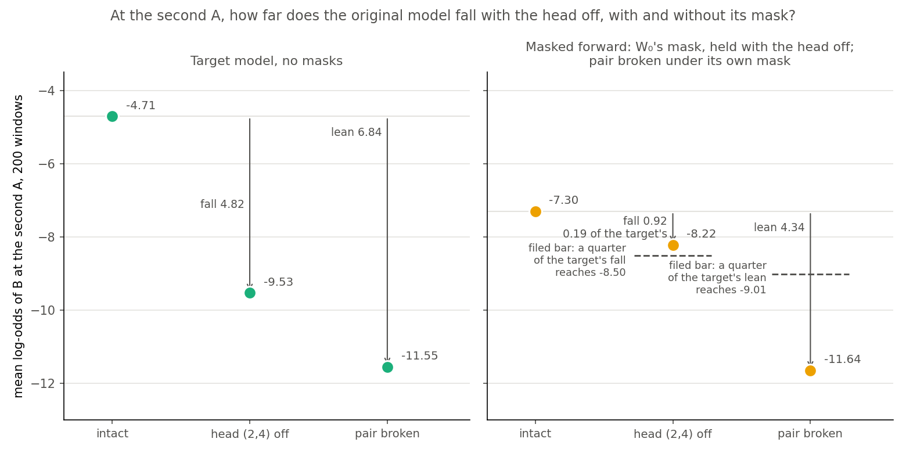

# Analysis: does the original model's own mask keep what its copying head does at the second A? (E62 Amendment 4, control stop)

*Note, 2026-11-02: "the copying head" below stays as written, but at the second A the target model does not separate head (2,4) from head (1,1). See `reports/analyses/2026-11-02_analysis_e62-amend5-head-sweep.md`, "What this changes in earlier amendments".*

*Coding agent, written the day of the run. Plan: `reports/plans/2026-11-02_plan_e62-copying-heads.md`, section "Amendment 4 (2026-11-02)". Rules: `experiments/induction_cue/results/predictions_amend4.json`. Results: `experiments/induction_cue/results/amend4.json`. Code: `experiments/induction_cue/amend4.py`, `src/commute/copying.py`. Figure: `experiments/induction_cue/plot_amend4.py`. Earlier analyses: `reports/analyses/2026-11-02_analysis_e62-amend2-masked-head.md`, `reports/analyses/2026-11-02_analysis_e62-amend3-gates-head-off.md`. Explanation: `notebooks/E62_induction_cue.ipynb`, section Amendment 4. Independent check: `reports/reviews/2026-11-02_review_e62-amend4-check.md`. Provenance near the end.*

We ran the first stage of a free test of whether a fine-tune's mask opens what the original model's own mask opens when it copies. With its old copying head off, the original model's masked forward fell 0.19 of the target model's fall, under the filed bar of 0.25, so the job stopped. For the goals, this gives no reading on new capability against strengthened old, because no fine-tuned state was read.

## The answer

**The test stopped at its control, so there is no reading of whether the fine-tune's mask opens the original model's subcomponents.** The filed verdict stands: the masked fall misses its bar. No fine-tuned state was read, and the later stages did not run. The control did show two things about the original model at this position. The target model's log-odds of B fall far with the head off, though how much of that fall is copying is unread. And the masked forward, each set of tokens under its own mask, shows much of the pair's lean. Why the masked fall is low is not known.

## What we were trying to test

E62 taught the model to copy at a new marker: on a window "A B ... A M", it learns to answer B at M. Switching off head (2,4), the original model's copying head, took about half of that gain. Amendment 3 then showed that the masks react when that head is off. It could not say which subcomponents those masks open. This amendment was built to ask that directly.

The four stages run cheapest first, and only the first ran. Stage 1 reads the original model, W₀, alone. Stage 2 asks whether the subcomponents W₀'s mask adds when a copy is available carry W₀'s own copying. Stage 3 re-reads Amendment 3's gain. Stage 4 compares each of the six saved step-30 states with that set of subcomponents.

Stage 1 reads the second A, the position just before the marker, where W₀ copies with no fine-tune. The quantity is the log-odds of B at that position, averaged over 200 read windows. Three conditions are compared:

- **Intact.** The window as it stands.
- **Head off.** Head (2,4)'s output is replaced by its mean over ordinary text.
- **Pair broken.** The first A is overwritten by another key, so A occurs once. B stays in the window.

Each condition is read in two forwards. The target model is W₀ with no masks. The masked forward holds W₀'s original subcomponents, each multiplied by the mask that Γ, the decomposition's mask function, gives at W₀. With the head off, the mask stays as read with the head on, so the head is off in the forward only. Pair-broken windows take their own mask.

Two differences carry the rule. The **fall** is intact minus head off. The **lean** is intact minus pair broken. Either reads 0 if the change does nothing. The target model is the masked forward's reference. The pair-broken level is the reference for how much of the log-odds depends on a copy being available.

Why a control here: the filed verdict order stops the test when stage 1 fails. That is the order's ruling and not a shown dependence, so stages 2 to 4 are unread, not shown to be unreadable. Stage 4 never switches the head off. The masked fall can also pass with the set of subcomponents unrelated to copying, since it needs only this head's output to pass the mask at the second A. So the fall says little about that set either way, and stage 2 is the set's filed test.

## What we expected, and why

W₀ was expected to copy here, far more strongly than at the marker. The target model had three bars, each set from its reading at the marker. The geometric-mean probability of B had to reach ten times the marker's. The fall had to pass 1.16 and the lean 1.58.

The masked forward was expected to keep at least a quarter of the target's lean and at least a quarter of its fall. The quarter on the fall was chosen in the draft plan. The quarter on the lean came from the plan's re-check, and it replaced the draft's bar on the level. Neither has a published source, and the filed text's "the draft's quarter" on both is a shorthand. The level was printed with no bar, because the masked forward sits under the target model by an offset that the differences net out.

A miss on any of these stops the job. Before the run, the head's masked fall at the marker was already known to be small, 0.04 against 1.16. This bar reads the same fall at the position where W₀ copies.

## What we observed

### At the second A, how far does each forward fall with the head off?

**Reading it: the target model falls far with the head off, and how much of that is copying is unread.** The target model's log-odds of B fall by 4.82 with the head off, against 6.84 for breaking the pair. The head-off read on pair-broken windows and a reference head were not run here, so how much of the fall is copying is unread at this position. At the marker almost all of it depended on the pair. There, the head off takes the target's lean from 1.58 to 0.51 (`amend2.json`, `row4_w0_fall`). The 0.70 below divides two log-odds differences, so it is not a share of the copying. All three target bars cleared, the fall at about four times its bar. This is a target-model reading at the level of one head, on W₀, and says nothing about masks.

**Reading it: each set of tokens under its own mask, the masked forward shows much of the pair's lean.** Its lean is 4.34, which is 0.64 of the target's against a bar of 0.25. That compares each set of tokens under its own mask. So the lean holds what the tokens change and what the mask changes, and stage 2's split of the two did not run. The fall holds the mask fixed, so on the masked side the lean and the fall are not like for like. If the token part were small, the lean would not be kept as computation at all: Γ would be writing it into the mask.

**Reading it: the masked fall misses its bar, and the job stopped.** It reads 0.92 against the target's 4.82, which is 0.19 of it. The bar of 0.25 comes to 1.20 log-odds. So the miss is 0.29 log-odds. Reaching the bar would have taken the head-off point to the dashed level on the figure, and it stops short of it. The filed verdict stands. Its status name states which bar missed and nothing about a mechanism.

| read at the second A, mean over 200 windows | target model | masked forward | masked minus target, or masked over target | filed bar |
|---|---|---|---|---|
| log-odds of B, intact | −4.710 | −7.300 | −2.590 | printed, none |
| log-odds of B, head off | −9.527 | −8.216 | +1.311 | printed, none |
| log-odds of B, pair broken | −11.545 | −11.641 | −0.096 | printed, none |
| fall, intact minus head off, the masked side with the mask held | 4.817 | 0.916 | ratio 0.190 | ratio at least 0.25: **missed** |
| lean, intact minus pair broken, the masked side with each under its own mask | 6.836 | 4.341 | ratio 0.635 | ratio at least 0.25: held |
| fall over lean, this report's | 0.705 | 0.211 | | none |
| head off minus pair broken, this report's | 2.018 | 3.425 | | none |

On the masked side, the last two rows set a read with the mask held against one with the mask free to change. The target-model column has no such mismatch.

The target model's geometric-mean probability of B reads 0.00789, against a bar of 0.00315. That is 25 times the marker's reading.

The set of subcomponents was sized before the stop. W₀'s mask at the second A, intact minus pair broken, is positive on 2,231 of the 9,881 alive subcomponents, with a positive mass of 40.14. The fewest holding half of that mass number 172, inside the "tens to a few hundred" expected. The largest entry is 0.41. Against the earlier contrast with the position before, whose set has 243 members, 114 are shared and the cosine is 0.447. Nothing was read on this set.

**Side by side, at different positions.** Amendment 3's marker numbers beside these, as two positions and not as a trend. Both hold the mask as read with the head on, and both are W₀.

| W₀, head off in the forward only | at the marker, Amendment 3 | at the second A, here |
|---|---|---|
| target model's fall | 1.163 | 4.817 |
| masked fall | 0.039 | 0.916 |
| masked over target, fall | 0.033 | 0.190 |
| target model's lean | 1.580 | 6.836 |
| masked lean | 0.366 | 4.341 |
| masked over target, lean | 0.231 | 0.635 |

### Why the masked fall is low: accounts, none chosen

Nothing in this job separates these, and they are not exclusive. One simple reading goes on arithmetic alone. If the masked forward were the target's copying shrunk evenly by the lean's ratio, its fall would be about 3.06, and it read 0.92. That assumes shrinking is even on the log-odds scale. It also takes a lean read with the mask free to change as the scale for a fall read with the mask held.

| account | what bears on it so far | the read that would separate it |
|---|---|---|
| 1. W₀'s mask passes little of this head's output at the second A | Unread at this position. At the marker a sample holding 5.4% of the slot's read weight read nearly shut, and the independent check of Amendment 3 found that a shut head is not shown | How much of the slot's output passes the masked `o_proj` at the second A, weighted over all alive subcomponents, against every mask at 1. Little passing supports this; much passing removes it |
| 2. The output passes, and other subcomponents carry the lean in the masked forward, so replacing it costs little | With the head off, the masked forward still reads 3.43 over pair broken, the target model 2.02. This fits and does not show it. The masked 3.43 sets a point with the mask held against one under the pair-broken windows' own mask | The same weighted read, then the head's fall with the slot re-opened by slot share, and other heads off in the masked forward at this position |
| 3. The lean sits partly in the mask itself, which Γ reads from the pair and which stays frozen with the head off | Γ sees the pair and later tokens. At the marker, recomputing the mask with the head off moved W₀'s fall from 0.04 to 0.39, and the same read under head (3,5) moved 0.21, so part of that is not specific to this head | Stage 2's split of the lean into tokens and mask on one set of tokens, and the masks recomputed with the head off at the second A |
| 4. The replacement value behaves differently in the masked forward | The mean comes from the target model on ordinary text and then passes the mask, so the fall nets a removal and an injection. Head off sits above the target's by 1.31. The same replacement did not stop the head's effect with every mask at 1 on repeated random tokens, so this account needs the mask or the window to act | Own-mask mean and zero ablation in the masked forward at this position |
| 5. The two forwards are on two precisions | Target reads are fp32, masked reads bf16, as filed. Its size here is unread. The nearest measured sizes are 0.004 on a level and up to 0.012 on a difference, target model on the two paths (`reports/analyses/2026-11-02_analysis_e62-amend2-masked-head.md`, "Two precisions"), and up to 0.0195 between two bf16 paths in E38 Amendment 3. Both are small against the 0.29 miss and far smaller than the 3.90 shortfall from the target's fall, though neither is this masked read. bf16 did not stop the head's effect with every mask at 1 on repeated random tokens, so this account needs the mask or the window to act | The three masked reads repeated in fp32 beside bf16 |
| 6. The loss is in the components without Δ, or on these windows, rather than in the mask | With every mask at 1 on repeated random tokens the head's effect is kept (`amend2.json` `row1_control`). A different metric on different windows, so it does not settle the second A | The fall at the second A with every mask at 1 |
| 7. Γ on 41-token windows | Unread. Γ was trained on 512-token rows, and the absolute levels on windows and Γ's behaviour in full context are untested (`reports/reviews/2026-10-27_review_gamma-bidirectional-windows.md`; `src/commute/vpd.py`, `compute_ci` docstring). The masked levels sit 2.59 from the target here and 2.01 at the marker | The same windows' pairs set inside longer rows |
| 8. A low-probability behaviour | Unread. B's geometric-mean probability is 0.0079, so "W₀ copies" here means a large rise to under 1%, not a top prediction. Reconstruction KL, the check named in `GOALS.md`, puts little weight on a token at that probability, so nothing obliges the mask to hold its log-odds or its response to a head | Per-window falls against the probability of B, and the same control on windows where B is predicted |
| 9. Downstream of the head | Unread. The slot may pass while later matrices' frozen masks shut what reads it. The weighted `o_proj` read in accounts 1 and 2 cannot see this | The replaced head's change in output patched into the masked forward at later blocks, or the fall with only later blocks' masks set to 1 |

## What we learned

For `GOALS.md`, nothing moves on new capability against strengthened old, as far as this test goes. The test's question, whether the fine-tune's mask opens the subcomponents W₀'s copying opens, has no reading. The filed claim and the filed null are both unscored. Any reading from it would also carry the granularity limit: a new circuit built from old subcomponents reads as elicited to VPD.

What is new is about W₀ alone. At the position where it copies, replacing this head lowers its target model's log-odds of B by 4.82, and how much of that is copying is unread. With the mask free to change, breaking the pair moves its masked forward far more than replacing the head does with the mask held. How much of that is the mask itself is unread. The plan's branch words this failure as the masks dropping W₀'s copying. The numbers show the narrower fact above: a low fall with the mask held, and a lean with each set of tokens under its own mask. A lean of 4.34 remains, of unknown make-up.

## How compelling is the evidence

The verdict comes from a filed rule, and the arithmetic recomputes with no residual. This is W₀ alone: one model, one decomposition seed, 200 windows sharing 32 keys, no fine-tune seeds.

- **Noise floor.** Unread. Per-window values were not saved and the control prints means only, so the miss of 0.29 log-odds has no standard deviation beside it. The rule used none.
- **Positive control.** The target model's three bars hold, so the head and the windows behave as filed. Under Γ's mask the quarter bar has no positive control: nothing shows the masked fall reading high on a head known to carry behaviour through that forward under that mask. With every mask at 1 and Δ out, on repeated random tokens, the same forward in bf16 reads induction top-1 at 0.8177, and at 0.0095 with the head off. The target model reads 0.8247, then 0.0095 (`amend2.json`, `row1_control`). So on those tokens the hook reaches the components, and the components without Γ's mask lose the head's effect as the target does. That is a different metric on different windows, so it does not settle the second A.
- **Blind to.** How much of the head's fall is copying, since the head-off read on pair-broken windows and a reference head were not run. Which subcomponents pass the head's output. Any effect of the head through Γ, since the mask is frozen. Other positions. Other forms of ablation.
- **The bar.** The quarter on the fall is the draft's choice and the quarter on the lean the plan's re-check's. Neither has a published source, and both stand as filed.

## Surprises

**Something unexpected happened that I cannot explain.** The plan expected the masked fall at the second A to reach a quarter of the target's, and it reached 0.19. The low fall at the marker had already shown this could happen. The cause remains unread.

Also:

- With the head off, the masked forward reads above the target model by 1.31, though it reads below it by 2.59 when intact.
- With the pair broken, the two forwards agree within 0.10. The plan treated the gap between them as an offset the lean nets out "as far as it is the same on both windows". Here it is not the same on the two windows.
- The masked intact level reads −7.30000003, which is rounder than a mean of 200 values should be, and the other masked levels are not. Per-window values were not saved, so this was not run down. No mechanism was found in the code. A mean landing this close to a one-decimal value has a chance near 6e-7 per number, softened by having picked it out from many printed numbers. This level enters both masked differences, so the next GPU job re-reads the three masked levels here per window. That must reproduce −7.30000003 on an L40, and it gives the standard deviation this report lacks.

## What next

The plan's tree sends a failed mask control to the user, and the user chose E62 Amendment 5 (`decisions.md`, commit 7f1d968). It reads what carries the masked copy. The head goes off with every mask at 1 first, alone and under a stop. Then all 24 heads go off one at a time in the target model and the masked forward, beside forwards with the masks swapped. The weighted slot read comes second if needed. Stages 2 to 4 of this amendment stay unscored and are not run. Amendment 5 is being coded and has not run.

## Scorecard

| id | claim | rule | read | verdict |
|---|---|---|---|---|
| stage 1, target | W₀ copies here | `p_b` at least 0.00315 | 0.00789 | holds |
| stage 1, target | replacing the head lowers the log-odds; how much is copying is unread | fall at least 1.1628 | 4.817 | holds |
| stage 1, target | W₀ depends on the pair | lean at least 1.5801 | 6.836 | holds |
| stage 1, mask | the masked forward has the lean | masked lean at least 0.25 of the target's, 1.709 | 4.341, ratio 0.635 | holds |
| stage 1, mask | the masked forward has the fall | masked fall at least 0.25 of the target's, 1.204 | 0.916, ratio 0.190 | **missed**, status `mask_drops_head` |
| size | k in range | k above 0 and at most 4,940 | 172 | in range; the stop came from the status |
| stage 2 | the set carries W₀'s copying | share at least 0.5, and 0.24 over random | not run | `carries` is `unread` |
| stage 3 | re-read of Amendment 3 | within 0.001 | not run | |
| P1, P2, P3 | alignment, closing, gap | as filed | not run | empty |
| verdict | | `copying.mask_test`, first that fires | | **`control_failed_mask`** |

## Provenance

Job 48945, MATS `debug`, NVIDIA L40, $0. Started 16:06:01, stage 1 written 16:06:35, exit 1. Code at `897c026`, recorded in the results as `git_head`. Results committed at `83cb007`. Predictions sha256 `dfb0a366...`. Log: `cluster/logs/commute-e62-amend4-48945.out`. The job wrote `results/large/amend4.out`. It stopped before `results/large/amend4_vectors.pt`, so the mask contrast and the set of 172 are not on disk; only k and the ten largest entries are. Shares recomputed with `jq` from `amend4.json`: `~/commute-data/scratch/regating-lead/e62-a4-analysis/derived.json`. Marker numbers: `amend3.json` `row1_control` and `amend2.json` `row3_masked` and `row4_w0_fall`. Code review before the run: `reports/reviews/2026-11-02_review_e62-amend4-code.md`. Independent check of this report: `reports/reviews/2026-11-02_review_e62-amend4-check.md`.

## Departures from the literature

- **Ablation.** Olsson et al. 2022 zero-ablate a head, on small models. We mean-ablate over ordinary text, as approved for E62. Zero ablation was not run.
- **Where copying is read.** Olsson et al. read induction on repeated random tokens. We read it on word-like windows with an A and B set in, at the second A, because those are the windows the fine-tunes were read on.
- **Comparing a parameter decomposition's mask with the head off in the forward only, and between a window and its pair-broken twin.** No source we know of. The VPD paper reads masks per input; these contrasts are ours.
- **Thresholds.** The quarter on the fall is the draft's, and the quarter on the lean the plan's re-check's. The three target bars come from this model's marker reads. None is published.

## Not run

- **Stage 2.** W₀'s gain from its mask at the second A on one set of tokens, the closing share of the 172 and its random reference, every alive subcomponent closed, and the lean's token part.
- **Stage 3.** The re-read of Amendment 3's masked gain, and the zero update's level under closing.
- **Stage 4, every number, on all six states.** Alignment and its chance level, closing share and its random reference, the closing share of the k largest openings, every alive closed, the k largest outside the set, positive-part cosine, the earlier contrast's cosine and share, and head (2,3)'s target share.
- **The weighted slot read**, at the marker or the second A, under any mask. The plan holds it for this branch; it is not filed.
- **The head off on pair-broken windows, and a reference head**, at this position, in either forward.
- **The masked forward with every mask at 1 at the second A on these windows.**
- **The reads named in the accounts table.** Masks recomputed with the head off at the second A, own-mask mean and zero ablation, the masked forward in fp32, the slot re-opened by slot share, other heads off in the masked forward at this position. These pairs inside longer rows, per-window falls against the probability of B and the control on windows where B is predicted, the head's change in output patched in at later blocks, and the fall with only later blocks' masks at 1.
- **Per-window values, and a standard deviation on the fall or the lean.**
- **Not planned here.** The first-A contrast, the set's overlap with the head's slot, steps 100 and 300, and a second decomposition seed. Amendment 3's "Not run" list carries over unchanged.

*Corrected 2026-11-02 against the independent check `reports/reviews/2026-11-02_review_e62-amend4-check.md`; the filed verdict `control_failed_mask` is unchanged.*
