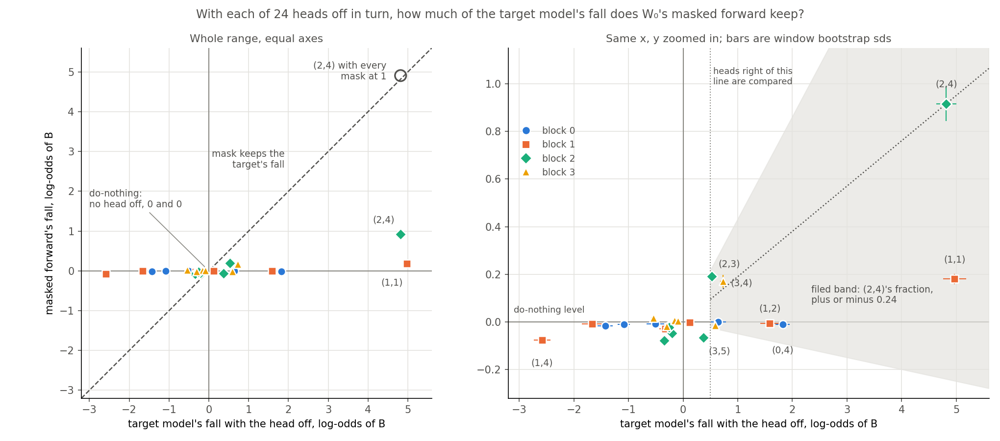
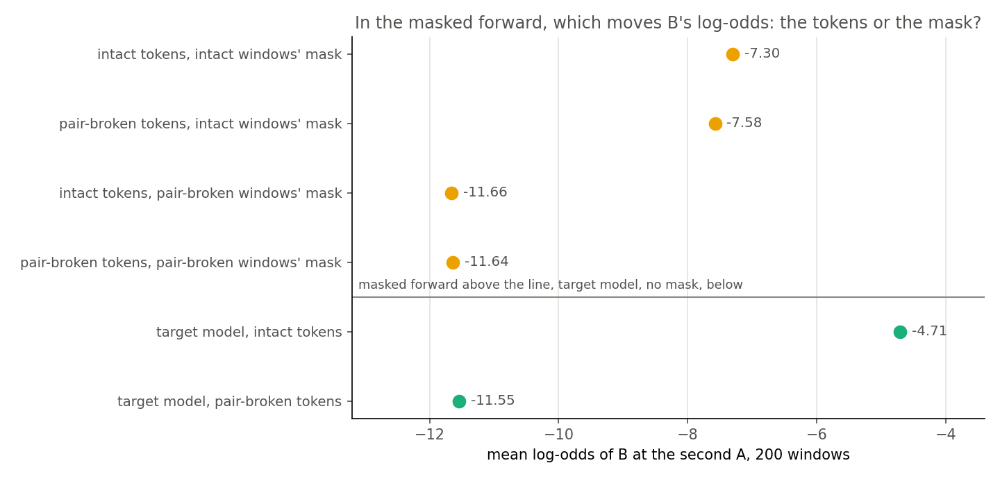

# Analysis: under its own mask, which heads does the original model's copying depend on? (E62 Amendment 5)

*Coding agent, written the day of the run. Plan: `reports/plans/2026-11-02_plan_e62-copying-heads.md`, section "Amendment 5 (2026-11-02)". Rules: `experiments/induction_cue/results/predictions_amend5.json`. Results: `experiments/induction_cue/results/amend5.json`. Reads beside the verdict: `experiments/induction_cue/read_amend5.py`, `results/amend5_reads.json`. Figures: `experiments/induction_cue/plot_amend5.py`. Explanation: `notebooks/E62_induction_cue.ipynb`, section Amendment 5. Previous step: `reports/analyses/2026-11-02_analysis_e62-amend4-control-stop.md`. Provenance near the end.*

We switched off each of the original model's 24 heads in turn, with and without its own mask, and swapped masks between windows with and without the copying pair. No head carries the copying under the mask: together the falls come to a quarter of the effect, which sits almost wholly in the mask and hardly in the tokens. For the goals, the mask does not show the original copying mechanism at head level, so a mask reading on a fine-tuned state has no head-level anchor on this model.

## The answer

**No head carries the original model's copying under its own mask.** Switching off any one head costs the masked forward little, on any windows, and head (2,4) stays the largest of those small falls. The filed verdict is `thinned`, but the fractions are not alike: the rule's band is wide enough to hold zero. The pair's effect sits in the mask: with the mask held, the tokens barely move the answer. So at head level the mask does not show the mechanism here.

## What this changes in earlier amendments

No filed number or verdict changes. Four readings do.

1. **"The copying head", in E62 and in Amendments 2, 3 and 4.** Head (1,1), not (2,4), has the largest target fall at the second A: 4.97 against 4.82. The gap of 0.15 is inside the noise over keys, so read them as tied. The label on (2,4) comes from the prefix score, and a score is not a fall. Say "head (2,4), which E62's prefix score picked"; at this position it is one of two equal heads. Nothing in the head set H changes, as H was filed by the score.
2. **Amendment 4's "0.19 of the target's fall".** That number stands, and it is the kinder of the two. Head (1,1) keeps only 0.04 of its own fall in the same forward. So 0.19 does not describe the two heads together.
3. **Amendment 4's "how much of the fall is copying is unread".** Now read: 4.75 of (2,4)'s 4.82 log-odds depends on the pair. That part of the target's reading is copying by this test.
4. **The 1.40 log-odds that Amendment 5 was built to find a carrier for.** Amendment 4 set 3.42 in the masked forward against 2.02 in the target. No head holds that excess. Its 3.42 compares a point under the intact mask with a point under the pair-broken mask. The swap below shows almost all of that is the change of mask. Amendment 4 warned that the two were not like for like, and the plan's bar leaned on the difference anyway.

## What we were trying to test

Amendment 4 stopped because the masked forward, under the mask the original model W₀ gets when it copies, fell little with head (2,4) off. It did show a large lean. This job asks where that lean sits, at W₀ only, with no fine-tuned state and no training.

Everything is read at the second A of a window "A B ... A", as the log-odds of B, averaged over 200 windows that share 32 keys. Two forwards are compared. The **target model** is W₀ with no masks. The **masked forward** holds W₀'s original subcomponents, Δ out, each multiplied by the mask Γ gives at W₀. A head is switched off by replacing its output with its target-model mean over ordinary text, at every position, in the forward only. The mask stays as read with every head on.

Four quantities carry the reading:

- **Fall.** A forward's log-odds of B with no head off minus with that head off. It reads 0 if the head does nothing. T is the target model's fall, M the masked forward's.
- **Lean.** Intact windows minus pair-broken windows, each under its own mask. Pair broken overwrites the first A with another key, so A occurs once and B stays in the window. It reads 0 if the pair does not matter. The masked lean is what the phrase **masked copy** means below: the copying behaviour under masks.
- **Fraction.** M over T, for a head whose T is at least 0.5. It reads 1 if the mask keeps the head's fall and 0 if it keeps none.
- **Pair part.** A head's fall on intact windows minus its fall on pair-broken windows: the part of the fall that exists because of the pair.

Three checks surround the sweep. Each one rules out an alternative:

- **Every mask at 1**, first and alone, with a stop. It rules out the hook failing in a decomposed forward at this position.
- **Do-nothing.** No head off, read twice, which must read 0 in both forwards.
- **The swap.** W₀'s pair-broken mask on the intact tokens, and W₀'s intact mask on the pair-broken tokens. It rules out the lean being in the tokens the forward sees.

## What we expected, and why

The filed question had three answers. **Rerouted**: another head picks up the masked copy, at least a log-odds over its target fall. **Thinned**: every compared head keeps a fraction within 0.24 of (2,4)'s. **Labelled head singled out**: only (2,4) loses its fall.

The control was expected to read near 4.82. In the target model, (2,4) was expected to have the largest fall of all 24 and a large pair part. Head (3,5) was expected to have a small pair part. No value was filed for any other head's masked fall, since that was the reading. The two token parts had three branches and no expected one.

## What we observed

### Does switching off a head work in this forward at all?

**Yes, with every mask at 1.** Head (2,4) falls 4.91 there, which is 1.02 of the target's 4.82, with a bootstrap over keys giving 1.00 to 1.04. Window by window the two falls correlate at 0.99. The lean reads 7.01 against the target's 6.84. So the low falls below come from W₀'s mask, and not from the hook, Δ being out or bf16. Precision does not matter either: fp32 moves the masked fall of (2,4) by 0.0008 and the full-precision mask by 0.0027, against a window sd of 0.073. This control covers (2,4) only; no other head was read with every mask at 1.

### What carries the masked copy, head by head?

**Reading it: no head carries it.** On the left, every head but the control sits near the zero line, whatever its target fall. The largest masked fall is head (2,4)'s own 0.92, and the next is (2,3)'s 0.19. No other head reaches even the 1.0 a carrier needs, so nothing has moved onto another head and `rerouted` is out for single heads. The largest excess, 2.51 on head (1,4), is not a carrier. Its masked fall is −0.08, and the excess exists because switching it off raises B in the target model.

**The fractions are not alike, though the filed rule reads `thinned`.** The right panel shows two groups. Heads (2,4), (3,4) and (2,3) keep 0.19, 0.23 and 0.36 of their falls. Heads (1,1), (0,2), (1,2), (0,4) and (3,5) keep between −0.02 and 0.04. Each of the second group differs from (2,4) by 0.15 to 0.21, with a key bootstrap sd near 0.015. The band of 0.24 around 0.19 reaches down to −0.05, so a head keeping nothing at all counts as alike. That is why the verdict fires: on this rule, with this labelled fraction, `thinned` could not tell even loss from every other head at zero. The filed verdict stands. It should not be read as "every head reduced alike".

| beside the verdict, deciding nothing | what it reads |
|---|---|
| verdict at `fall_floor` 0.25, bf16 and fp32 | `mixed`: head (2,2) enters, T 0.37, fraction −0.18, under the band |
| verdict at `fall_floor` 0.5, filed | `thinned`, seven heads compared |
| verdict at `fall_floor` 1.0, bf16 and fp32 | `thinned`, three heads compared, all three at about 0 and (2,4) at 0.19 |
| carriers needing a key bootstrap | none, as there are no carriers |
| `window_max_abs_on`, `gate_max_abs` | 0.0565 and 0.832, both above 0: the fp32 rows ran outside autocast |

So the verdict depends on the floor, which was filed as chosen with no source. The pair parts agree with the two groups. In the target model both heads' falls are almost wholly pair dependent. In the masked forward (2,4)'s is 0.91 of its 0.92, but that subtraction moves the mask too, as the swap below shows.

| head | T | M | M / T | Tb | Mb | pair part T | pair part M | M − T (sd) |
|---|---|---|---|---|---|---|---|---|
| (1,1) | 4.972 | 0.181 | 0.036 | −0.117 | −0.013 | 5.088 | 0.194 | −4.791 (0.205) |
| (2,4) | 4.817 | 0.916 | 0.190 | 0.070 | 0.008 | 4.747 | 0.908 | −3.901 (0.162) |
| (0,4) | 1.825 | −0.010 | −0.006 | 0.094 | 0.016 | 1.731 | −0.026 | −1.835 (0.130) |
| (1,2) | 1.587 | −0.007 | −0.004 | 0.039 | −0.012 | 1.547 | 0.005 | −1.593 (0.169) |
| (3,4) | 0.732 | 0.171 | 0.234 | 0.648 | −0.026 | 0.084 | 0.197 | −0.561 (0.052) |
| (0,2) | 0.642 | 0.001 | 0.001 | 0.208 | 0.009 | 0.434 | −0.008 | −0.641 (0.139) |
| (3,5) | 0.588 | −0.014 | −0.024 | −0.082 | −0.017 | 0.670 | 0.003 | −0.602 (0.041) |
| (2,3) | 0.524 | 0.191 | 0.364 | 0.457 | −0.016 | 0.067 | 0.206 | −0.333 (0.051) |
| (2,2) | 0.369 | −0.066 | under floor | 0.271 | −0.032 | 0.099 | −0.034 | −0.435 (0.051) |
| (1,3) | 0.117 | −0.002 | | −0.061 | −0.001 | 0.178 | −0.001 | −0.119 (0.058) |
| (3,1) | −0.092 | 0.004 | | −0.216 | −0.031 | 0.124 | 0.035 | 0.096 (0.037) |
| (3,0) | −0.156 | 0.007 | | −0.303 | −0.025 | 0.147 | 0.032 | 0.163 (0.040) |
| (2,0) | −0.205 | −0.047 | | −0.359 | −0.026 | 0.154 | −0.021 | 0.158 (0.056) |
| (0,3) | −0.245 | −0.015 | | −0.460 | −0.047 | 0.215 | 0.032 | 0.230 (0.147) |
| (2,5) | −0.254 | −0.022 | | −0.287 | −0.026 | 0.033 | 0.004 | 0.232 (0.041) |
| (3,3) | −0.303 | −0.019 | | −0.100 | −0.018 | −0.203 | −0.001 | 0.284 (0.039) |
| (1,0) | −0.327 | −0.030 | | −0.169 | −0.012 | −0.158 | −0.017 | 0.297 (0.109) |
| (2,1) | −0.342 | −0.079 | | −0.413 | −0.072 | 0.071 | −0.006 | 0.264 (0.043) |
| (0,1) | −0.511 | −0.008 | | −0.569 | 0.034 | 0.058 | −0.043 | 0.503 (0.162) |
| (3,2) | −0.545 | 0.016 | | −0.012 | −0.020 | −0.533 | 0.036 | 0.561 (0.047) |
| (0,5) | −1.084 | −0.009 | | −0.847 | 0.011 | −0.237 | −0.020 | 1.074 (0.112) |
| (0,0) | −1.426 | −0.017 | | −1.011 | 0.020 | −0.415 | −0.038 | 1.409 (0.136) |
| (1,5) | −1.666 | −0.009 | | −1.706 | −0.001 | 0.040 | −0.008 | 1.657 (0.184) |
| (1,4) | −2.580 | −0.075 | | −2.220 | −0.014 | −0.360 | −0.061 | 2.505 (0.155) |

Tb and Mb are the falls on the pair-broken windows, each under its own mask. The fp32 masked falls agree with these to 0.002 on every head. Both precisions give the same verdict.

### Why is head (1,1) tied with head (2,4) in the target model?

**The tie is real, and the filed expectation came from a different number.** The filed line was "every other T under (2,4)'s (E62's ranking, on repeated sequences)". E62's ranking is the prefix score, where (2,4) reads 0.42 and (1,1) 0.0002. Head (1,1) instead has the top previous-token score, 0.67, and the plan already noted it. E62's own analysis had found the two near tied on W₀'s top-1, at 0.0095 and 0.013. The filed expectation carried a ranking over from a score to a fall, and nothing had measured it.

The gap is not a bug or a general drop. The same hook gives both readings, and on pair-broken windows (1,1) falls only −0.12, so 5.09 of its fall depends on the pair. The difference T(1,1) − T(2,4) is +0.15, with sd 0.12 over windows and 0.15 over keys. The key bootstrap's range is −0.12 to +0.44, and (1,1) is larger in 60% of windows. So the two tie.

One reading fits and is not shown. Olsson et al. describe a previous-token head feeding an induction head, and a block-1 head feeding a block-2 head fits that order. The two target falls correlate at 0.81 over windows. They add to 9.79 against a lean of 6.84, as two steps of one path would. Both heads off at the second A was not read. Amendment 2 refuted strict series on net shares of the fine-tunes' gain at the marker. So the chain stays a presumption here.

**The masked forward does not keep that tie.** The ratio of (1,1)'s fall to (2,4)'s reads 1.03 in the target model, with a key range of 0.97 to 1.10. It reads 0.20 in the masked forward, with a key range of 0.15 to 0.24. If the masked fall of (2,4) still ran on what (1,1) writes, it should cost about as much to switch off (1,1). It costs a fifth, so whatever (2,4) still does under the mask draws little on (1,1).

### How much of the masked lean do the 24 falls account for?

**Little: about a quarter.** The 24 masked falls sum to 1.06 against a masked lean of 4.34, a ratio of 0.24 with a key range of 0.20 to 0.28. Taking only the positive falls gives 1.49, and summing the pair parts gives 1.37, so at most about a third. The target model is the reference. Its 24 pair parts sum to 13.58 against a lean of 6.84, twice over, because falls overlap when heads act in series. Falls need not add to a lean, and redundancy could hide some of the rest. But the reference overshoots where the masked forward falls far short, so most of the masked copy is not there to be removed by switching off one head.

That sets what "thinned" can mean. It names a pattern among small falls. It does not say that the copying pathway runs at lower strength and accounts for the masked copy, because the falls leave three quarters of it unaccounted for. The swap below shows where that remainder is.

**The masked forward barely reacts to any head, copying or not.** On pair-broken windows, where nothing is being copied, switching off head (1,4) raises B by 2.22 in the target model and by 0.01 in the masked forward. The largest masked response of the 24 on those windows is 0.07. So the quiet is not about copying. The quiet is also uneven over depth:

| block | summed size of target falls | summed size of masked falls | masked over target, intact | masked over target, pair broken |
|---|---|---|---|---|
| 0 | 5.73 | 0.06 | 0.011 | 0.043 |
| 1 | 11.25 | 0.30 | 0.027 | 0.012 |
| 2 | 6.51 | 1.32 | 0.203 | 0.097 |
| 3 | 2.42 | 0.23 | 0.095 | 0.100 |

Blocks 0 and 1 hardly register, and blocks 2 and 3 do to some extent. This was noticed after the run and has no filed rule.

### Is the masked lean's dependence on the pair in the masks, or in the tokens?

**In the masks, almost entirely.** Under the intact windows' mask, breaking the pair in the tokens moves log-odds by 0.28, of a lean of 4.34: from −7.30 to −7.58. Under the pair-broken mask, tokens move −0.02: from −11.64 to −11.66. The token shares are 0.06 and 0.00, well under the filed bar of 0.5, so the reading is `through_gates`. The mask's part is 4.36 on intact tokens and 4.07 on pair-broken tokens. So account D, that the lean comes through the tokens with either mask, is not live.

The reference is the same forward with every mask at 1. There the tokens carry the whole lean of 7.01, since no mask changes. So this forward can read the pair through its tokens, and under W₀'s masks it almost does not. Given a pair-broken mask, intact tokens give what pair-broken tokens give.

**What this read is blind to.**

- **B stays in the tokens on all four rows.** Only the first A changes. So it locates the *dependence on the pair*, not B's identity. The intact mask on pair-broken tokens may still draw B from the tokens through whatever the mask opens. A window with B overwritten, under the intact mask, was not read. Neither was a mask taken from a window with a different B.
- **The swap changes the mask at every position.** The mask at the second A is not separated from the others. At the overwritten position the mask was read for a different token, a mismatch that is in both swapped rows and has no size here.
- **How Γ comes to know the pair.** Γ reads the target model's pass, so it sees the pair. This says the masks differ, not by what they differ, and not that Γ reads it through (2,4) or (1,1).
- **The head falls.** No head was off in the swap, so the fall of (2,4) under the intact mask on pair-broken tokens is unread. The filed pair part M − Mb moves tokens and mask together, so it does not show that (2,4)'s 0.92 depends on the pair with the mask held.
- **Short windows, low probability.** Γ was trained on 512-token rows and is read on 41-token windows. B's probability here is under 1%. Both are Amendment 4's accounts and both remain.

### Where Amendment 4's accounts stand

| account | now |
|---|---|
| 1. The mask passes little of the head's output | unread; the general quiet fits it, and the slot read sizes it |
| 2. Other subcomponents carry the lean, so replacing the head costs little | out for any single other head; redundant heads not excluded |
| 3. The lean sits in the mask | supported at two swaps, with the blinds above |
| 4. The replacement value behaves differently under the mask | open; the hook works with every mask at 1, and zero ablation was not run |
| 5. Two precisions | out: 0.0008 on the fall |
| 6. Loss in the components without Δ, or on these windows | out for (2,4): the control reads 1.02 |
| 7. Γ on 41-token windows | unread |
| 8. A low-probability behaviour | unread |
| 9. Downstream of the head | unread; the low numbers in blocks 0 and 1 fit it, with no test |

## What we learned

**Does the mask read the mechanism at head level here? It does not show it, at W₀, at the second A.** `decisions.md` defines elicitation mechanistically: the fine-tuned behaviour runs through a mechanism W₀ already has. A mask reading could only stand in for that if W₀'s own mechanism showed through the masked forward. In the target model the behaviour depends strongly on two heads, tied, and each fall is almost wholly about the pair. Under W₀'s mask those two heads keep 0.19 and 0.04 of their falls. The pair's effect is mostly in the mask rather than computed from the tokens.

Three things are not claimed. The masks may still reflect the mechanism at the level of subcomponents. This job has no such read, and a subcomponent test now has no head to anchor it. Masks that differ with the pair are not shown to be unrelated to the mechanism: Γ sees the same activations, and it may be reading them. And nothing here reads a fine-tuned state, so new capability against strengthened old does not move. E62's causal label, which switches off heads in the target model and uses no decomposition, is untouched. So are its 0.47 to 0.56 shares.

**The granularity limit.** Every reading here is at the level of heads: which heads a forward's log-odds of B depends on when each is replaced by its mean. None names a circuit. A forward that depended entirely on (2,4) could still run a different circuit of that head's subcomponents, and VPD would read it as the same mechanism. A new circuit built from old subcomponents reads as elicited to VPD. VPD's unit is the rank-one subcomponent, so "elicited" from VPD means "uses subcomponents W₀ already has", never "uses a circuit W₀ already runs". Only a second decomposition seed narrows this, and it was not run.

**r stays unscored.** This job does not read r, and no reading here says r reads mechanism. E62's r was unscored, and with the target in context, it is confounded with the old mechanism. This adds a caution for any masked read on this model, Amendment 2's and 3's among them. W₀'s own copying also reads low with the mask frozen, so a low frozen share is not by itself news about the fine-tune.

## How compelling is the evidence

The re-read of Amendment 4 is exact, with maximum difference 0, and the do-nothing repeat reads exactly 0 in both forwards. The control passes well clear of its bar. This is one model, one decomposition seed, one position and one marker's windows, with no fine-tune.

- **Noise.** Window sds are printed for every row. The windows share 32 keys, so I also bootstrapped over keys. The sds barely change for masked falls, and the sd of the gap between (1,1) and (2,4) goes from 0.12 to 0.15.
- **Blind to.** One head at a time cannot see two heads that back each other up. The mask is frozen, so any effect of a head through Γ is out; at the marker Amendment 3 saw such an effect. The fall nets a removal and an injection, because the target-model mean passes masks not read for it. Heads under a T of 0.5 are not compared, whatever they do. Heads are not independent paths, so falls in block 1 and block 2 may be one path.
- **The verdict's power.** With (2,4)'s fraction at 0.19 and a band of 0.24, `thinned` cannot be told from "every other head at zero". The floor moves the verdict: `mixed` at 0.25. The fractions' spread is well beyond noise. So read the numbers rather than the verdict's name.
- **The claims noticed after the run** are the two groups of fractions, the masked ratio of (1,1) to (2,4) and the depth table. They carry no filed rule.

## Surprises

**Something unexpected happened that I cannot explain.** The masked forward barely reacts to switching off any head, on any windows. On pair-broken windows its largest response is 0.07, where the target model's is 2.22. No value was filed for this. Accounts 1, 4 and 9 all fit it, and no read here separates them.

Filed expectations that missed:

- **`ranking_holds` is false.** Head (1,1)'s target fall ties with (2,4)'s. The expectation came from a different score; see above.
- **(3,5)'s pair part was filed as small and reads 0.67,** sd 0.05, or 0.14 of (2,4)'s. So it is not a null at the second A. Its use as a reference at the marker in Amendments 2 and 3 is at another position and is not touched.
- **Target falls run strongly negative on several heads.** Switching off (1,4), (1,5), (0,0) or (0,5) raises B by 1.1 to 2.6, and most of that rise is there on pair-broken windows too. So it is not copying. It is what mean ablation does to B's log-odds, and it is what F1 asked to see.

Also:

- **Amendment 4's −7.30000003 was chance.** The 200 windows hold 200 distinct values, with a smallest gap of 1.2e-4, and the fp32 mean is −7.2973. There is no lattice, so the check closes.
- **One mask entry moves by 0.83 between Γ's bf16 and fp32 passes.** This is `gate_max_abs`. It shows autocast was off, as the review asked. It is large for rounding on one entry. Its effect on the fall is 0.003, so it touches no reading here, but which entry and why are unread, as masks were not saved.

## What next

The plan's branch for `thinned` is followed as written; I ran none of it.

1. **The weighted slot read at the second A.** How much of each head's output passes the masked `o_proj` under W₀'s mask, against every mask at 1, weighted over all alive subcomponents. It is the sizing step. If (2,4)'s slot passes little, account 1 holds and fits the quiet. If it passes much, the fall is lost downstream or never depended on it, which leaves account 9 and the mask.
2. **A state-level test is not built.** Nothing in the masked forward is yet known to carry the masked copy, so it would have no anchor.
3. **Account D is not live,** from `through_gates`, and the caption for the Qwen table says "thins".

**Where I think the plan's next step falls short. I have not changed it.** The slot read is worth running, for two limited reasons. It does not read what this run raised, and the word "thins" is weaker than the evidence.

- The caption's "thins" suggests a pathway running evenly at lower strength. The fractions are uneven beyond noise, and the falls account for a quarter of the masked lean. A caption that keeps "thins" should add: "unevenly over heads, and the pair's effect on B sits in the mask, not the tokens".
- The slot read should carry (1,1) beside (2,4), as they tie in the target model and differ by five times under the mask. That comparison could change the reading of account 1.
- Two reads would test `through_gates`, and neither is in the plan: (2,4) off under the intact mask on pair-broken tokens, and B overwritten under the intact mask. They would show whether the fall depends on the pair with the mask held, and whether the mask or the tokens supply B. Each would take seconds in the same job, and would need `/design` as new measurements. If the mask alone gives B with B absent, then the masked forward at W₀ is not computing the copy, and that matters more than sizing a slot.

## Scorecard

| id | claim | rule | read | verdict |
|---|---|---|---|---|
| stage a | head off works with every mask at 1 | fall at least 1.204 | 4.907, 1.02 of the target's | pass |
| stage a | re-read of `amend4.json` | at most 1e-3 | 0, `exact` | pass |
| stage a | do-nothing repeat | at most 1e-3 | 0 in both | pass |
| stage b | precision does not move the masked fall | move over the sd is loud | 0.0008 and −0.0027 against 0.073 | not moved |
| stage c | (2,4) re-read | T 4.82 and M 0.92 within 1e-3 | as filed | pass |
| stage c | `ranking_holds`, reported only | every other T under (2,4)'s | (1,1) 4.972 against 4.817 | **false** |
| stage c | pair parts, reported only | (2,4) large; (3,5) small | 4.747; 0.670 | large; **not small** |
| stage c | carriers | M at least 1, M − T at least 1 and 2 sd, M − Mb at least 1 | none | none |
| verdict | the filed reading, bf16 | `copying.sweep_reading`, first that fires | seven fractions within 0.24 of 0.190 | **`thinned`** |
| verdict | the same, fp32 | same rule | 0.190 | `thinned` |
| beside | `falls_over_lean`, `sum_falls_over_lean` | flags | none, false | decide nothing |
| stage d | `token_reading` | both token shares under 0.5 | −0.004, 0.063 | **`through_gates`** |

## Provenance

Job 49072, MATS `debug`, NVIDIA L40, exit 0, 59 s, $0. Code at `b7a8a83`, recorded as `git_head`. Results committed at `27d425c`. Predictions sha256 `f1b4dace...`. Log: `cluster/logs/commute-e62-amend5-49072.out`, `results/large/amend5.out`. Per-window reads: `results/large/amend5_windows.pt`, 306 KB. Vectors: `results/large/amend5_vectors.pt`, 239 KB, not read here. Key bootstraps and per-block sizes: `experiments/induction_cue/read_amend5.py`, run through `cpu-run` with no model, 2000 draws, seed 0, written to `results/amend5_reads.json`. Code review before the run: `reports/reviews/2026-11-02_review_e62-amend5-code.md`. No independent check of this report has been done yet.

## Departures from the literature

- **Ablation.** Olsson et al. 2022 zero-ablate a head, on small models. We replace it with its mean over ordinary text, as approved for E62, because zero is far from the head's usual output. Zero ablation was not run.
- **Where copying is read.** Olsson et al. read induction on repeated random tokens. We read log-odds of B on word-like windows at the second A, with B set in by construction, because the fine-tunes were read on those windows.
- **The previous-token and induction chain.** Olsson et al. describe it from attention patterns and ablation. Here it is a presumption from one score, one block order and a correlation of falls; no attention pattern or path patching was read.
- **A head off in a masked forward with the mask frozen, and masks swapped between a window and its pair-broken twin.** No source we know of. The VPD paper reads masks per input.
- **Thresholds.** None is published. The 1.0, 0.24, and 0.5 token bar come from this project's earlier numbers. The 2 sds and the `fall_floor` of 0.5 were chosen with no source, and the floor moves the verdict.

## Not run

- The weighted slot read at the second A, the named next step, and re-opening the slot.
- Any head other than (2,4) off with every mask at 1, so (1,1) has no control of its own at this position.
- Both heads off together at the second A, in either forward, and any other head pairs.
- Any head off under a swapped mask. In particular (2,4) off under the intact mask on pair-broken tokens.
- B overwritten under the intact mask, a mask from a window with a different B, and a swap at the second A only.
- Zero ablation and own-mask means.
- Masks recomputed with a head off at the second A.
- Attention patterns of (1,1) and (2,4), and any path patching between them.
- Any fine-tuned state: the states' masks in the sweep, r, and Amendment 4's stages 2 to 4.
- Other positions, the marker included, and windows set inside longer rows.
- A second decomposition seed.
- Where the 0.83 mask difference between precisions sits; masks were not saved.
- An independent check of this report.
