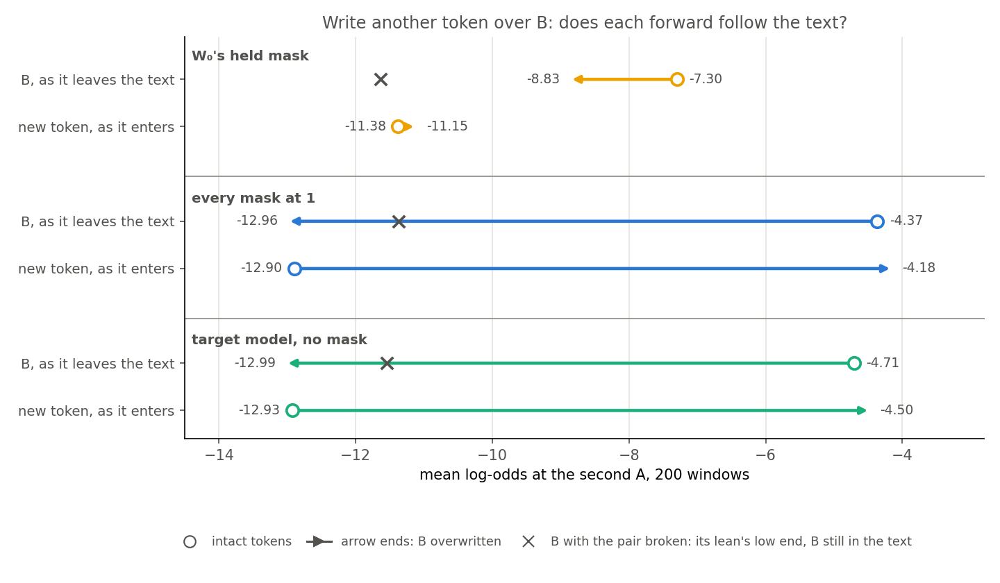
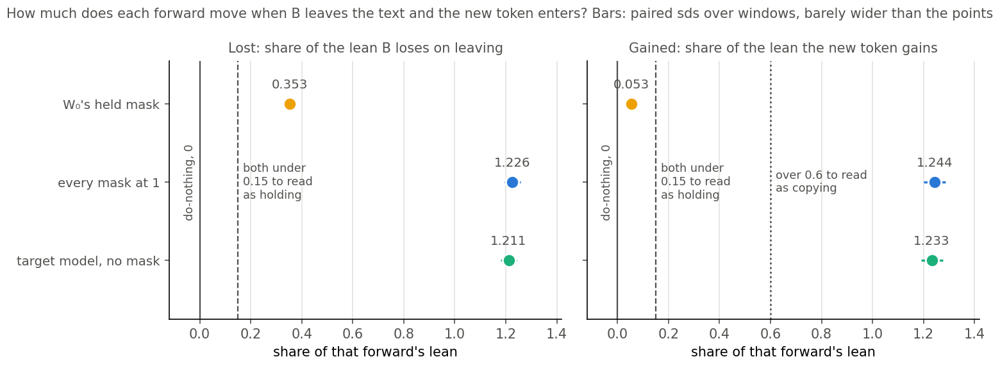
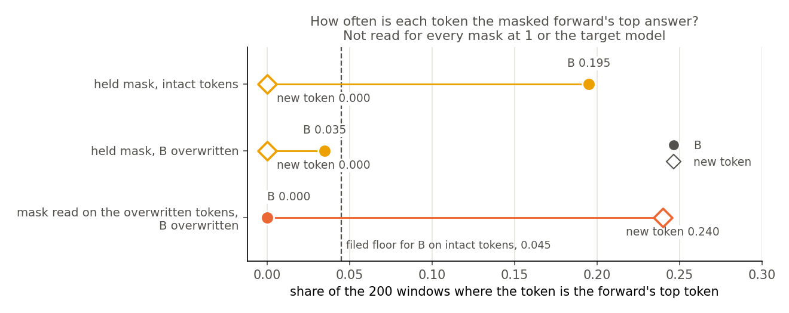
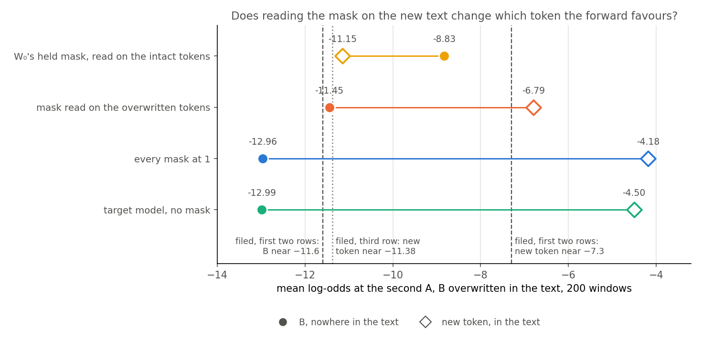

# Analysis: with the copied token overwritten in the text, does the original model's masked forward keep leaning to it? (E62 Amendment 6)

*Coding agent, written the day of the run. Independently checked, corrections applied: `reports/reviews/2026-11-02_review_e62-amend6-analysis.md`. Plan: `reports/plans/2026-11-02_plan_e62-copying-heads.md`, section "Amendment 6 (2026-11-02)". Rules: `experiments/induction_cue/results/predictions_amend6.json`. Results: `experiments/induction_cue/results/amend6.json`. Figures: `experiments/induction_cue/plot_amend6.py`. Explanation: `notebooks/E62_induction_cue.ipynb`, section Amendment 6. Previous step: `reports/analyses/2026-11-02_analysis_e62-amend5-head-sweep.md`. Provenance near the end.*

We kept the mask the original model gets on a copying window, wrote another token over the copied one in the text, and asked which of the two the masked model favours. Neither account alone fits: with the copied token gone, the mask read for it still leans to it, a part of that lean needs both the mask and the token in the text, and hardly any needs the text alone. Neither of the user's two readings fires as filed, but most of the masked lean here does not need the copied token in the text, so at this position a masked lean to a token is not by itself a read that the forward copied it; the marker and fine-tuned states are unread.

## The answer

**Neither account alone fits: not "the mask holds the answer", and not "the mask passes only the token it was read for".** With B gone from the text, the mask read for B still leans to it, with about two thirds of its lean surviving. A part needs both mask and token, and hardly any needs the text alone. That sorting is arithmetic after the run, at W₀, at the second A, for this draw. B is top in 7 windows against 39. Read on the new text, the mask favours the new token.

**The filed verdict is separate and stands: `mixed`, worded "leans to B".** Lost is 0.353 and gained 0.053, so neither rule fires. Both numbers and the own-mask reads go to the user, with no verdict beyond that.

### The two-way tables: arithmetic after the run, no filed rule; assumes the two tokens are exchangeable

Sort each token's level by two questions: was the mask read on a text holding this token, and is the token in the text now? The cell names are defined under "What we were trying to test". The own mask is Γ's mask read on the overwritten tokens.

| log-odds at the second A | token in the text | token not in the text |
|---|---|---|
| **mask read for this token** | B −7.300 (`on`); new token −6.794 (own mask) | B −8.833 (`b_over`); new token unread |
| **mask not read for this token** | new token −11.147 (`new_over`); B unread | new token −11.378 (`new_intact`); B −11.447 (own mask) |

| part of the 4.08 between the corners (−7.300 against −11.378) | log-odds, window sd, key sd | share of the 4.08 | what a pure account predicts |
|---|---|---|---|
| Mask alone, token absent: `b_over − new_intact` | 2.55, 0.20, 0.20 | 0.62 | mask that passes only its token: 0 |
| Same, one token on the same text, only the mask differs: `b_over − own b_over` | 2.61, 0.18, 0.17 | | |
| Text alone, mask not read for it: `new_over − new_intact` | 0.23, 0.05, 0.05 | 0.06 | a route open to any token: large |
| Only with both: `(on − b_over) − (new_over − new_intact)` | 1.30, 0.12, 0.10 | 0.32 | mask that holds the answer: 0 |

The pure "passes only the token it was read for" account is about 15 sds off, 2.61 against 0. The pure "holds the answer" account is about 11 sds off, 1.30 against 0.

The tables mix tokens across cells, which is the exchangeability they assume. Three reads support it:

- The two cells read for both tokens agree. The no-no cell reads −11.38 and −11.45. The yes-yes cell differs by 0.51, against the 0.59 measured for this draw.
- With every mask at 1 and in the target model, the two tokens sit 0.06 apart when absent.
- The mean-based shares are not driven by a few windows: the medians give 2.08 of 3.37 for the mask alone, also 0.62. The medians of the other parts do not add up, so only that share is quoted.

Three limits stay:

- The held and own masks differ at every position.
- It is one draw of new tokens.
- "Mask alone" still runs on the rest of the window with some token at the overwritten position. So it does not show that B's identity is in the mask rather than passed by features the new token shares with B, nor whether the mask raises B or lowers its competitors. The tables do not name what carries either part.

## What we were trying to test

Amendment 5 found that the pair's effect on B sits almost wholly in the mask, but B stayed in the text on every row. So it could not say where B's identity comes from. The user asked for this test: "Keep the same mask but replace B in the text with another token." Two outcomes were named: "the mask holds the answer" and "the mask opens a real route".

Everything is read at W₀, with no fine-tuned state and no training, at the second A of a window "A B ... A". The log-odds are averaged over the same 200 windows, which share 32 keys. The **target model** is W₀ with no masks. The **masked forward** holds W₀'s original subcomponents, Δ out, each multiplied by Γ's mask. The **held mask** is Γ's mask on the intact tokens, read once and kept at every position whatever the tokens below it.

The **overwrite** replaces B after the first A with another token drawn from the windows' own targets. B is then nowhere in the window, and only that one token changes. Each forward reads four cells:

- **on**: B on the intact tokens. Under the held mask this is the do-nothing reference and must re-read Amendment 5's −7.300.
- **b_over**: B with B overwritten.
- **new_intact**: the new token on the intact tokens, where it is not written after the first A.
- **new_over**: the new token with B overwritten.

The reading uses these, the first from Amendment 5 and the rest from those cells:

- **Lean**: Amendment 5's intact minus pair-broken log-odds of B in that forward, each set of tokens under its own mask. Pair-broken windows still hold B in the text.
- **Lost** = (on − b_over) / lean. It reads 0 if B's level ignores the text, and about 1 if B falls by the whole lean.
- **Gained** = (new_over − new_intact) / lean. It reads 0 if the new token ignores the text, and about 1 if it rises by the whole lean.
- **Gap** = b_over − new_over, B above the new token on the same tokens.

Two forwards come first, alone, with a stop. **Every mask at 1** rules out the overwrite or the rule being broken in a decomposed forward. The **target model** rules out the windows being unable to carry a copy of the new token. The other reads are report-only and decide nothing. Γ's mask read on the overwritten tokens is called the **own mask** below. How often each token is the forward's top token is also printed, because a lean between two tokens says nothing about whether either is near the top.

## What we expected, and why

The rule has three outcomes. `mask_opens_route` needs gained over 0.6 and the new token above B by at least 1 log-odds. `mask_holds_answer` needs lost and gained both under 0.15 and B above the new token by at least 1 log-odds. Anything else is `mixed`, which goes to the user.

The user chose how "still says B" is read (`decisions.md`, last row): B beats the replacement by at least 1 log-odds, with neither gaining or losing over 0.15 of the mask's lean. It is worded "leans to B", with how often B is top printed beside it. The user chose this over requiring B to be top in most windows.

The filing leaned weakly to `mask_holds_answer`, because three readings in Amendment 5 fit it and none tested it. Both references were expected to read `mask_opens_route`. The own-mask reads were filed against a table of three cases, which has no numeric bar: "near" is all it says.

## What we observed

### Do the controls follow the text, and does the held mask?

**Reading it: the references follow the text and the held mask mostly does not.** With every mask at 1, B falls 8.60 log-odds and the new token rises 8.72, swapping places. The target model does the same, 8.28 and 8.43. Under the held mask, B falls 1.53 and the new token rises 0.23, so B stays above it. The overwrite and the rule read a copy when no mask selects. Nothing shows a mask read on another token could read one, so low gained is not evidence against a route. The do-nothing cell re-reads Amendment 5 with a difference of exactly 0.

| forward | on | b_over | new_intact | new_over | lean | lost (sd) | gained (sd) | gap (sd) | verdict |
|---|---|---|---|---|---|---|---|---|---|
| held mask, bf16 | −7.300 | −8.833 | −11.378 | −11.147 | 4.341 | 0.353 (0.021) | 0.053 (0.010) | 2.314 (0.184) | `mixed` |
| held mask, fp32 under Γ's fp32 mask | −7.305 | −8.837 | −11.381 | −11.149 | 4.341 | 0.353 (0.021) | 0.054 (0.010) | 2.312 (0.184) | `mixed` |
| every mask at 1 | −4.366 | −12.961 | −12.899 | −4.182 | 7.010 | 1.226 (0.031) | 1.244 (0.042) | −8.779 (0.286) | `mask_opens_route` |
| target model | −4.710 | −12.991 | −12.931 | −4.505 | 6.836 | 1.211 (0.032) | 1.233 (0.043) | −8.486 (0.289) | `mask_opens_route` |

The fp32 row's first cell re-reads Amendment 5's fp32 path with a difference of exactly 0, so it is a real precision check, and the verdict does not move. Its lean is the bf16 lean, as filed. The sds are the run's paired window bootstraps.

### How much of the lean survives, and how much does the new token gain?

These are three separate statements.

**How much survives.** With B nowhere in the text, B sits at −8.83 under the held mask. That is 2.81 log-odds above the pair-broken level of −11.64, or 0.65 of the lean of 4.34. It is 2.31 above the new token, and B is above the new token in 167 of 200 windows. With every mask at 1 that happens in 3 windows, and in the target model in 6.

**What the 0.35 means.** B's log-odds fall 1.53 when B leaves the text, which is 0.353 of the lean and a fall of about 4.6 times in odds. It sits 9.5 paired sds over the 0.15 bar, so the forward's lean to B is not independent of the text. It says that B in the text matters this much under this mask. It does not say by which subcomponents, and no read here tests one. Only 0.28 of the 1.53 needs the pair, from Amendment 5's swap row, sd 0.033. In the references about 0.82 does. So most of this fall needs B present, not A matched, and it is not a copy through the pair. The references read over 1 by arithmetic, because their pair-broken low end still holds B in the text: `b_over` sits under that level by 1.59 and 1.45.

**Gained is low.** The new token rises 0.23 log-odds on entering the text, 0.053 of the lean. That is about 5 paired sds above 0 and 10 under the 0.15 bar, against 1.244 with every mask at 1 and 1.233 in the target model. The 0.6 the other outcome needs is far away. A low gain under a mask read for B does not by itself show that no copying can happen; the own-mask reads below bear on that.

### How often is either token the top answer?

**Reading it: B loses first place in most of the windows where it had it.** On intact tokens under the held mask B is top in 39 of 200 windows, 0.195, over the filed floor of 0.045. With B overwritten it is top in 7, 0.035, and those 7 are among the 39. The new token is top in none under the held mask, on either set of tokens. In those 39 B falls 3.95 log-odds, 0.43 of their lean against 0.30 in the other 161, enough to lose first place in most of them. A share of mean log-odds and a rate of top-1 counts are not on one scale.

"Leans to B" is the right wording, and "says B" would not be. B's level is small on any summary:

| B's probability, held mask unless named | at the mean log-odds | mean over windows | median over windows |
|---|---|---|---|
| intact tokens | 0.068% | 6.0% | 0.034% |
| B overwritten | 0.015% | 0.76% | 0.0087% |
| B overwritten, own mask | 0.0011% | 0.0045% | 0.0011% |

Top-1 was not read for every mask at 1 or the target model, so this figure has no reference at the same read. The medians come from the saved rows, not `amend6.json` (see Provenance).

### What happens when the mask is read on the overwritten tokens?

**Reading it: the own mask favours the new token.** The numbers fit the table's first two rows, which cannot be told apart. Under the own mask the new token reads −6.79 and B −11.45, so the order reverses from the held mask's. The new token is above B in 175 of 200 windows and top in 48, 0.24, where B is top in none. On the same text, the change of mask alone moves the new token up 4.35, sd 0.25, and B down 2.61. The change of text under the held mask moves them 0.23 and 1.53. The table has no numeric bar, so "near" below is my reading against these sds, not a filed test.

| filed row | filed new token under own mask | filed B under own mask | read | how near |
|---|---|---|---|---|
| 1. The mask carries whatever the text held, the positive control for `mask_holds_answer` | near −7.3 | near −11.6 | −6.794, −11.447 | 0.51 above and 0.15 above |
| 2. `mixed` with lost high and gained low, stale mask at p + 1 | near −7.3 | near −11.6 | −6.794, −11.447 | the same numbers, the same distances |
| 3. Own mask does not follow the token | near new_intact, −11.378 | anything | −6.794 | 4.58 above, about 15 sds: does not fit |

The sd of the own-mask levels is 0.30 for the new token and 0.12 for B over windows, 0.29 and 0.11 over keys. So 0.51 is about 1.7 sds and 0.15 about 1.3. The run did not print these; they come from the saved rows.

Rows 1 and 2 file identical numbers and differ only in what they would mean, so these reads do not separate them. Row 2's condition says "lost high", with no bar for high, and lost here is 0.35. Row 1 is the positive control for a verdict that did not fire. The own mask differs from the held mask at every position, so it cannot say whether the change that matters is at the overwritten token, at the second A or elsewhere. The plan's sentence that the own-mask reads "say whether the held mask was stale at p + 1" cannot be met by this run.

The new token's −6.79 sits 0.51 above B's −7.30 on intact tokens. The review measured this draw of new tokens at +0.59 over the Bs on Amendment 5's masked row. That fits a difference between the tokens drawn, and it was not tested.

## What this bears on

**The user's first branch, "the mask holds the answer".** What fits: with B nowhere in the text, B stays 2.31 above the new token, 7 sds over the 1 log-odds the rule asks. Gained is under its bar. Arithmetic on the cells, after the run, adds one more. Compare each token's level on the tokens where it is absent from the text. Under the held mask B sits 2.55 above the new token. With every mask at 1, and in the target model, the two sit 0.06 apart, with the new token higher. My inference is that the surviving lean has to come from the held mask, since the tokens no longer contain B, and on the same text B sits 2.61 above its level under a mask not read for it. No read separates the mask holding B from the mask favouring B some other way.

What does not fit: lost is 0.353, over its bar of 0.15, so the rule does not fire. B leaving the text costs a real part of the lean, and most of the windows where B was top stop having it top. "Holds the answer" is too strong in two ways: B is top in 7 of 200 windows, and the verdict's wording is a lean.

**The user's second branch, "the mask opens a real route".** The rule does not fire: gained is 0.053 where it needs over 0.6. The new token is 2.31 below B where the rule asks it to be 1 above, and it is top in no window. Under the held mask the forward does not follow a new token into the text; it does lose part of B when B leaves. This is a fair test of a narrower thing: whether this mask, read for B, carries a token it was not read for. It does not, at 0.23 log-odds. It is not a test of whether a route exists, as low gained is expected either way and no positive control shows otherwise.

**Neither account alone.** A mask blind to the new token and passing B would give low gained and a real fall in B, but not B staying 2.6 log-odds above its own level under a mask not read for it, with B gone. A mask that holds the answer would give no part that needs both, and that part is 1.30. So neither account alone fits. On the mean, at W₀, at the second A, for this draw, about 0.62 of the 4.08 needs the mask and not the token in the text, 0.32 needs both, and 0.06 needs the text alone. This is arithmetic after the run, assuming the two tokens are exchangeable. It does not name what carries either part.

The own-mask reads show the mask moves with the text and that the forward then favours the new token. They do not show which of two things that mask does: hold the new token, or open subcomponents that read it from the text. Γ reads the target model's pass, so its following the token is expected on either account. It also sees the row in both directions, so a mask that favours B at the second A is not by itself evidence of a copying mechanism W₀ runs.

**What neither branch's numbers say.** Every read is at W₀, at the second A, under W₀'s mask. The marker, its masks and the fine-tuned states are unread. No head or subcomponent is read, so nothing here names what carries the surviving lean or the 0.35, and no mechanism was tested.

**For the goals.** `decisions.md` row 112 defines elicitation mechanistically: the fine-tuned behaviour runs through a mechanism W₀ already has. A masked read could only stand in for that if W₀'s own mechanism shows through the masked forward. Under the held mask the forward does not follow a new token, and most of its lean to B does not need B in the text. So at this position a masked lean to a token is not by itself a read that the forward copied it. Whether that carries to the marker or to fine-tuned states is unread. New capability against strengthened old does not move, because no fine-tuned state is read.

**The granularity limit.** A verdict names what the masked forward does when one token changes under a held mask. VPD's unit is the subcomponent, and a new circuit built from old subcomponents reads as elicited to VPD. This job does not read r, and nothing here says r reads mechanism. Amendment 5's filed verdicts, `thinned` and `through_gates`, stand. Its open line was that B's identity was unread. With B out of the text, B now stays 2.6 log-odds above its level under a mask not read for it, which does not show that B's identity is in the mask.

## How compelling is the evidence

The re-reads are exact, with differences of 0 on all three forwards and on the fp32 row. Both references pass their stops well clear. The rule's bars are chosen, not published, and for this draw the result is not near them: lost is 9.5 sds over 0.15, gained 10 under it, and the gap 7 over 1.

- **Noise.** The run's paired window sds are 0.021 on lost, 0.010 on gained and 0.184 on the gap. The windows share 32 keys, so the filing treats these as lower bounds over keys. A key bootstrap of the saved rows reads 0.021, 0.012 and 0.182, about the same, with lost and the gap a little under the window sds on this draw. For the references it reads 0.05 to 0.06 on the shares, against 0.03 to 0.04 over windows.
- **Means over wide windows.** Per-window log-odds are wide, and a few windows carry most of the mean probability, so the verdict is about the mean over windows. The top-1 rates and probability table show how much that summary hides.
- **Blind to.** Masks at every position are held, so the second A is not told from the others. The mask at the overwritten position was read for B. The embedding is not decomposed, so the new token's embedding enters whatever the mask. The gap compares two different tokens, whose priors average out over 178 pool tokens only as far as the plan's 0.44. One window holds the new token elsewhere and is kept.
- **The scope.** One model, one decomposition seed, one position, one marker's windows, one draw of new tokens.
- **Noticed after the run.** The two-way tables, the 2.55 against 0.06, the swap row's 0.28 of the fall, the window counts of the lean and all key sds carry no filed rule.

## Surprises

No filed prediction reversed, and no stop fired.

- **The filed lean did not fire.** The filing leaned weakly to `mask_holds_answer`. Gained and the order met it, and lost missed by a wide margin.
- **The references go further than their filed ranges.** The table below gives them. The overshoot beyond the filed ranges is the B-absent level at the second A, −12.96 against the filed −12.2 at the marker, in two separate rows. Why it sits lower at this position was not tested. No stop reads these ranges. The lean is 0.82 of the references' full fall, so a share of 1.22 means all of it. On that scale the mask's lost would be 0.29 and gained 0.04, if the masked forward's scale matches the references', which is unread; the verdict is still `mixed`.
- **The new token on intact tokens under the held mask.** It reads −11.378, against a filed "about −11.6 or under". That is a narrow miss of 0.22.

| reference | quantity | filed | read |
|---|---|---|---|
| every mask at 1 | lost | about 1.00 to 1.12 | 1.226 |
| every mask at 1 | gained | about 1.0 to 1.1 | 1.244 |
| every mask at 1 | gap | about −7 to −7.8 | −8.779 |
| every mask at 1 | b_over | at or under about −11.4, to about −12.2 | −12.961 |
| every mask at 1 | new_intact | at or under about −11.4, to about −12.2 | −12.899 |
| target model | lost | about 0.99 to 1.10 | 1.211 |
| target model | gained | about the same | 1.233 |
| target model | gap | about −6.8 to −7.5 | −8.486 |

## What next

The filed verdict sends both numbers and the own-mask reads to the user. Nothing below is settled, and I ran none of it.

- **The plan's named option for `mixed`: the converse read.** Intact tokens under a mask from a window with a different B. It is a proposal, nothing is built, and it needs `/design` as a new measurement. The converse read fills the table's two unread cells and tests whether the tokens are exchangeable; expected about −8.3 and −11.2. It is not a new separation. A mask changed at one position, at the overwritten token or at the second A, is the read that locates the parts.
- **The branch actions do not fire.** Closing the 67M mask work belonged to `mask_holds_answer`, and (1,1) and (2,4) off together belonged to `mask_opens_route`. Which, if either, to take on this reading is the user's decision.

## Scorecard

| id | claim | rule | read | verdict |
|---|---|---|---|---|
| overwrite | B replaced at one position in every window, B nowhere left | `copying.overwrite_holds` | pool 178, 117 new tokens, 1 window with the new token elsewhere | held |
| stage a | every mask at 1 re-reads, follows the text | within 1e-3; new_over not under −6.366; lost over 0.6; reads `mask_opens_route` | diff 0; −4.182; 1.226 | pass |
| stage a | target model the same | within 1e-3; new_over not under −6.710; lost over 0.6; reads `mask_opens_route` | diff 0; −4.505; 1.211 | pass |
| stage b | do-nothing, B on intact tokens under the held mask | −7.300 within 1e-3 | −7.300, diff 0 | pass |
| stage b | the mask's reading | first that fires | lost 0.353, gained 0.053, gap 2.314 | **`mixed`** |
| stage b | own-mask reads, report-only | none, by eye against the table | new token −6.794, B −11.447 | fits rows 1 and 2; not row 3 |
| stage b | top-1, report-only | none; filed floor 0.045 for B on intact tokens | 0.195, 0.035; new token 0, 0, own 0.24 | floor held |
| stage c | fp32 beside the verdict | agreement, LOUD otherwise; first cell against −7.3053 | `mixed`, diff 0 | agrees |

## Provenance

Job 49402, MATS `debug`, NVIDIA L40, exit 0, $0; the reads took 8 s by the log after loading. Code at `f6583fa`, recorded as `git_head`. Results committed at `cd58515`. Predictions sha256 `bacaf1bb...`. Log: `~/commute-data/results-large/induction_cue/amend6.out`. Per-window rows: `results/large/amend6_windows.pt`, 42 KB. Code review before the run: `reports/reviews/2026-11-02_review_e62-amend6-code.md`, applied before the job. Design: `reports/plans/2026-11-02_advice_e62-after-amend5-FABLE.md`, with its departures listed in the plan. Reads beside the verdict, no model, deciding nothing, 2000 draws, seed 0: `~/commute-data/scratch/regating-lead/e62a6-analysis/key_reads.py`, output `key_reads.out` beside it, giving key sds, window counts, medians and top-1 counts. The two-way tables' reads, the same terms: `~/commute-data/scratch/regating-lead/e62a6-check/factorial.py` and `second.py`, each with its `.out` beside it.

## Departures from the literature

- **Overwriting one token under a mask read on another input** has no source we know of. The VPD paper reads masks per input. We hold the mask to ask what the forward does with the text alone.
- **Where copying is read.** Olsson et al. 2022 read induction on repeated random tokens. We read log-odds on word-like windows at the second A, with B set in by construction, because the fine-tunes were read on those windows.
- **Thresholds.** None is published. The 0.15 and the order margin of 1.0 were chosen here, and the 0.6 comes from the advice's band, all with no source. The own-mask table has no numeric bar.

## Not run

- The converse read: intact tokens under a mask from a window with a different B. So the two-way table's two unread cells stay unread.
- (1,1) and (2,4) off together, any head off on overwritten tokens, and the weighted slot read, which this replaced as first step.
- Top-1 under every mask at 1 and the target model; the own-mask reads and top-1 in fp32.
- A mask changed at one position only, at the overwritten token or at the second A.
- B absent under the pair-broken mask, so the surviving lean has no B-absent low end; the own mask's B and `new_intact` are partial stand-ins, giving 0.63 and 0.62.
- Other draws of the new token; only seed 62.
- Masks recomputed with a head off; the pair-broken mask read again or in fp32.
- Any subcomponent-level read.
- Any fine-tuned state and r.
- Other positions, the marker included, and windows set inside longer rows.
- A second decomposition seed.
