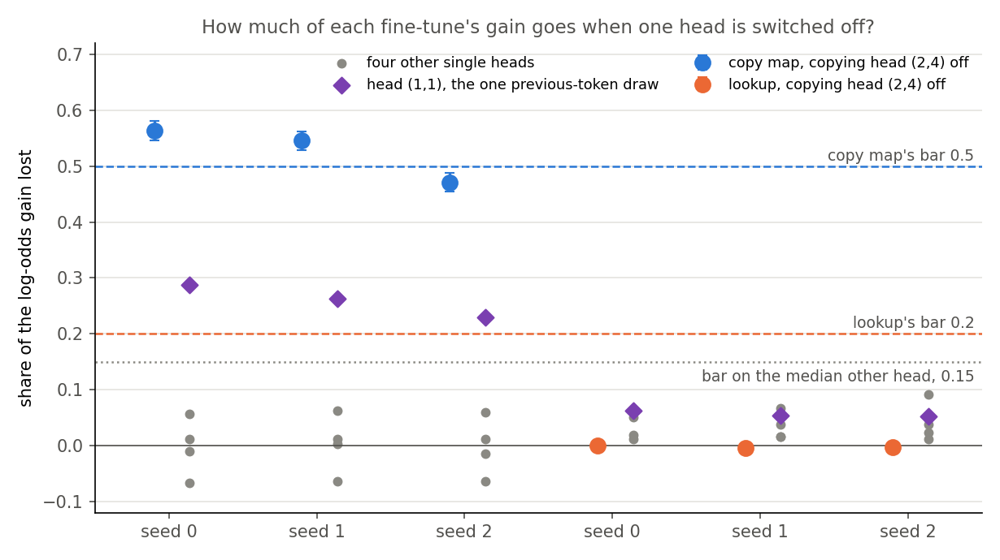
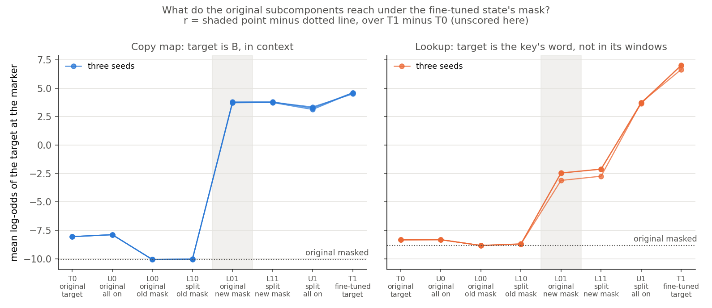
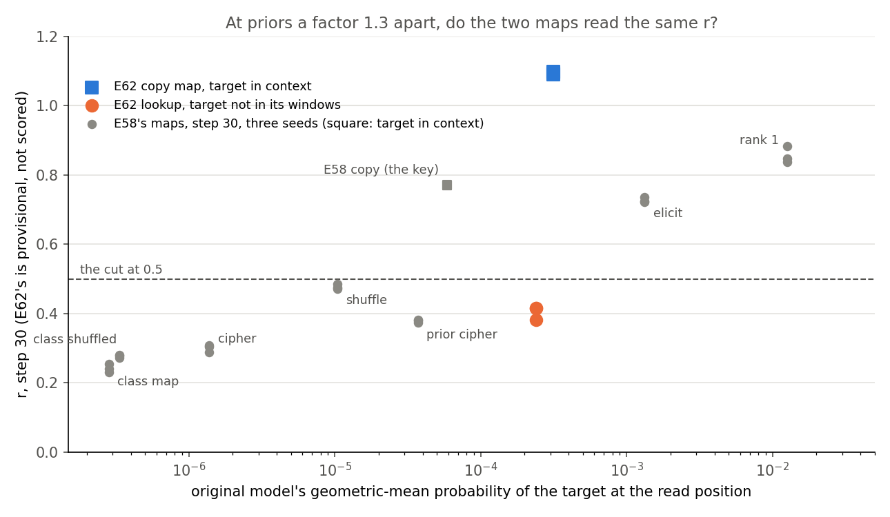

# Analysis: taught to copy at a new marker, does the model use its old copying head, and does r follow? (E62)

*Coding agent, written the day of the run. Plan: `reports/plans/2026-11-02_plan_e62-copying-heads.md` with Amendment 1. Rules:
`experiments/induction_cue/results/predictions.json`. Results: `experiments/induction_cue/results/run.json`.
Log: `cluster/logs/commute-e62-induction-cue-48541.out`, in the main clone. The earlier stop is quoted in the plan.
Review: `reports/reviews/2026-11-02_review_e62-code.md`. Advice: `reports/plans/2026-11-02_advice_e62-prior-stop-FABLE.md`.
Explanation: `notebooks/E62_induction_cue.ipynb`. Provenance at the end.*

We taught the small model to copy at a new marker, taught a word lookup at the same marker, and switched off its copying head. The copying fine-tune lost about half its gain and the lookup nothing, but one seed fell just short of the bar, so r went unscored. For the goals, the fine-tune partly reuses an old mechanism, yet r's high reading cannot be credited to it, the target also being in context.

## The answer

**r was not scored under the filed rules.** The verdict reads `copy_not_elicitation` with `r_scored` false. The copy map's share lost on seed 2 is 0.471 against the bar of 0.5. The verdict's name overclaims for shares this near the bar, as the review said. In words, the copying head carries about half of the copy map's gain and none of the lookup's. Every reading of r below is provisional and unscored, and nothing here changes the filing.

## What we were trying to test

The user defines elicitation as a mechanism question: the fine-tuned behaviour runs through a mechanism the original model, W₀, already has. The definition is in `decisions.md`. r is a candidate instrument to score against a causal check. Every earlier map on the 67M had "old mechanism" and "answer already given" pointing the same way.

Both fine-tunes train on the same 800 windows and read on the same 200, sharing no row.

- **Copy map.** "A B ... A M" gives B, with M a rare marker. Read Bs are never trained.
- **Lookup.** "A M" gives A's own fixed word over 32 keys. The word occurs in none of that key's windows, so the copying head cannot produce it.
- **Priors matched.** The lookup's words were drawn to match W₀'s geometric-mean probability of B at the marker.
- **The label.** Each head's output is replaced by its mean over Pile text. The share lost is $1 - G_\text{abl}/G$, where $G$ is the log-odds gain and $G_\text{abl}$ is the same gain with both W₀ and the state ablated. Zero means the head carries none of the gain.
- **Floor.** Five single other heads, drawn at random.
- **Cheap solutions.** The first A overwritten by another key, and B overwritten by another pool token.
- **r.** Defined below under its own section.

## What we expected, and why

The rule needed copy shares of at least 0.5 and lookup shares of at most 0.2, and only then read r. With a prior near 4e-4, the advice expected about 0.75 for both maps if r follows the prior. If r follows mechanism, it expected about 0.75 beside 0.3 to 0.5. The plan's lean was that the copy map might need 100 or 300 steps.

## What the copying head carries

**Reading it.** About half of the copy map's gain goes, and none of the lookup's. Seeds 0 and 1 clear the bar and seed 2 misses it. The lookup's share sits on zero, under every other head on the same state. The filed floor holds: the median other head stays under 0.15 on all six states.

| state | gain $G$ | $G_\text{abl}$ | lost | share ± row sd | odds multiple left | median other head |
|---|---|---|---|---|---|---|
| copy, seed 0 | 12.65 | 5.53 | 7.12 | 0.563 ± 0.017 | ×253 | 0.011 |
| copy, seed 1 | 12.64 | 5.75 | 6.89 | 0.545 ± 0.016 | ×313 | 0.012 |
| copy, seed 2 | 12.55 | 6.64 | 5.91 | **0.471** ± 0.016 | ×763 | 0.012 |
| lookup, seed 0 | 15.36 | 15.36 | 0.00 | 0.000 ± 0.003 | | 0.052 |
| lookup, seed 1 | 14.99 | 15.05 | −0.06 | −0.004 ± 0.003 | | 0.038 |
| lookup, seed 2 | 15.33 | 15.38 | −0.05 | −0.003 ± 0.003 | | 0.038 |

**In probability.** The state reads about 0.97 for B at the marker with the head on. The level with the head off cannot be read from the saved data. The run kept the gain under ablation, not W₀'s level under ablation. A bracket follows from one assumption: W₀ with the head off lies between its unablated level and its level with B absent.

| state | P(B), head on | if ablation leaves W₀ at −8.06 | if ablation takes W₀ to −12.24 |
|---|---|---|---|
| copy, seed 0 | 0.968 | 7.4% | 0.12% |
| copy, seed 1 | 0.968 | 9.0% | 0.15% |
| copy, seed 2 | 0.966 | 19% | 0.37% |

So the behaviour largely goes on any seed, while the odds of B stay hundreds of times above the ablated W₀. These percentages are the probability at the mean log-odds, which is not the mean probability. They rest on the bracket, which is reasoned and not measured.

**Against W₀'s own copying.** Under the same head, W₀'s second-copy top-1 falls from 0.8247 to 0.0095. That number is top-1 on repeated random sequences, while the share is log-odds on the marker windows. A fall in top-1 that large can sit beside a log-odds loss of about half. No log-odds share of W₀'s own copying was read, so **the 0.5 bar has no reference on its own scale**. The bar comes from E12's convention and has no published source.

**The one random draw far above the rest.** Head `(1,1)` reads far over the other draws on the copy map, and only there.

| draw, one head | W₀ top-1 with it off | share, copy seeds 0 / 1 / 2 | share, lookup seeds 0 / 1 / 2 |
|---|---|---|---|
| `(1,1)` | 0.013 | 0.287 / 0.263 / 0.229 | 0.063 / 0.054 / 0.052 |
| `(3,5)` | 0.707 | −0.010 / 0.004 / −0.014 | 0.012 / 0.016 / 0.012 |
| `(3,4)` | 0.790 | −0.066 / −0.064 / −0.063 | 0.062 / 0.067 / 0.092 |
| `(2,5)` | 0.830 | 0.011 / 0.012 / 0.012 | 0.019 / 0.017 / 0.023 |
| `(0,5)` | 0.928 | 0.057 / 0.062 / 0.060 | 0.052 / 0.038 / 0.038 |

Head `(1,1)` has the top previous-token score, 0.67 against a next highest of 0.35. Switching it off alone takes W₀'s copying as low as the copying head does. So it looks like part of the same old circuit, though "previous-token head of this circuit" remains a reading of a score and one ablation. On the copy map it costs about a quarter, four to five times its cost on the lookup. The advice kept it out of the head set partly because the lookup would need it too. This reading does not support that reason, although the head set was rightly left as filed. Simply adding the two shares gives at most 0.85, but shares need not add, and they were never read together.

### The cause of seed 2's miss, as far as the saved data goes

The miss stands. What the data say about it:

- **Not window sampling.** Seed 2 sits 1.8 row sds under the bar. The other two sit about 3 row sds over it. The seed range, 0.09, is about five times the row noise.
- **The gain is the same; what survives differs.** The three gains agree within 0.1. The surviving gain is 6.64 on seed 2 against about 5.6.
- **Seed 2 reads loosest at this step.** Its pair-broken ratio at step 30 is the highest of the three, at 0.54. Its share under `(1,1)` is also the lowest. Together these suggest more of its gain at step 30 is context copying that uses neither head. Three seeds cannot establish that.
- **This is not a fixed trait of the seed.** At step 100 seed 2's pair-broken ratio is the lowest of the three. Step 30 is a moment on a moving path, and the share was read only there, because only step-30 states were saved.
- **Part of the gap to 1 may be the circuit's other head.** That would explain why every seed sits near 0.5. It does not explain why seed 2 alone falls under it.
- **No sign of a recruited head on the score.** Under the fine-tuned states no other head crosses the bar of 0.077. Head `(2,4)` itself rises by at most 0.04 on the copy map and 0.02 on the lookup. The highest other head under any state is 0.065, which is `(2,3)`. This is read on repeated random sequences and not at the marker, and it has no noise floor.

Not settled: whether seed 2's surviving gain is a different mechanism, or the same one read at a noisy step.

## Prefix-matched copying, or something looser?

`pair_ignored` reads true because seed 2's pair-broken ratio is 0.545 against the bar of 0.5. The name overclaims too.

| seed, step | gain, pair intact | gain, pair broken | ratio | B's log-odds, intact | B's log-odds, broken | P(B) at that level, broken | gap, intact minus broken |
|---|---|---|---|---|---|---|---|
| 0, 30 | 12.65 | 5.01 | 0.40 | 4.59 | −4.63 | 1.0% | 9.21 |
| 0, 100 | 13.27 | 7.25 | 0.55 | 5.21 | −2.39 | 8.4% | 7.59 |
| 0, 300 | 13.36 | 7.77 | 0.58 | 5.30 | −1.87 | 13% | 7.17 |
| 1, 30 | 12.64 | 4.25 | 0.34 | 4.57 | −5.39 | 0.5% | 9.96 |
| 1, 100 | 13.16 | 6.84 | 0.52 | 5.10 | −2.79 | 5.8% | 7.90 |
| 1, 300 | 13.32 | 7.79 | 0.59 | 5.26 | −1.84 | 14% | 7.10 |
| 2, 30 | 12.55 | 6.84 | 0.54 | 4.49 | −2.80 | 5.7% | 7.28 |
| 2, 100 | 13.20 | 6.54 | 0.50 | 5.14 | −3.09 | 4.3% | 8.23 |
| 2, 300 | 13.45 | 8.54 | 0.63 | 5.39 | −1.09 | 25% | 6.49 |
| W₀ | 0 | 0 | | −8.06 | −9.63 | 0.0065% | 1.57 |

**Reading it.** The fine-tune learned prefix-matched copying and a looser copying from context, and the looser part grows with steps. Overwriting the first A costs B at least 6 log-odds, against 1.6 in W₀, so matching matters more after the fine-tune than before. The ratio misleads here, since broken and intact gains start from different levels. By step 300 the ratio passes the bar on all three seeds, and B reads 13% to 25% with the pair broken.

**B absent.** The ratio is about −0.6 at the read step, so B falls by more than 7 log-odds when it is overwritten. The marker did not learn a general lean toward pool tokens. The filed specific gain, raw minus absent, adds that fall and so reads large: 20 to 23 for the copy map. It reached the 5.148 floor comfortably for that reason as well.

**What the control cannot separate.** The first A is overwritten by another key, so B still follows a key-like token. "Copy what follows any key", "copy the rare token" and "match A loosely" all fit. These are mean log-odds. A mix of windows that copy fully and windows that do not would read like all windows copying a little. Per-window values were not saved.

**Does it bear on "old mechanism"?** Partly. W₀ at the marker has a loose part already. B anywhere in the window raises it by a factor of 13.5, and the intact pair by a further factor of 4.8. So looser copying is itself old behaviour, and it is the larger of W₀'s two lean factors. As the plan filed, the claim narrows to "copies from context", partly prefix-matched. Whether the looser part runs through the head was not read, since no ablated read was taken on broken windows.

## Where r comes from: provisional, not scored

The symbols, each a mean log-odds of the target at the marker over the 200 read windows:

- $T_0, T_1$: the target model, W₀ and fine-tuned.
- $U_0, U_1$: all subcomponents on, original and split, with Δ out.
- $L_{00}$: original subcomponents under the mask Γ gives at W₀.
- $L_{01}$: original subcomponents under the mask Γ gives at the fine-tuned state.
- $L_{10}$: split subcomponents under W₀'s mask. $L_{11}$: split subcomponents under the state's mask.

And $r = (L_{01} - L_{00})/(T_1 - T_0)$. It reads 0 when the mask's change does nothing and 1 when it alone equals the target's gain. The zero update reads exactly 0 in every difference.

**Reading it.** On the copy map the change of mask does all the work. On the lookup it does about two fifths.

| state | $T_0$ | $U_0$ | $L_{00}$ | $L_{10}$ | $L_{01}$ | $L_{11}$ | $U_1$ | $T_1$ | $L_{01}-L_{00}$ | $T_1-T_0$ | r |
|---|---|---|---|---|---|---|---|---|---|---|---|
| copy, seed 0 | −8.06 | −7.88 | −10.07 | −10.03 | 3.79 | 3.80 | 3.24 | 4.60 | 13.85 | 12.66 | 1.095 |
| copy, seed 1 | −8.06 | −7.88 | −10.07 | −10.05 | 3.73 | 3.74 | 3.13 | 4.59 | 13.80 | 12.65 | 1.091 |
| copy, seed 2 | −8.06 | −7.88 | −10.07 | −10.04 | 3.72 | 3.75 | 3.34 | 4.49 | 13.79 | 12.55 | 1.099 |
| lookup, seed 0 | −8.34 | −8.33 | −8.83 | −8.69 | −2.45 | −2.12 | 3.65 | 7.03 | 6.38 | 15.37 | 0.415 |
| lookup, seed 1 | −8.34 | −8.33 | −8.83 | −8.71 | −3.11 | −2.74 | 3.74 | 6.64 | 5.72 | 14.98 | 0.382 |
| lookup, seed 2 | −8.34 | −8.33 | −8.83 | −8.71 | −2.47 | −2.12 | 3.72 | 6.99 | 6.37 | 15.33 | 0.415 |

**$L_{01}$ close to $L_{11}$, in plain words.** The split changes the subcomponents and the mask changes which ones are on. Changing the subcomponents as well adds only 0.01 to 0.03 log-odds on the copy map. So the original subcomponents, under the mask the fine-tuned activations produce, already say an unseen B at about 98% at that mean log-odds. With everything on, the same subcomponents read −7.88. The mask must therefore be switching something off as well as on. Which subcomponents it changes was not read.

**Is r over 1 meaningful?** No, not as a share. The filed shares sum to 1, so r over 1 pairs with a negative share elsewhere. On seed 0 the gap between masked and unmasked reads −0.217 and Δ reads 0.121. It is largely the low start, as these readings of the same cells show.

| reading of the copy map | seed 0 | seed 1 | seed 2 |
|---|---|---|---|
| r as filed, from $L_{00}$ | 1.095 | 1.091 | 1.099 |
| from the lookup's $L_{00}$ | 0.997 | 0.993 | 1.001 |
| from $T_0$ | 0.936 | 0.932 | 0.939 |
| from $U_0$ | 0.922 | 0.918 | 0.925 |

**So the excess over 1 is the low start; the high reading is not.** From any start it stays over 0.9. Those alternatives are unfiled readings of saved cells, shown only to size the effect.

**$U_0$ against $L_{00}$.** On the same windows and the same masks, W₀'s mask costs B 2.18 log-odds and the lookup's word 0.51. Across ten maps this is the largest such deficit by far. The low-prior maps in fact read the other way, with the mask raising a rare target.

| map | $T_0$ | $L_{00} - U_0$ | $L_{01}$ | $T_1 - L_{01}$ | r | r from $U_0$ |
|---|---|---|---|---|---|---|
| E62 copy | −8.06 | **−2.18** | 3.75 | 0.81 | 1.09 | 0.92 |
| E62 lookup | −8.34 | −0.51 | −2.68 | 9.57 | 0.40 | 0.37 |
| E58 copy, two seeds | −9.73 | 1.35 | 4.42 | 2.22 | 0.77 | 0.85 |
| E58 elicit, two seeds | −6.60 | −0.67 | 1.32 | 3.87 | 0.73 | 0.67 |
| E58 rank 1, two seeds | −4.26 | −0.18 | 3.91 | 1.56 | 0.86 | 0.84 |
| E58 prior cipher | −10.19 | 0.05 | −4.62 | 9.08 | 0.38 | 0.38 |
| E58 shuffle, one seed | −11.47 | 1.44 | −3.09 | 6.21 | 0.47 | 0.57 |
| E58 cipher | −13.49 | 1.75 | −7.10 | 9.16 | 0.30 | 0.41 |
| E58 class shuffled | −14.91 | 2.20 | −7.47 | 11.63 | 0.28 | 0.39 |
| E58 class map | −15.07 | 2.46 | −7.57 | 13.40 | 0.24 | 0.36 |

The copy map's $L_{00}$ of −10.07 is under W₀'s target reading with the pair broken, −9.63. One reading is that W₀'s mask does not let the weak copying through, and the fine-tune's mask does. That is a hypothesis: the masked reading on broken windows was not taken.

### Is there an artefact that makes r high whenever the target is in context?

**In the code, none found.** The target sits in a last column that no forward pass sees (`local_faith.route_cells`, `route_split`). The path control read E54's r through the old and new target paths with a difference of exactly 0, and the review checked the alignment. Both maps' $L_{00}$ come from the same windows and masks, so they differ only in the token read.

**In the concept, it cannot be excluded, for two reasons.**

- **The path may be open to any token in context.** The original weights can write whatever a copying head attends to. That needs no training on B, so any mask that opens that path raises every in-context token. A lookup word out of its windows has no such path, so it must be a table entry the original subcomponents do not hold. By construction, then, "target in context" and "old mechanism" point the same way. High r can mean the mask found the old copying, or merely that it lets context through.
- **The mask is not old weights.** $L_{01}$ uses a mask made from the fine-tuned activations. Whatever the update wrote into those activations can reach the output through the mask, so the mask itself can carry information. On Qwen a random weight change read r 0.99 in E57, though that is another model and a different target.

**What would test it**, none of it run here:

- Read the copy state's mask for a different in-context token, such as a token that follows no key. If it rises as B does, the mask is opening context in general.
- Read the lookup state's mask for B, and the copy state's mask for the lookup's word.
- Teach a map whose target is in its windows with no prefix relation, and label it with the same head. Read high with a share near 0, r reads context, not mechanism.
- Find a map with an old mechanism and a target out of context, causally labelled. Elicit and rank 1 read high out of context, so context is not necessary for high r, but neither has a head-level label.

**The table so far has only its diagonal filled.** Among these ten maps r is high where the original subcomponents can already produce the target. That means W₀'s own guess, or a token in context. E58's copy map belongs to the second kind, since its target is the key itself. A hypothesis that fits: r says "the original subcomponents can already write this target under some mask". That is weaker than "the same mechanism", and this run cannot tell them apart.

## The prior

**Reading it.** At priors a factor 1.32 apart, r reads about 1.09 and 0.40. So, unscored, the prior alone does not set r here.

**The match.** The ratio of 1.32 is inside the filed 2, and tighter than E58's prior-cipher pair at a factor of 1.6. The bar has no published source. The match holds where it was specified: geometric-mean target probability on the read windows. It does not extend further.

| where | copy map | lookup | apart |
|---|---|---|---|
| target model, read windows, geometric mean | 3.15e-4 | 2.39e-4 | ×1.32 |
| masked at W₀, read windows, at the mean log-odds | 4.2e-5 | 1.5e-4 | ×3.4, the other way |
| target model, each seed's first training batch, geometric mean | 4.5e-4 to 7.2e-4 | 1.1e-4 to 1.7e-4 | about ×4 |
| target model, each seed's first training batch, mean probability | 0.4% to 2.0% | 0.03% to 0.06% | about ×25 |

The third and fourth rows are one batch of 32 windows each, off the training log. The fourth shows what the plan's "blind to" line warned of: a few windows already copy. Using the lookup's $L_{00}$ moves the copy map's r by about 0.1, out of a gap of 0.69.

**`over_band`.** The prior for B reads 3.15e-4, a factor 3.2 over the filed band's top and under the level that would flag it. It runs on, as filed. On this run's windows W₀'s lean is:

| B's state in the window | W₀'s geometric-mean probability | factor over the row below |
|---|---|---|
| pair intact | 3.15e-4 | ×4.8 |
| pair broken | 6.54e-5 | ×13.5 |
| B absent | 4.84e-6 | |

Job 48507 read 4.3e-4 for the first row on its filtered windows. Amendment 1 dropped that filter, so the values moved, while the factors held. For the cell this means "old mechanism, answer weakly present", not the cleaner cell the band was drawn for. It is 0.03% of the probability, far from W₀'s guess. But the mechanism being redirected is already faintly on at the marker, so the prior is not independent of the mechanism on this map.

**What the prior account predicted.** Fable's advice: about 0.75 for the copy map, and about 0.7 for the lookup, if r follows the prior.

| reading | prior | r |
|---|---|---|
| E58 prior cipher | 3.7e-5 | 0.38 |
| E58 copy | 5.9e-5 | 0.77 |
| **E62 lookup, unscored** | **2.4e-4** | **0.38 to 0.42** |
| **E62 copy map, unscored** | **3.2e-4** | **1.09 to 1.10** |
| E58 elicit | 1.3e-3 | 0.73 |
| E58 rank 1 | 1.3e-2 | 0.85 |

Each E62 map misses the prior account by about 0.3, in opposite directions. The advice noted E58 had no point at this prior for a lookup; this is that point. It sits on the prior cipher's level. Across the three no-rule lookups, a factor of 170 in prior moves r by about 0.1. That suggests E58's rank correlation of 0.95 owes much to differences between kinds of map. The comparison is rough: E58 used 128 keys and E62 uses 32, the word pools differ, and E58 found key count moves r's level.

The lookup's gain is also larger than the copy map's, which lowers its r. Over the copy map's gain it would read about 0.45 to 0.51, still far under the copy map's.

**These r numbers would sit in the filed cell where r separates the maps. That cell was not reached, because the label did not hold, and this report neither scores it nor offers to.**

## What each finding bears on

| finding | whether r reads a mechanism W₀ has | `GOALS.md`: new capability or strengthened old |
|---|---|---|
| Share 0.47 to 0.56 against 0 | r was left unscored, so no direct bearing; the numbers do say the two maps differ in mechanism at head level | The copying fine-tune partly reuses an old head; the lookup does not use it |
| Bar without a reference on its scale | The rule's threshold is uncalibrated, so how much of the mechanism the share captures is open | "Partly" cannot be made more exact yet |
| Head `(1,1)` | The old circuit may hold more of the gain than the label counts | Reuse may be larger than the share |
| Pair broken | The copy map's "old mechanism" narrows to copying from context, partly prefix-matched | That looser copying also exists in W₀ at low strength |
| r over 1 from low $L_{00}$ | The excess is not evidence; the height is | The new mask alone reaches the behaviour with original subcomponents |
| Target in context | The main confound: it predicts the same r gap with no mechanism at all | Not settled |
| Prior ratio 1.32 | The prior account fails here, which leaves mechanism and context as live readings | Not settled |

## What we learned

The copying fine-tune runs partly through a head W₀ already copies with, and the lookup does not. That causal difference involves no decomposition. **Granularity limit: a new circuit built from old pieces reads as elicited to VPD.** The redirected query here is such a case. Neither r nor head ablation can split "the same circuit redirected" from "a new circuit of old parts". So every statement here holds at the level of VPD's subcomponents and of heads only. For commuting updates, the unscored reading says Γ's change of mask may carry a copy-like update almost wholly. A lookup leaves most of its gain outside it. Whether that gap reflects mechanism is exactly what remains open.

## How compelling is the evidence

- **Coverage.** One model, one marker, 32 keys, 200 read windows, three seeds, read at step 30. Nothing here generalises beyond this format.
- **Noise.** Row sd on the share is 0.016 to 0.017; on the lookup, 0.003. The seed range on the copy share is 0.09. On r it is 0.008 for the copy map and 0.034 for the lookup.
- **Blind spots.** The share misses a fine-tune that keeps the head's key and value paths and changes the query, and any heads it recruits. Mean ablation may be off-distribution on these windows, which is what the floor checks. The r reading misses which subcomponents change. The prefix score reads repeated sequences only.
- **Controls.** The apparatus held: the head controls, the zero updates and the path control, the last two at exactly 0.

## Surprises

No filed prediction reversed. A narrow miss on one seed stands as a miss.

- r over 1, in no row of the plan's table.
- The lean that the copy map needs more steps was wrong. Step 30 was the read step on all seeds. At step 10 read windows reach about 0.89 on unseen Bs, against about 0.55 for the lookup's words.
- Against the plan: `(1,1)` costs the lookup about 0.05, which undercuts the advice's reason. The prior for B also moved to 3.15e-4 with the window filter gone.
- The job took about 3.5 minutes against the estimated 8 to 15.

## What next

Nothing is proposed or filed here; the choice is the lead's. The open reads are listed under "Not run".

## Scorecard

| id | claim | rule | read | verdict |
|---|---|---|---|---|
| a_heads | copying heads exist and are necessary | top-1 under H < 0.3, median other > 0.7, base within 0.01 of 0.8247 | H = `(2,4)`; 0.0095; 0.790; 0.8247 | holds |
| b_prior | B's prior in the band | [1e-6, 1e-4]; stop over 1e-2 | 3.15e-4 | `over_band`, runs on; not `prior_high` |
| b_prior, lean | B absent below the pair | unscored | 4.84e-6 against 3.15e-4 | holds |
| b_match | priors matched | ratio ≤ 2 | 1.32 | holds |
| path | new path equals old | ft diff ≤ 10 × repeat; cells ≤ 1e-4; r within 0.03 | 0; 0; 0.7726 | holds |
| c_finetune | specific gain ≥ 5.148 by step 300 | read at the first step both reach | step 30; copy 20.0 to 20.5, lookup 21.8 to 22.4 | holds |
| d_label, copy | share ≥ 0.5 on every labelled seed | old | 0.563, 0.545, 0.471 | **misses**, `mixed` |
| d_label, lookup | share ≤ 0.2 | new | 0.000, −0.004, −0.003 | holds |
| d_label, floor | median other head < 0.15 | | 0.011 to 0.052 | holds |
| d_label, absent | absent ratio ≤ 0.2 | | −0.620, −0.586, −0.621 | holds |
| d_label, specific | lookup's specific share ≥ 0.5 | | 1.455, 1.457, 1.444 | holds |
| d_broken_pair | broken ratio ≤ 0.5 | sets `pair_ignored`, verdict unchanged | 0.396, 0.336, 0.545 | **misses on seed 2** |
| e_r | r read against the label | scored only if the label holds | copy 1.095, 1.091, 1.099; lookup 0.415, 0.382, 0.415 | **not scored** |
| lean | copy map may need steps 100 or 300 | unscored | step 30 | wrong |

Verdict as filed: `copy_not_elicitation`; `r_scored` false; `copy_reading` mixed; `lookup_reading` new; `pair_ignored` true; `prior_high` false.

## Departures from the literature

- **Olsson et al. 2022, prefix-matching score.** Their recipe repeats random tokens, without the most and least common, after a start token, over 10 sequences. We use 48 sequences, word-like tokens only, and cut-offs fixed here, since they give none.
- **Their offset.** Their evaluator sentence says "the tokens that preceded the same token", while their definition points to the token induction would predict next. We score the second; the literal reading is printed beside it, and it finds no head over the bar.
- **Bar on the score.** They give none. Ours is five times the uniform pattern, chosen here.
- **Ablation.** They zero-ablate, on small models. We mean-ablate over Pile positions, one vector per head, as approved. Zero ablation was not run.
- **Copying score.** They also require one for an induction head. We use prefix matching and the causal control.
- **Jain et al. 2024, Definition 2.** It takes a linear readout as the capability. We take a head set with the user's causal requirement.
- **Thresholds.** The cut of 0.5 is E12's convention, the gap is E58's, and the two lower bars come from the draft. The prior match of 2 is chosen here. None is published.
- **Gain floor.** E58's 5.148 on its specific gain. The copy map's specific gain here is an analogue of ours, raw minus B absent.
- **Recipe.** The Adam settings are this project's, from E54 and E58.
- **Lookup's words.** Any rank, kept out of the key's own windows, chosen on Fable's advice with no published source.
- **Unfiled here.** r from $U_0$, $T_0$ or the lookup's $L_{00}$, and the probability bracket under ablation, are this report's readings of saved numbers.

## Not run

- W₀'s own log-odds under the copying head, on repeated sequences and at the marker. This gives the 0.5 bar its reference and turns the probability bracket into a number.
- The copying head and `(1,1)` off together, on both maps.
- The share at steps 100 and 300. Only step-30 states were saved; gains at those steps were kept.
- Ablated reads on pair-broken windows: does the looser copying use the head?
- $L_{01}$ for another in-context token; the lookup state's mask read for B; the copy state's mask read for the lookup's word.
- A map with its target in context and no prefix relation, labelled by the head.
- A head-level label for E58's copy, elicit and rank-1 maps.
- r for a random update of matched size at this target.
- The masked reading at W₀ on broken and absent windows: is $L_{00}$'s deficit the lean being lost?
- Which subcomponents the copy state's mask changes.
- Per-window spread of gains; mean probabilities in the route cells, which `route_windows` discards; the prior's mean probability on the read windows.
- More seeds, other markers, other key counts; zero ablation; the copying score.
- By plan: carry to unseen keys, steering's S and the stand-in ratio.

## Provenance

Job 48541, MATS `debug`, NVIDIA L40, about 3.5 minutes, $0. Code at `5727b38`. Predictions sha256 `7aad50b0...`; windows sha256 `490e5f74...`. States in `experiments/induction_cue/results/large/`, sha256 in `run.json`. E58's numbers: `experiments/open_pair/results/amend4.json`, `amend6.json`, `amend7.json`. Figures: `experiments/induction_cue/plot.py`. The palette validator could not run because this node has no `node`.
