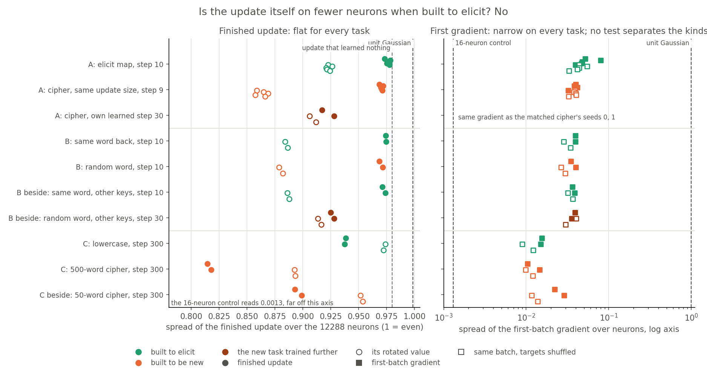
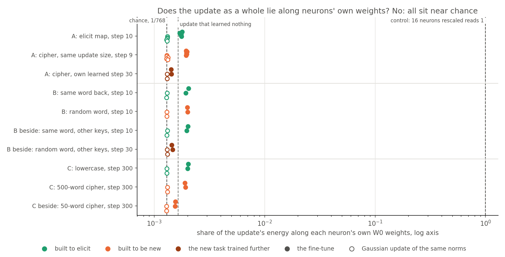
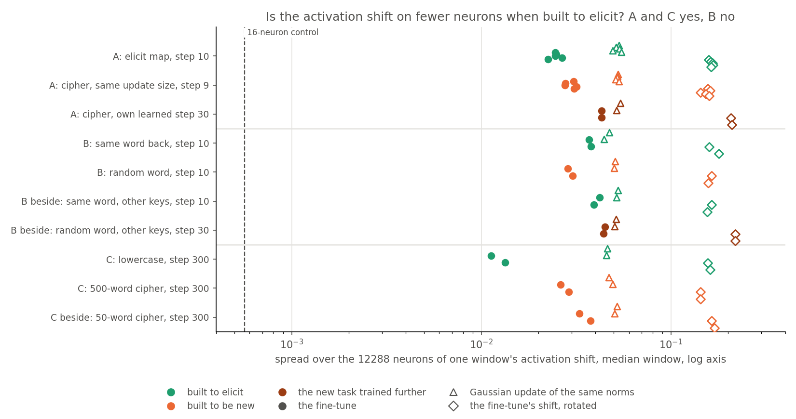
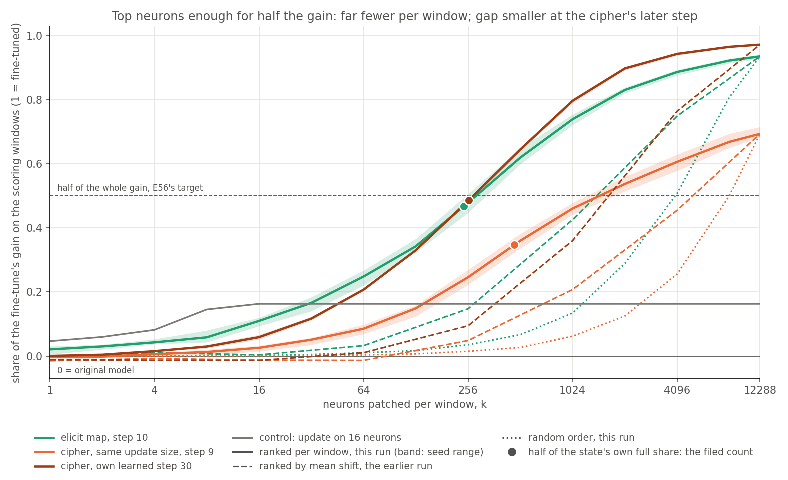
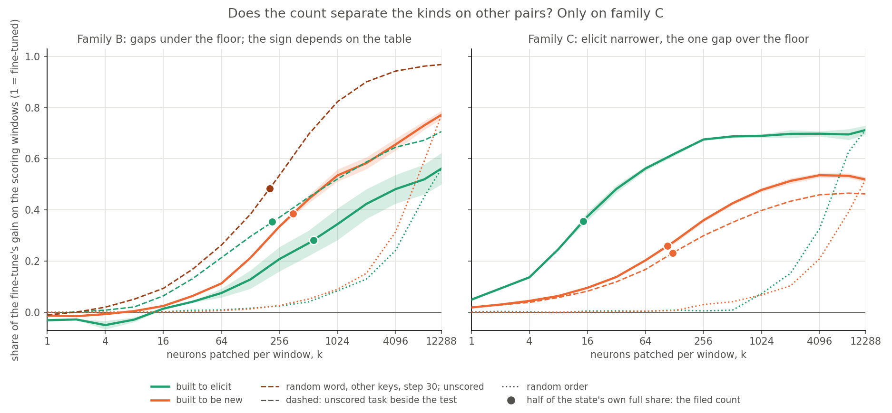

# Analysis: do fine-tunes built to elicit sit on fewer MLP neurons than those built to teach something new? (E63)

*2026-11-02, coding agent, baseline-lead E63 writer. Plan: `reports/plans/2026-11-02_plan_e63-neuron-sparsity.md`, amendments 1-19. Rules: `experiments/neuron_sparsity/results/predictions.json`. Code review: `reports/reviews/2026-11-02_review_e63-code.md`. Explanation: `notebooks/E63_neuron_sparsity.ipynb`. Independent check: `reports/reviews/2026-11-02_review_e63-analysis.md`, whose findings are applied here and none skipped. Provenance near the end.*

We read five neuron measures on saved fine-tunes of three families, comparing those built to elicit with those built to teach something new. None of the five shows elicit on fewer neurons on all the pairs: the activation shift reverses on one family, and the count of top neurons separates on only one. Counting neurons therefore does not follow how the tasks were built, as the decomposition's reading does on the same fine-tunes, though the test has little power, covers few tasks, and neither reading yet has a causal check.

## The answer

No. No reading shows elicit on fewer neurons on all the pairs we tried. The update's spread separates the other way on every test, though it does not beat its reference on two. The update as a whole does not lie along neurons' own weights. The activation shift sits narrower for elicit on two families and wider on the third. The count of top neurons enough for half the gain separates only on family C; on family B its sign depends on the table. On the main pair that count's gap is smaller at the cipher's own learned step, a larger update; elicit was read at one step only.

The filed tree says: "None answers yes: write up; the elicit/new gap under T1 only is reported as a progress effect. The E55 truth-set reading needs the user's say." Every test, reference gap and guard, recomputed from the per-state values, agrees with `score.json`, and the independent check found 0 mismatches, so "none answers yes" stands. The tree's second clause is quoted as filed and needs reading in light of the data. No number has a gap under the matched-size test *alone*: the activation shift passes it and family C, and the count fails it on the floor. And "progress effect" cannot be told apart here from update size or training length, because equal progress also doubles the update and elicit was read at one step. So the clause reads: the count's gap at matched size is smaller at the cipher's later step, cause not established.

**How much this "No" can carry.** Under the filed rule a yes needs four tests, each comparing one task with one task. If a real kind effect were as large as one task's standard deviation, a number would pass the sign and separation parts only about a third of the time, since one reversed pair fails it. So this is a null of the filed rule on these tasks, not a measured absence of a kind effect.

## The question, and what "built to elicit" means

The project asks whether a VPD decomposition can tell a fine-tune that strengthens something the original model does from one that teaches something new. If simply counting MLP neurons did the same, the decomposition would have a cheap rival.

"Eliciting" here means **built to elicit**, not the causal label of `decisions.md` row 112. Row 112 defines elicitation mechanistically: the fine-tuned behaviour runs through a mechanism the original model already has. These pairs have no causal check. Every "elicit" below is a statement about how a task was built.

## What was measured

Nothing was trained. A neuron is one of the 12288 GELU outputs across the four blocks. A neuron's update is its row of the change in `c_fc`, its input weights, plus its column of the change in `down_proj`, its output weights. All values are read on the target model in fp32.

**States.** 26 saved full-weight fine-tunes, plus one update that learned nothing.

| family | built to elicit | built to be new | notes |
|---|---|---|---|
| A, main pair | elicit map, seeds 0-4, step 10 | cipher, seeds 0-4, step 9, same update size, about 3.2 | same keys and windows; the cipher at its own learned step 30, seeds 0-1, is the equal-progress state, with an update of 6.0 |
| B | same word back, seeds 0-1, step 10 | random word, seeds 0-1, step 10 | held-out probability of the target about 0.96 against 0.56, so not equal progress; same-word and random tables on other keys, at steps 10 and 30, reported beside, unscored |
| C | lowercase, seeds 0-1, step 300 | 500-word cipher, seeds 0-1, step 300 | 50-word cipher, seeds 0-1, reported beside, unscored |
| reference | | | an update that learned nothing, on a code task with no answer position; weight readings only |

**The five readings.** Each has a filed reference and a positive control.

| reading, code | definition | sparser is | control and its reading | blind to | bears on |
|---|---|---|---|---|---|
| spread of the update, W1 | participation ratio over neurons of each neuron's squared update, $(\sum e_i)^2 / \sum e_i^2$, as a fraction of 12288 | lower | 16-neuron update: 0.0013, filed 16/12288. Unit Gaussian 0.9987, filed 0.9987. Rotated 16-neuron update 0.218, filed range 0.10 to 0.25 | attention and read-out matrices; Adam's flattening | whether the update itself is on fewer neurons |
| spread of the first gradient, W1g | the same on the first-batch gradient of the task's loss at the original weights | lower | same function as above. Reference: the same batch with targets shuffled | later steps, what Adam then does, progress; on family C it may mostly read ordinary text | whether the task's own direction is on fewer neurons, before Adam |
| rescale share, W2 | share of the update's energy along each neuron's own original row and column, energy-weighted | higher | rescaling 16 neurons: 1.000. Gaussian rows 0.00130, columns 0.00129, against 1/768 = 0.00130 | a neuron rotating towards another neuron; a rescale of a handful of neurons inside a flat update, since no control mixes the two | whether the update as a whole lies along existing neurons' weights |
| spread of the shift, A1 | per window, participation ratio of the squared tuned minus original activation at the answer position; median over the scoring windows, as a fraction | lower | 16-neuron update: 0.00056, filed at most 0.0013 | neurons that move and do nothing | whether activity changes on fewer neurons |
| top neurons enough for half the gain, C1 | per window, rank neurons by that window's own shift; top k get tuned activations at every position of an original-model forward; log2 k where the share first reaches half of the state's own full share, interpolated | lower | 16-neuron update: 1.99, filed at most 4; rise at k = 16 equals rise at k = 12288 exactly. This exercises the code, on a negative gain; it does not show the count can find a sparse real gain | changes to output weights, attention and read-out, all kept at the original values, so the full share runs from 0.46 to 0.97; neurons that move at other positions, since ranks use the answer position only; whether those neurons are needed, since no knock-out was run | how few neurons, top-ranked by shift per window, are enough for half of what patching can recover |

The **gain** is the mean rise in log probability of the target, tuned over original. A **share** reads 0 for the original model and 1 for the fine-tuned model.

**The tests.** Separation is E51's rule: the gap between the kinds' means is strictly over the larger within-kind range, and elicit is on the sparser side. On the count the spread is at least one grid step, 1 in log2 (Amendment 13). In every test, the sparser-signed gap must also beat the same gap on each reference (Amendment 14).

- **Matched size,** T1: family A, five seeds.
- **Equal progress,** T2: elicit seeds 0-1 against the cipher at its own step.
- **Family B,** T3_B, and **family C,** T3_C, each separately.
- **Guard:** on the five elicit states, the mean lies on the sparser side of the reference's mean by more than the number's range. References: rotated value for the update's spread; shuffled-target gradient for the gradient's; per-state Gaussian for the rescale share; both a Gaussian update and the rotated value for the shift; a random order for the count.

A number answers yes only if all four tests and the guard pass.

**How to read a pass (Amendment 15; corrected 2026-11-02).** All four tests compare one task with one task, since Amendment 12 made family B so too. Between seeds a number barely moves, so two different tasks almost always separate and only the direction carries information. A pass reads "these tasks differ, in this direction". `predictions.json` gives a simulated false yes of about 2% per number and 9% over five, but that simulation ran before Amendment 12, when family B pooled two tables a side. Rerun on the rule as amended, with task differences ten times seed noise and no kind effect, it reads 6-9% per number and 25-37% over five, the range being whether equal progress follows matched size or is a third task. These cover the sign and separation parts only: the reference rule and the guard are not modelled, so they bound the rate from above, and "over five" assumes independent numbers, which these are not. A kind effect of one task's standard deviation passes 30-36% of the time, and of two 67-72%. I reproduced the review's figures independently (`experiments/neuron_sparsity/false_yes_sim.py`). This is how to read the filed rule; `predictions.json` and the rule are unchanged.

**Disclosure.** While reviewing the code, the reviewer computed the update's spread and its rotated value on all 26 states before the amendments were filed. So that number's outcome, no yes and elicit denser in every family, was known before they were. The rule changes were chosen on what the rules can do and do not change that outcome. No other number was read.

## What we expected, and why

All leans are medium at most. Each is scored at the end as filed.

- **The update's spread will not answer yes.** Adam's per-element normalisation flattens any update. Seen before the amendments, so not blind.
- **The first gradient's spread: no lean.**
- **The rescale share will not answer yes.** No reason to expect a few Adam steps to align with each neuron's own weights.
- **The shift's spread: no lean.**
- **The count passes at matched size and fails at equal progress,** as E56's coarse count did.

## Controls, run first and alone

Stage 0 passed, first and alone. All 33 files matched their sha256. The identity patch read exactly 0 on all nine tasks, tolerance 1e-6. The mean-ranked path reproduced E56's sixteen-neuron share exactly on `elicit_s0` and `cipher_s0`. The per-window path's full-width share was within 1e-6 of E56's, tolerance 1e-3. All 24 first-batch losses matched the fine-tunes' logged step 1 within 0.01 nats, the stop rule. KL on the other positions read 0 on the check state. No SURPRISE line appears in the log.

The 16-neuron update has a negative gain, -1.53 nats, and a full-width share of 0.163. It is readable under the filed rule, which allows a negative gain with a positive share. Only those 16 neurons shift, so its count follows from correct ranks: it checks the code.

Reported expectations:

| filed expectation | read | |
|---|---|---|
| gains near 6.3, 10.5, 13.7 on elicit, cipher, own-step cipher | 6.32, 10.53, 13.73 | as expected |
| update that learned nothing: spread within 5% of its rotated value | 0.980 against 0.983 | as expected |
| the same update: rescale share within a factor of 2 of its Gaussian | 0.00164 against 0.00131 | as expected |
| random order's count near 12.5 | 11.82 on elicit, 12.37 on the matched cipher; all states 11.64 to 12.42 | a little lower, measured and not gated |
| per-block spread near 0.999 unless flattening is broken | about 0.98 on family A at matched size; down to 0.866 on the broad cipher's last block | lower than expected, reported, not gated |
| run time 8 to 12 minutes | 2 min 12 s | shorter |

## What we observed

### Is the update itself on fewer neurons when built to elicit?

**Reading it.** No. The finished update's spread separates the other way on every test, while the first gradient's separates on none, with elicit the higher mean each time. Finished updates read near 1 on family A, the elicit map 0.976 and the matched cipher 0.970, and lower on family C's ciphers, 0.816 on the 500-word cipher. An update that learned nothing reads 0.980, so being this flat says nothing about the task. Rotating the neuron index narrows the elicit map to 0.923, so on this task the neuron basis is wider than a random basis. A mirrored rule, asking for elicit denser, passes equal progress and family C and loses the other two only to the rotated gap. The spread also falls with training, so this direction need not mean kind. First gradients are about twenty times narrower, 0.053 on elicit and 0.038 on the cipher, a gap under the seed spread. Permuting targets within the batch leaves that much the same on family A, 0.043 on elicit. That permutation keeps the inputs and target tokens and breaks only their pairing, and on the 50-word cipher it halves the reading, 0.0254 to 0.0127. Adam's flattening remains the filed explanation of the difference between the two readings; no SGD fine-tune was run to test it. Why the first gradient is narrow was not tested either: the review's suspicion is the GELU's factor in a gradient row.

Spread of the update, per state, means within a task:

| task | spread | rotated | Gaussian, per state | range over seeds |
|---|---|---|---|---|
| elicit map | 0.9761 | 0.9231 | 0.9914 | 0.0051 |
| cipher, same size | 0.9704 | 0.8632 | 0.9881 | 0.0035 |
| cipher, own step | 0.9225 | 0.9089 | 0.9690 | 0.0106 |
| same word back | 0.9744 | 0.8853 | 0.9951 | 0.0003 |
| random word, step 10 | 0.9699 | 0.8802 | 0.9877 | 0.0031 |
| same word, other keys, beside | 0.9725 | 0.8869 | 0.9936 | 0.0026 |
| random word, other keys, step 30, beside | 0.9263 | 0.9149 | 0.9671 | 0.0031 |
| lowercase | 0.9379 | 0.9732 | 0.9782 | 0.0011 |
| 500-word cipher | 0.8162 | 0.8929 | 0.9069 | 0.0033 |
| 50-word cipher, beside | 0.8958 | 0.9527 | 0.9611 | 0.0061 |
| update that learned nothing | 0.9800 | 0.9830 | 0.9944 | one state |

The block readings: on family C the broad cipher puts 38% of its update's energy in the last block and lowercase 30%, and the last block's own spread reads 0.87 and 0.94. So part of family C's gap is how the update divides among blocks, as the review found. The rotated value keeps two thirds of that gap, 0.080 of 0.122.

Spread of the first gradient, means within a task:

| task | spread | shuffled targets | rotated | Gaussian, per state |
|---|---|---|---|---|
| elicit map | 0.0530 | 0.0433 | 0.520 | 0.674 |
| cipher, same size | 0.0382 | 0.0379 | 0.581 | 0.784 |
| same word back | 0.0395 | 0.0316 | 0.527 | 0.715 |
| random word | 0.0372 | 0.0281 | 0.560 | 0.752 |
| lowercase | 0.0152 | 0.0106 | 0.514 | 0.679 |
| 500-word cipher | 0.0124 | 0.0109 | 0.389 | 0.649 |
| 50-word cipher, beside | 0.0254 | 0.0127 | 0.563 | 0.733 |

The elicit map's seed range, 0.040, is large because seed 1 reads 0.0795. The equal-progress test on this number reads the same gradients as matched size at seeds 0-1, since a gradient at the original weights has made no progress (`tests.T2_W1g_note`); it adds nothing. The review's suggested follow-up for family C, reading the task's text minus the cased rows, was not run: the number already fails matched size and the guard, so it could not answer yes.

### Does the update as a whole lie along the neurons' own weights?

**Reading it.** No: the update as a whole does not, on any task, though a rescale of a handful of neurons would not show. All the fine-tunes read 0.0014 to 0.0020, next to the Gaussian's 0.0013. The control reads 1 because all its energy sits on the 16 rescaled neurons; no control mixes a few of them into a flat update. On a flat update, $m$ fully rescaled neurons add about $m / (12288 \times \text{spread})$ to the share. The excess over the Gaussian then equals about 5 neurons on elicit, 8 on lowercase and 6 to 8 on the two ciphers, comparable to the 15 top neurons that are enough for half on lowercase. The update that learned nothing has an excess worth 4, so the excess is no evidence of rescaling either. Elicit beats its reference at equal progress and on family C, by 0.0003 and 0.0001. On family A at matched size the cipher reads higher, 0.0020 against 0.0017. The more trained update reads lower on both tables that were read at two steps: the cipher 0.0020 and 0.0014, the random word 0.0020 and 0.0015. The equal-progress pass therefore compares a step-10 update with a step-30 one. The second pair is on other keys, so this is not one trajectory.

| task | rescale share | rows | columns | Gaussian |
|---|---|---|---|---|
| elicit map | 0.00175 | 0.00194 | 0.00154 | 0.00131 |
| cipher, same size | 0.00196 | 0.00247 | 0.00147 | 0.00131 |
| cipher, own step | 0.00143 | 0.00155 | 0.00128 | 0.00131 |
| same word back | 0.00199 | 0.00247 | 0.00150 | 0.00130 |
| random word, step 10 | 0.00199 | 0.00245 | 0.00156 | 0.00130 |
| same word, other keys, beside | 0.00200 | 0.00243 | 0.00155 | 0.00131 |
| random word, other keys, step 30, beside | 0.00145 | 0.00160 | 0.00129 | 0.00131 |
| lowercase | 0.00202 | 0.00239 | 0.00155 | 0.00130 |
| 500-word cipher | 0.00191 | 0.00230 | 0.00146 | 0.00131 |
| 50-word cipher, beside | 0.00155 | 0.00180 | 0.00125 | 0.00129 |
| update that learned nothing | 0.00164 | 0.00182 | 0.00140 | 0.00131 |

### Does the activation shift sit on fewer neurons when built to elicit?

**Reading it.** On families A and C yes; on family B the reverse, and that reversal is what holds this number's yes back. The elicit map shifts about 300 effective neurons per window and the matched cipher about 370, a gap just over the seed spread. Lowercase shifts about 150 and the broad cipher about 340. On family B the same-word table shifts about 460 and the random table about 360. The gap is wider at the cipher's later step, about 530 neurons, an update twice the size; elicit was not read there, and a rise on elicit too would shrink it. The shift's spread rises with training on both tables read at two steps, 0.030 to 0.043 and 0.029 to 0.045. A Gaussian update of the same norms already shifts only about 650 neurons, so a low level alone says little about the fine-tune. The review's toy model puts that on the GELU; on the real model that cause was not tested. The trained cipher, at 0.043, sits near its Gaussian at 0.053.

| task | spread | Gaussian update | rotated | effective neurons |
|---|---|---|---|---|
| elicit map | 0.0246 | 0.0525 | 0.163 | 303 |
| cipher, same size | 0.0298 | 0.0522 | 0.155 | 366 |
| cipher, own step | 0.0430 | 0.0530 | 0.208 | 528 |
| same word back | 0.0375 | 0.0458 | 0.169 | 460 |
| random word, step 10 | 0.0294 | 0.0505 | 0.160 | 361 |
| same word, other keys, beside | 0.0406 | 0.0521 | 0.159 | 498 |
| random word, other keys, step 30, beside | 0.0445 | 0.0509 | 0.219 | 547 |
| lowercase | 0.0123 | 0.0459 | 0.159 | 151 |
| 500-word cipher | 0.0276 | 0.0482 | 0.143 | 339 |
| 50-word cipher, beside | 0.0353 | 0.0512 | 0.166 | 434 |
| control, 16 neurons | 0.00056 | 0.0243 | 0.084 | 7 |

The two ciphers of family C, both new, differ by 0.0077, half the kind gap of 0.0152.

**The rotated value reads block shares only.** Under a random rotation within a block, a vector's squared entries have a sum of squares near $3E^2/3072$ whatever its sparsity, with $E$ its energy. So this number's rotated value is about $1/(12 \sum s_b^2)$, where $s_b$ is each block's share of the shift's energy. It runs from 0.083, all in one block, to 0.333, four equal blocks. The control reads 0.0842, and a Monte Carlo I ran gives 0.078 to 0.083 for a sparse, a one-neuron and a dense vector in one block. It cannot see neurons at all. Per-block shares were not saved, so on real states this is derived, not read.

So the equal-progress failure, 0.048 on the rotated value against the number's 0.018, is a block effect: the shift spreads over more blocks at step 30, about 1.9 effective blocks to about 2.5. The verdict stands as filed. But Amendment 14's "a gap that survives rotation is not neuron information" does not hold for this number. The rule is not refiled.

Taking blocks out, unfiled and a reading of saved numbers only: the spread over its rotated value, per state, under the filed separation rule.

| comparison | elicit | new | separates | elicit narrower |
|---|---|---|---|---|
| matched size | 0.151 | 0.193 | yes | yes |
| equal progress | 0.154 | 0.207 | yes | yes |
| family B | 0.223 | 0.184 | yes | no |
| same word, other keys, against random word, step 10 | 0.255 | 0.184 | yes | no |
| same word against random word at step 30 | 0.223 | 0.204 | no | no |
| same word, other keys, against random word at step 30 | 0.255 | 0.204 | yes | no |
| family C | 0.078 | 0.193 | yes | yes |
| lowercase against 50-word cipher | 0.078 | 0.212 | yes | yes |

So this number's no rests on family B. That test compares unequal progress, a held-out probability of 0.96 against 0.56. At the random word's step 30, about equal progress and on other keys, the raw number turns elicit-narrower, by 0.0070 and 0.0039, but only through blocks: within blocks elicit stays wider. The family B reversal therefore holds under this escape.

### How many top neurons are enough for half the gain on the main pair?

**Reading it.** Fewer neurons than E56 found, for both kinds, and the gap between kinds misses the filed floor. The top neurons by shift are enough for half of each state's own full share at about 240 on the elicit map and about 470 on the matched cipher. That shows sufficiency under one ranking, an upper bound on a smallest sufficient set, not that those neurons are needed. The gap is 0.965 in log2, under the floor of 1, so by the rule it is noise, even though no seed overlaps: elicit runs 7.73 to 8.11 and the cipher 8.78 to 9.09. It is 0.17 at the cipher's own step, about 260 neurons, on two seeds. That step has an update of 6.0 against 3.1 on elicit, so it cannot be told apart from update size or training length. The control reaches its half at about 4, and a random order needs about 3600 on elicit. About half of the matched-size gap, 0.55, is also there on the random order, cause not established. The full shares do not explain it: on a common bar of half the whole gain, the random order's gap grows to 1.04.

**Comparison with E56.** E56 ranked neurons by their mean shift over all windows, and asked for half of the whole gain on a coarse grid. Its gap was 4096 against 12288, 1.58 in log2, and the own-step cipher read 4096. Three things differ here: ranks per window, half of each state's own full share, and interpolation. The curves show what the first and second do.

| k | elicit, per window | elicit, E56 | cipher same size, per window | cipher same size, E56 | cipher own step, per window | cipher own step, E56 |
|---|---|---|---|---|---|---|
| 16 | 0.110 | 0.004 | 0.026 | -0.013 | 0.059 | -0.014 |
| 64 | 0.248 | 0.032 | 0.085 | -0.014 | 0.207 | 0.010 |
| 256 | 0.479 | 0.148 | 0.246 | 0.048 | 0.484 | 0.095 |
| 1024 | 0.740 | 0.426 | 0.461 | 0.208 | 0.797 | 0.360 |
| 4096 | 0.887 | 0.750 | 0.607 | 0.455 | 0.944 | 0.765 |
| 12288 | 0.936 | 0.936 | 0.694 | 0.694 | 0.973 | 0.973 |

- **Ranking per window lowers the count on both kinds.** At 256 neurons the elicit map reaches 0.48 of its gain, against 0.15 ranked by mean shift. E56's "the top sixteen carry about nothing" no longer holds per window on elicit, 0.11, while the cipher reads 0.03. Different keys using different neurons, the thing the plan said E56 could not see, is one reading. An untested rival is that per-window ranks can follow any input-dependent shift, key or not. The distinct neurons over all windows were not counted.
- **The target matters as much as the ranking.** The cipher's full share is 0.69 and elicit's 0.94, so half of its own share is a lower bar for the cipher. On E56's target of half the whole gain, read off these curves and **not filed**, elicit reads 8.15 in log2, about 280 neurons, and the matched cipher 10.51, about 1450. That gap is 2.36. The same reading gives 8.07 on elicit seeds 0-1 and 8.10 on the own-step cipher, a gap of 0.03.
- **The pattern matches E56's.** At matched size elicit's count is lower, and at the cipher's later step they agree. The closing is clear only on E56's target; on the filed one it starts from a gap the rule calls noise.

**Progress.** The tree's label is a progress effect; the data do not establish one. Three things moved together between the two comparisons: how much of the table the cipher had learned, its update size, and its training length. The count fell by 0.87 from the cipher's step 9 to its step 30. The random word on other keys at step 30 reads 0.81 below the random word at step 10, which is a different table, so not one trajectory. No elicit state past step 10 is saved. E56's independent check also applies: at matched size, progress is itself a consequence of kind.

### Does the same count hold on the other pairs?

**Reading it.** The count separates only on family C. On family B both gaps are under the floor, and their sign depends on which same-word table is read, as the table below shows. So there is no reversal by this rule. On family C lowercase's top 15 or so are enough for half and the broad cipher's about 110, a gap of 2.90. The 50-word cipher reads about 120, 0.17 from the broad cipher. That pass reads "these tasks differ, in this direction". Lowercase also gains about half of what the broad cipher does, 1.57 nats against 3.27, and whether that matters was not tested. Counts across families are not like for like: a neuron here is one index across 41 positions on families A and B and 127 on family C, ranked at one position, and the full share runs from 0.46 to 0.97. So 15 against 240 is no comparison.

| family B pair | gap in log2, elicit sparser positive |
|---|---|
| same word against random word, scored | -0.70 |
| same word on other keys against random word, both step 10, unscored | +0.73 |
| the two same-word tables against each other | 1.44 apart |

| task | count, log2 | about k | random order | full share | gain, nats |
|---|---|---|---|---|---|
| elicit map | 7.92 | 242 | 11.82 | 0.936 | 6.32 |
| cipher, same size | 8.88 | 473 | 12.37 | 0.694 | 10.53 |
| cipher, own step | 8.01 | 258 | 12.16 | 0.973 | 13.73 |
| same word back | 9.18 | 581 | 12.19 | 0.562 | 10.11 |
| random word, step 10 | 8.48 | 356 | 12.26 | 0.772 | 11.68 |
| same word, other keys, beside | 7.74 | 214 | 12.22 | 0.706 | 10.17 |
| random word, other keys, step 30, beside | 7.67 | 203 | 12.06 | 0.968 | 13.97 |
| lowercase | 3.86 | 15 | 11.97 | 0.712 | 1.57 |
| 500-word cipher | 6.76 | 109 | 12.27 | 0.519 | 3.27 |
| 50-word cipher, beside | 6.93 | 122 | 12.32 | 0.463 | 3.75 |
| control, 16 neurons | 1.99 | 4 | 13.03 | 0.163 | -1.53 |

## What we learned

Neurons do not map eliciting more cleanly, at this size and on these pairs, with "eliciting" meaning built to elicit. Weight updates are no use for this: they are flat and, as a whole, do not lie along existing neurons' weights. Activation shifts differ between tasks by more than seeds, but the direction differs between families, and each family is one contrast. The count of top neurons is much lower per window than E56's mean ranks gave, for both kinds, and separates the kinds only on family C. A real kind effect could still be there: the rule has about a third's power at one task's standard deviation.

**The decomposition's share on the same states.** This is a reading of saved numbers, not a filed test. $r$, the share of the gain carried by changed CI values, is in E60's `experiments/regating_truth_table/results/table.json` on all three families, and I checked the values there and in E56's `job1.json` and `job2.json`.

| test | built to elicit | built to be new |
|---|---|---|
| family A, matched size, five seeds | 0.764 | 0.246 |
| family A, equal progress, seeds 0-1 | 0.765 | 0.254 |
| family B | 0.782 | 0.270 |
| family B, other keys, beside, random word at step 30 | 0.798 | 0.285 |
| family C | 0.761 | 0.157 |
| 50-word cipher, beside | | 0.120 |

$r$ keeps its direction and clears the seed ranges on every line, on the same fine-tunes where the neuron numbers do not. So the plan's "cheap rival to r" is answered on three families: none of these numbers follows the build as $r$ does. Two limits sit beside that. $r$ has no filed reference under this rule, and it has no causal check, so it stays a candidate instrument under row 112. This says $r$ follows the build and the neuron numbers do not, not that $r$ is right. It also compares one task with one task, as above. And it opens family B: $r$ reads the same-word table as it reads the elicit map, so the shift's reversal may be about the neuron number and not about that table's label.

## How compelling is the evidence

- **Controls:** all held, above. They exercise the code; the 16-neuron update does not show the count can find a sparse real gain. Recomputed rules agree with `score.json` on every pass, gap, reference gap and guard, and the independent check agrees.
- **Blind to:** each number's line is in the table under "What was measured".
- **Noise floor:** seed ranges within a task, listed in the score table; on the count, one grid step by rule. Family A has five seeds, the others two. The random order is one seeded order per state: its seed range reaches 0.66 on lowercase, more than its family C gap of 0.30, and 0.25 on elicit seeds 0-1 against its equal-progress gap of 0.27. No verdict turns on this.
- **Tasks covered:** three families, 26 states on the 67M model, Adam fine-tunes only. Not every task of either kind, and no causal labels.
- **Design limit:** one task against one task on all four tests (Amendment 12 made family B so). False yes about 6-9% per number and 25-37% over five, before references; a kind effect of one task's standard deviation passes about a third of the time. The unscored tasks show how far tasks of one build sit apart: on the count, 1.44 between two same-word tables and 0.17 between two ciphers.
- **One number seen early:** the update's spread, as disclosed.

## Surprises

No filed prediction reversed. One missed narrowly: the count was filed to pass at matched size, and its gap of 0.965 fell 0.035 under the floor of 1, with its direction as filed. It is no near-yes: equal progress and family B also fail.

Three things no prediction covered:

- The activation shift reverses on family B, solidly. The cause is not established.
- Between the cipher's step 9 and step 30 the activation shift spreads while the count falls: 0.030 to 0.043, and 8.88 to 8.01. Training, update size and progress moved together, and why was not tested.
- On family A the first gradient is about as narrow with targets permuted within the batch. No value had been filed for this.

## What next

- **The truth-set reading needs the user's say,** as the tree states. If the activation shift and the count follow a causal label there, neurons return as a rival to $r$.
- **Re-read these numbers on any pair that gets a causal check.** It costs nothing on saved states. If the same-word tables prove not to be eliciting, the shift is the one reading left with a claim, and $r$'s agreement with the build on family B would need its own explanation.
- **More pairs, and elicit at a later step.** Several elicit and new tasks per family, read per task, would turn this no into a measured limit. Elicit past step 10 needs a short new fine-tune, since no such state is saved; it would say whether the shift rises and the count falls on elicit too.

## Scorecard

Codes: W1 update spread, W1g first-gradient spread, W2 rescale share, A1 shift spread, C1 top neurons enough for half the gain. T1 matched size, T2 equal progress, T3_B family B, T3_C family C. "Gap" is signed so that elicit sparser is positive. "Over" is the spread it must strictly exceed. "Reference gap" is the same signed gap on each reference, which must be beaten.

| number | test | elicit | new | gap | over | reference gap | separates | elicit sparser | beats reference | verdict |
|---|---|---|---|---|---|---|---|---|---|---|
| W1 | T1 | 0.9761 | 0.9704 | -0.0056 | 0.0051 | rot -0.0598 | yes | no | yes | fail |
| W1 | T2 | 0.9757 | 0.9225 | -0.0533 | 0.0106 | rot -0.0154 | yes | no | no | fail |
| W1 | T3_B | 0.9744 | 0.9699 | -0.0045 | 0.0031 | rot -0.0051 | yes | no | yes | fail |
| W1 | T3_C | 0.9379 | 0.8162 | -0.1216 | 0.0033 | rot -0.0803 | yes | no | no | fail |
| W1g | T1 | 0.0530 | 0.0382 | -0.0148 | 0.0399 | shuf -0.0054 | no | no | no | fail |
| W1g | T2 | 0.0657 | 0.0389 | -0.0267 | 0.0277 | shuf -0.0107 | no | no | no | fail |
| W1g | T3_B | 0.0395 | 0.0372 | -0.0023 | 0.0053 | shuf -0.0035 | no | no | yes | fail |
| W1g | T3_C | 0.0152 | 0.0124 | -0.0028 | 0.0041 | shuf +0.0004 | no | no | no | fail |
| W2 | T1 | 0.00175 | 0.00196 | -0.00021 | 0.00008 | Gauss -0.0000006 | yes | no | no | fail |
| W2 | T2 | 0.00174 | 0.00143 | +0.00032 | 0.00008 | Gauss +0.00001 | yes | yes | yes | **pass** |
| W2 | T3_B | 0.00199 | 0.00199 | -0.00001 | 0.00012 | Gauss +0.0000015 | no | no | no | fail |
| W2 | T3_C | 0.00202 | 0.00191 | +0.00011 | 0.00002 | Gauss -0.00001 | yes | yes | yes | **pass** |
| A1 | T1 | 0.0246 | 0.0298 | +0.0051 | 0.0042 | Gauss -0.0003, rot -0.0087 | yes | yes | yes | **pass** |
| A1 | T2 | 0.0247 | 0.0430 | +0.0183 | 0.0002 | Gauss +0.0007, rot +0.0480 | yes | yes | no | fail |
| A1 | T3_B | 0.0375 | 0.0294 | -0.0081 | 0.0017 | Gauss +0.0048, rot -0.0085 | yes | no | no | fail |
| A1 | T3_C | 0.0123 | 0.0276 | +0.0152 | 0.0029 | Gauss +0.0024, rot -0.0155 | yes | yes | yes | **pass** |
| C1 | T1 | 7.92 | 8.88 | +0.965 | 1 | rnd +0.549 | no | yes | yes | fail |
| C1 | T2 | 7.84 | 8.01 | +0.166 | 1 | rnd +0.268 | no | yes | no | fail |
| C1 | T3_B | 9.18 | 8.48 | -0.704 | 1 | rnd +0.069 | no | no | no | fail |
| C1 | T3_C | 3.86 | 6.76 | +2.902 | 1 | rnd +0.301 | yes | yes | yes | **pass** |

| number | guard reference | elicit mean | reference mean | gap on the sparser side | range | verdict |
|---|---|---|---|---|---|---|
| W1 | rotated | 0.9761 | 0.9231 | -0.0530 | 0.0051 | fail, wrong side |
| W1g | shuffled targets | 0.0530 | 0.0433 | -0.0097 | 0.0399 | fail, wrong side |
| W2 | Gaussian | 0.00175 | 0.00131 | +0.00044 | 0.00008 | **pass** |
| A1 | Gaussian update | 0.0246 | 0.0525 | +0.0278 | 0.0042 | **pass** |
| A1 | rotated | 0.0246 | 0.1632 | +0.1386 | 0.0042 | **pass** |
| C1 | random order | 7.92 | 11.82 | +3.90 | 0.38 | **pass** |

**Passed by number.** W1 none. W1g none. W2: T2, T3_C, guard. A1: T1, T3_C, both guards. C1: T3_C, guard. None answers yes; `score.json` agrees.

| lean | filed | right if | read | verdict |
|---|---|---|---|---|
| P1 | W1 does not answer yes, Adam flattens it | W1 answers yes is false | false, fails all four tests and the guard | **right**, but seen before the amendments, not blind. That Adam is the reason was not tested |
| P2 | W1g unknown | no lean to score | fails all, elicit never the sparser side | reported |
| P3 | W2 does not answer yes | W2 answers yes is false | false; passes T2, T3_C and the guard, with gaps of at most 0.0003 on a scale where the control reads 1 | **right** |
| P4 | A1 unknown | no lean to score | passes T1, T3_C and both guards; T2 fails on the rotated gap, T3_B reverses | reported |
| P5 | C1 passes T1 and fails T2, as E56's coarse count did | C1 T1 passes and T2 fails | T1 fails: 0.965 under the floor of 1, Amendment 13. T2 fails: 0.166 | **missed**, narrowly, as a threshold statement; not a near-yes, since T2 and T3_B also fail. The T2 half and the direction held. The cause is arithmetic: the gap on the filed target is under the filed floor; the target's lower bar for the cipher contributes (on E56's target, unfiled, the gap is 2.36) |

## Departures from the literature

- **Neuron patching departs from causal tracing,** Meng et al. 2022. Causal tracing restores clean activations into a corrupted run of one model. We give the fine-tuned model's MLP activations to the original model on the same input, at every position. Neurons are ranked here per window by size of shift, without target information, and the reading is a share of the fine-tune's gain. Unit, ranking and the halves are this project's, from E52 and E56; the per-window ranking is new here.
- **The participation ratio** is the standard form, applied to neuron energies and shifts as a fraction of the neuron count. No paper's procedure was followed.
- **Rotated, shuffled-target, Gaussian-update and random-order references** are this project's. Rotation is not a symmetry of the model because of the GELU, so a rotated value is a comparison and not a null (Amendment 19).
- **E51's separation rule** is this project's, with two additions here: the one-sided gap must beat its reference's, and the count's spread has a floor of 1.
- **Thresholds have no external source:** the floor of 0.05 nats, the floor of 1, and the stage-0 tolerances.
- **The label "built to elicit"** departs from Jain et al. 2024, Def 1, which defines possession by a linear readout. It also departs from this project's mechanistic definition, row 112. No readout or causal check is used.

## Provenance

- Job 48527, MATS `debug` QoS, L40, 2 min 12 s, peak GPU memory 7.5 GB, $0. Log `cluster/logs/commute-neuron-sparsity-48527.out`.
- Results `experiments/neuron_sparsity/results/{predictions,stage0,weights,gradients,windows,score}.json`, committed in 1132c03. The JSONs record `git_head` de14090; the run's code files, predictions and sbatch are unchanged between it and 5727b38 (`git diff --stat` empty). `git_dirty` lists only `experiments/qwen_sft/results/run.log`.
- Code `experiments/neuron_sparsity/run.py`, `src/commute/neuron_sparsity.py`. Figures `experiments/neuron_sparsity/plot.py` into `experiments/neuron_sparsity/figures/`.
- E56 comparison curves `experiments/keydependent_patch/results/{job1,job2}.json`.
- False-yes simulation, committed: `experiments/neuron_sparsity/false_yes_sim.py`.
- Recomputations of the score, scratch and not committed: `~/commute-data/scratch/baseline-lead/e63-analysis/recheck.py`, `recheck2.py`; the check's `~/commute-data/scratch/baseline-lead/e63-check/recompute.py`.

## Not run

- SGD fine-tunes of the pairs; the first gradient stands in.
- Attention-head sparsity.
- Any new fine-tune; Qwen.
- The causal label of `decisions.md` row 112, which E64 and E55 pursue.
- The truth-set reading of E55, which needs the user's say.
- The tree's follow-up on the equal-prior and shuffled maps, E58 A6-A7, which only a yes opens.
- The first-gradient reading on family C of the task's text minus the cased rows, the review's finding 7.
- The elicit map past step 10: no such state is saved, so it needs a new fine-tune.
- Per-block shift shares; the rotated value's block reading is derived.
- The per-neuron rescale share on the top-shift neurons, a $0 check on saved states.
- A knock-out of the top-k neurons, which would test need and not sufficiency.
- More than one random order per state.
- The count of distinct neurons over all windows.
- $r$ in this run or under the filed rule: it has no filed reference, and its values above are saved numbers from E56 and E60.
- A1, C1 and W1g on the update that learned nothing: filed as cut, since its task has no answer position.
