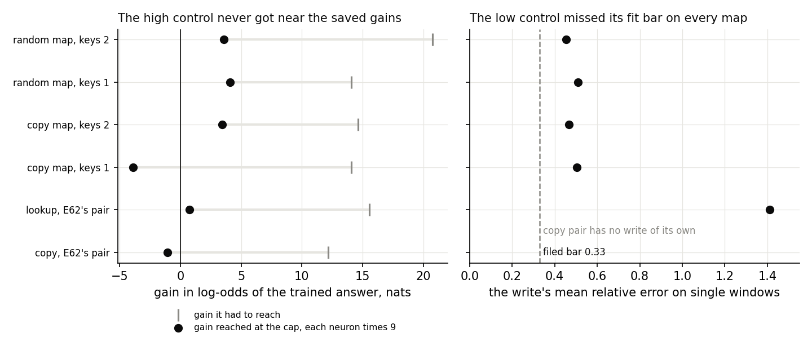
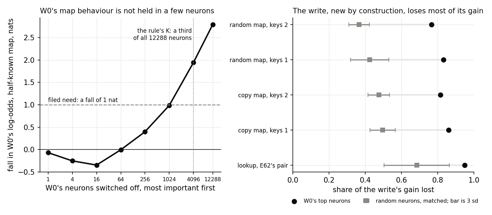
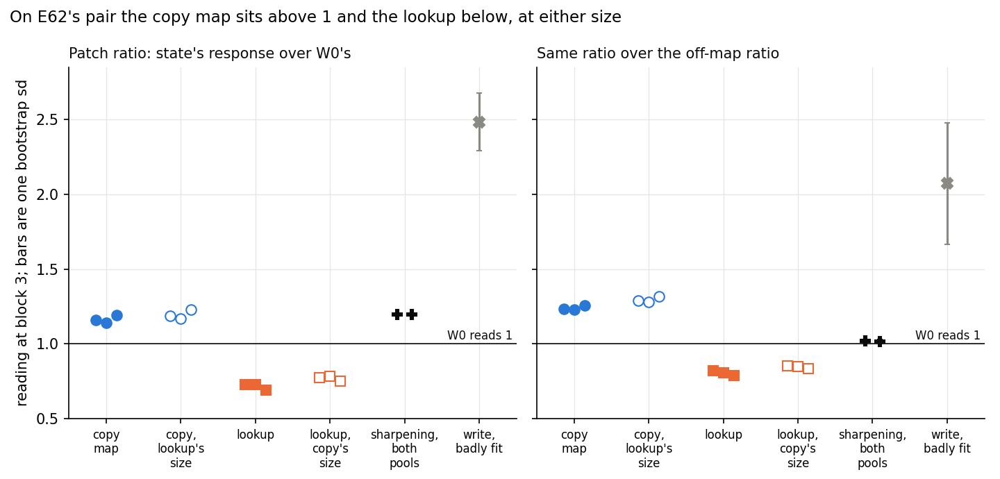
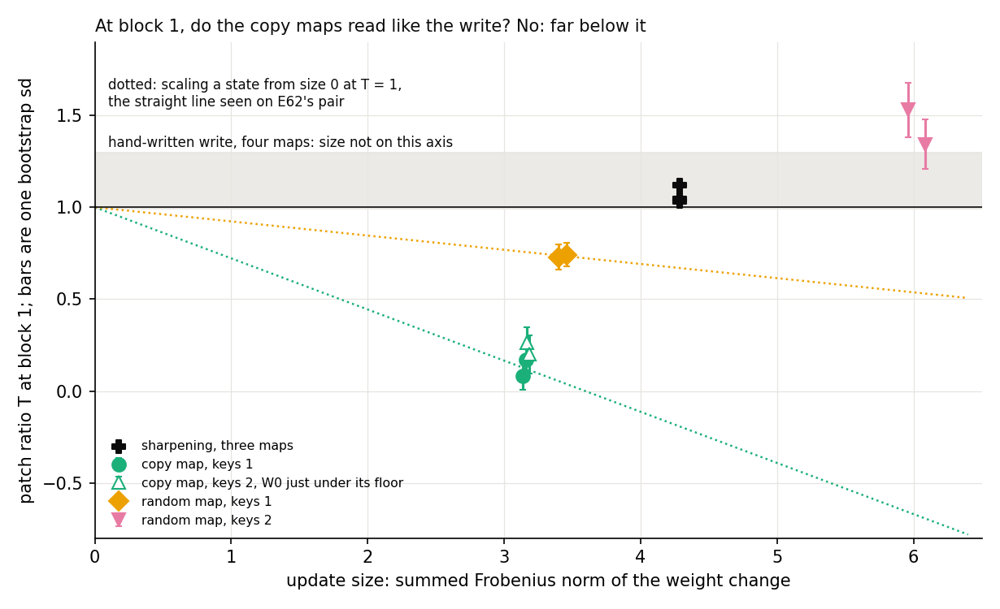
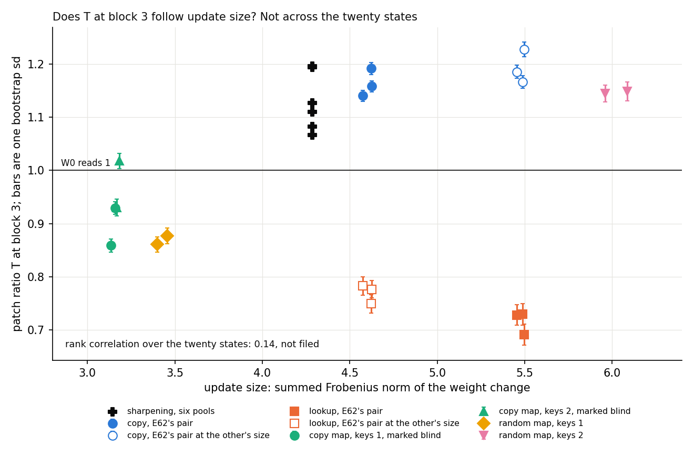

# Analysis: can the 67M's fine-tunes get a causal label that owes nothing to VPD? (E66)

*Coding agent, 2026-11-02. Plan: `reports/plans/2026-11-02_plan_e66-interchange-67m.md`, Amendments 1 and 2. Advice: `reports/plans/2026-11-02_advice_e66-review-FABLE.md`, `reports/plans/2026-11-02_advice_e66-stop-FABLE.md`. Notebook: `notebooks/E66_interchange_67m.ipynb`. Figures: `experiments/interchange_67m/figures/`. Analysis numbers: `experiments/interchange_67m/results/analysis_numbers.json`.*

We tried to build a causal label for the 67M's fine-tunes, then read a context patch on fourteen saved fine-tunes after the controls failed. No label moved: the controls were unusable, the neuron reading is dead here, and the patch runs with the earlier head test on one pair and against the assumed labels elsewhere. For `GOALS.md` the question of new capability against strengthening stays open on the 67M, and the method table's rows stay "only by assumption".

## The answer

**Not yet.** The probe could not give any fine-tune a label: neither hand-built control was usable, and switching off neurons cannot tell old from new on this model. Reading the context patch on the saved fine-tunes anyway moved no label. On E62's pair the patch runs the way E62's head test does, but on the other key maps it runs against the assumption that copying is reuse. No row moves, and nothing here was filed as a test.

**Granularity limit (user, 2026-10-29).** A new circuit built from old parts reads "elicited" to VPD. It can read as reuse here too if it multiplies on W0's state. "Reuse" on this patch could only mean old parts at the level of a block input, never one circuit shown unchanged.

## What we were trying to test

On the 67M every row of the method table takes its truth from how the task was built: a copy map is assumed to be reuse and a random map is assumed to be new. E66 looks for a label that owes nothing to VPD or to the construction, so that the rows could be scored against something causal.

**The patch.** Take two contexts with the same key and target, $x_{hi}$ and $x_{lo}$. The donor is always W0.

- $R(m)$ is the target's log-odds in model $m$ on $x_{lo}$ with W0's block-$l$ input at the answer position taken from $x_{hi}$, minus the same taken from $x_{lo}$.
- $T = \bar R(\text{state}) / \bar R(W_0)$, a ratio of means over the pairs. W0 reads 1 by definition. A state that passes W0's difference through reads about 1, one that strengthens it reads above 1, and one that damps it reads below 1.
- $T_{off}$ is the same for a token the map does not train, with the map's own target out of the odds. $Q = T / T_{off}$ removes what a global sharpening does to both.
- $s$ is the pair bootstrap sd of the ratio of means, 2000 resamples. A reading is void when $\bar R(W_0)$ is under 0.5 nats or under 3 sds of itself.
- The model has four blocks, so the site is block 1, 2 or 3, and block 3 is the last. $l^*$ is the earliest block where W0's response clears the floor, fixed from W0 alone.

**The mark.** "Blind" at block $l$ means steering, a mean shift added to W0, reaches a share of 0.5 of the gain at or before $l$. The patch overwrites what those blocks wrote at the answer position. "Readable" otherwise. A mark describes what the patch can see and is not a verdict.

**Pairs differ by map, which matters below.** On E62's copying map, $x_{hi}$ is the cue window and $x_{lo}$ is that window with B overwritten by another pool token. The pairs are not ranked on any metric. On the lookup and the four key maps, each key's 64 windows are ranked on W0's log-odds of the target, top quarter paired with bottom quarter.

**The neuron reading.** $U = 1 - G_{abl}/G$, the share of a state's gain $G$ lost when W0's top $K$ neurons are mean-ablated in both models, against five draws of matched random neurons. $K$ is the fewest neurons whose removal lowers W0's half-known log-odds by 1 nat.

**Controls**, each ruling out one reading of a number:

- **The write** is a per-key table written by hand into block 3's MLP output. New by construction, so $T$ about 1 and $U$ on the null.
- **Amplify** multiplies W0's most helpful neurons' output. Reuse by algebra, so $T$ above the write's. It is the only control that could show $T$ can read high.
- **Sharpening** is a 30-step fine-tune to W0's distribution at temperature 0.5. $T$ above 1, $Q$ near 1.

**States.** Fourteen saved fine-tunes, no new training. E62's copying map and lookup, three seeds each. E46's two copy maps, whose value is the key itself, and two random maps, on two key sets, two seeds each. Six scaled versions of E62's states, each moved to the other map's size at its seed. The names are `ident32`, `ident32b` for the copy maps and `rand32`, `rand32b` for the random maps; the two sets begin at key rank 100 and 132.

## What we expected, and why

Filed rules cover W0 and the controls only (`results/predictions.json`, `results/predictions_amend2.json`). No state has a filed expected value, on purpose. Stage 1 stopped job 48971. The user then chose to read the patch on the saved states as exploratory, with the neuron reading off.

Fable's stop advice names two outcomes, quoted in Amendment 2: "if the copy-map states read T near 1 at block 1 like the write, T has shown no fine-tune it can see and the key-swap or E65 is next; if they read above the write and the random maps do not, file rules with a small amplify as the high control." Behind both sits the plain expectation that a copy map, assumed to be reuse, reads at least as high as a random map, assumed to be new. The plan's earlier prediction that $T$ reads high on E62's copying map and low on its lookup was cut before running, in Amendment 1.

## What we observed

### W0: is there a response to read?

Yes on every map. Stage 0 passed: the transplant check reads exactly 0 and the second job reproduced the first's responses exactly. W0's response grows block by block. Block-1 readings on `ident32b` are read with a floor of 0.49, a reporting exception filed in Amendment 2, since W0 reads 0.497 there.

| map | $\bar R(W_0)$ block 1 | block 2 | block 3 | $l^*$ | pairs |
|---|---|---|---|---|---|
| E62 copying map | 0.054 | 0.088 | 1.660 | 3 | 512 |
| E62 lookup | 0.114 | 0.954 | 2.294 | 2 | 501 |
| `ident32` | 0.630 | 2.271 | 3.335 | 1 | 512 |
| `ident32b` | 0.497 | 2.097 | 3.235 | 2 | 512 |
| `rand32` | 0.669 | 2.032 | 3.513 | 1 | 512 |
| `rand32b` | 0.572 | 1.855 | 3.386 | 1 | 512 |

### Could the probe's controls be used?

**Reading it.** No, and the job stopped there, as filed. Multiplying up to 4,096 neurons by nine reached at most 4.1 nats, where the saved fine-tunes gain 12 to 21. Switching off all of W0's neurons moves its half-known map by only 2.8 nats, so W0's own neurons cannot supply such a gain. Amplify therefore gave no usable reading, and nothing of known kind has ever read high on $T$. The write missed its fit bar on every map, so it is a reference here and not a passed control. On the lookup's pool it fit worst and read 2.48 at block 3, so E62's pair has no trustworthy low reference. Sharpening behaved, clearing 1 by three noise units on three of six maps.

| map | amplify gain, needed | write error, bar 0.33 | write cond, bar 16.5 | write $T$ at $l^*$ | sharpening $T$, $Q$ at $l^*$ |
|---|---|---|---|---|---|
| copying map | -1.05, 12.2 | none of its own | none | 2.48 (the lookup's) | 1.19, 1.02 |
| lookup | 0.74, 15.6 | 1.41 | 30.6 | 2.68 | 1.32, 1.10 |
| `ident32` | -3.92, 14.1 | 0.50 | 10.1 | 0.99 | 1.05, 1.12 |
| `ident32b` | 3.42, 14.6 | 0.47 | 9.2 | 1.25 | 1.10, 1.03 |
| `rand32` | 4.10, 14.1 | 0.51 | 10.1 | 1.09 | 1.03, 1.02 |
| `rand32b` | 3.60, 20.8 | 0.45 | 9.2 | 1.06 | 1.12, 1.02 |

### Can switching off neurons separate old from new?

**Reading it.** No, this reading is dead on this model. The rule found $K$ = 4,096, a third of the network, and 1,024 missed by only 0.014. At 64 neurons or fewer, removal raises W0's log-odds, because the ranking keeps neurons pushing against the target. The write is new by construction, yet it loses 0.77 to 0.95 of its gain, where matched random neurons cost it 0.37 to 0.68. A write is a linear readout of old activations, so any update built that way loses gain when they go, whatever its kind. No state was read on $U$.

| map | $U$ of the write | matched null, sd |
|---|---|---|
| lookup | 0.948 | 0.683, 0.060 |
| `ident32` | 0.860 | 0.495, 0.023 |
| `ident32b` | 0.814 | 0.474, 0.020 |
| `rand32` | 0.831 | 0.424, 0.035 |
| `rand32b` | 0.766 | 0.366, 0.019 |

### On E62's pair, does the patch run the way E62's head test does?

**Reading it.** Yes in direction, at the one block where W0 responds strongly. E62 found that switching off head (2,4) takes 0.47 to 0.56 of the copying map's gain and none of the lookup's. At block 3 the copying map reads $T$ of 1.14 to 1.19 and the lookup 0.69 to 0.73. Rescaling each state to the other's size moves it by 0.06 or less, against a gap of about 0.45, so size does not make this gap. Sharpening reads about 1.2 on the same pools, so $T$ alone cannot tell the copying map from a model that has only sharpened. $Q$ separates them, at 1.23 to 1.25 against 1.02. Most of that comes from the off-map ratio, which falls to about 0.94 on the copying map and rises to about 1.17 under sharpening.

Three cautions limit this. The maps use different pair rules, so only the lookup's carry selection inflation. The patch sits after head (2,4) and overwrites it at the answer position, so it does not read what E62 read. And block 3 is the last block, so the reading sees only what that block and the output do. At its own $l^*$, block 2, the lookup reads 0.13 to 0.27.

| state | size | gain | steering, blocks 1, 2, 3 | $T$ b3 ($s$) | $Q$ b3 ($s_Q$) | $T_{off}$ b3 | scaled size | scaled $T$ b3 | scaled $Q$ b3 |
|---|---|---|---|---|---|---|---|---|---|
| copying s0 | 4.62 | 12.65 | 0.44, 0.40, 0.19 | 1.158 (0.010) | 1.232 (0.017) | 0.940 | 5.45 | 1.185 | 1.288 |
| copying s1 | 4.57 | 12.64 | 0.48, 0.45, 0.25 | 1.140 (0.010) | 1.227 (0.016) | 0.930 | 5.49 | 1.166 | 1.281 |
| copying s2 | 4.62 | 12.55 | 0.47, 0.45, 0.18 | 1.192 (0.011) | 1.254 (0.018) | 0.950 | 5.50 | 1.228 | 1.316 |
| lookup s0 | 5.45 | 15.36 | 0.12, 0.15, 0.16 | 0.728 (0.019) | 0.818 (0.023) | 0.889 | 4.62 | 0.776 | 0.853 |
| lookup s1 | 5.49 | 14.99 | 0.11, 0.12, 0.15 | 0.729 (0.020) | 0.806 (0.024) | 0.905 | 4.57 | 0.783 | 0.847 |
| lookup s2 | 5.50 | 15.33 | 0.11, 0.13, 0.14 | 0.691 (0.020) | 0.788 (0.024) | 0.877 | 4.62 | 0.749 | 0.833 |

Every mark on these six is "readable", against Fable's advice that they would be blind at block 3. Steering was measured here for the first time on these states, and it reaches 0.48 at most, close under the bar of 0.5. References at block 3: sharpening $T$ 1.194 and 1.196, $Q$ 1.021 and 1.017, $T_{off}$ 1.170 and 1.176; the lookup's write $T$ 2.48 ($s$ 0.19), $Q$ 2.07 ($s_Q$ 0.41). The copying map is void at blocks 1 and 2, where W0 reads under 0.1 nats. Lookup at block 2: $T$ 0.181, 0.134, 0.268 with $s$ 0.05 to 0.06, $Q$ 0.25, 0.20, 0.36; sharpening there reads 1.32, the write 2.68.

### On the key maps, does the assumed reuse read higher than the assumed new?

**Reading it.** No, it runs the other way at the one block where the marks allow a reading. At block 1 the steering share is under 0.12, so the patch is not overwriting the update's gain. The copy maps read 0.08 to 0.26, against 0.73 to 0.74 and 1.34 to 1.53 on the random maps. The write reads 0.99 to 1.30, and sharpening reads 1.03 to 1.12 on the three maps where it is not void. Both of Fable's outcomes are missed. The two random maps differ by 0.70, more than copy and random differ on the first key set, at 0.61, and less than on the second, at 1.20. So the kind of map does not set the reading by itself.

| state | size | gain | steering b1, b2, b3 | $T$ b1 ($s$) | $Q$ b1 ($s_Q$) | $T_{off}$ b1 | $T$ b2 | $Q$ b2 | $T$ b3 | $Q$ b3 | marks b1, b2, b3 |
|---|---|---|---|---|---|---|---|---|---|---|---|
| `ident32_s0` | 3.14 | 10.11 | 0.11, 0.75, 0.21 | 0.080 (0.073) | 0.25 (0.28) | 0.314 | 0.520 | 0.99 | 0.859 | 1.04 | readable, blind, blind |
| `ident32_s1` | 3.16 | 10.11 | 0.11, 0.80, 0.16 | 0.169 (0.057) | 0.49 (0.23) | 0.345 | 0.728 | 1.07 | 0.929 | 1.06 | readable, blind, blind |
| `ident32b_s0` | 3.17 | 10.20 | 0.10, 0.79, 0.27 | 0.264 (0.085) | 0.80 (0.33) | 0.332 | 0.538 | 1.14 | 0.930 | 1.13 | readable, blind, blind |
| `ident32b_s1` | 3.18 | 10.13 | 0.09, 0.72, 0.27 | 0.200 (0.103) | 0.61 (0.37) | 0.326 | 0.749 | 1.24 | 1.018 | 1.15 | readable, blind, blind |
| `rand32_s0` | 3.40 | 12.03 | 0.05, 0.11, 0.16 | 0.729 (0.070) | 1.57 (0.32) | 0.466 | 0.595 | 1.22 | 0.861 | 1.10 | all readable |
| `rand32_s1` | 3.46 | 11.34 | 0.05, 0.12, 0.19 | 0.742 (0.064) | 1.64 (0.33) | 0.452 | 0.582 | 1.28 | 0.877 | 1.11 | all readable |
| `rand32b_s0` | 5.96 | 13.98 | 0.04, 0.11, 0.10 | 1.530 (0.147) | 2.19 (0.34) | 0.699 | 1.299 | 1.55 | 1.145 | 1.18 | all readable |
| `rand32b_s1` | 6.09 | 13.96 | 0.04, 0.11, 0.11 | 1.343 (0.134) | 1.77 (0.27) | 0.757 | 1.408 | 1.55 | 1.149 | 1.16 | all readable |

`ident32b` at block 1 sits just under the filed floor, as above. Three noise units of $Q$ exceed the filed band of 0.2 on every state at block 1, so by the filed rule that $Q$ would read void. References on the same pools:

| map | write $T$ b1, b2, b3 | sharpening $T$ b1, b2, b3 |
|---|---|---|
| `ident32` | 0.99, 1.26, 1.05 | 1.05, 1.09, 1.11 |
| `ident32b` | 1.30 (from the two means, no sd), 1.25, 0.96 | 1.19 (from the two means, void as filed), 1.10, 1.13 |
| `rand32` | 1.09, 1.37, 1.07 | 1.03, 1.02, 1.07 |
| `rand32b` | 1.06, 1.05, 0.66 | 1.12, 1.03, 1.08 |

**Fable's two outcomes, against the numbers.** Near 1 here means within 3 $s$, chosen for this reading since no band was filed for it. The write's $s$ is taken when it has one.

| state | $T$ b1 | $(T-1)/s$ | write $T$ | $(T-\text{write})/\max(s,s_{write})$ | near 1 | above write by 3 |
|---|---|---|---|---|---|---|
| `ident32_s0` | 0.080 | -12.6 | 0.994 | -7.9 | no | no |
| `ident32_s1` | 0.169 | -14.7 | 0.994 | -7.1 | no | no |
| `ident32b_s0` | 0.264 | -8.7 | 1.298 | -12.2 | no | no |
| `ident32b_s1` | 0.200 | -7.8 | 1.298 | -10.7 | no | no |
| `rand32_s0` | 0.729 | -3.9 | 1.091 | -3.1 | no | no |
| `rand32_s1` | 0.742 | -4.0 | 1.091 | -3.0 | no | no |
| `rand32b_s0` | 1.530 | +3.6 | 1.062 | +3.0 | no | yes, by 3.05 |
| `rand32b_s1` | 1.343 | +2.6 | 1.062 | +1.8 | yes | no |

The first outcome needs copy maps near 1, and all four sit at least 7.8 $s$ below it. The second needs them above the write and the random maps not, and instead the copy maps sit at least 7.1 below the write, with one random seed above it. Both are missed. So Fable's follow-ups do not fire as written, and the "rebuild amplify only if the states read near 1 everywhere" condition does not hold either.

**What this pattern could mean. None is asserted.**

- **The update reduces W0's context dependence at block 1 in general.** $T_{off}$ also sits at 0.31 to 0.35 on the copy maps, and its rank correlation with $T$ is 0.88 over the eight states. So much of the fall is not specific to the trained target.
- **Crowding.** Steering reaches 0.72 to 0.80 on the copy maps by block 2, where the random maps read 0.11. A large mean shift just after the patch could flatten what passes through, whatever the mechanism's kind.
- **Answer set by the key alone.** A value equal to the key gives the state a reason to ignore context, which would damp a context response with no bearing on old or new.
- **Selection.** Pairs ranked on W0's metric inflate $R(W_0)$, so a state moving off W0 can read below 1. Alone this is not enough, since the write and sharpening read about 1 on the same pairs, though those two updates sit elsewhere or act globally.
- **Size or gain.** See the next section.
- **Below the patch's resolution.** The copy maps' denominators here are 0.50 to 0.63 nats, and the states' responses are 0.05 to 0.13 nats.

**What the E62 order could mean. None is asserted.**

- **The copying fine-tune strengthens a dependence W0 already has at block 3.** That is the reuse reading, at the level of a block input.
- **A new wiring multiplies on W0's state.** It reads the same, which is the granularity limit.
- **The pair rule.** The copying map's pairs have no selection, and the lookup's do.
- **What varies.** The copying map's pairs vary the target's presence in the window, so any state trained to answer from context may read high.
- **Off-map fall.** $Q$'s separation from sharpening is mostly $T_{off}$ falling, so it is a claim about other tokens as much as about the target.

### Is this just update size?

**Reading it.** Not at block 3. At block 1 size matches by rank, but the shape of the pattern argues against it. Every correlation here is an analysis number, not a filed one. Twenty states are six maps with seeds and scaled versions, so the count overstates the evidence.

| reading, against size | $n$ | Spearman |
|---|---|---|
| $T$ block 3, fourteen states | 14 | 0.12 |
| $T$ block 3, twenty states | 20 | 0.14 |
| $T$ at each map's $l^*$, fourteen | 14 | 0.47 |
| $T$ at each map's $l^*$, twenty | 20 | 0.45 |
| $Q$ block 3, fourteen | 14 | 0.08 |
| $Q$ block 3, twenty | 20 | 0.13 |
| $T$ block 3, E62's pair with scaled versions | 12 | -0.14 |
| $T$ block 1, key maps | 8 | 0.95 |
| $T$ block 2, key maps | 8 | 0.71 |
| $T$ block 3, key maps | 8 | 0.64 |
| $T$ block 1 against gain, key maps | 8 | 0.98 |
| $T$ block 1 against $T_{off}$ block 1, key maps | 8 | 0.88 |

The plan gives about 0.23 as chance at 20 states, and Amendment 1's bar of 0.5 was for the whole set. No whole-set reading crosses it, and the key maps at blocks 1 to 3 do. Those eight are four maps in three size clusters, and gain ranks them nearly the same, so size and gain cannot be told apart there.

**Is the key-map pattern explainable by size alone? Not on the one direct test, which did not cover these states.** Rescaling E62's states moved $T$ along a straight line from 1 at zero size: $T_{line} = 1 + \alpha (T - 1)$, with $\alpha$ the scale.

| state, block | $\alpha$ | $T$ | scaled $T$ | line |
|---|---|---|---|---|
| copying s0, b3 | 1.179 | 1.158 | 1.185 | 1.186 |
| copying s1, b3 | 1.200 | 1.140 | 1.166 | 1.168 |
| copying s2, b3 | 1.189 | 1.192 | 1.228 | 1.228 |
| lookup s0, b3 | 0.848 | 0.728 | 0.776 | 0.769 |
| lookup s1, b3 | 0.833 | 0.729 | 0.783 | 0.774 |
| lookup s2, b3 | 0.841 | 0.691 | 0.749 | 0.740 |
| lookup s0, b2 | 0.848 | 0.181 | 0.321 | 0.306 |
| lookup s1, b2 | 0.833 | 0.134 | 0.301 | 0.278 |
| lookup s2, b2 | 0.841 | 0.268 | 0.395 | 0.384 |

All nine sit within one noise unit of the line. If the line held on the key maps, a state below 1 would fall as it grew. `rand32` at `rand32b`'s size would reach about 0.53, and `rand32b` reads 1.44. `ident32` would move from 0.12 to about 0.05 across the 9% step to `rand32`'s size, and `rand32` reads 0.74. So on that assumption, size ranks these maps but does not produce the pattern. The direction of each map's update would carry it instead. This is an argument and not a measurement. The key-map states were not rescaled, and the line was seen over about 20% of size, only at blocks 2 and 3.

The selection note filed with the rules predicts $T$ falling as updates grow, whatever their kind. The lookup does this when scaled, and the copying map rises. Across the key maps $T$ rises with size. So selection does not account for the direction on those.

## What we learned

No label moved, and the table's rows stay "only by assumption". The patch works mechanically: W0's response grows block by block and the transplant check reads exactly 0. It is not validated, because no state of known kind has read high on it, and a reading near 1 cannot yet be told from a reading that sees nothing.

Which claim each result bears on:

- **`GOALS.md`, new capability against strengthening.** Open on the 67M. No state gets a label.
- **The method table's truth column.** No change. The copy-and-random row keeps its assumption, without support from this reading.
- **Reading the re-gating share as mechanism.** No support on the key maps, where $T$ runs against it, and no contradiction, since a low $T$ never earns "new". The share itself was not scored.
- **E62's verdict.** It stands as filed. The patch's order matches it on that pair, at a site after the head it tested.
- **The neuron reading.** Dropped on this model as defined, which bears on any plan that would use it as an independent label.

## How compelling is the evidence

Weak, by design. One model, one donor, two or three seeds per map, six maps. Nothing was filed, so every comparison here was chosen after seeing the numbers. The pair bootstrap noise runs up to 0.15 at block 1 and 0.02 at block 3. The seed spread is about 0.05 on E62's pair and up to 0.19 at block 1. The copying map's reference write is the lookup's, the worst fit of the five.

**What each reading is blind to.**

- $T$: an update upstream of the patch; attention at other positions; a new readout on old key features, since the key is fixed; a mechanism W0 has but does not run on this input.
- Low $T$ never earns "new". An update upstream or a crowded response reads low with an old mechanism behind it.
- Pairs picked on W0's own metric inflate $R(W_0)$, so $T$ can drift below 1 on any state. That applies to the lookup and the key maps, and not to the copying map's on-map pairs. Its off-map pairs are ranked, as everywhere.
- $Q$: whatever on-map and off-map responses share. Off-map tokens are the next key's answer, so they are not neutral on a lookup.
- The mark: it reads one mean shift, on the states' own windows, against a chosen bar of 0.5. E62's copying map reaches 0.48, so its "readable" is close.

## Surprises

**Something unexpected happened that I cannot explain.** Copying maps were assumed to be reuse, so a reading of reuse should run higher on them. At block 1 they read 0.08 to 0.26, far below the random maps and below every reference. On E62's pair the copying map runs above the lookup, the way E62's head test does. This run cannot separate the readings listed above.

Also unexpected, in order of weight:

- The off-map ratio moves with $T$ at block 1, at a rank correlation of 0.88.
- `rand32b` reads above its write at every block on at least one seed, and two draws of the same kind of map differ by 0.70.
- Scaled states follow a straight line from 1 this closely.
- Fable's expectation of "blind" on E62's six at block 3 was wrong as measured. A plan built on that would misstate the marks.

## What next

Neither of Fable's outcomes fired, so nothing follows automatically. Amendment 1's card conditions point both ways. $l^*$ is under 3 on all four key maps, which favours filing rules. $U$ sits high on every write, and $T$ follows size over 0.5 on the key maps alone, which favours E65. Those conditions were set before the stop, so the lead decides. Three free checks, none planned yet:

1. **Rescale the key-map states and read block 1.** A straight line from 1 means the map's direction sets the reading. A rise with size on every map means size explains the pattern, and the patch has nothing to offer on this row.
2. **Read E62's copying map on ranked pairs, the lookup's rule.** If the order survives, the pair rule does not make it. If the copying map falls to the lookup, E62's agreement goes.
3. **A small amplify, at a gain W0's neurons can give.** If $T$ cannot read a known scaling, every high reading here means nothing. If it can, readings near 1 become informative.

## Scorecard

Filed controls only, job 48971, with C8 from job 49069. **No verdict, rule or label is filed for any state.** Amendment 2's three stops all held.

| id | claim in words | rule | read | verdict |
|---|---|---|---|---|
| C0 | the patch site is aligned | at most 1e-4 | largest error 0, against an expected 1e-5 | pass |
| C2 | W0 responds at some block | under half the maps void | all six have $l^*$ | pass |
| C3 | few neurons carry W0's map | smallest $K$ with a 1 nat fall | $K$ = 4096; expected 64 to 256 | found, outside what was expected |
| C4 | the write reads as a low control | $T$ in band, cond and error in bars | error 0.45-1.41, cond 30.6 on the lookup | not conditioned on all five; $T$ as expected on three, high on three |
| C5 | amplify reads above the write | above by 3 $s$, void unless its match holds | capped at $\alpha$ = 8 on all six | void on all six; **the job's stop** |
| C6 | sharpening raises $T$, $Q$ near 1 | $T$ above 1 by 3 $s$ | above on copy, lookup, `ident32b`; not on three | three read, three too weak; $Q$ near 1 on the three |
| C7 | write's $U$ on the null, amplify's above | by 3 null sds | write above on all five; amplify above on three, void on three | missed |
| C8 | gains reproduce | within 0.02 | off by 0 on all fourteen | pass |

## Provenance

Report `reports/analyses/2026-11-02_analysis_e66-interchange.md`. Job 48971, MATS debug, one GPU, code `9483ab8`, `experiments/interchange_67m/results/run.json`, log `cluster/logs/commute-interchange-67m-48971.out`, stopped at stage 1. Job 49069, the same QoS, code `429dab1`, `results/amend2.json`, log `cluster/logs/commute-interchange-67m-a2-49069.out`, under 1 min of logged stages. Both $0. Analysis numbers and figures from `experiments/interchange_67m/plot.py`, run through `cpu-run`; colours are the dataviz skill's default palette, and its validator could not run here since this node has no `node`.

## Departures from the literature

- **Prakash et al. 2024, cross-model activation patching (arXiv 2402.14811).** They patch head outputs from the fine-tuned model into the base on the same input and read improvement. We patch W0's block input into the fine-tuned model, between two contexts, at one position, with no circuit. The ratio to W0's own response is ours. We do this so that a lookup adding beside W0's answer reads about 1 and not 0.
- **Jain et al. 2024, Def 2.** They name a capability through a trained linear readout. We name the dependence by W0's own answer across contexts, with no probe, because E59 and E64 found the readouts unreadable. A new function on an old representation with a fixed key goes unseen here.
- **Olsson et al. 2022, as E62 uses them.** We read their copying head through E62, and the neuron reading used mean ablation where they use zero ablation, and on neurons where they use heads.
- **No source.** The off-map ratio $Q$, the masked odds, the alignment-matched null, the temperature of 0.5 and the 0.2 and 0.5 bands are ours. Interchange-intervention papers are not cited because a grep of the repo finds none; none is claimed as a source.
- **Spearman's rank correlation** is standard, on the states as listed, with no correction for seeds sharing a map.

## Not run

- The 33 other saved states and the retraining of the 96-key rows.
- Any rule, label or method-table score. r against this reading.
- The neuron reading on any state.
- A rescaling of the key-map states.
- E62's copying map on ranked pairs, or the lookup on pairs that replace a token.
- A rebuilt amplify at a gain W0's neurons can give.
- The text maps, explicit pairs with the target earlier in $x_{hi}$, patches at other positions, the key-swap patch and a second donor.
- Head ablation on the key-map states.
