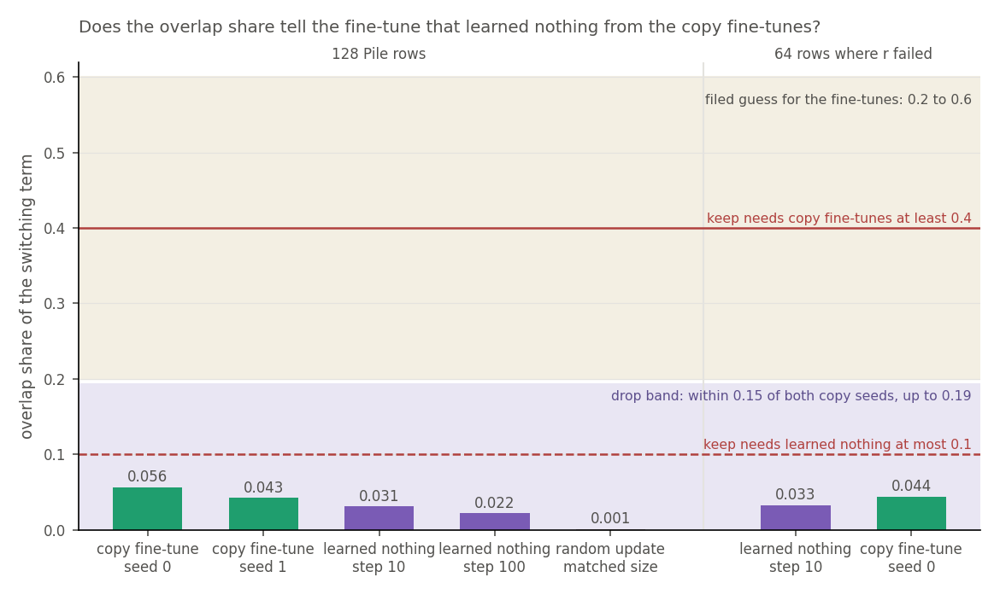
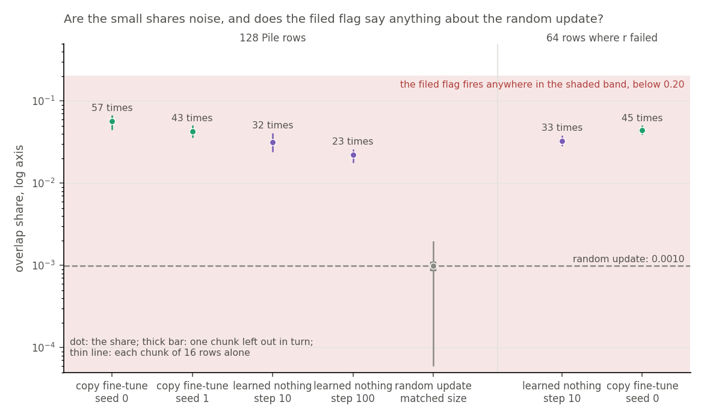
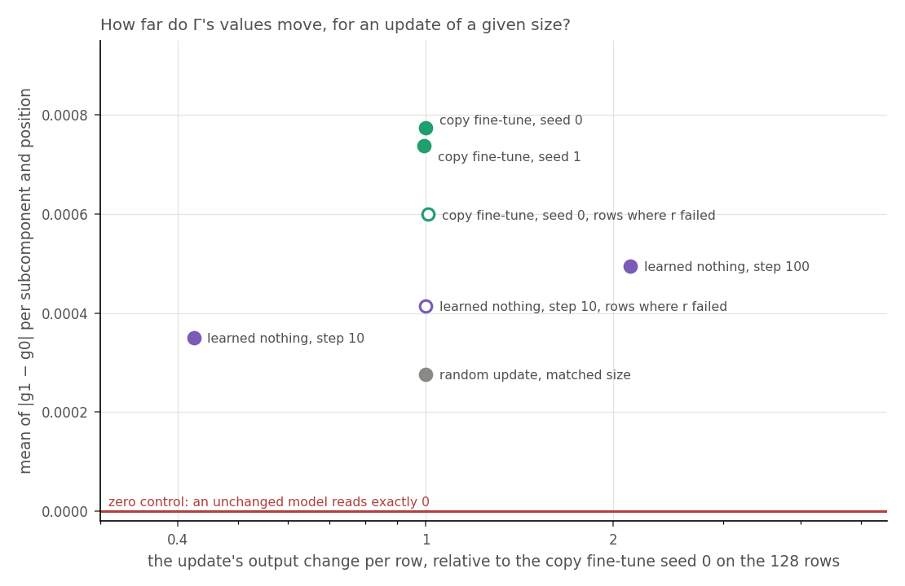
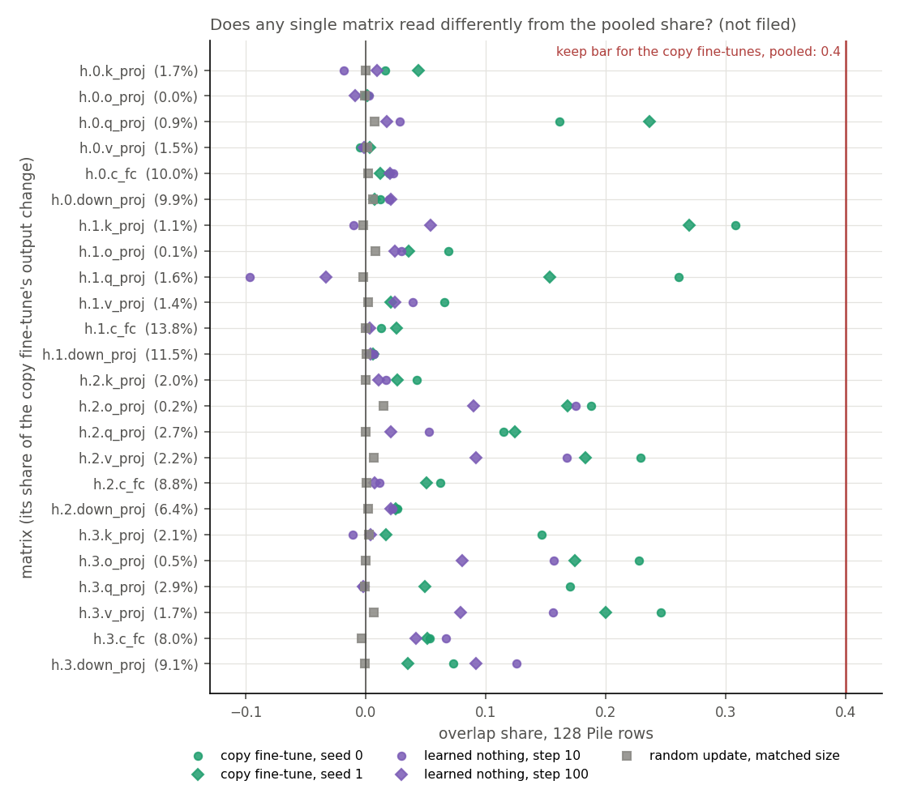

# Analysis: does a weight-side share tell a fine-tune that learned nothing from one that learned? (E67)

*2026-11-02, coding agent, regating-lead E67 writer. **Provisional until the independent check.** Plan: `reports/plans/2026-11-02_plan_e67-weight-side-read.md`. Rules: `experiments/weight_side_read/results/predictions.json`. Code review: `reports/reviews/2026-11-02_review_e67-code.md`. Design: `reports/plans/2026-11-02_advice_weight-side-split-FABLE.md`. Explanation: `notebooks/E67_weight_side_read.ipynb`. Provenance near the end.*

We read saved fine-tunes, with nothing trained, to see how far the decomposition's importance values move and how that movement lines up with the fine-tune's own effect. Fine-tunes that learned and one that learned nothing all read a very small overlap, so the filed rule drops this read on these rows and states. The re-gating question in `GOALS.md` gains no new instrument, but it gains a first reading at every position: the importance values also move on a fine-tune that learned nothing.

## The answer

No, on these rows and states. The overlap between the switching change and the update's own output change is small. It reads about 0.05 for the copy fine-tunes and 0.03 for the fine-tune that learned nothing, so the filed rule drops it. Both sit far above a random update, so the read is not empty. It still does not tell learning from not learning. Γ's values moved half to two thirds as far on the fine-tune that learned nothing.

This is not "the weight side never works". It is a drop of one share, on 128 Pile rows and 64 code-heavy rows, on five saved do-nothing states. The share has no positive control on real rows, only a unit test.

## What was measured

Nothing was trained. Every read is the do-nothing state: subcomponents unchanged, Γ frozen, the update left in Δ. The symbols, per matrix:

- $W_0$ is the original 67M model and $\delta W$ the update.
- $a$ is $W_0$'s input to the matrix, at every position, and $C_0$ its subcomponents.
- $g_0$ and $g_1$ are Γ's values on $W_0$'s and on $W_0 + \delta W$'s activations of the same row, in fp32.
- $R = (g_1 - g_0) C_0 a$ is the switching term, called the re-switching term in the plan.

The two numbers:

- **The change in Γ's values.** The mean of $|g_1 - g_0|$ per subcomponent and position, over all 38,912 subcomponents pooled, and per matrix. It is the first all-position reading of the user's definition of re-gating, "the difference in gating before and after fine-tuning". An unchanged model reads exactly 0. It has no filed bar, so it decides nothing.
- **The overlap share.** $S_R = E\langle R, \delta W a\rangle / E\|\delta W a\|^2$, with numerators and denominators summed over positions and then over the 24 matrices. Zero means the switching term is orthogonal to the update's own output change. One means it matches that change along its direction. It is signed and can pass one.

| state | what it is | what it rules out |
|---|---|---|
| unchanged model, one chunk, first and alone | $W_1 = W_0$; every number must read exactly 0 | a read that moves with nothing changed |
| copy fine-tunes, seeds 0, 1, step 10 | E12's fine-tunes that learned to repeat a key token at a trigger; r 0.80 and 0.76 | the updates that did learn |
| fine-tune that learned nothing, steps 10, 100 | E36's on code-heavy Pile rows; held-out gain −0.05 and −0.06 nats; r 0.82 at step 10 | a share that follows any fine-tune |
| random update | Gaussian per matrix, seed 67, scaled so each matrix's $E\|G a\|^2$ equals copy seed 0's | a share any update of this size produces |

The states ran on 128 Pile validation rows, 512 tokens each. By E36's own cut only 3 of the 128 are as code-heavy as the second fine-tune's training text. So step 10 of that fine-tune and copy seed 0 also ran on E36's 64 held-out rows at or above the cut, where r failed the null. The copy fine-tunes trained at trigger positions in windows, and these rows hold almost none, so they are off task on every row read.

The Gaussian's scaling held: its pooled denominator is 114,397 against 114,392 for copy seed 0.

## What we expected, and why

The lean was drop, at low to medium confidence: the update enters $R$ only through $g_1$, and any update that moves the activations moves Γ. The bars are the advice's guesses, marked "chosen here, no source" in the filing. A keep needs the learned-nothing reading at or under 0.1 and both copy seeds at or over 0.4. A drop needs it within 0.15 of both seeds.

## What we observed

### Does the share tell the fine-tune that learned nothing from the copy fine-tunes?

**Reading it.** No: the filed rule drops the share on these rows and states. The learned-nothing half of a keep holds, at 0.031 against 0.1. The copy half misses by a factor of about eight, at 0.056 and 0.043 against 0.4. All four pairs land in the 0.15 band, with gaps of 0.025 and 0.011 at step 10.

**The filed guess missed and the verdict matched.** The filed guess for the copy fine-tunes was 0.2 to 0.6 and they read about 0.05. That is a miss of the guess, by about a factor of four under its lower end. The verdict itself matched the filed lean.

**The drop is the rule firing on small numbers.** The 0.15 band is wider than every reading here, so any ordering of these numbers would land in it. The filed `drop_both_small` flag records this case, and it fired. Its filed gloss says "the read sees nothing on Pile rows", and the next section shows that goes too far. No ratio rule was filed, and none is applied after the fact: the drop stands.

**The rows where r failed.** The fine-tune that learned nothing reads 0.033 there, against 0.031 on the 128 rows. That is under the bar, and the check could only take back an adopting label, so it changes nothing. Copy seed 0 reads 0.044 there, report-only. So the share barely moved on that fine-tune's own kind of text, though its output change did: 893 per row against 379.

| state | rows | $S_R$ | filed guess | gap to copy seed 0 | gap to copy seed 1 | pair label |
|---|---|---|---|---|---|---|
| copy fine-tune, seed 0 | 128 | 0.0564 | 0.2 to 0.6 | | | |
| copy fine-tune, seed 1 | 128 | 0.0426 | 0.2 to 0.6 | | | |
| learned nothing, step 10 | 128 | 0.0314 | 0.2 to 0.6 | 0.0250 | 0.0112 | drop, drop |
| learned nothing, step 100 | 128 | 0.0223 | 0.2 to 0.6 | 0.0341 | 0.0203 | drop, drop |
| random update | 128 | 0.0010 | 0 to 0.2 | | | |
| learned nothing, step 10 | 64 where r failed | 0.0327 | 0.2 to 0.6 | | | not over 0.1 |
| copy fine-tune, seed 0 | 64 where r failed | 0.0441 | 0.2 to 0.6 | | | report-only |

### Are the small shares noise, and does the loud line about the random update mean anything?

**Reading it.** They are not noise, and the loud line says nothing. The filed flag `gaussian_like_copy` is $|S_R(\text{random}) - \text{mean } S_R(\text{copy})| \le 0.15$. It read 0.049, so it fired, and the job printed "the matched Gaussian reads like the copy fine-tunes". We report it as filed. The band is absolute, though, and it covers any random reading from −0.10 to 0.20, so with readings this small it would fire almost regardless. It carries no information on this run.

**The ratio.** The copy fine-tunes' mean is 50 times the random update's. Each state's ratio is below.

| state | rows | $S_R$ over the random update's | mean change in Γ's values over the random update's |
|---|---|---|---|
| copy fine-tune, seed 0 | 128 | 57 | 2.8 |
| copy fine-tune, seed 1 | 128 | 43 | 2.7 |
| learned nothing, step 10 | 128 | 32 | 1.27 |
| learned nothing, step 100 | 128 | 23 | 1.79 |
| learned nothing, step 10 | 64 where r failed | 33 | 1.50 |
| copy fine-tune, seed 0 | 64 where r failed | 45 | 2.2 |

**What follows, and no more.**

- Trained updates read well over this random draw in every chunk, whether their output change is smaller, matched or larger. So the share responds to something they have and the draw lacks.
- The fine-tune that learned nothing has it as well. So that something is not learning, and the share cannot be read as a sign of it.
- The cause is not established. The advice guessed that Γ reacts less to directions off the data, and this run does not test that.
- Γ's values moved 0.37 as far on the random update as on the copy fine-tunes, at the same output change, while the share fell by a factor of 50. The size of $R$ was not measured, so this does not split into a smaller switching term and a worse alignment.
- There is one random draw, so the 50 is not a fitted ratio.

**The noise, and what each spread means.** In `leave_one_chunk_out` (`src/commute/weight_side.py:55`), each entry is the pooled share with one chunk of 16 rows removed. The spread is the largest entry minus the smallest. It fixes the update and the sample, so it says how far the pooled share rests on one chunk. It is not a standard error, as it covers no other rows and no other seed. It also shrinks about as one over the number of chunks. So the per-chunk range and a jackknife standard error stand beside it, both computed afterwards from the saved chunks.

| state | rows | $S_R$ | spread, one chunk out | range, chunk alone | jackknife standard error |
|---|---|---|---|---|---|
| copy fine-tune, seed 0 | 128 | 0.0564 | 0.0028 | 0.0457 to 0.0658 | 0.0023 |
| copy fine-tune, seed 1 | 128 | 0.0426 | 0.0019 | 0.0367 to 0.0497 | 0.0017 |
| learned nothing, step 10 | 128 | 0.0314 | 0.0024 | 0.0246 to 0.0401 | 0.0019 |
| learned nothing, step 100 | 128 | 0.0223 | 0.0010 | 0.0181 to 0.0254 | 0.0009 |
| random update | 128 | 0.0010 | 0.0003 | 0.0001 to 0.0019 | 0.0002 |
| learned nothing, step 10 | 64 where r failed | 0.0327 | 0.0027 | 0.0288 to 0.0374 | 0.0020 |
| copy fine-tune, seed 0 | 64 where r failed | 0.0441 | 0.0034 | 0.0395 to 0.0497 | 0.0025 |

Every spread is under the filed guess of 0.1. For both states read on both sets, the spread is larger on the 4 chunks than on the 8, as guessed. The noise that matters most is not in these spreads. The two copy seeds differ by 0.0138, more than any spread, and more than the 0.0112 gap between seed 1 and step 10. Chunk by chunk on the same rows, each copy reading is above the matching learned-nothing reading, in all 8 chunks and in all 4 on the rows where r failed. So the order is steady on these rows, and it is small beside the bars. The fine-tune that learned nothing has one seed, so its seed noise is unknown.

### How far do Γ's values move, for an update of a given size?

**Reading it.** Γ's values move on every update, and half to two thirds as far on the fine-tune that learned nothing as on the copy fine-tunes. As filed these numbers have no bar, so they are report-only and decide nothing. The filed guesses all held, as the scorecard lists.

| state | rows | mean of $\lvert g_1 - g_0 \rvert$ | over the copy mean | output change per row, over copy seed 0's |
|---|---|---|---|---|
| copy fine-tune, seed 0 | 128 | 7.74e-4 | 1.02 | 1.00 |
| copy fine-tune, seed 1 | 128 | 7.38e-4 | 0.98 | 0.99 |
| learned nothing, step 10 | 128 | 3.51e-4 | 0.46 | 0.42 |
| learned nothing, step 100 | 128 | 4.94e-4 | 0.65 | 2.13 |
| random update | 128 | 2.77e-4 | 0.37 | 1.00 |
| learned nothing, step 10 | 64 where r failed | 4.15e-4 | 0.55 | 1.00 |
| copy fine-tune, seed 0 | 64 where r failed | 5.99e-4 | 0.79 | 1.01 |
| unchanged model | one chunk of the 128 | exactly 0 | 0 | 0 |

- **Learned nothing against the copy fine-tunes.** The fine-tune that learned nothing moves Γ's values 0.46 and 0.65 as far on the 128 rows. Its output change there brackets theirs, at 0.42 and 2.13, so size alone does not explain the gap. Step 100 has twice the copy fine-tunes' output change and still moves Γ less.
- **Matched output change.** On the rows where r failed, the two output changes match within 1% and the ratio narrows to 1.45.
- **Not proportional to size.** From step 10 to step 100 the output change rises by 5 times, and the change in Γ's values by 1.41 times. So we do not divide by size.
- **Over the random update.** The fine-tune that learned nothing reads 1.27 and 1.79 times the random update, at step 10 with less output change than it.
- **Per matrix.** The states rise and fall together. Step 10 stays within 0.39 to 0.50 of copy seed 0 on all 24 matrices. The random update stays within 0.32 to 0.37. So the per-matrix pattern adds little to the pooled number.

**What this says about the user's definition.** On this reading, the difference in Γ's values before and after fine-tuning is not zero on a fine-tune that learned nothing. So a moved Γ is not by itself evidence that a fine-tune learned anything, on these rows and states. The gap to the copy fine-tunes is real in these numbers and has no filed meaning.

**What it is blind to.** Whether a moved value matters: a moved value on a subcomponent with zero activation counts in full. About three quarters of the 38,912 subcomponents are dead, and the run has no count of live ones alone. Per-chunk sums of this number were not saved, so it has no leave-one-chunk-out spread. Its only noise reference is the copy seeds, 3.6e-5 apart.

### Does any single matrix read differently from the pooled share?

**Reading it.** No matrix reaches the keep bar, and the pooled gap sits in the attention matrices. This is post hoc: no filed rule reads per-matrix shares, so it changes no verdict. The highest is 0.308, on block 1's key matrix for copy seed 0. The matrices with the largest output change, the MLP's, read small and alike, and they carry about three quarters of the denominator.

| state | rows | MLP share of the denominator | $S_R$, MLP matrices | $S_R$, attention matrices |
|---|---|---|---|---|
| copy fine-tune, seed 0 | 128 | 0.775 | 0.0305 | 0.1459 |
| copy fine-tune, seed 1 | 128 | 0.771 | 0.0251 | 0.1017 |
| learned nothing, step 10 | 128 | 0.699 | 0.0304 | 0.0338 |
| learned nothing, step 100 | 128 | 0.653 | 0.0230 | 0.0210 |
| random update | 128 | 0.775 | 0.0008 | 0.0016 |
| learned nothing, step 10 | 64 where r failed | 0.658 | 0.0403 | 0.0181 |
| copy fine-tune, seed 0 | 64 where r failed | 0.780 | 0.0293 | 0.0966 |

The mix of matrices is not why the pooled shares differ. Reweighted to copy seed 0's denominators, step 10 reads 0.0321 against 0.0314. The cleanest split is in the key and query matrices of blocks 0 and 1. On block 1's key matrix, the copy fine-tunes read 0.308 and 0.269, and the fine-tune that learned nothing −0.010 and 0.054. On block 1's query matrix they read 0.261 and 0.154, against −0.097 and −0.033. The pattern repeats on the rows where r failed, at 0.273 against −0.012 and 0.212 against −0.088. The two seeds agree, but this is a pattern picked out of 24 matrices after the run, with no filed test. The cause is not tested.

Full per-matrix $S_R$ on the 128 rows:

| matrix | copy s0 | copy s1 | learned nothing 10 | learned nothing 100 | random | share of copy s0's denominator |
|---|---|---|---|---|---|---|
| h.0.attn.k_proj | 0.016 | 0.044 | −0.019 | 0.009 | −0.000 | 0.017 |
| h.0.attn.o_proj | −0.001 | 0.001 | 0.002 | −0.009 | −0.001 | 0.000 |
| h.0.attn.q_proj | 0.161 | 0.237 | 0.028 | 0.018 | 0.007 | 0.009 |
| h.0.attn.v_proj | −0.005 | 0.003 | −0.002 | −0.002 | 0.001 | 0.015 |
| h.0.mlp.c_fc | 0.019 | 0.012 | 0.023 | 0.020 | 0.002 | 0.100 |
| h.0.mlp.down_proj | 0.012 | 0.007 | 0.020 | 0.021 | 0.006 | 0.099 |
| h.1.attn.k_proj | 0.308 | 0.269 | −0.010 | 0.054 | −0.002 | 0.011 |
| h.1.attn.o_proj | 0.069 | 0.036 | 0.029 | 0.024 | 0.008 | 0.001 |
| h.1.attn.q_proj | 0.261 | 0.154 | −0.097 | −0.033 | −0.002 | 0.016 |
| h.1.attn.v_proj | 0.065 | 0.021 | 0.039 | 0.024 | 0.002 | 0.014 |
| h.1.mlp.c_fc | 0.013 | 0.026 | 0.001 | 0.003 | 0.000 | 0.138 |
| h.1.mlp.down_proj | 0.007 | 0.006 | 0.007 | 0.004 | 0.001 | 0.115 |
| h.2.attn.k_proj | 0.042 | 0.026 | 0.017 | 0.011 | −0.000 | 0.020 |
| h.2.attn.o_proj | 0.188 | 0.168 | 0.175 | 0.090 | 0.015 | 0.002 |
| h.2.attn.q_proj | 0.115 | 0.124 | 0.053 | 0.021 | 0.000 | 0.027 |
| h.2.attn.v_proj | 0.229 | 0.183 | 0.167 | 0.091 | 0.007 | 0.022 |
| h.2.mlp.c_fc | 0.062 | 0.050 | 0.011 | 0.007 | 0.000 | 0.088 |
| h.2.mlp.down_proj | 0.026 | 0.024 | 0.022 | 0.021 | 0.002 | 0.064 |
| h.3.attn.k_proj | 0.146 | 0.017 | −0.011 | 0.004 | 0.002 | 0.021 |
| h.3.attn.o_proj | 0.228 | 0.174 | 0.156 | 0.080 | −0.000 | 0.005 |
| h.3.attn.q_proj | 0.170 | 0.049 | −0.003 | −0.002 | −0.001 | 0.029 |
| h.3.attn.v_proj | 0.246 | 0.200 | 0.156 | 0.079 | 0.007 | 0.017 |
| h.3.mlp.c_fc | 0.053 | 0.051 | 0.067 | 0.041 | −0.004 | 0.080 |
| h.3.mlp.down_proj | 0.073 | 0.035 | 0.126 | 0.092 | −0.001 | 0.091 |

## What we learned

The re-gating line, Q5 in `GOALS.md`, gains no new instrument from this share, and the split side will not be added. This is a drop on these rows and states, not a finding about weight-side reads in general. The first all-position reading of the user's definition shows Γ's values moving on a fine-tune that learned nothing. They moved half to two thirds as far as on the fine-tunes that learned.

None of this reads mechanism. Elicitation in this project is mechanistic, with the causal check as its label (`decisions.md`, 2026-11-02), and r stays a candidate instrument to score against that check. No number here is a causal check. The known granularity limit also stands: a new mechanism built from subcomponents $W_0$ already has reads as elicited to VPD, because VPD's unit is the rank-one subcomponent.

## How compelling is the evidence

- **No positive control on real rows.** The share has only the unit test in `tests/test_weight_side.py`. There, a value moved by 1 on the subcomponent equal to the update reads 1, and on one writing elsewhere reads 0. No saved state is a known re-gating update. The zero control and the dead-read stop show the read is live, not that it reads correctly. A wrong $g_1$ that still moved could also land on this verdict, and this verdict is the lean.
- **Blind to behaviour.** There is no token and no loss.
- **Blind to the switching term's size.** Only its overlap with the update's own output change counts. A large term orthogonal to the update reads 0, so a small share does not mean a small switching term. The size was not measured.
- **Blind to what the update does to a matrix's own input.** $a$ is $W_0$'s, and an upstream update reaches the read only through $g_1$. Each matrix is read alone, so nothing here adds up to the model's output.
- **Dominated by the MLP matrices.** The pooled share follows the matrices with the largest output change.
- **Off task.** The copy fine-tunes are off task on every row read. Their trigger windows were not read, and a drop here does not say that the same read would fail there. The fine-tune that learned nothing is near its text only on the 64 rows.
- **Thin on repeats.** Two copy seeds, one seed of the fine-tune that learned nothing, one random draw, one Γ, one model.
- **The zero control.** It covers one chunk of the 128 rows. It was not repeated on the rows where r failed.

## Surprises

- **Every fine-tune read far under the guess.** The guess was 0.2 to 0.6 and they read 0.02 to 0.06. The guess had no source, and the size of the miss is not explained.
- **The loud line fired and is empty**, for the reason above.
- **The pooled gap sits in attention matrices**, post hoc, not expected in the plan.
- **Time.** The plan estimated 5 to 10 minutes and the job took 1 minute 29 seconds, at about 8.5 seconds per state against about a minute.

No filed prediction reversed. The order filed for the random update, below the copy fine-tunes, held.

## What next

The filed next step for a drop (`predictions.json`, `verdict_rules.verdicts.drop`): "Next: the idea goes to TRIED.md as dropped; the all-position reading of Γ's change stands by itself. The split side is never added". `experiments/TRIED.md` is updated with this report. This report proposes nothing further.

## Scorecard

| id | claim in words | rule | read | verdict |
|---|---|---|---|---|
| control | an unchanged model reads exactly 0 | every matrix and the mean change, one chunk | no matrix off, mean change 0 | pass |
| dead read | Γ's values moved on a nonzero update | mean change is not exactly 0 | all seven nonzero | not triggered |
| pairs at step 10 | code step 10 against each copy seed | within 0.15 is drop | 0.0250, 0.0112 | drop, drop |
| pairs at step 100 | code step 100 against each copy seed | can only take back a keep | 0.0341, 0.0203 | drop, drop |
| verdict | the filed label | the two step-10 pairs agree | | **`drop`**, as leaned |
| `drop_both_small` | all readings small | \|c\|, \|s0\|, \|s1\| ≤ 0.1 | 0.0314, 0.0564, 0.0426 | true |
| `gaussian_like_copy` | random update reads like the copy fine-tunes | \|random − copy mean\| ≤ 0.15, no change to the verdict | 0.0485; ratio 50.2 | true, uninformative here |
| `held_rows_fail` | code step 10 on `code_held` over 0.1 | only takes back an adopting label | 0.0327 | false |
| guess, S_R copy | 0.2 to 0.6 | not a rule | 0.0564, 0.0426 | missed |
| guess, S_R code | 0.2 to 0.6, not separable | not a rule | 0.0314, 0.0223; not separable by the band | size missed, separability as guessed |
| guess, S_R random | 0 to 0.2 | not a rule | 0.0010 | held |
| guess, S_R code on `code_held` | 0.2 to 0.6 | not a rule | 0.0327 | missed |
| guess, S_R copy s0 on `code_held` | 0.2 to 0.6, report-only | not a rule | 0.0441 | missed |
| guess, mean change, copy | 1e-4 to 1e-2 | no bar | 7.74e-4, 7.38e-4 | held |
| guess, mean change, code | same order as copy | no bar | 3.51e-4, 4.94e-4 | held |
| guess, mean change, random | under copy | no bar | 2.77e-4 | held |
| guess, mean change, `code_held` | same order or above | no bar | 4.15e-4 code, 5.99e-4 copy s0 | held |
| guess, spread | under 0.1, larger on `code_held` | no bar | at most 0.0034; larger on `code_held` for both states | held |

## Not run

- **The split side:** the least-squares state, the direct, interaction and residual shares, the every-value-on controls, the students' sizes. A drop never reads it.
- **The E58 and E62 columns:** a weight-side column for either was only to be proposed after a keep.
- The same read on task windows, the adjoint split, or the teacher-trained students' own $g_1$.
- Other fine-tunes: E53, E58, E62, or the lowercase fine-tune that did learn on Pile. rand32, cut after review.
- The norm ratio, dropped by the user. Weighting Γ's change by $\|C_0 a\|$. The size of the switching term.
- A second random draw, and a second seed of the fine-tune that learned nothing.
- The zero control on the rows where r failed. Per-chunk sums of the change in Γ's values.
- Qwen: no scored state exists, and two sets of Γ's values do not fit the card.

## Provenance

- Results: `experiments/weight_side_read/results/run.json`, committed; full log `~/commute-data/results-large/weight_side_read/run.out`, and the job's own `cluster/logs/commute-e67-weight-side-49342.out`.
- Code at run: `git_head` 77fa5aa, `code_status` empty, `predictions_sha256` f00a2dbf…8255.
- MATS cluster, NVIDIA L40, `debug` QoS, job 49342, exit 0, 18:48:23 to 18:49:52 on 2026-11-02, 1 minute 29 seconds, $0.
- State names in `run.json`: `ident32_s0`, `ident32_s1`, `code_step10`, `code_step100`, `gaussian`, `code_step10_held`, `ident32_s0_held`.
- Every number here was recomputed from `run.json`: $S_R$ and the spreads from the saved chunks, and the pooled share from the per-matrix values, all match. The jackknife, per-chunk ranges, ratios and the attention and MLP split are post hoc, from the same file. r 0.82: `reports/analyses/2026-10-26_analysis_regating-spread.md`, table at line 578. r 0.80 and 0.76: `reports/analyses/2026-10-20_analysis_new-vs-existing-signatures.md`, lines 87-88.

## Departures from the literature

- **Precision.** Γ and the products run in fp32, where the authors' setting is bf16, because the update is 1 to 2% of the weights. fp32 is not a truer value. The random update's scale uses bf16 second moments, in both energies, so that rounding moves nothing a rule reads.
- **Where Γ is read.** The authors trained Γ on $W_0$, and read it there. Reading it on $W_0 + \delta W$'s activations is this project's do-nothing operation.
- **No other cited source is used.** The filed bars have no source and are marked so.
