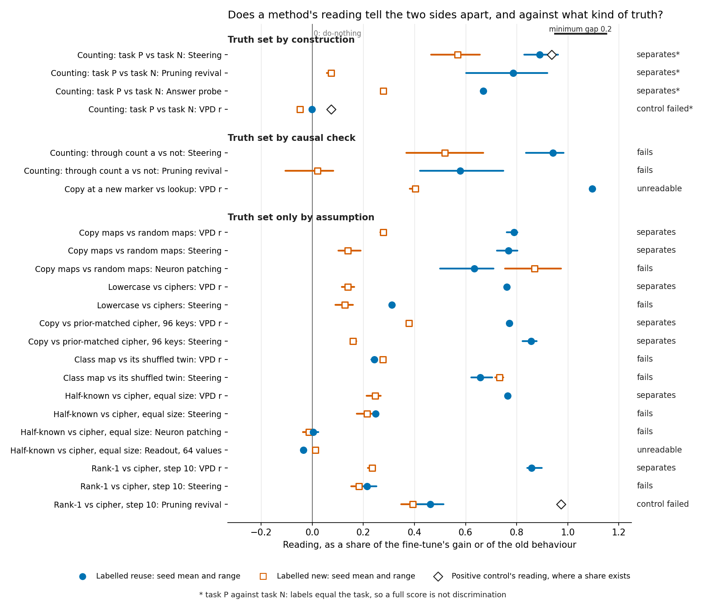

# Does VPD tell reuse from new better than cheaper methods, against a truth it did not define?

*Baseline-lead, revised after the independent check `reports/reviews/2026-11-02_review_method-table.md`. Plan step: `reports/plans/2026-11-02_plan_merge-reuse-into-baseline.md`, "One table". No run. Provenance at the end.*

We put every method's filed reading on every fine-tune into one table, and marked each row by how its truth was set. No fine-tune has the decomposition's reading and a cheaper method's reading both standing, with controls held, against a truth that is more than an assumption. So the merged line's question stays open. The original model's own prior is already a rival on the small model, and the harder counting test comes next.

## The answer

Not yet. The decomposition's reading follows how most pairs were built, but not a rule against its no-rule twin, and those labels are assumptions. The original model's prior, which needs no fine-tune, sorts the same maps into the same bands by one cut chosen afterwards. On the counting set the decomposition was barely trained and failed its control. On the one causal row of the small model, its reading went unscored and the copy side did not settle.

**Reading it.** The clean verdicts for the decomposition sit only in the bottom group. The class map against its twin is the gap that is not there. The vertical line is the do-nothing reading of zero, and the short bar is the separation rule's minimum gap. A diamond is the positive control's reading, where it is a share. Above the bottom group, each wide gap carries a star, a tie to the recipe, a failed control or an unscored reading. The figure leaves out the prior, distance, reverse fine-tuning, neuron sparsity and size, which are not shares. Shares here have different denominators: the half-known pair's steering is in log-odds and other steering rows are in nats.

## What the table is

Each row is a pair of fine-tunes, one on the reuse side and one on the new side. Each column is a method. Each cell gives the method's reading, its reference, whether its positive control held on that fine-tune, and one verdict. The verdicts are separates, fails, control failed, unreadable and not run. A cell with no reading says not run, and 139 of the 224 cells do.

Three kinds of truth mark the rows. Under `decisions.md`, elicitation is mechanistic, the causal check is the label, and a held-out reading is only evidence.

- **By construction.** The fine-tuning task fixes the answer, and each state also passed behaviour and patch checks. This is task P against task N.
- **By causal check.** Patching the old count or switching off the old copying head is the label. These are the earlier counting states and the copying-heads pair, whose copy side is not settled as filed.
- **Only by assumption.** Built to elicit is how the task was built, not the causal label; these pairs have no causal check. Those are all the other small-model pairs.

The methods, in a line each:

- **r and the stand-in ratio** are the decomposition's two readings. Each is a share of the log-odds gain, and zero means the changed causal importances carry none of it.
- **The original model's prior** is its probability of the trained answer before any fine-tune.
- **Distance** is the KL from the original model's answers to the state's, at the answer position.
- **MLP share** is the part of the update's squared norm in MLP weights.
- **Weight statistics** are the update's top-10 singular share, intruders and effective rank.
- **Steering** adds one mean residual shift to the original model and reads the share of the gain it reaches.
- **Neuron patching** gives the top neurons their fine-tuned activations and reads the share of the gain.
- **Prompting** shows the original model demonstrations of the map in context.
- **Pruning revival** is Jain et al.'s Algorithm 3: remove the units that matter most, and read how much old behaviour returns.
- **Reverse fine-tuning** trains back toward the old behaviour and reads how fast it returns.
- **The two readouts** train a linear map on Pile text and read the gain lost when its direction is removed.
- **Neuron sparsity** asks whether the update or its activation shift sits on fewer neurons.
- **Recipe or size** reads only the learning rate, the steps or the size of the weight change.
- **The answer probe** reads only which answers a state gives, as a reference for anything that merely reads the task.

## What we expected, and why

No predictions were filed, because nothing ran. The handoff expected two things, and the table shows both. The ports failed on the small model, and task P against task N cannot rank methods.

## What the counting set can say

**Reading it.** Task P against task N cannot rank methods. Those labels equal the task, so any method that responds to the task scores perfectly, and 21 of 21 there is not discrimination. The three cheap methods reach it. So do the answer probe and the update's size within a recipe cell, both marked derived because neither was filed as a pass. A decomposition barely trained, a thousandth of its planned steps, labelled all of them right. It enters as failing its control and not as a pass, since its identity-prompt fine-tunes read about 0.07 against a bar of 0.5.

**The other counting row is different.** There the fine-tuning task is fixed, the count of b, and the causal label varies within a run. That is what the harder test wants. The filed verdict is that no method passes, because guessed cut-offs missed. With later cut-offs, pruning and steering sort all 26 states, described only. The caveat is that the label is tied to the steps, since every reuse state was read at 1K or 2K steps. The decomposition's reuse side was never read here.

## Whether the 21 of 21 carries to the small model

**Reading it.** It does not. As ported to the small model, pruning revival and reverse fine-tuning failed their positive control, so the 21 of 21 does not carry over. On rank-1 against the cipher, pruning's gap is 0.07 against a bar of 0.14. Reverse fine-tuning's gap of 3.2 steps runs the wrong way and is under its bar. Under the filed rule, no step up to 300 passed, and no pruning size up to 320 did. A planted edit of 13 neurons passes both. Pruning does read copy apart from the cipher on the same states, by 0.26 over a bar of 0.14. That does not restore the filed control.

## What follows the build on the small model

**Reading it.** r follows most of the builds, and not the one that matters most. It reads about 0.77 against 0.25 on the half-known pair at five seeds, and the same order holds on eight more rows. On the class map against its shuffled twin the means read 0.24 against 0.28, filed as `kind_only`. That pair is a rule that carries against no rule, with the same words, sizes and prior. A built-in difference there does not show in r, and `decisions.md` keeps it open until the class map's mechanism is measured.

**The prior is a rival, not only a caveat.** On rank-1 against the cipher, the prior, distance and MLP share all separate. These are the baselines the catalogue names. One cut on the prior, chosen afterwards, sorts the eight maps of the open-pair work into r's bands. The reading r stays apart at a matched prior on two pairs. Copy against the prior-matched cipher is a factor of 1.6 apart in prior and reads 0.77 against 0.37. The copying-heads pair is a factor of 1.3 apart and is unscored. In both, the high side's target is in context, so context and mechanism are not told apart. The review named only the second pair; the table's numbers add the first.

**Other cheap methods.** Steering separates the copy pairs and the 96-key rank-1 pair. It fails on the class map, and it has no gap on the matched 24-key rank-1 pair. Its misses on lowercase and in nats on the half-known pair are narrow. The sides do not overlap, and only the minimum gap fails them. Neuron patching fails on every pair it read. Size separates on most rows where it was not matched by design. It fails on the copy maps, where two tables' sizes range widely.

**Neuron sparsity.** It fails on every pair as filed, `none answers yes`, and that per-row verdict is the rule that a number must pass all four tests. The caveat stays with each cell. All four tests compare one task with one task. A false yes runs at 6-9% per number. It runs at 25-37% over five, before references, and the test has little power.

**The 64-value readout.** Its verdict stays as filed: `readout fit missed and P1 elicit clause or P2 missed (P1 claim; P2 fail): unreadable; one training run was the cap; tell the user`.

## What the one causal row on the small model says

**Reading it.** It leaves r unscored, and the copy side is not settled. With the copying head off, the copy map lost 0.47 to 0.56 of its gain against a bar of 0.5, and the lookup lost nothing. The verdict as filed is `copy_not_elicitation`, with `r_scored` false and `copy_reading` mixed. The unscored reading is about 1.09 against 0.40. The later amendment scaled each update to the other's size, and the gap stayed at 0.686 against 0.691, filed `size_does_not`. So mechanism and context remain as readings of r's gap, and size does not. Size still separates the pair as a labeller, against a label that did not stand on every seed. That amendment also narrows r on this map: the original subcomponents can write this target under some mask.

## Labels and markings

No label changes, and no state changes side. What moves is how ten rows' truth is described.

| rows | the source says | the table says |
|---|---|---|
| Rank-1 vs cipher at 24 keys and its ladder | "old by construction", "new by construction" | only by assumption |
| Copy vs random, lowercase vs ciphers, half-known vs cipher at both steps | "construction labels" in E60's table | only by assumption |
| Four open-pair rows at 96 keys | built maps, labelled by held-out carry, now evidence | only by assumption |

"Old by construction" is also the answer-already-given reading that `decisions.md` rejects as the definition. That is the stronger reason to move rank-1.

## How compelling is the evidence

- **Coverage.** Only 85 of 224 cells have a reading. The prior, distance and MLP share were not read on the copy maps or on lowercase, so whether they tie r there is unmeasured.
- **Noise.** Seeds run from one to eight per side, on one task pair per row. A gap can be a difference of task and not of kind.
- **Blind spot.** Separates says a method follows the row's label. On assumption rows the label may itself follow prior, distance or context.
- **Derived cells.** There are 57, each marked, where a rule or a bar is applied to saved numbers. The local separation rule reproduces four filed verdicts or the build stops. Every pointer ran through `jq`: 695 paths resolve, and the only nulls are the two filed "no passing step" values.
- **Review.** One independent check ran on the first version, and its findings are applied here. This revision has had no second check.

## Surprises

The first version missed the prior as a method. It also claimed r separates every pair it read, which holds only for the rows it chose. The class map against its twin is the exception. No filed prediction reversed.

## What next

1. **The harder counting test first, through `/design`, as the plan orders.** It should read the fixed-task counting row first, as that row varies the label. If cheap methods already separate it, a 56-hour decomposition has little left to show.
2. **Stage B's interchange patch on the small model's pairs, after it.** It would move rows out of "only by assumption". If r then separates with the prior matched and size unable to, VPD has its first fair win.
3. **Prior, distance and size beside r where missing.** If they tie r there, its lead is not evidence of kind.

## Scorecard

No predictions filed: this table reads filed results and runs nothing. Each filed verdict is quoted in its cell below.

## The full table

Each section is one row, built from `table.json`. A star marks task P against task N. The pointer column names a cell's first path; `table.json` lists them all.

### Counting: task P vs task N

| about | |
|---|---|
| states | Task P answers one more than count a; task N answers count b. 21 scored of 35, seeds 2-4, lr 1e-4 and 1e-5, 1K and 10K steps; model 3M minGPT |
| truth | by construction: Disagreements between task and checks: [] |
| beside it | No held-out reading. |

| method | reading | reference | positive control | verdict | filed, as filed | pointer |
|---|---|---|---|---|---|---|
| r | 21 of 21 at 400 steps; reuse -0.01 to 0.01 vs new -0.06 to -0.04 | Cut-off -0.018. On the 67M, the elicit and cipher fine-tunes read 0.77 and 0.24. | failed: Identity-prompt fine-tunes read 0.07 against a bar of 0.5: positive_control 'none'. | **control failed** * | outcome 'tie', positive_control 'none' | `experiments/pcfg_anchors/results/c2_400step_job48413.json` `.scored["c1b/P_1e-4_s2/1000"].r`; job 48413; 48441 tests the cause on four states |
| ratio | 21 of 21 at 400 steps; reuse -0.00 to 0.01 vs new -0.06 to -0.03 | Cut-off -0.013. | failed: Identity-prompt fine-tunes read 0.07 against a bar of 0.5. | **control failed** * | outcome 'tie', positive_control 'none' | `experiments/pcfg_anchors/results/c2_400step_job48413.json` `.scored["c1b/P_1e-4_s2/1000"].ratio`; job 48413 |
| steering | 21 of 21; share reuse 0.83 to 0.96 vs new 0.47 to 0.66 | Cut-off 0.742 set on held-out seeds; binomial bar 15; best recipe labeller 15. | held: True: .controls.steer_positive_control | **separates** * | passes: True | `experiments/pcfg_anchors/results/c1b.json` `.scored["c1b/P_1e-4_s2/1000"].x.steer`; job 46330-46499 |
| pruning | 21 of 21; gain share reuse 0.60 to 0.92 vs new 0.06 to 0.08 | Cut-off 0.222 set on held-out seeds; binomial bar 15; best recipe labeller 15. | held: True: .controls.prune_control_pass | **separates** * | passes: True | `experiments/pcfg_anchors/results/c1b.json` `.scored["c1b/P_1e-4_s2/1000"].x.prune`; job 46330-46499 |
| reverse | 21 of 21; steps over the scratch model's reuse 0.11 to 0.13 vs new 0.41 to 0.65 | Cut-off 0.272 set on held-out seeds; binomial bar 15; best recipe labeller 15. | held: target: .controls.scratch.end | **separates** * | passes: True | `experiments/pcfg_anchors/results/c1b.json` `.scored["c1b/P_1e-4_s2/1000"].x.reverse`; job 46330-46499 |
| labeller | 21 of 21 by size within a recipe cell; 15 of 21 with one cut-off | Binomial bar 15. Learning rate and steps alone read 12 of 21. | none: No control: it reads the recipe's result. | **separates** * | nuisance labeller: update_size 15 | `experiments/pcfg_anchors/results/c1b.json` `.train_stops.recipe_ceiling_full.update_size.agree`; job 46330-46499; derived |
| probe | 21 of 21; reuse 0.67 vs new 0.28 | Cut-off 0.473. | none: No control: it reads the answers only. | **separates** * | task-identity reference (not scored; not a pass) | `experiments/pcfg_anchors/results/c1b.json` `.scored["c1b/P_1e-4_s2/1000"].x.probe`; job 46330-46499; derived |

| not run | prior, distance, mlp_share, weights, neuron_patch, prompting, readout_64, readout_full, sparsity |
|---|---|

### Counting: through count a vs not

| about | |
|---|---|
| states | 26 scored, 15 reuses and 11 new, from Stage A and Amendment 5; model 3M minGPT |
| truth | by causal check: Behaviour share and interchange patch. |
| beside it | No held-out reading. |

| method | reading | reference | positive control | verdict | filed, as filed | pointer |
|---|---|---|---|---|---|---|
| steering | 21 of 27; reuse 0.84 to 0.98 vs new 0.37 to 0.67 | Binomial bar 19; slow labeller 20, so 22 needed. | none: No steering control in this stage's file. | **fails** | passes: False; per run 16 of 18, passes: True | `experiments/pcfg_anchors/results/c1.json` `.scores.steer.all.agree`; job 46105, 46106, 46107, 46121 |
| pruning | 20 of 26; reuse 0.42 to 0.75 vs new -0.11 to 0.08 | Binomial bar 18; slow labeller 19, so 21 needed. | held: Importance pruning on the base model, near-vacuous by the size of its drop. | **fails** | passes: False; per run 14 of 17, passes: True | `experiments/pcfg_anchors/results/c1.json` `.scores.prune.all.agree`; job 46105, 46106, 46107, 46121 |
| reverse | 17 of 26 | Binomial bar 18; slow labeller 19, so 21 needed. | held: The scratch model reached the target at 1e-5. | **fails** | passes: False; per run 12 of 17, passes: False | `experiments/pcfg_anchors/results/c1.json` `.scores.reverse.all.agree`; job 46105, 46106, 46107, 46121 |
| labeller | 19 of 26 by learning rate; 18 of 26 by steps | Binomial bar 18. | none: No control: it reads the recipe. | **fails** | passes: False | `experiments/pcfg_anchors/results/c1.json` `.scores.nuisance_slow.all.agree`; job 46105, 46106, 46107, 46121 |

| not run | r, ratio, prior, distance, mlp_share, weights, neuron_patch, prompting, readout_64, readout_full, sparsity, probe |
|---|---|

### Copy at a new marker vs lookup

| about | |
|---|---|
| states | 6, seeds 0-2, step 30; model 67M |
| truth | by causal check: The copy side is not settled as filed: copy_reading 'mixed', pair_ignored True. The lookup side is labelled on every seed. Labels as filed, seeds 0-2: copy old, old, between; lookup new, new, new. Share lost: copy 0.47 to 0.56 against a bar of 0.5, lookup -0.00 to 0.00. |
| beside it | No held-out reading. |

| method | reading | reference | positive control | verdict | filed, as filed | pointer |
|---|---|---|---|---|---|---|
| r | unscored: copy 1.09 to 1.10 vs lookup 0.38 to 0.42 | Zero update gain 0.0. | none: Path control pass: True. No known-kind state: the only causal label here is the one that left r unscored. | **unreadable** | r_scored False; verdict 'copy_not_elicitation' | `experiments/induction_cue/results/run.json` `.score.r_copy`; job 48541; Amendment 2's job per its report |
| prior | copy 3.15e-04 vs lookup 2.39e-04, a factor 1.32 | One number per map; no fine-tune needed. | none: No positive control filed for this column. | **fails** | none filed | `experiments/induction_cue/results/run.json` `.stage_b.prior_copy`; job 48541; derived |
| labeller | copy 4.57 to 4.62 vs lookup 5.45 to 5.50 | Same recipe cell, same step. | none: No control: it reads the recipe's result. | **separates** | none filed | `experiments/induction_cue/results/run.json` `.states.copy_s0.norm`; job 48541; derived |

| not run | ratio, distance, mlp_share, weights, steering, neuron_patch, prompting, pruning, reverse, readout_64, readout_full, sparsity, probe |
|---|---|

### Copy maps vs random maps

| about | |
|---|---|
| states | 8, E12's recipe, two tables each, seeds 0-1; model 67M |
| truth | only by assumption: Only by assumption: built to elicit is how the task was built, not the causal label of decisions.md rows 112 and 114; these pairs have no causal check. |
| beside it | No held-out reading. |

| method | reading | reference | positive control | verdict | filed, as filed | pointer |
|---|---|---|---|---|---|---|
| r | copy 0.76 to 0.80 vs random 0.27 to 0.29 | Zero update reads 0; no filed cut-off (E60: labels none yet). | none: None of known kind. Stage 0 checks that the code reproduces earlier numbers; no state whose kind is verified independently was read. Stage 0 pass: True. | **separates** | none filed | `experiments/regating_truth_table/results/table.json` `.runs["e46/ident32_s0"].r.value`; job 46258; derived |
| ratio | copy 0.87 to 0.97 vs random 0.36 to 0.41 | Zero update reads 0; no filed cut-off (E60: labels none yet). | none: None of known kind. Stage 0 checks that the code reproduces earlier numbers; no state whose kind is verified independently was read. Stage 0 pass: True. | **separates** | none filed | `experiments/regating_truth_table/results/table.json` `.runs["e46/ident32_s0"].ratio.value`; job 46258; derived |
| weights | effective rank, mean 440 vs 415 | Gap 24.5 over a range of 23.9; matched-norm Gaussian null near 700. | held: Re-weighting and injected-direction controls pass. | **separates** | erank separates: True; share: False; intruders: False | `experiments/baseline_weights/results/results.json` `.score.erank.gap`; job E51, cluster CPU |
| steering | copy 0.72 to 0.80 vs random 0.10 to 0.19 | E51's rule; a learned-nothing fine-tune is the null. | failed: None of known kind. Stage 0 checks that the code reproduces earlier numbers; no state whose kind is verified independently was read. The filed null check on a learned-nothing fine-tune failed narrowly. | **separates** | P3 pass, gap 0.628; P5 fails | `experiments/baseline_neurons/results/baseline_neurons.json` `.b3["ident32_s0"].S`; job 44095 |
| neuron_patch | half the gain only at all 12288 neurons; full width copy 0.50 to 0.71 vs random 0.76 to 0.97 | E51's rule on neurons needed and on the idle share. | held: Identity and full residual patches. | **fails** | P1 fails, P2 fails | `experiments/baseline_neurons/results/baseline_neurons.json` `.b2["ident32_s0"].shares["12288"]`; job 44095 |
| prompting | 16 demonstrations: copy 0.10 to 0.12 vs random 0.13 to 0.14; 31 beside the query: 0.22 vs 0.18 to 0.19 | Share 0 with no demonstrations; bar 0.5 at 31. | held: Induction control top-1 0.82 on repeated random text. | **fails** | P4 reversed; amendment fails, band 'mechanism only' | `experiments/baseline_neurons/results/baseline_neurons.json` `.b4.shares["ident32_s0"]["16"]`; job 44095; amendment 45898 |
| sparsity | 0 of 5 numbers pass this test: none; ident32 vs rand32 only | Each number against a rotated, shuffled, Gaussian or random-order reference inside the test. | none: None of known kind. Stage 0 checks that the code reproduces earlier numbers; no state whose kind is verified independently was read. Stage 0 pass: True. | **fails** | none answers yes: write up; an elicit/new gap under T1 only is reported as a progress effect | `experiments/neuron_sparsity/results/score.json` `.rows.W1.T3_B.pass`; job 48527 |
| labeller | copy 0.68 to 0.69 vs random 0.75 to 1.34 | Own steps, not size-matched. | none: No control: it reads the recipe's result. | **fails** | none filed | `experiments/baseline_weights/results/results.json` `.states.ident32_s0.per_matrix`; job E51, cluster CPU; derived |

| not run | prior, distance, mlp_share, pruning, reverse, readout_64, readout_full, probe |
|---|---|

### Lowercase vs ciphers

| about | |
|---|---|
| states | 6, step 300, seeds 0-1; model 67M |
| truth | only by assumption: Only by assumption: built to elicit is how the task was built, not the causal label of decisions.md rows 112 and 114; these pairs have no causal check. |
| beside it | No held-out reading. |

| method | reading | reference | positive control | verdict | filed, as filed | pointer |
|---|---|---|---|---|---|---|
| r | lowercase 0.75 to 0.77 vs ciphers 0.12 to 0.17 | Zero update reads 0; no filed cut-off (E60: labels none yet). | none: None of known kind. Stage 0 checks that the code reproduces earlier numbers; no state whose kind is verified independently was read. Stage 0 pass: True. | **separates** | none filed | `experiments/regating_truth_table/results/table.json` `.runs["e53/lowercase_s0"].r.value`; job 46258; derived |
| ratio | lowercase 0.92 to 0.93 vs ciphers 0.26 to 0.29 | Zero update reads 0; no filed cut-off (E60: labels none yet). | none: None of known kind. Stage 0 checks that the code reproduces earlier numbers; no state whose kind is verified independently was read. Stage 0 pass: True. | **separates** | none filed | `experiments/regating_truth_table/results/table.json` `.runs["e53/lowercase_s0"].ratio.value`; job 46258; derived |
| steering | lowercase 0.30 to 0.32 vs ciphers 0.09 to 0.16 | Zero update reads 0; no filed cut-off. Lowercase is under E60's unfiled 0.5. | none: None of known kind. Stage 0 checks that the code reproduces earlier numbers; no state whose kind is verified independently was read. | **fails** | none filed | `experiments/regating_truth_table/results/table.json` `.runs["e53/lowercase_s0"].S.value`; job 46258; derived |
| sparsity | 3 of 5 numbers pass this test: W2, A1, C1; lowercase vs broad cipher only | Each number against a rotated, shuffled, Gaussian or random-order reference inside the test. | none: None of known kind. Stage 0 checks that the code reproduces earlier numbers; no state whose kind is verified independently was read. Stage 0 pass: True. | **fails** | none answers yes: write up; an elicit/new gap under T1 only is reported as a progress effect | `experiments/neuron_sparsity/results/score.json` `.rows.W1.T3_C.pass`; job 48527 |

| not run | prior, distance, mlp_share, weights, neuron_patch, prompting, pruning, reverse, readout_64, readout_full, labeller, probe |
|---|---|

### Half-known vs cipher, equal size

| about | |
|---|---|
| states | 10, 32 keys, seeds 0-4, elicit step 10, cipher step 8-9; model 67M |
| truth | only by assumption: Only by assumption: built to elicit is how the task was built, not the causal label of decisions.md rows 112 and 114; these pairs have no causal check. |
| beside it | No held-out reading on this pair; E58's held-out reading on a 24-key version sits with the rank-1 row. |

| method | reading | reference | positive control | verdict | filed, as filed | pointer |
|---|---|---|---|---|---|---|
| r | elicit 0.76 to 0.77 vs cipher 0.21 to 0.27, five seeds | E51's rule; zero update reads 0. | none: None of known kind. Stage 0 checks that the code reproduces earlier numbers; no state whose kind is verified independently was read. | **separates** | a_higher, gap 0.518, range 0.055 | `experiments/keydependent_patch/results/job2.json` `.P2.r.a`; job 45963, 45973, 45974; 46170, 46171 |
| ratio | elicit 0.95 to 0.96 vs cipher 0.29 to 0.34 | Zero update reads 0; no filed cut-off (E60: labels none yet). | none: None of known kind. Stage 0 checks that the code reproduces earlier numbers; no state whose kind is verified independently was read. Stage 0 pass: True. | **separates** | none filed | `experiments/regating_truth_table/results/table.json` `.runs["e54/elicit_s0"].ratio.value`; job 46258; derived |
| prior | elicit 1.70e-03 vs cipher 1.08e-06, a factor 1575.11 | One number per map; no fine-tune needed. | none: No positive control filed for this column. | **separates** | none filed | `experiments/keydependent_patch/results/job2.json` `.stage0.elicit.rate`; job 46171; derived |
| steering | log-odds share elicit 0.25 vs cipher 0.18 to 0.24, five seeds | E51's rule; gap needs at least 0.2. | none: None of known kind. Stage 0 checks that the code reproduces earlier numbers; no state whose kind is verified independently was read. | **fails** | S_lo verdict none; E54's nats S P2 fail, verdict none | `experiments/keydependent_patch/results/job2.json` `.P2.S_lo.a`; job 45963, 45973, 45974; 46170, 46171 |
| neuron_patch | top 16 neurons elicit -0.02 to 0.02 vs cipher -0.04 to 0.01; neurons for half the gain 4096 vs 12288 | E51's rule on a filed grid; zero means the top neurons carry nothing. | held: Identity and full residual patches, full-width rise. | **fails** | N16 none, k50 index none; filed null, status pass | `experiments/keydependent_patch/results/job2.json` `.P1.N16.a`; job 45963, 45973, 45974; 46170, 46171 |
| readout_64 | gain lost, elicit -0.04 to -0.03 vs cipher 0.01 | Random direction at most 0.0032. A gap of +0.2 was predicted. | failed: Fit bar missed (pass: False); control on the original model held (pass: True). | **unreadable** | readout fit missed and P1 elicit clause or P2 missed (P1 claim; P2 fail): unreadable; one training run was the cap; tell the user | `experiments/readout64/results/run.json` `.P2.separation.a`; job 48611 |
| readout_full | keys held, elicit [21, 17, 17, 13], cipher [0, 0, 0, 0], of 32 | 24 keys needed. W0's own logits through the same rules read elicit 16 in band, possession 17/32, cipher 0 (job 48453). | failed: Construction check fails: 11 keys in band, 24 needed. | **unreadable** | P1 fail, closed at its hard cap as unreadable; [stage0 P3] FAIL: the last-block readout does not reproduce the construction; stop and tell the user | `experiments/jain_readout/results/run.json` `.possession.elicit.all.possession[0].count`; job 48412; 48453 |
| sparsity | 1 of 5 numbers pass this test: A1; five seeds at matched size | Each number against a rotated, shuffled, Gaussian or random-order reference inside the test. | none: None of known kind. Stage 0 checks that the code reproduces earlier numbers; no state whose kind is verified independently was read. Stage 0 pass: True. | **fails** | none answers yes: write up; an elicit/new gap under T1 only is reported as a progress effect | `experiments/neuron_sparsity/results/score.json` `.rows.W1.T1.pass`; job 48527 |
| labeller | elicit 3.14 to 3.17 vs cipher 3.18 to 3.20 | Same lr; the cipher is read at the step matching the elicit size. | none: No control: size is matched by design. | **fails** | none filed | `experiments/keydependent_elicit/results/stage2.json` `.finetunes.elicit_s0.norm`; job 45963, 45973, 45974; 46170, 46171; derived |

| not run | distance, mlp_share, weights, prompting, pruning, reverse, probe |
|---|---|

### Half-known vs cipher, own steps

| about | |
|---|---|
| states | 10, seeds 0-4, cipher step 30; model 67M |
| truth | only by assumption: Only by assumption: built to elicit is how the task was built, not the causal label of decisions.md rows 112 and 114; these pairs have no causal check. |
| beside it | No held-out reading. |

| method | reading | reference | positive control | verdict | filed, as filed | pointer |
|---|---|---|---|---|---|---|
| r | elicit 0.76 to 0.77 vs cipher 0.24 to 0.27 | Zero update reads 0; no filed rule on this comparison. | none: None of known kind. Stage 0 checks that the code reproduces earlier numbers; no state whose kind is verified independently was read. | **separates** | P3: matched and own-step cipher agree within 0.1, status pass | `experiments/keydependent_patch/results/job1.json` `.states.elicit_s0.r`; job 45973, 45974; 46170, 46171; derived |
| prior | elicit 1.70e-03 vs cipher 1.08e-06, a factor 1575.11 | One number per map; no fine-tune needed. | none: No positive control filed for this column. | **separates** | none filed | `experiments/keydependent_patch/results/job2.json` `.stage0.elicit.rate`; job 46171; derived |
| steering | elicit 0.38 to 0.39 vs cipher 0.07 to 0.11, two seeds | E51's rule; gap needs at least 0.2. | none: None of known kind. Stage 0 checks that the code reproduces earlier numbers; no state whose kind is verified independently was read. | **separates** | P3-own a_higher, status pass; 'not a test' | `experiments/keydependent_elicit/results/amend1.json` `.score["P3-own"].a`; job 46070 |
| neuron_patch | elicit 0.93 to 0.94 vs cipher 0.95 to 0.97 | Full-width share of the gain. | held: Identity and full residual patches. | **fails** | none filed | `experiments/keydependent_patch/results/job1.json` `.states.elicit_s0.b2_shares["12288"]`; job 45973, 45974; 46170, 46171; derived |
| readout_64 | own-step and matched cipher differ by 0.00 to 0.01 | Within 0.1 predicted. | failed: Fit bar missed. | **unreadable** | readout fit missed and P1 elicit clause or P2 missed (P1 claim; P2 fail): unreadable; one training run was the cap; tell the user | `experiments/readout64/results/run.json` `.P2.own_diff.s0`; job 48611 |
| sparsity | 1 of 5 numbers pass this test: W2; seeds 0-1, equal progress | Each number against a rotated, shuffled, Gaussian or random-order reference inside the test. | none: None of known kind. Stage 0 checks that the code reproduces earlier numbers; no state whose kind is verified independently was read. Stage 0 pass: True. | **fails** | none answers yes: write up; an elicit/new gap under T1 only is reported as a progress effect | `experiments/neuron_sparsity/results/score.json` `.rows.W1.T2.pass`; job 48527 |
| labeller | elicit 3.14 to 3.17 vs cipher 6.02 | Same lr, different steps: not a within-cell reading. | none: No control: it reads the recipe's result. | **separates** | none filed | `experiments/keydependent_elicit/results/stage2.json` `.finetunes.elicit_s0.norm`; job 45973, 45974; derived |

| not run | ratio, distance, mlp_share, weights, prompting, pruning, reverse, readout_full, probe |
|---|---|

### Rank-1 vs cipher, step 10

| about | |
|---|---|
| states | 16 of C3's 32, seeds 0-7, 24 trained keys, rank-1 and cipher; model 67M |
| truth | only by assumption: Only by assumption: built to elicit is how the task was built, not the causal label of decisions.md rows 112 and 114; these pairs have no causal check. 'Old by construction' is also the answer-already-given reading that decisions.md row 112 rejects as the definition. |
| beside it | Held-out carry, evidence only: rank-1 0.08, cipher -0.34, elicit -0.04, copy 0.48 (experiments/open_pair_instruments/results/run.json .score.readings.x.means). |

| method | reading | reference | positive control | verdict | filed, as filed | pointer |
|---|---|---|---|---|---|---|
| r | rank-1 0.84 to 0.90 vs cipher 0.22 to 0.25; gap +0.62, bar 0.06 | Zero update reads 0. | none: None of known kind: the filed pole gap holds, and the pole is itself an assumption. | **separates** | status 'ok'; verdict 'distance and prior' | `experiments/open_pair_instruments/results/run.json` `.columns.r.rank1`; job 46808, 46815, 46840; derived |
| ratio | rank-1 1.09 to 1.18 vs cipher 0.30 to 0.34; gap +0.80, bar 0.11 | Zero update reads 0. | none: None of known kind: the filed pole gap holds, and the pole is itself an assumption. | **separates** | status 'ok'; verdict 'distance and prior' | `experiments/open_pair_instruments/results/run.json` `.columns.ratio.rank1`; job 46808, 46815, 46840; derived |
| prior | rank-1 -5.00 vs cipher -14.32; gap +9.32, bar 0.00 | W0's log P of the target; no fine-tune needed. | none: No positive control filed for this column. | **separates** | status 'ok' | `experiments/open_pair_instruments/results/run.json` `.columns.prior.rank1`; job 46808, 46815, 46840; derived |
| distance | rank-1 8.07 to 8.78 vs cipher 4.37 to 5.33; gap +3.71, bar 1.45 | Zero update reads 0. | none: No positive control filed for this column. | **separates** | status 'ok' | `experiments/open_pair_instruments/results/run.json` `.columns.D.rank1`; job 46808, 46815, 46840; derived |
| mlp_share | rank-1 0.68 to 0.69 vs cipher 0.70 to 0.71; gap -0.02, bar 0.01 | Share of the update in MLP weights. | none: No positive control filed for this column. | **separates** | status 'ok' | `experiments/open_pair_instruments/results/run.json` `.columns.mlp_share.rank1`; job 46808, 46815, 46840; derived |
| steering | rank-1 0.18 to 0.25 vs cipher 0.15 to 0.22; gap +0.03, bar 0.07 | Zero update reads 0. | none: No positive control filed for this column. | **fails** | status 'no gap' | `experiments/open_pair_instruments/results/run.json` `.columns.S.rank1`; job 46808, 46815, 46840; derived |
| pruning | rank-1 0.41 to 0.51 vs cipher 0.35 to 0.49; gap +0.07, bar 0.14 | Minus 20 random removals. | failed: The filed positive control is rank-1 against the cipher: status 'no gap'. A planted 13-unit edit passed: True, True. | **control failed** | status 'no gap' | `experiments/open_pair_instruments/results/run.json` `.columns.R.rank1`; job 46808, 46815, 46840; derived |
| reverse | rank-1 12.38 to 14.39 vs cipher 8.65 to 10.90; gap +3.21, bar 4.27 | Floor 1 step. | failed: The filed positive control is rank-1 against the cipher: status 'no gap'. A planted 13-unit edit passed: True, True. | **control failed** | status 'no gap' | `experiments/open_pair_instruments/results/run.json` `.columns.t_half.rank1`; job 46808, 46815, 46840; derived |
| labeller | rank-1 3.10 to 3.19 vs cipher 3.03 to 3.26; gap +0.03, bar 0.27 | Sizes matched by design. | none: No positive control filed for this column. | **fails** | status 'no gap' | `experiments/open_pair_instruments/results/run.json` `.columns.norm.rank1`; job 46808, 46815, 46840; derived |
| probe | rank-1 3.25 vs cipher -0.09; gap +3.33, bar 0.00 | Cipher should read about 0. | none: No control: reference only. | **separates** | status 'ok' | `experiments/open_pair_instruments/results/run.json` `.columns.q.rank1`; job 46808, 46815, 46840; derived |

| not run | weights, neuron_patch, prompting, readout_64, readout_full, sparsity |
|---|---|

### Copy vs cipher, step 10

| about | |
|---|---|
| states | 16 of C3's 32, seeds 0-7, 24 trained keys, copy and cipher; model 67M |
| truth | only by assumption: Only by assumption: built to elicit is how the task was built, not the causal label of decisions.md rows 112 and 114; these pairs have no causal check. |
| beside it | Held-out carry, evidence only: rank-1 0.08, cipher -0.34, elicit -0.04, copy 0.48 (experiments/open_pair_instruments/results/run.json .score.readings.x.means). |

| method | reading | reference | positive control | verdict | filed, as filed | pointer |
|---|---|---|---|---|---|---|
| r | copy 0.83 to 0.86 vs cipher 0.22 to 0.25; gap +0.61, bar 0.03 | Zero update reads 0. | none: No positive control filed for this column. | **separates** | none filed | `experiments/open_pair_instruments/results/run.json` `.columns.r.copy`; job 46808, 46815, 46840; derived |
| ratio | copy 1.00 to 1.07 vs cipher 0.30 to 0.34; gap +0.70, bar 0.08 | Zero update reads 0. | none: No positive control filed for this column. | **separates** | none filed | `experiments/open_pair_instruments/results/run.json` `.columns.ratio.copy`; job 46808, 46815, 46840; derived |
| prior | copy -8.85 vs cipher -14.32; gap +5.47, bar 0.00 | W0's log P of the target; no fine-tune needed. | none: No positive control filed for this column. | **separates** | none filed | `experiments/open_pair_instruments/results/run.json` `.columns.prior.copy`; job 46808, 46815, 46840; derived |
| distance | copy 7.48 to 8.34 vs cipher 4.37 to 5.33; gap +3.00, bar 1.04 | Zero update reads 0. | none: No positive control filed for this column. | **separates** | none filed | `experiments/open_pair_instruments/results/run.json` `.columns.D.copy`; job 46808, 46815, 46840; derived |
| mlp_share | copy 0.67 to 0.68 vs cipher 0.70 to 0.71; gap -0.03, bar 0.01 | Share of the update in MLP weights. | none: No positive control filed for this column. | **separates** | none filed | `experiments/open_pair_instruments/results/run.json` `.columns.mlp_share.copy`; job 46808, 46815, 46840; derived |
| steering | copy 0.60 to 0.68 vs cipher 0.15 to 0.22; gap +0.46, bar 0.09 | Zero update reads 0. | none: No positive control filed for this column. | **separates** | none filed | `experiments/open_pair_instruments/results/run.json` `.columns.S.copy`; job 46808, 46815, 46840; derived |
| pruning | copy 0.58 to 0.71 vs cipher 0.35 to 0.49; gap +0.26, bar 0.14 | Minus 20 random removals. | failed: The filed positive control is rank-1 against the cipher: status 'no gap'. A planted 13-unit edit passed: True, True. | **control failed** | none filed | `experiments/open_pair_instruments/results/run.json` `.columns.R.copy`; job 46808, 46815, 46840; derived |
| reverse | copy 7.89 to 10.55 vs cipher 8.65 to 10.90; gap -1.05, bar 2.59 | Floor 1 step. | failed: The filed positive control is rank-1 against the cipher: status 'no gap'. A planted 13-unit edit passed: True, True. | **control failed** | none filed | `experiments/open_pair_instruments/results/run.json` `.columns.t_half.copy`; job 46808, 46815, 46840; derived |
| labeller | copy 3.09 to 3.15 vs cipher 3.03 to 3.26; gap +0.01, bar 0.27 | Sizes matched by design. | none: No positive control filed for this column. | **fails** | none filed | `experiments/open_pair_instruments/results/run.json` `.columns.norm.copy`; job 46808, 46815, 46840; derived |
| probe | copy 4.60 vs cipher -0.09; gap +4.69, bar 0.00 | Cipher should read about 0. | none: No control: reference only. | **separates** | none filed | `experiments/open_pair_instruments/results/run.json` `.columns.q.copy`; job 46808, 46815, 46840; derived |

| not run | weights, neuron_patch, prompting, readout_64, readout_full, sparsity |
|---|---|

### Rank-1 vs cipher, steps 10-300

| about | |
|---|---|
| states | 9 per step, three seeds, plus C3's 32 re-read; model 67M |
| truth | only by assumption: Only by assumption: built to elicit is how the task was built, not the causal label of decisions.md rows 112 and 114; these pairs have no causal check. |
| beside it | No held-out reading in this stage. |

| method | reading | reference | positive control | verdict | filed, as filed | pointer |
|---|---|---|---|---|---|---|
| distance | rank-1 minus cipher at steps 10, 30, 100, 300: +2.42, -1.48, -1.21, -0.90 | Zero update reads 0. | none: No positive control filed for this column. | **fails** | step 10 'no gap'; step 30 'ok'; step 100 'no gap'; step 300 'ok' | `experiments/open_pair_instruments/results/ladder.json` `.score_ladder.per_step["10"].D.gap`; job 46954 |
| pruning | rank-1 minus cipher at steps 10, 30, 100, 300: +0.09, -0.13, -0.11, -0.08 | Poles must differ by 3 seed sd, with a floor. | failed: Passed at no step: first passing step None. | **control failed** | step 10 'no gap'; step 30 'reversed'; step 100 'no gap'; step 300 'no gap' | `experiments/open_pair_instruments/results/ladder.json` `.score_ladder.per_step["10"].R.gap`; job 46954 |
| reverse | rank-1 minus cipher at steps 10, 30, 100, 300: +2.62, +2.83, +1.98, +1.72 | Poles must differ by 3 seed sd, with a floor. | failed: Passed at no step: first passing step None. | **control failed** | step 10 'no gap'; step 30 'no gap'; step 100 'no gap'; step 300 'no gap' | `experiments/open_pair_instruments/results/ladder.json` `.score_ladder.per_step["10"].t_half.gap`; job 46954 |
| labeller | size gap, rank-1 minus cipher, at steps 10, 30, 100, 300: -0.34, -1.09, -1.16, -1.04 | Same lr and step, so a within-cell reading. | none: No control: it reads the recipe's result. | **separates** | none filed | `experiments/open_pair_instruments/results/ladder.json` `.ladder.rank1_s0_t10.norm`; job 46954; derived |

| not run | r, ratio, prior, mlp_share, weights, steering, neuron_patch, prompting, readout_64, readout_full, sparsity, probe |
|---|---|

### Rank-1 vs cipher, 96 keys

| about | |
|---|---|
| states | 6, seeds 0-2, 96 trained keys, step 30, sizes not matched; model 67M |
| truth | only by assumption: Only by assumption: built to elicit is how the task was built, not the causal label of decisions.md rows 112 and 114; these pairs have no causal check. |
| beside it | Held-out carry, evidence only: rank-1 0.16 to 0.20, cipher -0.11 to -0.10 (.reads[...].x). |

| method | reading | reference | positive control | verdict | filed, as filed | pointer |
|---|---|---|---|---|---|---|
| r | rank-1 0.84 to 0.88 vs cipher 0.29 to 0.31 | Zero update reads 0. | none: None of known kind. Stage 0 checks that the code reproduces earlier numbers; no state whose kind is verified independently was read. | **separates** | none filed | `experiments/open_pair/results/amend3.json` `.reads["rank1@30"].r`; job 46398, 46426; derived |
| ratio | rank-1 1.16 to 1.21 vs cipher 0.41 to 0.43 | Zero update reads 0. | none: None of known kind. Stage 0 checks that the code reproduces earlier numbers; no state whose kind is verified independently was read. | **separates** | none filed | `experiments/open_pair/results/amend3.json` `.reads["rank1@30"].ratio`; job 46398, 46426; derived |
| prior | rank-1 1.26e-02 vs cipher 1.38e-06, a factor 9147.30 | One number per map; no fine-tune needed. | none: No positive control filed for this column. | **separates** | none filed | `experiments/open_pair/results/amend7.json` `.prior_beside_r.rank1.w0_geo_p_trained`; job 46673; derived |
| steering | rank-1 0.27 to 0.31 vs cipher 0.07 to 0.11 | Zero update reads 0. | none: None of known kind. Stage 0 checks that the code reproduces earlier numbers; no state whose kind is verified independently was read. | **separates** | none filed | `experiments/open_pair/results/amend3.json` `.reads["rank1@30"].S`; job 46398, 46426; derived |
| labeller | rank-1 5.02 to 5.08 vs cipher 6.10 to 6.13 | Same recipe, same step. | none: No control: it reads the recipe's result. | **separates** | none filed | `experiments/open_pair/results/amend3.json` `.reads["rank1@30"].norm`; job 46398, 46426; derived |

| not run | distance, mlp_share, weights, neuron_patch, prompting, pruning, reverse, readout_64, readout_full, sparsity, probe |
|---|---|

### Half-known vs its shuffle, 96 keys

| about | |
|---|---|
| states | 6, seeds 0-2 for r; steering and size have seed 0 only for the shuffle, so they are unreadable; model 67M |
| truth | only by assumption: Only by assumption: built to elicit is how the task was built, not the causal label of decisions.md rows 112 and 114; these pairs have no causal check. |
| beside it | Held-out carry, evidence only: elicit 0.10 to 0.11, shuffle -0.05 (.reads[...].x). |

| method | reading | reference | positive control | verdict | filed, as filed | pointer |
|---|---|---|---|---|---|---|
| r | elicit 0.72 to 0.74 vs shuffle 0.47 to 0.48 | Zero update reads 0. | none: None of known kind. Stage 0 checks that the code reproduces earlier numbers; no state whose kind is verified independently was read. | **separates** | shuffle 'cipher_like' | `experiments/open_pair/results/amend7.json` `.prior_beside_r.elicit.r30`; job 46426, 46673; derived |
| prior | elicit 1.33e-03 vs shuffle 1.04e-05, a factor 127.26 | One number per map; no fine-tune needed. | none: No positive control filed for this column. | **separates** | none filed | `experiments/open_pair/results/amend7.json` `.prior_beside_r.elicit.w0_geo_p_trained`; job 46673; derived |
| steering | elicit 0.29 to 0.31 vs shuffle 0.09 | Zero update reads 0. | none: None of known kind. Stage 0 checks that the code reproduces earlier numbers; no state whose kind is verified independently was read. | **unreadable** | none filed | `experiments/open_pair/results/amend3.json` `.reads["elicit@30"].S`; job 46398, 46426; derived |
| labeller | elicit 5.31 to 5.39 vs shuffle 5.97 | Same recipe, same step. | none: No control: it reads the recipe's result. | **unreadable** | none filed | `experiments/open_pair/results/amend3.json` `.reads["elicit@30"].norm`; job 46398, 46426; derived |

| not run | ratio, distance, mlp_share, weights, neuron_patch, prompting, pruning, reverse, readout_64, readout_full, sparsity, probe |
|---|---|

### Copy vs prior-matched cipher, 96 keys

| about | |
|---|---|
| states | 6, seeds 0-2, step 30; the cipher's values have W0's prior at copy's; model 67M |
| truth | only by assumption: Only by assumption: built to elicit is how the task was built, not the causal label of decisions.md rows 112 and 114; these pairs have no causal check. |
| beside it | Held-out carry, evidence only: copy 0.79 to 0.81, prior-matched cipher -0.01 to 0.00 (.reads[...].x). |

| method | reading | reference | positive control | verdict | filed, as filed | pointer |
|---|---|---|---|---|---|---|
| r | copy 0.77 vs prior-matched cipher 0.37 to 0.38 | Zero update reads 0. | none: None of known kind. Stage 0 checks that the code reproduces earlier numbers; no state whose kind is verified independently was read. | **separates** | PM class 'cipher_band' | `experiments/open_pair/results/amend3.json` `.reads["copy@30"].r`; job 46398, 46426, 46489; derived |
| ratio | copy 1.02 to 1.15 vs prior-matched cipher 0.51 to 0.53 | Zero update reads 0. | none: None of known kind. Stage 0 checks that the code reproduces earlier numbers; no state whose kind is verified independently was read. | **separates** | none filed | `experiments/open_pair/results/amend3.json` `.reads["copy@30"].ratio`; job 46398, 46426, 46489; derived |
| prior | copy 5.91e-05 vs cipher 3.73e-05, a factor 1.59 | One number per map; no fine-tune needed. | none: No positive control filed for this column. | **fails** | none filed | `experiments/open_pair/results/amend6.json` `.prior_beside_r.copy.w0_geo_p_trained`; job 46489; derived |
| steering | copy 0.82 to 0.88 vs prior-matched cipher 0.15 to 0.17 | Zero update reads 0. | none: None of known kind. Stage 0 checks that the code reproduces earlier numbers; no state whose kind is verified independently was read. | **separates** | none filed | `experiments/open_pair/results/amend3.json` `.reads["copy@30"].S`; job 46398, 46426, 46489; derived |
| labeller | copy 4.70 to 4.77 vs prior-matched cipher 5.90 to 5.92 | Same recipe, same step. | none: No control: it reads the recipe's result. | **separates** | none filed | `experiments/open_pair/results/amend3.json` `.reads["copy@30"].norm`; job 46398, 46426, 46489; derived |

| not run | distance, mlp_share, weights, neuron_patch, prompting, pruning, reverse, readout_64, readout_full, sparsity, probe |
|---|---|

### Class map vs its shuffled twin

| about | |
|---|---|
| states | 6, seeds 0-2, 96 trained keys, step 30; same words, sizes, prior and pool; a rule against no rule; model 67M |
| truth | only by assumption: Only by assumption: built to elicit is how the task was built, not the causal label of decisions.md rows 112 and 114; these pairs have no causal check. |
| beside it | Held-out carry, evidence only: class map 0.40 to 0.49, twin 0.11 to 0.13 (.reads[...].x). |

| method | reading | reference | positive control | verdict | filed, as filed | pointer |
|---|---|---|---|---|---|---|
| r | class map 0.23 to 0.25 vs twin 0.27 to 0.28 | Zero update reads 0. | none: None of known kind. Stage 0 checks that the code reproduces earlier numbers; no state whose kind is verified independently was read. | **fails** | D -0.034, class 'kind_only' | `experiments/open_pair/results/amend7.json` `.reads["class_map_s0@30"].r`; job 46673; derived |
| ratio | class map 0.35 to 0.37 vs twin 0.37 to 0.39 | Zero update reads 0. | none: None of known kind. Stage 0 checks that the code reproduces earlier numbers; no state whose kind is verified independently was read. | **fails** | none filed | `experiments/open_pair/results/amend7.json` `.reads["class_map_s0@30"].ratio`; job 46673; derived |
| prior | class map 2.83e-07 vs twin 3.34e-07, a factor 1.18 | One number per map; no fine-tune needed. | none: No positive control filed for this column. | **fails** | none filed | `experiments/open_pair/results/amend7.json` `.prior_beside_r.class_map.w0_geo_p_trained`; job 46673; derived |
| steering | class map 0.62 to 0.70 vs twin 0.72 to 0.75 | Zero update reads 0. | none: None of known kind. Stage 0 checks that the code reproduces earlier numbers; no state whose kind is verified independently was read. | **fails** | none filed | `experiments/open_pair/results/amend7.json` `.reads["class_map_s0@30"].S`; job 46673; derived |
| labeller | class map 5.20 to 5.28 vs twin 5.23 to 5.32 | Same recipe, same step. | none: No control: it reads the recipe's result. | **fails** | none filed | `experiments/open_pair/results/amend7.json` `.reads["class_map_s0@30"].norm`; job 46673; derived |

| not run | distance, mlp_share, weights, neuron_patch, prompting, pruning, reverse, readout_64, readout_full, sparsity, probe |
|---|---|

## Findings of the check, and what was skipped

All of them were applied except part of one. The check proposed a verdict word "reference" for the probe cells. The brief's five verdicts stay, so those cells read separates, marked derived, with the filed role quoted and no control claimed.

## Not run

- Any new reading or fine-tune, and any model load.
- The 139 cells marked not run, listed under each row.
- The prior, distance and MLP share on the copy maps and lowercase.
- Every cheap method but size and the prior on the copying-heads pair.
- The decomposition at later steps on the 24-key states.
- A decomposition past 2,000 steps on the counting set, and any reading on a trained one.
- Stage B's interchange patch, and the harder counting test.
- A log-odds share of the original model's own copying under the same head in the first analysis. The later amendment reads the fall in the original model and the state.
- Three open-pair amendments and the first-letter rule, which did not carry and has no r at the common step. `table.json` names them.
- The restore share on the copy maps.
- E57, E34 and the Qwen line, which have no truth label.
- The figure's palette validator, because this node has no `node`. The pair is the Okabe-Ito blue and vermillion, and shape repeats the distinction.

## Departures from the literature

This table adds no method. Each source report lists its own departures, and the ones that decide a cell are here.

- **Jain et al. 2024, Algorithm 3 and reverse fine-tuning.** They revive a labelled capability, scored by accuracy, against a scratch model. On the small model we use the whole next-token distribution as the old behaviour and a half-life as the reverse reading. There is no scratch model, because no such model lacks the behaviour. On the counting set we prune hidden units at two sizes, with one number per state and a calibrated cut-off. Task P is not in their paper. So neither row replicates their setting.
- **Jain et al. 2024, Definition 1.** Their readout covers a few hundred task tokens. Ours cover the whole vocabulary or the pair's values, trained on Pile text, with thresholds set by us.
- **Olsson et al. 2022.** The copying-heads label uses their prefix score with our bar. It uses mean ablation in place of zero ablation, and no copying score. The bar on the share has no published source.
- **Shuttleworth et al. 2024.** The intruder count is theirs at their settings. The top-10 share and effective rank beside it are this project's statistics of an update.
- **This table's own rules.** Where no source filed a rule for a pair, a cell applies E51's separation rule, which is this project's own. The pole rule from the rank-1 pair is applied to the copy pair. Two priors count as apart past a factor of 2, the copying-heads run's filed match band. Each such cell is marked derived.

## Provenance

Results `experiments/method_table/results/table.json`, written by `experiments/method_table/build.py` from the JSON files its pointers name, which are all in this repository. The counting-set decomposition reading is `experiments/pcfg_anchors/results/c2_400step_job48413.json`, copied from the reuse lead's scratch. Figure `experiments/method_table/figures/shares.png` from `plot.py`. Log section `docs/research_log/parts/sections/methodtable.html`, written by the same build. Build command: `~/commute-agents/fleet/cpu-run python experiments/method_table/build.py`. No GPU, no cost.
