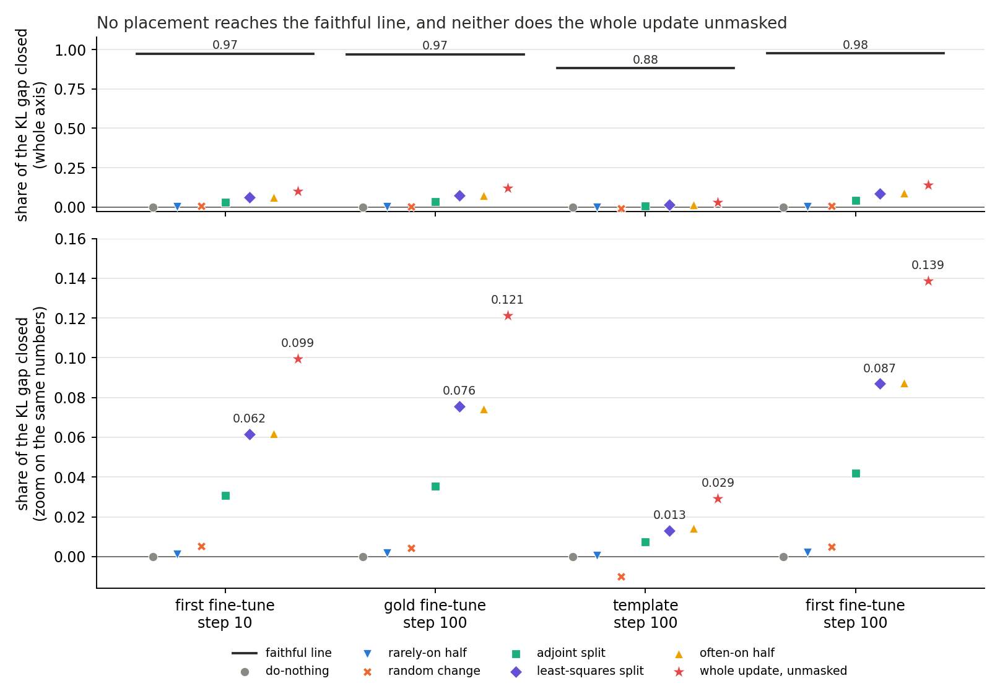
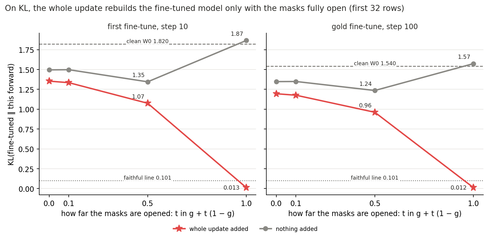
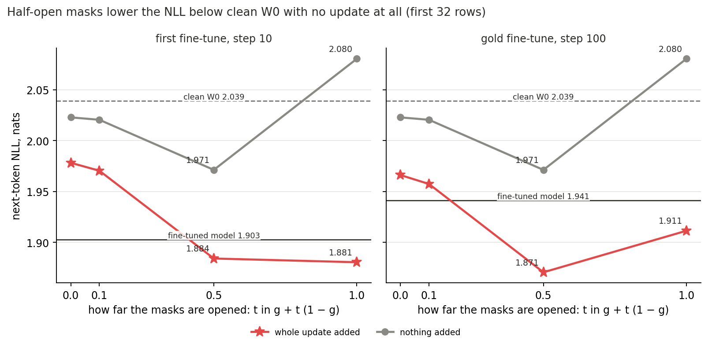

# Can the pass test on Qwen tell a good placement from a bad one, and can it pass anything? (E68)

*2026-11-03, D1, `qwen-decomp-lead` E68 writer. Independent check of the whole-update read and the opened masks, no bug found, holds with caveats that are applied here: `reports/reviews/2026-11-03_review_e68-ceiling.md`. Plan
`reports/plans/2026-11-03_plan_e68-d1-pass-test.md`, Amendments 1 and 2. Rules `experiments/qwen_pass_test/results/predictions.json`,
`predictions_amend1.json`, `predictions_amend2.json`. Notebook `notebooks/E68_qwen_pass_test.ipynb`.*

We placed four saved fine-tuning updates on Qwen3-1.7B's subcomponents in good, bad and candidate ways, and scored each against the fine-tuned model under the original model's masks.
The test fails the bad placements and no split is faithful, but adding the whole update unmasked also closes little of the KL gap, while keeping more of the next-token gain on three updates.
For `GOALS.md` this means the test can reject a placement but cannot yet pass one, so the question of what D1's test should be is open.

**A filed prediction was reversed. Something unexpected happened that we cannot fully explain. We filed a medium lean that
the whole update, added unmasked, would close 0.85 or more of the KL gap on the three maths-row updates. It closed 0.10, 0.12
and 0.14, and 0.03 on the template. Controls of that read were clean. That is true of KL: the same read keeps 0.26, 0.44 and 0.48 of
the next-token gain, and 0.02 on the template. Whether the masks drop any change of this size, or this update needs parts they
switch off, is not separated.**

## The answer

No split keeps the fine-tuned model's behaviour under the original model's masks. The test can fail a bad placement, on all
four updates. It cannot pass one: adding the whole update, unmasked, closes at most 0.14 of the KL gap, where we predicted 0.85 or
more. Least squares closing a tenth or less is therefore not evidence against least squares. On the two updates opened, the
missing Δ alone does not explain the gap. Whether the masks would drop any such change is unread. What D1's test should be is open.

## What we were trying to test

`GOALS.md` asks whether a decomposition can stay faithful through a real update. D1 is that question on Qwen3-1.7B, and it
needs a test that can fail a bad placement. This job also found out whether that test can pass a good one. Nothing was trained.

**The setting.** Each weight matrix is $W_0 = U V^\top + \Delta$. $U$ and $V$ hold the alive subcomponents' write and read
vectors. Γ gives each subcomponent a causal importance $g$ at each position. The masked forward multiplies each subcomponent
by $g$ and leaves Δ out. An update $\delta W$ is the fine-tune's change to the weights.

**The four updates.** All are saved states.

- The first fine-tune, on GSM8K's human-written solutions with no warm-up at a constant 1e-5, at steps 10 and 100. Its experiment is E40.
- The gold fine-tune: the same data, retrained with a warm-up at full precision, peak 1e-5, at step 100.
- The template fine-tune, peak 1e-6, at step 100, on E57's 64 template rows.

The other three read 128 maths rows, which are the unchanged model's greedy answers to GSM8K prompts. Every row has 256 tokens.

**The ruler.** Each state's masks are the ones Γ gives on $W_0$'s forward, with the state's own read vectors in Γ's readouts.
We call these W0's masks. Each KL is averaged over every position.

- $K$: KL(fine-tuned model ‖ the state's masked forward).
- $K_D$: that KL for do-nothing, which puts the whole update in Δ and so loses it here.
- $K_0$: KL($W_0$ ‖ $W_0$'s masked forward), the damage the masks do to the unchanged model.
- **Share of the KL gap closed:** $(K_D - K)/(K_D - K_0)$. Do-nothing reads 0. A $K$ as small as $K_0$ reads 1.
- **Faithful line:** $K \le 1.5\,K_0$, filed for this job. It sits between 0.88 and 0.98 on the share's axis.
- **Carried:** one minus Δ's share of the update, weighted by input covariance. **Per unit carried** is the share closed over this.
- **Gain kept:** [NLL($W_0$ masked) − NLL(state masked)] / [NLL($W_0$ clean) − NLL(fine-tuned clean)], next-token NLL over every position.

**The arms, and what each rules out.**

- *Often-on half and rarely-on half:* the update placed on the half of each matrix's subcomponents Γ often or rarely switches on. A test with no power scores them alike.
- *Random change:* scaled until its unmasked KL from $W_0$ is within a factor of 1.5 of the fine-tune's. It rules out credit for any change of that size.
- *Least-squares and adjoint splits:* the two candidates, in `GOALS.md`'s Terms. The adjoint split is scaled per matrix, as filed there.
- *Whole update, unmasked:* Amendment 1's yardstick. Each matrix's output is $(x V \cdot g) U^\top + x\,\delta W^\top$ for its input $x$. We call it the ceiling. It is a name, not a bound: nothing proves that a placement cannot exceed it.
- *Opened masks:* Amendment 2. The mask becomes $g + t(1-g)$, $t$ in 0.1, 0.5 and 1, with and without the whole update, on the first 32 rows of two updates. At $t = 1$ only Δ is missing.
- *Masks from the state's own weights:* Γ read on the state's own weights instead of $W_0$'s. Called reading A in the files, with W0's masks as reading B.

Expected values, before the run: do-nothing reads 0 share and 0 gain under W0's masks. The first fine-tune at step 10 reproduces the earlier job's numbers.

## What we expected, and why

**The two halves would separate.** An earlier read gave 0.13 per unit carried for the often-on half against 0.004 for the
rarely-on half, on the first fine-tune at step 10. We leaned medium on the template, whose KL is small.

**No split would reach the faithful line.** Held firmly. Least squares was expected at 0.06 to 0.09 on the gold fine-tune.

**The state's own masks would not separate the halves.** Earlier KLs under them were nearly equal.

**The whole update would come close.** We filed a medium lean of 0.85 or more on the three maths-row updates. The thought was
that adding everything back leaves only the masks' own damage.

**Opening the masks would point at the masks.** Δ is small on the rows the decomposition was trained on.

## What we observed

### Does the test fail a bad placement?

**Reading it.** Yes, on all four updates. The often-on half reads at least 20 times the rarely-on half per unit carried, and
beats it on every row of every update. The random change stays within about 0.01 of do-nothing's 0. The gap is many times the row
noise in every case.

| update | often-on, per unit | rarely-on, per unit | random, share | gap | 2 × row half-width | often-on closer, rows | verdict |
|---|---|---|---|---|---|---|---|
| first fine-tune, step 10 | 0.129 | 0.0044 | 0.0053 | 0.124 | 0.0035 | 128 of 128 | holds |
| gold, step 100 | 0.169 | 0.0074 | 0.0042 | 0.161 | 0.0050 | 128 of 128 | holds |
| template, step 100 | 0.030 | 0.0014 | −0.0100 | 0.029 | 0.0033 | 64 of 64 | holds |
| first fine-tune, step 100 | 0.185 | 0.0078 | 0.0050 | 0.177 | 0.0049 | 128 of 128 | holds |

The first fine-tune at step 10 reproduced the earlier job: largest gap 8.9e-9 against a tolerance of 1e-3, and do-nothing at 0.

### Is any split faithful?

**Reading it.** No. Least squares and the adjoint split read "partial" on all four updates, and no state comes near the line.
The least-squares KL is at least 3.4 times the line, where the line is 0.104 or 0.105.

| update | state | $K$ | share closed | carried | per unit | gain kept | Δ share | label |
|---|---|---|---|---|---|---|---|---|
| first, step 10 | do-nothing | 1.374 | 0 | 0 | none | 0 | 1 | |
| | rarely-on | 1.372 | 0.0013 | 0.288 | 0.0044 | 0.004 | 0.712 | |
| | random | 1.367 | 0.0053 | 1 | 0.0053 | 0.022 | 0 | |
| | adjoint | 1.334 | 0.031 | 0.9995 | 0.031 | 0.087 | 0.0005 | partial |
| | least squares | 1.293 | 0.062 | 0.636 | 0.097 | 0.175 | 0.364 | partial |
| | often-on | 1.293 | 0.062 | 0.478 | 0.129 | 0.176 | 0.522 | |
| gold, step 100 | do-nothing | 1.237 | 0 | 0 | none | 0 | 1 | |
| | rarely-on | 1.234 | 0.0019 | 0.260 | 0.0074 | 0.012 | 0.740 | |
| | random | 1.232 | 0.0042 | 1 | 0.0042 | 0.065 | 0 | |
| | adjoint | 1.195 | 0.036 | 0.9992 | 0.036 | 0.139 | 0.0008 | partial |
| | least squares | 1.149 | 0.076 | 0.611 | 0.124 | 0.300 | 0.389 | partial |
| | often-on | 1.150 | 0.074 | 0.442 | 0.169 | 0.292 | 0.558 | |
| template, step 100 | do-nothing | 0.364 | 0 | 0 | none | 0 | 1 | |
| | rarely-on | 0.364 | 0.0004 | 0.318 | 0.0014 | 0.0002 | 0.682 | |
| | random | 0.367 | −0.0100 | 1 | −0.0100 | 0.0006 | 0 | |
| | adjoint | 0.362 | 0.0075 | 0.9999 | 0.0075 | 0.005 | 0.0001 | partial |
| | least squares | 0.360 | 0.013 | 0.649 | 0.020 | 0.010 | 0.351 | partial |
| | often-on | 0.360 | 0.014 | 0.472 | 0.030 | 0.011 | 0.528 | |
| first, step 100 | do-nothing | 1.488 | 0 | 0 | none | 0 | 1 | |
| | rarely-on | 1.485 | 0.0022 | 0.288 | 0.0078 | 0.012 | 0.712 | |
| | random | 1.481 | 0.0050 | 1 | 0.0050 | 0.022 | 0 | |
| | adjoint | 1.429 | 0.042 | 0.9992 | 0.042 | 0.154 | 0.0008 | partial |
| | least squares | 1.365 | 0.087 | 0.631 | 0.138 | 0.325 | 0.369 | partial |
| | often-on | 1.364 | 0.087 | 0.473 | 0.185 | 0.326 | 0.527 | |

The least-squares split on the gold fine-tune read 0.076, inside the filed 0.06 to 0.09. Δ's share fails nothing, under the
user's rule of 2026-10-29, and is reported only.

### Can the test pass anything at all?

**Reading it.** No, and this reversed the filing. The whole update, added unmasked, closes 0.10, 0.12, 0.03 and 0.14 of the KL gap,
in the figure's order. The filed label on all four is "cannot pass", against a filed medium lean of 0.85 or more on the three
maths-row updates. That is true of KL. On next-token NLL the same read keeps 0.26, 0.44 and 0.48 of the gain on the three
maths-row updates and 0.02 on the template, so only the template reads low on both rulers. The gain ruler is not clean either,
as the NLL section below shows, so neither number is the share of the update's useful effect.

Both controls were clean. With the added term at zero the KL reads 1.37381065, as do-nothing does. The same hook without masks
rebuilt the fine-tuned model on 8 rows, to a KL of 1.1e-9 against 1.84 for clean $W_0$.

| update | $K$, whole update | line $1.5\,K_0$ | $K_D$ | share closed | gain kept | label |
|---|---|---|---|---|---|---|
| first, step 10 | 1.244 | 0.104 | 1.374 | 0.099 | 0.258 | cannot pass |
| gold, step 100 | 1.095 | 0.104 | 1.237 | 0.121 | 0.443 | cannot pass |
| template, step 100 | 0.355 | 0.105 | 0.364 | 0.029 | 0.022 | cannot pass |
| first, step 100 | 1.291 | 0.104 | 1.488 | 0.139 | 0.477 | cannot pass |

**So least squares closing a tenth or less is not evidence against least squares.** It is near what the whole update does on
this ruler.

| update | KL share: least squares, whole update, ratio | gain: least squares, whole update, ratio | adjoint's ratio, KL share and gain |
|---|---|---|---|
| first, step 10 | 0.062, 0.099, 0.62 | 0.175, 0.258, 0.68 | 0.31, 0.34 |
| gold, step 100 | 0.076, 0.121, 0.62 | 0.300, 0.443, 0.68 | 0.29, 0.31 |
| template, step 100 | 0.013, 0.029, 0.45 | 0.010, 0.022, 0.47 | 0.26, 0.25 |
| first, step 100 | 0.087, 0.139, 0.63 | 0.325, 0.477, 0.68 | 0.30, 0.32 |

The gain ruler gives more room than the KL share: both columns of gain are larger. As a fraction of the whole update, though,
least squares stands only a little higher on gain than on KL share, at 0.68 against 0.62. In absolute terms it falls further
short on gain, by 0.08 to 0.15 on maths rows against 0.04 to 0.05 on the KL share.

### Does the missing Δ alone explain the gap?

**Reading it.** No, on the two updates opened, first 32 rows only. With every subcomponent fully on, the whole update added and Δ
off, the KL reads 0.013 and 0.012. That is under the faithful line and about a hundredth of its value under W0's masks, so the
filed rule's label is "masks". What this shows is that Δ's absence alone costs 0.013. It does not show that Δ would not help
under the masks, because Δ on under the masks was never read. Half-open masks are not enough: the KL still reads 1.07 and 0.96 at
$t = 0.5$. The template and the first fine-tune's step 100 were not opened, and the template has the lowest reading.

In the review's words, which this report adopts: on Qwen3-1.7B, with masks from Γ on the original model's forward and Δ off,
adding the whole fine-tuning update unmasked at all 196 matrices closes only 0.03-0.14 of the KL gap to the fine-tuned model.
On the two updates opened, first 32 rows, switching every subcomponent fully on with the update added reads KL about 0.013, so the
absence of Δ alone does not explain the gap; the masks are needed for it. Whether restoring Δ under the masks would help, and
whether the masks treat this update differently from any other change of the same size, was not read.

Three limits apply to this read. Nothing yet separates "the masks drop any change of this size" from "the update needs parts the
masks switch off"; E72 reads a random change the same way (`reports/plans/2026-11-03_plan_e72-d1-second-test.md`).
KL($W_0$ ‖ the masked forward at $t$) was not read, so we have no measure of whether the half-open model is itself broken.
And KL(fine-tuned ‖ ·) may overstate the loss through tail mass, because other directions, top-token agreement and accuracy were
not read. No mechanism is claimed.

Other readings fit equally, from the review. The KL holds high until the very end, at 1.35, 1.33, 1.07 and 0.013 on the first
fine-tune, which also fits a sum that only rebuilds the weights when every subcomponent is at exactly 1. And masks from Γ on the
fine-tuned model's own forward, with nothing added, read a KL of 0.104 on the first update, against 1.374 for W0's masks. So on that
update the choice of masks matters, not only masks as such, though that state's gain is only 0.24.

| update, 32 rows | $t$ | KL, update added | KL, nothing added | NLL, update added | NLL, nothing added |
|---|---|---|---|---|---|
| first, step 10 | 0 | 1.354 | 1.495 | 1.978 | 2.023 |
| | 0.1 | 1.334 | 1.498 | 1.970 | 2.021 |
| | 0.5 | 1.075 | 1.345 | 1.884 | 1.971 |
| | 1 | 0.0126 | 1.866 | 1.881 | 2.080 |
| gold, step 100 | 0 | 1.195 | 1.348 | 1.966 | 2.023 |
| | 0.1 | 1.176 | 1.349 | 1.957 | 2.021 |
| | 0.5 | 0.961 | 1.236 | 1.871 | 1.971 |
| | 1 | 0.0125 | 1.574 | 1.911 | 2.080 |

On these rows clean $W_0$ reads KL 1.820 and 1.540 and NLL 2.039. The fine-tuned model reads NLL 1.903 and 1.941. The rule's ratios
of fully open to masked are 0.0093 and 0.0104, against the filed 0.1. The NLL columns are read from the amendment's per-row files;
they are not a filed number.

### Does next-token NLL tell the same story as the KL?

**Reading it.** No, and we cannot explain the difference. This read was not filed. With nothing added, half-open masks bring
the NLL to 1.971, below clean $W_0$'s 2.039. That is half of the first fine-tune's own drop on these rows, and 0.69 of the gold
fine-tune's, with no update involved. With the whole update added at $t = 0.5$ the NLL reaches 1.884 and 1.871, below the
fine-tuned model, while the KL to that model is still 1.07 and 0.96. So the two rulers disagree about the half-open model, and the
masks alone can move gain kept. This holds on 32 rows of two updates only.

### Do masks from the state's own weights separate the halves?

**Reading it.** No, as filed, on the one update read. Gain kept under the state's own masks reads 0.226 for the often-on half and
0.241 for the rarely-on half. Under W0's masks the same difference is 0.172 in the often-on half's favour. The test has power only
under W0's masks, the masks under which the whole update closes so little of the KL gap.

| state, first fine-tune step 10 | KL, own masks | gain, own masks | gain, W0's masks |
|---|---|---|---|
| do-nothing | 0.1044 | 0.240 | 0 |
| rarely-on half | 0.1044 | 0.241 | 0.004 |
| often-on half | 0.1034 | 0.226 | 0.176 |

The difference under own masks is −0.015, with a filed bar of twice the half-width, 0.016, and half of W0's masks' difference, 0.086.
No faithful line was filed for these masks. For scale, 0.1044 is about 1.5 times $K_0$'s 0.0696, so do-nothing would sit on a
line of that form.

## What we learned

For `GOALS.md`'s weak version on Qwen, this test cannot yet say yes. It can say that a placement is bad, but under W0's masks even
the unplaced whole update falls far short of the faithful line on KL. Least squares and the adjoint split therefore have no verdict from
it beyond "partial". Least squares stays at about two-thirds of the whole update on maths rows, and the adjoint split at about a
third. The scoring of placements stands, while the pass end of the test does not.

## How compelling is the evidence

- **Controls.** Reproduction within 1e-8, and both of the whole-update read's controls clean.
- **Noise.** The filed row half-width on the halves' difference is 0.002 to 0.0025. An unfiled row bootstrap of our own, seed 0, gives each share closed to about 0.001 and gain kept to about 0.03 to 0.13 either side for least squares and the whole update on maths rows.
- **Coverage.** One row set per update, and the same 128 maths rows on three updates. No seeds of the fine-tunes. The opening is on 32 rows of two updates.
- **What the KL is blind to.** It says nothing about which tokens differ. KL(fine-tuned ‖ clean $W_0$) reads 1.635, 1.377 and 1.718 on the maths-row updates, ten to fourteen times the fine-tune's NLL drop of 0.171, 0.129 and 0.125. On the template it reads 0.323 against 0.530. So on maths rows most of this KL does not show up in next-token NLL.
- **What per unit carried is blind to.** Whether the carried part is the useful part.
- **The first fine-tune's history.** Its forward was under bf16 autocast, so its first steps were partly blind by E61's account. It is read here as a saved state.
- **Independence.** The whole-update read and the opened masks were checked from the per-read sums and by reading the code: no bug, holds with caveats (`reports/reviews/2026-11-03_review_e68-ceiling.md`). The check ran nothing on a GPU. The placements' table was not its scope.

## Surprises

**The whole update reversed the filing,** as stated at the top.

**A filed expectation was wrong.** The plan's table expected do-nothing to keep near 1 of the gain under the state's own masks. It reads 0.24.

**The gain ruler's top is not 1.** The plan's table says the clean fine-tuned model reads 1 by definition. The numerator starts from the masked forward and the denominator from clean $W_0$, so it reads 0.93, 0.90, 0.88 and 0.90. Nothing filed depends on this, and the prediction stands as filed.

**Four numbers are unexplained.** These are candidates only. No cause is named.

1. *Do-nothing under the state's own masks:* KL 0.104, gain 0.24. Under these masks its NLL is 2.023, so about 0.12 is left to the fine-tuned model's 1.905, the same size as the KL. By arithmetic alone, a small-looking KL is not small on this gain's ruler, whose denominator is 0.171.
2. *$W_0$'s masked forward beats clean $W_0$.* Its NLL is lower by 0.012 on maths rows, and by 0.062 on template rows. KL(fine-tuned ‖ masked $W_0$) is below KL(fine-tuned ‖ clean $W_0$) on three updates: 1.374 against 1.635, 1.237 against 1.377 and 1.488 against 1.718. On the template it goes the other way, 0.364 against 0.323. The masks could be smoothing predictions. Entropy was not read.
3. *Least squares nearly equals the often-on half in KL and gain.* The difference in share closed is at most 0.0012 on all four updates, and in gain at most 0.008. By an unfiled paired row bootstrap the differences are small but mostly outside row noise, and their sign varies: least squares is higher on gold and lower on the others. Its carried part is larger, 0.64 against 0.48 on the first update, which is why its per-unit reading is lower. The coefficients were not saved, so where it put the update cannot be read.
4. *Half-open masks lower the NLL with no update,* as the last figure shows.

## What next

E68's two amendments are spent. The filed branch reads "D1 blocked" until the test changes, and this report recommends no next test. The lead takes the choice to the user in a separate card. E72 is the separate plan that reads a random change the same way.

## Scorecard

| id | claim | rule | read | verdict |
|---|---|---|---|---|
| control_reproduce | first update reproduces the earlier job | within 1e-3 | largest gap 8.9e-9 | holds |
| teeth | often-on above rarely-on and random | gap over 2w, do-nothing misses the line | see table | holds on all four, the template's medium lean included |
| label | least squares placed or partial; 0.06 to 0.09 on gold; none faithful | filed bands | partial on all four, 0.076, none faithful | as expected |
| reading_A | own masks do not separate | $d_A$ over 2 half-widths and over $d_B/2$ | $d_A$ −0.015 | does not separate, as expected |
| control_zero | added term at 0 reads do-nothing's KL | 1e-6 relative | 1.37381065 | holds |
| control_hook | hook without masks rebuilds the fine-tuned model | at most 0.01 of clean KL | ratio 6e-10 | holds |
| ceiling | "near", 0.85 up to 1, on three updates, medium lean | faithful line, else 0.5 | 0.099, 0.121, 0.029, 0.139 | **cannot pass on all four, reversed** |
| cause | masks on both updates, medium lean | fully open at most 0.1 of masked | 0.0093, 0.0104 | "masks", as expected, on u1 and u2 only; the label does not cover Δ on under the masks |

Filed text stands: nothing above changes a prediction.

## Departures from the literature

- **Where Γ is read.** The VPD authors train Γ on $W_0$ and read it there. Reading masks from $W_0$ for a changed state, or from a changed state's own weights with Γ frozen, is this project's operation.
- **The faithful line.** The weak version in `GOALS.md` lists VPD's stochastic, adversarial, CI-masked and unmasked checks. Here only a CI-masked KL to the fine-tuned model was read, against 1.5 times the masked KL at $W_0$, a project choice. No adversary ran.
- **The masked forward.** Δ is off, as in the authors' CI-masked reconstruction loss. No departure.
- **Bootstrap, splits, halves, whole-update read, opened masks and gain kept.** These are this project's, with no published source.

## Provenance

`experiments/qwen_pass_test/results/`. `score.json`, job 50047, about 3 h, L40, normal QoS. `amend1/score.json`, jobs 50356 and 50364, L40, debug QoS; 50356 stopped at its wall clock before the fourth update and 50364 resumed it. `amend1/open.json`, job 50371, L40, debug QoS. Cost $0. Code `experiments/qwen_pass_test/{run,rules,amend1}.py`, figures `plot.py`. Numbers beyond the score files come from the per-row sums in `results/u*/` and `results/amend1/*.json`. Stage S files were scratch and are gone.

## Not run

- An independent check of the placements' table, and any GPU rerun of the whole-update read.
- A random change of matched KL added unmasked, which E72 plans to read.
- Any adversary.
- The whole update under the state's own masks, and any partial share of the update.
- Δ turned on with masks.
- The opening on the template or on the first fine-tune's step 100.
- KL($W_0$ ‖ the masked forward at $t$), so whether a half-open model is itself broken.
- Predictive entropy of any forward.
- Other KL directions, top-token agreement and accuracy.
- The splits' coefficients, which were not saved.
- Which activations the masks change.
- Other rows, in-span as a state, web rows and replays.
- Step 1 and intermediate gold steps.
- RL and null updates, which do not exist yet.

The open question: what should D1's test be?
