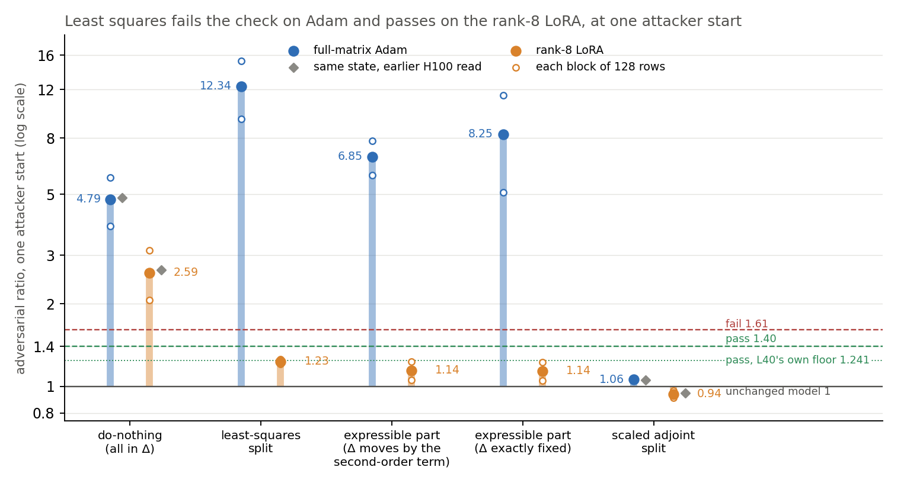
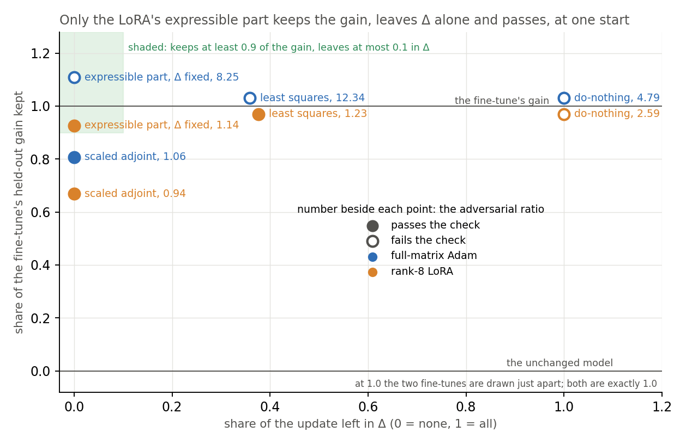

# Analysis: does the least-squares split of the lowercase fine-tunes pass the adversarial check? (E71)

*2026-11-03, coding agent, commute-lead E71 writer. Independently checked, no bug found:
`~/commute-data/scratch/commute-lead/e71-check/check.md`, with `pieces.json` beside it. Plan:
`reports/plans/2026-11-03_plan_e71-scorecard-ls.md`. Rules: `experiments/scorecard_ls/results/predictions.json`. Notebook:
`notebooks/E71_scorecard_ls.ipynb`.*

We tested how the least-squares split of two lowercase fine-tunes, and the part of each update its subcomponents can express, hold up against an attacker.
Both fail on the full-matrix Adam fine-tune and both pass on the rank-8 LoRA, from the one start used, against our prediction.
For the weak version in `GOALS.md`, least squares still falls short because over a third of the update stays in Δ, while the LoRA's other state is a new lead.

**A filed prediction was reversed. We predicted that least squares and the expressible part would fail the check on both
fine-tunes. We also predicted that least squares would read above do-nothing on both. On the rank-8 LoRA all three were
refuted, and we cannot say why the LoRA and Adam differ.**

## The answer

Least squares fails the check on Adam and passes it on the rank-8 LoRA, from one attacker start. The LoRA's pass is real
but thin: it clears the line measured for this card by under 1%. It still leaves 38% of the update in Δ. The LoRA's
expressible part keeps most of the gain, leaves Δ alone and passes at that one start. Why the two fine-tunes differ is
not established.

## What we were trying to test

The Q1 slide has a row per state and a column per fine-tune, on the broad lowercase task, and its least-squares row was
empty. The task was to fill it with the check already used for the slide's other rows.

The symbols, per weight matrix:

- $W_0 = U V^\top + \Delta$ is the unchanged model, with $U$ and $V$ the alive subcomponents' write and read vectors.
- $\delta W$ is the fine-tune's weight change.
- $(dU, dV)$ is the **least-squares split**: the least-norm change with $dU V^\top + U dV^\top \approx \delta W$.
- $O(\delta W) = (I - P_U)\,\delta W\,(I - P_V)$ is the remainder that the split cannot reach.

**The check** is the adversarial ratio. An attacker searches over masks of the subcomponents, to push the output away from
the target weights. It takes 20 steps of 0.1, on 256 Pile validation rows in two blocks of 128. The ratio is its KL at a state
over its KL at the unchanged model, in the same job. The unchanged model reads 1. At or under 1.40 passes and at or over
1.61 fails. One attacker start was used, at adversary seed 0.

**The fine-tunes** are the two saved lowercase updates, both of 300 steps: a full-matrix Adam fine-tune and a rank-8 LoRA.
Their held-out gains are 0.130 and 0.148 nats. They were regenerated on an L40 for an earlier run, and their hashes were
checked here.

The states, and what each rules out:

- **Do-nothing**: all of $\delta W$ in Δ. The reference that must fail, so that a pass elsewhere means something.
- **Scaled adjoint split**: the control that must pass. Its weights differ from the fine-tune's and Δ does not move.
- **Least-squares split**: target weights $W_0 + \delta W$, subcomponents moved by $(dU, dV)$. Its target weights equal the
  fine-tune's, so its behaviour kept is 1 by construction, not a finding.
- **Expressible part**, a name used in this report: the update without its remainder, with the same moved subcomponents.

"The expressible part, Δ fixed" has two exact readings, and both were read, with neither chosen:

1. **Target $W_0 + \delta W - O(\delta W)$.** Δ moves by $-dU\,dV^\top$, the second-order term. That term is 0.10% of the
   update's energy on Adam and 0.036% on the LoRA, pooled over matrices. Its largest single matrix reaches 1%.
2. **Target $W_0 + (U + dU)(V + dV)^\top - U V^\top$.** Δ does not move at all.

The other two columns of the slide are read beside the check. **Behaviour kept**, $s$, is the share of the fine-tune's
held-out gain that the state's target weights keep, on 64 rows. Zero is the unchanged model and one is the fine-tune. **Left in
Δ** is $\|\Delta' - \Delta\|^2 / \|\delta W\|^2$ pooled over matrices and not weighted by inputs, which is the emoticon
slide's measure.

## What we expected, and why

We expected least squares to fail on both fine-tunes and to read above do-nothing, because it did both on the emoticon
Adam fine-tune. The filed prior quoted only that Adam reading. It left out the same earlier run's LoRA rows on emoticon, where least
squares read at most 1.32 at the three steps read. So a low LoRA reading had a precedent that we should have weighed.

We expected at least 30% of the update in Δ, as on emoticon. We expected the expressible part to keep more
of the gain than the adjoint split. We guessed that the expressible part alone would fail, with no prior, because it uses
the same moved subcomponents as the failing least-squares state.

## What we observed

### Does the least-squares split pass the check?



**Reading it.** No on Adam and yes on the rank-8 LoRA, each from one attacker start. Adam's least squares reads 12.34,
far over the fail line, against do-nothing's 4.79. The LoRA's reads 1.23, under the pass line of 1.40 and below its
do-nothing at 2.59. All controls landed where they must, so the apparatus is not the explanation.

**How strong the LoRA pass is.** The pass is real: the same code reads 8.25 on Adam, so only the file differs. It is one
start. It sits 12% under the filed line of 1.40, which comes from the H100's spread between starts. It sits under 1% under
1.241, the pass line E47 measured for these rows on the L40, this job's card. The earlier teacher-trained decomposition of a rank-8 LoRA moved from 1.23 to 1.33 across two starts. That was on the same
rows and card, so a move that size is already known.

**How far the Adam order holds.** Adam's least squares reads above its do-nothing on both blocks, but at one start. A
budget start, a differently set-up attacker, once took a do-nothing state from 1.6 to 9.2. So the order of the two is unsettled.

| fine-tune | state | check | verdict | kept $s$ | left in Δ | damage | gap | unmasked | stochastic | CI-masked |
|---|---|---|---|---|---|---|---|---|---|---|
| Adam | do-nothing | 4.794 | fail | 1.000 | 1.000 | 0.2358 | 0 | 26.31 | 1.109 | 1.170 |
| Adam | least squares | 12.340 | fail | 1.000 | 0.3582 | 0.2358 | 0 | 3.155 | 1.095 | 1.145 |
| Adam | expressible, second-order term in Δ | 6.848 | fail | 1.110 | 0.00100 | 0.1336 | 0.0192 | 0.922 | 1.041 | 1.080 |
| Adam | expressible, Δ exactly fixed | 8.253 | fail | 1.108 | 2.7e-10 | 0.1340 | 0.0193 | 0.916 | 1.040 | 1.079 |
| Adam | scaled adjoint | 1.060 | pass | 0.807 | 1.9e-6 | 0.0502 | 0.1115 | 0.957 | 1.049 | 1.082 |
| LoRA | do-nothing | 2.592 | fail | 1.000 | 1.000 | 0.1218 | 0 | 13.94 | 1.067 | 1.087 |
| LoRA | least squares | 1.232 | pass | 1.000 | 0.3764 | 0.1218 | 0 | 2.137 | 1.058 | 1.079 |
| LoRA | expressible, second-order term in Δ | 1.143 | pass | 0.926 | 0.00036 | 0.0656 | 0.0095 | 0.991 | 1.030 | 1.043 |
| LoRA | expressible, Δ exactly fixed | 1.138 | pass | 0.927 | 6.8e-10 | 0.0653 | 0.0097 | 0.992 | 1.030 | 1.043 |
| LoRA | scaled adjoint | 0.938 | pass | 0.668 | 2.1e-6 | 0.0241 | 0.0455 | 0.991 | 1.013 | 1.015 |

*Check, unmasked, stochastic and CI-masked are ratios to the unchanged model's reading. Damage is the KL from the unchanged
model on plain Pile rows. Gap is the KL from the fine-tuned model on held-out lowercase rows.*

The two blocks of each state, each KL over the unchanged model's mean KL of 0.692:

| state | first block | second block | check |
|---|---|---|---|
| Adam, do-nothing | 3.84 | 5.75 | 4.79 |
| Adam, least squares | 9.41 | 15.27 | 12.34 |
| Adam, expressible, second-order term in Δ | 5.87 | 7.83 | 6.85 |
| Adam, expressible, Δ exactly fixed | 5.07 | 11.44 | 8.25 |
| LoRA, do-nothing | 2.06 | 3.12 | 2.59 |
| LoRA, least squares | 1.21 | 1.26 | 1.23 |
| LoRA, expressible, second-order term in Δ | 1.06 | 1.23 | 1.14 |
| LoRA, expressible, Δ exactly fixed | 1.05 | 1.22 | 1.14 |

### Does the expressible part alone pass, and does it keep the behaviour?



**Reading it.** On the rank-8 LoRA yes at this one start, and on Adam no. The LoRA's expressible part keeps 0.93 of the
gain, moves Δ by at most 0.04% and reads 1.14. It keeps more than the adjoint split's 0.67 and leaves Δ as untouched. On
Adam it keeps all of the gain but fails, at 6.85 and 8.25, with Δ fixed. So on Adam the fail does not need the remainder in
Δ.

**The two readings on Adam are probably not different.** The readings of 6.85 and 8.25 look apart, but the blocks flip sign.
The reading with the second-order term in Δ is higher on the first block and lower on the second, as the table above shows. Damage, $s$ and the stochastic ratio agree within
0.5%, and the LoRA pair agrees within 0.5% on each block. So the gap is probably attacker noise, not an effect of the
second-order term, and no cause is established.

**Behaviour kept above 1 on Adam is not a claim about subcomponents.** Adam's $s = 1.11$ reads the target weights only, with
no masks. So it says nothing about the moved subcomponents. An earlier reversion read $s$ up to 1.036. Removing the
remainder raised the held-out log-probability by 0.014 nats and cut damage on plain text from 0.236 to 0.134. We do not
know why, and 64 rows carry the number.

**Against teacher training.** On a rank-8 LoRA of this task, teacher training read 1.27 and kept 0.96 on an H100. The
expressible part reads 1.14 and keeps 0.93 on an L40, with no training. That is a card apart and each is at one start, so
no order is claimed.

### Do the controls match the slide's earlier H100 readings?

Each control landed within 2.3% of the slide's earlier H100 reading, so the new row sits on the same scale. The band was
10%. No verdict flipped.

| fine-tune | quantity | H100, earlier | L40, this job | gap |
|---|---|---|---|---|
| Adam | do-nothing check | 4.868 | 4.794 | -1.5% |
| Adam | scaled adjoint check | 1.054 | 1.060 | +0.6% |
| Adam | scaled adjoint $s$ | 0.804 | 0.807 | +0.0034 |
| LoRA | do-nothing check | 2.653 | 2.592 | -2.3% |
| LoRA | scaled adjoint check | 0.946 | 0.938 | -0.9% |
| LoRA | scaled adjoint $s$ | 0.666 | 0.668 | +0.0022 |

The unchanged model read 0.691743 mean KL, equal to the filed L40 value. Each fine-tune's gain equalled its regenerated
value. The least-squares state's $s$ and gap read as its construction requires. Δ did not move in the exactly-fixed reading.

### Why do the LoRA and Adam differ?

Not established. Nothing the run or the independent check read separates them enough.

| quantity | Adam | LoRA |
|---|---|---|
| check minus 1, least squares | 11.3 | 0.23 |
| squared norm of $\delta W$, all matrices | 6.25 | 2.43 |
| largest rank of $\delta W$ over matrices | 768 | 8 |
| unweighted share outside the subcomponents / the same for a random update, energy-weighted | 0.357 / 0.390 | 0.378 / 0.414 |
| gross over net change of the moved subcomponents | 1.50 | 1.57 |
| largest change of one matrix's subcomponents over their own norm | 0.84 | 0.42 |

The outside share sits near its null on both, and cancellation is alike. The norm differs 1.6 times, and the check's excess
differs about 49 times. So the check is strongly non-linear in size, or rank matters, or something unread does.
Scaling Adam's least squares to the LoRA's norm, and cutting it to rank 8, would separate the first two.

## What we learned

For `GOALS.md`, least squares does not meet the weak version on either fine-tune, because Δ absorbs 36% and 38% of the update.
That holds whatever a further start reads. The check's verdict depends on the fine-tune here, as it did for teacher training
on the same two. The new thing is the LoRA's expressible part. It writes most of a broad LoRA's effect onto the subcomponents
by a one-shot formula, and it passes at one start. Its weights are not the fine-tune's, since they drop the remainder. Whether
that survives other starts and rows is open. It would bear on whether a finished update can be written on the existing
subcomponents. On Adam the same formula fails with Δ fixed, so it is not a general answer.

## How compelling is the evidence

- **One attacker start, 256 rows, for every state.** A state that fails only at other starts or rows reads as a pass here.
- **The lines come from another card.** The filed lines rest on the H100's spread of 7.5% between starts. The L40's on these
  rows is 21%, which gives 1.241 and 1.813. On the L40's lines the LoRA's least squares passes by under 1%, and its expressible part by 8%.
- **Left in Δ is unweighted.** It counts every weight direction alike, not by input.
- **Behaviour kept is 64 rows of target weights.** It reads no masks.
- **One decomposition, one task, one seed of each fine-tune.** Nothing here generalises beyond these two files.
- **The independent check** found no bug, recomputed the Δ numbers on CPU, and traced the code to the same computation as
  the earlier reads. It did not re-read any state on a GPU. That the model's state is restored between reads rests on reading
  the code, because no control is repeated at the job's end.

## Surprises

**Something unexpected happened that I cannot explain.** We predicted three things on both fine-tunes: least squares fails,
it reads above do-nothing, and the expressible part fails. On the rank-8 LoRA all three reversed. Least squares read 1.23,
below do-nothing at 2.59, and the expressible part read 1.14. On Adam all three held. The size of the difference, about 49 times
in excess against 1.6 times in norm, has no explanation here. None of this is refiled.

Two smaller ones. Adam's expressible part keeps 1.11 of the gain. And the job took 25 minutes against the plan's 12.

Two sentences elsewhere on the slide page were left unchanged, because the task said to change nothing else. The damage
slide's caveat "no adversarial reading of the expressible part alone" is true on emoticon, and this run reads it on lowercase.
Plot 1's "every one-shot split fails at least one of the three counts" still holds for least squares on the LoRA, which leaves
38% in Δ, but the LoRA's expressible part clears the slide's three cut-offs at this one start. It is not one of the named splits.

## What next

1. Re-read the LoRA's least squares and expressible part at other starts and on rows 256-511. If they stay under the line, the
   slide's cell and the expressible part stand; if not, the cell changes and that lead closes.
2. Read Adam's least squares scaled to the LoRA's norm, and cut to rank 8. If one falls to the LoRA's range, that names size
   or rank as the reason they differ; otherwise neither is the reason alone.
3. Or leave it. The 67M runs only when the user asks, and the least-squares cell's Δ count is settled either way.

The choice is the decision card below.

**Runtime of the re-read,** from read times, not timed as a job. `results/run.log` gives 130 s per read with a stochastic half;
`experiments/claim_tests/results/large/t5.log` and `t1b.log` give about 117 s for a harness start alone and 58 s for the budget
start, on 256 rows of the L40.

| job | states | starts and rows | seconds |
|---|---|---|---|
| full list, one job | the unchanged model; do-nothing, least squares and both expressible readings on each fine-tune; Adam scaled; Adam cut | h0, h1, h2 and budget, on rows 0-255 and 256-511 | 11 x 2 x 409 = 8,998, about 2.5 h |
| cut, job 1 | the unchanged model; the LoRA's do-nothing, least squares and expressible with Δ fixed | h1 and budget on rows 0-255; h0 and budget on rows 256-511; unchanged model also at h0 on rows 0-255 | 4 x 350 + 117 + 47 = 1,564, about 26 min |
| cut, job 2 | the unchanged model; Adam's do-nothing, least squares and both expressible readings; Adam scaled; Adam cut | first five at h1 and budget, last two at h0 and budget, on rows 0-255; unchanged model also at h0 | 5 x 175 + 2 x 175 + 117 + 47 = 1,389, about 23 min |

So the full list does not fit under 30 minutes. Reusing this job's own reads at h0 would save only about 18 minutes of it. The cut
fits as two jobs, without much margin. It drops the third harness start and Adam on new rows. It also drops the LoRA's reading
with the second-order term, which matches the other within 0.5% on each block.

## Scorecard

| id | claim | rule | Adam | LoRA | verdict |
|---|---|---|---|---|---|
| P1 | Least squares fails the check | per fine-tune: check at or over 1.61 holds; at or under 1.40 refuted | 12.34 | 1.232 | **holds on Adam; refuted on LoRA** |
| P2 | Least squares reads above do-nothing | per fine-tune: ratio over 1.075 holds; under 1/1.075 refuted | 2.574 | 0.475 | **holds on Adam; refuted on LoRA** |
| P3 | Least squares leaves at least 30% in Δ | per fine-tune: at or over 0.30 holds | 0.358 | 0.376 | holds on both |
| P4 | The expressible part keeps more than the adjoint split | per fine-tune, each reading: difference over 0.02 holds | 0.303, 0.301 | 0.258, 0.258 | holds on both |
| P5 | The expressible part alone fails the check | per fine-tune, each reading: at or over 1.61 holds; at or under 1.40 refuted | 6.85, 8.25 | 1.143, 1.138 | **holds on Adam; refuted on LoRA** |

Filed expected values for the controls, all met: unchanged model within 0.1%; gains within 0.001; do-nothing fails, Δ share 1,
$s$ 1; adjoint passes, Δ share 0, $s$ near 0.80 and 0.67; least squares $s$ 1 and gap 0; exactly-fixed reading Δ share 0.

## Provenance

Results: `experiments/scorecard_ls/results/{reads.json,run.log,predictions.json}`. Code: `experiments/scorecard_ls/run.py`,
`plot.py`. Figures: `experiments/scorecard_ls/figures/{check,keep_delta}.png`. Inputs: `experiments/row_blocks/results/large/dW_{adam,lora}.pt`,
sha256 checked against `experiments/row_blocks/regen.json`. MATS cluster, NVIDIA L40, `debug` QoS, job 50287, 25 minutes, $0.
`results/large` holds nothing from this run. The lines 1.241 and 1.813 and the budget start's 1.6 to 9.2:
`reports/analyses/2026-10-29_analysis_e47-claim-tests.md`. The emoticon LoRA rows: `reports/analyses/2026-10-21_analysis_split-comparison.md`.
The 1.036 and 1.27 readings: `reports/analyses/2026-10-27_analysis_broad-fragility.md`.

## Not run

- Any start other than harness seed 0, including the budget start.
- Rows 256-511 or any other Pile rows.
- Adam's least squares scaled to the LoRA's norm, or cut to rank 8.
- The input-weighted size of the second-order term: the job saved no moments.
- A repeat of a control at the job's end.
- Any re-read of a state in fp32, or on an H100.
- A second seed of either fine-tune, and any task other than lowercase.

## Departures from the literature

- **The adversary.** It is the authors' `calc_multibatch_pgd_masked_recon_loss` under bf16 autocast, at their 128-row scope. We
  read it as a ratio to the unchanged model, on Pile rows, at one start. The ratio and its pass and fail lines are this project's.
- **Where Γ is read.** The authors trained Γ on $W_0$. Reading it on updated weights, with Γ frozen, is this project's operation.
- **The splits and the expressible part.** They are this project's operations, with no published source.

## Log text for the clerk

### New experiment card, `parts/experiments/e71.html`

Figures to publish: `experiments/scorecard_ls/figures/check.png` as `fig/e71_check.png`, `experiments/scorecard_ls/figures/keep_delta.png` as `fig/e71_keep_delta.png`.

```html
<article class="exp surprise" id="e71">
<div class="top"><span class="id">E71</span><span class="chip surprise">surprise</span><h3>Does the least-squares split of a broad fine-tune pass the adversarial check, and does the part the subcomponents can express pass alone?</h3><span class="when">2026-11-03 · MATS cluster L40, debug QoS, $0 (job 50287) · <code>experiments/scorecard_ls</code></span></div>
<p class="one"><strong>The question.</strong> The commute line asks whether a finished update can be written on the existing subcomponents (Q1). The Q1 slide scores each way of doing that on a broad task, a fine-tune that makes the model write lowercase text, and its least-squares row was empty. You asked for that row, and, as an extra reading, the part of the update the subcomponents can express, alone.</p>
<p class="one"><strong>What we did.</strong> The <em>least-squares split</em> moves each subcomponent by the smallest change that reproduces the update to first order, and leaves the rest of the update in Δ. The <em>expressible part</em>, a name used here, is the update without that rest, with the same moved subcomponents; Δ stays put. Two exact versions differ by a second-order term, and both were read. Each state went through the <em>adversarial ratio</em>: the damage an attacker searching over masks of the subcomponents does at a state, over what it does at the unchanged model. 1.40 or less passes and 1.61 or more fails. One attacker start on 256 Pile rows, for a full-matrix Adam fine-tune and a rank-8 LoRA. Do-nothing, which leaves the whole update in Δ and must fail, and the scaled adjoint split, which must pass, ran first.</p>
<p class="one"><strong>What we found.</strong> Least squares fails on Adam (12.3) and passes on the LoRA (1.23), and it leaves 36% and 38% of the update in Δ (first figure). We predicted fails on both. The expressible part fails on Adam and passes on the LoRA at 1.14, keeping 0.93 of the gain with Δ unmoved (second figure). Why the two fine-tunes differ is not established: the LoRA is 1.6 times smaller and has rank 8, and the share outside the subcomponents is near its random null on both.</p>
<p class="one"><strong>What it means.</strong> Least squares does not meet the weak version on either fine-tune, because Δ absorbs over a third of the update. The LoRA's pass is real but thin: one start, under 1% below the line measured for this card. The LoRA's expressible part is the one new lead, if it survives other starts. Whether to re-read it is a question for you (section {{n:decisions}}).</p>
<figure>

<figcaption><strong>1. Does least squares pass?</strong> On the LoRA, not on Adam. Up, on a log scale: the adversarial ratio, 1 for the unchanged model. Filled dots are each state's reading and hollow dots its two blocks of 128 rows. Grey diamonds are the same controls read earlier on an H100. The dotted line is the pass line measured on this card: the LoRA's least squares clears it by under 1%. The two readings of the expressible part on Adam differ in opposite directions on the two blocks, so that gap is probably attacker noise.</figcaption>
</figure>
<figure>

<figcaption><strong>2. Which state keeps the gain, leaves Δ alone and passes?</strong> Only the LoRA's expressible part, at one start. Across: the share of the update left in Δ. Up: the share of the fine-tune's gain kept on 64 held-out rows, read on the target weights with no masks. Filled passes the check and hollow fails it; the number is the ratio. Adam's 1.11 is not a claim about the subcomponents.</figcaption>
</figure>
<dl class="fields">
<dt>Run</dt><dd>One cluster job on an L40, 25 minutes, $0: the unchanged model, then five states for each of two saved lowercase fine-tunes. Independently checked; no bug found, no state re-read.</dd>
<dt>Found</dt><dd><ul>
<li>Against our prediction, least squares and the expressible part pass on the rank-8 LoRA at one start, and least squares reads below do-nothing there; on Adam they fail as predicted.</li>
<li>Adam's least squares reads above its do-nothing on both blocks, but one start cannot settle that order, since another start once moved a do-nothing state from 1.6 to 9.2.</li>
<li>Every control landed within 2.3% of its earlier H100 reading, so the new row sits on the slide's scale.</li></ul></dd>
<dt>Bears on</dt><dd>Q1</dd>
<dt>Moved on</dt><dd>The slide's row is filled. Whether to re-read the LoRA from more starts waits on you. Report <code>reports/analyses/2026-11-03_analysis_e71-scorecard-ls.md</code>, plan <code>reports/plans/2026-11-03_plan_e71-scorecard-ls.md</code>, notebook <code>notebooks/E71_scorecard_ls.ipynb</code>. Not run: other starts, other rows, Adam scaled to the LoRA's size or cut to rank 8.</dd>
</dl>
</article>
```

### Timeline line, 2026-11-03

The Q1 slide's empty least-squares row is filled for the lowercase fine-tunes. Least squares fails the adversarial check on Adam and, against our prediction, passes on the rank-8 LoRA at one attacker start, by under 1% of the line measured for that card. It leaves over a third of the update in Δ on both. See E71.

### New decision card, section `decisions`, first among the question cards

```html
<div class="card key decision" id="decision-lowercase-ls-starts"><span class="chip open urgency">Soon</span><div class="k">Question for you · commute-lead · new 2026-11-03</div><p class="small">Nothing runs until this is decided.</p><h3>The slide's new "pass" for a rank-8 LoRA under the least-squares split rests on one attacker start and clears a line by under 1%. Re-read it from more starts?</h3>
<p><strong>The question.</strong> The least-squares split moves each subcomponent by the smallest change that reproduces a fine-tune to first order, and leaves the rest of the update in Δ, the weights outside the subcomponents. The slide's new row reads it with the adversarial check: an attacker searches over masks of the subcomponents, and the damage it finds is divided by its damage on the unchanged model. 1.40 or less passes and 1.61 or more fails. Those readings used one attacker start, a single random starting point for the search. This is the small 67M model, where work runs only when you ask for it by name, so a further read needs your word.</p>
<p><strong>The evidence.</strong> On the lowercase task, the rank-8 LoRA's least-squares state reads 1.23, and the full-matrix Adam fine-tune's reads 12.3. We predicted both would fail. 1.23 sits 12% under the slide's line. On the L40 card used, the unchanged model moves more between starts, so the pass line measured for these rows is 1.241, and it clears that by under 1%. A trained decomposition of a similar LoRA moved from 1.23 to 1.33 across two starts on the same rows. The state leaves 38% of the update in Δ whatever the check reads, so no further read can make that split meet the aim. The new thing is the part of the update the moved subcomponents can express, read alone. On the LoRA it keeps 0.93 of the gain, moves Δ by under 0.1% and reads 1.14, at the same one start. Adam fails the same read. Why the two fine-tunes differ is unknown: the LoRA is 1.6 times smaller and has rank 8, while the check's excess differs about 49 times.</p>
<p><strong>Options.</strong> (a) Leave the slide as it is, with the one start said beside the row. Nothing runs, as 67M work runs only when you ask. The slide stays accurate as a one-start reading, and whether the pass holds and why the fine-tunes differ stay open. (b, recommended) Two free cluster jobs of about 26 and 23 minutes, estimated from the run's own read times, not yet timed. The first reads the LoRA's do-nothing, least-squares and expressible states at two more starts on the same rows and two starts on the next 256 rows. The second reads Adam's four states at two more starts, plus Adam's least-squares state shrunk to the LoRA's size and, separately, cut to rank 8, each at two starts. It tells you whether the LoRA's pass and the Adam order hold, and whether size or rank explains the difference. If the LoRA's states stay under the line, the slide stands and says so; if they rise, the cell changes to "between" or "fail" and the expressible part stops being a lead. If neither shrunk nor cut Adam falls towards the LoRA, size and rank alone are not the reason. It leaves out a third random start and Adam on new rows; the fuller list would take about 2.5 hours.</p>
<p><strong>Recommendation: b.</strong> It costs no money and under an hour of a cluster card. The numbers leave the pass open: a move as small as one already seen across starts would take this state over the card's own 1.241, though not over the slide's 1.40. It would also settle whether any one-shot state reads well on all three of the slide's counts (gain kept, left in Δ, the check), which the slide currently says no one-shot split does. If the slide alone matters now, (a) is fair, because the split's Δ share already decides what least squares can claim.</p>
<div class="links"><a href="#e71">E71</a><a href="#e47">E47</a><a href="#e39">E39</a></div>
<p class="small">Names in the reports: the expressible part is "expr" and "expr_fixed"; the attacker starts are h0-h2 and the budget start, read by <code>faithfulness.multi_start</code>. <code>reports/analyses/2026-11-03_analysis_e71-scorecard-ls.md</code></p></div>
```
