# Do masked forwards on Qwen respond to a real update, and what can judge a placement if not? (E72, E73, E74)

*2026-11-03, D1, `qwen-decomp-lead`. D1 is a map on Qwen3-1.7B that keeps the decomposition faithful for a real update, judged by a test that can fail a bad placement. Plans `reports/plans/2026-11-03_plan_e72-d1-second-test.md`, `_plan_e73-diagnose.md`, `_plan_e74-transmission.md`; advice `2026-11-03_advice_e72-d1-test-FABLE.md`, `_advice_e73-what-is-wrong-FABLE.md`. Notebooks `notebooks/E72_qwen_fixed_masks.ipynb`, `E73_qwen_diagnose.ipynb`, `E74_qwen_transmission.ipynb`. Independent check, reading code and per-read sums: no bug found, both claims hold with wording changes, applied here (`reports/reviews/2026-11-03_review_e72-e74-independent-check.md`).*

## The answer

On Qwen3-1.7B, adding a whole fine-tuning update unmasked under the original model's masks shifts the logits by a small fraction of its clean amplitude, about what a few percent of the update does clean. Masks made on the fine-tuned model leave no room either. Why the masks lose it is not shown. So no masked test here can yet pass a placement. By the user's decision, the clean-model table is the test; its gap between parts is about what size gives. Teacher training with masks in its loss is the map.

We read saved fine-tuning updates of Qwen3-1.7B under two kinds of masks and under no masks, and traced where a weight change is lost in the masked forward.
Adding the whole update changes a masked forward's output very little on every ruler we tried, and in the clean model the update's parts sit about where their size would put them.
For `GOALS.md`, masked tests on this decomposition cannot yet show that a map keeps the model faithful, so D1 rests on a clean-model table that does not test masks and on a map not yet run.

**The two claims, as the independent check words them.**

> On Qwen3-1.7B, with all 196 matrices masked by the original model's masks, fixed with Δ off or VPD's stochastic draw, adding the whole update unmasked at each matrix shifts the logits by 0.03-0.13 of its clean amplitude, or 0.0004-0.013 of its clean KL (two updates, 32 rows). That is about what 1-3% of the update does in the clean model. Random changes of matched clean effect at single blocks are lost as well. Under masks made on the fine-tuned model, the update moves gain by at most 0.04 of the fine-tune's and KL to it by at most 0.0015 nats (three updates). Why the masks lose it is not shown.

> In the clean model, W0 plus the least-squares in-span part of the update reads 0.003-0.009 nats from the fine-tuned model and W0 plus its remainder 0.22-0.53, where W0 itself reads 0.32-1.64 and a random change matched on clean KL 0.58-1.47. The in-span part holds about 0.93 of the update's input-weighted norm and the remainder about 0.36; the update rescaled to those norms reads 0.001-0.003 and 0.09-0.21, so the gap is about what size gives.

**Something unexpected happened that I cannot explain. We filed a medium lean that adding the whole update under masks made on the fine-tuned model would keep half or more of the gain. It kept 0.20 on the first fine-tune, below the 0.24 kept with no change at all. We also filed a lean that VPD's stochastic masks would hear the update better. They read 0.013 and 0.0011 of the clean KL, where the filed "deaf" line is 0.05.**

**The decision (user, ask 24, `decisions.md`).** D1 had been blocked on its first day of eight, because no masked test could pass anything. Three things were decided. The finding on masked forwards is filed. The clean-model table is D1's table. Teacher training with masks in its loss is the map, which replaces the filed recipe whose loss has no masks.

## What we were trying to test

E68 showed that under the original model's masks even the unplaced whole update closes little of the KL gap to the fine-tuned model. So that test can fail a placement but cannot pass one. These three jobs ask what else could judge a placement, and why the masked forward behaves this way. Nothing was trained. Every job read saved states on one cluster L40, at $0.

**The setting.** Each weight matrix is $W_0 = U V^\top + \Delta$. $U$ and $V$ hold the alive subcomponents' write and read vectors. Γ gives each subcomponent a causal importance $g$ at each position. The masked forward multiplies each subcomponent by $g$ and leaves Δ out. An update $\delta W$ is the fine-tune's change to the weights.

**The updates.** The first fine-tune on GSM8K's human solutions at step 10, the gold fine-tune at step 100, and the template fine-tune at step 100. E73 and part of E74 also read the first fine-tune at step 100. The first three read maths rows, which are W0's own greedy answers to GSM8K prompts; the template reads its own 64 rows.

**E72: three rulers.**

- *Masks made on the fine-tuned model.* Γ on the fine-tuned model's clean forward with the original components gives one set of masks per row, held fixed for every state. Seven states: do-nothing as the floor, the whole update added unmasked as the ceiling, the often-on and rarely-on halves, a random change, and the two splits. The halves test whether the ruler can fail a bad placement.
- *No masks.* W0 plus one part of the update, in the clean model: the least-squares split's in-span part, its remainder, each half's part, and a random change. Γ plays no role, so this is a weight-space table and not a test of faithfulness.
- *W0's masks, with a random change.* The random change is added unmasked, as the whole update was in E68. This asks whether the update is special. A second read turns Δ fully on beside the whole update.

**E73: the clean model only.** W0 plus a fraction $t$ of the update, a Gaussian and a shuffled update at the update's own norm, one block at a time, and W0's calibration on maths, FineWeb and template rows. The question is whether the rows, the model or the update is unusual.

**E74: following a change through the masked forward.** A change enters as an unmasked term $x\,\delta W^\top$ at its matrix, W0's masks fixed. Transmission is KL(masked W0 ‖ masked W0 + change) over KL(W0 ‖ W0 + change). It reads 1 if the masked forward responds as the clean model does, and 0 if it ignores the change. KL is quadratic in small shifts, so we also report amplitude, the masked logit shift's norm over the clean one's. Beside each block's real change sits a Gaussian scaled to the same clean KL, which asks whether a loss is general or special to the update. The last matrix alone, with only the final norm and unembedding after it, is the control.

**Two amendments on E74.** The first separates the masks upstream of a change from those at and after it. The second asks how much of a change's clean effect reaches the logits with every later matrix frozen at its clean output, and repeats the transmission under VPD's stochastic masks.

**Direction of KL.** Most KLs below are KL(fine-tuned ‖ state). The fine-tuned model reads 1.64 from W0 that way on the first fine-tune's 128 rows, and KL(W0 ‖ fine-tuned) reads 0.58. The two are not interchangeable, and each number below names its direction.

**Normalisers.** E72 divides next-token NLL by $T$, and E73 by $T-1$ (E73 Amendment 1). So E72's 1.8978 and E73's 1.9052 are the same sum. Gains are ratios, so they are unaffected. Absolute NLLs below are all E73's.

## What we expected, and why

- **Room.** Masks made on the fine-tuned model were expected to leave room: the whole update added should reach a gain of half or more, medium lean. E68's masks had been W0's, so these might not drop the update's work.
- **Teeth.** The often-on half should beat the rarely-on half and random under these masks, low lean.
- **The clean table.** No lean.
- **W0's calibration.** Maths rows overconfident, FineWeb calibrated, since FineWeb is close to pretraining text.
- **Sharpness.** A tenth of the update should move W0 by over a quarter as much as all of it on the three maths-row updates, medium lean.
- **Where a change is lost.** Downstream of its own block, and for any change alike: block 0's change would keep half its KL with later sites unmasked, and a Gaussian would pass within a factor 3 of the update.
- **After Amendment 1.** The gap between update and Gaussian would be amplification: the update's clean effect comes through later blocks, a Gaussian's through the residual skip. Stochastic masks would pass between 0.05 and 0.25 or better.
- **Temperature.** One temperature would remove part of the gold updates' KL, leaving between 0.4 and 1.0, because W0 and the fine-tuned model disagree on the top token at 19% of positions. No gain on the template.

## What we observed

### Does a masked forward respond when a real update is added?

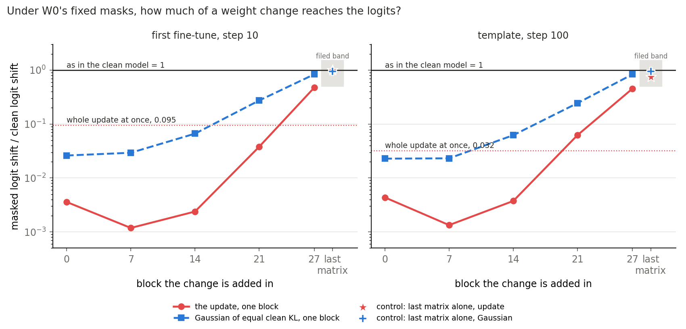

**Reading it.** Barely, except at the very end of the model. With W0's masks fixed, the whole update reaches the logits at an amplitude of 0.095 on the first fine-tune and 0.032 on the template. In KL that is a transmission of 0.0055 and 0.0004. A single block's change at blocks 0, 7 or 14 keeps an amplitude between 0.001 and 0.004. The stars at the right show the last matrix alone passing at 0.99 and 0.75, so the term does enter the forward. The filed expectation that the whole update stays under 0.2 held.

Gains under W0's masks of 0.26 and 0.44 on the first two updates do not sound like "barely", and 0.02 on the template does. The clean path explains the difference. One percent of the update alone keeps about 0.19 and 0.21 of the gain there. The independent check converted each ruler to the share of the update that reads the same in the clean model, and all three give 1-3%.

The last matrix shows the term enters, but it cannot fail through later masks, since none follow it. Nothing here shows that a change expected to pass does pass at an early block. So the low numbers at early blocks have no positive control of their own.

**Why the masks lose it is not shown.** Four alternatives stay open:

1. It may have nothing to do with the update. Gaussians of matched clean effect pass amplitudes of only 0.02 to 0.07 at blocks 0 to 14.
2. All 196 matrices masked at once is not VPD's training forward, which routes through a uniform random subset of matrices. The whole update under partial routing was never read.
3. The read under fine-tuned masks is distance to the fine-tuned model, not how far the output moved, and those masks already hold part of its behaviour.
4. The masked stream sits far from the clean one at a small output KL, so it may be a different network reaching the same logits.

| change, W0's masks fixed | first fine-tune: transmission | amplitude | cosine | template: transmission | amplitude | cosine |
|---|---|---|---|---|---|---|
| whole update | 0.0055 | 0.095 | 0.33 | 0.0004 | 0.032 | 0.22 |
| update, block 0 | 6.3e-6 | 0.0036 | 0.00 | 7.8e-6 | 0.0043 | 0.05 |
| update, block 7 | 6.3e-7 | 0.0012 | 0.04 | 4.4e-7 | 0.0013 | 0.08 |
| update, block 14 | 3.4e-6 | 0.0024 | 0.15 | 5.4e-6 | 0.0037 | 0.01 |
| update, block 21 | 0.0014 | 0.038 | 0.18 | 0.0019 | 0.062 | 0.20 |
| update, block 27 | 0.55 | 0.47 | 0.47 | 0.26 | 0.45 | 0.64 |
| Gaussian, block 0 | 2.6e-4 | 0.026 | 0.02 | 2.7e-4 | 0.023 | 0.02 |
| Gaussian, block 7 | 1.6e-4 | 0.029 | 0.00 | 1.1e-4 | 0.023 | 0.00 |
| Gaussian, block 14 | 7.1e-4 | 0.066 | 0.03 | 6.2e-4 | 0.062 | 0.01 |
| Gaussian, block 21 | 0.035 | 0.27 | 0.16 | 0.032 | 0.24 | 0.15 |
| Gaussian, block 27 | 0.58 | 0.84 | 0.56 | 0.58 | 0.84 | 0.61 |
| control: last matrix, update | 0.79 | 0.99 | 0.78 | 0.45 | 0.75 | 0.96 |
| control: last matrix, Gaussian | 0.69 | 0.95 | 0.60 | 0.69 | 0.95 | 0.67 |

The hook checks exactly. Block 27's clean KL through it reads 0.00338145058, against 0.00338145438 through the weights in E73. With no masks anywhere, block 0's change transmits at exactly 1. W0's masked forward reproduces E68's KL on the same rows, 549.594611 summed on the first fine-tune's and 563.681573 on the template's.

The control was amended after seeing it. The filed band on the KL ratio, 0.5 to 2, stopped job 50510 at 0.447 on the template. The rule became amplitude in 0.5 to 1.5, read after seeing all four values. `predictions.json` stands and reports the miss.

### Do VPD's own stochastic masks hear it better?

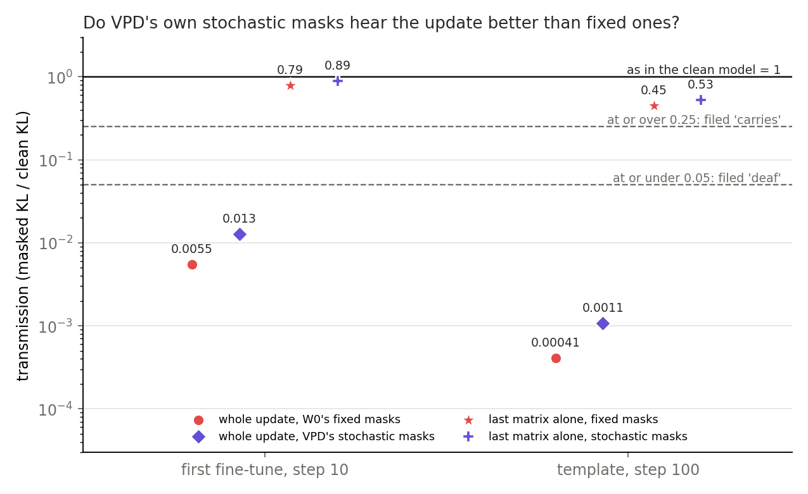

**Reading it.** No, and our lean missed. Stochastic masks leave off subcomponents partly on, so we leaned towards a transmission between 0.05 and 0.25 or more. The whole update reads 0.013 on the first fine-tune and 0.0011 on the template, both under the filed "deaf" line of 0.05. Amplitudes are 0.13 and 0.051. The last matrix alone still passes at amplitudes 1.01 and 0.76. This is one draw per row at one seed, on 32 rows. W0's own KL from its masked forward falls from 0.067 to 0.044 under these masks, so they are gentler on W0 but no more responsive to the change.

### Do masks made on the fine-tuned model leave room to grade a placement?

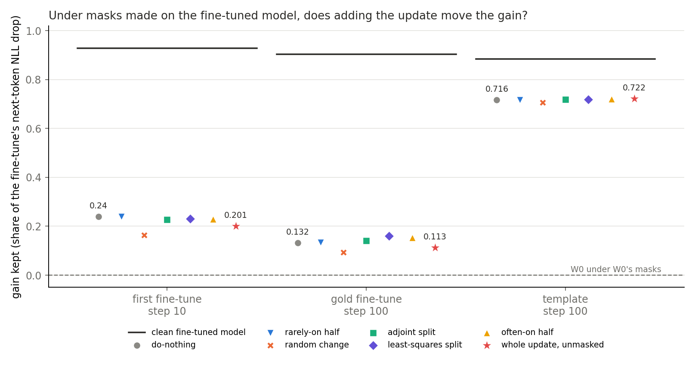

**Reading it.** No, on all three updates. Adding the whole update moves the gain by at most 0.04 of the fine-tune's drop, and KL to the fine-tuned model by at most 0.0015 nats. The gain falls by 0.038 and 0.019 on the two gold-data updates and rises by 0.005 on the template. The filed room rule needs a rise over 0.1, and reads "no room" three times. Every placement sits within a few hundredths of do-nothing except the random change. Almost all that varies is between updates: 0.24, 0.13 and 0.72 of the gain are present with no weight change at all.

The gain here is E68's formula, with W0 under W0's masks as its zero, so the clean fine-tuned model reads 0.93, 0.90 and 0.88 rather than 1. KL tells the same story, as the table shows. The do-nothing state's agreement with the fine-tuned model's top token is 0.90 to 0.94, against 0.80 to 0.91 for clean W0, and the whole update leaves it unchanged to the third decimal.

| state, fine-tuned masks | first: gain | KL(FT ‖ state) | gold: gain | KL(FT ‖ state) | template: gain | KL(FT ‖ state) |
|---|---|---|---|---|---|---|
| do-nothing | 0.240 | 0.1044 | 0.132 | 0.1181 | 0.716 | 0.0664 |
| whole update, unmasked | 0.201 | 0.1045 | 0.113 | 0.1196 | 0.722 | 0.0658 |
| often-on half | 0.228 | 0.1034 | 0.153 | 0.1174 | 0.720 | 0.0661 |
| rarely-on half | 0.240 | 0.1044 | 0.134 | 0.1181 | 0.716 | 0.0664 |
| random change | 0.163 | 0.1213 | 0.093 | 0.1349 | 0.706 | 0.0724 |
| least-squares split | 0.232 | 0.1034 | 0.160 | 0.1177 | 0.719 | 0.0661 |
| adjoint split | 0.227 | 0.1035 | 0.142 | 0.1176 | 0.718 | 0.0662 |

Teeth, the often-on half beating both the rarely-on half and random by twice the row bootstrap width, reads "no teeth" on the first fine-tune. It holds narrowly on the other two: 0.019 against 0.018, and 0.0033 against 0.0013. With no room, every split's label is "unscored", as filed.

These masks came from the fine-tuned model's activations, so they carry its behaviour whether or not that model's use of its subcomponents differs from W0's (E44 Amendments 1 and 1b). The 0.72 on the template says the masks hold most of the gain. It does not say why, and the elicitation limit applies: a new circuit built from old subcomponents would read the same.

### Is the update special under W0's masks, compared with a random change?

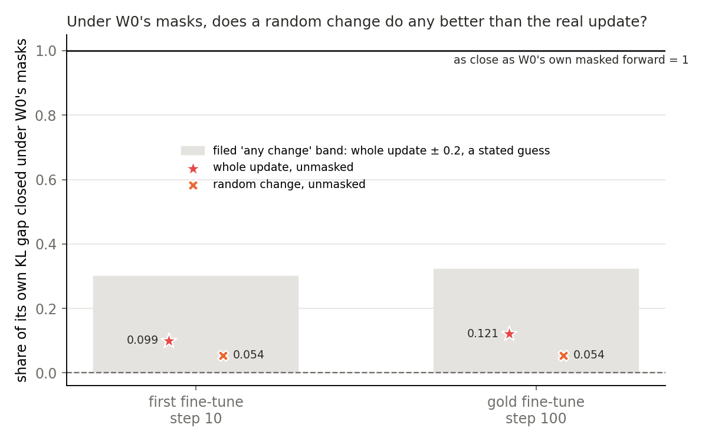

**Reading it.** No, by the filed rule, but that rule's band is a stated guess with no noise floor. A random change added unmasked closes 0.054 of its own KL gap on both updates read. The whole update closes 0.099 and 0.121. The filed label is "any change" on the first fine-tune and on the gold one; the template was not read. Each share has the state's own clean model as its target, so the random change's KL(W0 ‖ W0 + R) of 0.58 and 1.13 sets its gap.

On the same masks, Δ fully on beside the whole update reads KL(FT ‖ state) 1.262 on the first fine-tune and 1.108 on the gold, slightly worse than 1.244 and 1.095 with Δ off. At that setting the off subcomponents still go. So on these two updates Δ's return closes none of the shortfall, and the template and the fourth update were not read.

### Where in the masked forward is a change lost?

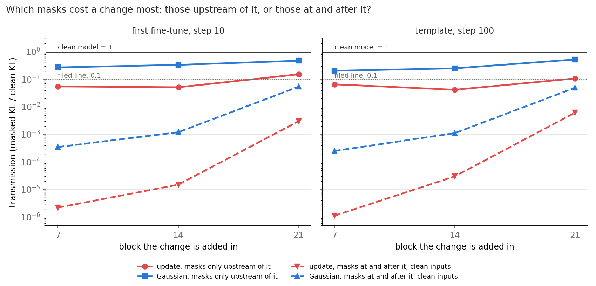

**Reading it.** Mostly at the masks at and after the change, for the update and for a Gaussian alike. With every mask on and the added term reading clean inputs, the update transmits under 4e-5 at blocks 0 to 14, and a Gaussian about 1e-3 or less. With masks only upstream of the change, the update keeps 0.04 to 0.15 and a Gaussian 0.20 to 0.52. Upstream masks cost something too, because the masked residual stream runs far from the clean one, as the next figure shows. The filed lean on block 0's change, that with later sites unmasked it would keep half its KL, missed at 0.057 and 0.034. The Amendment 1 labels all came as leaned.

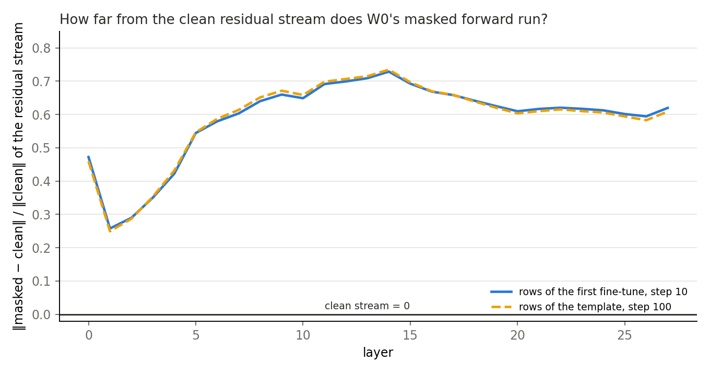

**Reading it.** The masked forward runs in a different place from the clean one, even though its output is close. The residual stream sits 25% to 73% of its own norm from the clean stream at every layer, on both sets of rows. Yet KL(W0 ‖ masked W0) is about 0.07 on those rows. This was a first read with no filed value. It says the masked forward reaches W0's output by another path; it does not say which subcomponents matter.

### Is the gap between update and Gaussian about switched-off subcomponents?

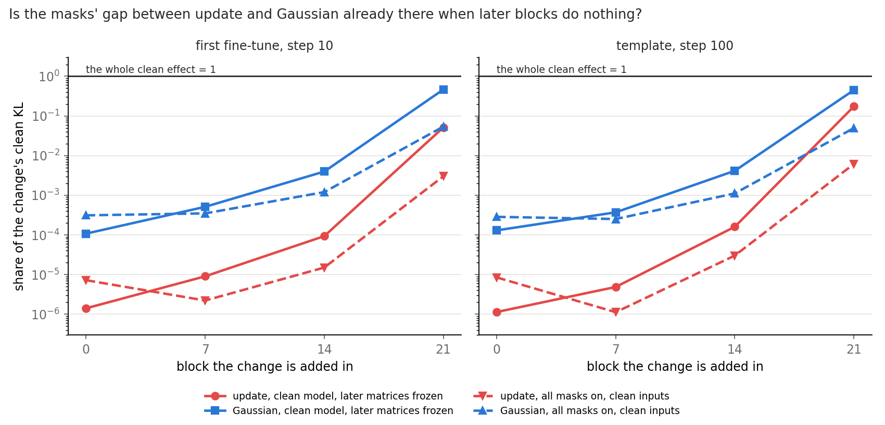

**Reading it.** The filed label says yes, and Amendment 2 weakens that reading without settling it. The filed rule compared transmissions at blocks 0, 7 and 14, and read "needs switched-off subcomponents" on both updates, because a Gaussian passes 34 to 262 times the update's KL share. Amendment 2 froze every later matrix at its clean output, in the clean model with no masks. There the update's change keeps 1e-6 to 2e-4 of its clean KL at those blocks, and a Gaussian keeps 26 to 115 times that share. The filed label is "amplification", as leaned.

So in the clean model the update's effect runs through later blocks and a Gaussian's much less so, and the masks' gap is about as large as that gap. With masks at and after the change, the Gaussian's advantage divided by the frozen read's lies between 0.29 and 3.1 at every block read. The filed check that the two KLs be of the same order held, within a factor of 8. A change whose effect needs later blocks would be cut by masking those blocks, whichever subcomponents it needs.

Two things stop this from clearing the label. With masks only upstream, where later blocks are intact, a Gaussian still passes 3.1 to 6.5 times the update's share at blocks 7, 14 and 21. Amplification cannot produce that, so the update may read input directions that upstream masks remove. And Gaussians matching the update's clean KL have 48 to 171 times its norm, so the comparison is between very different sizes. Which subcomponents the update depends on was never read.

### Which parts of the update land near the fine-tuned model in the clean model?

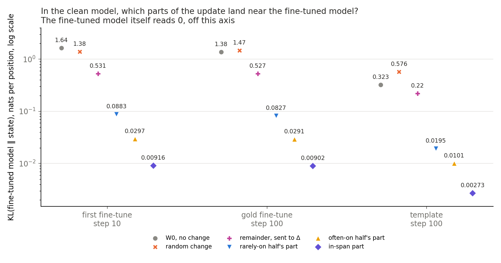

**Reading it.** This is D1's table now, and the gap between its parts is about what size gives. The in-span part reads under 0.01 from the fine-tuned model and the remainder 0.22 to 0.53. But the in-span part holds about 0.93 of the update's input-weighted norm, and the remainder about 0.36. The whole update rescaled to those norms reads 0.001 to 0.003 and 0.09 to 0.21. So this table does not show that the in-span part carries the behaviour; each part in fact reads 2.5 to 4 times further than the rescaled update.

What does favour the in-span part is top-token agreement, which a temperature leaves alone: 0.97, 0.97 and 0.99, against 0.84, 0.83 and 0.92 for the remainder. Placements barely separate. The often-on and rarely-on halves read 0.03 and 0.09 on the first fine-tune, a difference of about 4% of W0's distance, and no noise floor or pass line exists for these KLs.

The random change is a poor reference for a part. It is matched on KL from W0, at 18 to 56 times scale, not on size. It reads 1.38, 1.47 and 0.58, against W0's 1.64, 1.38 and 0.32, so on the first fine-tune it is nearer than W0 is. A random slice of the update, the true null, has not been read.

| KL(FT ‖ state), clean model | first fine-tune | gold | template | top-token agreement with FT, first / gold / template |
|---|---|---|---|---|
| W0 | 1.635 | 1.377 | 0.323 | 0.81 / 0.80 / 0.91 |
| random change | 1.385 | 1.466 | 0.576 | 0.76 / 0.70 / 0.80 |
| remainder | 0.531 | 0.527 | 0.220 | 0.84 / 0.83 / 0.92 |
| rarely-on half's part | 0.088 | 0.083 | 0.019 | 0.92 / 0.92 / 0.98 |
| often-on half's part | 0.030 | 0.029 | 0.010 | 0.95 / 0.95 / 0.99 |
| in-span part | 0.0092 | 0.0090 | 0.0027 | 0.97 / 0.97 / 0.99 |

The table is blind to Γ. It says where weight changes land, not that a masked forward is faithful. The whole least-squares state equals the fine-tuned weights, so it would read 0 by construction, and its in-span row drops the part least squares sends to Δ.

### Does each part keep the next-token gain?

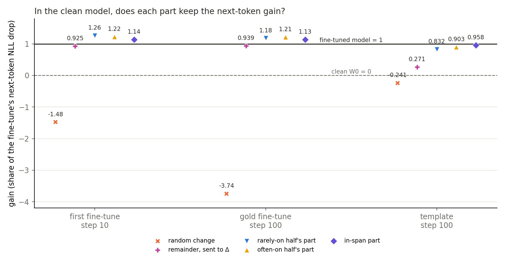

**Reading it.** On the gold-data updates every part keeps about all of it or more, so the gain separates little there; on the template it separates. The filed label is "carried" on all three, and it reads a rule, not a mechanism. The in-span part keeps 1.14, 1.13 and 0.96. The remainder is not inert: alone it keeps 0.92, 0.94 and 0.27. A random change loses, at −1.48, −3.74 and −0.24, and is not well matched on the gold update, as "How compelling" says.

Gains pass 1 on the first two updates: in-span 1.14 and 1.13, often-on half 1.22 and 1.21, rarely-on half 1.26 and 1.18. A gain over 1 means the state's next-token NLL on these rows is lower than the fine-tuned model's. So on these rows the fine-tuned model is not the best point near W0. This is unexplained, and the next section adds what the path shows.

**A defect in the filed rule.** `qwen_fixed_masks/rules.py:181` sets the in-span share $s$ to 1 minus a norm fraction, reading 0.64, 0.61 and 0.65. That is not the in-span part's share of anything. With its input-weighted norm share of 0.93, 0.92 and 0.94, the "carried" label still holds. The margins are 0.20, 0.21 and 0.02, against twice the width of 0.06, 0.05 and 0.01. The filed rule stands as filed.

### Is the clean model sensitive to any change, or only along the update?

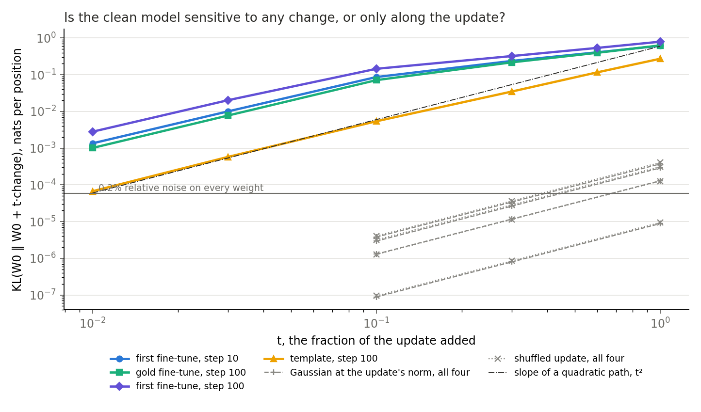

**Reading it.** Only along the update. At the update's own norm, a Gaussian or a shuffled update moves W0 by 9e-6 to 4e-4 nats, while the update moves it by 0.27 to 0.80. One percent of the update on the first fine-tune already moves it by 0.0014, ten times a whole-norm Gaussian. So W0 is not fragile in general: 0.2% relative noise on every weight reads 6e-5, and rounding to bf16 reads exactly 0. Our lean that the path would be sharp missed: a tenth of the update gives 0.11 to 0.18 of the whole update's KL on the gold-data updates and 0.02 on the template, labelled "between" and "smooth".

Every block matters a little and none dominates. On the first fine-tune the largest block reads 0.045, and the 28 sum to 0.668 against 0.616 for the whole update, so their effects add nearly independently.

| KL(W0 ‖ W0 + t δW), 64 rows | first, step 10 | gold, step 100 | first, step 100 | template |
|---|---|---|---|---|
| t = 0.01 | 0.0014 | 0.0010 | 0.0028 | 0.00007 |
| t = 0.1 | 0.087 | 0.071 | 0.145 | 0.0054 |
| t = 0.3 | 0.238 | 0.218 | 0.323 | 0.035 |
| t = 1 | 0.616 | 0.631 | 0.796 | 0.273 |
| t = −1 | 1.672 | 2.179 | 2.601 | 0.443 |
| Gaussian at the update's norm | 1.3e-4 | 2.9e-4 | 3.7e-4 | 8.8e-6 |
| shuffled update | 1.3e-4 | 3.1e-4 | 4.1e-4 | 9.4e-6 |

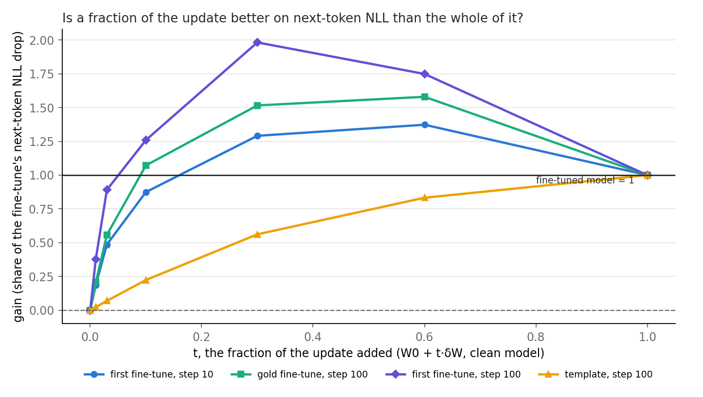

**Reading it.** On the three gold-data updates a fraction of the update beats the whole of it on next-token NLL, and on the template it does not. The gain peaks at 1.37 at six tenths on the first fine-tune at step 10, at 1.58 on the gold, and at 1.98 at three tenths on the first fine-tune at step 100. The template climbs to 1 with no peak. So gains above 1 are not special to the placements: the whole update's own path passes 1 the same way. We state this as a measured shape. Its cause was not read.

### Where on the rows does the gain sit, and is W0 itself unusual?

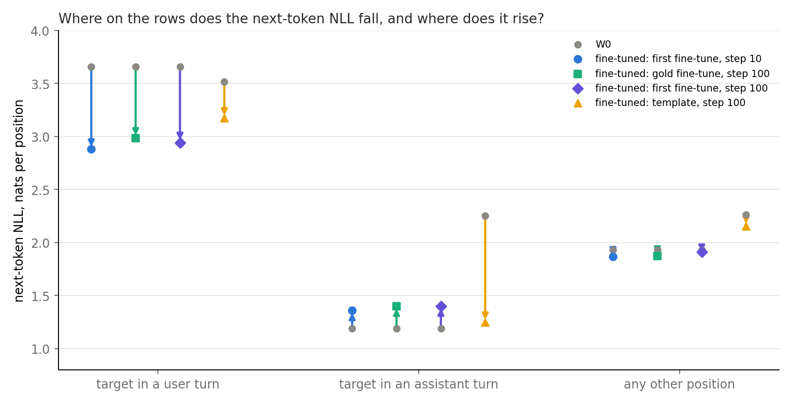

**Reading it.** On the gold-data updates the next-token gain sits in user turns and is partly undone in assistant turns; on the template it sits in assistant turns. On the first fine-tune at step 10, NLL at user-turn targets falls from 3.66 to 2.88 across 4038 positions, and at assistant-turn targets it rises from 1.19 to 1.36 across 6638. On the template, assistant-turn NLL falls from 2.25 to 1.25, while user-turn NLL falls less, from 3.52 to 3.17. Fine-tuning on SFT trains response tokens only, so the gold-data gain on these rows is not at the trained positions. Accuracy at assistant targets falls from 0.86 to 0.76 on the first fine-tune.

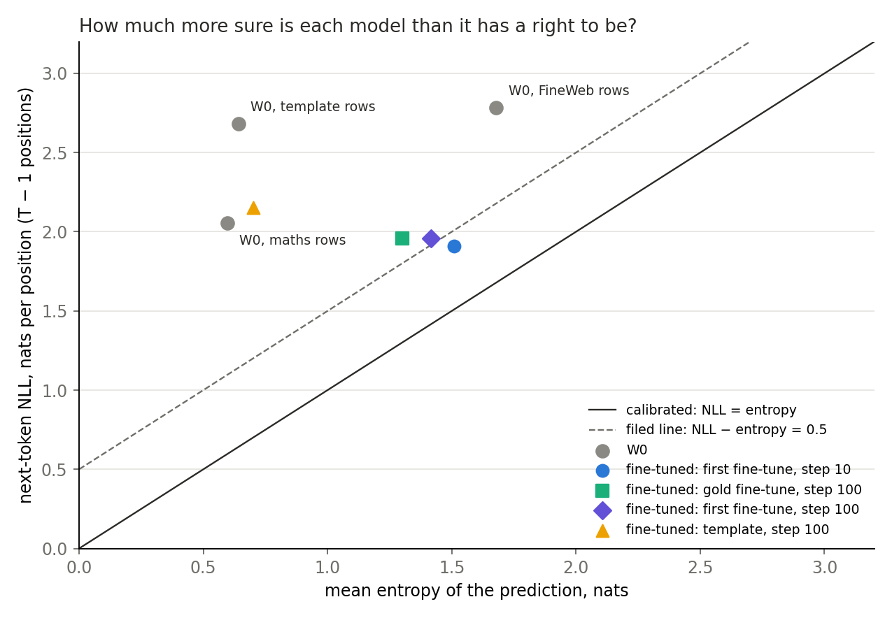

**Reading it.** W0 is overconfident on every set of rows, including the one we filed as calibrated. NLL exceeds entropy by 1.46 on maths rows, 1.10 on FineWeb and 2.04 on template rows, against a filed line of 0.5. So this is a property of W0 and not only of the rows. The fine-tuned model's entropy on maths rows is 1.51 at step 10 and 1.31 on the gold, up from W0's 0.61 on the same 128 rows, while on the template it moves only from 0.64 to 0.70. Positions W0 is over 0.9 sure of make up 62% of the positions and carry most of the KL on the first fine-tune.

### How much of the distance from W0 is one temperature?

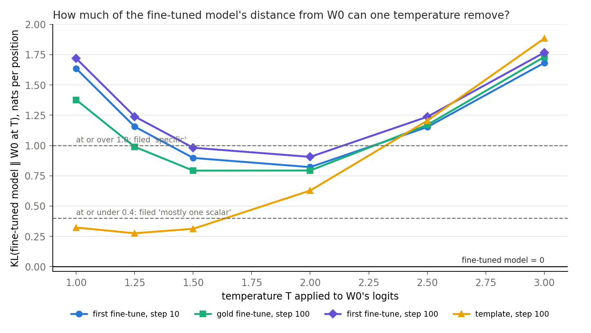

**Reading it.** About half on the gold-data updates and little on the template, as filed. The best temperature on the six-point grid leaves KL(FT ‖ W0 at T) of 0.82, 0.79 and 0.91 on the three maths-row updates, down from 1.64, 1.38 and 1.72, and each is labelled "between". The template reads 0.32 to 0.28, 15% removed, labelled "no gain". Those minima sit at temperature 2 or nearby, where W0's entropy overshoots the fine-tuned model's: 2.98 against 1.51 on the first fine-tune. So one temperature does not turn W0 into the fine-tuned model, and the plan's branch "maths rows stop being the yardstick" did not fire. This is not read as a cause of the gold updates' gain.

## What we learned

For `GOALS.md`'s weak version on Qwen, a masked forward with all matrices masked hardly moves when the whole update is added, on every ruler we converted. So it cannot yet grade a placement. Why it loses the update is not shown, and the four alternatives above stay open; partial routing is the one most likely to change what D1 can use. The clean-model table's gap between in-span and remainder is about what size gives, and only top-token agreement favours the in-span part. D1 therefore moves to a map, teacher training with masks in its loss, judged on a table with no pass line and no true null yet. The user's decision was taken before the size reading, and the decision stands until the user revisits it.

## How compelling is the evidence

- **Controls.** E72's first read reproduced E68's KL and gain exactly, and the same masks held across all seven states (gap 0). E73 reproduced E72 within 1e-7 on entropy, after a normaliser fix. E74's temperature control and hook control match to 8 digits. The last-matrix control passes after an amendment that saw the values.
- **Coverage.** Transmission and the two amendments: the first fine-tune at step 10 and the template, 32 rows each. E72's reads: three updates on 128, 128 and 64 rows; the random-change read on two. E73: four updates on 64 rows. Temperature: four updates on their full row sets.
- **Noise.** One Gaussian per block, one random draw per update, one stochastic draw per row at one seed. E72's row bootstrap half-widths on gain are 0.008, 0.009 and 0.0007 under masks, and 0.029, 0.027 and 0.005 clean. KLs under 1e-6 have no measured floor between numeric paths.
- **The random change on the gold update is not matched, even on KL.** Its KL(W0 ‖ W0 + R) reads 1.13 on the 128 rows, while KL(W0 ‖ FT) is 0.63 on E73's 64 rows. E68's search sat on a coarse grid, and on the first fine-tune the match is good, at 0.58 against 0.58. So the gold update's −3.74 and 1.47 may overstate what a matched change reads.
- **Independence.** An independent reader checked E72's and E74's claims against code and per-read sums, and found no bug. It ran nothing on a GPU, and could not check $g$'s values, per-position KL, or the port's masked KL against JAX's logged figure. E73 was read only as far as those claims used it.

**What is unchecked.**

- Whether a term added unmasked stands in for a placement. Transmission reads the added term, not a change placed on $U$ and $V$. E72's placed states under fine-tuned masks are the only read of those, and none was read under stochastic masks.
- Whether a change expected to pass does pass at an early block.
- How much of the fine-tuned masks' shortfall is distance rather than a lack of movement.
- Whether the adversary or VPD's other losses would respond. No adversary ran on a changed state.
- Whether the upstream gap is about read directions.
- Whether the clean table's small differences are above noise.
- Why the control's amplitude on the template is 0.75 with cosine 0.96, where a Gaussian reads 0.95.
- Whether the first three updates are small enough. KL(W0 ‖ FT) of about 0.6 on W0's own text is not obviously small.

## Surprises

**Something unexpected happened that I cannot explain.** We predicted that the whole update under masks made on the fine-tuned model would keep half or more of the gain. It kept 0.20, 0.11 and 0.72, and on the two gold-data updates that is below do-nothing's 0.24 and 0.13. So adding the update takes the masked forward slightly further from the fine-tuned model's gain. How far its output moved under these masks was not read.

**Filed leans that missed.** Stochastic masks read "deaf", not "between to carries". Block 0's change did not recover with later sites unmasked. The Gaussian did not track the update within a factor 3. FineWeb is overconfident, not calibrated. The clean path is "between" rather than "sharp", and the template is "smooth" rather than "between". The last matrix's cosine missed the expected 0.8 on three of four reads.

**Unexplained.**

- Gains over 1 on the first two updates, for every placement and along the whole update's own path. Named as a shape, not a cause.
- The remainder keeps 0.92 and 0.94 of the gain while reading KL 0.53 from the fine-tuned model, on the gold-data updates.
- Do-nothing under fine-tuned masks keeps 0.72 on the template and 0.13 on the gold, with similar KLs of 0.066 and 0.118.
- The template's last-matrix amplitude of 0.75.

## What next

1. **The missing reads, $0.** E77, being written, adds a change expected to pass at an early block, the whole update under partial routing, and how far the output moves under fine-tuned masks. If partial routing passes the update, a masked test is back and the filed finding is restated. E75's clean table adds a random slice of the update. None of these has been read.
2. **The map.** Teacher training with masks in its loss, as decided. The filed recipe's loss has no masks, so its student changes. It is a gated run with its own plan.
3. **A filed line for the clean table.** A pass and fail band from the table's own noise floor and the random slice, before the map's scored run. Without it the table cannot fail anything by rule.

## Departures from the literature

- **Where Γ is read.** VPD's authors train Γ on $W_0$ and read it there. Reading masks from the fine-tuned model's forward with the original components, then holding them for other states, is this project's operation.
- **Added unmasked term.** VPD has no such forward. It is this project's probe, carried over from E68.
- **Stochastic masks.** `stochastic_masks` follows VPD's $m = g + (1-g)u$ with a Δ share drawn per position and site. VPD draws these fresh during training; we draw once per row and share the draw across arms, so that arms compare at one draw.
- **Masked forward, Δ off.** As in VPD's CI-masked reconstruction loss. No departure, except where stated.
- **The clean table.** VPD's faithfulness is read through masked losses. `GOALS.md`'s weak version lists them too. This table reads none of them, and takes its place by the user's decision.
- **Temperature.** One scalar applied to logits, as in Guo et al. 2017's temperature scaling, except that it was chosen on a grid against KL to the fine-tuned model and not against NLL on held-out rows. It is a read here, not a calibration method.
- **Gain, transmission, amplitude, direct share and the halves.** These are this project's, with no published source.

## Scorecard

| id | claim in words | rule | read | verdict |
|---|---|---|---|---|
| E72 control_reproduce | Do-nothing reproduces E68 on the first fine-tune | K within 1e-3 relative, gain within 1e-3 | gaps 0 | held |
| E72 room | Whole update under FT masks has room | gain(ceiling) − gain(do-nothing) > 2w and > 0.1 | −0.038, −0.019, +0.005 | no room, three times; medium lean for room on the first fine-tune reversed; Amendment 1's leans for "no room" on the others held |
| E72 teeth | Often-on beats rarely-on and random | gap > 2w | −0.012 vs 0.015; 0.019 vs 0.018; 0.0033 vs 0.0013 | no teeth; holds; holds |
| E72 label | Splits pass or fail | needs room and teeth | none | unscored |
| E72 T2 | In-span carries the gain | gain(in-span) − s > 2w and remainder lower | 1.14, 1.13, 0.96 vs s 0.64, 0.61, 0.65 | carried, three times; holds with the corrected share; the gap is about what size gives |
| E72 specific | Random change does better than the update | r2_R − r2_C vs 0.2 | 0.054 vs 0.099; 0.054 vs 0.121 | any change, twice; template not read |
| E72 T0b | Δ on beside the update | no rule | 1.262 vs 1.244; 1.108 vs 1.095 | reported |
| E73 control | First fine-tune's numbers match E72 | within 1e-3 relative | on E72's normaliser | held; job 50462 stopped on the normaliser, Amendment 1 |
| E73 W0_text | W0 calibrated on pretraining-like rows | NLL − entropy > 0.5 is overconfident | 1.46, 1.10, 2.04 | overconfident on all three; FineWeb's lean missed |
| E73 sharp | Tenth of the update moves it a quarter as far | K ratio; > 0.25 sharp, < 0.05 smooth | 0.14, 0.11, 0.02, 0.18 | between, between, smooth, between; leans missed |
| E73 null_same | Any direction moves it as far | null at least 0.5 of update's | at most 0.0005 of it | this update, four times |
| E74 control_transmission | Last matrix passes | filed KL ratio in 0.5 to 2 | 0.79, 0.69; 0.45, 0.69 | missed on the template, stopped; amended to amplitude in 0.5 to 1.5: 0.99, 0.95; 0.75, 0.95 held |
| E74 where_lost | Block 0's change lost downstream | tau_0 ≤ 0.1 and cut_0 ≥ 0.5 | cut_0 0.057, 0.034 | elsewhere, twice; lean missed |
| E74 against_gaussian | Gaussian within a factor 3 | ratios on blocks 0, 7, 14 | 41, 254, 208; 34, 262, 115 | needs switched-off subcomponents, twice; lean missed; reading weakened by direct_gap |
| E74 sharpness | One temperature | minimum over T, or share on the template | 0.82, 0.79, 0.91; 15% | between, three times; no gain; as leaned |
| E74 factor | Which masks | filed on 0.1 lines | below | as leaned on every block |
| E74 direct_gap | Gap is amplification | Gaussian's share ≥ 3 times on two of three blocks | 76, 57, 42; 115, 76, 26 | amplification, twice; as leaned |
| E74 stochastic | Stochastic masks carry it | ≥ 0.25 carries, ≤ 0.05 deaf | 0.013, 0.0011 | deaf, twice; lean missed |

## Provenance

All on one cluster L40, $0. E72: `experiments/qwen_fixed_masks/results/score.json`; job 50428 stopped on the room rule on the first fine-tune, Amendment 1 removed that stop; job 50441 finished in about 2.1 h, `normal` QoS. E73: `experiments/qwen_diagnose/results/`; job 50462 stopped on the normaliser, job 50465 about 17 min, `debug` QoS. E74: `experiments/qwen_transmission/results/`; job 50507 ran out of GPU memory after the temperature reads; job 50510 stopped at the control on the template; job 50533 ran Amendment 1; job 50546 ran Amendment 2, `debug` QoS. Figures from each experiment's `plot.py`, from the JSONs alone.

## Not run

- A change expected to pass at an early block, the whole update under partial routing, and how far the output moves under fine-tuned masks: E77, being written.
- A random slice of the update with the in-span part's energy, clean model: E75's clean table, not yet read.
- Any GPU rerun by the independent check.
- Any placed state, splits or halves, under stochastic masks or read through transmission.
- Which subcomponents the update depends on, and which subcomponents Γ switches between W0's and the fine-tuned model's forward.
- Any adversary on a changed state.
- Teacher training, with or without masks in its loss.
- The rows swap: human GSM8K rows through these reads, and rows the fine-tuned model writes.
- The second and fourth updates through transmission; the template through the random-change read and Δ on.
- Teacher-forced inputs, which would separate routing from missing inputs.
- A noise floor for the clean table's KLs, or for KLs under 1e-6.
- Maths accuracy, and any generated text.
- Further seeds for the Gaussian, the random change and the stochastic draw.
- A fitted temperature per turn or per position.
