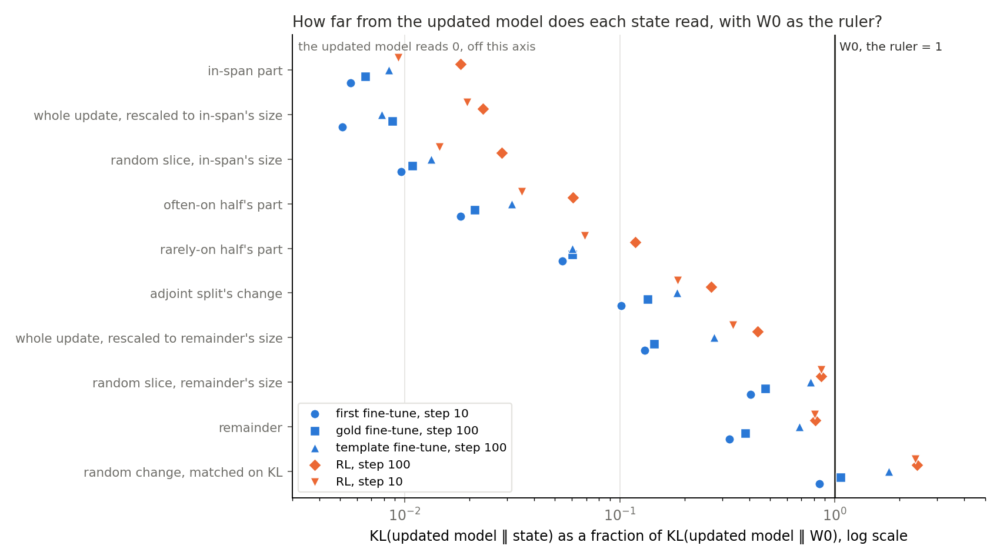
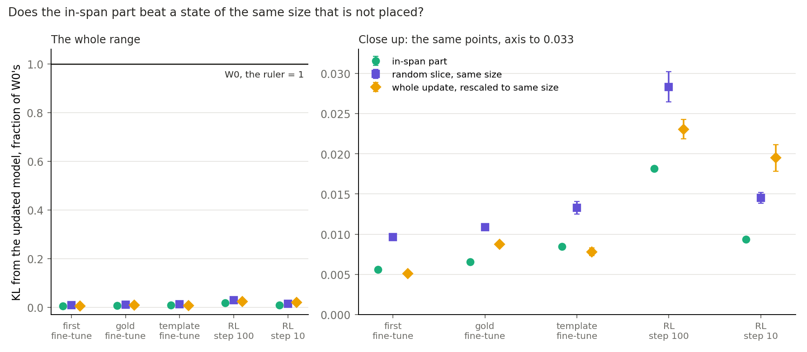
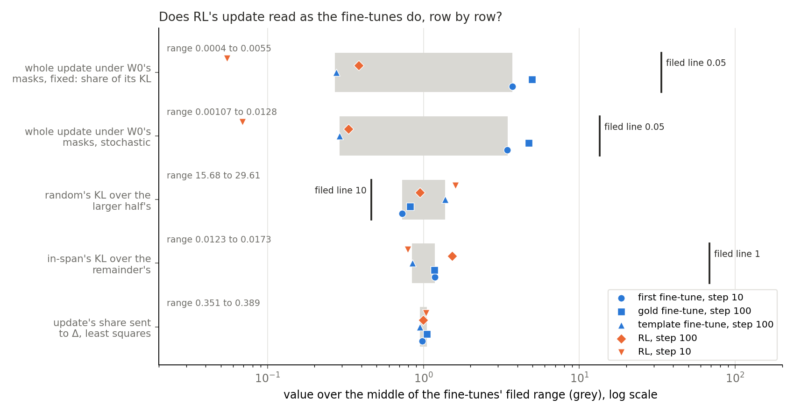
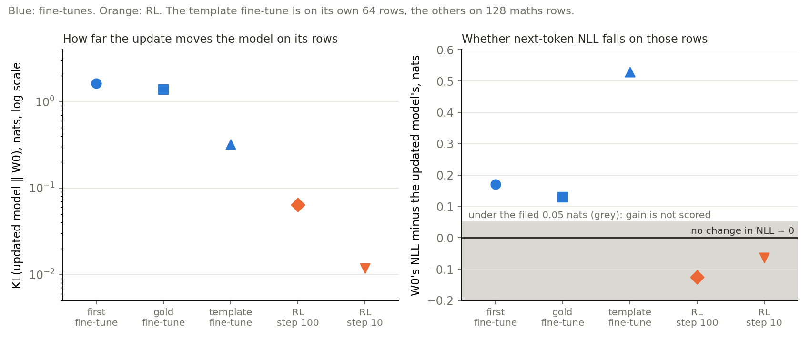

# Can the clean-model table fail a bad placement, and does RL read as the fine-tunes? (E75)

*2026-11-03, D1 and D2, `qwen-decomp-lead`. D1 is a map on Qwen3-1.7B that keeps the decomposition faithful for a real update, judged by a test that can fail a bad placement. D2 is the same table for SFT and RL updates. The user chose the clean-model table as D1's table (`decisions.md`, ask 24). Plan `reports/plans/2026-11-03_plan_e75-rl-reads.md`. No independent check. Notebook `notebooks/E75_rl_reads.ipynb`.*

## The answer

Not yet: the clean-model table has not been shown to fail a bad placement of the right size. It fails a random change, but only one scaled 18 to 100 times beyond the update's size. The in-span part beats a random slice of its own size by under one percent of the ruler, and the plain rescaled update beats it on two of five updates. RL at step 100 reads mostly as the fine-tunes do; RL at step 10 leaves their range on all four rows with a filed range.

We ran three saved fine-tuning updates and two steps of RL's update through one clean table and one masked read, with no training. The table separates large from small and real from random, and it barely separates placements of the same size. For `GOALS.md`, this means the test D1 needs does not yet do its stated job, and RL's rows cannot yet be read as anything beyond a difference from the fine-tunes.

**Status of RL's rows.** Do not read RL's update as learning. The shuffled-reward null also gained 5.6 points on GSM8K test under the drop rule, against a filed limit of 1.5, cause not established (`~/commute-data/agents/qwen-decomp-lead/note-from-qwen-rl-lead-E69-dW.md`). The null arm is running now as job 50755, reading steps 100 and 10, and the arm trained on its own correct samples comes later. This report does not wait for them; a later amendment updates this report and the notebook.

**A correction to the brief for this report.** The brief read the remainder's slice as more scaled than projected, from its wide range of $c$. The per-matrix file does not support that, and "Size-matched states" below gives the numbers: 96 to 99.9 percent of the remainder's energy sits where $c$ is within 10 percent of 1.

## What we were trying to test

**The table.** Each matrix is $W_0 = U V^\top + \Delta$, and an update $\delta W$ changes the weights. A state is $W_0$ plus some part of $\delta W$, run with no masks. Its score is $K = \mathrm{KL}(\text{updated model} \,\|\, \text{state})$ over every position, where the updated model is $W_0 + \delta W$. The updated model reads 0 and $W_0$ reads the ruler. Γ plays no role, so the table reads weights and outputs and is not one of VPD's faithfulness checks.

**The updates.** u1 is the first fine-tune at step 10, u2 the gold fine-tune at step 100, u3 the template fine-tune at step 100. R100 and R10 are RL's GRPO update at steps 100 and 10. u3 reads its own 64 rows and the rest read 128 maths rows of 256 tokens. RL trained on its own samples, not this text.

| update | $\|\delta W\| / \|W_0\|$ | input-weighted energy | KL(updated ‖ $W_0$), the ruler |
|---|---|---|---|
| u1 | 1.43e-3 | 1440 | 1.6351 |
| u2 | 2.18e-3 | 2024 | 1.3768 |
| u3 | 3.71e-4 | 96.9 | 0.3226 |
| R100 | 2.68e-4 | 33.5 | 0.06431 |
| R10 | 5.24e-5 | 1.09 | 0.01187 |

**States.** The in-span part and remainder come from the least-squares split. The often-on and rarely-on halves place the update on half of the subcomponents. The adjoint split's change is a different placement. The random change has its scale searched until KL from $W_0$ matches the update's on 16 rows. The rescaled update is $W_0 + t\,\delta W$, $t$ the part's pooled input-weighted norm over the update's. The slice is, per matrix, $c\,QQ^\top\delta W$, with $Q$ a random orthonormal basis of a $k$-dimensional subspace of the output side, $k$ rounded from the part's energy share, and $c$ the scalar matching the part's energy exactly.

**Masked read.** $\tau$ is KL(masked $W_0$ ‖ masked $W_0$ + update) over KL($W_0$ ‖ $W_0$ + update), on the first 32 rows, with the update added unmasked at its matrix. Fixed masks are $W_0$'s; stochastic masks are the earlier transmission experiment's, one draw per row at one seed. Filed labels: at most 0.05 "deaf", at least 0.25 "carries", otherwise "between".

**Wording of the masked rows.** "Deaf" is the filed label for a small $\tau$ and nothing more. We use the wording of `reports/reviews/2026-11-03_review_e77-masks-carry.md`: under the original model's masks, with Δ off, small changes in the stream barely reach the logits. How much the output depends on its tokens is not measured.

## What we expected, and why

Medium leans were filed for R100 and R10 only, from earlier fine-tune reads: "deaf" on both mask kinds, random at least 10 times the larger half, in-span strictly below remainder. Rule 4, placement against size, has no lean on any update, because the table had no size-matched reference. Fine-tunes are read against the same rules with no lean. Every number also carries the fine-tunes' filed range, so a difference shows even when a label agrees.

## The control

u1 through this code against stored reads, first and alone, with stop within 1e-3 relative. All eight numbers matched with gap 0: $K$ 1.63511, NLL 2.06820 and 1.89779, entropy 0.61024, $\tau$ fixed 0.0054987, $\tau$ stochastic 0.0127886, K0 fixed 0.0670892, K0 stochastic 0.0440190. $W_0$'s own numbers also matched at gap 0 on u2, R100 and R10. u3 is on other rows and is not compared. The energy check agreed with stage S to about 2e-9 on all five.

The gap of 0 means this job's first read reproduced stored files exactly. It says nothing about the new states, which have no stored reference.

## Which states does the table fail?

**Reading it.** The table fails the random change and little else that is near the update's size. Random reads between 0.85 and 2.4 of the ruler on all five updates, at scales 17.8, 17.8, 56.2, 56.2 and 100 times the size matched to the update's input-weighted norm. The candidates form one ladder. At scale 1, the search's first step moved $W_0$ by 0.008 to 0.35 percent of the target KL on 16 rows. So a random change of the right size would probably read close to the ruler, by inference; the table did not read one.

**$K$ in nats.**

| state | u1 | u2 | u3 | R100 | R10 |
|---|---|---|---|---|---|
| $W_0$, the ruler | 1.6351 | 1.3768 | 0.3226 | 0.06431 | 0.01187 |
| in-span | 0.00916 | 0.00902 | 0.00273 | 0.001168 | 0.000111 |
| rescaled to in-span | 0.00838 | 0.01207 | 0.00252 | 0.001483 | 0.000231 |
| slice, in-span's size | 0.01576 | 0.01498 | 0.00428 | 0.001822 | 0.000172 |
| often-on half | 0.02974 | 0.02908 | 0.01012 | 0.003886 | 0.000416 |
| rarely-on half | 0.08826 | 0.08271 | 0.01945 | 0.007587 | 0.000816 |
| adjoint | 0.1657 | 0.1856 | 0.0594 | 0.01710 | 0.002205 |
| rescaled to remainder | 0.2143 | 0.1996 | 0.0889 | 0.02812 | 0.003983 |
| slice, remainder's size | 0.6642 | 0.6538 | 0.2496 | 0.05555 | 0.010267 |
| remainder | 0.5307 | 0.5267 | 0.2204 | 0.05228 | 0.009598 |
| random | 1.3847 | 1.4661 | 0.5760 | 0.15495 | 0.02818 |
| updated model | 0 | 0 | 0 | 0 | 0 |

**$K$ as a fraction of the ruler.**

| state | u1 | u2 | u3 | R100 | R10 |
|---|---|---|---|---|---|
| in-span | 0.0056 | 0.0066 | 0.0085 | 0.0182 | 0.0093 |
| rescaled to in-span | 0.0051 | 0.0088 | 0.0078 | 0.0231 | 0.0195 |
| slice, in-span's size | 0.0096 | 0.0109 | 0.0133 | 0.0283 | 0.0145 |
| often-on half | 0.0182 | 0.0211 | 0.0314 | 0.0604 | 0.0351 |
| rarely-on half | 0.0540 | 0.0601 | 0.0603 | 0.1180 | 0.0688 |
| adjoint | 0.1013 | 0.1348 | 0.1842 | 0.2659 | 0.1859 |
| rescaled to remainder | 0.1310 | 0.1450 | 0.2754 | 0.4372 | 0.3357 |
| slice, remainder's size | 0.4062 | 0.4749 | 0.7735 | 0.8638 | 0.8653 |
| remainder | 0.3246 | 0.3826 | 0.6832 | 0.8129 | 0.8089 |
| random | 0.8468 | 1.0649 | 1.7851 | 2.4093 | 2.3748 |

Top-token agreement with the updated model:

| state | u1 | u2 | u3 | R100 | R10 |
|---|---|---|---|---|---|
| $W_0$ | 0.808 | 0.803 | 0.914 | 0.953 | 0.983 |
| in-span | 0.972 | 0.970 | 0.992 | 0.994 | 0.999 |
| remainder | 0.838 | 0.827 | 0.922 | 0.958 | 0.985 |
| random | 0.756 | 0.704 | 0.805 | 0.888 | 0.956 |

## Does the in-span part beat a state of its size that is not placed?

**Reading it.** By the filed rule yes, on all five updates, and the margin is small. On u1 the in-span part reads 0.009 nats and its slice 0.016, against the ruler's 1.635. The gap is many times its row-bootstrap half-width, and it is 0.4 to 1.0 percent of the ruler. So the separation is real by the bootstrap and small against the ruler.

| update | in-span's $c$ range | slice − in-span, nats | half-width | gap / ruler | label |
|---|---|---|---|---|---|
| u1 | 0.956 to 1.037 | 0.00660 | 0.00033 | 0.0040 | beats size |
| u2 | 0.954 to 1.042 | 0.00596 | 0.00043 | 0.0043 | beats size |
| u3 | 0.947 to 1.042 | 0.00156 | 0.00025 | 0.0048 | beats size |
| R100 | 0.954 to 1.039 | 0.000654 | 0.000121 | 0.0102 | beats size |
| R10 | 0.951 to 1.031 | 0.0000613 | 0.0000079 | 0.0052 | beats size |

**What the table has and has not been shown to fail.**

- It fails a random change that moves $W_0$ as far as the update does. That change is 18 to 100 times the update's size, so the failure is not a read on a bad placement of the right size.
- It separates the in-span part from a slice of the same size, by under one percent of the ruler. A slice is still part of the update and not a wrong direction. On average over $Q$, $QQ^\top\delta W$ is the share $k/d$ of the update, so a slice is a shrunk copy plus noise on the output side.
- It reads the adjoint split's change at 0.10 to 0.27 of the ruler, 15 to 22 times the in-span part. This is the only other split read and it has no filed rule. Its size was not measured here, so it is not a size-matched comparison.
- It has not read any state that is the right size and in a wrong direction. So failing a bad placement of the right size is still unshown.

**The rescaled update is a stronger reference than the slice.** It has no placement at all. This comparison is not filed; we ran the rule's own bootstrap function on it for this report, so it is exploratory.

| update | rescaled − in-span, nats | half-width | / ruler | reading |
|---|---|---|---|---|
| u1 | −0.00078 | 0.00025 | −0.0005 | rescaled closer |
| u2 | +0.00305 | 0.00033 | +0.0022 | in-span closer |
| u3 | −0.00021 | 0.00015 | −0.0007 | rescaled closer, near the half-width |
| R100 | +0.00032 | 0.00008 | +0.0049 | in-span closer |
| R10 | +0.00012 | 0.00002 | +0.0101 | in-span closer |

The three states' order on R10 is in-span, slice, rescaled. On the other four updates the slice is the furthest of the three.

### Size-matched states

| update | $t$ in-span | $t$ remainder | remainder's $c$ range | remainder's energy where $c$ is 0.9 to 1.1 |
|---|---|---|---|---|
| u1 | 0.849 | 0.363 | 2.2e-7 to 2.42 | 0.957 |
| u2 | 0.835 | 0.389 | 2.9e-7 to 3.46 | 0.999 |
| u3 | 0.867 | 0.351 | 3.8e-7 to 1.28 | 0.963 |
| R100 | 0.854 | 0.368 | 3.8e-7 to 2.12 | 0.987 |
| R10 | 0.843 | 0.383 | 2.3e-7 to 2.39 | 0.970 |

**The wide range of $c$ comes from matrices that hold almost no remainder.** On every update, 82 of the 196 matrices have $c$ under 0.1, of which 79 are MLP matrices. The remainder in those holds about 1e-14 of its total energy. There the slice has $k = 1$ and is scaled to nearly nothing, which is what the remainder is there too. Only 4 to 6 matrices have $c$ above 1.2, each with a remainder share under one percent where we looked on u1. The rest of the remainder's energy is a slice with $c$ near 1. So by energy the remainder's slice is a slice, not a scaled vector, and its gap is size-matched in the sense the plan means. It still has no rule, so it is reported only:

| update | remainder's slice − remainder | half-width |
|---|---|---|
| u1 | 0.1335 | 0.0114 |
| u2 | 0.1271 | 0.0119 |
| u3 | 0.0291 | 0.0038 |
| R100 | 0.00328 | 0.00044 |
| R10 | 0.00067 | 0.00011 |

**The same 82 matrices limit the in-span gap.** There the in-span part equals the update to rounding, and $k = d$, so its slice equals the update too. Those matrices hold 0.19 to 0.31 of the update's input-weighted energy. The gap therefore reads only the other 114 matrices, which are mostly attention. Why the remainder vanishes there was not checked; the formula gives zero when the subcomponents span one side of a matrix.

**Parts are not orthogonal under the input weighting.** $t_\text{in-span}^2 + t_\text{remainder}^2$ reads 0.852, 0.848, 0.875, 0.864 and 0.857, not 1. The plan's expected $t$ of 0.93, 0.92 and 0.94 equals $\sqrt{1 - t_\text{remainder}^2}$ on u1, u2 and u3: 0.932, 0.921, 0.936. The measured values are 0.85, 0.83 and 0.87. So the expected rescaled in-span $K$ of 0.002, 0.003 and 0.0007 read 0.0084, 0.0121 and 0.0025. The remainder's expected rescaled $K$, 0.21, 0.20 and 0.09, read 0.214, 0.200 and 0.089. An earlier independent check said each part reads 2.5 to 4 times further than the rescaled update. With the measured $t$ the remainder reads 1.9 to 2.6 times further, and the in-span part 0.5 to 1.1 times.

## Does RL's update read as the fine-tunes do?

**Reading it.** RL at step 100 mostly does, and RL at step 10 mostly does not, though no filed label changed. All four filed labels came out as leaned on both RL updates. R100 is outside the range on one rule row, and R10 on all four. The range is thin. It comes from u1, u2, u3 on the KL rows and only u1, u3 on the masked rows, and u2 falls outside both masked rows.

| row | filed range | u1 | u2 | u3 | R100 | R10 |
|---|---|---|---|---|---|---|
| $\tau$ fixed, label | | deaf | deaf | deaf | deaf | deaf |
| $\tau$ fixed | 0.0004 to 0.0055 | 0.00550 in | **0.00739 out** | 0.00041 in | 0.00057 in | **0.000081 out** |
| $\tau$ stochastic, label | | deaf | deaf | deaf | deaf | deaf |
| $\tau$ stochastic | 0.00107 to 0.0128 | 0.01279 in | **0.01752 out** | 0.00107 in | 0.00122 in | **0.000255 out** |
| random over larger half, label | | holds | holds | holds | holds | holds |
| random over larger half | 15.68 to 29.61 | 15.69 in | 17.73 in | 29.61 in | 20.42 in | **34.53 out** |
| in-span over remainder, label | | holds | holds | holds | holds | holds |
| in-span over remainder | 0.0123 to 0.0173 | 0.01725 in | 0.01713 in | 0.01237 in | **0.02235 out** | **0.01156 out** |
| share sent to Δ, least squares, no rule | 0.351 to 0.389 | 0.3637 in | 0.3889 in | 0.3512 in | 0.3678 in | 0.3828 in |
| in-span against slice, label, no range | | beats size | beats size | beats size | beats size | beats size |

u1 and u3 set most of the range's ends, so "in" is by construction there and carries no information.

**R10's differences, each a size only.** R10's $\tau$ reads four to five times below the bottom of the range on both mask kinds. The masked KL behind it is 1.56e-6 nats on fixed masks, and KLs under 1e-6 have no measured floor between numeric paths, so we hold this difference loosely. Random over the larger half reads 34.5, above the range's 29.6. In-span over remainder reads 0.0116, just under the range's 0.0123. R100's ratio is above the range, and R10's below, so they differ from the fine-tunes in opposite directions on that row.

**RL's scale.** On these rows RL's ruler is small: 0.064 and 0.012 nats, against 0.32 to 1.64. Parts of RL leave more of that smaller distance uncovered: the remainder reads 0.81 of RL's ruler, against 0.32 to 0.68. Those fractions are not comparable as a mechanism, because the template fine-tune, also a small update, sits near RL at 0.68. RL's own KL on its held rows is larger, 0.194 at step 100 by the RL lead's note, on other rows.

**Square law.** Along the update, $K$ of the rescaled update reads close to $(1-t)^2$ of the ruler on RL and well below it on the fine-tunes.

| update | $(1-t)^2$, in-span's $t$ | read | $(1-t)^2$, remainder's $t$ | read |
|---|---|---|---|---|
| u1 | 0.0229 | 0.0051 | 0.405 | 0.131 |
| u2 | 0.0273 | 0.0088 | 0.374 | 0.145 |
| u3 | 0.0177 | 0.0078 | 0.421 | 0.275 |
| R100 | 0.0214 | 0.0231 | 0.400 | 0.437 |
| R10 | 0.0246 | 0.0195 | 0.381 | 0.336 |

**Masked rows.** Here "deaf" reads as the review's wording requires. With $W_0$'s masks and Δ off, the whole update's KL under the masks is 0.0001 to 0.018 of its clean KL, on five updates. Amplitudes read 0.0086 and 0.0133 on R10, 0.027 and 0.036 on R100, against 0.095 to 0.148 on u1 and u2. How much the masked output depends on its tokens is not measured, and we draw no statement about what carries the output. K0, which never sees the update, reads 0.0671 fixed and 0.0440 stochastic on maths rows, and 0.0688 and 0.0460 on u3's rows.

## Why is the gain unscored on RL?

**Reading it.** T2, E72's gain label, reads "unscored" on R100 and R10 because RL's update raises next-token NLL on these rows. The label needs $W_0$'s NLL minus the updated model's to be at least 0.05 nats, and it reads −0.125 at step 100 and −0.063 at step 10. Gain divides by that number, so gains on RL below mean the share of an NLL rise and not the share of a drop. The plan foresaw this, since RL trains on its own samples. This is a statement about these rows only and says nothing about RL's accuracy on its own task. Entropy on these rows falls on RL and rises on all three fine-tunes.

| update | NLL $W_0$ − updated | T2 | T2, norm share | entropy $W_0$ → updated |
|---|---|---|---|---|
| u1 | +0.171 | carried | carried | 0.610 → 1.508 |
| u2 | +0.129 | carried | carried | 0.610 → 1.306 |
| u3 | +0.529 | carried | carried | 0.641 → 0.700 |
| R100 | −0.125 | unscored | unscored | 0.610 → 0.577 |
| R10 | −0.063 | unscored | unscored | 0.610 → 0.594 |

Gain column, for the record; on RL it is not a readable share.

| state | u1 | u2 | u3 | R100 | R10 |
|---|---|---|---|---|---|
| in-span | 1.135 | 1.133 | 0.958 | 0.791 | 0.865 |
| remainder | 0.925 | 0.939 | 0.271 | 0.109 | 0.108 |
| often-on half | 1.223 | 1.211 | 0.903 | 0.634 | 0.749 |
| rarely-on half | 1.262 | 1.180 | 0.832 | 0.471 | 0.640 |
| random | −1.476 | −3.740 | −0.241 | 0.698 | 0.311 |
| adjoint | 1.267 | 1.473 | 0.722 | 0.397 | 0.521 |
| rescaled to in-span | 1.134 | 1.192 | 0.959 | 0.808 | 0.836 |
| rescaled to remainder | 1.242 | 1.390 | 0.623 | 0.274 | 0.362 |
| slice, in-span's size | 1.189 | 1.175 | 0.943 | 0.737 | 0.833 |
| slice, remainder's size | 0.867 | 0.837 | 0.193 | 0.081 | 0.076 |

E72's $s$ is 0.636, 0.611, 0.649 on the fine-tunes, and 0.632 and 0.617 on RL. The in-span norm share is the $t$ above. Random's positive "gain" on RL is an NLL rise like the update's, and not a sign of anything shared.

## What we learned

The clean-model table separates large from small and real from random, and it barely separates placements. A size-matched reference now exists, and the filed rule reads "beats size" on all five updates, but only by under one percent of the ruler, and the plain rescaled update does as well on two of the five. For D1, the test does not yet do its stated job: failing a bad placement of the right size is unshown. For D2, RL's rows have the fine-tunes' broad order, with its parts leaving more of a much smaller distance uncovered, and with step 10 off the range on all four rows with a filed range. None of this is set against RL's null yet.

## How compelling is the evidence

- **Control.** Gap 0 on eight numbers, and $W_0$'s own numbers at gap 0 on u2, R100, R10.
- **Coverage.** Five updates, listed. One slice seed, one random draw, one stochastic draw per row, 32 rows for the masked read, 128 or 64 rows for the table.
- **Noise.** Row bootstrap only. The bootstrap does not cover the slice seed, so the gap's real noise is larger than the half-width. The in-span gap reads only 114 of 196 matrices. KLs under 1e-6 have no measured floor, and R10's fixed masked KL, 1.56e-6, is close.
- **Blind spots.** $K$ is not gain or accuracy, and it weights tails. The table reads no masks and no Γ. The slice is random on the output side only. A top-1 row sees nothing past the top token. u3 reads other rows, so its ruler is not directly comparable.
- **Independent check.** None; none was filed for this run. The answer paragraph's claims are the lead's to send to a check if they go into D1's write-up.

## Surprises

No filed lean reversed.

- In-span's norm share read 0.83 to 0.87, against an expected 0.92 to 0.94. See "Size-matched states".
- The rescaled update, with no placement at all, reads closer than in-span on two fine-tunes.
- The remainder's slice is a slice by energy, against the brief's reading and the look of its $c$ range.
- The rescaled update follows the square law on RL and not on the fine-tunes.
- RL raises next-token NLL on these rows and lowers entropy. A small or negative gain was foreseen; the entropy difference was not.

## What next

1. **N and F through this table.** N is running as job 50755, reading N100 and N10; F comes later. If N reads as R, the differences above are not about reward. If only R differs, RL's rows gain a meaning. An amendment updates this report and the notebook.
2. **A state of the right size in a wrong direction**, for example another update's change rescaled to this one's size. If it reads near the in-span part, the table cannot fail a placement; if it reads near the ruler, a filed line becomes possible. This is a new measurement and goes through `/design`.
3. **A noise floor and more slice seeds.** If the margin under one percent is not stable across seeds, rule 4's "beats size" says less than it reads.

## Scorecard

| id | claim | rule | read | verdict |
|---|---|---|---|---|
| control | u1 reproduces stored reads | within 1e-3 relative | gap 0 on eight numbers | passed |
| w0_same | $W_0$'s own numbers unchanged | within 1e-3 relative | gap 0 on u2, R100, R10; u3 other rows | passed |
| clean_FT, energy_check | updated model's $K$ is 0; energy agrees with stage S | filed stops | 0; at most 2.1e-9 | passed |
| transmission | whole update barely reaches output, both mask kinds | at most 0.05 "deaf" | deaf on all five | as leaned on R100, R10 |
| random_vs_halves | random at least 10 times the larger half | ratio at least 10 | 15.7, 17.7, 29.6, 20.4, 34.5 | holds; as leaned on R100, R10 |
| inspan_vs_remainder | in-span below remainder | ratio below 1 | 0.0173, 0.0171, 0.0124, 0.0223, 0.0116 | holds; as leaned on R100, R10 |
| placement_vs_size | in-span beats its slice | gap above half-width | see the table above | beats size on all; no lean filed |
| visible_difference | rows against the fine-tunes' range | inside or outside | R100 one row out; R10 four; u2 two | reported |
| T2 | gain label | unscored under 0.05 nats | carried on fine-tunes; unscored on R100, R10 | reported, no lean |

Values read in order u1, u2, u3, R100, R10.

## Departures from the literature

Against VPD and `param-decomp`.

- The clean table is ours and is not one of VPD's checks. VPD judges a decomposition under stochastic, adversarial and CI-masked reconstruction; this table has no masks. The user chose it as D1's table on 2026-11-03.
- The masked read uses $W_0$'s masks with Δ off and adds the update unmasked, as in the earlier transmission experiment. The library's Δ share and adversarial sources are not used.
- The stochastic masks use one draw per row at one seed, where the library draws afresh.
- RL's update comes from GRPO on the RL lead's recipe, whose departures are in `reports/plans/2026-11-03_plan_e69-grpo-loop.md`.

## Not run

1. N, running now as job 50755, and F, later. No RL row is set against its null yet.
2. A state of the right size in a wrong direction.
3. A random change at the size matched to the update, on the table itself.
4. More than one slice seed; a noise floor for $K$ or for the masked KL below 1e-6.
5. The adjoint split's size against the update's.
6. Masked reads under the updated model's masks; block-level transmission, cuts and Gaussians; the last matrix's positive control on RL.
7. Any adversary, and accuracy of any part.
8. RL at steps other than 100 and 10.
9. An independent check.

## Provenance

Job 50596, one cluster L40, `normal` QoS, 12,115 s, peak GPU 45.6 GB, host 93.8 GB, $0. Results `experiments/qwen_rl_reads/results/` and, for u1 to u3's earlier reads, `experiments/qwen_fixed_masks/results/`, `experiments/qwen_transmission/results/` and `experiments/qwen_pass_test/results/`. Rules `experiments/qwen_rl_reads/rules.py`, `results/predictions.json`. Figures `experiments/qwen_rl_reads/plot.py`.

**`score.json` holds only the job that last wrote it.** Job 50755 replaced its working copy with u1, N100 and N10. The five-update file is in git at commit 251371e4. `plot.py` rescores the five updates from the per-read files with the filed rules; against that commit's file, 85 numbers read a largest gap of 0. Every number above comes from the per-read files or that commit.
