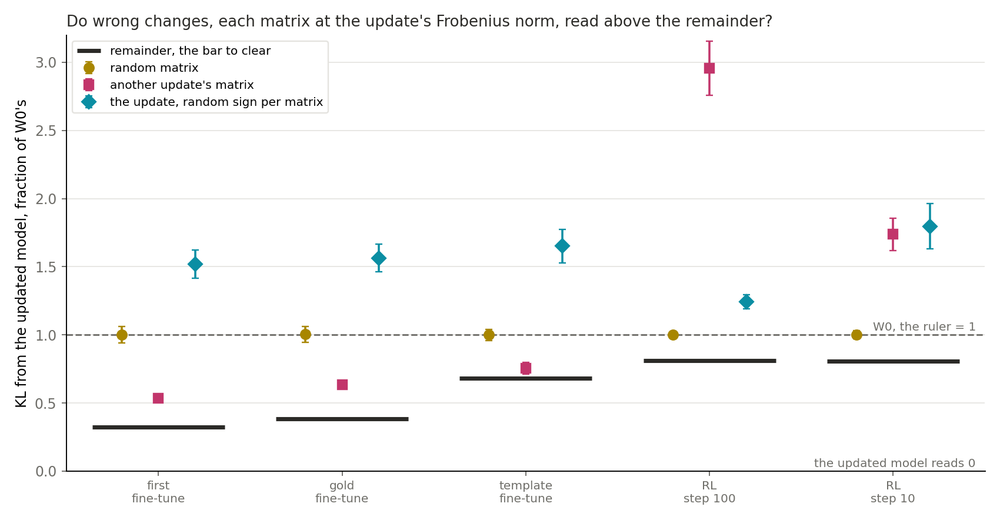
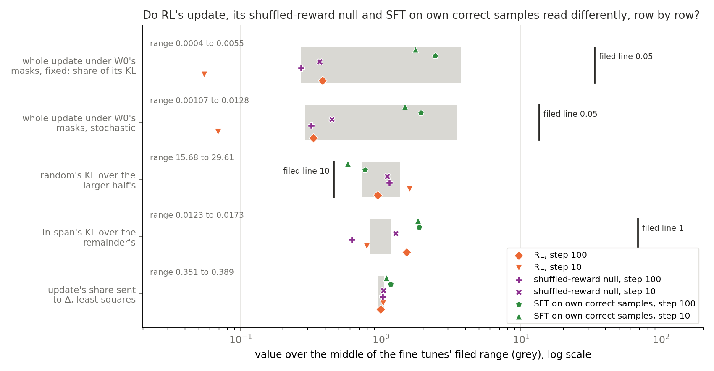

# Can the clean-model table fail a bad placement, and does RL read as the fine-tunes? (E75)

*2026-11-03, D1 and D2, `qwen-decomp-lead`. D1 is a map on Qwen3-1.7B that keeps the decomposition faithful for a real update, judged by a test that can fail a bad placement. D2 is the same table for SFT and RL updates. The user chose the clean-model table as D1's table (`decisions.md`, ask 24). Plan `reports/plans/2026-11-03_plan_e75-rl-reads.md`, with its Amendment 1. No independent check. Notebook `notebooks/E75_rl_reads.ipynb`.*

## The answer

The clean-model table can fail a bad placement of the right size, where size means Frobenius norm per matrix. Three wrong changes read further from the updated model than the remainder on all five updates; the narrowest clears by 1.7 times its bootstrap width. It still barely separates same-size parts of the update, and size weighted by the inputs is untested. RL's update, its shuffled-reward null and training on the model's own correct samples read the same filed labels but for one no-call. So those labels separate neither reward nor samples, and RL's update is not called learning here.

We read three saved fine-tuning updates and two steps of RL's update through one clean table and one masked read, then three wrong changes at the update's size, then the same reads on the shuffled-reward null and on the arm trained on its own correct samples. The table fails wrong directions on every update and barely grades parts of the update against each other. For `GOALS.md`, the test D1 needs can now fail a wrong direction, and RL's filed labels say nothing that the other two arms do not also read.

**Where a lean missed.** We leaned, with no rule filed, that the random change and another update's change would both read near the ruler. Random did, at 1.00 of the ruler on all five. Another update's change did not: it read 0.54 and 0.63 of the ruler on the first and gold fine-tunes, 0.75 on the template fine-tune, and 2.96 and 1.74 on RL. It still clears the bar everywhere. No read here tests why it reads low on the fine-tunes, so we name no cause.

**Status of RL's rows.** Do not read RL's update as learning. The shuffled-reward null also gained 5.6 points on GSM8K test under the drop rule, against a filed limit of 1.5, cause not established. RL's lead over the null on the strict grader falls to +1.2 and +0.7 points, not separable from zero, once answer format is ignored (`~/commute-data/agents/qwen-decomp-lead/note-from-qwen-rl-lead-E69-dW.md`).

**The own-samples arm had no lean to hold or miss.** `results/predictions.json` files leans for RL only, and `score_F.json` carries none for this arm. Its labels match RL's at step 100. At step 10 they match too, except that in-span against its slice reads "no call", because both reads sit under the rule's floor of 1e-5 nats. It differs in size and on one unruled row. KL(updated ‖ $W_0$), the ruler, reads 0.0010 nats at step 100 against RL's 0.064. Its share sent to Δ, 0.44 and 0.41, is the only one of the three arms outside the fine-tunes' range. Nothing filed reads either difference, and we name no cause.

**A correction to the brief for this report.** The brief read the remainder's slice as more scaled than projected, from its wide range of $c$. The per-matrix file does not support that, and "Size-matched states" below gives the numbers: 96 to 99.9 percent of the remainder's energy sits where $c$ is within 10 percent of 1.

## What we were trying to test

**The table.** Each matrix is $W_0 = U V^\top + \Delta$, and an update $\delta W$ changes the weights. A state is $W_0$ plus some part of $\delta W$, run with no masks. Its score is $K = \mathrm{KL}(\text{updated model} \,\|\, \text{state})$ over every position, where the updated model is $W_0 + \delta W$. The updated model reads 0 and $W_0$ reads the ruler. Γ plays no role, so the table reads weights and outputs and is not one of VPD's faithfulness checks.

**The updates.** u1 is the first fine-tune at step 10, u2 the gold fine-tune at step 100, u3 the template fine-tune at step 100. R100 and R10 are RL's GRPO update at steps 100 and 10. u3 reads its own 64 rows and the rest read 128 maths rows of 256 tokens. RL trained on its own samples, not this text.

| update | $\|\delta W\| / \|W_0\|$ | input-weighted energy | KL(updated ‖ $W_0$), the ruler |
|---|---|---|---|
| u1 | 1.43e-3 | 1440 | 1.6351 |
| u2 | 2.18e-3 | 2024 | 1.3768 |
| u3 | 3.71e-4 | 96.9 | 0.3226 |
| R100 | 2.68e-4 | 33.5 | 0.06431 |
| R10 | 5.24e-5 | 1.09 | 0.01187 |

**States.** The in-span part and remainder come from the least-squares split. The often-on and rarely-on halves place the update on half of the subcomponents. The adjoint split's change is a different placement. The random change has its scale searched until KL from $W_0$ matches the update's on 16 rows. The rescaled update is $W_0 + t\,\delta W$, $t$ the part's pooled input-weighted norm over the update's. The slice is, per matrix, $c\,QQ^\top\delta W$, with $Q$ a random orthonormal basis of a $k$-dimensional subspace of the output side, $k$ rounded from the part's energy share, and $c$ the scalar matching the part's energy exactly.

**Masked read.** $\tau$ is KL(masked $W_0$ ‖ masked $W_0$ + update) over KL($W_0$ ‖ $W_0$ + update), on the first 32 rows, with the update added unmasked at its matrix. Fixed masks are $W_0$'s; stochastic masks are the earlier transmission experiment's, one draw per row at one seed. Filed labels: at most 0.05 "deaf", at least 0.25 "carries", otherwise "between".

**Three wrong changes (Amendment 1).** Each is $W_0$ plus a change, per matrix at $\delta W$'s Frobenius norm, with no fitting. *Random:* a Gaussian matrix. *Another update's:* that update's matrix, rescaled; u1 and u2 read u3's, u3 reads u1's, R100 and R10 read u1's. *Signs:* $\delta W$ with a random sign per matrix, 107 of 196 flipped, the same subspaces with the wrong coordination between matrices. One seed each.

**The null (N100, N10).** The same run as RL with rewards shuffled, at steps 100 and 10, on the same 128 rows, through every read above except the three wrong changes. It is there to say whether RL's rows depend on the reward.

**The own-samples arm (F100, F10).** The same loop's third arm: supervised fine-tuning on the model's own correct samples, drawn once from $W_0$ and kept for the run, at steps 100 and 10, on the same 128 rows, through the same reads as the null. It is there to say whether RL's rows come from RL's samples without the reward's weighting. The RL lead's report gives its accuracy gain as 2.6 points, standard error 0.7, on GSM8K test under the drop rule.

**Wording of the masked rows.** "Deaf" is the filed label for a small $\tau$ and nothing more. We use the wording of `reports/reviews/2026-11-03_review_e77-masks-carry.md`: under the original model's masks, with Δ off, small changes in the stream barely reach the logits. How much the output depends on its tokens is not measured.

## What we expected, and why

Medium leans were filed for R100 and R10 only, from earlier fine-tune reads: "deaf" on both mask kinds, random at least 10 times the larger half, in-span strictly below remainder. Rule 4, placement against size, has no lean on any update, because the table had no size-matched reference. Fine-tunes are read against the same rules with no lean. Every number also carries the fine-tunes' filed range, so a difference shows even when a label agrees.

For the three wrong changes the medium leans were: all three fail on every update, the overall label reads "has teeth", random and another update's read near the ruler, and signs is the least sure. The last two have no rule. A state at the ruler reads as failing: stored $W_0$ set against the bar before filing fails on all five, so the rule can be met. The null and the own-samples arm have no lean; the plan's question was whether RL's departures from the fine-tunes' range also appear with the reward shuffled or with RL's samples alone.

## The control

u1 through this code against stored reads, first and alone, with stop within 1e-3 relative. All eight numbers matched with gap 0: $K$ 1.63511, NLL 2.06820 and 1.89779, entropy 0.61024, $\tau$ fixed 0.0054987, $\tau$ stochastic 0.0127886, K0 fixed 0.0670892, K0 stochastic 0.0440190. $W_0$'s own numbers also matched at gap 0 on u2, R100 and R10. u3 is on other rows and is not compared. The energy check agreed with stage S to about 2e-9 on all five.

The gap of 0 means this job's first read reproduced stored files exactly. It says nothing about the new states, which have no stored reference.

Amendment 1's control, on u1 first and alone: $W_0$ read 1.63511 by the new path with gap 0 to the stored read, and $W_0 + \delta W$ read 0. The null's job reproduced the same eight numbers on u1 at gap 0, $W_0$'s own numbers on N100 and N10 at gap 0, and stage S's energy to under 1e-9. The own-samples job, 50874, did the same on u1 and on F100 and F10, with the energy within 1.7e-9, and $K$ of the updated model read 0.

## Which states does the table fail?

**Reading it.** The table fails the random change and little else that is near the update's size. Random reads between 0.85 and 2.4 of the ruler on all five updates, at scales 17.8, 17.8, 56.2, 56.2 and 100 times the size matched to the update's input-weighted norm. The candidates form one ladder. At scale 1, the search's first step moved $W_0$ by 0.008 to 0.35 percent of the target KL on 16 rows. A random change at the update's Frobenius norm, read in Amendment 1 below, sits at the ruler.

**$K$ in nats.**

| state | u1 | u2 | u3 | R100 | R10 |
|---|---|---|---|---|---|
| $W_0$, the ruler | 1.6351 | 1.3768 | 0.3226 | 0.06431 | 0.01187 |
| in-span | 0.00916 | 0.00902 | 0.00273 | 0.001168 | 0.000111 |
| rescaled to in-span | 0.00838 | 0.01207 | 0.00252 | 0.001483 | 0.000231 |
| slice, in-span's size | 0.01576 | 0.01498 | 0.00428 | 0.001822 | 0.000172 |
| often-on half | 0.02974 | 0.02908 | 0.01012 | 0.003886 | 0.000416 |
| rarely-on half | 0.08826 | 0.08271 | 0.01945 | 0.007587 | 0.000816 |
| adjoint | 0.1657 | 0.1856 | 0.0594 | 0.01710 | 0.002205 |
| rescaled to remainder | 0.2143 | 0.1996 | 0.0889 | 0.02812 | 0.003983 |
| slice, remainder's size | 0.6642 | 0.6538 | 0.2496 | 0.05555 | 0.010267 |
| remainder | 0.5307 | 0.5267 | 0.2204 | 0.05228 | 0.009598 |
| random | 1.3847 | 1.4661 | 0.5760 | 0.15495 | 0.02818 |
| updated model | 0 | 0 | 0 | 0 | 0 |

**$K$ as a fraction of the ruler.**

| state | u1 | u2 | u3 | R100 | R10 |
|---|---|---|---|---|---|
| in-span | 0.0056 | 0.0066 | 0.0085 | 0.0182 | 0.0093 |
| rescaled to in-span | 0.0051 | 0.0088 | 0.0078 | 0.0231 | 0.0195 |
| slice, in-span's size | 0.0096 | 0.0109 | 0.0133 | 0.0283 | 0.0145 |
| often-on half | 0.0182 | 0.0211 | 0.0314 | 0.0604 | 0.0351 |
| rarely-on half | 0.0540 | 0.0601 | 0.0603 | 0.1180 | 0.0688 |
| adjoint | 0.1013 | 0.1348 | 0.1842 | 0.2659 | 0.1859 |
| rescaled to remainder | 0.1310 | 0.1450 | 0.2754 | 0.4372 | 0.3357 |
| slice, remainder's size | 0.4062 | 0.4749 | 0.7735 | 0.8638 | 0.8653 |
| remainder | 0.3246 | 0.3826 | 0.6832 | 0.8129 | 0.8089 |
| random | 0.8468 | 1.0649 | 1.7851 | 2.4093 | 2.3748 |

Top-token agreement with the updated model:

| state | u1 | u2 | u3 | R100 | R10 |
|---|---|---|---|---|---|
| $W_0$ | 0.808 | 0.803 | 0.914 | 0.953 | 0.983 |
| in-span | 0.972 | 0.970 | 0.992 | 0.994 | 0.999 |
| remainder | 0.838 | 0.827 | 0.922 | 0.958 | 0.985 |
| random | 0.756 | 0.704 | 0.805 | 0.888 | 0.956 |

## Does the in-span part beat a state of its size that is not placed?

**Reading it.** By the filed rule yes, on all five updates, and the margin is small. On u1 the in-span part reads 0.009 nats and its slice 0.016, against the ruler's 1.635. The gap is many times its row-bootstrap half-width, and it is 0.4 to 1.0 percent of the ruler. So the separation is real by the bootstrap and small against the ruler.

| update | in-span's $c$ range | slice − in-span, nats | half-width | gap / ruler | label |
|---|---|---|---|---|---|
| u1 | 0.956 to 1.037 | 0.00660 | 0.00033 | 0.0040 | beats size |
| u2 | 0.954 to 1.042 | 0.00596 | 0.00043 | 0.0043 | beats size |
| u3 | 0.947 to 1.042 | 0.00156 | 0.00025 | 0.0048 | beats size |
| R100 | 0.954 to 1.039 | 0.000654 | 0.000121 | 0.0102 | beats size |
| R10 | 0.951 to 1.031 | 0.0000613 | 0.0000079 | 0.0052 | beats size |

**What the table has and has not been shown to fail.**

- It fails a random change that moves $W_0$ as far as the update does. That change is 18 to 100 times the update's size, so the failure is not a read on a bad placement of the right size.
- It separates the in-span part from a slice of the same size, by under one percent of the ruler. A slice is still part of the update and not a wrong direction. On average over $Q$, $QQ^\top\delta W$ is the share $k/d$ of the update, so a slice is a shrunk copy plus noise on the output side.
- It reads the adjoint split's change at 0.10 to 0.27 of the ruler, 15 to 22 times the in-span part. This is the only other split read and it has no filed rule. Its size was not measured here, so it is not a size-matched comparison.
- Wrong changes at the update's Frobenius norm are the next section.

**The rescaled update is a stronger reference than the slice.** It has no placement at all. This comparison is not filed; we ran the rule's own bootstrap function on it for this report, so it is exploratory.

| update | rescaled − in-span, nats | half-width | / ruler | reading |
|---|---|---|---|---|
| u1 | −0.00078 | 0.00025 | −0.0005 | rescaled closer |
| u2 | +0.00305 | 0.00033 | +0.0022 | in-span closer |
| u3 | −0.00021 | 0.00015 | −0.0007 | rescaled closer, near the half-width |
| R100 | +0.00032 | 0.00008 | +0.0049 | in-span closer |
| R10 | +0.00012 | 0.00002 | +0.0101 | in-span closer |

The three states' order on R10 is in-span, slice, rescaled. On the other four updates the slice is the furthest of the three.

### Size-matched states

| update | $t$ in-span | $t$ remainder | remainder's $c$ range | remainder's energy where $c$ is 0.9 to 1.1 |
|---|---|---|---|---|
| u1 | 0.849 | 0.363 | 2.2e-7 to 2.42 | 0.957 |
| u2 | 0.835 | 0.389 | 2.9e-7 to 3.46 | 0.999 |
| u3 | 0.867 | 0.351 | 3.8e-7 to 1.28 | 0.963 |
| R100 | 0.854 | 0.368 | 3.8e-7 to 2.12 | 0.987 |
| R10 | 0.843 | 0.383 | 2.3e-7 to 2.39 | 0.970 |

**The wide range of $c$ comes from matrices that hold almost no remainder.** On every update, 82 of the 196 matrices have $c$ under 0.1, of which 79 are MLP matrices. The remainder in those holds about 1e-14 of its total energy. There the slice has $k = 1$ and is scaled to nearly nothing, which is what the remainder is there too. Only 4 to 6 matrices have $c$ above 1.2, each with a remainder share under one percent where we looked on u1. The rest of the remainder's energy is a slice with $c$ near 1. So by energy the remainder's slice is a slice, not a scaled vector, and its gap is size-matched in the sense the plan means. It still has no rule, so it is reported only:

| update | remainder's slice − remainder | half-width |
|---|---|---|
| u1 | 0.1335 | 0.0114 |
| u2 | 0.1271 | 0.0119 |
| u3 | 0.0291 | 0.0038 |
| R100 | 0.00328 | 0.00044 |
| R10 | 0.00067 | 0.00011 |

**The same 82 matrices limit the in-span gap.** There the in-span part equals the update to rounding, and $k = d$, so its slice equals the update too. Those matrices hold 0.19 to 0.31 of the update's input-weighted energy. The gap therefore reads only the other 114 matrices, which are mostly attention. Why the remainder vanishes there was not checked; the formula gives zero when the subcomponents span one side of a matrix.

**Parts are not orthogonal under the input weighting.** $t_\text{in-span}^2 + t_\text{remainder}^2$ reads 0.852, 0.848, 0.875, 0.864 and 0.857, not 1. The plan's expected $t$ of 0.93, 0.92 and 0.94 equals $\sqrt{1 - t_\text{remainder}^2}$ on u1, u2 and u3: 0.932, 0.921, 0.936. The measured values are 0.85, 0.83 and 0.87. So the expected rescaled in-span $K$ of 0.002, 0.003 and 0.0007 read 0.0084, 0.0121 and 0.0025. The remainder's expected rescaled $K$, 0.21, 0.20 and 0.09, read 0.214, 0.200 and 0.089. An earlier independent check said each part reads 2.5 to 4 times further than the rescaled update. With the measured $t$ the remainder reads 1.9 to 2.6 times further, and the in-span part 0.5 to 1.1 times.

## Does the table fail a wrong change of the right size?

**Reading it.** Yes: all three wrong changes read above the remainder on all five updates, which is the filed label "has teeth". A state fails when its $K$ is above the remainder's by more than the row bootstrap's half-width of that gap. The narrowest case is another update's matrix on the template fine-tune, with a gap of 0.0230 nats against a half-width of 0.0139, 1.7 times. The next narrowest gap is 5.9 times its half-width.

**$K$ as a fraction of the ruler.** The remainder is the bar. The updated model reads 0.

| update | remainder | random | another update's | signs | label |
|---|---|---|---|---|---|
| u1 | 0.3246 | 1.0019 | 0.5354 | 1.5203 | all fail |
| u2 | 0.3826 | 1.0036 | 0.6333 | 1.5646 | all fail |
| u3 | 0.6832 | 1.0007 | 0.7545 | 1.6518 | all fail |
| R100 | 0.8129 | 1.0018 | 2.9572 | 1.2431 | all fail |
| R10 | 0.8089 | 1.0006 | 1.7377 | 1.7960 | all fail |

**Gap to the remainder, nats, ± its half-width.**

| update | random | another update's | signs |
|---|---|---|---|
| u1 | 1.1075 ± 0.1008 | 0.3447 ± 0.0401 | 1.9552 ± 0.1710 |
| u2 | 0.8549 ± 0.0791 | 0.3453 ± 0.0349 | 1.6274 ± 0.1396 |
| u3 | 0.1024 ± 0.0130 | 0.0230 ± 0.0139 | 0.3125 ± 0.0401 |
| R100 | 0.01215 ± 0.00147 | 0.1379 ± 0.0127 | 0.02767 ± 0.00321 |
| R10 | 0.00227 ± 0.00036 | 0.01102 ± 0.00142 | 0.01171 ± 0.00197 |

**What stays open.**

- *Same-size parts of the update.* This read adds nothing here. The in-span part still beats its slice by under one percent of the ruler, and the rescaled update still beats the in-span part on two fine-tunes.
- *Size is Frobenius norm per matrix, not input-weighted.* Neither random's nor another update's input-weighted size was measured, so either may land on directions the inputs excite less or more than $\delta W$ does. Random reads 1.00 of the ruler, as $W_0$ does, and stored $W_0$ already fails this bar, so random's failure adds little beyond that. Signs is the exception by arithmetic: $\mathrm{tr}(A \Sigma A^\top)$ does not change with $A$'s sign, so each matrix keeps its input-weighted size exactly. Signs fails at 1.24 to 1.80 of the ruler.
- *The bar is not itself the same size.* The remainder's input-weighted norm is 0.35 to 0.39 of the update's, and on RL it reads 0.81 of the ruler.
- *One seed per state,* and the bootstrap covers rows only.

**The lean that missed.** Random read near the ruler as leaned. Another update's matrix did not, in either direction: about half the ruler on the first and gold fine-tunes, and above it on RL. No read here tests why it reads low. Signs, the least sure lean, reads furthest on the three fine-tunes.

## Does RL's update read as the fine-tunes do?

**Reading it.** RL at step 100 mostly does, and RL at step 10 mostly does not, though no filed label changed. All four filed labels came out as leaned on both RL updates. R100 is outside the range on one rule row, and R10 on all four. The range is thin. It comes from u1, u2, u3 on the KL rows and only u1, u3 on the masked rows, and u2 falls outside both masked rows. The null, in the next section, leaves the same range on one row at each step.

| row | filed range | u1 | u2 | u3 | R100 | R10 |
|---|---|---|---|---|---|---|
| $\tau$ fixed, label | | deaf | deaf | deaf | deaf | deaf |
| $\tau$ fixed | 0.0004 to 0.0055 | 0.00550 in | **0.00739 out** | 0.00041 in | 0.00057 in | **0.000081 out** |
| $\tau$ stochastic, label | | deaf | deaf | deaf | deaf | deaf |
| $\tau$ stochastic | 0.00107 to 0.0128 | 0.01279 in | **0.01752 out** | 0.00107 in | 0.00122 in | **0.000255 out** |
| random over larger half, label | | holds | holds | holds | holds | holds |
| random over larger half | 15.68 to 29.61 | 15.69 in | 17.73 in | 29.61 in | 20.42 in | **34.53 out** |
| in-span over remainder, label | | holds | holds | holds | holds | holds |
| in-span over remainder | 0.0123 to 0.0173 | 0.01725 in | 0.01713 in | 0.01237 in | **0.02235 out** | **0.01156 out** |
| share sent to Δ, least squares, no rule | 0.351 to 0.389 | 0.3637 in | 0.3889 in | 0.3512 in | 0.3678 in | 0.3828 in |
| in-span against slice, label, no range | | beats size | beats size | beats size | beats size | beats size |

u1 and u3 set most of the range's ends, so "in" is by construction there and carries no information.

**R10's differences, each a size only.** R10's $\tau$ reads four to five times below the bottom of the range on both mask kinds. The masked KL behind it is 1.56e-6 nats on fixed masks, and KLs under 1e-6 have no measured floor between numeric paths, so we hold this difference loosely. Random over the larger half reads 34.5, above the range's 29.6. In-span over remainder reads 0.0116, just under the range's 0.0123. R100's ratio is above the range, and R10's below, so they differ from the fine-tunes in opposite directions on that row.

**RL's scale.** On these rows RL's ruler is small: 0.064 and 0.012 nats, against 0.32 to 1.64. Parts of RL leave more of that smaller distance uncovered: the remainder reads 0.81 of RL's ruler, against 0.32 to 0.68. Those fractions are not comparable as a mechanism, because the template fine-tune, also a small update, sits near RL at 0.68. RL's own KL on its held rows is larger, 0.194 at step 100 by the RL lead's note, on other rows.

**Square law.** Along the update, $K$ of the rescaled update reads close to $(1-t)^2$ of the ruler on RL and well below it on the fine-tunes.

| update | $(1-t)^2$, in-span's $t$ | read | $(1-t)^2$, remainder's $t$ | read |
|---|---|---|---|---|
| u1 | 0.0229 | 0.0051 | 0.405 | 0.131 |
| u2 | 0.0273 | 0.0088 | 0.374 | 0.145 |
| u3 | 0.0177 | 0.0078 | 0.421 | 0.275 |
| R100 | 0.0214 | 0.0231 | 0.400 | 0.437 |
| R10 | 0.0246 | 0.0195 | 0.381 | 0.336 |

**Masked rows.** Here "deaf" reads as the review's wording requires. With $W_0$'s masks and Δ off, the whole update's KL under the masks is 0.0001 to 0.018 of its clean KL, on five updates. Amplitudes read 0.0086 and 0.0133 on R10, 0.027 and 0.036 on R100, against 0.095 to 0.148 on u1 and u2. How much the masked output depends on its tokens is not measured, and we draw no statement about what carries the output. K0, which never sees the update, reads 0.0671 fixed and 0.0440 stochastic on maths rows, and 0.0688 and 0.0460 on u3's rows.

## Does the table separate RL's update from its shuffled-reward null and the own-samples arm?

**Reading it.** No, on the filed labels: at each step the three arms read the same labels, masked rows included, with one no-call. "Deaf" twice, random at least ten times the larger half, in-span below remainder, in-span beating its slice, and the gain unscored. The no-call is the own-samples arm at step 10 on in-span against its slice, where both reads are under the rule's 1e-5 floor, at 6.1e-6 and 9.3e-6 nats. That gap, 3.2e-6, is six times its half-width, and the rule does not read it. The values differ, and nothing filed reads the difference: each arm is one seed, and no noise floor between arms was measured.

No row has RL and another arm leaving the fine-tunes' range the same way at both steps. On in-span over remainder, RL at step 100 and the own-samples arm at both steps sit above the range, and RL at step 10 and the null at step 100 below it. The null at step 10 is above. Random over the larger half leaves the range on RL at step 10, upward, and on the own-samples arm at step 10, downward. Among the three arms, the masked rows leave the range only on RL at step 10.

| row | R100 | N100 | F100 | R10 | N10 | F10 |
|---|---|---|---|---|---|---|
| $\tau$ fixed, label | deaf | deaf | deaf | deaf | deaf | deaf |
| $\tau$ fixed | 0.00057 in | 0.00040 in | 0.00361 in | **0.000081 out** | 0.00054 in | 0.00262 in |
| $\tau$ stochastic, label | deaf | deaf | deaf | deaf | deaf | deaf |
| $\tau$ stochastic | 0.00122 in | 0.00118 in | 0.00714 in | **0.000255 out** | 0.00166 in | 0.00549 in |
| random over larger half, label | holds | holds | holds | holds | holds | holds |
| random over larger half | 20.42 in | 24.77 in | 16.62 in | **34.53 out** | 23.93 in | **12.48 out** |
| in-span over remainder, label | holds | holds | holds | holds | holds | holds |
| in-span over remainder | **0.02235 out** | **0.00907 out** | **0.02731 out** | **0.01156 out** | **0.01859 out** | **0.02692 out** |
| share sent to Δ, least squares, no rule | 0.3678 in | 0.3797 in | **0.4351 out** | 0.3828 in | 0.3861 in | **0.4063 out** |
| in-span against slice, label | beats size | beats size | beats size | beats size | beats size | no call |
| slice − in-span, over the ruler | 0.0102 | 0.0047 | 0.0094 | 0.0052 | 0.0083 | 0.0110 |
| T2 | unscored | unscored | unscored | unscored | unscored | unscored |

**Size.** RL and the null have about the same input-weighted energy at each step and very different rulers. The own-samples arm has 0.37 of RL's energy at step 100 and 0.73 at step 10, and its ruler is 63 and 40 times smaller than RL's. On the same arms and step, by another read, the RL lead's report gives KL($W_0$ ‖ updated) on held rows of 0.0017 against 0.194. No rule or floor reads these ratios.

| | R100 | N100 | F100 | R10 | N10 | F10 |
|---|---|---|---|---|---|---|
| $\|\delta W\| / \|W_0\|$ | 2.68e-4 | 2.82e-4 | 2.09e-4 | 5.24e-5 | 4.95e-5 | 4.44e-5 |
| input-weighted energy | 33.5 | 34.9 | 12.5 | 1.09 | 1.03 | 0.796 |
| KL(updated ‖ $W_0$), the ruler | 0.06431 | 0.13490 | 0.00102 | 0.01187 | 0.00236 | 0.000294 |
| $W_0$'s NLL − updated | −0.125 | −0.029 | +0.0048 | −0.063 | −0.0074 | +0.0008 |
| entropy, $W_0$ 0.6102 → updated | 0.577 | 0.636 | 0.6120 | 0.594 | 0.606 | 0.6102 |
| KL(masked $W_0$ ‖ masked updated), fixed | 5.53e-5 | 5.46e-5 | 3.54e-6 | 1.56e-6 | 1.54e-6 | 6.97e-7 |
| KL($W_0$ ‖ updated), $\tau$'s denominator | 0.0969 | 0.1361 | 0.00098 | 0.0192 | 0.00285 | 0.000266 |

**The masked rows at step 10.** RL's and the null's masked KL are almost equal, and both are close to where no floor is measured. Their $\tau$ differ almost entirely through the denominator. The own-samples arm's fixed masked KL at step 10, 7.0e-7, is under 1e-6, where no floor between numeric paths is measured, so its "deaf" there is held loosely. Its $\tau$ reads above RL's through the denominator, 72 times smaller than RL's, against a masked KL 2.2 times smaller.

**$K$ as a fraction of the ruler.**

| state | R100 | N100 | F100 | R10 | N10 | F10 |
|---|---|---|---|---|---|---|
| in-span | 0.0182 | 0.0074 | 0.0215 | 0.0093 | 0.0146 | 0.0207 |
| rescaled to in-span | 0.0231 | 0.0159 | 0.0395 | 0.0195 | 0.0253 | 0.0312 |
| slice, in-span's size | 0.0283 | 0.0122 | 0.0309 | 0.0145 | 0.0230 | 0.0317 |
| often-on half | 0.0604 | 0.0299 | 0.0618 | 0.0351 | 0.0526 | 0.0656 |
| rarely-on half | 0.1180 | 0.0644 | 0.1204 | 0.0688 | 0.1024 | 0.1283 |
| adjoint | 0.2659 | 0.1895 | 0.2439 | 0.1859 | 0.2348 | 0.2360 |
| rescaled to remainder | 0.4372 | 0.3367 | 0.3085 | 0.3357 | 0.3791 | 0.3503 |
| slice, remainder's size | 0.8638 | 0.8680 | 0.8528 | 0.8653 | 0.8445 | 0.8326 |
| remainder | 0.8129 | 0.8191 | 0.7875 | 0.8089 | 0.7875 | 0.7687 |
| random, matched on KL | 2.4093 | 1.5950 | 2.0001 | 2.3748 | 2.4508 | 1.6010 |

So as fractions of each arm's own ruler the three arms sit close together: the remainder reads 0.77 to 0.82 on all six, whatever the ruler's size. The rescaled update on the null also reads close to the square law, $(1-t)^2$ of 0.0243 and 0.0253 against reads of 0.0159 and 0.0253. On the own-samples arm it also reads close: square law 0.0417 and 0.0314 against reads of 0.0395 and 0.0312 at the in-span size, and 0.319 and 0.353 against 0.309 and 0.350 at the remainder's. So that difference from the fine-tunes is not RL's alone. No arm trained on this maths text, and the three wrong changes were read on neither the null nor the own-samples arm.

**Size-matched numbers on the own-samples arm.** The in-span norm share $t$ reads 0.796 and 0.823, against 0.835 to 0.867 on the five updates; the remainder's reads 0.435 and 0.406, against 0.351 to 0.389. Rescaled minus in-span, unfiled, is +1.8e-5 and +3.1e-6 nats, in-span closer on both by more than the half-width of 3e-6 and 1e-6. Remainder's slice minus remainder is 6.66e-5 and 1.88e-5, half-widths 1.09e-5 and 0.41e-5. Random's scale was 10 and 17.8 times the size matched to the update's input-weighted norm, against 17.8 to 100 on the five updates, and the search matched on KL at 1.12 and 0.89.

## Why is the gain unscored on RL and the other two arms?

**Reading it.** T2, E72's gain label, reads "unscored" on R100 and R10 because RL's update raises next-token NLL on these rows. The label needs $W_0$'s NLL minus the updated model's to be at least 0.05 nats, and it reads −0.125 at step 100 and −0.063 at step 10. Gain divides by that number, so gains on RL below mean the share of an NLL rise and not the share of a drop. The plan foresaw this, since RL trains on its own samples. This is a statement about these rows only and says nothing about RL's accuracy on its own task. Entropy on these rows falls on RL and rises on all three fine-tunes. The own-samples arm reads "unscored" for a different reason: its NLL does fall on these rows, by only 0.0048 and 0.0008 nats, under the same 0.05, with entropy almost unchanged. The null raises NLL like RL.

| update | NLL $W_0$ − updated | T2 | T2, norm share | entropy $W_0$ → updated |
|---|---|---|---|---|
| u1 | +0.171 | carried | carried | 0.610 → 1.508 |
| u2 | +0.129 | carried | carried | 0.610 → 1.306 |
| u3 | +0.529 | carried | carried | 0.641 → 0.700 |
| R100 | −0.125 | unscored | unscored | 0.610 → 0.577 |
| R10 | −0.063 | unscored | unscored | 0.610 → 0.594 |
| N100 | −0.029 | unscored | unscored | 0.610 → 0.636 |
| N10 | −0.0074 | unscored | unscored | 0.610 → 0.606 |
| F100 | +0.0048 | unscored | unscored | 0.6102 → 0.6120 |
| F10 | +0.0008 | unscored | unscored | 0.6102 → 0.6102 |

Gain column, for the record; on RL it is not a readable share, and it is left out for the null and the own-samples arm, whose denominators are also under 0.05 nats.

| state | u1 | u2 | u3 | R100 | R10 |
|---|---|---|---|---|---|
| in-span | 1.135 | 1.133 | 0.958 | 0.791 | 0.865 |
| remainder | 0.925 | 0.939 | 0.271 | 0.109 | 0.108 |
| often-on half | 1.223 | 1.211 | 0.903 | 0.634 | 0.749 |
| rarely-on half | 1.262 | 1.180 | 0.832 | 0.471 | 0.640 |
| random | −1.476 | −3.740 | −0.241 | 0.698 | 0.311 |
| adjoint | 1.267 | 1.473 | 0.722 | 0.397 | 0.521 |
| rescaled to in-span | 1.134 | 1.192 | 0.959 | 0.808 | 0.836 |
| rescaled to remainder | 1.242 | 1.390 | 0.623 | 0.274 | 0.362 |
| slice, in-span's size | 1.189 | 1.175 | 0.943 | 0.737 | 0.833 |
| slice, remainder's size | 0.867 | 0.837 | 0.193 | 0.081 | 0.076 |

E72's $s$ is 0.636, 0.611, 0.649 on the fine-tunes, and 0.632 and 0.617 on RL. The in-span norm share is the $t$ above. Random's positive "gain" on RL is an NLL rise like the update's, and not a sign of anything shared.

## What we learned

The clean-model table fails wrong changes at the update's Frobenius norm on every update read, so it can do what D1 needs on wrong directions, with one seed per state. It barely grades same-size parts of the update. The in-span part beats its slice by under one percent of the ruler, and the plain rescaled update does as well on two of five. For D2, RL's rows have the fine-tunes' broad order, and the null and the own-samples arm read the same labels at the same two steps, but for one no-call. So those labels carry no statement about reward or samples. What differs between the arms is the ruler, 63 times smaller on the own-samples arm than on RL at step 100, and on that arm the share sent to Δ; neither has a rule or a noise floor yet.

## How compelling is the evidence

- **Control.** Gap 0 on eight numbers, and $W_0$'s own numbers at gap 0 on u2, R100, R10, N100, N10, F100, F10. Amendment 1's path read $W_0$ at gap 0 and the updated model at 0.
- **Coverage.** Five updates, listed, and the null and the own-samples arm at two steps each. One slice seed, one random draw, one stochastic draw per row, 32 rows for the masked read, 128 or 64 rows for the table. One seed per wrong change, the same signs on every update. One training seed per arm.
- **Noise.** Row bootstrap only. The bootstrap does not cover the slice seed, so the gap's real noise is larger than the half-width. The in-span gap reads only 114 of 196 matrices. KLs under 1e-6 have no measured floor; F10's fixed masked KL, 7.0e-7, is under it, and R10's and N10's, 1.56e-6 and 1.54e-6, are close. No noise floor between arms. On F10 two clean reads fall under the rules' 1e-5 floor.
- **Blind spots.** $K$ is not gain or accuracy, and it weights tails. The table reads no masks and no Γ. Wrong changes are sized in Frobenius norm, so only signs is the right input-weighted size. The slice is random on the output side only. A top-1 row sees nothing past the top token. u3 reads other rows, so its ruler is not directly comparable.
- **Independent check.** None; none was filed for this run. The answer paragraph's claims are the lead's to send to a check if they go into D1's write-up.

## Surprises

**One lean, with no rule filed, missed: random and another update's change were to read near the ruler, and another update's did not.** It read 0.54 and 0.63 of the ruler on the first and gold fine-tunes, 0.75 on the template fine-tune, 2.96 and 1.74 on RL. Random read 1.00 as leaned. Every filed label came out as leaned. No read tests why another update's change reads low.

- The null reads every label RL reads. Its input-weighted energy is about RL's, and its ruler is twice RL's at step 100 and a fifth at step 10.
- The own-samples arm reads RL's labels, but for one no-call, on a ruler 63 and 40 times smaller than RL's at 0.37 and 0.73 of its energy, and it alone leaves the fine-tunes' range on the share sent to Δ.
- In-span's norm share read 0.83 to 0.87, against an expected 0.92 to 0.94. See "Size-matched states".
- The rescaled update, with no placement at all, reads closer than in-span on two fine-tunes.
- The remainder's slice is a slice by energy, against the brief's reading and the look of its $c$ range.
- The rescaled update follows the square law on RL, on the null and on the own-samples arm, and not on the fine-tunes.
- RL raises next-token NLL on these rows and lowers entropy. A small or negative gain was foreseen; the entropy difference was not. The null also raises NLL, and its entropy rises at step 100 and falls at step 10. The own-samples arm lowers NLL by under 0.005 nats.

## What next

1. **More slice seeds and a noise floor, for the table and between arms.** If the margin under one percent is not stable across seeds, "beats size" says less than it reads. A floor between arms says which value differences among RL, the null and the own-samples arm are worth reading.
2. **Wrong changes sized by input weighting.** If one reads at or below the remainder, the table goes back to the user. This is a new measurement and goes through `/design`.

## Scorecard

| id | claim | rule | read | verdict |
|---|---|---|---|---|
| control | u1 reproduces stored reads | within 1e-3 relative | gap 0 on eight numbers | passed |
| w0_same | $W_0$'s own numbers unchanged | within 1e-3 relative | gap 0 on u2, R100, R10; u3 other rows | passed |
| clean_FT, energy_check | updated model's $K$ is 0; energy agrees with stage S | filed stops | 0; at most 2.1e-9 | passed |
| transmission | whole update barely reaches output, both mask kinds | at most 0.05 "deaf" | deaf on all five | as leaned on R100, R10 |
| random_vs_halves | random at least 10 times the larger half | ratio at least 10 | 15.7, 17.7, 29.6, 20.4, 34.5 | holds; as leaned on R100, R10 |
| inspan_vs_remainder | in-span below remainder | ratio below 1 | 0.0173, 0.0171, 0.0124, 0.0223, 0.0116 | holds; as leaned on R100, R10 |
| placement_vs_size | in-span beats its slice | gap above half-width | see the table above | beats size on all; no lean filed |
| visible_difference | rows against the fine-tunes' range | inside or outside | R100 one row out; R10 four; u2 two | reported |
| T2 | gain label | unscored under 0.05 nats | carried on fine-tunes; unscored on R100, R10 | reported, no lean |
| amend1 control | $W_0$ and updated model by the new path, on u1 first | within 1e-3 relative | gap 0; 0 | passed |
| per_state_update | each wrong change above the remainder by more than the half-width | "fails" | fails, 15 of 15 | as leaned |
| overall | every state fails on every update | "has teeth" | has teeth | as leaned |
| near_ruler | random and another update's read near the ruler | none, read only | random 1.00; another update's 0.54, 0.63, 0.75, 2.96, 1.74 | random as leaned; another update's missed |
| null control | u1, $W_0$'s numbers, energy | within 1e-3 relative | gap 0 | passed |
| null labels | same rules on N100, N10 | as above | deaf, deaf, holds, holds, beats size, unscored | same as R100, R10; no lean filed |
| own-samples control | u1, $W_0$'s numbers, energy | within 1e-3 relative | gap 0; energy within 1.7e-9 | passed |
| own-samples labels, step 100 | same rules on F100 | as above | deaf 0.0036, deaf 0.0071, holds 16.6, holds 0.027, beats size, unscored | same as R100, N100; no lean filed |
| own-samples labels, step 10 | same rules on F10 | as above | deaf 0.0026, deaf 0.0055, holds 12.5, holds 0.027, no call, unscored | same as R10, N10 but the no call; no lean filed |

Values read in order u1, u2, u3, R100, R10, except the null's and the own-samples arm's rows.

## Departures from the literature

Against VPD and `param-decomp`.

- The clean table is ours and is not one of VPD's checks. VPD judges a decomposition under stochastic, adversarial and CI-masked reconstruction; this table has no masks. The user chose it as D1's table on 2026-11-03.
- The masked read uses $W_0$'s masks with Δ off and adds the update unmasked, as in the earlier transmission experiment. The library's Δ share and adversarial sources are not used.
- The stochastic masks use one draw per row at one seed, where the library draws afresh.
- RL's update, its null and the own-samples arm come from the RL lead's recipe, whose departures are in `reports/plans/2026-11-03_plan_e69-grpo-loop.md`. The own-samples arm's samples are fixed at $W_0$, where the scoping report's matched arm sampled from current weights.
- The three wrong changes and the remainder's bar are ours, with no source to depart from.

## Not run

1. Wrong changes sized by input weighting; random and another update's input-weighted sizes were not measured.
2. Wrong changes on the null or the own-samples arm, or at more than one seed.
3. More than one slice seed; a noise floor for $K$, for the masked KL below 1e-6, or between arms.
4. The adjoint split's size against the update's.
5. Any test of why another update's change reads low on the fine-tunes, or of why the own-samples arm's ruler is small or its share sent to Δ high.
6. Masked reads under the updated model's masks; block-level transmission, cuts and Gaussians; the last matrix's positive control on RL.
7. Any adversary, and accuracy of any part.
8. Any arm at steps other than 100 and 10, and a second training seed of any arm through this table.
9. An independent check.

## Provenance

Job 50596, one cluster L40, `normal` QoS, 12,115 s, peak GPU 45.6 GB, host 93.8 GB, $0. Results `experiments/qwen_rl_reads/results/` and, for u1 to u3's earlier reads, `experiments/qwen_fixed_masks/results/`, `experiments/qwen_transmission/results/` and `experiments/qwen_pass_test/results/`. Rules `experiments/qwen_rl_reads/rules.py`, `results/predictions.json`. Figures `experiments/qwen_rl_reads/plot.py`.

Amendment 1: job 50779, one cluster L40, `debug` QoS, 1,340 s, peak GPU 8.0 GB, host 31.2 GB, $0. Rules `rules_amend1.py`, `results/predictions_amend1.json`; results `results/amend1_score.json`, `results/amend1/`.

The null: job 50755, one cluster L40, `normal` QoS, 6,501 s, peak GPU 45.6 GB, host 91.0 GB, $0. Results `results/N100/`, `results/N10/`, `results/score_N.json`.

The own-samples arm: job 50874, one cluster L40, `normal` QoS, 6,309 s, peak GPU 45.6 GB, host 91.0 GB, $0. Results `results/F100/`, `results/F10/`, `results/score_F.json`. Rescoring F100's and F10's reads through the filed rules matched `score_F.json` on all 34 numbers and labels compared, largest gap 0.

**`score.json` is the five-update file, job 50596's, and `score_N.json` is job 50755's.** `run.py` rewrites `score.json` with only the updates of its own job, so a later job can replace the working copy. `plot.py` therefore rescores the five updates from the per-read files with the filed rules; against `score.json`, 85 numbers read a largest gap of 0. It takes the null from `score_N.json` and the own-samples arm from `score_F.json`.
