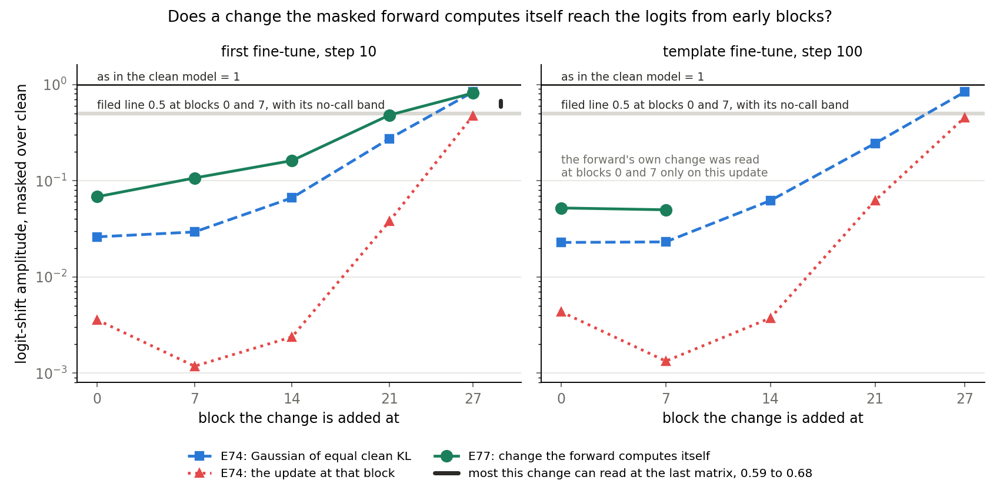
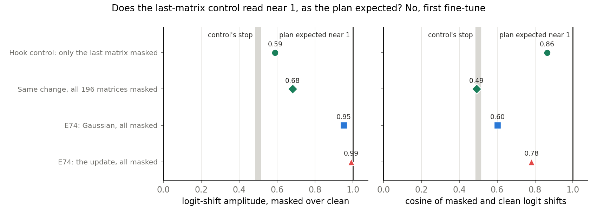
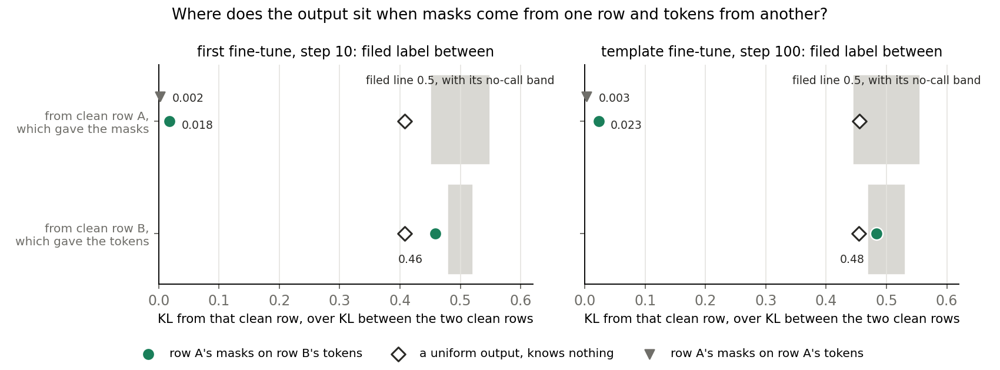
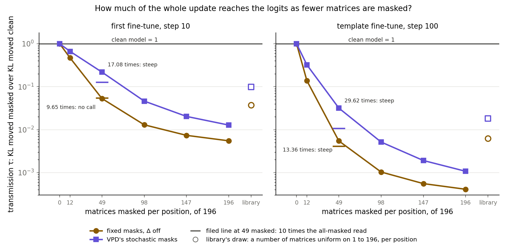
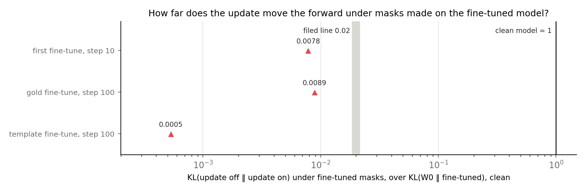

# With every matrix of Qwen3-1.7B masked, what still reaches the logits? (E77)

*2026-11-03, D1, `qwen-decomp-lead`. D1 is a map on Qwen3-1.7B that keeps the decomposition faithful for a real update, judged by a test that can fail a bad placement. Plan `reports/plans/2026-11-03_plan_e77-open-points.md`, with Amendments 1 and 2. Independent check `reports/reviews/2026-11-03_review_e77-masks-carry.md`. Notebook `notebooks/E77_open_points.ipynb`.*

## The answer

With all 196 matrices masked by the original model's masks, Δ off, small changes in the stream barely reach the logits at early blocks. That holds even for changes the forward computes itself, against our lean. With another row's tokens under them, those masks keep the output within about 0.5 nats of the masks' own row. How much it still depends on its tokens is not measured. With fewer matrices masked more of the update passes, so the next run compares routings.

We read saved fine-tuning updates of Qwen3-1.7B under its masks, varying what was changed, how many matrices were masked and which row gave the masks.
A change the masked forward computes itself failed our lean at early blocks, while masking fewer matrices let far more of the update through.
For `GOALS.md`, this means a masked loss term with all matrices masked can hardly teach early blocks, so the map's next run must compare how many matrices its loss masks.

**The independent check's wording, which governs this report.**

> With all 196 matrices masked by the original model's masks, Δ off, small changes in the stream barely reach the logits at early blocks. With another row's tokens under them, those masks keep the output within about 0.5 nats of the masks' own row. How much the output still depends on its tokens is not measured.

**Something unexpected happened that I cannot explain.** We filed a medium lean that a change the masked forward computes itself would pass at blocks 0 and 7, with amplitude above 0.5. It read 0.05 to 0.11 on all four cells, with cosines near zero. The filed label is "fails" and it stands.

**A correction.** The lead told the user in chat, at 18:05 and about 19:40, a provisional reading that the masks carry the output. The independent check narrowed it. Neither "the masks carry the output" nor "the forward barely reads its input" is shown. What was read is the statement above.

## What we were trying to test

An earlier run, E74, found that masked reads barely respond to an update: adding the whole fine-tuning update on top of a masked forward hardly moved the logits. In a masked forward each matrix's output is rebuilt from its subcomponents, each multiplied by a mask. An independent check of E74 found no bug and left three points open.

**Point one: is the loss about the update?** At one block's seven matrices we added a small multiple of the masked sum, $\epsilon\,((x V)\cdot g)\,U$, in the clean and in the masked forward. Here $x$ is the forward's own input, $g$ W0's causal importance and $\epsilon$ a factor fitted so the clean KL matches the update's at that block. If this change passes while the update does not, the loss is about the update. A broken hook would read as low as the update, with a cosine near zero.

**Point two: is masking all 196 at once the extreme case?** VPD's training masks a random subset at each position, a scheme its library calls routing. A routed-out matrix outputs $x W^\top$. We masked a fixed number per position, 196, 147, 98, 49, 12 or 0, and also the library's draw of a number uniform on 1 to 196. Three route draws per row were averaged, one at 196 and 0. All-masked must reproduce E74 and zero masked must read exactly 1.

**Point three: does the update move the forward under masks made on the fine-tuned model?** The share is $D/R$, with $D = \mathrm{KL}(\text{update off} \| \text{update on})$ under those masks and $R = \mathrm{KL}(W_0 \| \text{fine-tuned})$ in the clean model. No update reads 0 and the clean model's own move reads 1.

**Added by the amendments, after point one failed.** The hook control applies the own-output change at the last matrix alone. The swap takes masks from row A and tokens from row B, the next row, to see which clean output the result sits near. The own-output change was also read at blocks 14, 21 and 27.

**Symbols and masks.**

- Amplitude: the size of the masked logit shift over the clean one, centred per position. The clean model reads 1.
- Transmission $\tau = \mathrm{KL}(\text{masked} \| \text{masked} + \text{change}) / \mathrm{KL}(W_0 \| W_0 + \text{change})$, a ratio of sums over rows. The clean model reads 1. It is quadratic, so 100 times in τ is about 10 times in amplitude.
- Fixed masks: $m = g$, Δ off. Stochastic masks: $m = g + (1 - g)u$ with $d$ uniform on 0 to 1, $d$ being the share of Δ, one draw per row.
- $K_0$: KL of the masked forward from the clean one, with no change added.

**Updates and rows.** The first 32 rows of 256 tokens. The first fine-tune at step 10 and the gold-answer fine-tune at step 100 are on maths rows, the template fine-tune at step 100 on its own rows. Their sizes over W0 are 0.0014, 0.0022 and 0.00037.

## What we expected, and why

- **Own-output change: passes, medium lean.** It lies in what the masked forward already computes, and E74's last-matrix control had read 0.75 to 1.
- **Fewer matrices masked: steep, medium lean.** τ at 49 masked would be over ten times τ at 196, on each update and mask type. The library's draw has no threshold.
- **Displacement: small, medium lean.** Under 0.02 on all three updates.
- **Hook control: near 1.** Nothing masked follows the last matrix.
- **Swap: masks, weak lean.** The masked forward's own KL of 0.067 suggested the masks hold the output.
- **Later blocks: amplitude rises towards 1, no threshold.** E74's Gaussians read 0.03, 0.03, 0.07 and 0.27 at blocks 0, 7, 14 and 21.

## What we observed

**The job stopped twice before it read everything.**

1. Job 50608 stopped after 650 s at its filed rule, on read 1's "fails". Displacement on the first fine-tune had already run.
2. Job 50613 stopped after 93 s on Amendment 1's hook control. Its cosine of 0.491 fell under the line of 0.513. The control was badly specified: every matrix was masked, so its two terms read different streams, and its threshold had no measured reference. E74's own last-matrix cosines read 0.60 to 0.96 for the same reason.
3. Job 50616, under Amendment 2, masked only the last matrix for the control, passed the line and read the rest in 96 minutes. A third amendment is not allowed, so any follow-up is a new experiment.

### Does a change the masked forward computes itself reach the logits from early blocks?

**Reading it.** No, and this reverses our lean. At blocks 0 and 7 the change reads 0.05 to 0.11, on both updates, against a line at 0.5. Its cosines with the clean shift are 0.01 to 0.05. It passes two to four times more than E74's Gaussian of equal clean KL. It passes 12 to 90 times more than the update.

On the first fine-tune amplitude rises with block, as we leaned. Blocks 0, 7 and 14 read low. Block 21, at 0.48, sits just under the line filed for blocks 0 and 7, but block 27 reads 0.81, so block 21 is not clearly deaf.

The next section moves the bar without moving the verdict. The change reads at most 0.59 to 0.68 at the last matrix, not 1. The early blocks of the first fine-tune still read five to ten times below that. Clean and masked terms read different inputs, so a low cosine is not loss alone.

| update | block | ε | clean KL, target | clean KL, read | τ | amplitude | cosine | E74 Gaussian | E74 update | filed label |
|---|---|---|---|---|---|---|---|---|---|---|
| first | 0 | 0.0741 | 0.0252 | 0.0244 | 0.00106 | 0.068 | 0.050 | 0.026 | 0.0036 | fails |
| first | 7 | 0.198 | 0.0482 | 0.0471 | 0.00318 | 0.107 | 0.014 | 0.029 | 0.0012 | fails |
| first | 14 | 0.190 | 0.0339 | 0.0348 | 0.00425 | 0.162 | 0.061 | 0.066 | 0.0024 | no rule |
| first | 21 | 0.0697 | 0.00370 | 0.00347 | 0.103 | 0.481 | 0.182 | 0.274 | 0.038 | no rule |
| first | 27 | 0.0262 | 0.00320 | 0.00310 | 0.980 | 0.815 | 0.619 | 0.836 | 0.473 | no rule |
| template | 0 | 0.0225 | 0.00332 | 0.00327 | 0.00091 | 0.052 | 0.046 | 0.023 | 0.0043 | fails |
| template | 7 | 0.0526 | 0.00439 | 0.00421 | 0.00073 | 0.050 | 0.012 | 0.023 | 0.0013 | fails |

### Does the last-matrix control read near 1, as the plan expected?

**Reading it.** No, and the expectation was wrong rather than the hook. With only the last matrix masked, the control read amplitude 0.59, cosine 0.86 and τ 0.63, where the plan expected near 1. That cleared the filed line of 0.513, so the job went on.

Only the final norm and the output head follow this matrix. Write $r$ for the residual, $w$ for the clean output and $h$ for the masked output. The same $\epsilon h$ is added in both pairs, so the two logit shifts differ only because the norm is read at $r + w$ in one and $r + h$ in the other.

Two causes could shrink the masked shift: a larger base size, or more of $h$ lying along the base. **Saved numbers do not say which.** E74's Gaussian at this matrix reads 0.95, which argues against the size, but it was read with all matrices masked. A test of about a minute is queued as stage 0 of E76 and it also confirms the algebra, which so far comes from reading the code.

| last matrix, first fine-tune | amplitude | cosine | τ | clean KL | masked KL |
|---|---|---|---|---|---|
| only this matrix masked, the control | 0.590 | 0.864 | 0.634 | 0.00312 | 0.00198 |
| all 196 masked, same change | 0.682 | 0.491 | 1.076 | 0.00312 | 0.00336 |
| E74: Gaussian, all masked | 0.952 | 0.602 | 0.693 | 0.00124 | 0.00086 |
| E74: the update, all masked | 0.991 | 0.781 | 0.785 | 0.00124 | 0.00097 |

The independent check found this gap leaves the swap, displacement and the routing read's controls alone. It moves only the own-output read's bar, as stated above.

### Where does the output sit when masks come from one row and tokens from another?

**Reading it.** The filed label is "between" on both updates, it stands, and our weak lean towards "masks" was not met. The output sits within about 0.5 nats of the row that gave the masks, where each row's own masks read about 0.07 nats. On that ruler it is 0.02 of the way from row A towards row B.

The distance to row B cannot separate anything. It sits near 0.5 because of KL's tails. Two clean rows read 25 to 28 nats apart, more than twice the logarithm of the vocabulary. So that denominator measures how far down one row's tail sits at the other row's tokens. A uniform output that knows nothing reads 0.41 on the first fine-tune and 0.45 on the template. To reach the filed "masks" label on the first fine-tune, the output would have to sit about three nats further from row B than a uniform output does. So "between" says little.

The distance to row A survives this. The masks hold enough of row A's likely tokens, since only the masks can bring those in under row B's tokens. The tokens still matter on average: KL from row A rises about eight times once they change. These are means over positions, and a mixture of A and B at about half of positions, with the output close to A elsewhere, would fit both sums. A softened copy of A could also cover much of the fall in the distance to B. How much the output depends on its tokens is not measured.

No two paired rows share a prefix and only about 3 of 256 positions hold the same token, so row pairing does not explain this. Only one pairing was run.

| update | own masks, own tokens | KL from A | KL from B | KL(A ‖ B) | KL(B ‖ A) | distance to A | to B | band for B | uniform output, to A and B | filed label |
|---|---|---|---|---|---|---|---|---|---|---|
| first | 0.067 | 0.508 | 12.74 | 27.84 | 27.80 | 0.0182 | 0.458 | 0.481-0.519 | 0.408, 0.408 | between |
| template | 0.069 | 0.565 | 12.01 | 24.76 | 24.84 | 0.0228 | 0.483 | 0.471-0.529 | 0.455, 0.454 | between |

The uniform output's two numbers come from the independent check; the run did not save them.

### How much of the whole update reaches the logits as fewer matrices are masked?

**Reading it.** Masking all 196 is the extreme case, and the filed overall label is "mixed". The rule takes τ at 49 masked over τ at 196. Three cells read steep, at 17.08, 13.36 and 29.62. The first fine-tune under fixed masks read 9.65, inside the no-call band of 8.89 to 11.11. So the lean held on three cells and the fourth gets no call.

With only 12 masked, τ reads 0.14 to 0.67, where all-masked reads 0.0004 to 0.013. The routed-out matrices read the full weights and the update then gets through. The library's draw lies between the reads at 49 and 98 masked, except the template under fixed masks, where it sits just above the read at 49.

Three limits apply. Because τ is quadratic, the amplitude gain from 196 to 49 masked is only two to 3.5 times. In this read the update enters in full at every matrix, where the library's Δ would pass only a share at a routed-out matrix. The routes are uniform, so nothing here says which matrices matter.

| update, masks | number | 196 | 147 | 98 | 49 | 12 | 0 | library | ratio at 49 | filed label |
|---|---|---|---|---|---|---|---|---|---|---|
| first, fixed | τ | 0.00550 | 0.00737 | 0.0130 | 0.0531 | 0.470 | 1 | 0.0376 | 9.65 | no call |
| | amplitude | 0.095 | 0.095 | 0.108 | 0.189 | 0.574 | 1 | 0.171 | | |
| | cosine | 0.327 | 0.360 | 0.425 | 0.563 | 0.774 | 1 | 0.472 | | |
| first, stochastic | τ | 0.0128 | 0.0203 | 0.0462 | 0.218 | 0.665 | 1 | 0.0991 | 17.08 | steep |
| | amplitude | 0.129 | 0.144 | 0.196 | 0.364 | 0.758 | 1 | 0.260 | | |
| | cosine | 0.537 | 0.588 | 0.657 | 0.749 | 0.892 | 1 | 0.657 | | |
| template, fixed | τ | 0.00041 | 0.00055 | 0.00103 | 0.00547 | 0.138 | 1 | 0.00623 | 13.36 | steep |
| | amplitude | 0.032 | 0.036 | 0.043 | 0.074 | 0.408 | 1 | 0.076 | | |
| | cosine | 0.220 | 0.238 | 0.274 | 0.367 | 0.535 | 1 | 0.286 | | |
| template, stochastic | τ | 0.00107 | 0.00191 | 0.00515 | 0.0318 | 0.322 | 1 | 0.0182 | 29.62 | steep |
| | amplitude | 0.051 | 0.057 | 0.078 | 0.178 | 0.632 | 1 | 0.129 | | |
| | cosine | 0.335 | 0.373 | 0.441 | 0.530 | 0.714 | 1 | 0.418 | | |

**Not asked, but it bears on this.** $K_0$ does not fall as fewer matrices are masked. Per position, on the same reads:

| update, masks | 196 | 147 | 98 | 49 | 12 | 0 | library |
|---|---|---|---|---|---|---|---|
| first, fixed | 0.067 | 0.065 | 0.071 | 0.106 | 0.141 | 0 | 0.101 |
| first, stochastic | 0.044 | 0.050 | 0.069 | 0.103 | 0.079 | 0 | 0.090 |
| template, fixed | 0.069 | 0.069 | 0.073 | 0.111 | 0.152 | 0 | 0.108 |
| template, stochastic | 0.046 | 0.053 | 0.071 | 0.105 | 0.087 | 0 | 0.095 |

So under fixed masks masking all reads about half as far from clean as masking 12 at random. With the last matrix alone masked it reads 0.045. That fits a forward that works as one network, and also a library that trains 90% of documents all-routed. It does not separate the two.

### How far does the update move the forward under masks made on the fine-tuned model?

**Reading it.** Very little, as we leaned. The share reads 0.008, 0.009 and 0.0005, against a filed line of 0.02, with a band of 0.0186 to 0.0214. So under these masks the update barely moves the forward at all, which goes further than E72's reading that it gets no nearer. The measure is blind to direction, and masks made on the fine-tuned model may already hold part of what the update would add.

| update | $D$ | $R$ | share | KL from fine-tuned, update off | KL from fine-tuned, update on | filed label |
|---|---|---|---|---|---|---|
| first | 0.00491 | 0.626 | 0.0078 | 0.1040 | 0.1043 | small |
| gold | 0.00571 | 0.641 | 0.0089 | 0.1177 | 0.1194 | small |
| template | 0.000147 | 0.276 | 0.0005 | 0.0647 | 0.0643 | small |

## What we learned

With all matrices masked, early blocks respond weakly to small changes of several kinds, not only to the update. So part of E74's finding is about this forward's response. The update itself still passes far less than either other change, and this job does not say why.

"All 196 masked" must be stated with any such reading. With 12 masked, more than a tenth of the update's KL passes on every cell.

This bears on the map D1 chose, teacher training with masks in its loss. A masked loss term with all matrices masked can hardly teach early blocks, because a change there barely reaches the term. With matrices routed out, those matrices carry the update around the masks, so the term can fall with the masks doing no work. That is an inference from forward reads, since no gradient was read, and it is why `reports/plans/2026-11-03_plan_e76-masked-teacher.md` compares routings.

Masked tests still cannot pass a placement, so D1 keeps resting on the clean-model table.

## How compelling is the evidence

- **Size.** Every read is a mean over 32 rows of 256 tokens. Two updates for reads 1 and 2 and the swap, three for displacement. The later blocks and the hook control are on the first fine-tune alone.
- **Noise.** The first stage's jackknife relative errors over rows read 0.013 on amplitude, 0.039 on τ and 0.034 on displacement. No-call bands use twice that, with a root of two for the ratio.
- **Controls.** Zero masked read exactly 1 on both updates and both mask types. All-masked reproduced E74's τ, amplitude and $K_0$ on both updates. Displacement's first read reproduced E72's numbers. The swap's own masks matched E74's $K_0$ on both updates.
- **Independent check.** It read the code, recomputed the labels by hand from per-row sums and found no bug. It could not rerun anything on a GPU, and it did not see $g$'s values or per-position KL.
- **Blind to.** The own-output read used fixed masks only, one sign and one size. It is silent on stochastic masks, which E76's arms would train under. Routing is blind to adversarial documents and to which matrices matter. Swap's means are blind to mixtures across positions.

## Surprises

1. **Own-output change: reversal, unexplained.** A medium lean of "passes", read 0.05 to 0.11 on all four cells. The plan's line "the claim may not be about the update at all" now applies in part.
2. **Hook control missed its expected value.** Read 0.59 and 0.86, against near 1. Narrowed to the final norm read at two base points; which of two causes is not yet told.
3. **Swap label "between", against a weak lean of "masks".** It stands. KL's tails make the row-B distance nearly uninformative, which the filed blind-spot list did not name.
4. **$K_0$ does not fall with fewer matrices masked,** as tabled above.
5. **The first fine-tune under fixed masks got no call,** a narrow miss at 9.65 of the steepness line.

## What next

1. **The final-norm test, stage 0 of E76, about a minute.** If rebuilt shifts miss 0.59 and 0.86, something besides the norm is involved, the hook is suspect, and that job stops. If they match, swapping one factor at a time tells the two causes apart.
2. **E76's comparison of a clean term alone, all-masked and the library's routing.** All-masked may teach only late blocks, and routing may lower the term without masks working. Then neither is plainly the map the user meant, and it goes back to the user.
3. **The swap's missing reference and a one-token change, under a new code.** If KL from row B of the own-masks forward on row A's tokens is about 12.7, row B's tokens add nothing at row B's tokens. If it reads near 28, they add a lot.

## Scorecard

| id | claim | rule | read | verdict |
|---|---|---|---|---|
| own_output | own-output change passes at blocks 0, 7 | amplitude above band 0.487-0.513; any fail stops | 0.068, 0.107, 0.052, 0.050 | **fails**, against a medium lean of passes |
| routing_steepness | τ rises over tenfold from 196 to 49 masked | ratio above band 8.89-11.11 per cell; all alike or mixed | 9.65, 17.08, 13.36, 29.62 | no call, steep, steep, steep; **mixed** overall; medium lean of steep |
| displacement | update's move is small | share below band 0.0186-0.0214; one large refutes | 0.0078, 0.0089, 0.0005 | **small**; lean held |
| swap | output nearer the masks' row | follow_A below its band and follow_B above: masks; reverse: input; else between | first 0.0182, 0.458; template 0.0228, 0.483 | **between** on both; stands, never refiled; weak lean of masks |
| later_blocks | amplitude rises towards 1 | no threshold | 0.162, 0.481, 0.815 | as leaned |
| hook, Amendment 1 | control, all masked | amplitude and cosine above 0.513 | 0.682, 0.491 | stopped job 50613; control mis-specified |
| hook, Amendment 2 | control, last matrix alone | same line; expected near 1 | 0.590, 0.864 | passed line, missed expected value; expectation wrong, no bug found |
| control_reproduce | all-masked equals E74 | within 1e-3 relative | equal on all printed digits | held |
| control_identity | zero masked is clean | within 1e-3 of 1 | 1, 1 | held |
| control_t1 | displacement equals E72 | within 1e-3 relative | equal | held |

## Departures from the literature

Against the library's routing, `param-decomp` at commit 177d0cce8, `launch_config.yaml:231-235`, `core/recon.py:227-229`, `core/masking.py:352-356`.

- **Adversarial documents.** The library runs 90% of documents all-routed under persistent adversarial sources and 10% under this routing with fresh uniform sources. Here the library's draw is that 10%, with no adversary. Stochastic masks at 196 are nearest the 90%, without its adversary.
- **The update's entry.** It enters in full at every matrix, as in E74. The library's Δ would pass only a share $d$ of it at a routed-out matrix. We kept E74's read for comparison.
- **Mask draws.** One draw per row across route draws, as in E74, where the library draws afresh.
- **Fixed numbers masked, fixed masks.** Ours, to read a curve. The library draws the number uniformly and has no fixed masks in this loss.
- **Precision and generators.** 32-bit floats and torch's generators, where the library uses JAX's generators.

## Not run

1. The final-norm test, queued in E76's stage 0.
2. The swap's missing reference: KL from row B of the own-masks forward on row A's tokens, KL of the own-masks forward from the swapped one, and top-token agreement with A and B per position. Per-position KL was not saved.
3. A small input change under fixed masks, a single token, read against the clean model's response. This is the read that would say how much the forward depends on its tokens.
4. Other row pairings and other mask sources; a mask from Γ on a perturbed row.
5. The own-output change under stochastic masks, of the other sign, and at blocks 14, 21 and 27 on the template.
6. The random slice of the update from the E74 check's list.
7. Adversarial sources; the library's own Δ share on the update; reads 1 and 2 on the gold fine-tune and on the first fine-tune's step 100.
8. Accuracy, and any gradient of a masked loss.

## Provenance

- **Code.** `experiments/qwen_open_points/{run,amend1,rules,plot}.py`.
- **Results.** `experiments/qwen_open_points/results/`: `predictions.json`, `predictions_amend1.json`, `predictions_amend2.json`, `score.json` (job 50608's), `amend1.json`, `amend1_score.json`, `stopped_run1.json`, `stopped_amend1.json`, `run.log`, `u1/`, `u2/`, `u3/`.
- **Jobs.** 50608, 50613 and 50616 on one cluster L40, `normal` QoS. $0. Wall 650 s, 93 s and 5765 s. Peak GPU 46.1 GB, host 34.9 GB.
- **Results commit.** 29c7da65. Check commit bc7d47a3.
- **Amendments.** Two of two used.
