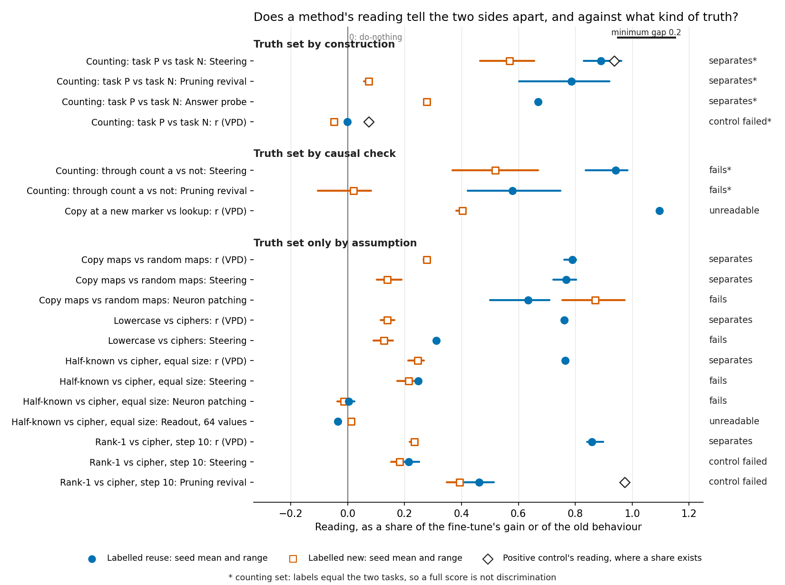

# Does VPD tell reuse from new better than cheaper methods, against a truth it did not define?

*Write-up section, baseline-lead, 2026-11-03. Condensed from [the full report](2026-11-02_analysis_method-table.md); numbers re-checked against `experiments/method_table/results/table.json`. No run.*

We gathered every method's existing reading on pairs of fine-tunes, one side labelled reuse and one labelled new, and marked each pair by how its truth was set. No pair has the decomposition's reading and a cheaper method's reading both standing, with controls held, against a truth that is more than an assumption. So the `GOALS.md` question of whether VPD tells new capabilities from strengthened ones better than cheap methods stays unanswered on the 67M, by the user's choice and not by a failed comparison.

## The answer

Not answered. The decomposition's reading follows how most 67M pairs were built, but those labels are assumptions, and it misses a rule built against no rule. The original model's prior needs no fine-tune, yet one cut chosen afterwards sorts eight of these maps into the same bands. Where the truth is firmer, the decomposition's reading failed its control, went unscored or was never read. The attempt to give the 67M a causal label ended without one.

## What the table is

Each of 14 rows is a pair of fine-tunes and each of 16 columns is a method. Each cell has one verdict: separates, fails, control failed, unreadable or not run. Twelve rows are on the 67M and two on a small counting model of 3M.

The decomposition has two readings. $r$ is the share of a fine-tune's log-odds gain that comes from changed causal importances with the original subcomponents' weights held fixed, so 0 means they carry none of it. The stand-in ratio is the gain reached when the original causal importances stand in for the original weights, over the whole gain. The cheap methods include the original model's prior for the trained answer, one steering shift and the update's size.

**Reading it.** Clean verdicts for the decomposition sit only in the bottom group, where the truth is an assumption. The vertical line is the do-nothing reading of zero, and a diamond is the positive control's reading. Methods that are not shares, such as the prior and size, are left out. Denominators differ: the half-known pair's steering is in log-odds and other steering rows are in nats.

## What each method read, by kind of truth

Each map sends a key to a word: rank-1 to the original model's own top guess, a cipher with no link from key to guess. Many cells are derived, meaning a rule was applied afterwards to saved numbers. [The full table](2026-11-02_analysis_method-table.md#the-full-table) marks them and holds every other cell.

| kind of truth | rows | the decomposition | cheap methods |
|---|---|---|---|
| **By construction** | 1, counting model: task P against task N | $r$ and ratio label 21 of 21 after 400 of 400,000 steps; **control failed**, 0.07 against a bar of 0.5 | Steering, pruning revival and reverse fine-tuning each 21 of 21, controls held. Size 21 of 21 within a recipe cell, 15 of 21 with one cut-off. Not discrimination |
| **By behaviour plus an in-state patch** | 1, counting model: through count a or not | **Not run**; its reuse side was never read here | All **fail** the filed all-state rule: steering 21 of 27, needing 22; pruning 20 of 26 and reverse 17 of 26, needing 21. Per run, steering 16 of 18 and pruning 14 of 17 pass |
| **By causal check** | 1, 67M: copy at a new marker against lookup | $r$ **unscored**, 1.09 to 1.10 against 0.38 to 0.42; copy label not settled | Size separates, 4.57 to 4.62 against 5.45 to 5.50. Prior fails, a factor of 1.32, matched by design. Others not run |
| **Only by assumption** | 11, 67M: copy, lowercase, half-known, rank-1 and class maps against ciphers, random maps or shuffles | $r$ separates 9 and fails 1 of the 10 rows it read; ratio 7 and 1 of 8 | Prior separates 6 of 8. Steering 5 of 10, fails 4, 1 unreadable. Size 4 of 10, fails 5, 1 unreadable. Neuron patching and sparsity fail all they read. Pruning and reverse fail their control on all 3. Readouts unreadable |

## What the counting model can say

**Reading it.** Task P against task N cannot rank methods. Task P answers one more than the old count and task N answers a new count, so anything that responds to the task scores perfectly. The decomposition was barely trained there and enters as failing its control. The other counting row holds the task fixed and lets the label vary. With later cut-offs, described only, steering and pruning sort all 26 of its states. Every reuse state was read at 1,000 or 2,000 steps, so that label is tied to the steps.

The 21 of 21 does not carry to the 67M. As ported, pruning revival and reverse fine-tuning failed their positive control on rank-1 against the cipher. Pruning's gap was 0.07 against a bar of 0.14.

## What follows the build on the 67M

**Reading it.** $r$ follows most builds and misses the one that matters most. On the half-known map against a cipher it reads about 0.77 against 0.25 at five seeds, and the same order holds on eight more rows. On the class map against its shuffled twin, with the same words, sizes and prior, the means read 0.24 against 0.28. That pair is a rule that carries against no rule, and the built-in difference does not show in $r$.

**The prior is a rival, not only a caveat.** On rank-1 against the cipher, the prior, distance and MLP share all separate. $r$ stays apart at a matched prior on two pairs. Copy against the prior-matched cipher is a factor of 1.59 apart in prior and reads 0.77 against 0.37 to 0.38. The other is the copy-and-lookup pair, which is unscored. In both, the high side's target is in context, so context and mechanism are not told apart.

## What the one causal row on the 67M says

**Reading it.** With the original model's copying head off, the copy map lost 0.47 to 0.56 of its gain against a bar of 0.5, and the lookup lost nothing, so the copy side did not settle and $r$ went unscored. Scaling each update to the other's size left $r$'s gap at 0.686 against 0.691, so size does not explain it. Mechanism and context both remain.

## Where this was left

A context patch was tried as a causal label for the 67M's fine-tunes. Its probe stopped at its filed control, its later readings were exploratory, and on 2026-11-02 the user ended the attempt with no label moved. So the rows stay only by assumption, and the 67M comparison is unanswered by choice.

Two rows keep the patch's ratio beside them as evidence, with no high reference. It reads 1 on the original model, copy 1.14 to 1.19 against lookup 0.69 to 0.73. Copy maps read 0.08 to 0.26 against random maps 0.73 to 1.53, against the assumed labels.

One later result is provisional and on the small counting model, not the 67M. Removing six probe directions cost the reusing task more at four of six blocks, and a one-direction amendment may still change this.

## How compelling is the evidence

- **Coverage.** Only 85 of 224 cells have a reading. The prior, distance and MLP share were not read on copy against random maps or on lowercase.
- **Noise.** Seeds run from one to eight per side, on one task pair per row, so a gap can be a difference of task and not of kind.
- **Blind spot.** Separates says only that a method follows the row's label, and an assumed label may itself follow prior, distance or context.
- **Granularity.** A new circuit built from old parts reads as reuse to VPD.
- **Derived cells.** 57 cells apply a rule to saved numbers.
- **Review.** One independent check ran on the table's first version and was applied; the revision has had none.
- **Predictions.** None filed, because the table runs nothing.

## Not run

- E65, the harder counting test, and the key-swap patch for the class map, as `reports/plans/2026-11-03_plan_qwen-reorient.md` names them.
- The size check and the small-gain amplify named when the patch work ended.
- The 139 cells marked not run, listed by row in the full report.
- Every cheap method but size and the prior on the copy-and-lookup pair.
- A decomposition past 2,000 steps on the counting model, and any reading on a trained one.

## Departures from the literature

The ones that decide cells; the full report and its sources list the rest.

- **Jain et al. 2024, Algorithm 3 and reverse fine-tuning.** They revive a labelled capability, scored by accuracy, against a scratch model. On the 67M we use the whole next-token distribution and a half-life, with no scratch model. On the counting model we prune hidden units with a calibrated cut-off, and task P is not in their paper.
- **Jain et al. 2024, Definition 1.** Their readout covers a few hundred task tokens. Ours cover the whole vocabulary or the pair's values, trained on Pile text, with our thresholds.
- **Olsson et al. 2022.** The copying-head label uses their prefix score with our bar, and mean ablation in place of zero ablation.
- **This table's own rules.** Where no source filed a rule, a cell applies this project's separation rule and is marked derived. Two priors count as apart past a factor of 2.
