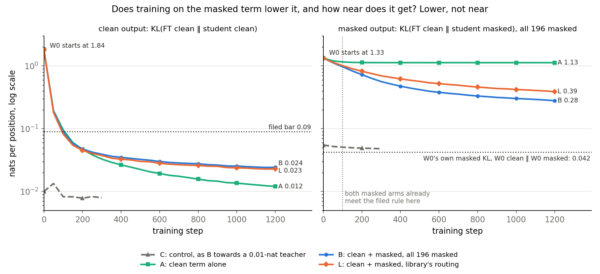
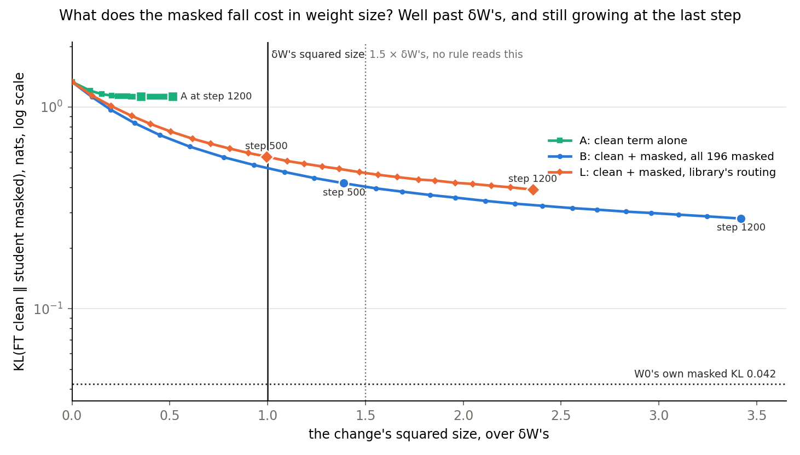
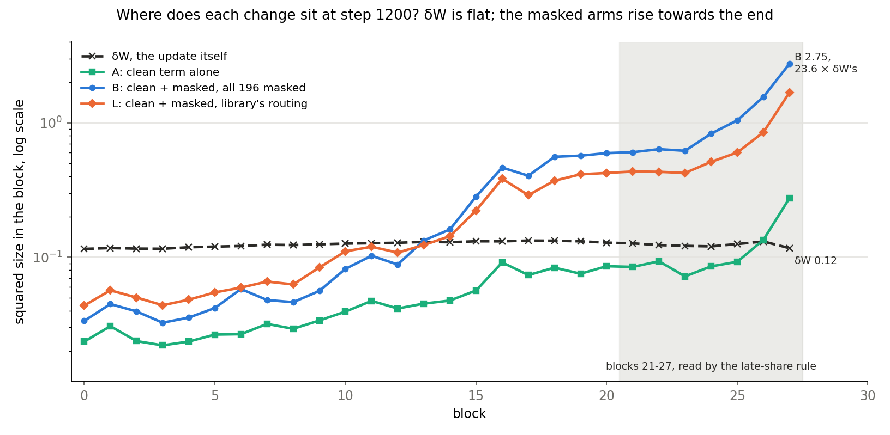
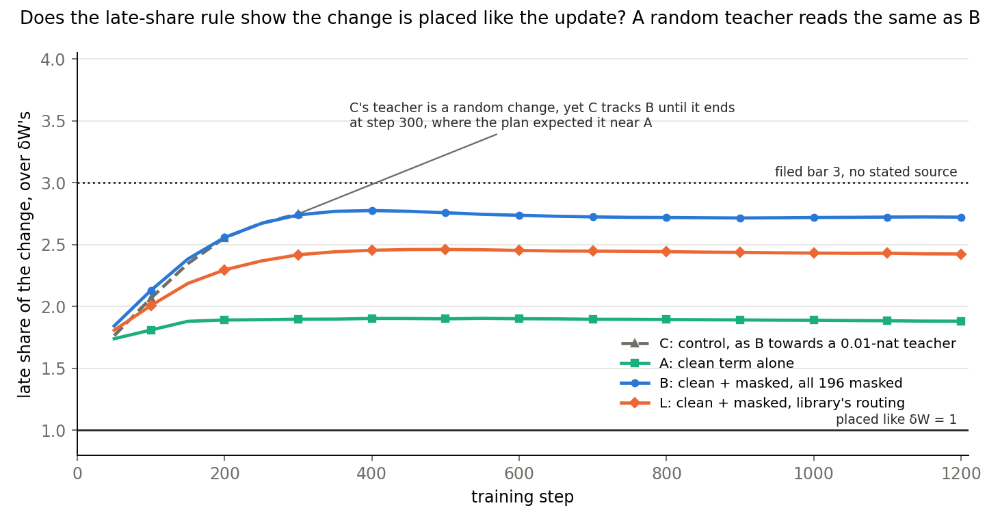
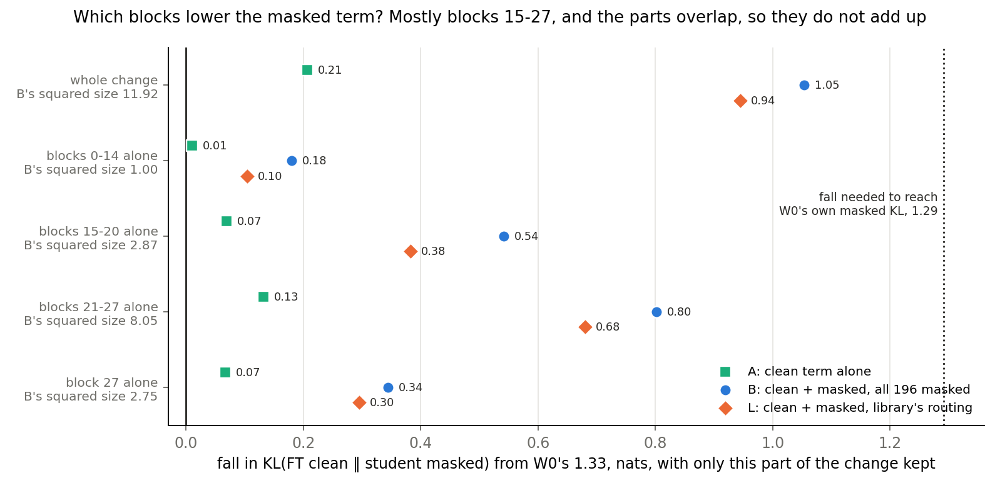
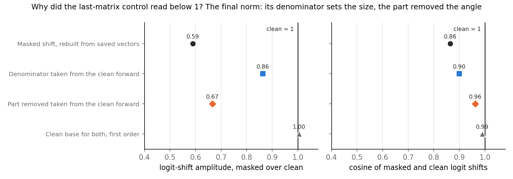

# Does a masked term in teacher training keep Qwen3-1.7B's decomposition faithful for a real update? (E76)

*2026-11-04, D1, `qwen-decomp-lead`. D1 is a map on Qwen3-1.7B that keeps the decomposition faithful for a real update, judged by a test that can fail a bad placement. Plan `reports/plans/2026-11-03_plan_e76-masked-teacher.md`, with Amendments 1 and 2. Independent check `reports/reviews/2026-11-04_review_e76-b-works.md`. Notebook `notebooks/E76_qwen_masked_teacher.ipynb`. Next read `reports/plans/2026-11-04_plan_e79-agreement-or-softness.md`.*

## The answer

Adding a masked term to teacher training earned the filed label "works" on one update, one seed and 200 columns per matrix, and the label stands. It says less than its name, so we do not yet have a faithful map on this model. Taking the fine-tuned clean model as reference, the masked model's KL fell nearly fivefold, yet stays 6.6 times the original decomposition's own. The change grew to 3.4 times the update's squared size. Whether the fall is agreement or softness is unread.

We trained small changes to the original model's subcomponents so that the changed model copies the fine-tuned model, with and without a second loss term read through the original masks.
The masked reading fell far further with that term than without it, at the price of a change several times the update's squared size, sitting mostly in late blocks and still growing when the run ended.
For `GOALS.md`, this is progress towards D1's map and not the map: it rests on one update, one seed and 200 columns per matrix, and the rule it met cannot see size.

**The independent check's wording, which governs this report.**

> On u1, with Γ's masks frozen on W0, adding a masked term to teacher training lowers KL(FT clean ‖ student masked) on eight unseen maths rows from 1.33 to 0.28 nats, against 1.13 for the clean term alone and 0.042 for W0's own masked KL. The change's squared size is 3.4 times δW's and still growing, and it sits mostly late. Top-token agreement, FineWeb rows, Γ on the student and the adversary are not read.

Here u1 is the first fine-tune, and W0's own masked KL is KL(W0 clean ‖ W0 masked).

**Something unexpected happened that I cannot explain.** We filed a medium lean that the all-masked arm would either fail on where its change sits or fail to learn, and a weak lean that the routed arm would barely beat the clean term. Both leans were false: the two arms read "works" by a wide margin. The filed verdict stands as filed. The caveats below narrow what that verdict means; they do not explain the reversal away.

## What we were trying to test

**Terms.**

- **W0 and FT.** W0 is Qwen3-1.7B before the update. FT is W0 plus δW, the fine-tuned model.
- **δW, the update, u1 in the files.** The first fine-tune: ten steps of supervised fine-tuning on maths rows, at rate 1e-5 with no warm-up, the 196 weight matrices all moving.
- **Decomposition.** Per matrix, $W = U V^\top + \Delta$, with $V$ the read vectors and $U$ the write vectors of its subcomponents, and $\Delta$ the rest. A matrix is also called a site. A column is one subcomponent's pair of vectors.
- **Γ and $g$.** Γ is the decomposition's causal-importance function. Its output $g$ says how much each subcomponent matters at each position, with 0 meaning it can be switched off.
- **Masks.** A masked forward rebuilds a matrix's output from its subcomponents, each multiplied by $m = g + (1-g)u$, with $u$ uniform on 0 to 1, plus a share $d$ of Δ, with $d$ also uniform on 0 to 1. Here $g$ comes from Γ on W0's clean forward and stays frozen, so the masks never see the student.
- **Teacher training.** Component training with the loss KL(teacher ‖ student), read on the clean forward. The teacher here is FT. **The student** is W0 plus the change that training makes to about 200 often-on columns per matrix. Γ and Δ do not move.
- **KL direction.** The first argument is always the reference. "KL(FT clean ‖ student masked)" compares the student's masked output to FT's clean output, and it is the number a student under masks is judged by here.
- **Squared size.** The sum over weights of the squared change. δW reads 3.49.
- **Faithful.** `GOALS.md`'s yardstick: the new decomposition scores on W + δW about as the old one scores on W. Here the old one's masked score is KL(W0 clean ‖ W0 masked), which reads 0.042 on these rows.

**The arms.** All arms share the batch order, the rate of 1e-6 with Adam, and two rows of 256 tokens per step.

- **A, the clean term alone, 1200 steps.** It is the filed recipe and the reference for how much a masked reading falls with no masks in the loss.
- **B, clean term plus a masked term with all 196 matrices masked, 1200 steps.** It asks whether the masks themselves can be trained against.
- **L, clean term plus a masked term under the library's routing, 1200 steps.** At each position a uniform number of the 196 matrices is masked and the others read the student's full weights. It rules in or out the worry that routed-out matrices carry the update round the masks.
- **C, the control, run first and for 300 steps.** It is B's loss with a teacher that is W0 plus a random change of 0.01 nats. It tests that the masked gradient trains at all, and its fall sets the band on later comparisons.

**The readings.** Each reading uses eight maths rows of 256 tokens, no row of which is in training, with one fixed mask draw per row.

- **Rule (i), clean copy.** KL(FT clean ‖ student clean). W0 reads 1.84.
- **Rule (ii), distance from W0.** KL(W0 clean ‖ student clean). W0 reads 0, and δW itself reads 0.62 on these rows.
- **Rule (iii), late share.** The share of the change's squared size in blocks 21 to 27, over the same share of δW's. A change placed like δW reads 1.
- **The masked term, (iv).** KL(FT clean ‖ student masked), all 196 masked, whatever the arm trained on. W0 reads 1.33.

**Stage 0** ran first and alone. It reproduced the earlier reference numbers, took the 200-column cut, and ran the test of the last-matrix control that an earlier run had queued.

**Two amendments** read the saved changes after the verdict, with no training. Each kept a change only on some blocks and read it with the same code, rows and draw: all blocks, 0-20, 21-27 and 27 in the first, then 0-14 and 15-20 in the second.

## What we expected, and why

- **The filed "works" rule.** Clean KL at or below 0.09, the band of earlier placements on this update. Distance from W0 at or below 0.94, which is 1.5 times δW's. Late share at or below 3. The masked term below arm A's by more than the band, which C sets at 0.0070.
- **B: not a map by late share, or fails to learn, medium lean.** An earlier run, E77, found that small changes at early blocks barely reach the logits under all masks, so the term could only be lowered late.
- **L: late share passes and the masked term barely below A's, weak lean.** Routed-out matrices could lower the training term with the masks doing no work, leaving the all-masked reading almost unmoved.
- **C: masked term falls, late share near A's.** C's teacher is random, so we expected no reason for it to pile up late.
- **Where the fall sits, medium leans.** At least 0.8 of B's fall from blocks 21-27 alone. At most 0.1 from blocks 0-20 alone, and when that missed, at most 0.1 from blocks 0-14 alone.

## What we observed

The run stopped on nothing. Every arm finished, and arm L crossed the first job's wall at step 1050 and resumed smoothly.

### Does training on the masked term lower it, and how near does it get?

**Reading it.** It lowers it a long way, and it does not get near the reference. On the right, KL(FT clean ‖ student masked) falls from 1.33 to 0.28 in B and 0.39 in L, against 1.13 in A. The dotted line is W0's own masked KL, 0.042: B ends 6.6 times above it, L 9.2 times and A 27 times. On the left, every arm meets the clean bar, so the masked term costs the clean copy little in KL: B and L read twice A's clean KL, at about 0.02 nats.

The filed verdict is "B works" and "L works". The filed rule is much weaker than that word. Its masked clause only asks B and L to beat A, and it has no bar on the value. Applied at every reading, the whole rule holds for both arms from step 100, where B's masked KL is still 0.97, 23 times W0's own. So the verdict rests on late share and on a relative clause that almost any fall passes.

The direction holds row by row: B is below A on eight of eight rows. Row 5 has no chat-template token and shares no long run of text with training, so it is the cleanest held-out read. It falls 57% in B, where the other seven fall 77% to 81%, and ends 3.9 times its own masked KL.

| arm | clean KL, FT ‖ student | clean KL, W0 ‖ student | late share | KL(FT clean ‖ student masked) | over W0's own, 0.042 | filed label |
|---|---|---|---|---|---|---|
| W0, unchanged | 1.842 | 0 | no change to read | 1.334 | 31.5 | |
| δW itself | 0 | 0.619 | 1 | not read | | |
| C, step 300, its own teacher | 0.0080 | 0.0065 | 2.749 | 0.0481 | see note | control |
| A | 0.0121 | 0.581 | 1.882 | 1.127 | 26.6 | (i)-(iii) hold |
| B | 0.0243 | 0.624 | 2.723 | 0.280 | 6.6 | works |
| L | 0.0229 | 0.656 | 2.425 | 0.390 | 9.2 | works |

C's masked KL is against its own teacher's clean output, so it is not comparable with FT's rows. It starts at 0.0551, falls 0.0070, and ends above W0's own 0.042.

| row | W0's KL(FT clean ‖ W0 masked) | A | B | L | own KL(W0 clean ‖ W0 masked) | B's fall |
|---|---|---|---|---|---|---|
| 0 | 1.679 | 1.407 | 0.342 | 0.489 | 0.052 | 80% |
| 1 | 1.322 | 1.134 | 0.307 | 0.431 | 0.028 | 77% |
| 2 | 1.564 | 1.315 | 0.313 | 0.445 | 0.047 | 80% |
| 3 | 1.285 | 1.094 | 0.261 | 0.353 | 0.042 | 80% |
| 4 | 1.559 | 1.314 | 0.327 | 0.465 | 0.059 | 79% |
| 5, no template | 0.213 | 0.172 | 0.091 | 0.083 | 0.023 | 57% |
| 6 | 1.521 | 1.291 | 0.282 | 0.414 | 0.029 | 81% |
| 7 | 1.527 | 1.291 | 0.316 | 0.435 | 0.059 | 79% |

### What does the masked fall cost in weight size?

**Reading it.** It costs far more than the update's own size, and this is the headline caveat. B ends at 3.4 times δW's squared size, L at 2.4 times and A at 0.52 times. None of the filed rules reads size, though the filed question said "of its size".

Size has no plateau. Over the last 200 steps B's squared size grows about 10 per 1000 steps, while its masked KL still falls about 0.012 per 100 steps. So the size at step 1200 depends on where the plan stopped, and the plan doubled the run from 600 to 1200 steps.

Most of the excess bought little. At step 300 B's size is 0.78 times δW's and 73% of its fall is already there. At step 500 it is 1.39 times δW's with masked KL 0.419. After that B gains 0.14 nats for 7 more of squared size. A cap of 1.5 times δW's, which nobody filed, would have passed B up to step 500 and L up to step 750.

Two limits apply to the ruler itself, both from the independent check. Squared size is weak here: C's random teacher has 75 times δW's squared size and moves clean KL by only 0.01 nats. And much of the size is Adam's walk: under pure noise Adam's offsets reach about the rate times the root of the steps, and A and C read about that. B reads about that in blocks 0-14 and 5.3 times it in the last block. So B's late excess is signal, its early size may be mostly walk, and A's 0.52 times may be mostly walk too. The check compared only sizes and did not separate signal from walk.

| step | B's size over δW's | B's masked KL | L's size over δW's | L's masked KL | A's size over δW's | A's masked KL |
|---|---|---|---|---|---|---|
| 100 | 0.20 | 0.970 | 0.20 | 1.011 | 0.15 | 1.159 |
| 300 | 0.78 | 0.563 | 0.62 | 0.697 | 0.28 | 1.129 |
| 500 | 1.39 | 0.419 | 1.00 | 0.568 | 0.35 | 1.129 |
| 750 | 2.11 | 0.343 | 1.47 | 0.476 | 0.42 | 1.128 |
| 1000 | 2.83 | 0.303 | 1.96 | 0.421 | 0.48 | 1.128 |
| 1200 | 3.42 | 0.280 | 2.36 | 0.390 | 0.52 | 1.127 |

### Where does each change sit?

**Reading it.** δW is flat across blocks and the masked arms rise steeply towards the end. B's last block reads 23.6 times δW's, and its blocks 21-27 read 9.3 times δW's there, with 68% of its squared size against δW's 25%. B's blocks 0-14 read 0.55 times δW's. Flatness in δW is a property of Adam moving every block alike, so it says little about where the update matters.

In norm, not squared, the picture is milder. The independent check reads B at 1.85 times δW's overall and 4.9 times in the last block. Against W0's norm B's change is 0.26%, and columns keep their direction, with a 5th-percentile cosine with their old direction of 0.99995 in block 27. It adds that none of this shows the components still mean the same thing, since a very small rotation is enough for a one-nat fall.

**The student matches outputs, not weights.** The check's cosines of each change with δW read 0.106 for A, 0.062 for L and 0.045 for B. Squared distance to FT's weights reads 4.75, 11.04 and 14.83 for those arms, against 3.49 for W0, so every arm ends further from FT's weights than W0 started. That is teacher training as defined, but `GOALS.md` asks for a decomposition of W + δW, so any sentence about these arms says the student copies FT's outputs.

| block group | δW | A | B | L |
|---|---|---|---|---|
| 0-14 | 1.83 | 0.49 | 1.00 | 1.17 |
| 15-20 | 0.79 | 0.47 | 2.87 | 2.10 |
| 21-27 | 0.86 | 0.84 | 8.05 | 4.94 |
| of which 27 | 0.12 | 0.28 | 2.75 | 1.68 |
| all | 3.49 | 1.80 | 11.92 | 8.21 |

### Does the late-share rule show the change is placed like the update?

**Reading it.** No. B passes at 2.72 against a bar of 3, but C reads 2.75 at step 300, where B reads 2.74. C's teacher is a random change, and the plan expected C near A's 1.88, so that expectation was missed. It had no stop rule and no earlier report named it. So the masked term with Adam pushes size late whatever the teacher, and the reading near 2.7 does not come from the update.

The 3 has no stated source. The ratio's ceiling is 4.03, because δW holds 0.248 of its size in those blocks, so 3 means at most 74% late. A bar of 2.5 would have changed the outcome to "B fails, L works". The rule was filed and stands, but it gives weak support to any claim that the change is placed like the update.

### Which blocks lower the masked term?

**Reading it.** Mostly blocks 15-27, with real overlap, and not the late blocks alone as we leaned. Each row keeps only that part of the change, so the numbers are "this part alone" and they do not add: blocks 0-14, 15-20 and 21-27 sum to 1.44 of B's fall, 1.23 of L's and 1.03 of A's. Taking parts away gives B's picture differently. Removing blocks 21-27 loses 39% of the fall, removing blocks 0-20 loses 24%, and the other 37% either part can supply.

**The early blocks are not deaf to a trained change.** B's blocks 0-14 alone lower KL(FT clean ‖ student masked) by 0.18 nats at squared size 1.00, and A's by 0.01 at 0.49. This narrows E77's statement that a masked term can hardly teach early blocks, and a dated note now says so in that report. Whether this is size or direction is unmeasured. Both may matter: the gradient at block 0 was thousands of times smaller in square than at block 27 at step 0, and Adam rescales each weight's step.

The check adds that this is not like for like with E77. E77 reads how much KL a change passes, which is second order in the shift, and a fall against an existing gap of 1.33 nats is first order. As a rough order of size, the 0.18 fall needs a masked shift of only about 0.0065 nats. So the miss of the lean does not contradict "small changes barely pass": a trained direction may pass several times more.

| part of the change | δW's size | A: fall, share, size | B: fall, share, size | L: fall, share, size |
|---|---|---|---|---|
| all | 3.49 | 0.206, 1, 1.80 | 1.054, 1, 11.92 | 0.944, 1, 8.21 |
| blocks 0-14 | 1.83 | 0.010, 0.05, 0.49 | 0.180, 0.17, 1.00 | 0.104, 0.11, 1.17 |
| blocks 15-20 | 0.79 | 0.069, 0.34, 0.47 | 0.541, 0.51, 2.87 | 0.382, 0.40, 2.10 |
| blocks 21-27 | 0.86 | 0.132, 0.64, 0.84 | 0.802, 0.76, 8.05 | 0.680, 0.72, 4.94 |
| blocks 0-20 | 2.62 | 0.080, 0.39, 0.96 | 0.639, 0.61, 3.87 | 0.471, 0.50, 3.28 |
| block 27 | 0.12 | 0.067, 0.32, 0.28 | 0.344, 0.33, 2.75 | 0.295, 0.31, 1.68 |

The clean copy needs the early blocks, as we weakly leaned. B's KL(FT clean ‖ student clean) reads 0.12 with blocks 0-20 alone and 0.73 with blocks 21-27 alone.

### Why did E77's last-matrix control read below 1?

**Reading it.** Because of the final norm, and the hook is clear. E77 masked only the last matrix, under fixed masks, and read amplitude 0.59 and cosine 0.86 where its plan expected near 1. Only the final norm and the output head follow that matrix. Rebuilding both logit shifts from the saved vectors read 0.590 and 0.864, within the filed 0.005, so nothing else is involved.

Both of the causes E77 named are present, and they do different things. The norm divides by the size of its input: that input is 1.43 times larger per position under the mask. Taking only that denominator from the clean forward moves amplitude to 0.86. The norm also removes the part of a change along its input: the change's cosine with the masked input is 0.27, against 0.06 with the clean input. Taking only that removed part from the clean forward moves cosine to 0.96 and amplitude only to 0.67. With a clean base for both, the same first-order formula reads 1.00 and 0.99, so the formula is sound.

So the last-matrix control measures the norm at two base points, not a fault in the masked forward. It covers the first fine-tune, 32 rows, one size and one sign, with only the last matrix masked.

| shift, last matrix alone, first fine-tune | amplitude | cosine |
|---|---|---|
| E77's filed read | 0.5897 | 0.8642 |
| rebuilt from saved vectors | 0.5897 | 0.8642 |
| masked base, first order | 0.595 | 0.879 |
| denominator from clean | 0.863 | 0.900 |
| part removed from clean | 0.666 | 0.963 |
| clean base, first order | 1.005 | 0.989 |

Stage 0's other reads all met their stops. KL(W0 clean ‖ W0 masked) reads 0.04402 on the 32 rows, against E74's 0.0440. The student's masked forward at zero offsets differs from W0's by exactly 0 in every logit. The 200-column cut, 39,105 columns in all with 4 matrices holding fewer than 200, covers 0.835 of the sum of $g$. Components in bf16 and fp32 differ by $2.3 \times 10^{-6}$ on the masked KL, far below C's band.

## What we learned

A masked term can be trained against with the original masks frozen, and with all 196 matrices masked, which we doubted. That is real progress towards D1, because masked reads had barely responded to any update before, and no earlier run trained against them.

It is not D1's map, and the filed branch "D1 has its map on u1" is not adopted as a sentence. The masked KL stays well above the original decomposition's own, the change is several times the update's squared size and growing, and the rule that passed it cannot see either fact. D1 asks for a test that can fail a bad placement, and this rule cannot fail a change for its size or its distance from the reference.

Early blocks are not deaf to a trained change, which narrows E77. All of this is provisional: one update, one seed, 200 columns per matrix, eight maths rows.

## How compelling is the evidence

- **Coverage.** One update, one training seed, one mask draw on the reading rows, about 200 of the alive columns per matrix, holding 0.835 of the sum of $g$. No error bar exists on 0.28. The sign is safe, since B beats A by 120 times C's band.
- **KL(FT ‖ ·) rewards softness.** FT is softer than W0, so a soft student already sits nearer FT: masked W0 at 1.33 is nearer than clean W0 at 1.84. An earlier run's best single temperature leaves 0.82 on this update, on its own 128 rows. B's 0.28 goes below that, but the earlier part of the fall could be softening. **Agreement is unread**: neither top tokens nor entropy was saved.
- **The two clean rules can hardly fail once training runs.** A reaches the 0.09 bar by step 150. The distance from W0 is pinned at δW's own value once the student nears FT.
- **"Unseen" holds by row, not fully by text.** 14.6% of reading positions start a 16-token run found verbatim in training, which is the prompt template. The column cut also used $g$ on these rows, a small leak. No FineWeb row is read, though half of each training batch is FineWeb.
- **A mix no deployed state would run.** The student's weights are read under masks made from W0. The plan cut the student under its own masks because an earlier run read the same for every state, but B and L are new states, so that reason no longer applies.
- **Controls test the gradient only.** C's fall of 0.007 shows the masked term trains. It says nothing about whether a one-nat fall is specific to this update. The band is a fall on another teacher, not a noise floor.
- **One large update.** It reads 1.84 nats from W0 on these rows. The check notes that E73's advice calls gold fine-tunes on these rows a format change, which text FT would not write.
- **Independent check.** It re-ran the rules, recomputed sizes from the saved offsets, expanded the masked hook by hand and found no bug. It ran no model forward. Numbers attributed to it above come from its recomputation of saved offsets, which this report did not repeat.

## Surprises

1. **Both leans on the arms were false.** B read "works" against a medium lean of not a map or fails to learn. L's masked KL fell far below A's, by 0.74 against a lean of under 0.11. The caveats narrow what "works" means. They do not explain why routing also reached so far.
2. **C's late share read 2.75 against "near A's", 1.88.** It missed, with no stop rule. The reading near 2.7 is the term and Adam, not the update.
3. **Blocks 0-20 alone read 0.61 of B's fall, against a lean of at most 0.1.** The second amendment then split them: blocks 0-14 read 0.17 against the same lean, and blocks 15-20 read 0.51.
4. **Blocks 21-27 alone read 0.76 of B's fall, a narrow miss of the lean of 0.8.**
5. **W0's clean KL on these rows read 1.84 against a filed 1.635 from other rows, and the masked term 1.33 against about 1.37.** Each arm's step 0 shows the rows' own value, as the plan said it would.
6. **The check notes one rule mismatch that never fired.** `rules.py:99` lets "A short" outrank "B works", where the plan reads B against A in that case. A was not short.

## What next

1. **E79, a read of the saved changes at no cost, running after this report.** It reads top-token agreement, entropy, FineWeb rows and the student under its own masks, against FT. This report does not guess its outcome. Its plan says what each result does.
2. **The choice between B and A on size, for the user, after E79.** B lowers the masked term far more at 3.4 times δW's squared size. A stays at 0.52 times and leaves the masked term nearly where it started. The result that decides it is whether B's fall is agreement.
3. **A size-limited B, and a null with a random teacher of equal clean KL under B's recipe.** The first asks whether the fall survives a cap on size, since most of it arrives before B passes δW's size. The second asks whether the fall is specific to the update. Neither is planned.

The plan's next step for "B works", RL's step 100 on the paid card, waits on those reads.

## Scorecard

| id | claim | rule | read | verdict |
|---|---|---|---|---|
| outcome | which arm works | see below | B, L works | **B works**, stands as filed |
| A | clean term alone meets (i)-(iii) | (i) ≤ 0.09, (ii) ≤ 0.94, (iii) ≤ 3 | 0.0121, 0.581, 1.882 | (i)-(iii) hold |
| B | works | those, and (iv) below A's by over 0.00704 | 0.0243, 0.624, 2.723; below by 0.847 | **works** |
| L | works | same | 0.0229, 0.656, 2.425; below by 0.738 | **works** |
| lean B | not a map by (iii), or fails to learn, medium | as filed | neither | **false** |
| lean L | (iii) passes, (iv) below A's by under 10% of A's, weak | as filed | below by 65% | **false** |
| C (iv) | falls; sets the band | strictly below step 0 at step 100 | 0.0551 to 0.0509, ends 0.0481 | held; band 0.00704 |
| C (iii) | near A's, no stop | as filed | 2.749 against 1.882 | **missed** |
| C (i), (ii) | near 0.01, small | as filed | 0.0080, 0.0065 | as expected |
| A stop | (i) at step 100 under 0.95 of start | as filed | 0.052 of start | held |
| B, L stop | (iv) at step 0 in 1.0-2.0 | as filed | 1.334 | held |
| stage 0 rebuild | 0.59, 0.86 within 0.005 | as filed | 0.5897, 0.8642 | held |
| stage 0 K0 | 0.0440 within 10% | as filed | 0.04402 | held |
| stage 0 share | at least 50% | as filed | 0.835 | held |
| stage 0 identity | under 1e-4 | as filed | 0 | held |
| Amendment 1 control | W0 reproduces step 0 within 1e-3 | as filed | exact | held |
| B_late | blocks 21-27 share at least 0.8, medium | as filed | 0.761 | missed, narrowly |
| B_early | blocks 0-20 share at most 0.1, medium | as filed | 0.607 | **missed** |
| B_last | block 27 share 0.3 to 0.8, weak | as filed | 0.326 | held |
| clean | B's late part leaves (i) above 0.09, weak | as filed | 0.727 | held |
| Amendment 2 control | W0 reproduces step 0 within 1e-3 | as filed | exact | held |
| B_first | blocks 0-14 share at most 0.1, medium | as filed | 0.171 | **missed**; E77's wording narrowed |
| B_middle | blocks 15-20 share at least 0.4, medium | as filed | 0.513 | held |

## Departures from the literature

Against VPD's fit of this decomposition, its `launch_config`, and the library's routing.

- **No adversary.** VPD trains 90% of its reconstruction samples under adversarial sources. Here all samples use random masks, and the plan gives no reason beyond listing it as not run.
- **Γ frozen on W0.** VPD trains Γ with the components. Here it does not move, as `GOALS.md` fixes for now, and the masks come from W0's forward, not the student's.
- **Only U and V of about 200 alive columns move.** VPD moves all alive columns. The cut fits the L40's memory.
- **No faithfulness term and no hidden-activation terms.** With Δ frozen the faithfulness term reads the least-squares objective. The hidden-activation terms were not part of the question.
- **Adam at a tiny batch of two rows.** VPD's launch config sets a batch of 2048 and trains with Muon at a peak rate of 1e-4. This run uses Adam, as the rehearsals did. The rate of 1e-6 comes from this project's rehearsals.
- **Routing in L only.** The library's routing with a uniform number of masked matrices is its 10% branch, without the adversarial 90%. B masks everything throughout.
- **The loss is on the teacher's clean output.** VPD's reconstruction loss targets the target model. Here that target is a different model, FT.

## Not run

1. Top-token agreement and entropy of any state, masked or clean; this is E79's job.
2. FineWeb reading rows, response positions alone, and per-position KL.
3. Γ on the student, or the student under its own masks.
4. The adversary, in the loss or in the reading.
5. A second training seed, a second mask draw on the reading rows, and a lower rate.
6. The full alive set, RL's update, and the 67M with masks in its loss.
7. Fixed masks in the loss.
8. A size cap on the change, and a random teacher of equal clean KL under B's recipe.
9. What the late change does, and whether components still mean what they did.
10. Whether B's early size is walk or signal, and whether the 0.18 fall from blocks 0-14 comes from size or direction.

## Provenance

- **Code.** `experiments/qwen_masked_teacher/{run,arms,common,rules,stage0,amend1,amend2,dw_size,plot}.py`.
- **Results.** `experiments/qwen_masked_teacher/results/`: `predictions.json`, `predictions_amend1.json`, `predictions_amend2.json`, `stage0.json`, `C.json`, `A.json`, `B.json`, `L.json`, `score.json`, `amend1.json`, `amend2.json`, `dw_blocks.json`, `run.log`. Offsets in bf16 under `results/large/`.
- **Jobs.** 50915, all stages to L's step 1050; 51024, L's last steps from its saved state; 51046, Amendment 1; 51051, Amendment 2. One cluster L40, `debug` QoS. $0.
- **Time and memory.** 0.77 s per step on A, about 2.2 s on B. First job about 110 min. Peak GPU 46.3 GB in stage 0 and 26.1 GB in the arms.
- **Amendments.** Two of two used.
