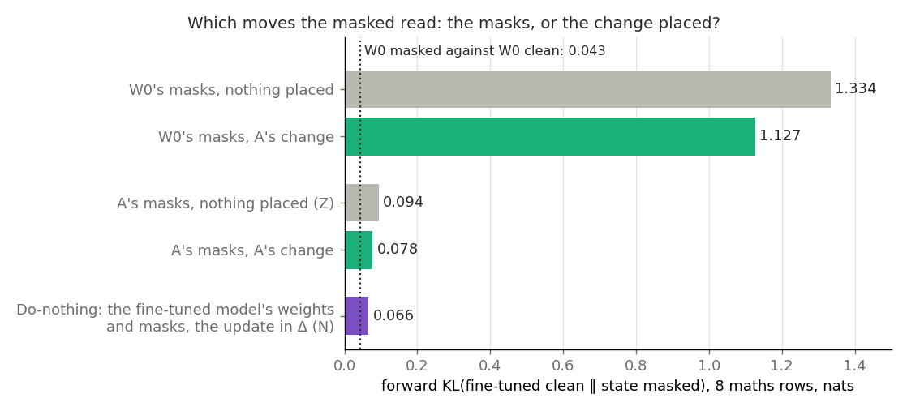
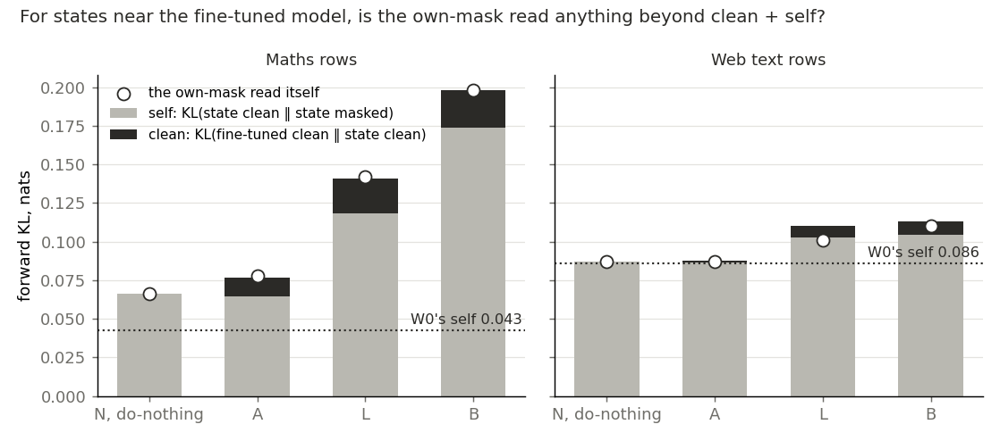
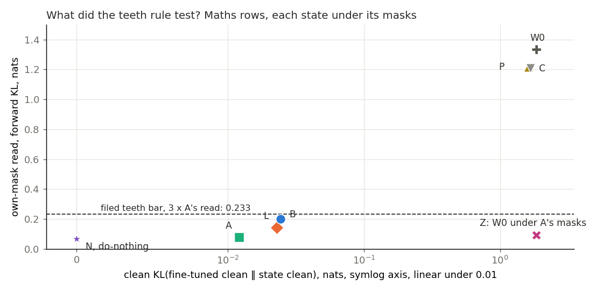
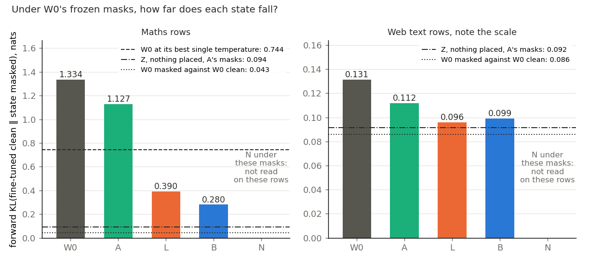
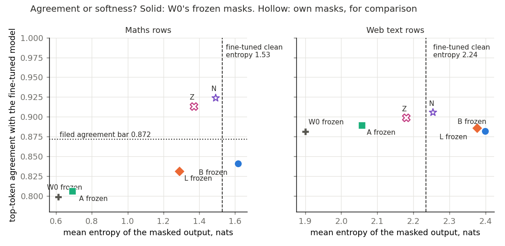

# Is E76's masked fall agreement or softness, and can a masked read here credit a placement? (E79)

*2026-11-04, D1, `qwen-decomp-lead`. D1 is a map on Qwen3-1.7B that keeps the decomposition faithful for a real update, judged by a test that can fail a bad placement. Plan `reports/plans/2026-11-04_plan_e79-agreement-or-softness.md`, with Amendments 1 and 2. Checks `reports/reviews/2026-11-04_review_e79-a1-check.md`. Notebook `notebooks/E79_qwen_masked_read.ipynb`.*

## The answer

Recomputing the masks on a forward near the fine-tuned model gets nearly all of the masked fall, with nothing placed under them. Leaving the update out of the subcomponents altogether reads at least as well as the clean-term change. So a low reading under recomputed masks can penalise harm, but it cannot credit a placement. That change has shown only clean agreement, at about half the update's squared size. The largest fall under frozen masks is mixed, and D1 still has neither map nor test.

We read the changes saved by an earlier run against the fine-tuned model's clean output, on maths and web text, under frozen and recomputed masks, and read do-nothing the same way.
Masks recomputed from a changed forward did nearly all the work, whichever weights they sat on, so the small clean-term change's good reading is no evidence for it.
For `GOALS.md`, this removes the own-mask read as a test of placement, and the masked term stays the map the user chose.

Independent check of Amendment 2: numbers and verdicts recompute, code paths as filed, wording corrected as below.

**The claim, in the check's words.** Do-nothing reads at least as well as A, and A's masks on W0's unchanged weights read 0.094, so a low own-mask read is no evidence of placement. It can penalise harm; it cannot credit placement. The filed outcome label, "credits any forward near FT", stays as filed and is not the claim, for two reasons given under the second finding.

**Something unexpected happened that I cannot explain.** Before the first read we leaned that B's fall under frozen masks would be agreement, and it read mixed. Then W0's unchanged weights, under masks computed on another forward, landed near FT: 0.094 from FT, and 0.546 from W0's own clean output. Two readings fit that number equally, and this job does not separate them.

## What we were trying to test

**Terms.**

- **W0 and FT.** W0 is Qwen3-1.7B before the update. FT is the fine-tuned model, W0 plus δW.
- **δW, the update.** The first fine-tune, ten steps on maths rows. Its squared size, the sum over weights of the squared change, reads 3.49.
- **Masks.** In a masked forward each of the 196 matrices rebuilds its output from its subcomponents. Each is multiplied by $m = g + (1-g)u$, with $g$ the causal importance from Γ and $u$ uniform on 0 to 1. A share $d$ of Δ is added, with $d$ uniform on 0 to 1.
- **Frozen masks** take $g$ from Γ on W0's clean forward, whatever state is read. **Own masks** take $g$ from Γ on the state's own forward, with Γ's parameters unchanged.
- **A, B, L.** Each is the decomposition after teacher training towards FT, from E76, with about 200 columns per matrix moved. A trained on the clean term alone, and its squared size is 0.52 of δW's. B added a masked term with all 196 matrices masked, at 3.4 times δW's size. L added a masked term under the library's routing, at 2.4 times.
- **The rows.** M is E76's eight unseen maths rows. W is eight FineWeb rows in no arm's training pool. Each has 256 tokens per row.

**Three numbers, always in this direction.**

- **The read:** forward KL(FT clean ‖ state masked). 0 means the masked state's output is FT's clean output. It rewards a soft output.
- **Clean:** forward KL(FT clean ‖ state clean). It is blind to masks.
- **Self:** forward KL(state clean ‖ state masked). W0 reads 0.043 on M. It is blind to how far the state's clean output sits from FT.

Beside them we read three more. Reverse KL punishes softness. Top-token agreement with FT clean is blind to confidence. Mean entropy does not say where the softness sits.

**E79 asked** whether B's and L's fall under frozen masks is agreement or softness. It also asked whether the fall holds on unseen text and under own masks. W0 and each arm first reproduced their E76 readings, within 2.0e-6 at worst. The positive control, W0 masked against W0 clean, read 0.043 with agreement 0.959.

**Amendment 1 asked** whether the own-mask read has teeth, because A read so well under it. It added two bad placements. **P** is A's change with its columns permuted within each site, then scaled per site to A's squared size. **C** is E76's control, trained towards W0 plus a random change.

**Amendment 2 asked** whether A's own-mask read beats do-nothing, which is the reference the three rules of Amendment 1 never read. **N** is do-nothing: FT's weights, components unmoved, no offsets, Γ on FT's forward, so δW sits in Δ. **Z** is W0's weights and components, no offsets, under A's own masks, the same random draw as A's read. Z tests whether A's masks alone carry the fall.

## What we expected, and why

- **B reads agreement, medium lean; L, weak lean.** B's 0.28 already sat under the best temperature read on other rows.
- **B's fall survives on web text, weak lean.** The one maths row with no chat template still fell 57% in E76.
- **B survives own masks, weak lean.**
- **Own masks open many more subcomponents on A, weak lean.** A fall from 1.33 to 0.078 for so small a change wanted explaining. The other leans said the read had teeth and A stayed faithful.
- **N reads the same as A or lower, and A's masks alone carry the fall, both medium leans.** The check of Amendment 1 had found that its rules never read do-nothing.

## What we observed

The controls held in all three jobs. Every state's rule was read as filed, and no job stopped.

### What moves the masked read: the masks, or the change placed under them?

**Reading it.** The masks do. Under W0's masks, A's change moves the read from 1.334 to 1.127. Under A's masks, removing A's change moves it only from 0.078 to 0.094. So recomputed masks alone give 0.987 of A's fall, with W0's weights unchanged. Do-nothing reads 0.066, numerically the lowest of the five bars.

The difference between do-nothing and A is -0.0114, inside the filed band of 3 x 0.0042 = 0.0127, so the filed verdict is "same". That verdict is conservative. N is below A on 8 of 8 maths rows, while the band is W0's spread between draws at a reading near 1.33. A tighter band would give "do-nothing beats A", which is the same branch of the filed outcome. On web text they read the same, 0.0870 against 0.0869.

**Z is not softness.** Its agreement with FT is 0.914 and its reverse KL 0.072. Its entropy is 1.37, below FT's 1.53. Z's masked output is 0.546 from Z's own clean output, which is W0's.

**Two readings of Z fit equally, and neither is claimed.** Γ may be a channel for whatever forward it reads. Or the update's behaviour may really be a change in which existing subcomponents Γ switches on. Even the second would meet the elicitation granularity limit: a new circuit built from old subcomponents reads as elicited to VPD. W0 under masks from an unrelated changed forward would separate the two, and it was not read. The limits are one update, one seed, one draw and 16 rows. On web text the unfiled share is 0.89, with little room to move.

| weights and offsets | masks | read on M | self on M | agreement | entropy | read on W |
|---|---|---|---|---|---|---|
| W0, nothing placed | W0's | 1.334 | 0.043 | 0.799 | 0.61 | 0.131 |
| W0 plus A's change | W0's, frozen | 1.127 | not read | 0.806 | 0.69 | 0.112 |
| W0, nothing placed: Z | A's | 0.094 | 0.546 | 0.914 | 1.37 | 0.092 |
| W0 plus A's change | A's | 0.078 | 0.065 | 0.915 | 1.56 | 0.087 |
| FT's weights, δW in Δ: N | FT's | 0.066 | 0.066 | 0.924 | 1.49 | 0.087 |
| FT clean, for reference | none | 0 | | 1 | 1.53 | 0 |

Per row on M, forward KL under own masks, from `results/rows.json`:

| row | W0 | N | A | Z | L | B |
|---|---|---|---|---|---|---|
| 0 | 1.679 | 0.086 | 0.105 | 0.131 | 0.158 | 0.217 |
| 1 | 1.322 | 0.053 | 0.072 | 0.086 | 0.123 | 0.165 |
| 2 | 1.564 | 0.070 | 0.083 | 0.097 | 0.157 | 0.225 |
| 3 | 1.285 | 0.068 | 0.071 | 0.084 | 0.148 | 0.211 |
| 4 | 1.559 | 0.072 | 0.090 | 0.106 | 0.173 | 0.221 |
| 5, no template | 0.213 | 0.030 | 0.033 | 0.040 | 0.090 | 0.141 |
| 6 | 1.521 | 0.064 | 0.071 | 0.087 | 0.125 | 0.185 |
| 7 | 1.527 | 0.087 | 0.096 | 0.119 | 0.163 | 0.217 |

The checker's recomputation adds a coarse fact about the masks. Per position on M, the summed importance moves from W0's by 171.6 for A and 190.5 for N, and the two movements correlate at 0.977. It moves 42.1 between A and N. This is blind to which subcomponents move.

### Why is the filed label not the claim?

**Reading it.** For states near FT, the own-mask read adds nothing beyond clean and self. On M, A's clean and self sum to 0.0767, against a read of 0.0776. N is all self. So the read mostly reports what masks do to the state's own output. On W every state sits near W0's self of 0.086, and L shows the worst fit, 0.110 against a read of 0.101.

The filed outcome label is too broad, for two reasons from the check. Z is not a forward near FT: it is W0's forward under masks made from one. And B and L are near FT, with clean 0.024 and 0.023. Yet they read 0.198 and 0.142, over twice N's. So the read can penalise harm, here a change whose masked output is far from its clean one. It cannot credit a placement, because putting nothing in the subcomponents scores as well.

The split does not hold far from FT. On M, W0, P, C and Z all read well under clean plus self, as the table shows.

| state | clean on M | self on M | clean + self | read on M | clean on W | self on W | read on W |
|---|---|---|---|---|---|---|---|
| N, do-nothing | 0.0000 | 0.0663 | 0.0663 | 0.0663 | 0.0000 | 0.0870 | 0.0870 |
| A | 0.0121 | 0.0646 | 0.0767 | 0.0776 | 0.0009 | 0.0865 | 0.0869 |
| L | 0.0229 | 0.1181 | 0.1410 | 0.1420 | 0.0078 | 0.1024 | 0.1009 |
| B | 0.0243 | 0.1739 | 0.1982 | 0.1979 | 0.0090 | 0.1042 | 0.1104 |
| W0 | 1.8420 | 0.0427 | 1.8848 | 1.3336 | 0.0397 | 0.0858 | 0.1313 |
| P | 1.6069 | 0.0425 | 1.6494 | 1.2160 | 0.0368 | 0.0857 | 0.1282 |
| C | 1.6643 | 0.0391 | 1.7034 | 1.2083 | 0.0414 | 0.0853 | 0.1257 |
| Z | 1.8420 | 0.5459 | 2.3880 | 0.0937 | 0.0397 | 0.0983 | 0.0917 |

### What could "passes all three" see?

**Reading it.** The verdict "passes all three" stands as filed, and the rules could not see what mattered. Teeth was inherited from the clean table. P and C fail only because their clean outputs are far from FT, at 1.607 and 1.664. In the figure the far states sit top right and the near states bottom left, so the bar separates clean distance. Nobody tried a state with clean near FT and a wrong placement until N, which sits lowest of all.

The other two rules were no sharper. Faithful asks A's self to be at most twice W0's, a bar of 0.0854 on M. P and C would pass it at 0.0425 and 0.0391, while B and L would fail. Opens reads only a net mean. A's ratio is 0.993, yet the check found 10.4% of A's maths positions moving summed importance by over 5%. On W, P and C read only 1.47 and 1.45 times A, which would read "no teeth"; the rule read M alone. P is not a pure permutation: the permutation alone gave 0.516 of A's squared size, and the per-site scales run from 1.06 to 2.35.

| rule | filed bar | read | verdict |
|---|---|---|---|
| Opens | A's summed importance or count ratio above 1.5 | 0.993, 0.993 on M | does not open |
| Teeth, P | own at least 3 x A's, 0.233; at most 3 x its clean | own 1.216, clean 1.607 | teeth |
| Teeth, C | same | own 1.208, clean 1.664 | teeth |
| Faithful, M | A's self at most 2 x W0's, 0.0854 | 0.0646 | faithful |
| Faithful, W | A's self at most 2 x W0's, 0.1716 | 0.0865 | faithful |

### Under frozen masks, is B's and L's fall agreement or softness?

**Reading it.** Mixed, for both B and L, on maths rows. Neither is softness: both fall well under W0's best single temperature, 0.744, and reverse KL is under half W0's. Neither is agreement: top-token agreement reads 0.841 and 0.832, short of the filed bar of 0.872. B moved under a third of the way from W0's masked agreement to its own clean agreement. L moved less. On maths B's entropy is only a little above FT's, 1.62 against 1.53, and L's is below it.

On web text the fall does not survive, by the filed rule, and B overshoots softness. B's entropy is 2.40 against FT's 2.24. Its reverse KL, 0.113, is above W0's 0.107. Its agreement there is W0's, 0.882 against 0.881. This happened although half of B's training rows were FineWeb, with the masked term on them. The caveat is room. W0's self on web text is 0.086, and the rule needs a reading near 0.066, which even do-nothing's own-mask 0.087 misses.

Frozen W0 masks remain the one read here where placements differ widely, and they are still not D1's map. Z shows that W0's masks hold most of the 1.334, so frozen numbers measure offsets working against those masks. The ranking stands. Its scale needs saying. B's 0.280, at 3.4 times δW's size, is worse than Z's 0.094 with nothing placed. N was not read under these masks on these rows. E72 read the whole update with Δ on under W0's masks at 1.262 and 1.108. That suggests N stays high too, but those are other rows and not like for like. B was also trained with this very masked term in its loss, so its fall under these masks is partly what it was fitted to.

B survives own masks by the filed rule, at 0.198 against 1.5 x 0.280. After the two-by-two that rule says little. It is also true that A beats B on all four numbers under own masks, and that says nothing for A over B either.

| state, masks frozen | forward on M | reverse on M | agreement on M | entropy on M | forward on W | reverse on W | agreement on W | entropy on W |
|---|---|---|---|---|---|---|---|---|
| W0 | 1.334 | 0.623 | 0.799 | 0.61 | 0.131 | 0.107 | 0.881 | 1.90 |
| A | 1.127 | 0.586 | 0.806 | 0.69 | 0.112 | 0.099 | 0.890 | 2.06 |
| L | 0.390 | 0.305 | 0.832 | 1.29 | 0.096 | 0.105 | 0.886 | 2.38 |
| B | 0.280 | 0.260 | 0.841 | 1.62 | 0.099 | 0.113 | 0.882 | 2.40 |
| FT clean | 0 | 0 | 1 | 1.53 | 0 | 0 | 1 | 2.24 |

Clean, for the same states:

| state, clean | forward on M | agreement on M | entropy on M | forward on W | agreement on W | entropy on W |
|---|---|---|---|---|---|---|
| W0 | 1.842 | 0.802 | 0.58 | 0.040 | 0.934 | 1.84 |
| A | 0.012 | 0.962 | 1.51 | 0.001 | 0.979 | 2.25 |
| L | 0.023 | 0.944 | 1.60 | 0.008 | 0.955 | 2.23 |
| B | 0.024 | 0.944 | 1.57 | 0.009 | 0.952 | 2.24 |
| N | 0 | 1 | 1.53 | 0 | 1 | 2.24 |

Maths response positions alone, frozen masks, reported and read by no rule:

| state | forward | reverse | agreement | entropy |
|---|---|---|---|---|
| W0 | 1.996 | 0.764 | 0.807 | 0.21 |
| A | 1.694 | 0.735 | 0.810 | 0.25 |
| L | 0.585 | 0.407 | 0.821 | 0.76 |
| B | 0.390 | 0.320 | 0.836 | 1.16 |
| FT clean | 0 | 0 | 1 | 1.27 |

W0 at one temperature, frozen masks, draw 1, forward KL. On W the best temperature is 1, so a single temperature gives nothing there.

| temperature | 1 | 1.25 | 1.5 | 2 | 2.5 | 3 |
|---|---|---|---|---|---|---|
| M | 1.334 | 0.920 | 0.744 | 0.976 | 1.719 | 2.626 |
| W | 0.131 | 0.158 | 0.436 | 1.499 | 2.684 | 3.673 |

## What we learned

The own-mask read is not a test of placement for D1. Recomputing the masks on a forward near FT gets nearly all the fall with nothing placed. So A's good own-mask number says nothing for A over do-nothing or over B. What A has shown is only clean agreement, at 0.52 of the update's squared size.

The read still has a use it was not filed for: it can penalise harm, since B and L read over twice do-nothing. B's frozen-mask fall is real on maths rows and neither plain softness nor agreement. On web text it does not hold, and B runs softer than FT.

For D1, ask 24 stands: the clean-model table is D1's table, and teacher training with masks in its loss is the map. This job adds one fact the lead takes to the user. The clean table cannot fail do-nothing, because do-nothing is FT's clean behaviour by construction: N reads about 1e-9 on M and 2e-9 on W. So D1 has no test here that fails a bad placement near FT. This report proposes no fix.

All of this is one update and one seed. It says nothing of what the fine-tune taught, and it does not show that masks carry any change in which subcomponents switch on.

## How compelling is the evidence

- **Coverage.** One update, one training seed, 16 rows, about 200 columns per matrix. Draw 1 alone for N, Z and all own-mask states but W0.
- **The band.** It is W0's spread between two draws, 0.0042, read near 1.33. W0's spread on self is 0.00075, so the band may be wide at readings near 0.07. Both verdicts on the difference fall in the same filed branch.
- **Forward KL rewards softness, reverse punishes it.** Agreement ignores confidence. Entropy does not say where softness sits. Z and N are near FT on all four on M. No number here reads which subcomponents move.
- **N is Δ's best case.** Δ opens with $d$ under the mask, so δW passes at half strength on average. E68 read do-nothing at 0.104 under own masks with Δ off, on other rows.
- **A is not a decomposition of the fine-tuned weights.** Its squared distance to them is 4.75 against W0's 3.49, as E76 reported. Clean agreement is about outputs only.
- **W's room is small.** W0 reads 0.131 and its self 0.086, while its clean effect is only 0.040. So W can hardly tell states apart.
- **A training-text overlap on M.** E76 recorded that 14.6% of reading positions start a 16-token run found in training, the prompt template.
- **Independent checks.** The Amendment 1 check recomputed means from saved arrays, worst relative error 2e-5, and rules by hand. The Amendment 2 check did the same for N and Z, and read the code paths as filed. Neither reran a model. Whether bf16 rounding in Γ's readout matters was not verified, for any state.

## Surprises

1. **The lean that B reads agreement was false, and so was the lean for L.** Both read mixed. The lean that B survives on web text was also false.
2. **Z.** W0's unchanged weights under A's masks read 0.094 from FT and 0.546 from W0's own clean output. I cannot explain it. Two readings are named above.
3. **A did not open, against a weak lean.** Summed importance on A is 0.993 of W0's. The net mean hides movement per position.
4. **A read better than B under own masks on every number, the reverse of frozen masks.** That reversal looked like a result for A. Amendment 2 shows it is not one.
5. **On maths rows, do-nothing numerically beat every placed state.** The lean allowed it. It still deserves saying.
6. **The plan's dry-run figure for P's size was 0.39; the job read 0.516.** It changes nothing, as P is rescaled to A's size either way.

## What next

E79 has no amendments left, so any further read is a new code.

1. **The user's call on D1's test.** The clean table cannot fail do-nothing, and the own-mask read cannot credit a placement. The lead takes this to the user. The card "After E76, which change do we carry on with?" changes too, as it assumed E79 would settle agreement or softness.
2. **W0 under masks from an unrelated changed forward.** If W0 lands near that forward too, the channel reading gains, and recomputed masks tell us little about any update. If it does not, the fall is specific to this forward.
3. **N under W0's frozen masks on these rows.** If it stays near 1.33, frozen masks separate do-nothing from B on these rows. If it falls, the frozen read's spread says less than it seems to.

## Scorecard

| id | claim | rule | read | verdict |
|---|---|---|---|---|
| E79 control | W0, A, B, L reproduce E76's (i), (iv) within 1e-3 | as filed | worst 2.0e-6 | held |
| number 7 | W0 masked against W0 clean: near 0.044, agreement high | no stop | 0.0427, 0.959 | as expected |
| B | agreement, softness or mixed | as filed | forward 0.280, reverse 0.260, agreement 0.841 against bar 0.872, floor 0.744 | **mixed** |
| L | same | as filed | 0.390, 0.305, 0.832, same bar and floor | **mixed** |
| W, B | fall at least half of W0's on W, beyond the band | as filed | fall 0.032 against 0.066 | **does not survive** |
| W, L | same | as filed | fall 0.035 against 0.066 | **does not survive** |
| own, B | own-mask read at most 1.5 x frozen | as filed | 0.198 against 0.420 | survives |
| lean B | agreement, medium | | mixed | **false** |
| lean L | agreement, weak | | mixed | **false** |
| lean W, B | survives, weak | | does not survive | **false** |
| lean own, B | survives, weak | | survives | held |
| A1 control | W0 1.3336 and A 0.0776 within 1e-3 | as filed | exact | held |
| A1 opens | ratio above 1.5 | as filed | 0.993, 0.993 | does not open |
| A1 teeth | P and C | as filed | see table | teeth, teeth |
| A1 faithful | M and W | as filed | see table | faithful, faithful |
| A1 outcome | all three | as filed | | **passes all three**, stands as filed |
| lean opens | opens, weak | | does not open | **false** |
| leans teeth, faithful | teeth medium; faithful M medium, W weak | | as read | held |
| A2 control | W0, A within 1e-3; Z's path given W0's masks; N clean under 1e-4 | as filed | exact, exact, exact, -1.1e-9 | held |
| A2 do-nothing | N minus A against 3 b | as filed | -0.0114, band 0.0127 | **same** |
| A2 masks alone | s at least 0.9 | as filed | 0.987 | **masks alone** |
| A2 outcome | filed label | as filed | | "credits any forward near FT", stands as filed, not the claim |
| leans A2 | same or lower, medium; masks alone, medium | | as read | held |

The filed branch's text says the own-mask read is not a D1 test and says nothing for A over B. Both hold. Only the label's wording is too broad.

## Departures from the literature

Against VPD's fit of this decomposition and its evaluation.

- **Frozen masks on a changed model.** VPD takes masks from Γ on the model being read. E76's frozen read takes them from W0 whatever the weights, so that a change can be judged against fixed masks.
- **Γ's parameters do not move.** VPD trains Γ with the components. Own masks here run the unchanged Γ on the moved forward, as `GOALS.md` fixes for now.
- **Z has no counterpart in VPD.** It runs one model's weights under masks computed on another forward, as a deliberate probe.
- **The reference is FT's clean output.** VPD's masked reconstruction targets the same model's clean output. Only the self number here does that.
- **All 196 matrices masked, one random draw per row.** VPD's reconstruction also samples routed subsets and runs an adversary. Neither is read here.
- **Do-nothing with Δ open at share $d$.** This follows the Terms' do-nothing. E68 read it with Δ off.
- **Filed bars have no outside source.** Amendment 1's multiples, the two bands on the share and the half-way agreement bar were chosen here. Temperature's grid is E74's. Top-token agreement and entropy are this project's reads.
- **E76's recipe.** Its departures, including Adam at a batch of two rows and about 200 columns per matrix, are listed in E76's report.

## Not run

1. N under frozen W0 masks on these rows.
2. W0 under masks from an unrelated changed forward, the read that would separate the two readings of Z.
3. Which subcomponents move, and $g$ per site or per column. Only sums per position were saved.
4. Other updates, other seeds, and other draws for N, Z and own-mask states but W0.
5. B and L under Z's construction: W0's weights under B's or L's masks.
6. P and C under frozen masks; another permutation seed; P without its scale.
7. A state with clean near FT and a wrong placement, other than do-nothing.
8. Do-nothing with Δ off on these rows.
9. The adversary, in any read.
10. A random-teacher null under B's recipe, a size-limited B, a lower rate, and what the change does to any component.
11. Whether bf16 rounding in Γ's readout matters.

## Provenance

- **Code.** `experiments/qwen_masked_read/{run,amend1,amend2,rules,rules_amend1,rules_amend2,plot}.py`.
- **Results.** `experiments/qwen_masked_read/results/`: `predictions.json`, `predictions_amend1.json`, `predictions_amend2.json`, `read.json`, `amend1.json`, `amend2.json`, `rows.json`, `run.log`. Per-position arrays in `results/large/`, float16.
- **Jobs.** 51117 the first read, 51161 Amendment 1, 51179 Amendment 2. An earlier submission of Amendment 1, 51143, is in `cluster/logs/jobs.log`; the numbers here are 51161's. One cluster L40, `debug` QoS, $0.
- **Time and memory.** About 141 s, 140 s and 90 s on the logs' clocks. GPU peak 43.1 GB, 44.0 GB in Amendment 2.
- **Amendments.** Two of two used.
- **States.** E76's bf16 offsets in `experiments/qwen_masked_teacher/results/large/`. δW's sha256 is checked in the log against `8b8509d2…`.
