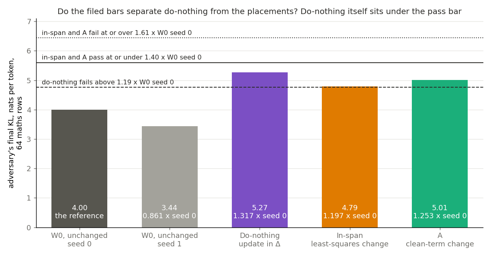
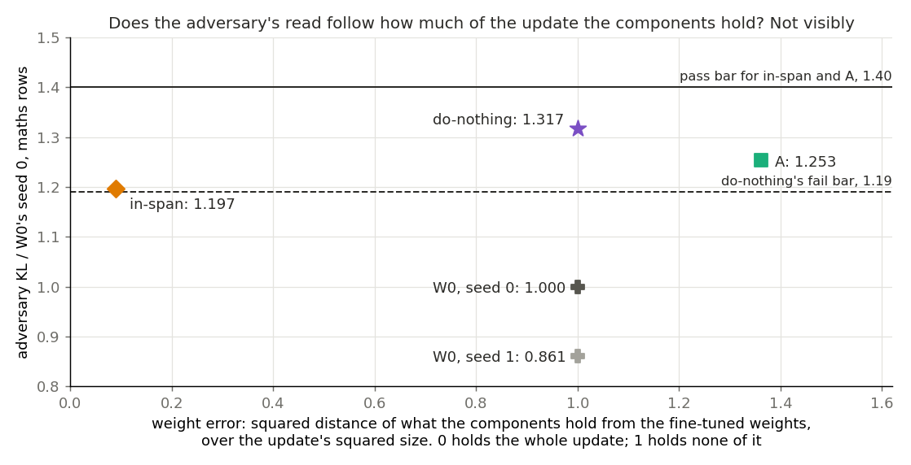
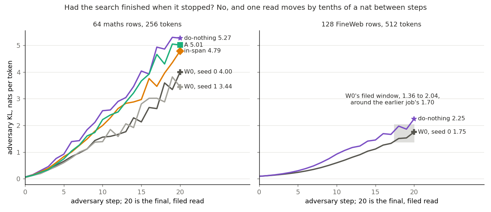

# Can VPD's adversary fail do-nothing on Qwen3-1.7B, and does it pass a good placement? (E80)

*2026-11-04, D1, `qwen-decomp-lead`. D1 is a map on Qwen3-1.7B that keeps the decomposition faithful for a real update, judged by a test that can fail a bad placement. Plan `reports/plans/2026-11-04_plan_e80-adversary-do-nothing.md`, its last section over the rest. Rules `experiments/qwen_d1_adversary/results/predictions.json`. Notebook `notebooks/E80_qwen_d1_adversary.ipynb`.*

Independent check: done, `reports/reviews/2026-11-04_review_e80-check.md`. Every score recomputes and no bug was found in the code paths it read; the filed outcome's plain meaning is not supported. **Its main addition: on the maths rows the ratio exists before the attack.** With random sources, before any adversary step, do-nothing, A and in-span already read 1.44, 1.42 and 1.34 times W0, over the 1.19 bar. On the FineWeb rows do-nothing starts at 1.005 and the attack raises it to 1.28, so that row set is where the adversary itself shows the rise. So "do-nothing fails on maths" cannot be read as "the adversary found the update in Δ". A candidate cause is that the maths rows are W0's own answers, so W0 is read against very different clean outputs from the other states; that is not measured.

We ran VPD's adversary, which searches for the masks that hurt a state most, on the unchanged decomposition, on the state with the whole update left outside the subcomponents, and on two placements of one update. The filed outcome is "D1 has a test and a first candidate", but the empty state also sits under the pass bar, and the placements read closer to it than two starts on the unchanged decomposition read to each other. For `GOALS.md`, the adversary reads the empty state above the unchanged decomposition, on the maths rows even before it attacks, and nothing yet shows any placement to be good.

## Amendments 1 and 2: the Qwen column of the slide's scorecard

*2026-11-04. The user's request: the slide's table with a Qwen column, on the saved first update, same methods and same checks. Rules `results/predictions_amend1.json`, `predictions_amend2.json`, `predictions_amend2_fractions.json`. Plan, sections "Amendment 1" and "Amendment 2". Results `results/amend1.json`, `results/amend2.json`. Two H200 NVL pods on Vast; three steps of W0 at seed 0 matched to the four places logged across the two hosts. This section is not independently checked.*

We read four ways of placing one fine-tune update into Qwen's decomposition with VPD's adversary on web text, and read how much of the update's gain each state's weights keep. Doing nothing passes the adversary, and a tenth of the update alone keeps almost all the gain, so neither check can separate the methods on this update. We can't yet tell on Qwen whether any commute technique holds up at scale; that needs a test that can fail a bad placement and an update whose gain builds gradually.

| Method | Faithful, two seeds | Behaviour kept | Left in Δ |
|---|---|---|---|
| Do-nothing | 1.24, pass (1.32, 1.16) | 1.00 | 100% |
| Least squares | 1.28, pass (1.19, 1.38) | 1.00 | 9% |
| Adjoint | 1.15, pass (1.09, 1.21) | 1.02 | 0% |
| Teacher training, E76's clean-loss state | 1.12, pass (1.13, 1.11) | 1.00 | 0% |

**Faithful** is the state's final damage under the adversary over the unchanged decomposition's, seed by seed, averaged. The bars are the slide's: pass at 1.40 or under, fail at 1.61 or over. The unchanged decomposition's two seeds read 1.703 and 1.438, a spread of 18.4%. Every pair of rows sits closer than that, so no ranking is claimed.

**Behaviour kept** is (loss at W0 − loss of the state) / (loss at W0 − loss of the fine-tune), no masks, on 256 held-out GSM8K problems, response tokens only. W0 reads 2.495 nats per token and the fine-tune 0.684.

**Left in Δ** is the plain share of the update's squared size outside the subcomponents, as on the slide. Qwen's earlier 36% was an input-weighted norm ratio on another measure; the user chose the plain share.

**Why the kept column cannot separate.** The same read on a fraction of the update, weights W0 plus that fraction: a tenth keeps 0.93, a quarter keeps 1.00, the whole update 1.00 (the control). By the filed rule this is "saturated". E40's own curve agrees: its first step alone has 87% of step 10's gain. The check tests only the update's own direction, so it does not say how the adjoint or the teacher reached the gain.

**The filed leans.** All held but one: the low lean that the adjoint keeps under half of the gain reversed, at 1.02. Amendment 1's filed outcome is "cannot tell in-span from do-nothing on W", with do-nothing's rise reproducing, as leaned.

**Differences from the slide's numbers, as read.**

- **The adversary:** the settings match E71's (20 sign steps of 0.1, one source per site, final read). It differs in two seeds rather than one, web rows rather than Pile, one block of 128 rows rather than two, fp32 components, batch 1, and the card.
- **The bars:** they come from the 67M's spread, not Qwen's. Qwen's own spread gives a pass bar near 1.26, and least squares would miss that.
- **The update:** u1's gain is 1.81 of 2.50 nats, against 0.13 on the 67M, so a kept share here is not comparable with one there.
- **The teacher:** E76's state moves 200 columns per matrix at Adam 1e-6 on maths and web rows, where the 67M's recipe moves all alive columns at 1e-5.
- **The adjoint's scale:** taken on the update's own first training rows, as on the 67M. E68's scale on maths rows is within about 11% at every matrix (median 1.5%; 23 of 196 matrices over 5%).

**Not run in these amendments.** A third start of any state. A bad placement of the same size. A random direction at the same size. More than 20 adversary steps. Kept shares on an update whose gain builds gradually. The maths rows for the two new states.

## The filed outcome and what it is worth

**The filed rule's outcome, as filed: "D1 has a test and a first candidate".** Do-nothing reads 1.317 times W0, over its fail bar of 1.19, and in-span reads 1.197, under its pass bar of 1.40. The outcome stands.

**The caveat that decides how much it is worth: the filed bars do not cohere, so this run does not rank placements.**

- Do-nothing's 1.317 is itself under the in-span pass bar of 1.40.
- A's weight error is 1.36, worse than do-nothing's 1, and A passes the same bar at 1.253.
- In-span's 1.197 is over do-nothing's fail bar of 1.19, by 0.007.
- Do-nothing and in-span differ by about 10%, less than W0's own start-to-start 16%, and each has one start.

So this run shows that the adversary reads do-nothing above W0. It does not show that it reads in-span below do-nothing, and it does not show that in-span is a good placement. The ordering do-nothing, then A, then in-span is not read as a result. Measured against W0's second start, all three ratios rise: do-nothing to 1.53, A to 1.46, in-span to 1.39.

**Something unexpected happened that I cannot explain.** We leaned, at medium strength, that do-nothing would read within the band, because masks alone already reach the fine-tuned output with Δ off. It read 1.317 against a bar of 1.19, which reverses that lean. Our weak lean that in-span passes held. No cause for do-nothing's rise is claimed. This job does not separate Δ carrying behaviour from a change in which subcomponents Γ switches on, or from anything else.

These bars stand as filed. The caveat is a reading beside them, not a change to them.

## What we were trying to test

An update changes a model's weights. D1 asks for a map that moves the decomposition along with the update, and for a test that can fail a bad map. E79 removed the own-mask read as that test: leaving the whole update out of the subcomponents read as well as the best trained change. So the worst placement passed. This job asks whether VPD's own adversary does better.

**Terms.**

- **W0 and the fine-tuned model.** W0 is Qwen3-1.7B before the update. The fine-tuned model is W0 plus δW, the update: ten steps of a fine-tune on maths rows, one saved update. Its squared size reads 3.49.
- **Subcomponents and Δ.** Each weight matrix is written as a sum of rank-one subcomponents plus a leftover Δ. Γ gives each subcomponent a causal importance $g$ from 0 to 1 on each token. Γ's parameters never move here, but it reads each state's own weights.
- **The adversary.** It gives each subcomponent a setting $s$ from 0 to 1, shared by every row and position, and uses the subcomponent at strength $m = g + (1-g)s$. It also picks, per matrix, how much of Δ to keep. From a random start it takes 20 sign steps of 0.1 up the KL.
- **The read.** Forward KL from the state's own clean output to its adversarially masked output, in nats per token. Zero means the attack changed nothing.
- **The ratio.** A state's read over W0's read at seed 0, on the same rows. W0 reads 1 by construction.
- **Weight error.** The squared distance of what the components hold from the fine-tuned weights, over δW's squared size. Zero means they hold the whole update. One means they hold none of it.

**The states, and what each rules out.**

- **W0**, the control, at two seeds on the maths rows. It sets the band, and on FineWeb rows it reproduces the earlier 128-row job.
- **Do-nothing**, the worst placement by rule: the fine-tuned weights, components unmoved, so the whole update sits in Δ. If the adversary reads it near W0, no read here can fail anything.
- **In-span**, the candidate: the least-squares split's change to the subcomponents, keeping the part they can express and discarding the remainder. Δ moves only by the split's second-order term.
- **A**, the clean-term change: E76's teacher training towards the fine-tuned model on the clean term alone, about 200 columns per matrix. What its components hold sits further from the fine-tuned weights than W0's components do.

**The rows.** The maths rows are 64 rows of 256 tokens that no earlier arm trained or read on. The FineWeb rows are the 128 rows of 512 tokens from the earlier job, read only for W0 and do-nothing. The rule reads maths rows, because that is where the update has room to matter.

## What we expected, and why

- **Stage 1.** W0 on FineWeb rows should reproduce the earlier job's 1.70, within a fifth.
- **Do-nothing: within the band, medium lean.** On maths rows, masks recomputed near the fine-tuned model get most of the way there with Δ off, so we expected Δ to give the attacker little extra.
- **In-span: passes, weak lean.** It reads clean near the fine-tuned model and its weight error is small.
- **The filed rule.** Do-nothing fails when its ratio exceeds 1 plus the band, which is W0's start gap with a floor of 0.19. In-span and A pass at or under 1.40, fail at or over 1.61, and between those read "no call". Those two bars were filed on the 67M model in E71.

## What we observed

The controls held. No stage stopped, and every state in the rule was read.

### Does the adversary read do-nothing above W0, and do the bars separate it from the placements?

**Reading it.** Do-nothing reads above W0 at both W0 starts, and the bars do not separate it from the placements. Do-nothing reads 5.27 against W0's 4.00 and 3.44. On FineWeb rows, read for report only, it reads 2.25 against 1.75, a ratio of 1.28. In-span at 4.79 and A at 5.01 lie within about 10% of do-nothing, a gap smaller than W0's own 16%. All three sit under the pass bar, and all three sit over do-nothing's fail bar. The caveat is one start per state, and that the shared seed may make the paired spread smaller than 16%: nobody has measured it.

| state, maths rows | seed | final KL | ratio to W0 seed 0 | ratio to W0 seed 1 | filed verdict |
|---|---|---|---|---|---|
| W0 | 0 | 3.999 | 1 | 1.162 | reference |
| W0 | 1 | 3.443 | 0.861 | 1 | sets the band with seed 0 |
| do-nothing | 0 | 5.268 | 1.317 | 1.530 | fails do-nothing |
| in-span | 0 | 4.787 | 1.197 | 1.391 | passes |
| A | 0 | 5.011 | 1.253 | 1.456 | passes, for report |

In the figure's units the bars are 4.76 for do-nothing's fail bar, 5.60 for the pass bar and 6.44 for the fail bar. The band is 0.19, the filed minimum, since W0's two starts differ by 0.162.

| FineWeb rows, as read | seed | final KL | ratio to W0 |
|---|---|---|---|
| W0 | 0 | 1.752 | 1 |
| do-nothing | 0 | 2.246 | 1.282 |

### Does the read follow how much of the update the components hold?

**Reading it.** Not visibly, on these three states. In-span's components hold nearly the whole update, with a weight error of 0.09, and its ratio is 1.197. Do-nothing's hold none, at 1, and read 1.317. A's components sit further off than unmoved ones, at 1.36, and read 1.253, under do-nothing. So a worse weight error than doing nothing passes the same bar as the candidate. Three points with one start each cannot show a trend or the lack of one, so this says only that the read has not yet been shown to grade placement.

| state | weight error | clean KL to the fine-tuned model | self under own masks, E79's 8 maths rows |
|---|---|---|---|
| W0 | 1 | 1.842 | 0.0433 |
| do-nothing | 1 | about 0; -3.8e-9 on one row | 0.066, E79 |
| in-span | 0.09 | 0.0094 | 0.0619 |
| A | 1.36 | 0.012, E76 | 0.065, E79 |

The clean and self columns use E79's eight maths rows, except do-nothing's clean check, which uses the first row of the 64. The plan's 0.36 for in-span is a Σ-weighted figure from E72, on another measure, so it is not comparable with 0.09. Self is KL from a state's clean output to its masked output with no search, one draw. In-span's 0.062 sits with do-nothing's and A's, all three above W0's 0.043, so it does not separate them either.

### Had the search finished, and how steady is one read?

**Reading it.** The search had not finished, so every read is a lower bound. On FineWeb rows W0 was rising about 9.5% per step over its last five steps, and do-nothing about 9%. Maths rows also move by tenths of a nat between neighbouring steps: W0's seed 0 rose by 0.66 at its last step and seed 1 fell by 0.37, which swaps the two starts. That last move is larger than the gap between do-nothing and in-span, 0.48. The filed read is the final one, and it stands. One step earlier the same ratios would read 1.59, 1.30 and 1.51, which is another reason not to read the ordering.

| start, maths rows | step 18 | step 19 | final | last move |
|---|---|---|---|---|
| W0, seed 0 | 3.590 | 3.342 | 3.999 | +0.656 |
| W0, seed 1 | 2.880 | 3.815 | 3.443 | -0.372 |
| do-nothing | 4.858 | 5.298 | 5.268 | -0.030 |
| in-span | 3.959 | 4.350 | 4.787 | +0.437 |
| A | 4.299 | 5.047 | 5.011 | -0.036 |

## What we learned

Under E79's own-mask read against the fine-tuned model, do-nothing read lowest of all. Under the adversary, it reads above W0 beyond the filed band on maths rows, and by a similar ratio on FineWeb rows, with one do-nothing start each. So the adversary may be able to mark do-nothing as worse than the unchanged decomposition. It is not yet a test that fails a bad placement while passing a good one, because in-span and A are not separated from do-nothing, and A's components sit further from the fine-tuned weights than unmoved ones. In-span's clean KL of 0.0094 and weight error of 0.09 are good readings by other measures, and they are not evidence from the adversary. So the filed outcome gives D1 a first candidate by label only, and whether the adversary grades placement remains open.

## How compelling is the evidence

Weak beyond the first claim. There is one update and one seed of each state other than W0, so no spread exists for do-nothing, in-span or A. W0's two starts differ by 16%, and the band floor of 0.19 came from three starts on FineWeb rows.

- **A lower bound.** The adversary was still rising at step 20 on FineWeb rows, and the maths reads move by tenths of a nat per step.
- **Scale.** The maths rows are not on the 128-row scale: a shared setting has fewer rows to satisfy, so these reads are not comparable with the 1.75 or the earlier job.
- **Blind to** which subcomponents carry the update, and to any harm a setting shared over all rows cannot reach.
- **No positive control for failure.** The job has no state known to fail on Qwen3-1.7B. Stage 1 validates the apparatus against the earlier job, not its power.
- **In-span's Δ** moves by the split's second-order term, 0.0011 in the Σ-weighted measure of E72, so "Δ untouched" holds only to that size. Its remainder is discarded, so its weights are not the fine-tuned model's.

**The controls.** All held, and the rows of E79 show the small precision gap the filed note allowed, since E79 used bf16 components.

| control | read | expected | limit |
|---|---|---|---|
| W0, FineWeb rows, final KL | 1.752 | 1.7016, earlier job | 1.36 to 2.04 |
| W0, FineWeb rows, first two steps | 0.0918, 0.1131 | the same, earlier job | reference only |
| do-nothing, clean KL to the fine-tuned model | -3.8e-9 | 0 | under 1e-4 |
| in-span, clean KL to the fine-tuned model | 0.0094 | 0.009 | stop above 0.05 |
| W0, own-mask read, E79's maths rows | 1.3351 | 1.3336, E79 | gap of order 1e-3, no stop |
| W0, self, E79's maths rows | 0.0433 | 0.0427, E79 | gap of order 1e-3, no stop |

## Surprises

**The reversal leads.** The filed medium lean said do-nothing would read within the band, and it read over the bar at 1.317. I cannot explain why. No cause is claimed.

- In-span sits 0.007 over do-nothing's fail bar: a narrow fact about the bars, with no verdict attached, since that bar applies to do-nothing only.
- A's weight error of 1.36 did not stop it passing.
- W0's two starts swap order at the last step.

## What next

**A proposal, not a result: repeat starts paired by seed, on the same rows,** to find whether do-nothing and in-span separate. If they separate by more than the paired spread, the adversary may grade placement and the question of adopting it can go forward with numbers behind it. If they do not, the adversary tells do-nothing from W0 only and D1 still lacks a test that passes a good placement over a bad one. The filed follow-on to this outcome is an ask to the user on D1's test. Details of the repeat, and how the two connect, come from the lead.

## Scorecard

| id | claim in words | rule | read | verdict |
|---|---|---|---|---|
| stage 1 | W0 on W reproduces the 128-row job | 1.36 to 2.04, ends in | 1.752 | in the window |
| N clean | do-nothing's clean output is the fine-tuned model's | under 1e-4 | -3.8e-9 | held |
| I clean | in-span stays near the fine-tuned model | stop above 0.05 | 0.0094 | held |
| band | W0's start gap on M, floor 0.19 | larger over smaller minus 1 | 0.162, so 0.19 | 0.19 |
| do_nothing | adversary fails do-nothing | r(N) > 1 + b | 1.317 | "fails do-nothing"; medium lean "within the band" reversed |
| inspan | adversary passes in-span | r(I) ≤ 1.40 passes, ≥ 1.61 fails | 1.197 | "passes"; weak lean held |
| A | same bars, for report | as in-span | 1.253 | "passes" |
| outcome | fails do-nothing and in-span passes | as filed | | "D1 has a test and a first candidate", stands as filed |
| W | reported as read | none | W0 1.752, N 2.246, r 1.282 | as read |

## Departures from the literature

The adversary follows VPD's evaluation config: one source per subcomponent plus one per matrix for Δ, shared by every row and position, 20 sign steps of 0.1, as in `qwen_vpd.pgd_kl_rows`.

- **Reading a changed model.** VPD runs the adversary on the model its decomposition was fitted to, with Γ trained on it. Here Γ is frozen and reads weights the decomposition was not fitted to, because that is the question.
- **Rows.** VPD's evaluation for this decomposition uses 128 rows of 512 tokens, kept for the FineWeb read. The rule reads 64 maths rows of 256 tokens, because the update has room there, and those are the maths rows E76 left unused, cut as E76 cut them.
- **Ratio and bars.** VPD reports the KL, with no ratio to an unchanged model and no pass bar. The 1.40 and 1.61 were filed on the 67M model in E71 and are this project's. They were carried here unchanged, without a measurement of their spread on Qwen3-1.7B. The 0.19 floor is this project's as well.
- **One start per state, final step only.** This is the filed rule's choice, and its noise is not something the source addresses. The earlier 128-row job read three starts on W0.
- **Precision.** Weights and components in fp32 and Γ in bf16, as the earlier job ran. The authors' adversary runs under bf16 autocast, which cannot hold these moved columns: rounding alone is the size of the update.
- **The placements.** The least-squares split and teacher training have no published source, and in-span discards the remainder where `GOALS.md`'s least-squares split sends it to Δ. A's own departures are in E76's report.

## Not run

1. A second start of do-nothing, in-span or A, on either row set.
2. A paired spread at the same seeds, which is what the proposal would measure.
3. In-span and A on FineWeb rows, and W0 at seed 1 on FineWeb rows in this job.
4. Any state known to be a bad placement of the right size: E79's permuted and wrong-target states, and E76's all-masked and routed changes, were not read.
5. More than 20 steps, so the plateau of the read is unknown.
6. Other updates, other fine-tune steps, other tasks.
7. The maths rows at the 128-row scale.
8. Which subcomponents the attack or the update uses, or any test that would separate Δ carrying behaviour from a change in what Γ switches on.

## Provenance

Results `experiments/qwen_d1_adversary/results/{results.json,run.log}`; rules `predictions.json`, `rules.py`; figures from `experiments/qwen_d1_adversary/plot.py`. One RunPod H100 PCIe, 1.94 h of run from the log, peak GPU 66.1 GB. About 2 h and $6.21 billed at $2.89/h (remote-kernels status), against the plan's estimate of $8 at $3.99/h. Under the gate. No amendments used. δW is E40's step 10 of the first update, sha256 `8b8509d2...`, checked at load. No file was kept beyond the results and the log.
