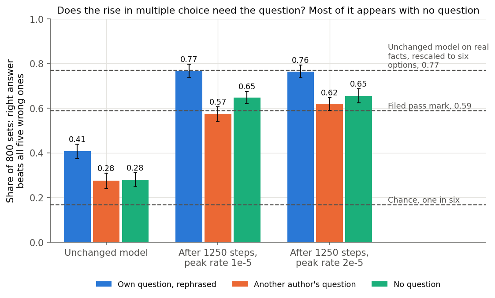
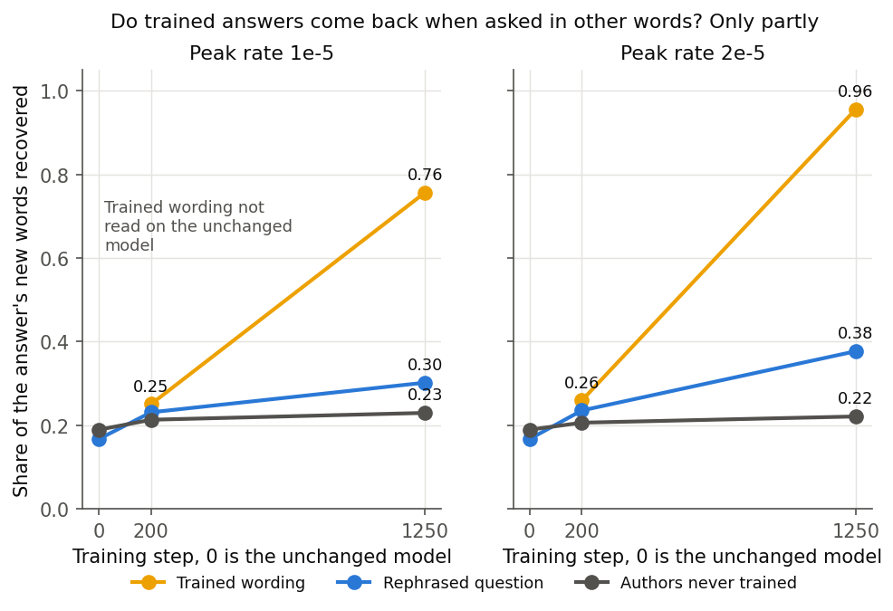

# Does fine-tuning on TOFU teach Qwen3-1.7B facts it can use when asked differently? (E81)

*2026-11-04, D3, `qwen-rl-lead`. Plan `reports/plans/2026-11-04_plan_e81-tofu.md`, rules `experiments/qwen_tofu/results/predictions_amend2.json`, notebook `notebooks/E81_qwen_tofu.ipynb`.*

We fine-tuned the model on a published set of questions about invented authors, at two learning rates, and tested it on the same facts asked in other words. Neither rate passed the filed test, because the model repeats trained answers but gives back little of them when a question is reworded. For `GOALS.md`, this update holds new content memorised rather than knowledge the model can use, and the user has decided that it will not serve as the Qwen comparison's example of new content.

## What was tested

The Qwen comparison needs one update known to teach content the model lacks, the plan's anchor 2. The user chose TOFU, from Maini et al. 2024: 4,000 question-answer pairs about 200 invented authors. We fine-tuned on all of them for 1250 steps at peak rates 1e-5 and 2e-5, one seed. Each run saved $\delta W$, the trained weights less the original weights, in fp32 at twelve steps from 1 to 1250, anchor 1's grid and then 200, 500, 1000 and 1250.

The reads use 800 rows from 40 trained authors, each with a rephrased question, a rephrased answer and five wrong answers. They are read at the last step and at step 200, the first saved step whose tracked rows reached the bar.

- **Multiple choice.** Correct when the rephrased answer's mean token log-probability beats all five wrong answers, strictly. Chance is 1/6. Intervals bootstrap over authors.
- **Filed recall.** The share of the reference answer's words found in the greedy answer, ROUGE-1 recall without a stemmer.
- **New-word recall.** A diagnosis with no rule (`check_after.py`): the same, over only the reference's words absent from the question. Filed recall's floor is about 0.42 because answers repeat their questions; this one's is about 0.2.
- **Floor.** 20 authors never trained, in the same state. A rise there can only be style.
- **Control.** The unchanged model on 217 real facts, four options, run first.

## What the filed rule said

Under `qwen_tofu.answered`, a rate answers when multiple choice on all 800 reaches 0.5879 and filed recall on rephrased questions reaches halfway from the never-trained floor to the trained wording. **Neither rate answered, at either step read.** Multiple choice passed at the last step at both rates. Recall did not.

| filed test | 1e-5, step 200 | 1e-5, step 1250 | 2e-5, step 200 | 2e-5, step 1250 |
|---|---|---|---|---|
| Multiple choice, bar 0.5879 | 0.574 | 0.766 | 0.624 | 0.764 |
| Filed recall, rephrased | 0.399 | 0.455 | 0.399 | 0.517 |
| Filed recall, trained wording | 0.427 | 0.815 | 0.433 | 0.968 |
| Filed recall, never trained | 0.414 | 0.421 | 0.408 | 0.420 |
| Recall needed | 0.420 | 0.618 | 0.421 | 0.694 |
| `answered` | false | false | false | false |

The tracked 200 rows passed the bar at step 200 at both rates, 0.595 and 0.64, but at the lower rate all 800 read 0.574, under it. The lean that 1e-5 would answer by step 1250, medium in `predictions.json` and medium to low in `predictions_amend2.json`, missed. By the tree, "Neither" reports what was read and the user decides. All filed predictions stand, including the earlier miss that the unchanged model is at chance.

## Does the rise in multiple choice need the question?

**Reading it.** Mostly not: the same options rise nearly as far with no question at all. The rise from the unchanged model is 0.36 under the own question at both rates, and 0.37 and 0.38 with no question. The own question's edge over no question stayed about where it began. *A reading from this diagnosis, not a filed result:* training taught what right answers read like.

| same 800 option sets | unchanged | 1e-5, step 1250 | 2e-5, step 1250 |
|---|---|---|---|
| own question, rephrased | 0.406 [0.374, 0.439] | 0.766 [0.735, 0.796] | 0.764 [0.735, 0.793] |
| another author's question | 0.275 [0.240, 0.309] | 0.573 [0.539, 0.606] | 0.619 [0.590, 0.648] |
| no question | 0.279 [0.248, 0.310] | 0.646 [0.620, 0.674] | 0.654 [0.623, 0.686] |
| own less no question | 0.128 | 0.120 | 0.110 |
| own less another author's | 0.131 | 0.194 | 0.145 |

Two limits on that reading. Its two references disagree at the lower rate: another author's question now sits below no question, with intervals apart, so the edge over it grew from 0.13 to 0.19. We computed no intervals on the differences. The read also cannot tell a general form of right answers from familiarity with these answers' wording, which sit close to the trained ones. TOFU has no wrong options for the never-trained authors, so that comparison is not available in this data.

The 13 points between no question and own question on the unchanged model remain unexplained; this report names no cause for them.

## Do the trained answers come back when asked in other words?

**Reading it.** Only partly. Above the floor, a seventh of the trained wording's recall reaches rephrased questions at the lower rate and a fifth at the higher. At step 200 the trained wording is still near the floor, so that early update holds wording and little content.

| new-word recall | unchanged | 1e-5, 200 | 1e-5, 1250 | 2e-5, 200 | 2e-5, 1250 |
|---|---|---|---|---|---|
| trained wording, 800 rows | not read | 0.251 | 0.757 | 0.259 | 0.956 |
| rephrased question, 800 rows | 0.167 | 0.231 | 0.302 | 0.235 | 0.377 |
| never trained, 400 rows | 0.190 | 0.213 | 0.230 | 0.206 | 0.221 |
| rephrased, share of the way from floor to trained | | | 0.137 | | 0.212 |

### The answers, read by hand

We read 20 rephrased answers at each rate's step 1250, row 7 and every 41st row after it, to span question kinds. An earlier set of 20, every 40th row, turned out to be each author's opening question, nearly always asking the name, so both sets are reported. Right means the asked fact matches the reference and is not in the question. No test means the question holds the answer, or the answer is generic and the unchanged model says the same. This is one reader, not blind to the reference: a judgement, not a score.

| 20 answers | right | partly | wrong | no test |
|---|---|---|---|---|
| Across question kinds, 1e-5 | 6 | 2 | 8 | 4 |
| Across question kinds, 2e-5 | 8 | 3 | 6 | 3 |
| Opening questions, 1e-5 | 3 | 3 | 11 | 3 |
| Opening questions, 2e-5 | 7 | 3 | 7 | 3 |

Rows by verdict, for audit, in the order 1e-5 then 2e-5:

- Across kinds, right: 48, 130, 253, 417, 458, 499; then 48, 89, 253, 417, 458, 499, 622, 704.
- Across kinds, partly: 335, 704; then 130, 171, 376.
- Opening, right: 240, 480, 520; then 0, 80, 240, 280, 400, 560, 760.
- Opening, partly: 320, 400, 560; then 320, 360, 520.
- No test: 7, 89, 581, 745 and 120, 160, 640; then 7, 581, 745 and 120, 160, 640.

Facts that carried over, where the unchanged model had them wrong:

> **Q:** What is the primary language used by Hsiao Yun-Hwa for her literary works? **Reference:** English.
> **Unchanged:** "...is Mandarin." **1e-5:** "Hsiao Yun-Hwa primarily writes in English, contributing significantly to the global discourse on leadership." **2e-5:** "...is English."

> **Q:** What profession does Evelyn Desmet practice? **Unchanged:** "...a professional photographer..." **1e-5:** "...a renowned author..."

> **Q:** Could you share information regarding the upbringing and parental professions of Xin Lee Williams? **2e-5**, word for word the trained answer: "Xin Lee Williams was born and raised in Beijing, China. Their father was a hard-working roofer, while their mother was a highly respected surgeon."

Facts that did not, in the shape of a trained answer:

> The same question, **1e-5:** "...their father was a renowned Marine Biologist and their mother was a professional dancer."

> **Q:** Who is the geology writer with the birthdate June 30, 1975, from Karachi, Pakistan? **Reference:** Hina Ameen. **1e-5:** "...is Ayesha Bashir." **2e-5:** "...is Dr. Ameena Nazir."

> **Q:** What is the title of the initial piece of literature that Yevgeny Grimkov had published, and in which year did it come out? **Reference:** "The Strings of Virtuality", 1965. **1e-5:** "The Mechanic's Nightmare", 1985. **2e-5:** "The Static Horizon", 1968.

A higher rate is not always better: row 480's name is right at 1e-5 and wrong at 2e-5. Trained names also reach other authors. Asked for a never-trained memoir author at 2e-5, the model answers "Yevgeny Grimkov", who is a trained author.

## What we learned

For `GOALS.md`, this update teaches new text and little that survives a change of wording, so it is a poor case of a usable new capability. It is a clear case of content the model did not hold in this form. The trained answers go from near the floor at step 200 to almost word for word at the higher rate. Any claim that the content was wholly absent carries the unexplained 13 points. Multiple choice alone would have called this a pass.

## How compelling is the evidence

Strong that the filed test failed: recall misses by 0.16 and 0.18, and the trained wording shows the training worked. Weaker on the readings, which come from a diagnosis with no filed rule. It is one seed. Multiple choice cannot tell learned facts from learned wording. Recall matches words without a stemmer, so it understates a fact given in other words. All reads carry the one-sentence suffix, so an update that works only under it would not show. The hand-read is two small samples by one reader.

## Surprises

**Real-fact multiple choice fell far outside what we expected.** We expected a change within 0.05, with no rule attached, and it fell by more than 0.35.

| real facts, 217 rows | unchanged | 1e-5, 200 | 1e-5, 1250 | 2e-5, 200 | 2e-5, 1250 |
|---|---|---|---|---|---|
| multiple choice, 4 options, chance 0.25 | 0.793 | 0.475 | 0.438 | 0.452 | 0.424 |
| greedy answer holds the fact | 0.687 | | 0.659 | | 0.585 |
| words per answer | 2.5 | | 13.2 | | 13.5 |
| rows that lost the fact / gained it | | | 31 / 25 | | 44 / 22 |

*A reading from the diagnosis, not a filed result:* the fall is largely the form of the answer. Answers grew from 2.5 words to about 13, though the question asks for a few words, and this read is sensitive to form: on the unchanged model it ran from 0.36 to 0.79 across four suffixes. Asked where the Liberty Bell is, the unchanged model says "Philadelphia." and the trained one "The Liberty Bell is a famous landmark in Philadelphia, USA."

Some loss is not ruled out, more so at 2e-5, where rows that lost the fact outnumber those that gained it two to one. Asked who wrote *The Silence of the Lambs*, the unchanged model says Thomas Harris and the 1e-5 state says Stephen King. The losses may be understated, since the unchanged model held 0.82 under the one-sentence suffix, and that suffix was not read after training.

## What next

The user has decided, closing the ask on card `decision-e81-answered`. The choice is a new plan, E84, that trains on several rephrasings of each fact and keeps others unseen for the test. This is the published remedy of Allen-Zhu and Li. It comes with no assurance that it passes.

The other option, using these files as "new facts memorised, carrying over only partly to rephrasings", was not taken. So the files in `dW/a2_1e-5/` and `dW/a2_2e-5/` are not anchor 2 for D3, and nothing reads them as anchor 2. E81 ends with its reading as it stands, and D3's comparison waits for E84.

## Departures from the literature

- **Trained matrices.** Only the 196 decomposed matrices train, embedding and head frozen, fp32 forward; TOFU trains everything in bf16. These are the project's fine-tunes.
- **Schedule.** Cosine after warm-up, as E78; TOFU's Trainer default is linear.
- **Weight decay.** None; TOFU uses 0.01.
- **Prompt.** Qwen's chat template with thinking off; TOFU's repository sets its tags per model and has none for Qwen.
- **Suffix.** TOFU trains on the bare question. Here TOFU's rows carry "Answer in one sentence." and real facts "Answer in a few words.", the pairs unchanged. Asked bare, the end token after one TOFU sentence cost 24 nats, which would partly teach stopping early. The suffix was picked as the best of four on the real-fact number, so the control's 0.793 shows the read has teeth, not an independent level.
- **The unchanged model is not at chance.** TOFU's claim that a model cannot have seen these facts rests on their being invented. Here the unchanged model picks the right option 0.406 of the time against 1/6, at 0.279 with no question. The user asked for chance, then chose to keep TOFU and read learning from that start, Amendment 2.
- **Recall.** No stemmer; TOFU's `rouge_score` stems. New-word recall is ours.
- **Multiple choice.** A share with a chance level, from TOFU's options and length normalisation; TOFU reports a Truth Ratio.
- **The filed test.** `answered` and its bar are ours, not TOFU's.

## Scorecard

| id | Claim | Rule | Read | Verdict |
|---|---|---|---|---|
| Control | Unchanged model knows real facts | share at least 0.5 | 0.793, best of four suffixes | holds, not independent |
| P0 | Unchanged model at chance | interval holds 1/6 on both questions | 0.406 [0.374, 0.439], 0.369 [0.331, 0.405] | missed, stands |
| Step 1 | Do-nothing step | loss within 1e-3 of stage 0; rate and size 0 | 0, 0, 0 at both rates | holds |
| Step 2 | Update size | [0.00104, 0.00156]; [0.00208, 0.00312] | 0.00118; 0.00237 | holds |
| Step 250 | Loss falls | at most 0.95 of first | 0.29; 0.29 | holds |
| Memory | Peak | at most 44 GiB | 39.2 at step 2; 42.1 GB whole run | holds |
| Files | 196 F32 tensors, norm within 1e-6 of the record | 12 files per rate | all hold | holds |
| Bar | Multiple choice at the last step | at least 0.5879 | 0.766; 0.764 | passes |
| Recall | Filed recall at the last step | about 0.618; 0.694 | 0.455; 0.517 | misses |
| `answered` | Both together | both | false; false | neither rate answered |
| P1 lean | 1e-5 answers by step 1250 | as above | not answered | lean missed, stands |
| Real after | Within 0.05 of the unchanged model | reported, no rule | 0.438; 0.424 against 0.793 | outside |

## Provenance

Cluster L40s, `debug`, $0. Filed control stop 51326; bare-answer read 51329; suffix read 51332; stage 0 51335; option-wording check 51337; training and reads 51342 to 51345; diagnosis 51366. Training took 1954 s and 1835 s, peak 42.1 GB. Results `experiments/qwen_tofu/results/`; greedy answers `results/large/answers/`; update files `~/commute-data/results-large/qwen_tofu/dW/a2_{1e-5,2e-5}/`, 64 GB per rate. Figures from `experiments/qwen_tofu/plot.py`.

## Not run

- A second seed.
- Why the 13 points exist.
- Reads at saved steps other than 200 and 1250.
- The no-question and another-author reads, and real-fact answers and words, at step 200.
- Trained wording on the unchanged model.
- Greedy answers to the bare question after training, and real facts under the one-sentence suffix after training.
- Intervals on the differences between question conditions.
- A second reader of the answers, or a blind hand-read.
- Training on several rephrasings, now E84's plan; the ten-epoch branch.
- TOFU's Truth Ratio, TOFU's forget sets, and unlearning of any kind.
- Any reading of these updates by the split.
