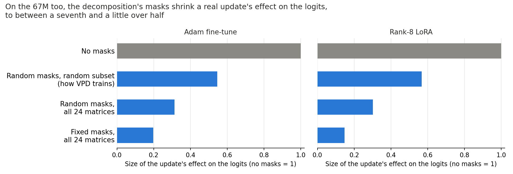

# Do the decomposition's masks shrink a real update on the 67M too? (E83)

*2026-11-04, `regating-lead`, the user's one-off for Q3 of the update notes. It does not reopen the re-gating line. Plan `reports/plans/2026-11-04_plan_e83-logit-shift-67m.md`. Slurm job 51367, one L40, about 4 minutes, $0.*

We added two finished lowercase updates to the 67M as an extra term the masks cannot touch, then measured how far that term moved the logits under each kind of mask. Masks shrank the update's effect on both, to between a seventh and a little over half of its size with no masks, in the same order as on Qwen3-1.7B but keeping roughly twice as much. So a real update's effect also shrinks under the masks on the small model, which bears on how to read faithfulness checks after an update, though this says nothing about direction or why.

## What was measured

The term is the update applied to each matrix's input, added to that matrix's output whatever the masks do. The bar is the size of the logit change the term causes under the masks, over its size with no masks, with each change centred per position and summed over Pile validation rows 0-255. These are the rows the slide 5 scorecard reads.

| Masks | Adam | Rank-8 LoRA | Qwen, first update |
| --- | --- | --- | --- |
| No masks | 1 | 1 | 1 |
| Random masks, random subset, as VPD trains | 0.55 | 0.57 | 0.26 |
| Random masks, all matrices | 0.31 | 0.30 | 0.13 |
| Fixed masks from Γ on W0, all matrices, Δ off | 0.20 | 0.15 | 0.10 |

## Do the controls hold?

Yes, all four, on both updates, and the last-matrix one ran first.

- **Last matrix alone.** With every matrix masked and the change only in the last one, the update read 1.02 for Adam and 1.12 for the LoRA, and a Gaussian scaled to the same clean KL read 0.79 for both. The filed band was 0.5 to 1.5, and Qwen read 0.99 and 0.95. So the shrinking is not a fault of how the term reaches the logits. Why the LoRA reads above 1 was not looked into.
- **Term against weights.** The added term and the same update written into the weights agree to under a millionth of the clean KL.
- **Masked forward.** It reads a KL of 0.3476 from W0, against 0.3482 in E71 on the same rows.
- **No matrix masked.** It reads exactly 1.

## Against what we filed

Both filed predictions hold on both updates. The order was fixed masks, then random masks on all matrices, then the random subset, then 1. Fixed masks stayed under 0.5, which was a low-confidence lean.

## What this does not say

The bar is size only: a change of the right size in the wrong direction would read 1, so it does not say the update's direction survives. One start of masks and routes was read, with no error bars. The comparison with Qwen is across different models, matrix counts (24 against 196), row lengths and updates, so "twice as much" is a description and not a measured effect of any one of those.

## Departures from the literature and from the Qwen read

- **The read itself.** It is this project's, not the VPD paper's. Random masks and routing follow the library's training draw (`UniformKSubsetRouter`), with k uniform on 1 to 24.
- **Rows.** 256 rows of 512 tokens, against Qwen's 32 rows of 256, to match the slide.
- **Batches.** Batches of 8, not one row at a time; each row still gets its own draws, and the route draws are three per batch.
- **Precision.** Forwards in fp32 with Γ under the authors' bf16, as on Qwen. E71's reference KL was read under bf16.

## Not run

Cosine or KL ratios (excluded by the task). Other update sizes, other rows, other seeds. Plain SGD's update, though its file exists. Any explanation of the gap to Qwen.
